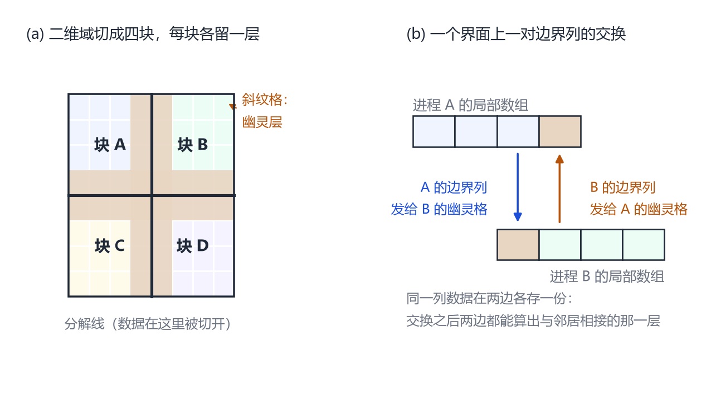
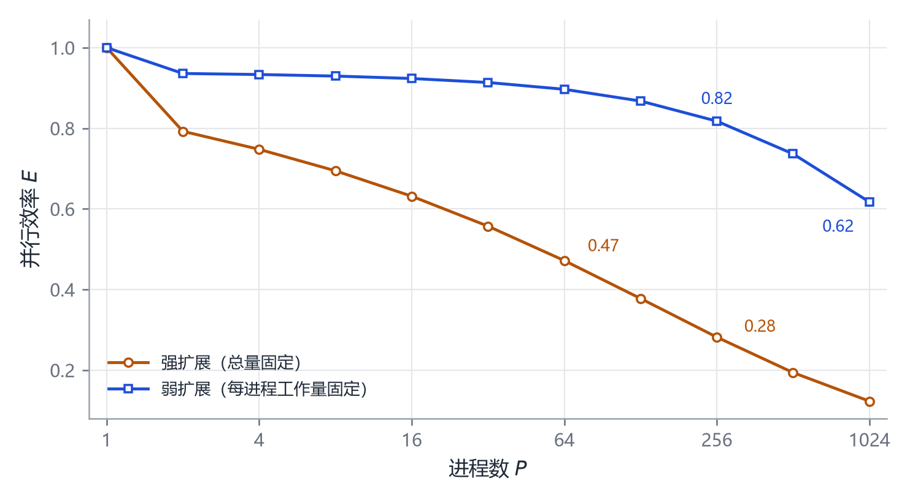

# 第 10 章 集群与分布式模拟

一个两米见方的水箱，想做毫米级的流体。分辨率 2000 的立方，就是八十亿个格子。每个格子放三个速度分量、一个压力、一个体积分数，单精度二十字节，一百六十 GB。刚把数组声明出来，机器就退出了。

换成粒子：八亿个粒子，每个四十八字节（位置、速度、质量、体积、材料编号），三十八 GB。一张二十四 GB 的卡装不下，两张勉强，但单个粒子要访问的邻居全在另一张卡上，跨卡的那条链路会成为瓶颈。

再退一步，把精度降到厘米。每边从 2000 格降到 200 格，八百万个格子，每格二十字节就是一百六十 MB，一张卡跑得很轻松。可你要的是一毫米，因为表面张力产生的那些小气泡只在这个尺度上存在。

这就是分布式模拟的起点：不是“我们有一千台机器所以要用一千台”，而是单机的内存和算力到顶了，而问题的规模还在往上涨。这一章讲拆开之后多出来的那些事——边界上的数据怎么换、谁等谁、怎么分才公平、加速比为什么上不去、机器坏了怎么办、账单长什么样。

## 10.1 一台机器装不下

先把“装不下”分清楚，它有三种，应对方式完全不同。

第一种是内存装不下。上面那个水箱属于这类。出路只有两条：降精度，或者加机器。降精度会丢掉你要的物理，所以只剩加机器，而加机器意味着数据被切开，切开的边界上要有数据交换。

第二种是算不完。内存够，但一步要算的时间超过预算。这在离线渲染里很常见：一帧四十分钟，一百帧就是三天，加机器是唯一办法。这类问题往往拆起来最舒服，因为像素之间基本独立。

第三种是装得下也算得动，但你要跑几千个变体。参数扫描、强化学习的环境池、不确定性量化都属于这类。它不需要拆一个大问题，需要的是把几千个小问题并排放。这种结构可以做到零通信，效率接近百分之百，和真正意义上的区域分解是两码事——[@makoviychuk2021] 把上万个刚体场景塞进一张 GPU 就是这个路子，每个环境是一个独立的小世界，环境之间的隔离换来了几乎线性的吞吐。

真正难的是第一类和第二类里“数据有邻接关系”的那部分。切开之后，交界面两侧的格子互相需要对方的值，谁先算都不对，必须停下来换一次数据。换数据要时间，这段时间里算子空转。分布式模拟的全部工程，本质上是在处理这笔额外的账。

## 10.2 区域分解与幽灵层

最直接的分法是块分解：把三维区域切成若干长方体，每块交给一个进程。

每块在自己的内存里还要多留一层或几层。这层格子的值不是自己算的，是从邻居那里拷过来的，叫幽灵层或晕层。幽灵层的宽度等于模板的半径：二阶中心差分只用相邻一格，宽度 1；四阶紧致格式宽度 2；WENO 这类重构要更宽，因为它的模板本身就伸出去好几格。

幽灵层带来的额外功是可以算出来的。把 $N$ 个格子的立方体切成 $P$ 块，每块边长 $N/P^{1/3}$，内部格子数与表面格子数之比是

$$
\frac{N_{\text{halo}}}{N_{\text{vol}}} = \frac{6\,w}{(N/P^{1/3})}
$$

$w$ 是幽灵层宽度，分子上的 6 是三对相对的面。这个比值随进程数按 $P^{1/3}$ 增长，这就是区域分解效率下降的几何根源，和代码写得好不好无关。

代入一组数。$N = 512$，共 $1.34\times10^{8}$ 个格子，$P = 64$，每块 $128^{3}$，$w = 1$，比值 4.7%。同样的总量分给 512 个进程，每块 $64^{3}$，比值升到 9.4%；分给 4096 个进程，每块 $32^{3}$，比值 18.8%。进程数翻八倍，相对交换量翻一倍。这是纯几何的结论，任何优化都改不了，只能改变它前面的系数。

这也是为什么块要尽量接近立方体。同样切成 $P$ 块，沿一个方向切成长条，每块要换两个 $N^{2}$ 的面；切成 $P^{1/3}$ 见方的立方体，每块换六个 $(N/P^{1/3})^{2}$ 的面。$N = 512$、$P = 64$ 时，前者 52 万格，后者 9.8 万格，差五倍多。切得越扁，边界越大，还使数据在网络上走得更远，这是很多人第一次做分解时踩的坑——按数组下标一维切最省事，也最亏。

还有一个约束容易被忽略：分解必须和算法匹配。多重网格的粗层只剩几个格子，分不开，只能让每个进程都算一份完整粗层（冗余计算），或者把粗层收到一个进程上（其余进程空等）。前者的成本是“粗层规模乘以进程数”，后者是“粗层时间乘以进程数”。粗层通常很小，冗余计算一般更划算。

粒子系统的分解方式不同。粒子会动，块的边界对粒子没有意义，所以按空间块分，块里的粒子数每步都在变；每步之前要重新统计、重新分配，这套流程就是负载均衡那一节的内容。流体用网格，固体用粒子，混合方法（MPM）两边都要，还要在网格块与粒子块之间维持一致的划分，这是它实现起来最麻烦的地方。

图 10-1 画的是二维的简化情形：四块、一层幽灵层、四条交换通道。

<figure class="fig">

<figcaption><b>图 10-1</b>　区域分解与幽灵层（示意图）。(a) 域切成四块，分解线两侧的斜纹格各存一份：左块的边界列是右块的幽灵层，反之亦然。(b) 放大一个界面：A 的边界列发给 B 的幽灵格，B 的边界列发给 A 的幽灵格，交换之后两边都算得出与邻居相接的那一层。二维示意，三维时每块有六个方向的邻居。</figcaption>
</figure>

## 10.3 通信与计算重叠

最朴素的写法是：先把幽灵层换完，再算整块。这样每一步的时间是通信时间加计算时间，串着来。

改成重叠，思路是把块里的格子分成“依赖幽灵层的”和“不依赖的”两类。内部格子只用自己的数据，可以先算；边界那几圈要等邻居。于是时间线变成：发起非阻塞发送与接收，转头算内部，算完检查接收是否完成，再算边界。理想情况下通信被完全藏进计算里，总时间取两者较大值而不是相加。

能不能藏住，取决于通信时间与内部计算时间的比例。用 10.2 的数：$128^{3}$ 的块，六个面加起来要换 $6\times128^{2}\approx9.8\times10^{4}$ 个格子；一个分量四字节就是 400 KB，速度三个分量加一个压力就是 1.5 MB 上下；内部格子 $2\times10^{6}$ 个，每个几十次浮点运算。在一张现代 GPU 上，后者是几百微秒量级，前者走片内互联是几十微秒量级，比例有戏。但这是在同一台机器的 NVLink 或 PCIe 上换的前提下；跨机器走网络，同样 1.5 MB 的传输时间会长一个量级，重叠就藏不住了。

工程上有几个具体手段。把六个面的消息打包成一条，减少消息条数——小消息的成本几乎全在延迟上，每条几十微秒的启动开销乘以六，比数据本身还贵。把邻居映射到同一台交换机下，让跳数最少。用 GPUDirect RDMA 让网卡直接读写显存，省掉“显存到主机内存再到网卡”的两跳拷贝，这一项常常能省掉一半的通信时间。

还有一个更彻底的选择：不用幽灵层，用重复计算。如果模板很窄、邻居的数据可以用很便宜的方式重算出来，那就算两遍，把通信换成本地计算。这在格子着色、粒子邻域这类问题上有先例——多算一点，少换一次，往往划算。判断标准还是那三件事：访存、并行度、同步。通信就是一种跨节点的访存，能用本地访存替代就替代。

## 10.4 负载均衡

几何均分假设每个格子的计算量相同。这个假设经常不成立。

水只占了箱子底部三分之一，上面三分之二的格子是空的，但空格子也要判断、也要参与压力求解；沙堆的接触集中在底部几层；燃烧只在火焰面上发生；碰撞只出现在物体互相接触的地方。结果是分到空区域的那块很快算完，然后干等；分到密集区域的那块算到超时，其他人都等它。

静态均衡按几何划分，实现简单，对均匀问题够用。动态均衡要每步或每若干步统计每块的实际成本，重新划分。统计本身有成本：要计时、要汇总（这又是一次全局归约）、要迁移数据。

重划分的算法通常借空间填充曲线。把三维区域按 Morton 序（Z 序）或 Hilbert 序排成一条线，这条线有个好性质——空间上相邻的块在线上也相邻。然后在这条线上按累计成本切成 $P$ 段，每段给一个进程。切开的位置由前缀和决定，前缀和可以用并行扫描算，成本是线性的。相比“按坐标切”，曲线切法能处理任意形状的密集区，代价是每个进程拿到的区域不再是一块长方体，幽灵层的邻居数从 6 个变成几十个。

迁移的成本要算。把一块数据从进程 A 搬到进程 B，走的是网络，搬完还要重建幽灵层。如果每步都重划分，迁移开销会吃掉均衡的收益。实践中的折中是三条：只在成本失衡超过阈值（比如最慢比最快慢 30%）时才重划分；加滞后，避免在两个划分之间来回抖；限制每步迁移的比例。

粒子系统有一个便宜得多的办法。粒子本来就要每帧按空间排序（为了邻域查询的局部性），排序用的键就是 Morton 码；排完序之后按累计粒子数切段，顺手就均衡了。排序的成本已经付过，均衡几乎是免费的。这也是为什么基于粒子的方法在分布式上比基于网格的方法更容易做好——它每一步都在重排，天然适应变化。

过度分解是另一个思路。把域切成 $kP$ 块，$k$ 取 4 到 8，块数远多于进程数，进程算完自己那块就去拿下一块（工作窃取）。这种做法对不均匀问题的鲁棒性好，代价是每个块的幽灵层都要维护，通信的邻居变多，且块越小，表面体积比越差。$k$ 的选取就是在均衡能力与通信开销之间找平衡。

## 10.5 强扩展与弱扩展

两个词要分清，它们衡量的是不同的问题。

强扩展固定问题规模，增加进程数，看时间怎么降。定义效率

$$
E_{\text{strong}}(P) = \frac{T(1)}{P \cdot T(P)}
$$

$T(1)$ 是单进程时间，$T(P)$ 是 $P$ 个进程的时间，分母是“如果完美并行”应该花的时间。理想值是 1，实际总是往下掉。

弱扩展固定每个进程的工作量，问题规模随进程数一起涨，看时间是否保持不变。定义

$$
E_{\text{weak}}(P) = \frac{T(1)}{T(P)}
$$

这里 $T(1)$ 是单进程做“一份”工作的时间，$T(P)$ 是 $P$ 个进程各做一份的时间。理想情况下这个比值恒为 1，因为每个进程干的活没变。

两者的区别在物理上很直白。强扩展里，进程越多，每块越小，表面体积比越差（10.2 节那个比值按 $P^{1/3}$ 涨），通信占比上升，效率必掉。弱扩展里，每块的尺寸不变，表面体积比不变，通信量按进程数线性增长而计算量也线性增长，所以理论上效率能守住；掉下来的部分来自更细的原因——全局归约的延迟按 $\log P$ 涨、共享的存储与网络带宽被更多进程分、负载不均被放大。

图 10-2 用一组显式写出的模型算这两条曲线。强扩展的模型是

$$
T_{\text{strong}}(P) = \frac{100}{P} + 20\,P^{-2/3} + 0.5
$$

第一项是计算，按进程数反比下降；第二项是幽灵层交换，按表面体积比下降，所以慢；第三项是每次交换的固定延迟。弱扩展的模型是

$$
T_{\text{weak}}(P) = 100 + 6 + 0.6\,P^{1/3} + \frac{100\,P}{2048}
$$

第一项是每个进程固定的计算量，第二项是固定的交换量，第三项是跳数增加带来的延迟，第四项模拟共享带宽被摊薄——进程越多，每个进程能分到的有效带宽越少。

<figure class="fig">

<figcaption><b>图 10-2</b>　强扩展与弱扩展的效率曲线（按模型计算，非实测）。横轴为进程数（对数），纵轴为并行效率。强扩展取固定总工作量，模型 $T = 100/P + 20P^{-2/3} + 0.5$（毫秒，其中 $100$ 为单进程计算时间，$20$ 为交换项系数，$0.5$ 为固定延迟）；弱扩展取每进程工作量固定，模型 $T = 100 + 6 + 0.6P^{1/3} + 100P/2048$。曲线形状只反映各项的相对权重，具体数值不代表任何真实系统。</figcaption>
</figure>

读这两条线的方法比记数字重要。强扩展曲线在 16 个进程时还有六成效率，到 256 个只剩两成八——继续加机器，多花的钱几乎全用在交换上。弱扩展曲线平得多，256 个进程还有八成，1024 个掉到六成二，掉的原因不是几何，而是共享资源。这告诉你优化的方向不同：强扩展场景要优化通信，弱扩展场景要控制每个进程的资源占用。

一个极端情形值得单独说。如果你的问题是“几千个互不通信的小场景”，弱扩展的效率可以接近 1，因为交换项和第二项都是零，瓶颈只剩显存容量与调度开销。[@makoviychuk2021] 的做法就是这样：把环境分批塞进 GPU，环境之间的隔离让并行几乎是免费的。反过来说，[@todorov2012] 那类面向单个复杂系统的引擎，走的是完全相反的路——一个模型、一个求解器、追求单次求解的速度与鲁棒性，扩展性靠的是更大更快的单卡，而不是拆到很多卡上。

## 10.6 检查点与容错

几千张卡的集群，每天都在坏东西。按单卡年故障率百分之几算，一千张卡一天就有一两次故障；一次作业跑二十小时，被打断是常态而不是意外。

检查点是把整个分布式状态写到持久存储：每个进程的状态、幽灵层（其实可以重建）、时间步号、随机数种子、求解器的热启动量。写完之后继续算，坏了从最近的检查点重启。

间隔怎么定有个经典答案。设写一次检查点要 $\delta$ 秒，系统的平均无故障时间是 MTBF，最优间隔是

$$
\tau = \sqrt{2\,\delta\cdot \text{MTBF}}
$$

$\delta$ 是秒，MTBF 是秒，$\tau$ 也是秒。这个式子来自一个平衡：写得太勤，开销占比 $\delta/\tau$ 上升；写得太疏，一次故障平均要重算 $\tau/2$。

代入：$\delta = 60$ 秒，MTBF 取一天（86400 秒），$\tau \approx 3220$ 秒，约 54 分钟，开销占比 1.9%。如果写检查点要 300 秒（几个 TB 的状态写出去），$\tau$ 变成 7200 秒，占用升到 4.2%，而平均重算损失 1 小时。这时候异步检查点就有价值了：把状态拷到另一块内存或另一台机器，由它慢慢往存储写，主计算立刻继续。代价是内存占用翻倍，因为那份快照在写完之前不能改。

全量写太贵的时候可以只写变化的部分。大多数模拟里，状态的大部分在一步之内是不动的——静止的物体、远离扰动的区域。增量检查点记录“自上一个检查点以来哪些块变了”，恢复时先用上一个完整检查点，再依次应用增量。代价是恢复时间变长，因为要回放一串增量；收益是每次写的量小一个数量级，$\tau$ 可以设得更短。

真正麻烦的是静默错误。内存位翻转被 ECC 挡住一部分，网络传输的位错误被校验和挡住一部分，剩下漏网的会在几十小时后表现为“结果有点不对”。对策是定期做全局校验：把关键不变量（总质量、总动量、能量）算一遍，与历史值比对；差距超过阈值就回滚到上一个检查点重算。这比崩溃更难处理，因为没有任何信号告诉你从哪一步开始错的。

## 10.7 云上的账

云上的成本和集群上的成本不是一个算法。

自建集群的账是折旧加电费，跑满跑不满都得付，所以“闲着”不花钱也不会省钱。云上是按小时租，闲着就是真花钱。于是决策从“怎么最快算完”变成“每单位有效算力多少钱”。

这个指标叫每结果成本，等于总花费除以有效工作量。总花费是单价乘以卡数乘以时间，有效工作量是单卡工作量乘以卡数再乘以效率。两边一除，卡数消掉了：

$$
\text{每结果成本} \propto \frac{1}{E(P)}
$$

效率掉到一半，每个结果的价格就翻倍，尽管你付的还是每卡每小时那个价。10.5 节的强扩展模型在 64 个进程处给出 0.47 的效率，意味着这时候每份有效算力的价格是单卡的两倍多。租 64 张卡的效果，约等于租 30 张卡满效率跑。

这条换算改变了很多决策。假设你的作业用 8 张卡要跑 100 小时，用 64 张卡要跑 15 小时——后者便宜还是贵？总卡时前者 800，后者 960，后者贵两成。加速比只有 6.7，而卡数翻了 8 倍，效率 0.83 看起来还行，但账面上是亏的。反过来说，如果交期值钱（明天要出图），多花两成换 85 小时是划算的。这就是为什么云上的调度既要算钱也要算交期。

还有几笔容易漏的账。出网流量按 GB 计费，把一百 TB 的模拟结果拉到本地，可能比算它还贵；正确的做法是在云上做后处理，只把图和汇总数据带出来。存储也分层：热数据放高性能盘，检查点放对象存储，后者便宜一个数量级但延迟高，恢复时要留出读回的时间。抢占式实例便宜一半以上，但随时可能被回收，检查点间隔要按“几分钟”而不是“一小时”设，这时候 10.6 那个公式里的 MTBF 要换成实际被回收的平均间隔，算出来的 $\tau$ 会小很多。

最小的一条经验：小作业不要上分布式。通信、排队、启动、调试，这四样在小规模上全是固定成本，加机器加不出收益。等到单机真的算不动了再拆，拆的时候先问一句“效率能到多少”，答案是零点几的时候，先把单机优化一遍往往更便宜。
