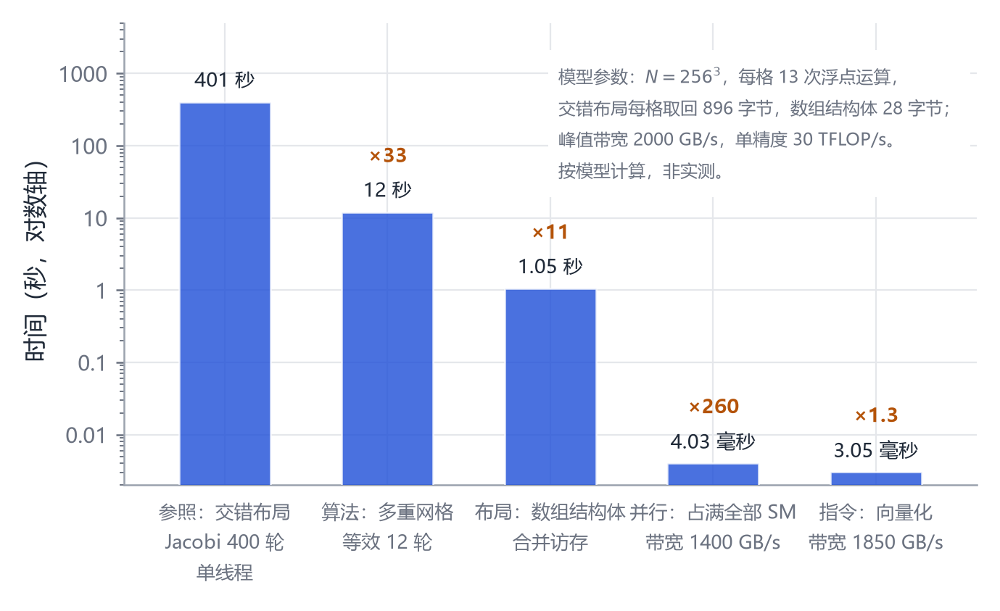

# 第 11 章 性能分析、优化与可移植性

> 本章导读：一个内核在两台机器上差三倍，未必是显卡的差别；改一行循环顺序快了四成，也未必是编译器突然变聪明。这一章把"感觉慢"变成可以核对的数字：怎么计时，看哪几个计数器，怎么用 roofline 判断自己在带宽一侧还是算力一侧，以及为什么优化的顺序只能是算法、布局、并行、指令。最后是精度选择的代价、后端抽象的三种做法，和一张能贴在显示器边上的检查表。

## 11.1 同一个内核，两台机器

一位同事把一套 SPH 求解器从工作站搬到笔记本上做演示，帧率掉了一半多。查参数：工作站的卡峰值带宽约 900 GB/s，笔记本的约 450 GB/s，正好一半。带宽减半、时间翻倍，故事到这里很圆满。

先把几个后面一直要用的词说清楚。内核（kernel，在 GPU 上由成千上万个线程同时执行的一小段函数，"算一次受力""做一次邻域求和"通常就是一个内核）；带宽（bandwidth，每秒能从显存搬进计算单元的字节数，可以想成水管的口径，它只说管子多粗，不说里面有多少水想流）；帧（frame，渲染或仿真的一轮，也是留给全部工作的时间片）。

给一组假设的数字感受量级。假设某卡峰值带宽 900 GB/s，一帧 16 ms 内能搬 $900\times10^{9}\times0.016\approx14.4$ GB。一个八百万粒子的系统，每粒子每步读写 96 字节，一步的总流量是 $8\times10^{6}\times96\approx0.77$ GB，按带宽算只要 0.85 ms。也就是说，预算里真正稀缺的是字节数，不是运算次数。

同一周他又报告另一件事：在同一张卡上，把粒子的位置和速度从一个交错的大数组拆成两个数组，同一个内核快了 38%。带宽没变，算法没变，只改了数据怎么摆。

两件事放在一起说明：性能不是代码的属性。同一段代码配上不同的数据形状、跑到不同的机器上，时间可以差几倍，而解释这个差别的量既不在源码里，也不在规格表里，而在三个比值上——这段代码搬了多少字节，用到了多少并行，等了多少次同步。想优化，就得先把这三个量出来。凭感觉改代码，通常只是把瓶颈从一个位置挪到另一个位置，然后误以为成功了。

还有一层容易被忽略：差三倍的原因常常不在任何一行代码里，而在"这段代码被叫了几次"。同一个邻域内核，一帧调一次和调八次，代码一模一样，时间差八倍。所以动手之前先做一件事：把一帧里的内核按总时间排序。经验上前三个常占七成以上，动剩下的几十个小内核，天花板就是那三成。

测量的三层分工要清楚。墙钟时间回答"变了没有"，硬件计数器回答"为什么"，采样时间线回答"花在哪"。三样都要：只测总时间，改完只知道变没变、不知道为什么；只看采样，会因为采样器每一毫秒才取一个样，完全看不见那个真正贵的 200 微秒内核。

一个反例值得记住。有人为了"减少内核数量"，把六个小内核并成一个，里面按粒子类型分支。内核数从六降到一，启动开销省了几微秒；但一个 warp（线程束，GPU 按 32 个线程一组发射指令，组内线程走同一条指令流）里混了不同类型的粒子，分支发散让每条指令都要跑两遍，总时间反而涨了。省下的那一项，往往不是贵的那一项。

## 11.2 让计时说真话

把计时做对，比想象中难。GPU 的执行是异步的：CPU 上的启动调用把命令塞进队列就返回，如果在调用前后各取一次时钟，量到的是"入队花了多久"，通常几微秒，和内核真正跑了多久没关系。要么在内核之后插一个同步点，要么在流里打两个事件时间戳。后者更准，因为时间戳由 GPU 自己写，不受 CPU 抖动影响；但它量的仍然是"这条流上从这到那"的时长，如果内核和拷贝在不同流上重叠着跑，两段数字加起来会超过总时间。

把这两句展开。流（stream，一条按顺序执行的命令队列，不同流之间可以并行）里的命令是排队执行的，CPU 只负责往里塞。在流里打两个事件（event，GPU 自己写下的时间戳），取两者之差，就是这段时间在 GPU 上的长度。给个数字：假设事件分辨率 0.5 微秒，测一个 200 微秒的内核，误差 0.25%；用 CPU 时钟去包一次异步启动，只量到 5 微秒，连真实时长的百分之三都不到。

第二件是热身。第一次跑和第一百次跑不是一个内核：着色器还没编译，显存页表刚建立，时钟在爬升，缓存是冷的。用只跑一遍的计时去比较两个实现，量到的可能是初始化开销的差别。惯例是空跑十几次，再连续测几十次取分布。

第三件是频率不是常数。GPU 有功耗墙和温度墙：一个 20 微秒的内核单独跑，时钟能冲到最高；同一个内核连跑两百遍，十几毫秒之后就开始降频。这让"单独测内核"和"整帧测"得出不同的结论，而且单独测总是更好看。判断方法很朴素：连续跑两分钟，看时间是否缓慢上升。

第四件是统计量。均值在这里几乎没有意义，因为计时分布是右偏的：大部分帧很快，少数帧因为调度、缺页、别的进程抢带宽而变慢。实时应用要看尾部：p95、p99，"每一百帧里有一帧超过多少毫秒"。均值 8 毫秒、p99 40 毫秒的实现，用户感受到的是卡顿，不是 8 毫秒。

把"尾部"说具体：录一千帧，按耗时排序，第 950 个是 p95，第 990 个是 p99。假设一组数：均值 8 ms、p95 11 ms、p99 40 ms。三句话都真，但体验由 40 ms 决定，因为一秒钟里会出现好几帧 40 ms，主观上就是一顿一顿。VR 更苛刻，90 Hz 的预算只有 11.1 ms，超一帧要重投影，超得多就黑一下，均值再漂亮也没用。

第五件是粒度。启动一个内核有几微秒的固定开销，给一个 20 微秒的内核直接计时，误差就有 25%。做法是把它放进循环跑一百次再除以一百，同时明白这个数字已经摊掉了启动开销，也部分预热了缓存，所以偏乐观。

最后是"测整帧还是测单个内核"。整帧有代表性：缓存状态、内存压力、与其他阶段的交错都是真的，但它无法归因，你只知道这一帧 12 毫秒，不知道谁的 4 毫秒。单内核可归因，但它把缓存预热好了。两个都测：先把某个阶段临时换成空内核看总时间掉多少，再用单内核把它拆开。

一个真实场景收尾。某次调优把物理从 4.1 ms 降到 2.4 ms，均值很好看，可戴上头显仍偶尔一顿。查 p99 发现每三十帧有一帧 9 ms，周期正好对上资源流式加载。把那一帧的同步拷贝改成异步之后，p99 掉到 3.1 ms，均值几乎没动。也就是说，改均值可能什么都没改，改尾部才改体验。

## 11.3 计数器：看硬件在等什么

时间告诉你哪里慢，计数器告诉你为什么慢。剖析器能给出上百个计数器，但有四组足以定位绝大多数问题。

剖析器（profiler，记录每个内核耗时、并能读出硬件计数器的工具）有两种工作方式。采样（sampling）每隔固定时间问一次"现在哪些 warp 在干什么"，开销小，得到统计分布，适合回答"花在哪"。计数器采集（instrumentation）让内核重跑若干遍，每遍只统计一组计数器，能精确到指令，但要重跑、且缓存状态已经变了。也就是说，先用采样定位，再用计数器解释。

第一组是 DRAM 吞吐占峰值的比例。这个数高于七成，内核基本是带宽受限，继续调计算收益很小，该做的是少搬字节或提高复用。

第二组是计算单元的忙碌比例。它和上一组一起看：两个都高，各方面都顶到了；两个都低，内核在等内存、等同步、等调度。

第三组是占用率，而且要看实际达成值而不是按寄存器数算出的理论上限。占用率被寄存器数、共享内存、每块线程数三者中更紧的那个卡住：一个用 64 个寄存器、每块 256 线程的内核，每个 SM 只能驻留少数几块，实际占用率可能只有三成。低占用率本身不是罪，问题是它是否让访存延迟无法被掩盖：一次全局访存要等几百个周期，需要足够多的独立 warp 才盖得住。

第四组是停顿原因。剖析器把每个 warp 没发出指令的周期归到几类：等全局内存、等共享内存或 bank 冲突、栅栏同步、以及"没有被选中"，即 warp 就绪但发射端口被别的 warp 占着。这个分布直接指出下一步该动哪里：等内存占大头，去改访存模式、加预取；栅栏占大头，去减少同步点、把大块拆成小块；"没有被选中"占大头，说明并行已经过多。

实际看的时候有个固定顺序。第一步看整帧时间线（timeline）找空洞：空洞意味着 GPU 在等，等 CPU 提交、等同步、等一次没藏住的拷贝，这类问题在任何计数器里都看不到。第二步按总时间排内核表，取前三个，低于 5% 的暂时不看。第三步对选中的内核看上面四组计数器，定它在带宽侧还是算力侧。第四步到源码行计数器，看哪条访存指令贡献了最多 sector。第五步才看汇编，确认有没有寄存器溢出。

剖析本身会改变被剖析的东西。采集计数器要让内核重跑，第一遍冷缓存、第二遍热缓存，数字不一样；有些工具默认关掉其他流、降低分辨率，于是"干净的 4 ms"在真实帧里是 6 ms。判断方法很简单：报告里的总时间要和墙钟对得上，差得远就说明剖析条件不对。

还有一个数容易忽略：每个请求触及的 sector 数。一个 warp 的 32 个线程各读一个相邻的 4 字节浮点数，理想情况合并成 4 个 32 字节的 sector；如果这 32 个地址散在一百多个 sector 里，同样的计算要搬二十几倍字节，而吞吐百分比可能显示得很低，因为散乱访问发出的都是小事务。这解释了为什么改布局比调并行更管用。

再补一个陷阱：块的数目。网格切成块以后，如果块数不是"SM 数乘以每 SM 驻留块数"的整数倍，最后一波只有少数块在跑，其余 SM 空转。108 个 SM、每 SM 驻留 8 块共 864 个槽位，切出 900 个块，第二波只有 36 个块在跑，这一波的开销却按整波算。

## 11.4 roofline 与工作点

要判断一个内核在带宽一侧还是算力一侧，最省事的工具是 roofline。把算术强度定义成一次运行里做的浮点运算数除以从内存搬来的字节数：

$$
I=\frac{F}{B},
$$

$F$ 是浮点运算次数，$B$ 是必须从 DRAM 取回的字节数。机器有两个常数，峰值算力 $P_{\max}$ 与峰值带宽 $B_{\max}$，于是性能的上界是

$$
P\le\min\left(P_{\max},\;B_{\max}\cdot I\right).
$$

两条线的交点 $I^{\ast}=P_{\max}/B_{\max}$ 叫脊点：算术强度低于它，性能跟着带宽走；高于它，性能跟着算力走。图 11-1 按 $B_{\max}=2000$ GB/s、$P_{\max}=30$ TFLOP/s 单精度画出，脊点在 15 FLOP/字节。

<figure class="fig">

<figcaption><b>图 11-1</b>　roofline 与物理内核的工作点（示意图）。屋顶按 $B_{\max}=2000$ GB/s、$P_{\max}=30$ TFLOP/s 单精度画出，脊点在 15 FLOP/字节。四个点是按各自访存量与运算量估出的算术强度与性能量级，只用于说明它们都落在脊点左侧很远的地方，不是任何设备的实测值。</figcaption>
</figure>

读这张图有个固定套路，四个问题按顺序问。第一，横轴是对数刻度的算术强度，纵轴是对数刻度的性能，先找脊点，把自己内核的 $I$ 标在横轴上。第二，看自己在脊点左边还是右边：左边那条斜线的斜率就是 $B_{\max}$，右边的水平线就是 $P_{\max}$。第三，从自己的点向上画竖线，碰到屋顶的那点就是这台机器上这个内核的上界，你离它多远就是还有多少余量。第四，如果点在斜线上，唯一的出路是往右移，也就是提高 $I$——融合 pass、提高复用、降精度；单纯优化指令不会让你爬上去。

把自己放上去要算两个数，两个都容易算高。$F$ 只数浮点运算，别把下标计算、地址算术算进去，分支跳过的也不算。$B$ 要数真正从 DRAM 来的字节，不是数组大小：一趟遍历读一遍、写一遍，两次都算；写出这一半最常被忘，忘了会让 $I$ 虚高两倍。也就是说，算 $I$ 时要当会计，不能当宣传员。

用一个具体内核走一遍这两条式子。$I\approx0.46$，代入 $B_{\max}=2000$ GB/s 得 $0.46\times2000\times10^{9}\approx9.2\times10^{11}$ FLOP/s，即 920 GFLOP/s；另一个候选是 $P_{\max}=30$ TFLOP/s。两者取小，说明这个内核连算力侧的边都摸不到。若每格 13 次运算，920 GFLOP/s 相当于每秒 $7.1\times10^{10}$ 格，$256^{3}=1.68\times10^{7}$ 格只要 0.24 ms。假设实测 0.5 ms，就是屋顶的 47%，差两倍通常是访存没合并或者块切得不好；如果实测 1.5 ms，只剩 16%，别调内核了，先看布局和算法。

接着算几个常见内核的 $I$。三维七点差分：每格读自己和六个邻居共 28 字节，做 6 次加、1 次乘、1 次减，约 13 次浮点运算，$I\approx0.46$。SPH 的邻域遍历：每个邻居读 32 字节做约 30 次运算，$I\approx1$。稀疏矩阵乘向量：每行平均 6 个非零元，读 48 字节做 12 次乘加，$I\approx0.25$。三个数都在脊点左边十几倍到几十倍。

这个结果值得停下来看。物理内核几乎全部落在带宽受限区，而且是大幅度地偏左。所以在这个领域里，"优化"大多数时候不是让计算更快，而是让每字节干更多活，或者少搬字节。前者的手段是复用：一次读进的邻居数据被多个量共用，几个 pass 融合成一个，在寄存器或共享内存里分块，让一块数据被反复使用。后者的手段是压缩与稀疏：降到更窄的精度，用稀疏网格，只处理窄带。

roofline 也有盲区。它只算 DRAM 一层，真实工作点通常在屋顶下面一段：做到七成到八成是好的，五成也常见。它不管延迟和同步：一个访存完全合并、算术强度也不低的内核，如果每步都要等一次全局栅栏，实测可能只有屋顶的三成，而 roofline 对此一言不发。它更不管分支发散与负载不均。所以它的正确用法是当上界而不是预测：先算出 $B/B_{\max}$，即"这个内核若只受带宽限制，最快能到多少"，再拿实测去除。

有两个常见误读。一是把峰值算力当上限：物理内核的 $I$ 普遍在 1 附近，离脊点十几倍，那一侧的屋顶根本摸不到。二是拿规格表上的理论带宽当 $B_{\max}$：真实可达通常是理论值的八成到九成，用理论值算出的上界偏乐观，容易把"已经做到 85%"误判成"还有一倍空间"。

如果实测比理论值慢 15%，不值得再花一周，该动的是算法或精度；如果慢 3 倍，说明代码没吃满带宽。这个判断决定了你是改代码还是改方案，而两件事的成本差一个数量级。

## 11.5 优化顺序：算法到指令

四级：算法、布局、并行、指令。写下来像常识，做起来常被违反，因为人总想先动自己最熟的那一层。

四级改的不是同一件事。算法改的是要搬多少字节、要解多少次方程；布局改的是搬来的字节里有多少真被用上；并行改的是由谁来搬；指令改的是搬这个动作本身有多贵。前一层的量级决定后一层的天花板：数据结构选错，布局怎么调都补不回来；布局散着，并行只是让更多线程一起排队等内存。也就是说，每一层都在决定下一层能做到多好。最常见的错误是在交错布局上先做向量化，编译器生成一串 gather，代码长了三成，速度掉了两成。

算法层的收益来自两处，改变渐近项，或者改变常数。前者是换离散、换求解器：用多重网格代替 Jacobi，收敛所需的扫描次数从与网格边长成正比降到近似常数；用更小的邻域核代替更大的核，每个粒子的邻居数掉一个量级。后者是把必须做的工作变少：更少的 pass、更少的临时数组、提前剔除不可能的碰撞对。这里有个反直觉的例子：把时间步长缩小、每步只做一次迭代，听起来是"走更多步"，总功反而可能下降，因为每步不再是那个需要几十次迭代才收敛的隐式系统 [@macklin2019]。这类改动不发生在任何循环里，而发生在"这一帧到底要解几个方程"这一层。

具体动手时，算法层按三个问题问下去。第一，"这一步能不能不解"——能不能沿用上一帧的结果，能不能少解一个场。第二，"能不能少解几轮"——换收敛更快的格式，或把残差阈值放宽到视觉上够用。第三，"能不能少算一部分"——窄带、剔除、让睡着的物体继续睡。第三问最常被忘：一屋子静止的箱子不该每帧都做接触检测。

布局层的天花板可以算出来：如果每次取回 32 字节却只用得上 8 字节，理论上限就是四倍；实际受其他访问干扰，拿到两倍上下是常见结果。交错结构体改成数组结构体是最简单的一例——更新位置只用得到其中两个分量，交错布局却把整条读回来。块状布局让一个线程块处理空间相邻的一片，邻域访问落在同一批缓存行里。这一层的麻烦不在想法，而在改动面。

这一层也可以自己记账核对。一个粒子存位置、速度、密度、压力、类型，交错布局下每粒子 48 字节全读回来；拆成数组结构体以后，受力这一步只要位置 12 字节加类型 4 字节。不过账要按 sector 算：硬件按 32 字节的 sector 记账，一个 warp 的地址连续，16 字节的访问也排得满；地址一散，哪怕每个线程只要 4 字节，也会各自占掉一个 sector。决定浪费的不是"读了多少"，而是"地址连不连"。

并行层不改变字节数，只改变同时搬的人有几个。它的收益上界由两个数里小的那个决定：你能加的并行度，和被并行掩盖的那部分时间占比。一张带宽 2000 GB/s 的卡上，单线程大约只能拿到 15 GB/s，所以理论上限一百多倍；一旦带宽被打满，再加线程只会增加竞争，实测甚至会倒退。这就解释了并行为什么必须排在布局之后：布局没做好时，每一次访存都在浪费带宽，加线程只是让浪费发生得更快、更挤。并行这一层真正要调的是映射与占用率——每块多少线程、块怎么对齐、共享内存用多少、同步点放哪里。

这几个旋钮互相牵制，要一个一个拧。每块线程数取 128、256、512 是常见起点，块内线程要对应空间上连续的一片；每 SM 驻留几块由寄存器和共享内存挤出来，共享内存用多了驻留块数就掉；块数要凑成驻留槽位的整数倍，最后一波才不空转。

指令层是最后一步。融合乘加、向量化访存、快数学函数、去掉分支、减少寄存器溢出，作用都是减少发射的指令数或缩短依赖链。收益一成到五成，且只有前三层做完才看得见：内核在等内存时，减少指令不会让等待变短。

这一层也有便宜可捡。把开方换成倒数平方根的近似指令，误差在千分之一量级，只影响视觉的地方够用；把 `pow(x, 2)` 写成 `x*x`；把乘以常数改成融合乘加。都是一两行的改动，但同样的改动在等内存的内核上收益接近零，这就是它排在最后的原因。

<figure class="fig">

<figcaption><b>图 11-2</b>　按成本模型计算的优化收益（不是实测）。算例为 $256^{3}$ 网格上的七点平滑，每格 13 次浮点运算、7 个邻居各占一条 128 字节缓存行（取回 896 字节），改数组结构体后为 28 字节。参照实现：交错布局、Jacobi 400 轮、单线程，有效带宽 15 GB/s。依次施加：换多重网格（等效 12 轮）、改数组结构体（合并访存）、占满全部 SM（有效带宽取峰值的 70%，即 1400 GB/s）、向量化与融合乘加（有效带宽 1850 GB/s）。时间按"取回字节除以有效带宽"与"浮点运算数除以有效算力"两者取大计算，峰值带宽 2000 GB/s、单精度 30 TFLOP/s。</figcaption>
</figure>

图 11-2 是这个模型的一次演算。参照实现 401 秒，换算法 12.0 秒，改布局 1.05 秒，占满并行 4.0 毫秒，指令优化 3.0 毫秒，四步的倍率分别是 33、11、260、1.3。布局只拿到 11 倍，因为合并访存之后瓶颈换到了算力一侧：每格 13 次运算在单核 2.5 GFLOP/s 下要 5 纳秒，28 字节在 15 GB/s 下只要 2 纳秒，工作点往右移了。这也正是并行紧跟其后的理由，它同时补上算力与带宽。倒过来做就吃亏：把并行提到布局之前，交错布局下满 SM 的有效带宽只有 400 GB/s，同一步的增益从 260 倍掉到二十几倍——后一步的收益被前一步锁着。

## 11.6 精度选择

浮点数的位数分配决定了两件事：能表示多细的差别，和能表示多大的范围。fp64 是 11 位指数加 52 位尾数，fp32 加 23 位，tf32 加 10 位，bf16 加 7 位，fp16 是 5 位加 10 位。换成十进制，fp32 大约 7.2 位有效数字，fp16 约 3.3 位，bf16 只有 2.4 位。fp16 与 bf16 的取舍正好相反：fp16 更准但范围只到正负 65504，bf16 范围同 fp32 但更粗。

比有效位数更好用的是机器精度（machine epsilon，1 与"下一个能表示的数"之间的间隔）。fp32 是 $2^{-23}\approx1.2\times10^{-7}$，fp16 是 $2^{-10}\approx9.8\times10^{-4}$，bf16 是 $2^{-7}\approx7.8\times10^{-3}$，fp64 是 $2^{-52}\approx2.2\times10^{-16}$。用起来是这样：在 fp16 里算 $1+10^{-4}$，结果还是 1，因为 1 附近的刻度间隔是 $9.8\times10^{-4}$，$10^{-4}$ 落在两条刻度之间被舍掉；同一个算式在 fp32 里毫无问题。也就是说，窄精度的问题不是"不够准"，而是"小于某个值的东西直接不存在"。

误差进入物理有三条路。第一条是长求和：SPH 里一个粒子的密度是几百上千个邻居贡献之和，如果累加器是 fp16，加到后面每一项都被舍入到当前量级的最小刻度上，小贡献直接消失。第二条是相近数相减：两个几乎相同的坐标相减求距离，有效位被大量抵消，剩下的位全是噪声。第三条是迭代放大：隐式求解、位置修正这类过程会把每步的舍入误差累积，误差的增长速度取决于条件数。

物理上的后果分两类。数值噪声让表面抖动、能量缓慢漂移，难看但不算错。定性错误更麻烦：穿透判断翻转、接触流形错、拓扑判定失败。这类错误对精度极其敏感，因为它们是比较两个几乎相等的量。算一笔：场景坐标在 100 米处，fp32 的相邻可表示数间隔约 7.6 微米，做毫米级的碰撞判定绰绰有余；同样位置用 fp16，间隔是 6.25 厘米，比大多数碰撞厚度都大，两个物体谁在谁前面都判不出来。bf16 在同一位置的间隔是半米，只能用来存颜色这类量。

fp64 的代价要说清。字节翻倍，带宽受限的内核直接慢一倍；更疼的是某些消费级显卡把双精度吞吐压到单精度的几十分之一（假设按三十二分之一算，具体看型号），一个本来 2 ms 的双精度求解会变成几十毫秒。所以 fp64 的合理位置只有两个：CPU 上的参考解，和确实需要十五位有效数字的少数场合（大场景长时间积分、病态矩阵）。也就是说，"上双精度保险"在 GPU 上是很贵的保险。

收益方面要克制。把存储从 fp32 换成 fp16，字节减半，带宽受限的内核最多快一倍——"最多"有前提：如果内核里有大量 fp32 累加，或者要在两种精度之间来回转换，实际收益会掉到三成。算力上的收益只在张量单元那类专用通路里才明显，逐元素和邻域内核用不上，因为它们的瓶颈本来就在内存。

可用的做法是分层：存储用窄格式，中间计算用 fp32，关键归约用 fp32 或 Kahan 补偿求和，只在数值条件明确的地方降精度。判断一个量能不能降精度，看三条：它是否参与分支判断（穿透、接触、拓扑），它的量纲范围是否跨越很多数量级，它在迭代里是否被放大。三条里有一条成立，就别省那两个字节。

Kahan 求和便宜，值得记一笔。每加一项丢掉的低位单独存进一个补偿量 $c$：先算 $y=x-c$，再算 $t=s+y$，然后 $c=(t-s)-y$，最后 $s=t$。多三次运算，误差从与项数成正比的 $O(n\epsilon)$ 降到 $O(\epsilon)$。SPH 里累加几百个邻居的贡献，靠它就能在单精度上稳住。

验证要跟到底。同一个算例用 fp64 跑一遍做基准，比较轨迹偏离随时间的增长；画守恒量的漂移曲线；把场景放大一千倍再跑，看结果是否等比例——精度不够时，尺度一换结果就变。Isaac Gym 的做法可以当参照：整个仿真状态留在显存里，避免每步在 CPU 与 GPU 之间来回拷贝，端到端保持单精度 [@makoviychuk2021]。省下的是传输，不是有效位。精度是工程决策，省下来的带宽往往能在别处用掉。

## 11.7 后端抽象、DSL 与一张检查表

同一份物理代码要跑在 CUDA、HIP、Metal、WebGPU 和 CPU 上，这是今天的常态。硬写五遍的代价不在第一遍，而在第五遍之后：每次改算法要改五处，每处的偏差都会变成"只有某个平台上一个算例不对"的 bug。

物理内核的形态其实很有限：逐元素、邻域遍历、散射累加、归约、前缀和、稀疏乘。这六种覆盖了绝大多数时间，所以抽象的目标很具体：把数据布局、并行映射、归约与原子这三件事抽出来，其余照旧。

常见三种做法。最轻的是薄封装：一套宏或一层很薄的运行时，把内存分配、内核启动、归约、原子操作包起来，内核体还是各写各的。成本最低，代价是每个内核要在每个后端上分别实现和测试。中间一层是模板化的内核库加代码生成：内核用带布局参数与精度参数的模板写一遍，编译期为每种组合生成特化版本，好处是特化带来的性能，坏处是构建时间与错误信息。最重的是嵌入 DSL：在 Python 里写 kernel，编译器翻译到各个后端，布局与并行由编译器决定，Taichi 是这一类里比较完整的例子，它同时提供自动微分 [@hu2020]。它的开发速度最好，代价是受限于 DSL 能表达的控制流与数据结构——哈希表、指针追逐、动态增长的数组，这些在稀疏碰撞、动态拓扑里天天出现的东西，写起来很难受。

薄封装那一层抽什么，值得写具体。够用的接口只有五样：缓冲（分配、上传、下载）、内核（编译一次、按配置启动）、三种并行原语（归约、前缀和、原子加）、同步（流内、流间）、以及"当前是哪台设备"的查询。写成 C++ 大致是这样：

```cpp
struct Backend {                     // 一个后端就是这五样
  virtual Buffer* alloc (size_t bytes) = 0;
  virtual void    copyIn(Buffer*, const void*, size_t) = 0;
  virtual Kernel* build (const char* src, const char* name) = 0;
  virtual void    launch(Kernel*, Dim grid, Dim block, ...) = 0;
  virtual float   reduceSum(Buffer*, size_t n) = 0;
  virtual void    sync  () = 0;
};
```

内核体各写各的，抽象层只管"数据在哪、怎么发、怎么同步"。这层壳通常是几百行的量级，换来的是上层物理代码一行不改就能换后端。代价是每加一个内核，就要在每个后端上各实现一遍。也就是说，抽象只买"能换"，不买"更快"。

模板生成那条路要防组合爆炸。布局两种、精度四种、向量宽度三种、展开因子三种，乘起来就是 72 个版本，每个都要编译和测试，构建时间可能从一分钟变成二十分钟。做法是只生成会用到的组合，其余交给运行时参数。

选择的标准不是先进与否，而是内核形态是否规则。规则网格上的有限差分、SPH 的近邻求和、刚体的批量积分，都很适合 DSL 或模板；需要手写内存池、变长邻接表、并行图着色的地方，薄封装更省事。还有一条现实标准：这套代码要不要和第三方库共享内存。求解器、渲染器、学习框架都有自己的内存管理，抽象层如果要求所有数据都在它自己的数组里，跨库时就要拷一遍，那点收益立刻被拷贝吃掉。

代码生成还有一个不太被提及的好处：把精度、向量宽度、展开因子、布局做成编译期参数，同一份源码生成十几个版本，每个都在自己的场景里最快。用编译期换运行期，是这类工程里性价比最高的一种优化。

跨后端还有一个绕不开的坑：结果不会逐位一致。归约顺序不同、编译器是否融合乘加、快数学函数的近似版本不同，都会让最后几位不一样。所以测试要比容差，不能比位；确定性要求高的场合（回滚、录像回放），要固定归约顺序、关掉快数学函数。可移植性买的是"处处能跑"，不是"处处一样"。

把这一章压成一张表，大概是这样。

- 这个内核占总时间的多少？低于 5% 的先放着，别动。
- 计时是否同步了、热身了、看的是尾部还是均值？
- DRAM 吞吐占峰值多少？超过七成就是带宽受限。
- 每个 warp 请求触及几个 sector？理想值是多少？
- 算术强度是多少？只受带宽限制时最快能到多少？实测差几倍？
- 有没有算了却没人用的量？有没有读了却没用上的字节？
- 布局是否让每个取回的字节都被用上？
- 块数是否是驻留槽位的整数倍？最后一波空转多少？
- 每个同步点是否必要？能不能换成更粗的同步？
- 关键归约是否用了 fp32 累加？
- 为了最后一个后端分支，是否引入了新的数据拷贝？
- 改完之后整帧重测一遍，看 p99 不是均值。

这张表的顺序就是工作顺序：先量，再判断瓶颈在哪一侧，再从算法往下走。跳过前面直接做后面，多数时候只是把时间从一个格子挪到另一个格子。

最后是何时停。性能目标来自预算，不来自"还能再快"。一帧给物理 3 毫秒，做到 2.3 毫秒就该停手，把剩下的留给内容增长：场景会变大，粒子会变多，今天刚好卡在预算上的实现，半年后一定超。留两成余量的实现比榨到极限但经不起改动的实现更有价值。反过来，如果已经到了理论值的 1.1 倍还在折腾，时间该花在算法上。
