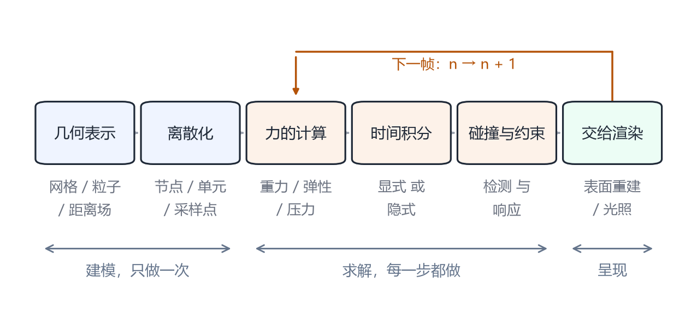
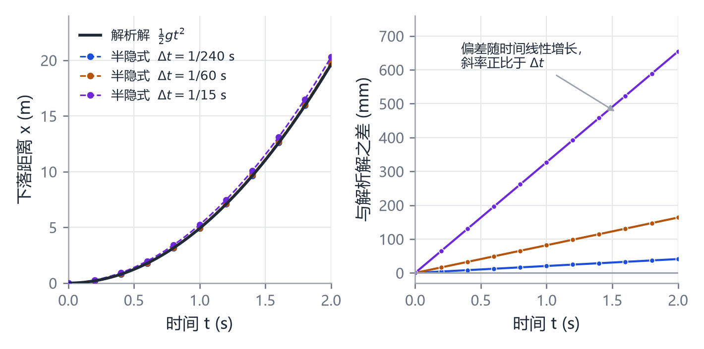

# 第 1 章 从一片下落的叶子说起

> 本章导读：这一章不推导什么，只把“物理模拟”这个词拆开看。先看一件小事——一片叶子怎么落下来——在三种做法里分别意味着什么；再把模拟压到最小的骨架：状态、规则、时间步。然后回答两个问题：谁在用它，它由哪几步组成。最后是五个绕不开的难点，和一张按目的排的阅读路线。

深秋的下午，一棵梧桐下面，一片叶子脱开枝条。

它没有直着落下来。先向右滑出一段，像被谁从背后推了一把；滑到尽头又停住，翻个身，叶面从水平转成竖直，下落的速度忽然快了一截；接着开始左右摆，摆幅一次比一次大，眼看要贴地，又被一股气流抬起来，斜着飘出去半米才停住。

两秒多一点。看过秋天的人不会觉得这有什么特别。

可这段画面出现在屏幕上时，它可能是三种东西中的一种：实拍素材、手调的关键帧，或者程序算出来的运动。三者的成本、可控程度、失败方式都不一样，没有哪一种在所有场合都更好。

## 1.1 实拍、关键帧、模拟

实拍的做法很直接：摄影棚里挂一块绿幕，道具师在镜头外撒一把叶子，后期把支撑的细线擦掉。真实度是满的，叶子受的每一股气流、每一次弯折都是真的。代价是这段运动从此固定。风再大一点，得重拍；机位改成贴地仰拍，也得重拍；想让叶子穿过角色手里那只杯子，做不到。素材库里能买到下落的叶子，但它的运动和拍摄时的镜头运动绑在一起，换个机位就对不上。

关键帧是另一条路。动画师给位置打三个关键帧，给旋转打四条曲线，中间交给样条插值。运动完全在手里：可以精确到第 132 帧落到画面右下角，可以摆得更戏剧化，可以完全不管物理。代价在细节。叶子的摆动是次生运动，由气流和姿态互相拉扯产生，手调只能近似；越细，工作量越大，而改动一个前提就全部作废——导演说叶子要轻一半，整段都得重来。

模拟把运动交给方程。给叶子一个质量、一张形状，写下重力、空气阻力、升力，让时间一步步往前走。写代码的时间花在前期的工程上，之后每次改动只要动参数：风大一倍就把风速乘二，重跑一遍，整段运动自己跟着变。它能批量生成变体，能接受实时输入（玩家会去拨它）。代价是可控性变成了间接的。你调的不是运动，是参数；结果对不对，只能看。而且它总会给你一个结果——模型错了，它照样算出一段挺像的运动。

真正的制作里三者是混着用的：影视里角色的上衣常是手 key 的骨架驱动，下摆挂一层布料模拟；游戏里角色被打倒时切成 ragdoll，爬起来又切回动画。所以“用了哪种”意义不大，更有意义的是：这段运动最终由谁决定——摄影机、动画师的手，还是方程和参数。

只要这段运动落在“算”这一边，它在一帧之内要做的事就可以拆成六步：表示几何、切成小块、算受力、积分、处理碰撞、交给渲染。这个骨架先放在图 1-1 里，1.4 节再一节一节走。

<figure class="fig">

<figcaption><b>图 1-1</b>　一帧之内的六步，围成一个回环。前两步只在场景变化时做一次，中间三步每帧重算，最后一步把状态变成像素，下一帧又从“力的计算”接着走。每格下面的小字是这一步摆弄的东西。</figcaption>
</figure>

## 1.2 状态、规则、时间步

把“算出来”这件事剥到最小，只剩三样东西。

**状态**是一组数，够用来决定下一刻。一维自由落体只需两个：下落距离 $x$ 和向下速度 $v$，写成向量 $(x,v)$。约定是：能从已有的数推出来的都不存。加速度不必存，它由规则随时给出；但规则里若出现会变的量，比如随时间变化的风，它就得进状态。状态的选择决定了能表现什么。只有 $x$ 和 $v$，物体只能直上直下；要给叶子加上翻转，就得再存朝向角和角速度，状态从二维变成四维。后面几章关于自由度的讨论，本质上都在问状态里该放多少个分量。

**规则**是状态的导数。自由落体有两条：

$$
\frac{dv}{dt}=g,\qquad \frac{dx}{dt}=v .
\tag{1.1}
$$

$g$ 是重力加速度的大小，地表附近取 9.81 m/s²。上式取竖直向下为正，$x$ 从释放点算起，速度也向下为正，所以两项都是正的。第一条说速度每秒变化 $g$，第二条说位置的变化率就是速度。这是牛顿第二定律最简单的样子，也是全书所有规则的祖先：用力除以质量得到加速度，再把加速度积分成位置。规则写的是导数，不是“下一步”；计算机不做连续的事，中间还差一步。

**时间步**就是这一步。取一个固定的 $\Delta t$，把时间切成 $t_0=0,\,t_1=\Delta t,\dots$，第 $n$ 步记作 $t_n=n\Delta t$。把导数换成差商，得到

$$
v_{n+1}=v_n+g\,\Delta t ,
\tag{1.2}
$$

再用刚算出来的新速度推进位置：

$$
x_{n+1}=x_n+v_{n+1}\,\Delta t .
\tag{1.3}
$$

$n$ 是步数下标，$v_n$ 是第 $n$ 步结束时的速度。两行加一个初值 $(x_0,v_0)$，就是一个完整的模拟器，每步两次乘加。跑两秒（$\Delta t=1/60$ s）需要 120 步。

式 (1.3) 里用的是 $v_{n+1}$ 而不是 $v_n$，这一点值得停一下。如果改成

$$
x_{n+1}=x_n+v_n\,\Delta t ,
\tag{1.4}
$$

看起来更“对称”：速度和位置都用旧值算新值，这就是最朴素的显式欧拉法。两种写法的表现差别很大。

拿自由落体这个有解析解的问题对照。真解是 $x(t)=\tfrac12 gt^2$。按式 (1.2)(1.3) 递推得

$$
x_n=\tfrac12 g\,t_n^2+\tfrac12 g\,\Delta t\,t_n ,
\tag{1.5}
$$

按式 (1.4) 那种写法得

$$
x_n=\tfrac12 g\,t_n^2-\tfrac12 g\,\Delta t\,t_n .
\tag{1.6}
$$

两个偏差都正比于 $\Delta t\,t$，一个偏大、一个偏小。取 $\Delta t=1/60$ s、$t=2$ s，偏差约 0.16 m；取 $\Delta t=1/15$ s，偏差 0.65 m，占两秒落距的百分之三。图 1-2 画的就是这件事：左图三条虚线紧贴解析解，肉眼分不出；右图把差值放大到毫米，才看出它是一条斜率正比于 $\Delta t$ 的直线。

<figure class="fig">

<figcaption><b>图 1-2</b>　一维自由落体：$\Delta t$ 取 1/240、1/60、1/15 s 三种步长，按式 (1.2)(1.3) 递推到 $t=2$ s，$g=9.81$ m/s²，初速为零。左图是位置，右图是同一个数减去解析解 $\tfrac12gt^2$ 后的偏差，单位换成毫米。偏差随 $t$ 线性增长，斜率正比于步长，正是式 (1.5) 里那一项。</figcaption>
</figure>

只看自由落体，两种写法半斤八两，误差同阶。分水岭出现在力依赖于位置的时候。

设想一个弹簧振子：加速度不是常数，而是 $a=-\omega^2 x$，偏离越远拉得越狠，$\omega$ 是角频率。显式欧拉每一步都让速度和位置错开半个节拍，这一错就多出一点能量，而能量按指数增长，几十步后振幅肉眼可见地涨上去，最后溢出。半隐式没有这个毛病，能量在真值附近来回摆，摆幅由步长决定，不会自己长大。两者都有步长上限，$\Delta t$ 超过 $2/\omega$ 时半隐式也会发散，第 3 章推；区别在于界内，一个是慢慢烂掉，一个是烂不掉。

而代价是零：把式 (1.4) 里那个 $v_n$ 换成 $v_{n+1}$，运算次数不变。这是全书最划算的一次改动，也是几乎所有实时物理引擎的第一行代码。

这个格式叫半隐式欧拉，也叫辛欧拉。第 3 章会讲“辛”这个字意味着什么。

最后一点关于“同样输入得到同样输出”。式 (1.3) 只用加减乘，浮点数在同样顺序下逐位确定：同一个初值跑一万次结果相同。游戏里这条叫确定性，支撑回放和联机同步；破坏它的常见做法是可变步长、多线程求和、编译器重排浮点运算。

这段程序还模拟不了叶子。它只有一维，没有空气，更麻烦的是叶子有姿态：叶面水平时阻力大、竖直时阻力小，姿态一转，受力方向就变。要让它像叶子，得往状态里加角度，往规则里加空气动力学，往流水线里加碰撞。骨架不动，往上堆东西。

## 1.3 四类使用者的“真实”

同一组方程，被四类人拿去用，验收标准完全不同。

游戏的硬约束是十六毫秒。一帧里要画完画面、跑完脚本、解完物理、混完音频，物理通常只分到三四毫秒。这个预算下，第一要求不是准，是不出事：玩家会把一堆积木推到墙角，会让布料反复自交。任何一次数值爆炸都当场被看见。第二要求是确定，联机要让两台机器算出同样的结果，回放要让昨天那一局原样重演，所以步长必须固定、随机数必须可控、运算顺序必须稳定。第三要求是交互，玩家随时改场景，没有预计算的余地。

在这三条之下，作弊是常态：把重力调大一点让跳跃手感更好，给布料加阻尼让它别抖，碰撞体比显示模型简单得多，看不见的物体干脆不算。这些手段没有一条是物理正确的，但它们让画面在预算内成立：玩家只看它像不像、穿不穿帮。

影视反过来。一帧算十分钟没人管，只要最终画面经得起大银幕。但影视有一个游戏没有的硬要求：可控。导演说第 240 帧浪要打到船舷，就得让它在第 240 帧打到，而模拟只会告诉你“按这个风速，它会在第 217 帧打到”。于是有了引导力、目标形状、分段模拟再拼接。第二个要求是可回滚：改一个参数只重跑这一段。第三个是细节：近景里布的褶皱、水花的碎沫都要有，这意味着高分辨率和比实时高出几个数量级的机时。在这里，“真实”是“看起来对，并且听指挥”，这两条经常打架。

工业仿真——结构强度、碰撞安全、流体机械、注塑——的验收标准是可以写进报告里的：网格加密一倍结果变化多少，守恒量守不守恒，和实验数据差几个百分点。这里有一套叫验证与确认的流程：验证问“方程解得对不对”，确认问“方程本身对不对”。一个算例跑完，交出去的还有一条误差带。所以工业界不接受“看起来对”，升力差百分之五可能就是几十公斤的载荷差异。

机器人训练要的不是漂亮镜头，是几百万次试错。要求变成：能开几千个环境并行，单步足够快，最好还能求导（第 10 章），接触要多而稳——抓取和足式行走都是接触主导的。还有一个特殊要求：不许作弊。那些“调重力、加阻尼”在游戏里是艺术手段，在这里会变成策略学到的假规律：策略学会用一股不存在的力保持平衡，搬到真机上就摔。这个差距叫 sim-to-real gap，对付它的办法有域随机化、系统辨识、把真实数据混进训练。这里的“真实”是“分布上够接近，学出来的策略搬过去还能用”。

四条要求摆在一起，冲突很明显：工业要精度，游戏要速度；影视要可控，机器人要“不作弊”。同一个引擎在不同行业口碑不同，是因为衡量的不是同一件事。图 1-3 把四者放进同一张等级表，比较的是每一格的侧重。

<figure class="fig">

<figcaption><b>图 1-3</b>　四类使用者在三个方向上的侧重。单元格里的等级只表示相对强弱，不是评分：工业把“真实”放在第一位，游戏要速度和可控，影视要真实也要可控，机器人要速度也要能把参数标定到真实数据上。定性等级，不代表实测数据。</figcaption>
</figure>

## 1.4 一条流水线

图 1-1 那六步，一步一步说。

**几何表示**：物体长什么样，用什么描述。三角网格最常用，点云和隐式函数（有向距离场）也常见，流体有时干脆用体素。这一步决定了后面所有步骤的形状。有个惯例：渲染和碰撞用的往往不是同一个模型，后者要简单得多，角色的高模有几十万面，撞起来用的是几十个凸包拼成的代理。

**离散化**：把连续的物体切成有限块。网格切成节点和单元，布料切成顶点和三角面，流体切成格子或粒子。切法不同，后面的一切都不同，第 4 章专门讲。

**力的计算**：算出每一块受什么力。重力最容易；弹性要把变形换算成应力，再换算成节点上的力；流体要算压力梯度和黏性；接触要在穿透发生时给一个排斥力。这是物理模型真正落地的地方，也是“像不像”的主要来源。

**时间积分**：把力变成下一时刻的状态。显式方法一步到位，隐式方法要解一个方程组，位置约束类的方法绕开力直接改位置。细节在第 3 章。

**碰撞与约束**：先找出哪些块撞上了，叫检测；再决定怎么响应，叫响应。这是最容易出 bug 的一环：漏检会穿模，过度响应会抖动。

**渲染**：把结果变成像素。流体要做表面重建，布料要有法线和材质，快速运动要有运动模糊。模拟交出去的不是画面，是位置和形状。

这六步每帧重来一遍，物理步长通常比帧短：一秒六十帧，物理可能跑一百二十步。为什么不能一帧一步，第 3、9 章各有解释。

要提醒的是误差的累积方式。看到的是六步误差的总和：离散粗了形状就僵，力的模型不对材质就不像，积分器有耗散运动就发闷。一个“看着不对”的结果可能出在六步里的任何一步，而症状经常相似。

## 1.5 五个难点

**自由度太多。** 两米见方的布切成 $200\times200$ 的网格，就是四万个顶点、每个顶点三个未知量，十二万个。流体更夸张：$256^3$ 的网格是一千六百万个格子，每格至少存速度和压力。汽车碰撞的有限元模型动辄上百万个单元。这些量每一步都要更新一遍，而一步只有几毫秒。增长还是三维的：分辨率翻倍，未知量涨八倍。这解释了流体为什么吃内存，也解释了降分辨率为什么是最常见的加速手段——细节也跟着没了。

**稳定性。** 弹簧越硬，振得越快，显式积分要求的步长越小，大致按 $1/\sqrt{k}$ 缩小，$k$ 是刚度。真实的钢铁、真实的纤维，刚度对应的时间尺度是微秒级，而一帧是十六毫秒，中间差了三四个数量级。这个矛盾没有便宜的解法：要么把步长降到微秒（跑不动），要么换隐式方法（每步解一个大型方程组），要么改用约束投影（放弃严格的力与加速度）。三条路各自撑起一大批方法，也是第 5 到第 8 章的主体。

**性能预算。** 这一条更像工程问题：所有东西都得塞进预算。游戏是十六毫秒一帧，影视是几十分钟一帧，机器人是几千个环境同时跑，同一套算法的实现完全不同。GPU 带来两个数量级的吞吐，也带来新约束：它怕分支、怕不规则访问、怕全局同步；流体每步要求解的泊松方程是全局耦合，正好落在它不擅长的位置。这类错配第 9 章讲怎么绕。

**可控。** 物理不听人的。导演要一个“更戏剧化”的倒塌，物理只给一个“按这组初始条件必然发生”的倒塌。于是有了各种把手：外力场、目标形状、位置约束、分区模拟，以及把模拟和关键帧混合。每个把手都在破坏一致性：叶子被一股看不见的力拽到镜头前，它的速度就不再是解出来的，撞到别的东西时动量和能量都对不上。行业里的做法是“改得少、改得巧”，接受局部不物理。

**验证。** 这一条最少被讨论：怎么知道它算对了。工业界有实验、有标准、有误差带；影视和游戏通常只有眼睛。可眼睛会被骗——一段布料抖得很自然，可能只是因为它抖得像另一部片子。能用的替代品有三个：守恒量（能量、动量有没有单向漂移），收敛性（分辨率加倍，结果变化多少），以及与简化解析解对照。三个都不完美，但比“看着还行”强。

五条互相拉扯：为了让雪堆得住，需要能处理拓扑变化的方法，代价是内存和网格噪声；为了实时把网格降到 $32^3$，雪的细节就没了；为了导演满意加一股引导力，物理一致性就破了。任何能跑起来的模拟，都是在这五条线上找的一个点。

## 1.6 阅读路径

后面十一章不必按顺序读。按目的分，有四种走法。

想尽快写出能跑的东西：第 3 章（积分器与稳定性）、第 5 章（刚体与碰撞）、第 9 章（性能与并行）。读完这三章，够写一个几百个物体的实时场景。要看布，加第 6 章；要看烟和水，加第 7 章。

做影视特效：第 6、7、8 章是主体，第 9 章后半（子空间、LOD、离线并行）和第 5 章的接触求解值得细读。第 10、11 章可以往后放，但第 10 章的参数辨识在实操中很有用——让模拟对上实拍素材靠的就是它。

做机器人或具身智能：第 5 章（接触是最难的部分）、第 9 章（并行与确定性）、第 10 章（可微）、第 11 章（学习与混合）。第 4 章也得读，要判断一个模拟器的离散方式适不适合手上的任务。

想做方法本身：第 3、4 章是地基，第 10、11、12 章是前沿。中间五章按兴趣挑一章读透，比全翻一遍有用。数学上要的不多：微积分、线性代数、一点常微分方程，真正卡人的往往不是推导，而是离散之后的矩阵长什么样。

## 1.7 判断一段模拟的三个问题

**它守恒吗。** 让它跑十分钟，看能量、体积、质量有没有单向漂移。烟雾越来越小，是数值耗散把细节吃掉了；布料越抖越猛，是积分器在往系统里灌能量；水面莫名其妙地升高，多半是体积约束没守住。漂移不一定致命，单向漂移一定说明有结构性问题。

**它收敛吗。** 把分辨率或步长减半，看结果变化多少。变化很小，你看到的是方程的解；变化很大，你看到的是网格的产物。不少“效果好”的模拟加密之后完全不同，说明好看来自离散误差。

**它在预算里吗。** 最好看的那一版能不能塞进目标时间，是它能不能用的最后一关。研究里常见的说法是“比基线快十倍”，但基线可能已经慢到没有实用价值。

三条不必都通过：游戏里的布料第一条勉强、第三条必须过，工业里的叶轮前两条必须过。知道自己在哪一栏，比追求全部通过实际得多。

这三个问题看着很现代，其实最老的一个在十七世纪就被问过了，只是说法不同：抛出去的石子，为什么会落在那条弧线上。
