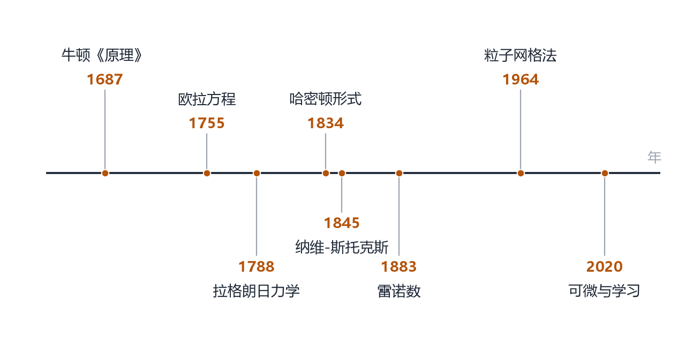
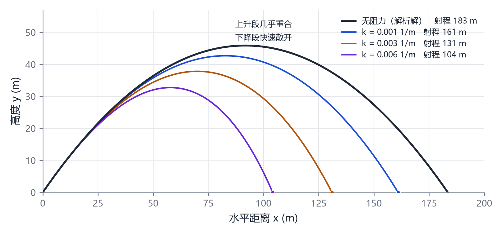
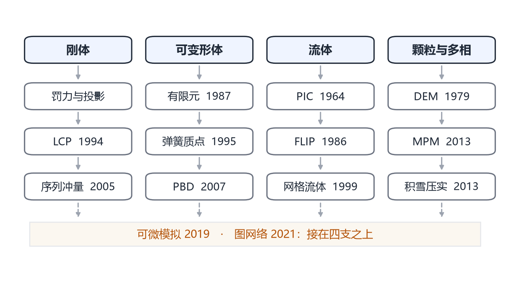

# 第 2 章 一条抛物线的四百年

> 本章导读：一颗石子扔出去，落点由谁决定？这个问题换了四次答案：目的、定律、能量、场。每换一次，能算的东西就多一类，算法的形状也跟着变。这一章沿着这四次更换走一遍，最后落到图形学的时间线上，看每一次方法上的进步到底让什么变便宜了。

一颗石子斜着扔出去，飞过一道弧线，落在几步之外的地上。

这条弧线是抛物线。中学课本上用三行就能证明：水平方向匀速，竖直方向匀加速，消去时间，得到一条二次曲线。结论太干净，反而让人忘掉它有多反常——天上月亮的轨道是椭圆，地上石子的轨迹是抛物线，两者能由同一条定律给出。

从“弧线是抛物线”到“屏幕上的一片叶子能算出来”，中间隔了四百年。这不是一条直线，而是几次视角的更换：从目的到定律，从力到能量，从质点到场，从解析解到数值解。每一次更换都留下了东西，今天的求解器里同时装着这四个时代的遗产。

## 2.1 石头为什么不继续飞

公元前四世纪，亚里士多德给运动分了类：重物向下是自然运动，因为它要回到自己的位置；被推着走是被迫运动，推力一消失就停下。由此得出一个定量说法：速度正比于力，反比于阻力，写成今天的记号是 $v=F/R$。

这个式子经不起推敲。阻力越小速度越大，那么真空里速度就是无穷大，亚里士多德干脆否认真空存在。抛出的石子离开手之后没有东西推它，他就让空气来补：空气被排开又涌回来，从后面推着石子走。这套解释今天看着荒谬，但它自洽，能解释很多事。

它统治了两千年，有四个原因。

一是它符合日常经验。推车、拉船、拖箱子，松手就停。今天的人知道那是摩擦，可摩擦无处不在，肉眼看不见。

二是它回答了“为什么”。目的论的解释在当时更有说服力：石头往下掉是因为它想回到地面，这跟种子长成树是同一类说法。

三是它没法被便宜的实验推翻。这套理论是定性的，没有给出可以精确测量的预言，也就没有明确的靶子。

第四个原因很少被提到：在阻力主导的情形下，它几乎是对的。把 $v=F/R$ 读成“力与阻力平衡时的速度”，那就是终端速度。一滴水在蜂蜜里下沉，速度确实正比于重力、反比于黏度。亚里士多德错在把阻力主导当成了全部；而在空气里扔石头是惯性主导，他的定律立刻崩掉。

中间不是没人反对。六世纪的菲洛波诺斯说抛射物带着一股冲力；十四世纪的布里丹把它叫 impetus，认为它与质量成正比、会自己衰减。离动量只差一步，但那一步要等到有了准确的计时才迈得出去。

## 2.2 把时间稀释

伽利略面对的第一个困难是时间。自由落体太快，十六世纪没有秒表，用脉搏或水钟去掐一个两秒的过程，误差比要测的量还大。

他的办法是稀释。让铜球滚下一条微微倾斜的木槽，倾角越小球走得越慢，同样的下落被拉成几秒甚至十几秒。计时用一个大容器底部开小孔，收集流出的水再称重——时间变成了重量，可以反复核对。

结果是一个奇怪的序列：相等的时间间隔里，球走过的距离之比是 1:3:5:7。相邻奇数之和是平方数，所以这等价于“总距离正比于时间的平方”。他没有写成公式，而是用比例的语言，因为当时的数学还没有准备好处理瞬时速度。

接下来是外推：倾角一点点加大，球越来越接近自由落体，比例不变；倾角到九十度，就是竖直下落。这一步在当时是一跃，因为它假定斜面上的规律在极限处依然成立。今天我们知道它对应连续性假设，而所有数值方法都建立在它上面。

抛体是同一套工具的另一个用法。伽利略把运动拆成两个互不干扰的部分：水平方向不受力，匀速；竖直方向受重力，匀加速。两段叠加，轨迹就是抛物线。他还用这个结论反驳了流行说法——抛射物先沿直线飞一段，然后突然垂直落下。

这里有一个比任何结论都重要的转折：先忽略空气和摩擦，得到一条干净的定律，再讨论干扰项带来什么偏差。这正是模拟的做法。任何能算的模型都是对现实的删减，区别只在删掉了什么、什么时候加回来。

1638 年，这些结果收进《关于两门新科学的对话》。三百三十三年后，阿波罗 15 号的宇航员在月面同时松开一把锤子和一根羽毛，两者同时落地。

把这条弧线交给后来的人，故事大致沿着图 2-1 走。

<figure class="fig">

<figcaption><b>图 2-1</b>　力学与计算的分水岭，横轴按年份线性排布。标注的是让问题变得可算的几次转折：定律（1687）、换坐标（1788）、方程（1755、1845）、能量（1834）、判据（1883）、算法（1964）、学习（2020）。1687 到 1834 之间的一百五十年只有三个点，而 1964 之后不到六十年就换了一整套工具。</figcaption>
</figure>

## 2.3 一条定律统管天地

1687 年，《原理》。三条定律，一条引力定律。

第一定律说，没有外力时物体保持匀速直线运动。这句话今天听起来平淡，它当时的作用是把“运动需要原因”这个直觉推翻：运动不需要原因，改变运动才需要。

第二定律给出改变的量。牛顿的原话是冲量形式：$F\,dt=dp$，动量的改变等于力对时间的累积。写成变化率是 $F=dp/dt$，质量不变时退化成熟悉的 $F=ma$。第三定律说作用与反作用成对出现——碰撞、接触、约束求解，本质上都是在处理这一对力。

然后是把天地统一的那一步。牛顿假定，让苹果落地的力和让月亮绕地球转的力是同一种，大小与距离的平方成反比：

$$
F=G\frac{Mm}{r^2} .
\tag{2.1}
$$

$G$ 是引力常数，$M$ 和 $m$ 是两个物体的质量，$r$ 是它们之间的距离。这个式子的胆量在于把“天上的完美运动”和“地上的粗糙运动”放进同一个括号。

对模拟来说，牛顿留下的最重要的东西不是任何一条定律，而是问题的形式：给定 $t=0$ 时刻的位置和速度，之后的一切由方程决定。这就是初值问题。第 1 章那三行代码写的正是这个形式。在此之前，“物体为什么运动”是哲学问题；在此之后，它成了一组可以求解的方程。

牛顿自己用几何方法算过月球，误差不小，因为月球同时受地球和太阳的影响。三体没有解析解，这件事要等庞加莱才被证明。但在能算的范围内，预言能力惊人：哈雷用牛顿的定律算出 1682 年那颗彗星的轨道，预言它 1758 年回来。它回来了。

这里有一处容易被忽略的落差：抛物线只是无阻力时的解。真实的东西总有阻力，而有阻力时方程没有解析解。图 2-2 把两种情况画在一起。

<figure class="fig">

<figcaption><b>图 2-2</b>　同一初速度下的抛体：$v_0=(30,30)$ m/s，$g=9.81$ m/s²。黑线是无阻力的解析解 $y=x\tan\theta-gx^2/(2v_0^2\cos^2\theta)$；其余三条是 $m\dot{\mathbf{v}}=m\mathbf{g}-c|\mathbf{v}|\mathbf{v}$ 用四阶龙格-库塔（$\Delta t=2\times10^{-4}$ s）积出的数值解，$k=c/m$ 取 0.001、0.003、0.006 1/m。上升段的四条线几乎重合，下降段迅速分开，射程从 183 m 缩到 104 m。</figcaption>
</figure>

同一个初速度，四种阻力系数，射程从 183 m 缩到 104 m；顶点变低，到达顶点也更早；下降段比上升段陡。这些数字没有一个能写成公式，它们是逐步积出来的。怎么积，第 3 章。这里只记一件事：从十七世纪起，“算出一个具体情形”就逐渐不再等于“写出公式”。

## 2.4 从力到能量

牛顿的框架有个不方便的地方：它用直角坐标和力描述一切。摆的约束是“到悬点距离不变”，用 $x,y$ 加一个约束力表示，就是两个未知量加一个乘子，而那个乘子本身没有物理意义，只是为了维持约束。物体一多，约束一多，这种写法很快就不能看了。

欧拉在 1755 年给出流体方程，也把变分法带进力学。拉格朗日在 1788 年的《分析力学》里做了一件更彻底的事：换坐标。

设系统的位形用一组广义坐标 $q=(q_1,\dots,q_n)$ 描述，$n$ 就是自由度个数；$T$ 是动能，$V$ 是势能，定义拉格朗日量 $L=T-V$。真实运动满足

$$
\frac{d}{dt}\frac{\partial L}{\partial \dot q_i}-\frac{\partial L}{\partial q_i}=0,\qquad i=1,\dots,n ,
\tag{2.2}
$$

$\dot q_i$ 是 $q_i$ 对时间的导数。好处是约束被坐标吸收了：摆用角度做坐标，约束自动满足，不必再求约束力，未知量从三个变成一个。对模拟而言，这是第一次“减少未知量”的胜利。后面所有的降维、子空间、模态方法，思路都从这里来：选对坐标，问题就小一半。

哈密顿在 1834 年又换了一次。他把速度换成动量 $p_i=\partial L/\partial\dot q_i$，定义 $H=\sum_i p_i\dot q_i-L$，在常见系统里它就等于总能量。运动方程变成一对一阶方程：

$$
\dot q_i=\frac{\partial H}{\partial p_i},\qquad \dot p_i=-\frac{\partial H}{\partial q_i} .
\tag{2.3}
$$

形式上更对称，代价是维数翻倍。这一步对模拟的意义比拉格朗日那一步更深，有三个后果。

第一，能量成了可以直接检查的量。$H$ 在真实运动中守恒，数值解不守恒，偏差就是一目了然的诊断信号。

第二，相空间有几何结构。$(q,p)$ 上的演化保持“面积”，这个性质叫辛。好的积分器保持同样的结构，能量误差于是在真值附近振荡而不单向漂移——第 3 章的 Verlet 就属于这一类。

第三，也是最实用的一条：$H$ 是标量，力是它的导数。于是“算力”变成了“对一个标量求导”，而标量函数可以被离散、被最小化、被自动微分。今天的隐式积分器，一步的求解常写成“最小化一个增量势能”；第 10 章的梯度，来源也是这个标量。

还有一条线索在这里埋下：最小作用量原理说，真实路径使作用量取驻值。把“力的平衡”换成“整体的极值”，对数值方法更友好，因为极值问题可以直接离散成优化问题，而优化有成熟解法。

## 2.5 一块水不是一堆质点

质点力学处理有限个点。一块水有无穷多个。

连续介质的办法是不再追踪每个分子，而是定义场：密度 $\rho(\mathbf{x},t)$、速度 $\mathbf{u}(\mathbf{x},t)$、压力 $p(\mathbf{x},t)$，每个量在空间每一点都有值。这一步的合法性来自尺度分离：只要关心的尺度远大于分子间距，统计平均就是稳定的。

有了场，还要一个描述内力的量。柯西在 1822 年给出应力张量 $\boldsymbol{\sigma}$。为什么是张量而不是向量：在一小块材料内部任意取一个面，面上的力取决于面的朝向。同一点上，法向朝 $x$ 的面和法向朝 $y$ 的面上，单位面积的力不同。需要九个分量才能描述完，写成 $3\times3$ 的矩阵；角动量守恒让它对称，独立分量降到六个。

有了应力，三条方程就位：质量守恒、动量守恒、以及把应力和变形联系起来的本构关系。前两条普适，第三条是材料自己的事——水、橡胶、沙子的本构完全不同。

欧拉 1755 年写出无黏的形式，纳维 1823 年、斯托克斯 1845 年加上黏性，得到

$$
\rho\left(\frac{\partial \mathbf{u}}{\partial t}+(\mathbf{u}\cdot\nabla)\mathbf{u}\right)=-\nabla p+\mu\nabla^2\mathbf{u}+\mathbf{f} ,
\tag{2.4}
$$

$\mu$ 是动力黏度，$\mathbf{f}$ 是外力的体密度，括号里第二项是对流项。难处全在三处：对流项非线性；不可压条件 $\nabla\cdot\mathbf{u}=0$ 让压力变成全局量，每一点的压力都依赖整个流场；湍流把能量摊到极宽的尺度范围里。

雷诺在 1883 年给了判据。取特征长度 $L$、特征速度 $U$、密度和黏度组成无量纲数 $Re=\rho UL/\mu$。$Re$ 小，黏性主导，流动规整；$Re$ 大，惯性主导，流动失稳、碎成涡。模拟的难度几乎完全由 $Re$ 决定：要分辨的尺度范围随 $Re$ 增长，计算量随范围的三次方增长。

三维纳维-斯托克斯方程的光滑解是否存在，至今没有答案，它是七个千禧年问题之一。对做模拟的人，含义很直接：不要指望解析解，也不要指望算准，只能在一个有限分辨率上离散，把没分辨出来的尺度要么用模型补上，要么让数值耗散吃掉——后者在图形学里几乎是标准做法。

固体和流体在这里分道。弹性体也有应力，但它多一个参考构型：材料记得自己原来的形状，应力是“偏离参考构型多少”的函数。流体不记得。这个区别决定了算法结构，第 6 章和第 7 章的分野就在这里。

## 2.6 计算机进场

1946 年 ENIAC 通电。几年后它被用来算氢弹，而流体力学正是那批工作的核心。

1950 年，查尼用计算机做了数值天气预报：把大气切成网格，逐格积分。这是第一次有人用机器而不是纸笔解偏微分方程，结果可用。

结构分析走另一条路。飞机机翼形状不规则，规则的差分网格套不上去。1956 年，特纳和克劳夫等人把机翼拆成许多三角形和四边形，每个小块内部用简单多项式近似，再把小块拼起来；1960 年克劳夫给这个方法起名“有限元”。关键一步是把微分方程换成弱形式：不再要求方程在每一点成立，只要求它在平均意义下成立。不规则形状于是也能处理，边界条件也容易加。

流体这边，哈洛在洛斯阿拉莫斯面对一个两难：用粒子追踪物质，平流没有数值耗散，但粒子会缠成一团，压力算不出来；用固定网格，压力好算，但界面会被抹平。1964 年他提出质点网格法，粒子携带质量和动量，网格负责解压力，每一步在两者之间来回搬运 [@harlow1964]。同一年代的 MAC 方法则用标记点追踪自由表面；二十多年后，这套粒子加网格的思路演化为 FLIP [@brackbill1986]。

这些工作带来一个观念变化：答案不再是一个公式，而是一组数。随之而来的问题是这组数有多可信——离散误差有多大，网格加密一倍结果会不会变。“验证”从哲学问题变成了日常工序。

1963 年，洛伦茨在一个简化的对流模型里发现，初值的微小差别会在一段时间后长成完全不同的轨迹。含义是：有些系统的长期行为在原理上不可预测，和算得多准无关。第 3 章回到这里。

## 2.7 图形学拿走了什么

图形学进入这个领域晚了二十年，带来一种不同的取舍：精度可以扔，速度不能扔。

1983 年，里夫斯发表粒子系统 [@reeves1983]。他要做火和云——没有表面、没有固定拓扑、随时在变的东西。做法是当成一堆点，每点有位置、速度、寿命、颜色，按随机规则生灭。变便宜的是造“模糊物体”：以前要动画一团火，得手工造一个不断变形的曲面；现在只要一条生成规则加一组随机数。代价是数量：要看起来连续，至少上万颗。

1987 年，特佐普洛斯等人把弹性体的能量写成泛函，离散到网格上再积分 [@terzopoulos1987]。变便宜的是让任意形状按同一条规律变形，而不是逐顶点手调。这也是“图形学里的物理”这个模板的起点：写能量、求力、积分、画出来。

1990 年，卡斯和米勒做浅水，用隐式处理阻尼项，让大步长也稳定 [@kass1990]。1996 年，福斯特和梅塔克萨斯把三维纳维-斯托克斯搬进图形学，配上自由表面，做出了能在镜头里用的液体 [@foster1996]。变便宜的是“不炸”：在此之前，海面靠程序化的波形叠加 [@fournier1986]，水体靠贴图，真正的三维流体很少出现在镜头里。

真正的转折在 1999 年。斯塔姆的 Stable Fluids 用三步做出不炸的烟：半拉格朗日平流（沿速度回溯再插值）、隐式扩散、投影（解泊松方程把速度场变成无散的）[@stam1999]。变便宜的是工程量：一个能用的流体求解器从上万行变成一个下午，而且步长不受 CFL 限制。代价是数值耗散，烟会变糊，涡会消失。此后二十年，图形学流体的主线之一就是怎么把耗散掉的东西补回来。

2007 年，米勒等人提出基于位置的动力学 [@muller2007]。思路是把力换成约束：先按外力预测位置，再把不满足的约束直接投影回去。变便宜的是刚度——布、绳、软体都能在实时帧率下稳住，不会因为弹簧太硬而爆炸。代价是刚度不再由物理参数决定而由迭代次数决定，同一块布在快机器上比慢机器上更硬。这个毛病到 2016 年的 XPBD 才修好。

2013 年，斯托马欣等人用物质点法做雪 [@stomakhin2013]。粒子携带物质和形变历史，网格负责算应力和碰撞。变便宜的是拓扑变化与历史相关的材料：雪被压实时体积会减小，纯粒子做不好，纯网格会纠缠，混合才成立。代价是内存，以及粒子与网格来回搬运带来的噪声。

2019 年之后，可微模拟把梯度变便宜了 [@hu2020]。以前优化一个参数只能有限差分，参数有多少就要重跑多少遍；现在反过来穿过求解器算梯度，一次前向加一次反向就够。代价是显存，以及接触的不可导。

2021 年，图网络把迭代变便宜了 [@sanchez2020]。把粒子或网格点当节点、邻居关系当边，训练一个网络预测下一步，推理时一次前向替代几十次迭代。代价是泛化和长时稳定性：分布外会崩，推演久了会漂。

连起来看，模式是反复的：数学往往早几十年就位，等的是一次让它变便宜的工程。PIC 是 1964 年的，MPM 是 2013 年的；半拉格朗日平流是气象学的老技术，1999 年才进图形学；纳维-斯托克斯是 1845 年的，1996 年才出现在电影里。图形学做的事不是发明物理，而是把精度要求扔掉换来速度，需要时再一点点捡回来。图 2-3 是按物质类型分的演化树，四条分支各自长，根是同一个。

<figure class="fig">

<figcaption><b>图 2-3</b>　按物质类型分的方法演化。每一列内部的箭头表示同一类物质上方法的接续，年份为代表性工作；底部一行表示可微与学习方法不是第五类物质，而是接在四支之上的另一层。分类是粗的，很多方法跨两列。</figcaption>
</figure>

四百年之后，那颗石子还在飞。今天的求解器里，牛顿的部分负责算力，拉格朗日的部分负责选坐标和写约束，哈密顿的部分负责能量检查，柯西的部分负责把连续的物质切碎。四层叠在一起，谁也不能单独工作。

而它们合起来，仍然解不出一个一般的问题。
