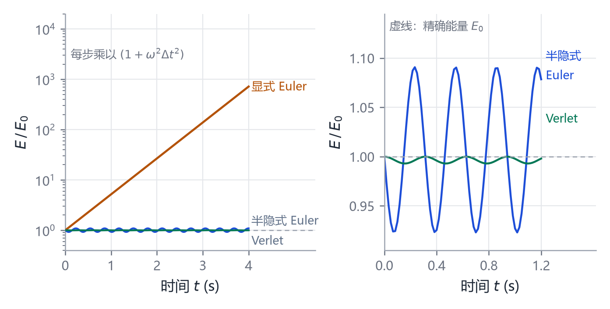
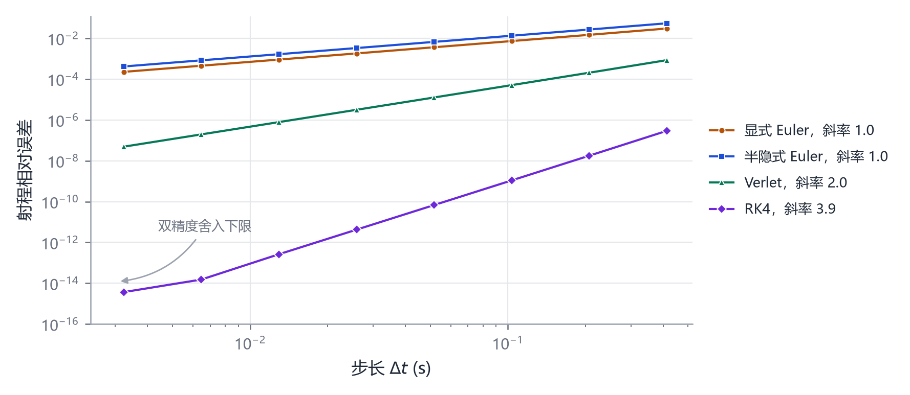
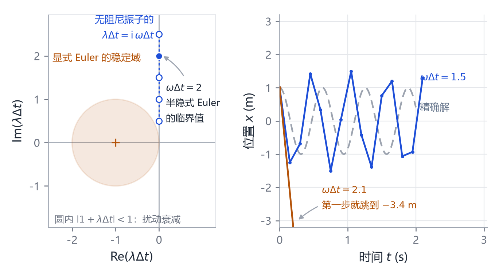

# 第 3 章 当方程解不出来

三行代码就能写下弹簧振子：加速度等于负的 $k/m$ 乘以位移，速度加上加速度乘一步时间，位置加上速度乘一步时间。有人照着写了一个，屏幕上挂一只小球，拉一下松开，它开始上下晃。头两秒像模像样，第四秒振幅明显变大，第八秒小球飞出窗口，程序报了个数值溢出。

公式没有写错，检查十遍还是那三行。出问题的是把这三行交给计算机的方式：连续的时间被切成了一段一段，而切法本身会往系统里注入一样真实世界不存在的东西——能量。

这一章讲的就是这件事。一个写对的方程，在离散之后会变成什么样；为什么图形学里的模拟器大多宁愿要“稳定”，也不肯要“精确”。

## 3.1 三体问题与庞加莱

1885 年，瑞典国王奥斯卡二世过六十岁生日。数学家们凑了一份礼物：一组悬赏问题，其中一题问的是，$n$ 个天体在万有引力下互相绕行，能不能用公式写出它未来任意时刻的位置。

这题在当时不算狂妄。二体问题早有答案：两个天体互相绕转，轨道是椭圆，位置可以由开普勒方程算出来。三体看起来只是多了一个，理应也能算。欧拉和拉格朗日都试过，也找到过若干特殊解——三个天体排成等边三角形一起转，或者始终共线，这些构型今天还在用，拉格朗日点就出自这里。但它们是特例，不是通解。

1889 年，三十四岁的庞加莱交上了答案。他的思路是找守恒量：如果能找到足够多的独立不变量，系统的轨道就被限制在一张低维曲面上，问题随之拆解。二体问题里，能量、动量、角动量恰好够用。三体问题里，无论怎么凑，总是差一个。

评审过程中，编辑发现他论文里有一处错误，庞加莱撤稿重写。重写的两年里他看到了一件比原题更重要的事：三体的轨道在相空间里会自己缠住自己。一条轨道绕出去，又绕回来，与自己的邻域相交，而且不是相交一次，是无穷多次、越缠越密。这样的结构导致一个后果——两个初始位置差得极小的轨道，会在有限的步数之后跑到完全不同的地方。

这就是后来被叫作混沌的东西。庞加莱没有给它命名，也没有画出今天那种漂亮的相图，他只是在论文里写下了这个几何事实，然后放弃“算出三体轨道”这条路，转而去研究轨道的整体结构。这一转向改变了力学：问题从“轨迹的公式是什么”变成了“所有可能的轨迹构成什么形状的集合”。

对做模拟的人来说，这件事的意义很具体。它意味着“我算出来的这条轨道”和“真实的那条轨道”是两个不同的对象。前者是某个离散规则迭代出来的序列，后者是微分方程的解。两者在短时间内贴得很近，时间一长就各走各的——不是因为程序写得差，而是因为方程本身就不允许你用有限精度跟踪一条轨道很久。

## 3.2 解析解的边界

先把“解”这个词说清楚，后面的取舍才有依据。

数学上说一个微分方程有解析解，通常指它的解能写成有限个初等函数（多项式、三角、指数、对数）和少数被命名的特殊函数的组合。按这个标准，人类能解的问题少得可怜。自由落体有，真空中的抛体有，有空气阻力的抛体只在阻力正比于速度时才有闭式解；单摆在摆角很小的时候近似为简谐振动，角度一大就用椭圆积分，写不出初等表达式；双摆没有，三体也没有。流体里只有极少数精确解——均匀流、点涡、两平板之间的库埃特流——而它们大多已经被简化到不太像真实流动。

这不是数学家不够努力。庞加莱之后，人们慢慢接受这类“解不出来”是结构性的，不是技术性的：绝大多数非线性系统根本不存在那套公式。所谓“三体问题的通解”，是一个不存在的东西。

于是数值方法不是“求解析解的近似”，而是另一类解法。它构造一条离散规则，让状态一步一步往前走，走足够多步之后得到一条轨迹。这条轨迹不是原方程的轨迹，而是一个离散映射的轨道。两者的差，就是这一章余下的全部内容。

这里有一个常见的误解：既然写不出公式，那数值解总该给出“正确答案”，只要精度够高、机器够快。混沌让这句话失效。混沌系统的定义特征不是“乱”，而是对初值敏感：初始误差按指数速率放大，$\mathrm{e}^{\lambda t}$，指数 $\lambda$ 叫李雅普诺夫指数，它的倒数给出一个可预测的时间尺度。两个初始相对误差 $10^{-10}$ 的轨道，走过二十来个 $1/\lambda$ 之后就会分开到量级相当的程度。

天气是最熟悉的例子。大气模式的初始场来自全球观测网，误差不可能为零；取 $\lambda$ 大约每两天一档，$10^{-5}$ 的初始相对误差在两周左右被放大到与信号同量级。这就是“预报只能报十天到两周”的物理原因——误差按指数增长，时间一到，初始场的信息就被抹平了。

这件事对模拟的启示很直接：不要问“这个模拟准不准”，要问“在我关心的那段时间里准不准”。行星轨道要跑一亿年，需要的是一批长期守恒的量；一团烟只跑三秒，需要的是每一帧看着像。同一套方程，两种需求，对数值方法的要求正好相反。

## 3.3 四种积分器

回到那三行代码。把一阶系统写成统一形式 $\dot{\mathbf{y}} = \mathbf{f}(\mathbf{y}, t)$，最朴素的做法是

$$
\mathbf{y}_{n+1} = \mathbf{y}_n + \Delta t\,\mathbf{f}(\mathbf{y}_n, t_n)
\tag{3.1}
$$

这是显式 Euler。它只用当前状态算一次斜率，然后往前推一整步。上面那个弹簧程序就是它：先更新速度，再用旧速度更新位置，所以位置永远落后半步。

把两个更新的顺序调一下，用刚算出的新速度更新位置：

$$
\mathbf{v}_{n+1} = \mathbf{v}_n + \Delta t\,\mathbf{a}(\mathbf{x}_n), \qquad
\mathbf{x}_{n+1} = \mathbf{x}_n + \Delta t\,\mathbf{v}_{n+1}
\tag{3.2}
$$

这就是半隐式 Euler，也叫辛欧拉。只改了一个下标，行为完全不同——第 1 章提过一句，这里要讲清楚为什么。

第三种是 Verlet，在分子动力学里用了几十年。写成速度形式是

$$
\mathbf{x}_{n+1} = \mathbf{x}_n + \Delta t\,\mathbf{v}_n + \frac{\Delta t^2}{2}\mathbf{a}_n, \qquad
\mathbf{a}_{n+1} = \mathbf{a}(\mathbf{x}_{n+1}), \qquad
\mathbf{v}_{n+1} = \mathbf{v}_n + \frac{\Delta t}{2}\left(\mathbf{a}_n + \mathbf{a}_{n+1}\right)
\tag{3.3}
$$

它用当前加速度把位置推到下一步，在新位置重算加速度，再用两个加速度的平均值更新速度；每步只算一次力。

第四种是四阶龙格-库塔（RK4）。它在一步之内取四个斜率，加权平均：

$$
\begin{aligned}
\mathbf{k}_1 &= \mathbf{f}(\mathbf{y}_n) \\
\mathbf{k}_2 &= \mathbf{f}\left(\mathbf{y}_n + \tfrac{\Delta t}{2}\mathbf{k}_1\right) \\
\mathbf{k}_3 &= \mathbf{f}\left(\mathbf{y}_n + \tfrac{\Delta t}{2}\mathbf{k}_2\right) \\
\mathbf{k}_4 &= \mathbf{f}\left(\mathbf{y}_n + \Delta t\,\mathbf{k}_3\right) \\
\mathbf{y}_{n+1} &= \mathbf{y}_n + \frac{\Delta t}{6}\left(\mathbf{k}_1 + 2\mathbf{k}_2 + 2\mathbf{k}_3 + \mathbf{k}_4\right)
\end{aligned}
\tag{3.4}
$$

每步算四次力，换来的是精度。这里的 $\mathbf{y}$ 可以是位置和速度拼成的向量，$\mathbf{f}$ 是“已知状态求导”的函数，$\Delta t$ 是步长。

误差阶的定义是把精确解在 $t_n$ 处做泰勒展开，看第一步丢掉了哪一阶。显式 Euler 丢掉 $\Delta t^2$ 项，单步误差 $O(\Delta t^2)$，走 $1/\Delta t$ 步之后累积成 $O(\Delta t)$，所以叫一阶方法。半隐式 Euler 也是一阶。Verlet 的奇数次项因为对称而抵消，单步 $O(\Delta t^3)$，全局 $O(\Delta t^2)$。RK4 全局 $O(\Delta t^4)$。

<figure class="fig">

<figcaption><b>图 3-1</b>　同一根弹簧在三种积分器下的能量。参数为 $k=100$ N/m、$m=1$ kg，所以 $\omega=10$ rad/s、周期 0.63 s；步长 $\Delta t=1/60$ s，正好是一帧。左图纵轴取对数：显式 Euler 的能量每步乘以 $1+\omega^2\Delta t^2$，四秒涨了七百多倍，在对数坐标下是一条直线；另外两条只在 $E_0$ 附近振荡。右图放大前 1.2 秒，半隐式 Euler 的能量在 $0.94$ 与 $1.11$ 之间来回，Verlet 只在 $0.994$ 与 $1.000$ 之间抖动，两者都不是“误差累积”，而是有界的来回摆动。</figcaption>
</figure>

图 3-1 里显式 Euler 那条线每步把能量乘以 $1+\omega^2\Delta t^2$，四秒涨了七百多倍；另外两条贴着 1 振荡。为什么辛方法的能量只在附近摆动而不是往上爬，3.5 节再说。

<figure class="fig">

<figcaption><b>图 3-2</b>　射程相对误差随步长变化。一门炮以 $\mathbf{v}_0=(12,18)$ m/s 斜向上发射，受线性空气阻力 $\mathbf{a}=\mathbf{g}-k\mathbf{v}$，取 $k=0.2\,\mathrm{s^{-1}}$、$g=9.8\,\mathrm{m/s^2}$。解析解给出落地时刻 3.31 s、水平射程 29.06 m；四种方法在同一个落地时刻比较水平位置，全都积分到该时刻。双对数坐标下四条直线，斜率分别为 1.0、1.0、2.0、3.9，即误差阶 1、1、2、4。RK4 在最左端变平，那是双精度的舍入下限。</figcaption>
</figure>

图 3-2 把四种方法的误差画在一起：同一门炮、同一条阻力，双对数坐标下四条线都是直线，斜率分别是 1.0、1.0、2.0、3.9——误差阶在这里是可数的。

成本也得算进去。Verlet 每步一次力计算，RK4 四次。若要把误差从 $10^{-4}$ 降到 $10^{-8}$，二阶方法要把步长缩小一百倍，四阶只要缩小十倍。所以在力函数光滑、精度要求高的地方（天体力学、分子动力学），RK4 划算；在力函数昂贵或本身不光滑的地方（碰撞、摩擦、接触），高阶方法拿不到它应有的收益——接触力在穿透的瞬间是断的，泰勒展开的前提就没了。

## 3.4 稳定性与临界步长

图 3-1 里显式 Euler 的能量为什么一定涨？不是“误差累积”这么含糊的说法，可以算出来。

考虑标量方程 $\dot{y}=\lambda y$，$\lambda$ 是复数。显式 Euler 给出 $y_{n+1}=(1+\lambda\Delta t)y_n$，每步乘一个固定的数。这个乘子的模小于 1，扰动就衰减；大于 1，扰动就增长。所以稳定条件是 $\left|1+\lambda\Delta t\right| \le 1$，在复平面上是一个以 $-1$ 为心、半径 1 的圆盘，图 3-3 左边画的就是它。

无阻尼振子的特征值是纯虚的，$\lambda=\pm\mathrm{i}\omega$。它落在虚轴上，而那个圆盘只与虚轴在原点相切。除了 $\Delta t=0$，任何步长都让 $\left|1+\mathrm{i}\omega\Delta t\right|=\sqrt{1+\omega^2\Delta t^2}$ 大于 1。结论很干脆：显式 Euler 对无阻尼振子无条件不稳定，步长再小也只能让它晚几秒炸。

这解释了一个新手常遇到的现象：把步长从 1/60 改成 1/600，物体还是飞了，只是飞得晚了。

半隐式 Euler 不一样，因为它的更新有先后。把式 (3.2) 写成矩阵，状态是 $\left[\mathbf{x}_n, \mathbf{v}_n\right]$：

$$
\begin{bmatrix} \mathbf{x}_{n+1} \\ \mathbf{v}_{n+1} \end{bmatrix}
=
\begin{bmatrix} 1-\omega^2\Delta t^2 & \Delta t \\ -\omega^2\Delta t & 1 \end{bmatrix}
\begin{bmatrix} \mathbf{x}_n \\ \mathbf{v}_n \end{bmatrix}
\tag{3.5}
$$

这个矩阵的迹是 $2-\omega^2\Delta t^2$，行列式是 1。两个特征值都落在单位圆上，当且仅当迹的绝对值不超过 2，也就是 $\omega\Delta t \le 2$。超过这条线，两个特征值变成实数，其中一个的模大于 1，位移开始按几何级数增长。

$$
\Delta t \le \frac{2}{\omega}
\tag{3.6}
$$

这个 $2/\omega$ 是本章最该记住的一个数。$\omega=10$ rad/s 时临界步长是 0.2 s，1/60 s 远在安全区，所以半隐式 Euler 在弹簧上很好用。刚度高的系统就难受了：布料的弯曲刚度、接触的罚函数刚度能把 $\omega$ 推到 $10^4$ 以上，临界步长掉到 $10^{-4}$ 秒，一帧要算上百个子步才稳。

<figure class="fig">

<figcaption><b>图 3-3</b>　左：显式 Euler 的稳定域（以 $-1$ 为心、半径 1 的圆盘）与无阻尼振子的特征值轨迹。振子的 $\lambda\Delta t$ 始终落在虚轴上，圆盘只与虚轴在原点相切，所以任何步长都不稳定；虚轴上标出的实心点是 $\omega\Delta t=2$，那是半隐式 Euler 的临界值。右：半隐式 Euler 在 $\omega\Delta t=1.5$（蓝）与 $\omega\Delta t=2.1$（橙）下的位置，$\omega=10$ rad/s，虚线是精确解 $\cos\omega t$。1.5 的那条有界，但振幅 1.51 m、周期短了 11%；2.1 的那条第一步就跳到 $-3.4$ m，此后每步放大 1.88 倍。</figcaption>
</figure>

图 3-3 右边是两条相近步长的轨道。$\omega\Delta t=1.5$ 的那条稳稳地晃着，没有发散，但它的振幅是 1.51 m（真实振幅 1 m），周期短了 11%；$\omega\Delta t=2.1$ 的那条第一步就跳到 $-3.4$ m，随后每步放大 1.88 倍，六七步就到十万量级。

这张图想说的不是“1.5 可以用”，恰恰相反。跨过稳定边界会立刻炸，这是显眼的失败，一眼能看见；靠近边界时方法安静地给出错误的振幅和周期，画面看着正常，这才是危险的失败。稳定只保证不发散，离“准确”还差一整条街。

## 3.5 能量、辛结构与数值阻尼

图 3-1 里有个细节：半隐式 Euler 和 Verlet 的能量一直在 1 附近振荡，四秒里没有向上的趋势。这两种方法的误差不累积。原因是它们属于辛积分器。

辛是几何力学的词，指的是一类变换保持相空间面积。一维振子的相空间是 $(x,v)$ 平面，取一小块区域，让真实的动力学推着它跑，面积不变；辛积分器在离散的步进里也保持面积，或者保持面积的某个固定倍数。显式 Euler 不保面积，它每一步都把一块区域拉大一点点，能量就是这么攒起来的。

保持面积带来一个比“守恒”更微妙的性质。辛方法一般不精确守恒系统的哈密顿量 $H$，但它精确守恒一个略微不同的量 $\tilde{H}$，两者相差 $O(\Delta t^p)$，$p$ 是方法的阶数。而 $\tilde{H}$ 又始终被夹在 $H$ 的一个很窄的范围里，于是 $H$ 只能在真值附近振荡，不会漂移。图 3-1 右侧那两条小波浪，不是误差在随机游走，而是轨道绕着一个稍微走形的能量面在转。

RK4 不是辛方法。它阶数很高，短期误差极小，但长时间看能量会缓慢单调地漂，方向取决于问题。太阳系模拟里这一点很致命：跑几十亿年，地球可能被甩出去。所以天体力学里，挑大梁的常常不是 RK4，而是蛙跳格式（和 Verlet 同族）这类辛方法，宁可局部精度低一点，也要保住长期结构。

另一面是数值阻尼。有些方法自带耗散：隐式欧拉（用新状态算力）每步把能量按 $1/(1+\omega^2\Delta t^2)$ 压下去，阻尼强到运动变得黏糊。半隐式 Euler 对无阻尼系统给出的是有界的能量（不是精确守恒），遇到真有阻尼的方程则老实跟着衰减，两种行为它都做得对。

耗散什么时候是好事？真实系统本来就有耗散的时候，或者你需要压住数值噪声的时候。布料模拟里，高频抖动会让布看起来像塑料纸，加一点阻尼反而更像布；刚体求解器里的接触抖动，也常靠阻尼压住。什么时候是坏事？你要统计长时间行为的时候：行星轨道的能量、气体分子的温度、理想弹簧的振幅。这些量一旦被数值阻尼吃掉，结论就错了，而且错得很隐蔽——画面不会报警，数字慢慢偏。

判断标准很实际：问自己这个量在物理上该不该变。该变的变了，方法是对的；不该变的变了，方法在骗你。

## 3.6 截断误差、舍入误差与条件数

误差有三张面孔，混在一起谈就会得出错误结论。

截断误差是“公式被截短”造成的。泰勒展开有无穷多项，积分器只取前几项，剩下的就是截断误差。它随步长按幂律下降：一阶方法正比于 $\Delta t$，二阶正比于 $\Delta t^2$。图 3-2 的四条直线就是它的形状。这类误差是设计出来的，可控、可预测，也是最容易讨论的一类。

舍入误差是“数存不下”造成的。双精度浮点数有 53 位尾数，相对精度约 $2.2\times10^{-16}$。每一步运算都引入一个这么小的误差，步数越多累积越多，量级大致按 $\sqrt{n}$ 到 $n$ 增长。它的方向和截断误差相反：步长越小，步数越多，舍入误差越大。两条曲线相交的地方就是总误差的最小值，再缩小步长只会更糟。图 3-2 里 RK4 变平的那一段，误差已经不是算法的错，是浮点数的极限。按经验，双精度下四阶方法的可用步长下限落在 $10^{-3}$ 到 $10^{-4}$ 之间（具体量纲取决于问题），再往下就得换更高精度或换算法。

第三张面孔是条件数。它描述问题本身对扰动的敏感程度：输入动一点，输出动多少。条件数与算法无关，是问题固有的。矩阵求解里，条件数是最大奇异值与最小奇异值之比；常微分方程里，“刚性”是条件数的一种表现——系统里同时存在快慢差别很大的时间尺度，快的那个把步长卡死，慢的那个又要求你算很久。

布料是最典型的刚性系统。一根结构弹簧的刚度可以到 $10^5$ N/m，临界步长小到微秒；而整块布又要走完几秒的动画。显式方法的步长由最快的振动决定，于是只能取极小；隐式方法允许大步长，代价是每步要解一个线性或非线性方程组 [@baraff1998]。这个交换是后面几章反复出现的主题：把计算量从“步数”挪到“每步的求解”上。

误差预算的意识比误差公式更重要。渲染一帧只有 8 位颜色，位置误差 $10^{-3}$ 米没人看得出来；离线计算流体力学（CFD）要报的升力系数可能要求 $10^{-4}$ 的相对精度。前者用半隐式 Euler 加几个子步就够，后者得做网格收敛性研究——网格加密一倍再算一遍，看结果变不变，这是工程界验证数值解的标准动作，图形学里几乎没人做。

## 3.7 图形学为什么稳定性优先

一帧 16 ms 是硬约束。这段预算里要跑物理、动画、剔除、渲染，物理常常只能分到两三毫秒。这意味着步长不是自由的：$\Delta t$ 通常是 1/60 或者更小的固定值，一帧能做的迭代次数有限。

在这个约束下，优先级自然倒过来。一个二阶方法如果每帧都炸，精度毫无意义；一个一阶方法如果保证不炸，画面里的误差没人看得出来。Stable Fluids 那篇论文的标题就是这个态度：先让它稳，再谈别的 [@kass1990]。

具体做法有几条。

一是选条件宽松的积分器。半隐式 Euler、Verlet、以及各种基于位置的动力学方法（position based dynamics，PBD）都属于这一类，稳定性边界宽，1/60 的步长能跑刚度不低的场景。PBD 更进一步，把力换成约束投影，刚度由迭代次数控制，步长的限制几乎消失。

二是子步。把一帧切成四个或八个物理子步，稳定性边界就放宽四到八倍。渲染仍在 60 Hz，物理在 240 Hz 或 480 Hz 跑，这是实时布料和破坏效果的常规配置。

三是加限制。速度上限、位置修正、穿透回弹，这些在教科书里属于“非物理”的手段，在引擎里是标准操作。它们的作用是把数值上失控的自由度按住，让错误以看得见的方式出现，而不是以爆炸的方式出现。

四是接受“错得一致”。固定步长的引擎，同样的输入给同样的输出，录像回放、联机同步、失败重现都依赖这一点。一旦引入自适应步长（按误差自动调整 $\Delta t$），确定性就没了：同样的操作在不同帧率下会得到不同结果，回放对不上，bug 复现不了。

工程仿真走的是另一条路。CFD 里守恒性比稳定性更难保证也更值钱：质量、动量、能量必须严格守恒，否则结果没有物理意义。那里会用有限体积、通量限制、高阶重构，配合网格收敛性研究；步长由 CFL 条件（库朗数不超过 1）决定，宁可算得慢也不能算错。

两条路线的分野不在技术水平，而在容错的方式。游戏允许误差，但要求任何输入下都不崩；工程不允许误差，但可以要求操作者等上几个小时。想清楚自己站在哪一边，接下来的每一章才有意义——因为第 4 章要做的第一件事，就是把连续的世界切成块，而切法决定了你后面能保住什么、必须放弃什么。
