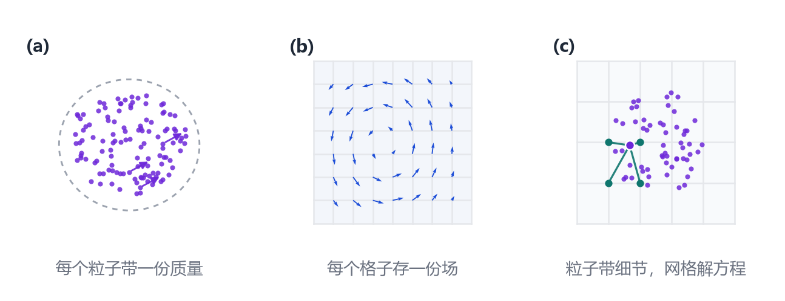
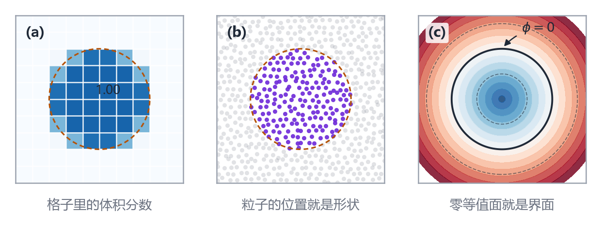
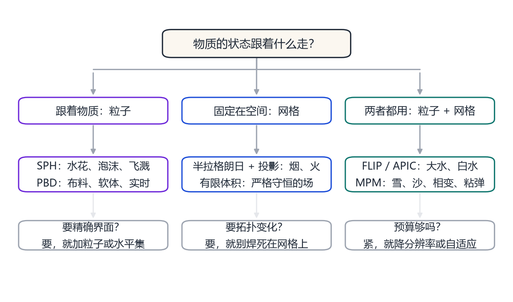

# 第 4 章 把连续的世界切成有限块

一杯水从杯口倒进另一只杯子。水柱先撞到杯底，摊开，沿着杯壁往上爬一小截，又落回去，中间卷进一团空气，几秒后炸成几个气泡浮上来。整个动作不到两秒，形状却一直在变，没有哪一帧重复过。

现在要把它放进程序里。第一件麻烦事不是方程，是“存”。一块水里有无穷多个点，每一点都有自己的速度，而计算机只能存有限个数。你必须先决定：存哪有限个数，以及怎么从这些数里把“一块水”还原出来。

这一章讲的就是这个决定。它比后面所有的公式都更早发生，也更深地决定了你能做什么、不能做什么。

## 4.1 从连续到离散

连续介质假设是流体力学的地基：在远大于分子间距、远小于物体尺度的范围内，可以认为物质连续铺满空间，每一点有密度 $\rho(\mathbf{x},t)$、速度 $\mathbf{u}(\mathbf{x},t)$、压力 $p(\mathbf{x},t)$。这些场是定义在连续空间上的函数，自由度无限。

这个假设本身就是一个模型。水在纳米尺度上是离散的分子，在杯子尺度上才“连续”；选哪个尺度，决定了你该不该相信那套偏微分方程。天气模式的网格是几公里，海洋环流模式的网格是几十公里，它们都工作在连续假设成立的范围内。

离散化的第一层含义，是把无限自由度压成有限个。做法只有两大类，第三类是它们的组合。

一种是把物质分成有限块，每块记住自己的身份，跟着物质一起跑，这叫拉格朗日视角。另一种是把空间分成有限块，每个位置记住此刻流过它的物质处于什么状态，物质从格子之间穿过去，这叫欧拉视角。

<figure class="fig">

<figcaption><b>图 4-1</b>　三种记账方式（示意图）。左：粒子各自带着质量与速度随物质运动，粒子的外轮廓就是界面。中：网格固定不动，每个格点存一份速度场，物质穿过格子。右：粒子负责细节，网格负责求解，两者之间来回插值，这一步是后面 FLIP 与 MPM 的共同骨架。</figcaption>
</figure>

三种方式都会引入误差，来源有三处。

表示误差：几何被切成了块。一个球用三角面片表示就有了棱，一块水用格子表示，边界就变成阶梯。分辨率提高，误差下降，但永远不为零。

求导误差：微分被换成了差分。连续方程里的 $\partial u/\partial x$，在离散世界里只能用相邻两个值相减再除以间距。泰勒展开告诉我们，中心差分丢掉三阶项，误差 $O(h^2)$，$h$ 是网格间距；一阶迎风差分丢掉二阶项，误差 $O(h)$，但更稳。

采样误差：比网格小的结构直接消失。一朵直径小于格子的浪花，在网格上不存在；一个比粒子间距还小的气泡，在粒子法里同样不存在。这不是精度问题，是表达能力问题——离散之后，能表示的形状有一个最小尺度。

还有一处更隐蔽的：连续性假设失效。把雪当成连续介质，在雪崩的尺度上没问题；但要把雪压实成冰，颗粒之间的接触就变成主角，连续方程写不出来，得换离散元那一套。

## 4.2 拉格朗日视角：物质带着自己的账本

拉格朗日视角的想法很朴素：把物质切成小块，每块记住自己的位置、速度、质量，然后让它按自己的速度移动。

好处立刻显现。连续方程里的物质导数

$$
\frac{D\mathbf{u}}{Dt} = \frac{\partial \mathbf{u}}{\partial t} + (\mathbf{u}\cdot\nabla)\mathbf{u}
\tag{4.1}
$$

在拉格朗日描述里只剩下左边那一项——因为观测者跟着物质跑，对流项已经被“点自己在移动”这件事包含了。输运不需要额外的数值格式，物质带着自己的量走，不会因为网格平流被抹平。

第二个好处是拓扑自由。两股水可以合并，一滴水可以分裂成两滴，不需要任何特殊处理：粒子各自移动，靠近了就是合并，散开了就是分裂。

第三个好处是界面天然存在。粒子在哪里，物质就在哪里，粒子的外轮廓就是自由表面。渲染时只要把表面粒子连起来就行。

光滑粒子流体动力学（smoothed particle hydrodynamics，SPH）是最典型的粒子流体方法。它用一个核函数 $W(r,h)$ 把离散的粒子“抹”成连续场：位置 $\mathbf{x}$ 处的密度近似为

$$
\rho(\mathbf{x}) = \sum_j m_j\, W(\mathbf{x}-\mathbf{x}_j,\, h)
\tag{4.2}
$$

$m_j$ 是第 $j$ 个粒子的质量，$h$ 是核的支持半径（也叫光滑长度），求和遍历 $\mathbf{x}$ 附近的粒子。压力、粘性力都从密度场的空间导数得到，最终每个粒子受到的力只依赖它邻居的状态。邻居搜索靠哈希网格，把空间切成边长为 $2h$ 的格子，只查相邻的 27 个。

这套做法的问题很具体。表面上的粒子邻居少，密度求和天然偏低，算出来的压力也低，于是表面浮出一层“虚假低压”；解决靠重新归一化，或者补一圈虚拟粒子。压力用显式方法求解时，密度误差会变成压力振荡，逼得步长很小；后来的一批工作把压力改成隐式求解或者位置投影，就是为了把步长放开 [@macklin2013]。

采样噪声是另一个麻烦。粒子分布不均匀，密度场就不光滑，压力梯度里带高频抖动，渲染出来是表面上的小凸起，看上去像在沸腾。加大核半径能把噪声压平，代价是把细节一起抹掉。

物质点法（material point method，MPM）的粒子略有不同。它不把粒子当成流体微团，而是让每个粒子带上一小块物质的完整信息：质量、体积、初始位置，以及一个 3×3 的变形梯度 $\mathbf{F}$，记录这块物质从初始构型到当前构型被拉成了什么形状。粒子本身不连网格，但它周围会临时铺一层背景网格来算应力——这是 4.4 节的话题。

## 4.3 欧拉视角：格子不动，物质流过去

欧拉视角反过来：空间切成一格一格，每格存此刻流经它的物质的状态。物质在动，格子不动。

这个方法的历史比计算机长。有限差分把导数换成差商，直接在格点上解偏微分方程；有限体积把方程写成“一个格子里某个量的变化，等于穿过它表面的通量之和”，守恒性直接写在格式里。

守恒这一点值得展开。有限体积法里，每个格子记录的是体积分——总质量、总动量、总能量。相邻格子共享一个面，同一条通量在一侧被减去、在另一侧被加上，符号相反。整片区域加起来，内部通量全部抵消，只剩边界上的进出。这意味着无论网格多粗，总质量都严格守恒。

有限差分没有这个性质。它保证的是“差分方程的解逼近微分方程的解”，守恒只在极限意义下成立。但有限差分结构简单、容易高阶化，在规则网格上仍然是主流，图形学的流体基本都用它，因为好写、好并行。

欧拉方法的代价集中在一个地方：平流。格子固定，物质穿过格子，你得决定“上一时刻在别处的量，怎么搬到这个格子里”。最直接的做法是半拉格朗日：对每个格子，沿着速度方向往回追一步，看它上一时刻在哪，再插值取回那个位置的值 [@stam1999]。

半拉格朗日无条件稳定，可以取大步长，写出来只有十几行。代价是数值耗散：每次插值都是一次低通滤波，细节被抹掉一点，反复多次之后，烟变得像棉花，水失去小漩涡。这是 Stable Fluids 之后二十年里图形学流体最常被抱怨的问题，各种涡量约束、误差补偿格式都是冲着它去的。

第二个代价是界面。网格里存的是密度或者体积分数，界面只能通过“哪些格子有物质”间接表示。要拿到光滑的表面，得靠等值面提取或者水平集，这是 4.5 节的内容。

第三个代价是各向异性。方形网格对沿轴方向的流动和对角方向的流动处理得不一样，球形冲击波在粗网格上会变成方的。加密能缓解，不能消除。

换来的好处也实在：规则的数据结构，缓存友好，容易并行；压力泊松方程有成熟的稀疏求解器；隐式积分可以取大步长；整个流程能做成无条件稳定。

## 4.4 混合视角：粒子带细节，网格解方程

两种视角各有死穴。粒子不会平流耗散，但邻居搜索贵、压力难解；网格求解稳定、压力好解，但平流耗散、界面模糊。

混合方法想把两边的好处都拿到。思路是分工：让粒子带住物质的身份和细节，让网格承担需要全局耦合的计算，尤其是压力的泊松方程。

粒子网格法（particle-in-cell，PIC）是最早的版本，1960 年代为流体计算而发明 [@harlow1964]。流程三步：把粒子的质量、动量散布到网格上（粒子到网格，P2G）；在网格上解方程，算出新的速度场；再把网格速度插值回粒子（网格到粒子，G2P）。粒子本身不存速度场，只是网格场的采样点，所以 PIC 的耗散和纯网格一样大，粒子在这里没带来细节。

FLIP（fluid-implicit-particle）改了一步 [@brackbill1986]。它不让粒子直接取网格速度，只把网格速度的变化量加到粒子原有的速度上：粒子保住自己的速度，网格只提供“这一步该加速多少”。这样一来，粒子保留了亚网格尺度的旋转，水花能甩出细丝，烟能卷起小涡。代价是噪声：粒子速度场不再和网格严格一致，密度出现颗粒感，需要额外滤波，或者把 FLIP 与 PIC 按比例混合。

APIC（affine particle-in-cell，仿射粒子网格）再往前一步 [@jiang2015]。它让每个粒子除了速度，还带一个仿射矩阵，记录邻域内速度的线性变化；插值回网格时用这个矩阵重建，角动量不再丢失。PIC 会莫名其妙地让水停止旋转，FLIP 好一些但仍有损失，APIC 基本不丢，实现只多了一个 3×3 矩阵的存储和几次乘法，现在已经是很多引擎的默认选择。

MPM 把同样的分工用在固体和颗粒上 [@stomakhin2013]。粒子带质量、体积和变形梯度 $\mathbf{F}$，网格只在这一帧临时铺开：P2G 把质量和动量搬上网格，网格上算应力、积分、处理碰撞，G2P 再把速度带回粒子并更新 $\mathbf{F}$。网格用完就丢，下一步重新铺。

这套结构给了 MPM 几样别人没有的能力：大变形不撕裂（粒子之间没有连接）、拓扑变化自然（雪可以压实、可以分裂）、材料模型随便换（弹性、塑性、颗粒、雪的本构都只是应力公式不同）。代价是两次插值既带来耗散也带来噪声，粒子数不够时会出现团块，网格太粗时细节会丢。

浸没边界法（immersed boundary）是另一种混合，思路不同：结构（一面旗、一颗跳动的心脏）用拉格朗日方式表示，流体用欧拉网格，两者通过力耦合——结构在网格上撒力，网格把速度插值回结构。网格不需要贴合物体，省掉了动网格的麻烦；代价是界面被抹在几个格子宽度里，锐利的边界拿不到。

## 4.5 界面怎么表示

前面反复提到界面。水和空气之间、雪和空气之间，那个面在数值上究竟怎么存，是一个独立的问题，可以脱离具体的求解器来谈。

最直接的是显式表示：用三角网格，顶点就落在界面上。优点是精确，渲染可以直接用，碰撞检测也直接。缺点是拓扑变化要重连：水花分裂成两滴，网格得撕开再缝合，代码里全是特例。有工作专门处理这种重连，代价是复杂度上升、鲁棒性下降 [@molino2004]。

另一种是隐式表示：不存面，存一个定义在全空间的标量函数 $\phi(\mathbf{x})$，界面就是 $\phi=0$ 的等值面。$\phi$ 取负值表示在内部、正值表示在外部（反过来也行，只要全书统一）。如果进一步要求 $\left|\nabla\phi\right|=1$，这个函数就叫有向距离场，$\phi(\mathbf{x})$ 的绝对值就是到界面的距离。

<figure class="fig">

<figcaption><b>图 4-2</b>　同一个圆（半径 0.30，圆心在格子正中）的三种表示，全部由解析圆的公式计算得到。左：10×10 网格上的体积分数，格内按 24×24 采样求圆所占比例，界面附近的格子是 0 到 1 之间的小数。中：粒子按六边形排布加抖动，圆内保留、圆外淡显，粒子的位置本身就是形状。右：水平集 $\phi$ 的填色，黑线是 $\phi=0$，虚线圈是 $\phi=\pm0.15$。</figcaption>
</figure>

图 4-2 是同一个圆在三种表示下的样子。三种都能描述这个圆，误差分布却完全不同：体积分数在边界上被量化成格子宽度，粒子在表面留下采样间隙，水平集在曲率大的地方丢掉细节。

水平集的好处是拓扑自由。两滴水平集靠近，零等值面自动合并，不需要任何重连代码，分裂也一样。求法向、求曲率都是对 $\phi$ 求导，一次差分就够。渲染时用 marching cubes 提出三角面，或者直接做光线步进。

代价是体积不守恒。水平集被速度场推着走，数值误差会让它慢慢收缩，水面一点点变薄。解决的办法有两个：一是重新初始化，每隔几步把 $\phi$ 拉回距离函数的形状；二是把粒子混进来，让粒子记住体积，水平集只负责几何 [@enright2002]。后者是现在的标准做法，叫粒子水平集。

分辨率是第三个问题。三维网格的存储是 $O(N^3)$：$128^3$ 是两百万个格子，$512^3$ 是一亿三千万，后者还塞得进显存，再往上就难了。八叉树把网格做成自适应的，界面附近细、远处粗，内存降一个量级，代价是数据结构复杂，邻居查询和插值都不再是数组下标，代码量翻几倍 [@losasso2004]。

## 4.6 离散化的代价

把这几种视角放在一起看，会发现它们在几个固定的维度上互相交换。这些维度值得单独列出来，因为选方法的时候，你其实是在挑愿意付哪几笔账。

拓扑变化。粒子和水平集天生支持，界面分裂合并不用写一行特殊代码；三角网格要显式重连，固定网格则根本不追踪界面，代价是界面被抹成几个格子宽。水和烟的界面每秒都在分裂合并，这是图形学偏爱粒子和水平集的主要原因。

分辨率。三维均匀网格的内存随分辨率立方增长，粒子数可以按需要增减，但分布不均时稀疏区的精度会掉，自适应的代价是复杂度和并行效率。这三种选择之间的换算，是每次调参都要重新算一遍的东西。

守恒性。有限体积严格守恒，SPH 近似守恒（边界处尤其差），PIC 有采样噪声，MPM 在 P2G 与 G2P 之间会损失一点能量。守恒重不重要，取决于你要什么：算流量、算受力，守恒是底线；做一段三秒的动画，不守恒但看不出来，就无所谓。

耗散。半拉格朗日抹平细节，FLIP 补回一部分，粒子法几乎没有平流耗散但有采样噪声。耗散的可怕之处在于它是单向的：抹掉的细节再也回不来，跑得越久越糊。

各向异性。网格有方向偏好，粒子有采样偏好。方形网格上的圆形爆炸会变成方形，规则排布的粒子在某个方向上更“硬”。这些偏差在低分辨率下最明显，加密之后会缓解，但不会消失。

还有一条不在教科书里、但每个写过模拟的人都遇到过的代价：调试难度。网格法的 bug 表现为一片区域数值爆炸，粒子法的 bug 表现为某些粒子飞出去，水平集的 bug 表现为体积慢慢漏光。三种症状要三种排查思路，而同一份工程代码里往往三种都有。

## 4.7 怎么选

把前面的内容压成一张表，是这一章最实用的部分。

| 物质 | 主要特征 | 实时 | 离线 |
|---|---|---|---|
| 烟、火 | 没有自由表面，浮力主导 | 网格，半拉格朗日 | 网格，高阶平流 |
| 大水体 | 有界面，要细节 | FLIP 或 APIC | 粒子水平集 |
| 飞溅、泡沫 | 大量小尺度碎片 | SPH | SPH 加表面重建 |
| 雪、沙 | 大变形，会压实 | MPM，粒子少 | MPM，粒子多 |
| 布料、软体 | 薄，拓扑基本不变 | PBD 或 XPBD（位置动力学） | 有限元加隐式 |
| 刚体 | 形状不变 | 刚体求解器 | 同左，更高精度的接触 |
| 断裂 | 拓扑会变 | 预碎片加刚体 | 有限元加虚拟节点 |

<figure class="fig">

<figcaption><b>图 4-3</b>　选型决策树。第一层问状态跟着什么走，分成粒子、网格、混合三支；第二层给出每一支的代表方法；第三层是三个共同判据，按“界面—拓扑—预算”的顺序排列，因为前两个错了画面直接崩，预算不够只影响细节。</figcaption>
</figure>

图 4-3 是同一件事的决策版本。先问物质的状态跟着什么走，分成粒子、网格、混合三支；每一支再追问三个问题：界面要不要精确，拓扑会不会变，预算够不够。

这三个问题的顺序不该颠倒。界面对不对，是观众第一眼就能看出来的；拓扑变化处理不好，画面会直接崩掉；预算不够只影响细节多少。前两个错了，细节再多也没用。

还有一个经常被忽略的事实：一套模拟里通常有两套表示，求解用一套，渲染用另一套。MPM 用粒子求解，渲染时提取表面；FLIP 用粒子加网格求解，渲染时再建一张三角网格；SPH 用粒子求解，表面用各向异性核或者屏幕空间方法重建。两套表示之间的转换本身是一道工序，也会引入误差——从粒子提取出来的水面，体积可能比粒子本身少百分之几。

理解这一点之后，选型就不再是“哪个方法最好”，而是“哪条链路上我愿意付哪笔账”。烟愿意用网格换稳定，水愿意用粒子换细节，雪愿意用两套表示换大变形，布料愿意用约束换步长。每一笔账都有代价，没有一笔是白拿的。下一章从最简单的固体开始，把它逐项拆开。
