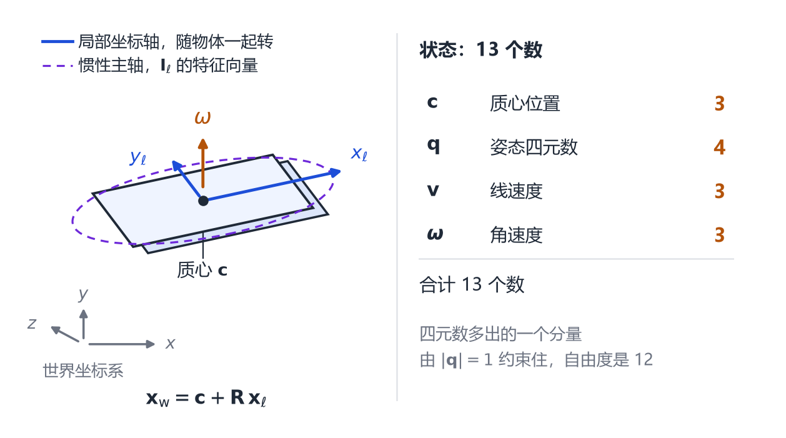
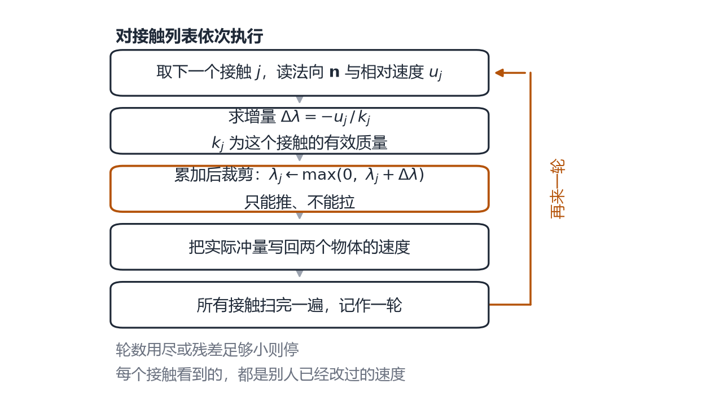
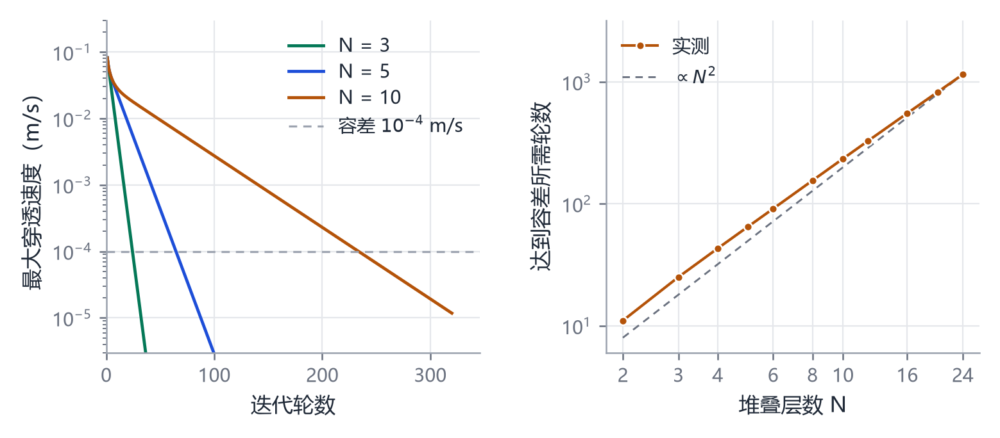

# 第 5 章 刚体：从台球到倒塌的塔

> 本章导读：这一章从一杆台球讲起。一个不会变形的物体需要记住什么，怎么往前走一步，撞上了怎么算，一堆这样的东西摞在一起又为什么格外难。读完你会知道刚体模拟的重心不在牛顿定律，而在“几十个接触必须同时成立”这件事上。

## 5.1 一颗球要记住什么

台球桌上，白球撞向红球。要模拟这一杆，第一个要回答的问题不是“力有多大”，而是“球现在处于什么状态”。

位置好办，三个数；速度也好办，三个数。麻烦在姿态：球在滚也在转，转到哪个角度了，该怎么存。

最直接的想法是三个角：绕三根坐标轴各转多少。飞机上的滚转、俯仰、偏航就是这么一套，动画软件里也到处是它。三个数，直观，好调，可拿它做动力学会在三个地方出问题。

第一个是死锁。让物体先绕 $y$ 轴俯仰 90 度，此时它的 $z$ 轴指向正上方。接下来不管你说“绕 $z$ 轴转”还是“绕 $x$ 轴转”，从外面看都是绕同一根竖直轴。两个参数退化成一个，你少了一个能用的方向。这不是数值误差，是这套参数本身有个洞，飞行器做特技时的万向节死锁说的就是它。

第二个是插值与比较。两个姿态之间“正中间”的那一个怎么取？三个角各自取平均，得到的常常不是最短的那条路，有时还会绕远路转一整圈。角度又有周期性：359 度和 1 度只差 2 度，数值上却差 358。

第三个最容易被忽略：角速度不是三个角的导数。角速度描述的是绕某根瞬时轴的转速，而三个角的变化率与它之间隔着一个随姿态变化的矩阵，这个矩阵在死锁点不可逆。所以“角度增量等于角速度乘时间”这句看似天经地义的话，只在姿态接近零位时才近似成立。

替代品是四元数：四个数 $(w,x,y,z)$，约束是长度为一，表示绕单位轴 $\mathbf{n}$ 转过角 $\varphi$：

$$
\mathbf{q} = \left(\cos\frac{\varphi}{2},\ \sin\frac{\varphi}{2}\,\mathbf{n}\right)
$$

四个数表示三个自由度，多出来的那一个由长度约束占掉。角速度 $\boldsymbol{\omega}$ 推着它往前走：

$$
\mathbf{q} \leftarrow \mathbf{q} + \frac{\Delta t}{2}\,(0,\boldsymbol{\omega}) \otimes \mathbf{q}
$$

$\Delta t$ 是时间步，$\otimes$ 是四元数乘法。容易写反的地方是：$\boldsymbol{\omega}$ 在物体自己的坐标系里表达时乘左边，世界坐标里表达时乘右边，写反了物体会朝反方向转。乘完还要归一化，否则长度会漂。

于是刚体的状态是：质心位置 $\mathbf{c}$ 三个、姿态 $\mathbf{q}$ 四个、线速度 $\mathbf{v}$ 三个、角速度 $\boldsymbol{\omega}$ 三个，一共十三个数，对应十二个自由度。图 5-1 把它们放在一起。

<figure class="fig">

<figcaption><b>图 5-1</b>　刚体的状态。质心 $\mathbf{c}$ 与姿态 $\mathbf{R}$ 一起把局部坐标里的点送到世界坐标：$\mathbf{x}_{\mathrm{w}}=\mathbf{c}+\mathbf{R}\mathbf{x}_{\ell}$。蓝线是随物体转动的局部坐标轴，虚线椭圆标出惯性主轴的方向，$\boldsymbol{\omega}$ 从质心画出。右侧把状态拆成十三个数：四元数多出的那一个分量由长度约束占掉，真实自由度是十二。</figcaption>
</figure>

## 5.2 转起来和推起来不是一回事

推门这个动作，人人都会。

手放在门轴附近，怎么推都推不动；手挪到把手，一根手指就够。力一样，力矩不一样——力矩是力乘力臂。可还有第二层：换一扇更宽更重的门，把手离轴更远，还是更费力。到这一步，光有力臂就不够了，还得知道质量怎么摊开。

转动惯量说的就是这件事。绕固定轴转的杆，它是 $\sum_i m_i r_i^2$，$m_i$ 是质量元，$r_i$ 是它到轴的距离。挪到三维和任意轴，就得用矩阵：

$$
\mathbf{L} = \mathbf{I}\,\boldsymbol{\omega}
$$

$\mathbf{L}$ 是角动量，$\boldsymbol{\omega}$ 是角速度，$\mathbf{I}$ 是三乘三的惯性张量，对称，独立分量六个。对角线上那三个是绕三根坐标轴的转动惯量；非对角线上的叫惯性积，描述质量分布斜不斜。

举个能算的例子：边长 $a$、$b$、$c$、质量 $m$ 的长方体，绕质心、平行于 $a$ 边的轴，转动惯量是 $m(b^2+c^2)/12$。$a$ 没出现——绕那根轴转时，$a$ 方向的长短不参与，因为质量元到轴的距离只由 $b$、$c$ 决定。这种一算就清楚的地方，是理解惯性张量最省力的入口。

关键的一点：$\mathbf{I}$ 在物体自己的坐标系里是常数，在世界坐标系里会变：

$$
\mathbf{I}_{\mathrm{w}} = \mathbf{R}\,\mathbf{I}_{\ell}\,\mathbf{R}^{\mathsf{T}}
$$

$\mathbf{R}$ 是姿态矩阵，$\mathbf{I}_{\ell}$ 是局部坐标下的惯性张量。物体每转一下，$\mathbf{I}_{\mathrm{w}}$ 就变一次。每步都存这个乘积并不划算，更好的做法是压根不存，用的时候“转进去、乘、再转出来”：

$$
\mathbf{I}_{\mathrm{w}}\,\boldsymbol{\omega} = \mathbf{R}\left(\mathbf{I}_{\ell}\left(\mathbf{R}^{\mathsf{T}}\boldsymbol{\omega}\right)\right)
$$

很多引擎的代码里就是这个形式。

惯性张量还能对角化，三个特征向量叫惯性主轴。换到主轴坐标系，$\mathbf{I}_{\ell}$ 变成对角阵，三行各管一件事：绕哪根轴转得轻，看对应的特征值就知道。多数建模工具导出的碰撞体已经是对角化的，图 5-1 里那个虚线椭圆画的正是三个特征值的相对大小。

最后说一个选择：积分角速度，还是积分角动量。

把 $\boldsymbol{\omega}$ 当状态，欧拉方程是

$$
\mathbf{I}\,\dot{\boldsymbol{\omega}} = \boldsymbol{\tau} - \boldsymbol{\omega}\times(\mathbf{I}\boldsymbol{\omega})
$$

$\boldsymbol{\tau}$ 是力矩。多出来的叉积项不是笔误，它来自参考系自己在转。

改积分 $\mathbf{L}$，方程变成 $\dot{\mathbf{L}}=\boldsymbol{\tau}$，然后 $\boldsymbol{\omega}=\mathbf{I}^{-1}\mathbf{L}$。叉积项自动跑进了 $\boldsymbol{\omega}$ 里，不用手写。这个写法在无外力矩时让角动量严格守恒，长期更稳。陀螺的进动从这里看也最清楚：$\mathbf{L}$ 守恒，但 $\boldsymbol{\omega}$ 与 $\mathbf{L}$ 不平行，物体就一边自转一边把轴绕成一圈。这条现象在没有外力矩时也会发生，用积分 $\boldsymbol{\omega}$ 的写法很容易把它算丢。

## 5.3 一步怎么走

有了状态和惯性张量，走一步似乎就是把牛顿定律抄一遍。真做起来，麻烦出在“力从哪来”。

台球桌上，除了重力，力只在球撞上球的那一瞬间存在。用显式积分算这个力就会遇到尴尬：力在一步之内从零涨到极大再落回零，显式法用的却是常值力。步长小到能分辨这次撞击，别的地方就白算了；步长大到能算完一桌球，撞击就被抹平，或者干脆当作没发生。

常用解法是绕开“力”，直接改速度。两个物体相撞，不管那一瞬间的力曲线长什么样，它做的事可以概括成一句话：把相对速度从“正在接近”改成“不再接近”。达成这个改动的量叫冲量，单位是牛·秒。

碰撞前相对速度沿法向的分量记作 $u$，接近时为负。恢复系数 $e$ 描述弹性：完全非弹性取 0，完全弹性取 1。撞完之后相对速度该是 $-eu$，需要补上的差是 $-(1+e)u$。有效质量 $k$ 把这个速度差换成冲量：

$$
\lambda = -\frac{(1+e)\,u}{k}, \qquad \mathbf{v} \leftarrow \mathbf{v} + \mathbf{M}^{-1}\boldsymbol{\lambda}
$$

$\mathbf{M}$ 是质量矩阵（含转动部分），$k=\mathbf{n}^{\mathsf{T}}\mathbf{M}^{-1}\mathbf{n}$，$\mathbf{n}$ 是接触法向。$k$ 的物理意义很直白：沿法向推一下，相对速度改变多少。

冲量法有两种组织方式。事件驱动只在真撞上时推进时间，碰撞稀疏时很划算，一个事件只牵动两个物体；但物体一挤，事件之间的间隔就趋近于零——一叠球靠在一起，每解决一个接触就造出新的接触，时间再也推不动，这叫 Zeno 现象。时间步驱动把步长固定，每一步把所有接触当成一组约束一起解，不保证“撞了就精确分开”，但保证步末的速度是非穿透的。游戏和多数实时引擎走这条路 [@todorov2012]。

这种方式在实时场合受欢迎，原因不在精度，在结构。每个接触只需要读两个物体的速度和逆质量，改完立刻写回，不用把所有物体拼成一个大矩阵，不用分解，不用求逆。这意味着它可以随时中断——十六毫秒用完了就停，下一帧接着来；也意味着它天然能并行，只要同时处理的接触不共享物体。代价是解不精确，迭代不够时残留穿透和抖动。

## 5.4 先筛后算

一桌球只有十几颗，两两测也没事。可一场景里几百上千个物体时，两两测就是 $O(N^2)$ 的对数。碰撞检测因此分两级：先用便宜的办法排掉绝大多数“肯定没碰上”的对，剩下的再做精确计算。

粗筛（broad phase）的目标不是算准，是“绝不漏、尽量少”。

**轴对齐包围盒。** 给每个物体套一个各面都平行于坐标轴的盒子，盒子相交才可能碰上。测试只要六次比较，连乘法都不用；缺点是松——斜放的细杆，包围盒可能比杆本身大十倍。后面还有细筛，粗筛松一点不要紧，但总得再排一次序，否则依旧两两比较。

排序扫掠把盒子按 $x$ 下界排好往右扫，扫到某个盒子时只和“右边界还没过去”的那几个比，适合赛车这类在一维上拉得开的场景。层次包围盒（BVH）把盒子组织成树，父节点包住子节点，查询时从根往下剪枝，场景在动，树要每帧重建再合并，适合尺寸差异大、分布稀疏的场景。网格哈希把空间切成格子，每个物体登记到它覆盖的格子里，同格的才需互测，格子边长取平均尺寸时总代价接近 $O(N+k)$，$k$ 是真正可能相碰的对数，适合碎块、人群这类尺寸相近又挤在一起的场景。

细筛回答另一个问题：碰没碰、碰在哪、扎进去多深。三个名字经常一起出现。

**分离轴（SAT）。** 两个凸体不相交，当且仅当存在一根轴，把它们在这根轴上的投影分开。所以要判定相交，得把候选轴查一遍，找到一根分离的就收工。候选轴来自面法向和两组棱的叉积：二维时就是各条边的法向，三维凸包最多几十根。判定相交后，最浅的那根轴给出接触法向和穿透深度。SAT 给的是精确的接触信息，代价是必须有顶点和面。

**GJK。** 它不需要知道物体长什么样，只要一个接口：给定方向，返回物体在这个方向上最远的点。两物体的 Minkowski 差（$A$ 中的点减 $B$ 中的点）是否包含原点，等价于两物体是否相交。GJK 在这个差集上迭代：找当前单纯形上朝原点最远的点，加进来，扔掉用不上的顶点，缩小范围。单纯形从点、线段、三角形到四面体，最多四步就能判定。因为只用最远点函数，球、胶囊、凸包乃至隐式曲面都用同一套代码。

**EPA。** GJK 只回答相交与否，回答不了扎多深。EPA 接着它停下时的单纯形往下做，把差集的边界一点点撑开，找到离原点最近的那个面——法向是接触法向，距离是穿透深度。

还有一件常被低估的事：接触不是一个点。两个平面贴在一起，理论上是一个面；只取一个点，物体会绕着它翻。所以细筛之后要生成“接触流形”，把面与面的接触近似成二到四个点。这也是方块能堆起来、球堆不起来的直接原因之一。

## 5.5 一个接触要满足四件事

一个接触在速度层面要满足的条件，写下来是四句话。

第一，不许穿透。法向相对速度 $u$ 非负，两个物体在接触点上要么分开、要么贴着，不能继续靠近。说的是速度而非位置，位置上的穿透留到 5.7 收拾。

第二，只能推不能拉。法向冲量 $\lambda$ 非负。地面能顶住箱子，不能把箱子吸住。

第三，这两个条件里恰好有一个是“紧”的：

$$
\lambda\, u = 0
$$

要么冲量为零、两点自由分开（$u \gt 0$），要么冲量为正、两点贴死（$u=0$）。物理上这叫互补条件，一叠物体里每一个接触都得满足它。

第四，切向。切向冲量的大小不超过 $\mu\lambda$（$\mu$ 是摩擦系数），方向与滑动方向相反，这就是库仑摩擦锥。附带一条：在滑时切向冲量顶在锥面上，没滑时落在锥内，大小刚好抵消驱动力。

四条合起来是一个线性互补问题（LCP）[@stewart1996; @anitescu1997]。难在两处。$\lambda$ 在不同接触之间互相牵连：底板多顶一点，上面那层就少顶一点；而互补条件是“或”的逻辑，不是线性方程，不能直接写成矩阵求逆。精确解法要枚举哪些接触是“紧”的（这叫活跃集）[@baraff1994]，最坏情况下枚举量是指数的。

所以工程上几乎都用迭代法，最常见的是投影高斯-赛德尔（PGS），在刚体里常叫顺序冲量。想法很朴素：一次只照顾一个接触。把其他接触的冲量当定值，解出“只动这一个需要多少”，这一步是纯线性的：

$$
\Delta\lambda = -\frac{u}{k}, \qquad \lambda \leftarrow \max\left(0,\ \lambda+\Delta\lambda\right)
$$

$k$ 是有效质量，物体越重 $k$ 越大，同样的速度差需要的冲量越多。那个 $\max$ 就是“投影”：把解投回非负这个合法区域。然后用实际加进去的 $\Delta\lambda$ 改两个物体的速度，接着处理下一个接触。

摩擦也用同样三步，方向换成两个切向，最后按摩擦锥裁剪：超出 $\mu\lambda$ 的部分按比例缩回锥面。

图 5-2 画出这一轮的流程。注意两点：每个接触看到的都是被前面的接触改过的速度，所以扫一遍不等于解一遍；什么时候停都行，停下来就是一个近似解。

<figure class="fig">

<figcaption><b>图 5-2</b>　顺序冲量求解的一轮。橙色那一步是投影：算出增量后把累积冲量裁到非负，多出的部分丢弃，真正生效的冲量再写回速度。扫完所有接触算一轮，重复若干轮。</figcaption>
</figure>

PGS 之所以有效，是因为它是约束优化里的坐标下降，每处理一个接触都让残差单调不增；这也解释了它为什么慢，一次只动一个变量，信息传得慢。

提速最有效的一招是热启动：拿上一帧解出的冲量当这一帧的初值。相邻两帧的接触力变化很小，一个好初值能省掉大半迭代，代价是接触得有稳定的身份，所以引擎要维护接触缓存。另一条路是换求解器：直接法在中小规模上很准，分裂类方法把问题拆成“解线性系统”和“投影”交替，障碍函数法则把非穿透写进能量，从根上避开组合爆炸 [@li2020]。

## 5.6 塔为什么站不住

拿十个一公斤的盒子叠起来。重力把它们各往下拉一点，这一步显式算完，速度和位置都有了。接下来让求解器把它们按住。

麻烦在于，按住十个盒子不是一个接触的事：最底下那个要顶住十个盒子的重量，最上面那个只顶一个。谁该出多大力，本身是一组方程。

PGS 一次只处理一个。从下往上扫，第一个接触只知道自己要顶住“一个盒子”，不知道上面还压着九个，于是给了一个偏小的冲量；第二个接触接着补，第三个再补。扫完一遍，最上面那层被按住了，可它多出来的冲量又反作用到下面，把下面重新压下去。信息一轮只能往上走一层，所以十层的塔至少要十轮，实际要几十轮才收敛。

参数是这样：十个盒子各一公斤，叠在无穷大质量的地面上，步长六十分之一秒，重力九点八一米每二次方秒，恢复系数零，摩擦系数零点六（对法向解没影响）。结果在图 5-3。纵轴是最大穿透速度，横轴是迭代轮数，三条线分别对应三层、五层、十层。十层那条扫到第三百轮，残差还在十的负五次方量级——看着小，乘上六十帧就是一秒内肉眼可见的下沉。

右图是达到容差所需轮数随层数的变化，双对数下几乎是一条斜率 2 的直线：层数翻倍，轮数涨四倍。二十层的塔要八百多轮。这就是堆叠被单独当成一个课题的原因——不是精度问题，是收敛阶的问题。

<figure class="fig">

<figcaption><b>图 5-3</b>　一维堆叠的 PGS 收敛（真实计算）。十个一公斤的盒子叠在无穷大地面上，步长六十分之一秒，重力九点八一，恢复系数零，接触自下而上逐个扫描。左图：三层、五层、十层的最大穿透速度随轮数下降，虚线是每秒十的负四次方的容差。右图：达到该容差所需轮数随层数变化，虚线正比于层数平方。</figcaption>
</figure>

收敛慢之外还有两个病。

一是抖动。物体静止时微微颤，来源有三个：迭代没收敛，重力每一步注入的能量又被约束抽走；恢复系数被误触发，把微小接近速度当成碰撞速度，弹了一下；以及求解顺序在帧与帧之间来回翻。

二是穿透。速度层面做到了非穿透，位置层面未必。物体一步走了 $\Delta t\, v$，如果这步比它自身的厚度还长，它就直接穿过去，或者卡在另一个物体里。这不是求解器无能，是离散时间本身的缺陷。

## 5.7 真正在引擎里做的事

真写引擎时，稳定性和手感靠的是一堆补丁。挑五个最有用的说。

**子步。** 把一帧分成四到八块，每块只做很少的迭代 [@macklin2019]。总工作量差不多，结果却稳得多：每块里速度变化小，线性化更准；接触点变化小，热启动更有效；穿透浅，修正压力也小。代价是并行度下降，还要在“少步多迭代”和“多步少迭代”之间做实验。

**Baumgarte 稳定化。** 位置上的穿透总得修。最直接的办法是给约束加一个偏置：把穿透深度 $d$ 换算成允许的分离速度 $\beta d/\Delta t$ 加进约束，$\beta$ 取 0.1 到 0.3，穿透就会在几帧内被推出去。毛病是往系统里注入了能量：物体被“顶”出来，速度凭空多了一点，堆叠时这些虚假速度互相干扰，表现为塔自己在晃。

**分离冲量。** 修 Baumgarte 的办法是把位置修正挪到另一个通道：真实速度照常解，另算一组伪速度，只用来推位置，算完就扔 [@kaufman2008]。穿透照样被修掉，能量一点没多，代价是多一遍求解。

**休眠。** 一堆箱子放在地上一动不动，没什么好算的。给每个物体记一个安静计时器，速度连续低于阈值超过半秒就冻住，不再参与求解，也不再被检测，有东西撞上来时唤醒。这一条对性能的贡献往往比优化求解器还大，对画面则把抖动一并去掉。

**连续碰撞。** 子弹打薄墙、硬币落地、快速挥动的刀，一帧走的路超过自身厚度，离散检测必然漏。做法之一是保守前进：先算这一步能走到哪，中途会碰就把时间截断在碰撞时刻，处理完再把剩下的时间走完。另一种是投机接触：还没贴上就提前建立约束，允许接触距离为负，求解器自然会在该停的地方停住。前者精确但复杂，后者简单但要多解假接触。

最后一件小事：求解顺序。把所有接触按“共享物体的不能相邻”分组，组内并行、组间顺序，既拿到并行度，又保住收敛性质。

这些补丁加起来，才让“堆一座二十层的塔并且让它站着”成为可能。它们没有一个在物理上更正确，都是为了让一个近似解在有限预算内看起来对。
