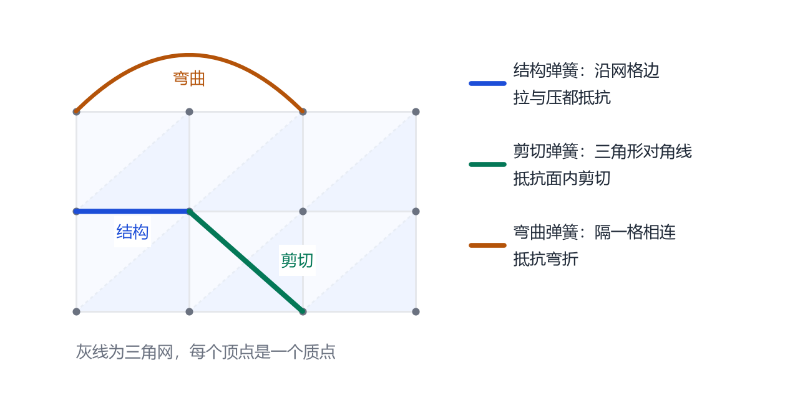
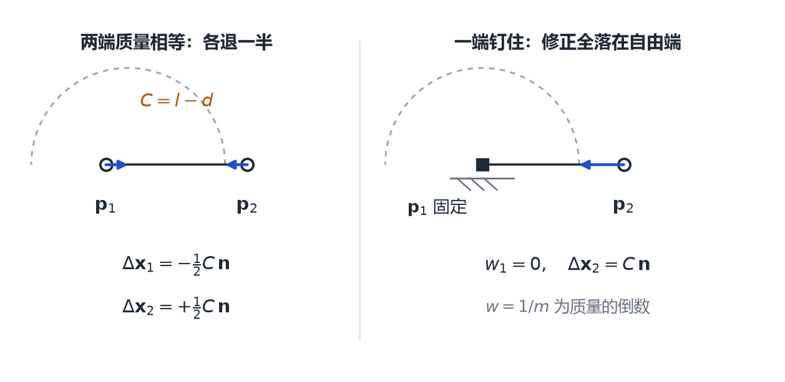
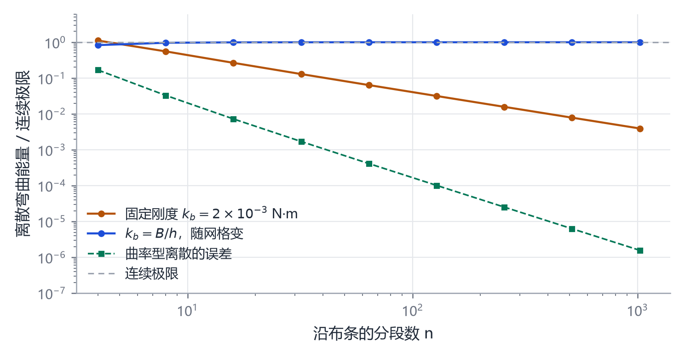

# 第 6 章 布料与柔体：会皱的世界

> 本章导读：一块布垂下来，褶皱会自己长出来。这一章讲清这么薄的东西为什么难算，从最笨的弹簧网格一路讲到影视和游戏各自的做法，中间会反复撞上同一个陷阱：网格一加密，布就变软。

## 6.1 薄的东西为什么难

桌布从桌面垂下来，垂到一半开始起褶。没人规定褶子长在哪，它们自己就长出来了，位置由布的重量、桌角的形状和布本身的软硬共同决定。换成一块同样大小的橡皮板，它只会老老实实往下弯，不起褶。

差别在厚度。布只有零点几毫米，长宽以米计，长短比是几千比一。这个比例带来三个后果。

第一，不能把它当成“很薄的实体”来做。把一块布离散成四面体网格，这些四面体在厚度方向上只有一层，形状极度扁平。有限元在这种退化单元上算出来的应变和法向全是噪声，网格一变形就翻转，能量爆掉。

第二，两个方向的刚度差得太多。沿布面拉伸，一块棉布几乎拉不动；垂直布面弯折，一根手指就能折起来。拉伸刚度和弯曲刚度之间隔着四到六个数量级。这个差距直接进入刚度矩阵的条件数，而条件数决定了迭代法要迭代多少次、显式法能用多大的步长。

第三，布几乎不受约束。刚体有“不能变形”这条硬约束，误差大多被约束吃掉；布只有面内两个方向的伸缩约束，第三个方向是自由的。任何一点求解误差都会跑到面外去，变成褶皱、抖动，或者整块布飞走。这不是夸张，布料模拟里最常见的失败画面，就是布自己抖成一团。

再加上自碰撞：布一折叠，两层布之间的距离小于自己的厚度，要不要算碰是个很难定的判据；而布动辄几万个三角形，碰撞对数按平方涨。几个难点叠在一起，才有了后面这一串专门的方法。

## 6.2 把布缝成一张弹簧网

最直接的做法：把布离散成一张质点网格，质点之间连弹簧，用牛顿第二定律推着走。

弹簧可以连三种（图 6-1）。沿网格边的叫结构弹簧，抵抗拉伸和压缩；三角形对角线的叫剪切弹簧，抵抗面内剪切（正方形格子被推成菱形时边长并不变，结构弹簧察觉不到这件事）；跨过一格、把隔着中间顶点的一对质点连起来的叫弯曲弹簧，抵抗弯折。三类缺一不可：没有剪切弹簧，布会像渔网一样塌成一条线；没有弯曲弹簧，布会软塌得毫无挺括感。

一根弹簧的力是最简单的胡克定律：

$$
\mathbf{f} = -k\left(|\mathbf{x}_{ij}| - L\right)\hat{\mathbf{x}}_{ij}
$$

$k$ 是刚度，$L$ 是静止长度，$\mathbf{x}_{ij}$ 是两质点的位置差，$\hat{\mathbf{x}}_{ij}$ 是它的单位方向。把它加进显式积分，一步就完事。

问题出在 $k$ 上。显式积分的稳定条件是 $\Delta t$ 小于 $2\sqrt{m/k}$，$m$ 是质点质量。取一组看起来合理的数：边长一厘米的网格，每个质点一克，要让布“拉不动”，$k$ 得取到十万牛每米的量级。于是 $\omega=\sqrt{k/m}\approx 10^{4}$ 弧度每秒，稳定步长约 0.2 毫秒。一帧十六毫秒，需要八十个子步。

八十个子步意味着八十倍的力计算和八十倍的邻居遍历，实时就没了。这不是实现问题，是模型本身的刚性：真的布就是很硬，而显式积分最讨厌硬的东西。

Provot 在 1995 年给了一个很实用的绕法 [@provot1995]。先用偏小的 $k$ 跑，让布允许被拉长；跑完检查每根弹簧，把超过静止长度一定比例（比如一成）的那些直接拉回阈值。这一步不是物理，是几何修正，效果却出奇地好——人对布料的感觉主要来自“拉不长”，而不来自拉伸曲线是不是线性。这是位置修正的雏形，过了十来年 PBD 把它做成了整套方法。

另一条路是隐式积分：$k$ 再大也稳定，代价是每步解一个线性系统。这条路在影视里成立，在当年的实时里不成立。

<figure class="fig">

<figcaption><b>图 6-1</b>　三角网上的三类弹簧。结构弹簧沿网格边，剪切弹簧走三角形的对角线，弯曲弹簧跨过一个顶点把相隔一格的质点连起来（画成弧线只是为了不和网格边重合）。网格越密，同一根弯曲弹簧跨过的物理长度越短，它的刚度必须跟着改。</figcaption>
</figure>

## 6.3 把力换成约束

PBD（基于位置的动力学）[@muller2007] 换了个路子：不算力，直接改位置。

一步分三段。先按速度自由飞，$\mathbf{x}^{*}=\mathbf{x}+\Delta t\,\mathbf{v}$，$\mathbf{x}$ 是位置。再对每个约束做投影，把位置改到满足约束的地方。最后用位置差反算速度，$\mathbf{v}=(\mathbf{x}^{*}-\mathbf{x})/\Delta t$。

中间那步是核心。以距离约束为例，约束是 $C=|\mathbf{p}_1-\mathbf{p}_2|-d$，$d$ 是静止长度。$C$ 不为零时，把两个点沿它们的连线各推一段，让距离回到 $d$：

$$
\Delta\mathbf{p}_1 = -\frac{w_1}{w_1+w_2}\,C\,\mathbf{n}, \qquad
\Delta\mathbf{p}_2 = +\frac{w_2}{w_1+w_2}\,C\,\mathbf{n}
$$

$w=1/m$ 是质量的倒数（叫逆质量），$\mathbf{n}$ 是从 $\mathbf{p}_1$ 指向 $\mathbf{p}_2$ 的单位向量，$C$ 就是上面那个距离误差。分配比例是逆质量之比：轻的那个点让步多，被钉死的点（$w=0$）一点不让。图 6-2 画的就是这件事。

这个式子为什么稳？因为它在位置层面干活。不管 $C$ 有多大，投影只做一件事：把 $C$ 变小，没有任何一步会把它放大。显式积分则相反，一步走过头会让力变大，力变大又让下一步走得更过头。

代价有两个。一是刚度变成了迭代次数的函数：迭代十轮和迭代五十轮，布的软硬不一样。二是速度由位置差反算，相当于偷偷加了阻尼，能量不守恒，布看起来“没有弹性”就是这个原因。

XPBD [@macklin2016] 修的是第一个。它给每个约束引入柔度 $\alpha=1/k$（$k$ 是约束刚度，单位牛每米），并在迭代中累积拉格朗日乘子 $\lambda$：

$$
\Delta\lambda = \frac{-C-\tilde{\alpha}\lambda}{w_1+w_2+\tilde{\alpha}}, \qquad
\tilde{\alpha}=\frac{\alpha}{\Delta t^{2}}
$$

$\tilde{\alpha}$ 是把柔度换算到“每步”的量纲。位置按 $\Delta\lambda$ 更新，方式和 PBD 一样。

结果很关键：刚度不再依赖迭代次数。迭代少了只是没收敛（表现为偏软），材料参数本身没变；迭代多了就趋向设定的刚度。$\alpha$ 取零时退化成 PBD 的硬约束。

有个坑要交代：这里的 $k$ 是“一根约束的刚度”，不是材料的杨氏模量。同一个材料，网格加密后每根弹簧代表的长度变短，$k$ 必须跟着换算，否则细分之后布又变软。这件事在 6.6 会以弯曲的形式再出现一次。

<figure class="fig">

<figcaption><b>图 6-2</b>　距离约束的投影。虚线弧是满足 $|\mathbf{p}_1-\mathbf{p}_2|=d$ 的所有位置，当前两点相距 $l \gt d$，投影把两点沿连线各拉回一段。左边两端质量相等，各退一半；右边一端被钉住（逆质量为零），修正全落在自由端。</figcaption>
</figure>

## 6.4 有限元：从能量出发

弹簧模型有个毛病：它不来自连续体。同样一块布，网格密一倍，弹簧多一倍，整块布就硬一截，参数得重调。有限元从能量出发，没有这个问题。

核心是一个量：变形梯度 $\mathbf{F}$，直观上它描述“一小块材料被拉成了什么样”。布是二维流形，$\mathbf{F}$ 是二乘三矩阵。行列式 $J=\det\mathbf{F}$ 度量面积变化，$J=1$ 表示没有压缩；$J$ 趋零表示被压扁，$J$ 为负表示翻转。

有了 $\mathbf{F}$ 就能写能量密度 $W(\mathbf{F})$，单位是能量每面积。整个物体的应变能是 $W$ 在材料上的积分，力是能量对位置的导数——只要能写出 $W$，剩下的都是机械的。

最常用的两个 $W$。St. Venant–Kirchhoff 用应变 $\mathbf{E}=(\mathbf{F}^{\mathsf{T}}\mathbf{F}-\mathbf{I})/2$，

$$
W = \frac{\lambda}{2}\left(\mathrm{tr}\,\mathbf{E}\right)^{2} + \mu\,\mathrm{tr}\left(\mathbf{E}^{2}\right)
$$

$\lambda$、$\mu$ 是拉梅常数，$\mathbf{I}$ 是单位矩阵。它简单、便宜，坏处在压缩时能量反而下降：把一块材料压到翻转，能量不升反降，求解器会主动往那里跑。

Neo-Hookean 修了这一点：

$$
W = \frac{\mu}{2}\left(\mathrm{tr}\left(\mathbf{F}^{\mathsf{T}}\mathbf{F}\right)-3\right) - \mu\ln J + \frac{\lambda}{2}\left(\ln J\right)^{2}
$$

关键是 $-\mu\ln J$ 这一项：$J$ 趋近零时它趋向正无穷，材料被压扁的代价无限大。翻转必须先穿过 $J=0$，于是被自动挡住。这就是它在图形学里几乎是默认选择的原因 [@irving2004]。

离散的做法：把布切成三角形，单元内用线性形函数插值，于是 $\mathbf{F}$ 在整个单元内是常数。每个单元的能量就是一个 $W$ 乘面积，对顶点求导得到力，装配成整体，得到稀疏矩阵；隐式积分之后解一个稀疏线性系统。困难的部分从物理转到了线性代数。

代价也在这里：$\mathbf{F}$ 在单元内是常数，一个三角形只能表示均匀变形，弯曲必须靠相邻三角形的夹角来表达。三角形网格对弯曲天然“过刚”，所以布料里常常要单独补一套弯曲能量。

这套东西不限于布。果冻、肌肉、橡胶件，只要是会变形但不会流动的东西，换个能量密度就是另一种材料。

## 6.5 隐式积分与投影动力学

隐式积分写下来是一句话：下一步的位置，要让下一步的力自己成立。

$$
\frac{\mathbf{M}}{\Delta t^{2}}\left(\mathbf{x}_{n+1}-\mathbf{x}_{n}-\Delta t\,\mathbf{v}_{n}\right)
= -\nabla E(\mathbf{x}_{n+1}) + \mathbf{f}_{\mathrm{ext}}
$$

$\mathbf{M}$ 是质量矩阵，$\nabla E$ 是内力（能量对位置的梯度），$\mathbf{f}_{\mathrm{ext}}$ 是外力。右边依赖未知的 $\mathbf{x}_{n+1}$，所以这是一个非线性方程。

标准解法是牛顿法：每步线性化，解 $\left(\mathbf{M}/\Delta t^{2}+\mathbf{H}\right)\Delta\mathbf{x}=-\mathbf{g}$，$\mathbf{H}$ 是能量的 Hessian（也就是刚度矩阵），$\mathbf{g}$ 是残差。二次收敛，听着很美。

问题是 $\mathbf{H}$ 随形变变化。每步都要重新组装、重新分解，一帧几万顶点的布，分解本身就要几十毫秒。更糟的是大变形时 $\mathbf{H}$ 可能不定，牛顿方向指向能量更高的地方，迭代发散。

投影动力学把这件事拆开了 [@bouaziz2014]。它要求能量能写成一堆“局部项”的和：

$$
E(\mathbf{x}) = \sum_c \frac{w_c}{2}\left\|\mathbf{A}_c\mathbf{x}-\mathbf{p}_c(\mathbf{x})\right\|^{2}
$$

每一项对应一个约束，$\mathbf{A}_c$ 是只挑出相关顶点的稀疏矩阵，$\mathbf{p}_c$ 是这个约束“最想去的”位置，也就是它的投影。

于是每步变成两步交替。局部步：每个约束独立算自己的 $\mathbf{p}_c$，互不相关，可以全并行。全局步：固定 $\mathbf{p}_c$，解一个二次型

$$
\left(\frac{\mathbf{M}}{\Delta t^{2}}+\sum_c w_c\,\mathbf{A}_c^{\mathsf{T}}\mathbf{A}_c\right)\mathbf{x} = \mathbf{b}
$$

左边的矩阵不含 $\mathbf{p}_c$，只跟网格拓扑有关，与形变无关。预分解一次，之后每帧只是回代。省下来的正是隐式有限元最贵的那部分。

从优化角度看，这就是交替方向乘子法的一个特例 [@narain2016]，两个子问题轮流下降。代价是收敛从二次降到线性：迭代次数比牛顿多，但每次迭代极便宜，总时间反而少。另一个代价是材料模型受限，必须能写成投影形式。

举个具体例子就清楚了。一个距离约束在 PBD 里是“把两点拉到相距 $d$”，在投影动力学里就是一项：$\mathbf{p}_c$ 取两点中点加减半个静止长度，$\mathbf{A}_c$ 把这两个点从整体位置向量里挑出来。局部步做的是每个约束各自的这个计算，全局步把所有约束的诉求平均开，平均的权重就是 $w_c$，也就是刚度。刚度大的约束在平均里说话响，形变就向它让步。

## 6.6 弯曲与褶皱

褶皱是布的招牌。它从哪来？

一块悬挂的布，面内几乎不可拉伸，面积就等于被锁死了。一旦边界条件让它无法保持平坦（比如两侧被往中间推），它只能靠面外弯曲来消耗多出来的长度——折成波浪。波长多少？弯曲要花能量，压应力要释放，两者平衡给出一个特征波长，它正比于 $\sqrt{B/T}$：$B$ 是弯曲刚度（牛·米），$T$ 是单位宽度上的压力（牛每米）。刚度越大波长越长，压得越狠波长越短。

这解释了两件事。一是为什么丝绸的褶子细密、帆布的褶子粗大。二是为什么褶皱对分辨率极其敏感：网格间距如果大于波长的一半，这个波长根本表示不出来，模拟只能给出整体塌陷或者数值噪声。

离散这一侧，弯曲通常写成折痕链上夹角的平方和：

$$
E_b = \frac{1}{2}\sum_i k_b\,\theta_i^{2}
$$

$\theta_i$ 是相邻两段（或相邻两个面）的夹角，$k_b$ 是离散弯曲刚度。它的连续极限是 $\frac{1}{2}\int B\kappa^{2}\,\mathrm{d}A$，$B$ 是材料的弯曲刚度（单位牛·米），$\kappa$ 是曲率。

关键在于 $k_b$ 与 $B$ 之间差一个网格尺度的因子，$k_b$ 必须随分段长度 $h$ 变化，大致是 $B/h$ 的量级。把 $k_b$ 当成固定常数写进代码，结果就是图 6-3：网格一加密，总弯曲能量按 $1/n$ 掉下去，布越来越软。

这张图算的是一条长一米、幅值五厘米的正弦形布条。蓝线取 $k_b=B/h$，离散能量收敛到连续极限，相对误差按 $h^{2}$ 下降；橙线保持 $k_b$ 不变，能量一路掉到零。两条线的走向完全不同，说明这不是“精度差一点”，而是模型本身错了。

“细分之后布料变软”是布料模拟里最常见、也最难查的 bug：它不报错，只让美术觉得这块布手感不对。同样的道理适用于拉伸弹簧、体积约束、任何带刚度的东西。

工程上有两种处理。一是按 $h$ 换算刚度，写一个“材料参数转约束参数”的函数，网格一改就重算。二是干脆用离散壳 [@grinspun2003]，把二面角能量直接定义在三角网格上，不引入额外自由度，能量只依赖夹角，缩放自然正确。

<figure class="fig">

<figcaption><b>图 6-3</b>　弯曲能量随细分的变化（真实计算）。一条长 1 m、幅值 0.05 m 的正弦形布条，材料弯曲刚度 $B=5\times10^{-4}$ N·m。蓝线把离散刚度取成 $B/h$，能量收敛到连续极限，其相对误差按 $h^{2}$ 下降（绿线，实测斜率 −2.07）；橙线保持 $k_b=2\times10^{-3}$ N·m 不变，能量按 $1/n$ 掉向零（实测斜率 −1.02）。</figcaption>
</figure>

## 6.7 自碰撞与撕裂

布最美的地方是它折起来的样子，最难的地方也是。

自碰撞的难处有四个。数量：几万个三角形，两两配对是平方级，用 BVH 或空间哈希能降到近线性，但布每帧都在动，树每帧都要重建。尺度：布的厚度零点二毫米，接触距离阈值必须与它同量级，稍大一点布就“悬空”，稍小一点两层布就穿过去了。拓扑：不只是点和点，还有点和面、边和面。外观：褶皱最终停在哪，主要由摩擦决定，没有摩擦的布会一路滑到底，看起来像塑料。

做法上，Bridson 等人给过一套相当完整的方案 [@bridson2002]：用连续碰撞检测算出面与面在这一步内真正接触的时刻，用厚度阈值判断“差一点就碰上”，再加一层摩擦处理。这套流程至今仍是很多布料求解器的骨架。

另一种思路把非穿透写成一个障碍函数加进能量，让接触变成优化问题的一部分 [@li2020]。障碍函数在距离趋零时趋向无穷，解就天然不可能穿过去，也不需要“检测—响应”这个循环。代价是优化问题更难解，要专门的求解器。

撕裂是另一回事。物理上它是一条裂纹在扩展，工程上大多是“拉伸超过阈值就把这根弹簧删掉”。删掉之后拓扑变了：原本共用的顶点要分裂成两个，索引要重排，相邻三角形要重新编号，还要处理“只连着一个三角形的边”这种退化情况。一个三角形被撕成两半时，中间那条新边没有对应的端点，得插一个虚拟节点 [@molino2004]，或者在撕裂发生时就地加密 [@pfaff2014]。这些都是纯几何的活，跟力学关系不大，做不好却会在裂口处留一块永远挂在空中的薄片。

有两个参数的实践意义比看上去大。一是厚度：它决定了自碰撞的接触距离，也决定了布能不能“自己撑起来”。渲染用的厚度可以是零，物理用的厚度不能，否则两面完全重合时法向都没法定义。二是摩擦系数：它在零点一到零点五之间的变化，足以让同一块布从“一滑到底”变成“折住不动”。这两个数都不是从材质表里查出来的，是调出来的。

## 6.8 影视与游戏的不同做法

同样一块布，影视和游戏要的东西不一样。

影视要形变对。一帧可以算几分钟，允许用有限元或壳单元，允许几十万顶点，允许十几轮牛顿迭代。接触和摩擦要真，褶皱要停在物理上该停的位置。它们的可控性不靠手调关键帧，而靠分层：用低分辨率模拟决定大形变，把高分辨率褶皱当细节贴上去；或者解一个带目标形状的优化问题，让布朝着美术画的样子皱。

游戏要的是稳、快、别穿模。十六毫秒里布料只分到一两毫秒，几万顶点，几轮迭代，只能是 PBD 那一类方法。布常常是半个物理半个动画：裙摆跟着骨骼走，只在关节附近开一小块局部模拟。看起来对就行，没人会去检查褶皱的波长对不对。

中间地带是交互式设计——虚拟试衣、软体机器人、手术训练。它们要的是改一个参数立刻看到结果，于是投影动力学这种“预分解加快速迭代”的路线特别合适。

两边都有各自的代价。影视那套依赖人工：分层、目标形状、后期修褶皱，每一环都要人盯着，改一版可能要重算一夜。游戏那套依赖近似：迭代少、碰撞简化、布常常被切成几块分开算，接缝处的处理比物理本身更花心思。所以看到“某游戏实现了实时布料”时，值得再问一句：它算的是整块布，还是几块挂片。

有一条判断标准可以带走：布的真实感不在刚度数值对不对，而在它是否在正确的地方起皱、褶皱是否停在正确的位置。前者由弯曲刚度决定，后者由摩擦决定。把这两个调对，中间那些数值细节差一点，眼睛是看不出来的。
