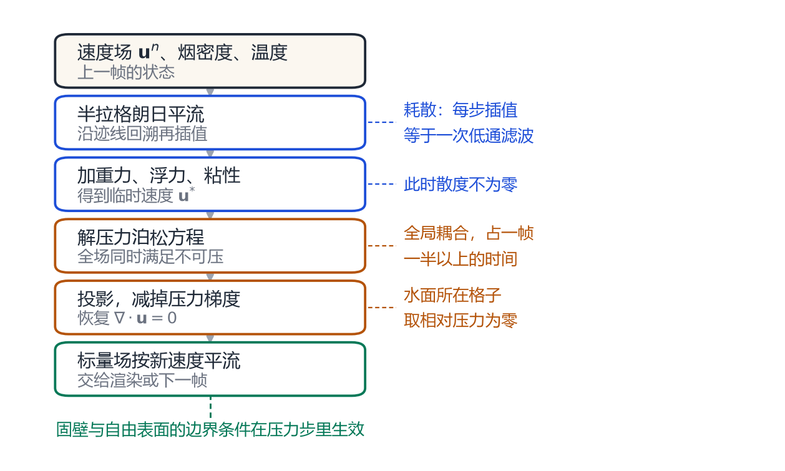
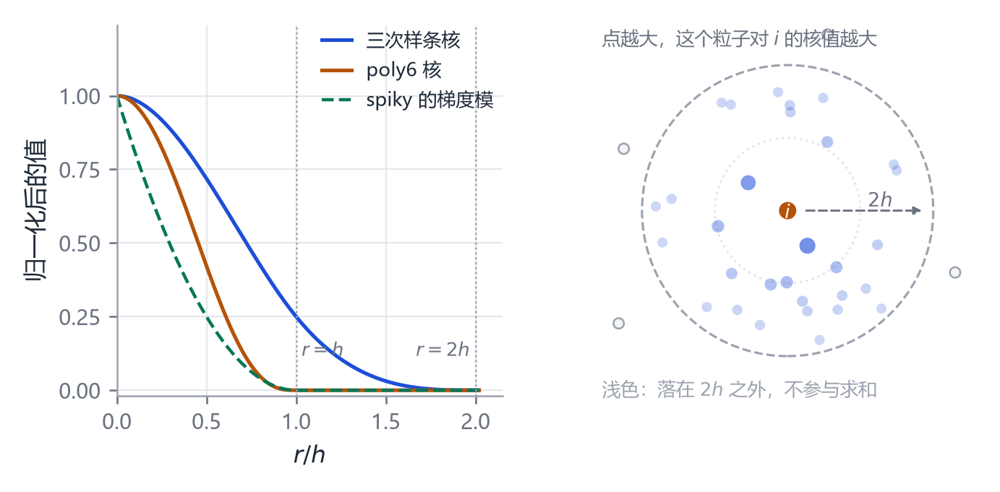
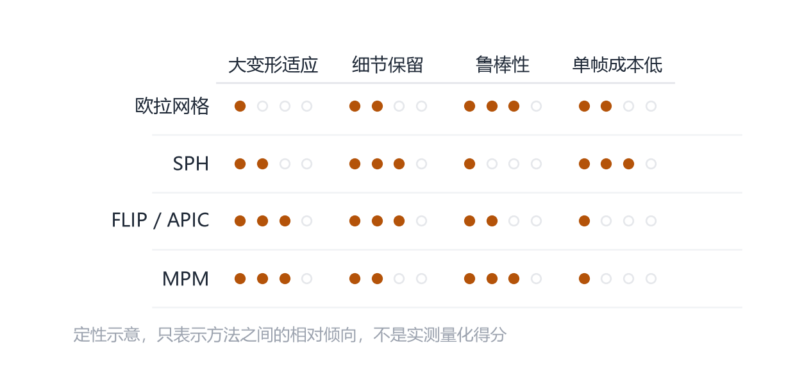

# 第 7 章 流体：烟、水与火

> 本章导读：一支香的烟升到十几厘米高会突然散成翻滚的团，半杯水倒进池子会溅起一蓬白花。这两件事由同一组方程描述，却几乎没有哪个程序能同时把它们算好。这一章把方程按项拆开，看每一项在画面上对应什么，再看网格、粒子、混合三类做法怎么把方程变成一帧一帧的图，最后说清什么时候选哪一种、会在哪里翻车。

## 7.1 两种记账方式

房间里点一支香，烟往上走。离香头两三厘米的地方，烟是一条几乎笔直的细线，边缘光滑，盯很久也只有轻微抖动。再往上十厘米，它开始左右摆，摆幅一次比一次大，最后散成一团翻滚的东西，被房间里的气流带走。

同一股烟，同一个温度梯度，只差一段高度。低处的微小扰动被粘性抹平，高处的扰动被烟自己的运动放大，长成一片一片的涡。这个转变叫转捩，它说明流动方程里必须存在一个能把小扰动放大的项。

要把这段烟算出来，第一件事不是写方程，而是决定数字记在哪儿。

一种记法是把流体切成许多小团，每一团带上自己的质量、速度、温度，跟着流体走，记下它每一步到了哪里。另一种是在空间里铺一张固定的网，每个格子记下此刻流过它的流体的速度、密度、温度，网格不动，流体从格子里穿过去。

前一种叫拉格朗日描述，可以想成在河上放一批带定位器的浮标，每个浮标记录自己的轨迹，你看到的是这批浮标的历史。后一种叫欧拉描述，可以想成在桥上架一台测速仪，对准固定位置连续读数，你看到的是位置上发生的事。

这个区别在数学上落成一个具体的公式。设房间里有一个温度场 $T(\mathbf{x},t)$，$\mathbf{x}$ 是空间位置，$t$ 是时间。站在固定点看，温度的变化率是 $\partial T/\partial t$，即当地变化率。可一个随流体飘动的空气微团并不停在原地，它在 $\Delta t$ 里移动到 $\mathbf{x}+\mathbf{u}\Delta t$，那个位置本来就有另一个温度，于是它感受到的变化除了当地变化，还多了一项由位移带来的差异：

$$
\frac{D T}{D t} = \frac{\partial T}{\partial t} + \mathbf{u}\cdot\nabla T .
\tag{7.1}
$$

其中 $DT/Dt$ 是跟着微团看到的变化率，$\mathbf{u}$ 是当地流速，$\nabla T$ 是温度的空间梯度，$\mathbf{u}\cdot\nabla T$ 叫对流项，意思是“微团以速度 $\mathbf{u}$ 穿过一个梯度为 $\nabla T$ 的场，因此感受到的变化”。站在窗口不动感到房间在变暖，这是 $\partial T/\partial t$；一个从冷角落走到暖气旁的人感受到的升温里还包含 $\mathbf{u}\cdot\nabla T$，他走过的那条路上的空气本来就是越来越热的。

速度场自己也服从同样的关系，把 $T$ 换成 $\mathbf{u}$ 得到加速度 $\mathbf{a}=D\mathbf{u}/Dt=\partial\mathbf{u}/\partial t+(\mathbf{u}\cdot\nabla)\mathbf{u}$。第二项里 $\mathbf{u}$ 出现两次，一次是被携带的量，一次是携带的速度，非线性就来自这里。烟柱里一个微团被向上推，就到了一个上升更快的位置，于是被推得更快，扰动自己喂自己，直线保不住。线性方程不会这样，这是流体比弹簧难算的根本原因。

## 7.2 四项与一条约束

不可压流体的动量方程写成

$$
\rho\left(\frac{\partial \mathbf{u}}{\partial t} + (\mathbf{u}\cdot\nabla)\mathbf{u}\right) = -\nabla p + \mu\nabla^2\mathbf{u} + \mathbf{f},
\qquad \nabla\cdot\mathbf{u}=0 ,
\tag{7.2}
$$

其中 $\rho$ 是密度，$\mathbf{u}$ 是速度场，$p$ 是压力，$\mu$ 是动力粘度，$\mathbf{f}$ 是单位体积的外力。左端是单位体积的质量乘加速度，右端三项分别是压力、粘性、外力。整条式子只说一件事：一块流体加速，因为挤压不均与摩擦。

对流项 $(\mathbf{u}\cdot\nabla)\mathbf{u}$ 在数值上最麻烦，中心差分会把高频扰动放大成锯齿，迎风格式稳定却把涡抹平。烟的细节能不能留下来，一半取决于这一项怎么离散。

$-\nabla p$ 是压力梯度，这里的压力身份常被误解。可压缩气体里，压力是状态量，由密度和温度通过状态方程定出；不可压流体里，压力不是物质的属性，而是一个拉格朗日乘子，作用是维持体积不变这条约束。哪里流体要堆积，哪里压力就升高，把流体往别处推。它的值无法从局部算出，必须让全场同时满足 $\nabla\cdot\mathbf{u}=0$ 才能定出。一根 U 形管，从一端按下去，另一端的水几乎同时升起，这个“同时”在数值上意味着一张全局线性系统。

$\mu\nabla^2\mathbf{u}$ 是粘性扩散，相邻两层流体速度不同，分子交换把动量从快的一层搬到慢的一层。蜂蜜的 $\mu$ 约 10 Pa·s，水约 $10^{-3}$，空气约 $1.8\times10^{-5}$，差了六个数量级。粘性还带来壁面条件：紧贴固体的流体速度为零，叫无滑移。这条条件在物理上成立，但边界层常常只有零点几毫米厚，网格分辨不出来，所以大尺度模拟常换成自由滑移，只挡法向。

四项的相对大小由一个无量纲数决定：

$$
\mathrm{Re}=\frac{\rho U L}{\mu} ,
\tag{7.3}
$$

$U$ 是特征速度，$L$ 是特征长度。杯子里搅咖啡，$U\approx0.3$ m/s，$L\approx0.05$ m，运动粘度 $\nu=\mu/\rho\approx10^{-6}$ m²/s，算出 $\mathrm{Re}\approx1.5\times10^{4}$，惯性远大于粘性，涡能一路级联到很小的尺度，网格必须细到能看见最小的涡，否则流动显得没有劲。同一杯蜂蜜，$\nu\approx10^{-3}$，$\mathrm{Re}$ 不到 1，粘性统治一切，流动几乎可逆。

第二条式子 $\nabla\cdot\mathbf{u}=0$ 的意思不是流体不能被压缩，而是在当前速度范围内压缩性可以忽略。水中声速约 1500 m/s，管道里 2 m/s 的水流，马赫数只有 0.0013，压力波在毫秒内把密度差抹平。空气里的烟几米每秒，声速 340 m/s，同样可按不可压处理。爆炸、激波、高速喷流不行，那些场景里密度变化本身就是主角。

这条约束的后果很实在：压力方程是椭圆的，一点变化影响全场，于是有了 7.3 里那一步全局求解。

## 7.3 把一帧拆成几步

1999 年 Stam 给出的做法影响很深 [@stam1999]。核心是把一帧拆成几步，每步只解一件简单的事，这叫算子分裂。分裂会引入误差，因为几个算子并不对易，先平流再加重力和反过来结果不同；误差是一阶的，换来的是每步都能用成熟稳定的解法。图 7-1 画的就是这个循环。

<figure class="fig">

<figcaption><b>图 7-1</b>　网格流体一帧的处理顺序。速度场先被自己携带，再累加外力与粘性，得到散度不为零的临时速度；压力泊松方程给出修正量，投影之后速度重新满足不可压条件；烟、温度等标量场用同一套平流器推进。右侧注明每个阶段最容易出问题的地方。</figcaption>
</figure>

平流用半拉格朗日格式。对每个网格点，不问“这里的流体下一步会去哪”，而问“这一步之前，哪个位置的流体会来到这里”，沿速度反推一段得到回溯点 $\mathbf{x}-\Delta t\,\mathbf{u}(\mathbf{x})$，在那里插值取速度赋给当前点。这个格式无条件稳定，原因很朴素：新值是若干旧值的加权平均，权重非负且和为一，幅值不会被放大，无论 $\Delta t$ 多大都不会像显式对流那样震荡发散。

代价是数值耗散。每次插值都相当于一次轻微的低通滤波，涡被一层层抹平，烟越算越淡，火焰边缘越来越糊。这个损失不靠加密网格解决，因为耗散来自格式本身。弥补有两类：提高插值精度，比如 MacCormack 先正推一步再反推一步，用两次结果的差补偿误差；或者加涡量约束 [@fedkiw2001]，先算涡量 $\boldsymbol{\omega}=\nabla\times\mathbf{u}$，在涡量大的地方沿 $\boldsymbol{\omega}\times\nabla|\boldsymbol{\omega}|$ 方向加一个很小的力，把被抹掉的旋转补回去。后者明摆着是为了好看牺牲物理，但影视和游戏里几乎是标配。

投影要从临时速度 $\mathbf{u}^{*}$ 里减掉一个梯度，使结果无散。要求 $\mathbf{u}=\mathbf{u}^{*}-(\Delta t/\rho)\nabla p$ 满足 $\nabla\cdot\mathbf{u}=0$，代入得

$$
\nabla^{2}p=\frac{\rho}{\Delta t}\nabla\cdot\mathbf{u}^{*} .
\tag{7.4}
$$

这是椭圆型方程，离散后每个格子的压力只和直接邻居有关，整体是稀疏线性系统。二维用共轭梯度就够，三维通常要几何多重网格，因为共轭梯度的迭代次数随网格变细而增加，多重网格在理想情况下是 $O(N)$。这一步通常占一帧的一半以上，优化的第一刀在这里。

几何上这是正交分解。亥姆霍兹分解说任何光滑向量场都能唯一写成一个无散场加一个梯度场，压力就是那个标量。$\mathbf{u}^{*}$ 里混进了梯度成分，减掉它，剩下的自动无散。解压力和减梯度是同一件事，后面的 FLIP 和 MPM 都在重复这个动作。

离散上有个容易踩的坑：压力和速度都放格子中心时，相邻格子的压力在差分里解耦，压力场出现棋盘花纹，速度却看不出问题。解决办法是交错网格，压力在中心，速度分量在面上，差分时天然错开半格。这个布局叫 MAC 网格，沿用至今。

自由表面在这里出现一次：空气侧不参与压力求解，水面所在格子取相对压力为零，难的是先知道哪些格子在水下。

成本随分辨率涨得比想象快。三维网格每加一倍分辨率，未知量变八倍，迭代次数也上升，总成本接近十倍。八叉树结构 [@losasso2004] 在空区域用大格子，只细化表面附近，能压掉一部分浪费。

## 7.4 粒子：把水当成一堆小球

网格的问题在大变形面前暴露得最彻底。一颗水花溅起来，分裂成几十个小滴，再落回水面合并，拓扑每一帧都在变。网格要跟上这种变化，得不停重建界面、标记哪些格子是水，很费劲。粒子法换了个思路：水本来就可以看作大量小块的集合，让它们带着质量、速度、位置自由地跑，界面在哪不用标记，有粒子的地方就是水。

光滑粒子流体动力学（SPH）用核函数把离散的粒子重新糊成连续场。任何物理量在位置 $\mathbf{x}$ 处的值，由附近粒子的值加权平均得到：

$$
A(\mathbf{x})\approx\sum_{j}\frac{m_j}{\rho_j}A_j\,W(\mathbf{x}-\mathbf{x}_j,h) ,
\tag{7.5}
$$

$m_j$、$\rho_j$、$A_j$ 分别是第 $j$ 个粒子的质量、密度和待求量，$W$ 是核函数，$h$ 是光滑长度，决定核的作用范围。$m_j/\rho_j$ 是粒子占的体积，乘核值相当于“这块体积对周围的影响”。

核函数要满足几条性质：全空间积分为一，保证常数场被准确重现；紧支撑，超过两倍 $h$ 取零，否则每个粒子都要和所有粒子算权重；足够光滑，求梯度时不出现尖点。常用的多项式核有两个，一个中心平滑、适合算密度，另一个梯度在中心附近更大、适合算压力，否则挤在一起的粒子再也推不开。

<figure class="fig">

<figcaption><b>图 7-2</b>　SPH 的核函数与邻居。左图按 $h=1$ 计算两种核的形状与 spiky 核的梯度模，poly6 的支撑半径是 $h$，三次样条核是 $2h$；右图是二维邻居示意，点越大说明该粒子对中心的核值越大，落在 $2h$ 之外的浅色粒子不参与求和。</figcaption>
</figure>

图 7-2 的右半画的就是这个求和的范围：只有 $2h$ 以内的邻居算得进去。密度直接用求和 $\rho_i=\sum_j m_j W(\mathbf{x}_i-\mathbf{x}_j,h)$，不必单独解方程。压力由状态方程给出，最简单的是 $p=k(\rho-\rho_0)$，$k$ 是刚度，$\rho_0$ 是静止密度。$k$ 越大流体越接近不可压，但声速 $c\approx\sqrt{k/\rho}$ 也随之变大，显式步长受 $\Delta t \lt 0.4h/c$ 限制，刚度提十倍，步子就得小十倍。这是弱可压 SPH 的根本矛盾：不可压性与可承受的步长互斥。

预测-校正绕开了它 [@solenthaler2009]。先不管压力，让粒子按重力和粘性走一步，量出密度误差，再反推“要让密度回到 $\rho_0$ 需要多大压力”，加上去，再量，迭代几轮直到误差降到千分之一。压力不再由状态方程硬算，而由密度约束解出，刚度不再是步长的枷锁。隐式版本把压力写成线性系统迭代求解，收敛更快 [@ihmsen2014]。

粒子法有一批顽固的副作用。受拉区域粒子会聚成团，因为核梯度在低密度时给出吸引力；表面粒子邻居少、密度偏低，状态方程给出负压把表层往里吸，水面像结了一层膜；边界处没有粒子，流体直接穿过去。补丁分别是人工压力、负压截断、边界粒子。

FLIP 把两套记法接起来 [@brackbill1986]。粒子带速度，每步先把粒子速度按形函数权重撒到网格点上，在网格上做一次和 7.3 完全一样的投影，再把结果插回粒子。粒子负责携带与输运，网格负责解压力。这个循环叫 P2G（粒子到网格）和 G2P（网格到粒子）。

插回什么，决定流体的性格。PIC 只把网格速度插回粒子，粒子被反复平均，涡和飞溅很快消失。FLIP 插回速度增量，细节回来了，可网格上的压力噪声也原样带回，水面会抖。实践里按大约 0.95 的 FLIP 加 0.05 的 PIC 混合，噪声压下去，细节还在。后来的 APIC 让每个粒子额外携带一个仿射矩阵，记录速度在粒子内部的一阶变化，插值时不再假设粒子内速度均匀，耗散和噪声同时下降 [@jiang2015]，现在多数生产级水体解算器用的都是它。

## 7.5 水面在哪里

自由表面不是给定的边界，而是解的一部分 [@foster2001]。三种表示各有脾气。

用粒子表示最直接，有粒子的地方就是水，表面靠密度场加移动立方体重建，天然处理分裂与合并，代价是有颗粒感。

水平集用一个标量场 $\phi(\mathbf{x},t)$ 表示水面，$\phi$ 取到水面的有符号距离，水下为负、水上为正，零等值面就是水面。它的好处是几何量干净：法向是 $\nabla\phi$ 归一化，曲率是法向的散度，表面张力可以写成 $\gamma\kappa\nabla\phi$，$\gamma$ 是表面张力系数（水约 0.072 N/m），$\kappa$ 是曲率。有了这两样，水滴收成球、水膜贴住叶片才做得出来。$\phi$ 跟着流体走，用和速度一样的半拉格朗日平流；平流后的 $\phi$ 不再是距离场，梯度大小偏离 1，还要解一个虚拟时间上的方程把 $|\nabla\phi|$ 拉回 1，同时保持零等值面不动。

水平集最要命的是体积不守恒。数值耗散会把薄水膜和飞溅小滴的 $\phi$ 慢慢推成正数，它们凭空消失，一池水算上几百帧会变浅。修法是在表面两侧撒一层示踪粒子，粒子跟着流体走，当某个粒子的位置与 $\phi$ 的符号矛盾时，就地把 $\phi$ 的局部值改回来，等于用粒子把丢掉的体积还回去 [@enright2002]。这招叫粒子水平集，代价是多一套粒子系统。

体积分数（VOF）是另一条路。每个格子存一个 $0$ 到 $1$ 之间的数 $\alpha$，表示液体占比，解守恒形式的输运方程 $\partial\alpha/\partial t+\nabla\cdot(\alpha\mathbf{u})=0$。写成通量形式后液体总量在离散意义下严格守恒，一滴都不会少。代价是界面在格子内是模糊的，算准曲率要先做几何重构，把界面近似成一段平面，噪声比水平集大。

白水是另一回事。小于网格尺度的细节解不出来，硬解只会得到糊状物。实际做法是当主流体某处的速度、曲率或动能超过阈值，就撒一批二级粒子，分成泡沫、飞沫、气泡三类。它们不解压力方程，只做弹道运动加空气阻力，泡沫有寿命，随表面漂移并慢慢消失。观感上白水贡献极大，没有白花的水花看起来像塑料做的，而它几乎不增加多少计算量。

## 7.6 火不是流体

火焰看上去像流体，实际是气体、燃料、碳黑与化学反应混在一起的一团东西。燃烧放热让气体膨胀，浮力往上拽，湍流撕成火舌，碳黑被加热到白炽发光。真要解化学反应的细节，那套方程刚性极强，时间尺度在微秒量级，为几秒钟的镜头去解它不划算。视觉模拟取的是简化版：把燃料和温度当作随流体输运的标量场，用一条人为设定的速率把燃料变成热和烟。

具体是三个场：燃料密度 $F$、温度 $T$、烟尘浓度 $S$。它们和速度场一起被平流，$F$ 以正比于自身的速率消耗，同时加热 $T$、增加 $S$。浮力写成 $\mathbf{f}=\alpha(T-T_0)\hat{\mathbf{y}}$，$\alpha$ 是热膨胀系数，$T_0$ 是环境温度，$\hat{\mathbf{y}}$ 是竖直方向。这一项让热气体上升、冷空气从下方补进来，火苗的形状基本由它和湍流共同决定。

网格耗散在这里格外碍事。火苗边缘本来是很薄的反应面，半拉格朗日平流几下就糊成橙色棉花，所以火焰几乎一定要加涡量约束。系数要调到刚好，太小没效果，太大就出现过于规则的螺旋。

温度到颜色这一段决定了火像不像。真实火焰的可见光主要来自碳黑颗粒的热辐射，那是连续谱，可用黑体辐射近似：给定温度，普朗克定律给出各波长的辐射强度，乘上人眼的三条配色曲线积分，得到一组 RGB 值。1000 K 左右是暗红，1300 K 是橙，1600 K 偏黄，2000 K 接近白。真实火焰底部还有一层蓝色，来自完全燃烧时某些分子基团的谱线发射，黑体模型给不出这个蓝，所以影视里通常拿黑体曲线当骨架，再手调一条色带。

模拟和渲染的接口在这里划清：模拟交出密度、温度、烟尘三个场，渲染把它们当作参与介质，沿视线解辐射传输，发射项由温度决定，吸收和散射由密度决定。体积渲染、阴影、多次散射都是渲染端的事，模拟端只要保证场在时间上连续。

## 7.7 选型与失效

烟、雾、气体、爆炸的火球用欧拉网格。它们没有自由表面，密度变化平缓，耗散反而是优点。大变形的水、飞溅、泡沫用 FLIP 或 APIC，粒子负责输运，网格负责压力，白水粒子补细节。小尺度液滴、粘性流体、表面张力主导的现象用 SPH 更顺手，界面天然由粒子给出。雪、沙、泥浆、融化与凝固这类既有固体记忆又会流动的材料用 MPM，它把粒子的历史与网格的求解能力拼在一起，第 8 章会讲。

<figure class="fig">

<figcaption><b>图 7-3</b>　四类方法在四个方面的定性对比，实心点越多表示越强。这是按常见实现的倾向画的示意，换一个场景，同一格的判断可能反过来。</figcaption>
</figure>

图 7-3 把这四类摆在一起，看的是倾向而不是分数。实时场景里粒子数只有几万，位置动力学一类做法用约束代替压力方程，牺牲不可压精度换速度 [@macklin2014]。

失效也各有各的模样。水平集会丢体积，一池水放久变浅，水面出现不该有的薄片。半拉格朗日和 PIC 会耗散，烟越算越淡。同位网格解出棋盘压力。粒子法会抖，水面像有细密的雨点在打。边界处理不当时流体渗过地板；时间步太大时，强外力把整块流体甩出去。

还有一类失效不在方程里，在观感上。压力解得再准，如果表面没有白水、没有正确的折射和吸收，画面依然像塑料。反过来，物理上错得离谱的一团烟，只要密度场的样子对、光照对，观众也看不出问题。这两件事分属两个系统，而大多数失败的流体镜头，问题出在后者。
