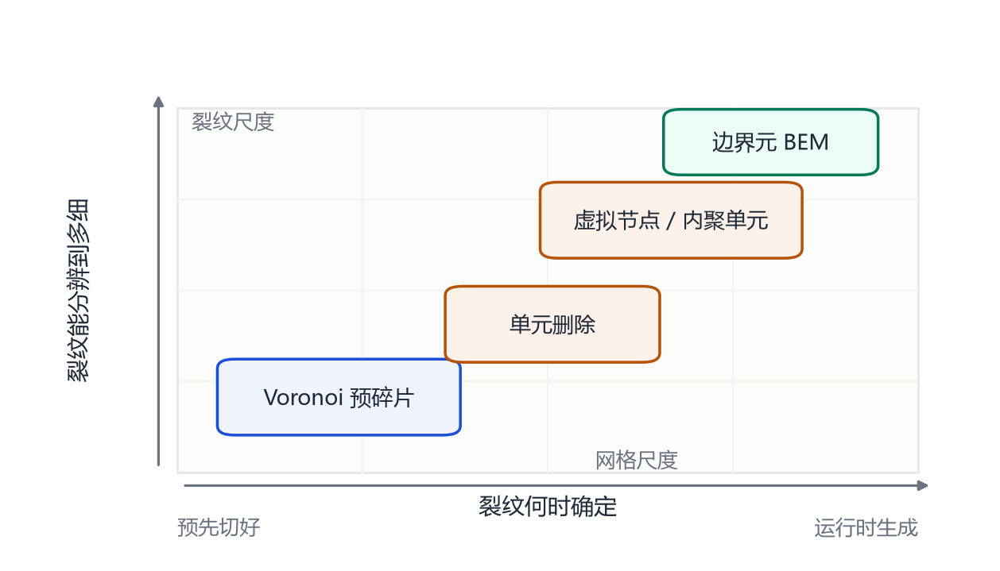
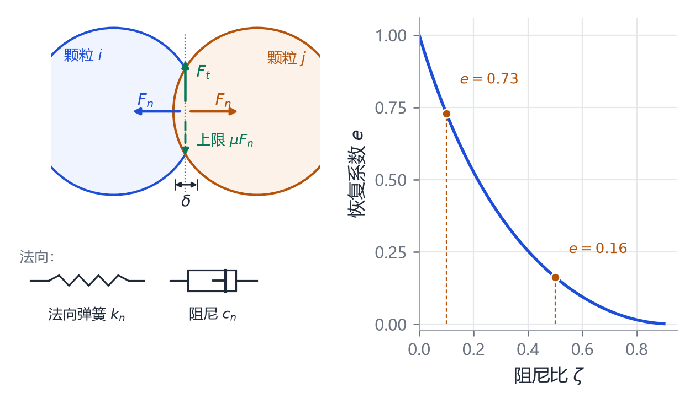
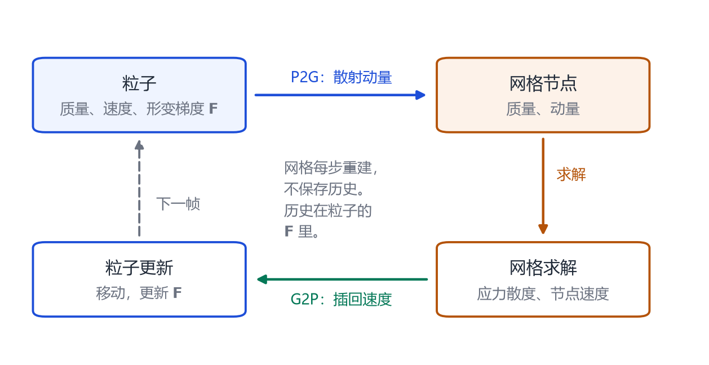

# 第 8 章 断裂、颗粒与雪

> 本章导读：一只玻璃杯从桌沿滑下去，落地那一刻碎成几十片，有的片薄如刀口，有的地方成了粉。同一帧里还可能有别的东西：一把沙子从指缝漏下堆成锥，一团雪被鞋底压成硬块。这三样东西的共同点是它们既不像刚体那样守规矩，也不像水那样听话。这一章讲清楚它们各自难在哪、现成的做法有哪几类、在什么尺度上该退让。

## 8.1 断裂的三个尺度

玻璃杯落地，先是一条几乎看不见的裂纹从接触点出发，然后十几条分支同时向外跑，跑到杯壁边缘时整只杯子散开。慢放看，碎片的边缘有一片光滑如镜的区域，再往外变成粗糙的毛面，最外侧是锯齿状的白边。这三段纹理记录的是裂纹跑过的速度：慢的时候表面平整，快了之后裂纹开始分叉、微观上互相干扰，表面就变粗。

一次断裂里同时有三件事在发生，尺度差得很远。起裂发生在微米级的缺陷上，玻璃内部的一条划痕、一粒杂质、一个气泡，都是应力集中的地方。裂纹扩展是介观的事，尖端前面一小块材料被拉到极限，裂纹以每秒上千米的速度往前跑。碎片飞散是宏观的事，厘米级的块在空中翻转、碰撞、落地。

一个模拟不可能同时覆盖这三个尺度。网格尺寸和粒子间距决定了能表达的最小结构，用一毫米的网格表示一微米的缺陷做不到，起裂位置只能人为指定或用统计模型撒点。认清这一点，后面所有方法的分工就清楚了：有人决定在哪里断，有人负责断得好看，有人负责碎片怎么飞。

起裂的判据有两套语言。一套是强度：材料能承受的最大拉应力 $\sigma_t$，超过就断。这套语言简单，但解释不了一件事：同一批玻璃杯，有的从三十厘米落下就碎，有的从五十厘米还没事。原因是强度不是材料的固有常数，它由最大的缺陷决定。用断裂力学的话说，裂纹尖端的应力强度因子达到材料的断裂韧性 $K_{IC}$ 时才扩展：

$$
K_{IC} = Y\,\sigma\sqrt{\pi a} ,
\tag{8.1}
$$

其中 $\sigma$ 是远场拉应力，$a$ 是裂纹长度（或深度），$Y$ 是跟几何有关的无量纲系数，量级在 1 附近。玻璃的 $K_{IC}$ 约 0.75 MPa·m$^{1/2}$，钢在几十到上百。把 $K_{IC}$ 代进去反解，一条 1 毫米深的划痕会把玻璃的等效强度压到十几 MPa，比完好时低一个数量级以上。这解释了为什么划过的玻璃更容易碎，也解释了为什么用强度判据时必须给每个单元一个随机的初始缺陷。

扩展阶段的速度有上限。裂纹尖端的能量要供给新生成的表面，速度太快时能量来不及送到尖端，理论上限是 Rayleigh 波速（材料表面波的传播速度），实测通常落在它的 0.5 到 0.6 倍。玻璃的 Rayleigh 波速约 3.1 km/s，所以裂纹最快也就 1.6 km/s 上下。速度接近上限时裂纹开始分叉，一条变两条，两条再分，碎片尺寸就这样被决定。

碎片的大小分布有统计规律。脆性材料的碎片常常服从幂律，大碎片少、小碎片多，指数在 2 附近浮动。工程上有时用能量最小化推特征尺寸：释放的弹性能刚好够支付新表面的表面能，解出的尺寸跟应变率的平方成反比。这条结论在爆炸和高速冲击里好用，慢速压碎就不准，那时摩擦与二次破碎占了大头。

材料按断裂行为分三类，处理方式完全不同。玻璃、陶瓷这类脆性材料几乎没有塑性变形，应力一到就断，断口干净。金属是韧性的，断裂前先屈服、颈缩，断口有韧窝，能量吸收大得多。混凝土、岩石、冰是准脆性的，介于两者之间，受压时有强度，受拉时很脆，破坏往往沿着预先存在的微裂纹网络走。模拟里的判据、本构、碎片形状都要跟着这三类走，把金属的模型套在玻璃上，出来的碎片会太“肉”。

## 8.2 有限元断裂

有限元把物体切成单元，解出节点位移，由位移算应变、由应变算应力，有了应力场就知道该在哪里断。最常用的判据是最大主应力：任意一点总能找到三个互相垂直的方向，沿它们剪应力为零，这三个正应力就叫主应力。脆性材料怕拉，取最大的主应力，超过抗拉强度就判断裂。韧性材料用 von Mises 等效应力，它综合三个主应力之差，对应形状改变的能量。岩石和混凝土用 Mohr-Coulomb 一类准则，强度跟围压关系很大。

判据给出“哪里断”，接下来要决定“断了之后网格怎么办”。最早也最省事的办法是单元删除：超过阈值的单元直接移除，相邻单元露出一个新的自由表面。它一天就能实现，代价却不少：被删的单元带走质量和弹性能，总能量不守恒；露出的边界是锯齿状的，碎片形状由网格决定，换个网格朝向碎片就变样；一次删掉一片还会让邻居应力跳高，引发连锁删除。

改进的办法是把单元真的切开。虚拟节点法沿一个平面把单元分成两半，各自复制节点，两半独立积分，不再共享位移。质量、能量、几何都保住，断面也比较平滑，代价是实现复杂：切面跟网格不对齐，子单元要重新积分，接触检测要重建。O'Brien 等人的工作把这条路线做通了，先是脆性材料 [@obrien1999]，后来加上塑性做成韧性断裂 [@obrien2002]，两者的区别在于断裂前是否允许单元先屈服、拉长。

有限元断裂的强项是“物理上说得通”，应力场是真的解出来的，断裂顺序由力的传播决定。它的弱项是规模：要看清裂纹，网格必须细到裂纹尖端附近，而裂纹尖端会移动，网格得跟着加密。一次高分辨率的三维断裂，单元数很容易上百万，每帧都要解一个大型稀疏系统。

另一条路把顺序反过来：提前把碎片切好。在物体内部撒一批种子点做 Voronoi 划分，每个种子分到离它最近的那块空间，得到一堆凸多面体。它们就是未来的碎片，质量、惯性张量、凸包、接触面全都可以预计算。运行时被一层“胶”粘住，胶有强度阈值，超过就断开，碎片随即变成刚体，交给第 5 章的求解器。

预碎片的优点很实际。碎片形状自然，因为 Voronoi 划分出来的块大小分布接近真实的碎裂；求解便宜，因为断完之后全是刚体，接触用凸包，几十万片也能跑实时；稳定性好，因为刚体求解器已经成熟。缺点是裂纹路径在开始前就定死了，你看到的每一条裂缝其实都是碎片之间的接缝，敲不同的位置只会断开不同的接缝，不会长出新的分支。碎片也碎不到比种子间距更小的尺度，想要更细的粉末得做分级：大碎片内部再预碎一层，断开时按能量决定展开到第几级。

边界元是第三个方向，把问题从体降到面。它只在裂纹表面上离散，用格林函数（点载荷在无限介质里引起的位移场）联系表面的位移与面力，解边界积分方程。未知量只在裂纹面上，同样的计算量能买到高得多的分辨率。Hahn 等人的工作用这套办法做出了极细的裂纹网络和真实的分叉形态 [@hahn2015]。代价是矩阵是稠密的，规模一大就解不动；格林函数要针对具体几何预先算好；裂纹扩展时影响矩阵要更新。它适合一条裂纹怎么长这种特写，不适合整只杯子怎么碎。

<figure class="fig">

<figcaption><b>图 8-1</b>　断裂方法的谱系。横轴是裂纹何时确定，纵轴是裂纹能分辨到多细：预碎片在左下，单元删除居中，虚拟节点与边界元往右上走。</figcaption>
</figure>

图 8-1 把这几种做法摆成一片，越往右上越贵。

几种办法对应几种需求。实时破坏用 Voronoi 预碎片，形状够看、成本可控。影视中景用有限元加单元删除或虚拟节点，断裂顺序有物理依据。特写镜头里裂纹怎么分叉、断口纹理怎么变，才轮到边界元。选错的典型症状是：用单元删除做实时，帧率掉到个位数；用预碎片做特写，观众发现裂缝的位置永远不变。

## 8.3 颗粒：沙为什么能立住

从上方慢慢倒沙，地上会堆出一个圆锥，坡面稳定在某个角度，再往上加沙就从坡面滑下来，圆锥不再长高，只往横向扩张。这个角度叫安息角，干沙大约 30 到 35 度，湿沙能到 45 度以上。同一堆沙，你用手去戳，它像液体一样流动；不碰它，它又能撑起一个斜坡。这种既不像固体也不像液体的行为，是颗粒物质最核心的特征。

离散元（DEM）把每一颗沙当成一个刚体，带位置、速度、朝向、角速度，逐帧算它受的力和力矩。颗粒之间不真正接触，允许一点点重叠，重叠量 $\delta$ 就是法向变形的度量。法向力用一个弹簧加一个阻尼器描述：

$$
F_n = k_n\delta + c_n\dot{\delta} ,
\tag{8.2}
$$

$k_n$ 是法向刚度，$c_n$ 是阻尼系数，$\dot{\delta}$ 是重叠量的变化率（接近时为正，分离时为负）。弹簧提供排斥，阻尼吃掉碰撞的能量，让颗粒不会永远弹跳。真实的弹性接触里刚度不是常数，Hertz 理论给出 $k_n$ 正比于 $\sqrt{\delta}$，重叠越深越硬。工程上常用线性弹簧，简单稳定，只要恢复系数调对，看不出差别。

阻尼和恢复系数的关系可以算出来。把碰撞简化成一个质量块压缩弹簧再弹开，阻尼比 $\zeta=c_n/(2\sqrt{k_n m})$，恢复系数是

$$
e = \exp\left(-\frac{\zeta\pi}{\sqrt{1-\zeta^{2}}}\right) ,
\tag{8.3}
$$

$m$ 是等效质量。$\zeta=0$ 时 $e=1$，完全弹性；$\zeta=0.5$ 时 $e$ 约 0.16，几乎不弹。这条曲线画在图 8-2 的右半，调参时对着它选就行。

切向的力靠摩擦。颗粒接触点上有切向的相对位移，先用一个切向弹簧顶住，力随位移线性增长，但上限是 $\mu F_n$，$\mu$ 是摩擦系数。一旦超过上限，接触点开始滑动，切向力就停在 $\mu F_n$ 不再增长，这就是库仑摩擦。静摩擦和动摩擦的区别在于前者能“记住”切向位移，只要没滑动过，弹簧就一直有效，所以静止的沙堆能锁住。

<figure class="fig">

<figcaption><b>图 8-2</b>　两个颗粒的接触模型。左图为示意：法向是弹簧加阻尼，切向是带库仑上限的弹簧，重叠量 $\delta$ 是唯一允许的穿透。右图按式 (8.3) 计算的恢复系数随阻尼比的变化，$\zeta=0.1$ 时 $e$ 约 0.73，$\zeta=0.5$ 时只剩 0.16。</figcaption>
</figure>

时间步长是 DEM 的命门。两个颗粒加一根弹簧构成振子，接触频率是 $\sqrt{k_n/m}$ 的量级，显式积分的稳定要求步长小于周期的十分之一。石英的弹性模量约 70 GPa，颗粒尺度折算出的 $k_n$ 常在 $10^{4}$ 到 $10^{6}$ N/m，质量又小，接触周期因此在微秒量级，步长常取 $10^{-6}$ 秒。一秒动画要算一百万步，DEM 的规模就卡在百万颗粒上下。

沙堆能立住，靠摩擦加上几何咬合。颗粒被压紧后，要让它流动就得让颗粒互相翻越，这需要整体体积膨胀，叫剪胀；围压存在时膨胀要克服压力做功，流动被挡住，堆体就锁住。这解释了为什么松散的沙更容易流，也解释了坡角与摩擦系数大致满足 $\tan\theta\approx\mu$。

把沙当连续介质是另一条路。实验发现，颗粒流的有效摩擦系数不是常数，它随一个无量纲的惯性数变化：

$$
I = \frac{\dot{\gamma} d}{\sqrt{p/\rho_s}} ,
\tag{8.4}
$$

$\dot{\gamma}$ 是剪切率，$d$ 是粒径，$p$ 是围压，$\rho_s$ 是颗粒密度。$I$ 小的时候颗粒靠长时间接触传递力，摩擦系数接近一个下限 $\mu_s$；$I$ 大的时候碰撞主导，动量交换像气体分子，摩擦系数升到 $\mu_2$。中间用一个插值函数连起来，就是 $\mu(I)$ 流变。有了它，沙就可以写进纳维-斯托克斯方程，一个格子代表上千颗沙，规模一下子放开。更早也更直接的做法是拿塑性流体近似沙，用屈服准则代替逐颗的接触计算，远景里足够好 [@zhu2005]；摩擦边界要小心处理，半隐式 MPM 在与墙面摩擦时更稳 [@daviet2016]。

两种做法各有各的画面。你要看沙粒从指缝漏下、在桌面上弹跳、被风吹成一道细流，只有 DEM 能给。你要看整座沙丘崩塌、卡车卸沙、沙画流动，连续方法才跑得动。中间地带（沙堆被球砸出一个坑）两种都能做，看预算。

## 8.4 雪与物质点法

雪的密度只有冰的三分之一到十分之一，结构是冰晶烧结成的骨架，中间全是空气。抓一把能捏成球，说明它有一定的粘结；踩上去会陷，说明抗剪很弱；压过的雪变硬，说明它会压实硬化。这几种性质加在一起，让雪既要有固体的记忆，又要有流体的自由度：大变形、碎、飞。

物质点法（MPM）就是为这类材料准备的。它用两套表示：粒子携带物质，记住质量、速度、形变梯度、体积；网格只用来解方程，每帧重建，不留永久信息。一个时间步分三段：粒子把质量和动量撒到网格节点（P2G），网格上算应力、积分速度，再插回粒子（G2P），粒子据此移动并更新形变梯度。图 8-3 画的就是这个循环。

<figure class="fig">

<figcaption><b>图 8-3</b>　物质点法的一个时间步。粒子携带质量、速度与形变梯度，先把动量散射到背景网格（P2G），在网格上求应力散度并积分速度，再把速度与速度梯度插回粒子（G2P），粒子据此移动并更新形变梯度；网格在下一步可以整个丢弃重建。</figcaption>
</figure>

形变梯度 $\mathbf{F}$ 是这个方法的核心。它记录粒子邻域从初始状态到现在的线性变换，初始时是单位矩阵，被拉长、被剪切、被旋转之后各分量就变了。有了 $\mathbf{F}$，应变和应力都能算出来，这份记忆一直跟着粒子走。这正是 MPM 适合雪的原因：雪的历史（压过几次、压得多紧）必须记住，而网格记不住。

雪的本构是一套拼起来的东西 [@stomakhin2013]。弹性部分用固定 corotated 模型，先把 $\mathbf{F}$ 做极分解 $\mathbf{F}=\mathbf{R}\mathbf{S}$，$\mathbf{R}$ 是旋转、$\mathbf{S}$ 是拉伸，弹性只对 $\mathbf{S}$ 起作用，这样颗粒整体转动不会产生假应力。塑性部分处理屈服：把 $\mathbf{S}$ 的奇异值夹在一个区间里，拉伸方向的上限是 $1+\theta_s$，压缩方向的下限是 $1-\theta_c$，超出的部分被永久削掉，等于材料记住了新的形状。硬化部分让刚度随压缩增加：定义压缩比 $J=\det\mathbf{F}$，杨氏模量写成 $E\,h(J)$，$h$ 是一个随 $J$ 减小而增大的函数。

原文给的参数是一组可以照抄的起点：$E=1.4\times10^{5}$ Pa，泊松比 0.2，压缩屈服 $\theta_c=2.5\times10^{-2}$，拉伸屈服 $\theta_s=7.5\times10^{-3}$，硬化指数 10。这套参数下，体积压掉四分之一时刚度已升到十几倍，压到一半时超过一百倍，正对应现实里踩实的雪变硬。拉伸屈服很小，说明雪几乎不能受拉，一拉就裂，所以雪块从树上掉下来会散成粉。

MPM 的失效方式很有特点。P2G 和 G2P 都是加权平均，每步丢一点信息，旋转细节最先没，雪会像一堆会流动的橡皮泥；修法是让粒子多带一个速度梯度（APIC），插值时保留一阶项 [@jiang2015]。体积也会缓慢损失，粒子在网格上抹开后密度算低，压实的雪越算越小。粒子间距接近网格间距时还会网格锁死，动起来一格一格地跳。

## 8.5 相变与多材料

雪化了是水，水冻了是冰，岩浆冷了是岩石。这些过程在模拟里意味着本构要换，而且换的时候要处理两件麻烦事：潜热和体积变化。

做法是在 MPM 里再加一个场：温度。粒子带温度，网格上解热传导，热源来自摩擦与塑性功。温度跨过熔点时材料从弹性切到粘性，储存的剪切应力必须在很短时间里释放，否则融化的雪块会像固体一样僵着；办法是把形变梯度的偏斜部分逐步拉回单位矩阵，拉回速度对应熔体粘度。凝固时当前的形状成为新参考形状，应力从零长起。

潜热让温度在相变期间停住。冰水混合物加热时温度不上升，能量都用来破坏晶格；这一点在数值上是刚性的，显式积分会越过熔点，所以要在一帧内把越界的能量折算成相变比例。Augmented MPM 把这些量（温度、相变分数、潜热）都挂在粒子上，网格只负责求解和扩散 [@stomakhin2014]。

多材料共用一个框架，各用各的本构。沙用 $\mu(I)$ 或 Drucker-Prager，雪用压实硬化，水用粘性，橡胶用 Neo-Hookean。界面处一个网格节点可能同时收到几种材料的动量，按体积分数加权，等于在网格上做了一次混合。密度差很大时这套混合会出问题，轻的材料被重的挤压得过度，需要额外的界面处理。

## 8.6 耦合

真实场景里这些东西很少单独出现。球砸进沙堆、洪水冲走碎石、布兜住一堆豆子，每一种耦合都有自己的麻烦。

刚体撞沙 [@hu2018] 最难的是质量比。一颗钢球的质量可能是一小片沙的上千倍，显式耦合时球的速度一变，沙子还没反应过来，两者就穿模了。做法是把刚体的表面当成移动边界，用有符号距离场判断哪些网格节点在球内，给这些节点强制球的速度；反过来把网格上的动量损失积分成冲量施加给球。两个方向都要在同一个时间步里闭合，否则球会“穿”过沙而不减速。

水冲颗粒可以把两者放进同一个粒子框架，用统一的位置约束求解：水粒子之间是不可压约束，颗粒之间是接触约束，水和颗粒之间是摩擦约束，全部交给同一个投影求解器迭代 [@macklin2014]。好处是界面自然、不需要专门的数据传递，坏处是两套约束的刚度差很多，迭代次数被硬的那套拖住。另一种做法是 FLIP 解水、DEM 解颗粒，两边通过网格交换动量，实现简单但界面容易漏。

布料裹颗粒的困难在接触。布是极薄的壳，颗粒是离散的球，接触查询要处理布的自碰撞、布与颗粒的摩擦、颗粒从缝隙里漏出去。用统一粒子加距离约束省事，代价是弯曲刚度要靠额外约束补回来。

耦合的通用原则只有一条：界面两侧的冲量必须大小相等方向相反，且在同一时刻施加。做到这一点，剩下的都是精度问题；做不到，无论单相解得多准，整体都会漂移或者爆炸。

