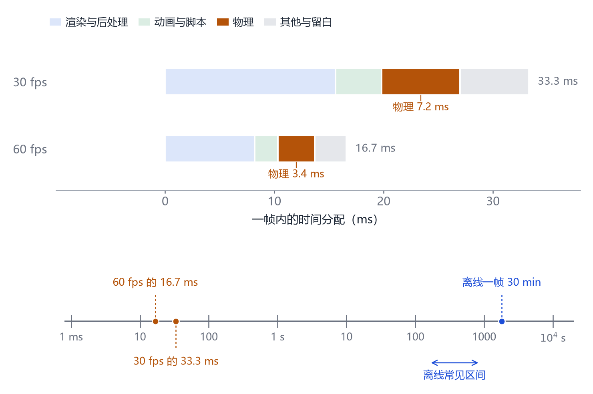
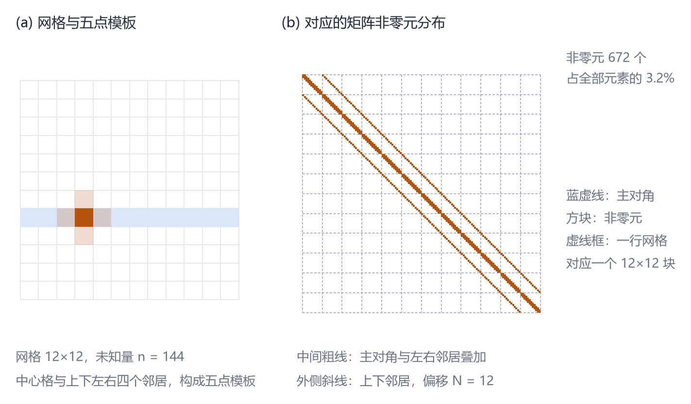
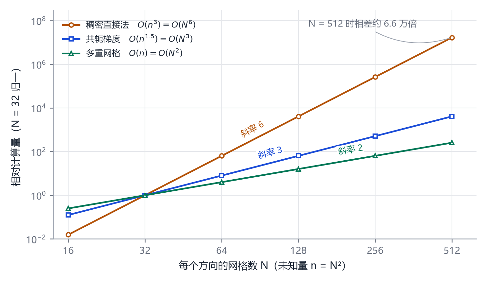

# 第 9 章 让模拟跑得动

> 本章导读：这一章谈的是“算得完”。同一套方程，放进游戏里只有几毫秒，放进影视农场可以有几十分钟，预算差五个数量级，能用的算法就不是同一批。下面从一帧的时间怎么被分掉讲起，依次说明隐式积分、稀疏求解、并行、降维、自适应各自省下的是哪一段时间，最后讲怎么找到时间真正去了哪里。

## 9.1 三种时间预算

一个角色跑过草坡，披风拖在身后，撞上小腿又甩开。美术说这条披风“要飘起来”，程序把物理模块的耗时打出来：9.3 毫秒。整帧预算 16.7 毫秒，渲染已经吃掉十毫秒出头。这条披风要么减面，要么降迭代次数，要么就得接受它在拐弯处变得像一块硬纸板。

根源在预算，不在算法。60 帧的应用一帧 16.7 毫秒，渲染占大头，动画、脚本、音频、界面依次拿走各自一份，物理通常只能分到五分之一，也就是三毫秒多。30 帧的项目宽松一倍，物理能拿到七八毫秒。图 9-1 上半部分画的就是这种分法：条内比例取自量级经验，具体项目差别很大，但“物理只拿到零头”是普遍的。

<figure class="fig">

<figcaption><b>图 9-1</b>　一帧的时间被谁分掉了，以及三种预算在同一根对数时间尺上的位置。上：60 帧与 30 帧两条横条按渲染、动画、物理、其他切分；下：16.7 毫秒、33.3 毫秒与半小时量级的离线一帧相隔近五个数量级。条内比例是量级示意，不代表任何具体项目。</figcaption>
</figure>

三毫秒是什么概念。一段五千顶点的布，做一次约束投影要扫一遍所有顶点，二十次迭代就是十万次顶点更新，还要建邻居表、查可能的三角形对，已经贴到边缘。

离线是另一个世界。影视里一个流体镜头，一帧算三十分钟不算长，机器在农场上排队跑。图 9-1 下半部分把三种预算放在同一根对数尺上：16.7 毫秒与 30 分钟相差约十万倍。实时里“能不能算”是硬约束，离线里“算多久”只是排期问题。

还要说清一件事：一帧里的物理并不是“算一次”。它包含宽相碰撞、窄相碰撞、约束求解、积分四段，耗时比例随场景变化极大：堆满箱子的仓库，碰撞能占一半；悬挂的布，几乎全在求解上。

## 9.2 隐式求解为何能大步长

第 3 章给过一条线：显式积分弹簧，步长必须小于 $2/\omega$，其中 $\omega=\sqrt{k/m}$ 是角频率，$k$ 是刚度，$m$ 是质量。这条线放到布料上很难看。一块布的抗拉刚度动辄 $10^{5}\ \mathrm{N/m}$，一个顶点的质量只有 $0.01\ \mathrm{kg}$，于是 $\omega\approx 3.2\times10^{3}\ \mathrm{rad/s}$，临界步长约 $6\times10^{-4}\ \mathrm{s}$。按 60 帧走，一帧要切二十多个子步。

问题出在“最快的那个模态”上。刚度决定了布内部有频率极高的振动，它们在画面上根本看不见，但显式积分必须按它们的频率定步长。

隐式欧拉换了方向：不求“现在”的力，而是求解“下一刻”的力：

$$
\mathbf{v}_{n+1}=\mathbf{v}_{n}+\Delta t\,\mathbf{M}^{-1}\mathbf{f}(\mathbf{x}_{n+1}),
\qquad
\mathbf{x}_{n+1}=\mathbf{x}_{n}+\Delta t\,\mathbf{v}_{n+1},
$$

$\mathbf{M}$ 是质量矩阵，$\mathbf{f}$ 是合力。麻烦在于 $\mathbf{f}$ 的自变量是 $\mathbf{x}_{n+1}$，而它正是未知量。把 $\mathbf{f}$ 在 $\mathbf{x}_{n}$ 处一阶展开，$\mathbf{f}(\mathbf{x}_{n+1})\approx\mathbf{f}(\mathbf{x}_{n})+\mathbf{K}\Delta\mathbf{x}$，$\mathbf{K}=\partial\mathbf{f}/\partial\mathbf{x}$ 是刚度矩阵，对弹簧力负半定。令 $\Delta\mathbf{x}=\mathbf{x}_{n+1}-\mathbf{x}_{n}$ 代入消去 $\mathbf{v}_{n+1}$，得到

$$
\left(\mathbf{M}-\Delta t^{2}\mathbf{K}\right)\Delta\mathbf{x}
=\mathbf{M}\,\Delta t\,\mathbf{v}_{n}+\Delta t^{2}\mathbf{f}(\mathbf{x}_{n}).
$$

左边对称正定：$\mathbf{M}$ 正定，$-\mathbf{K}$ 半正定。于是每步要解一个线性方程组，而不是简单乘一次。

稳的原因在稳定域。显式积分要求 $\Delta t$ 落在稳定域内，对振子就是 $\Delta t \lt 2/\omega$；隐式欧拉的稳定域是整个左半平面，线性系统下无论 $\Delta t$ 多大都不发散。代价是数值阻尼：步长越大，高频压得越狠，布看起来越“黏”。

这就给出了实时模拟里最重要的一条经验：步长不再由刚度决定，而由“你想让画面动多快”决定。布里的拉伸波速度是 $\sqrt{k/m}$ 量级，一步之内走过的距离若超过一个网格边长，接触和摩擦就会算错。步长上限来自位移，不来自稳定性。

代价转移到线性求解上。非线性系统要牛顿迭代几轮，每轮解一次 $\left(\mathbf{M}-\Delta t^{2}\mathbf{K}\right)\Delta\mathbf{x}=\mathbf{r}$，而 $\mathbf{K}$ 依赖当前构型，每轮都得重算。工程上很少严格做牛顿，而是冻结 $\mathbf{K}$ 几轮，或者像投影动力学那样把矩阵拆成常数部分加局部修正 [@bouaziz2014]。

还有一条反方向的路线。有人在游戏场景里比较过“大步长少迭代”与“小步长多迭代”，发现缩小步长反而更稳更快 [@macklin2019]：大步长下线性化误差大，牛顿要多轮才收敛，还容易在接触上振荡。

## 9.3 稀疏线性代数

隐式方法把动力学问题变成了线性代数问题，而且结构很特殊。

特殊性来自局部性。布的一个顶点只和通过弹簧相连的少数几个顶点有直接作用，四面体网格里一个节点只与所在单元的其余三个节点相连。矩阵的一行因此只有常数个非零元。一万顶点的布，每行六到十个非零元，总共十万个；按稠密矩阵存是一亿个位置，几乎全为零。

图 9-2 用最简单的例子把这件事画出来：$12\times 12$ 的二维网格，每节点与上下左右四个邻居相连，离散的是五点拉普拉斯算子。节点按行编号，矩阵于是呈带状：主对角一条线，紧邻的两条斜线是左右邻居，隔开 $N=12$ 的两条是上下邻居。$144\times 144$ 的矩阵，非零元只有 672 个。

<figure class="fig">

<figcaption><b>图 9-2</b>　$12\times12$ 网格上五点拉普拉斯矩阵的真实稀疏结构。左：网格与五点模板；右：矩阵非零元分布，每行至多 5 个，合计 672 个，占全部元素的 3.2%。虚线框每 12 行一格，对应网格的一行；中间那条粗线是主对角与左右邻居叠加，外侧两条斜线是上下邻居，横向偏移正好 $N=12$，也就是带宽。</figcaption>
</figure>

这个结构决定了求解器的选择。稠密高斯消元会把零的位置填满，代价 $O(n^{3})$，而 $n$ 一般是顶点数的三倍。

共轭梯度是第一个该想到的工具。它只要求矩阵对称正定，每次迭代做一次矩阵乘向量。代价在迭代次数：误差每步大致按 $\left(\sqrt{\kappa}-1\right)/\left(\sqrt{\kappa}+1\right)$ 缩小，$\kappa$ 是条件数。二维泊松问题的 $\kappa\sim N^{2}$，迭代次数正比于 $N$，总工作量 $O(n^{1.5})$。

预条件把这条曲线压下去：找来一个容易求逆又“接近” $\mathbf{A}$ 的 $\mathbf{P}$，改解 $\mathbf{P}^{-1}\mathbf{A}\mathbf{x}=\mathbf{P}^{-1}\mathbf{b}$。取对角线几乎不花时间，但只能消掉量纲差异；不完全 Cholesky 保留原矩阵的稀疏结构、丢掉填出来的位置，在布和弹性体上常能把迭代次数压掉一半。

真正解决问题的是多重网格。细网格上做几步光滑（比如 Gauss-Seidel），高频误差很快消掉，低频却几乎不动，而低频放到粗一倍的网格上本身就是高频。于是细网格光滑几步，把残差限制到粗网格，在粗网格上递归求解，再把修正插值回来。对泊松型问题总工作量正比于未知量个数，$O(n)$，与网格大小无关。流体里的压力投影是它的经典舞台。

<figure class="fig">

<figcaption><b>图 9-3</b>　三种求解器的计算量随分辨率增长。横轴是每个方向的网格数 $N$，未知量 $n=N^{2}$；稠密直接法 $O(N^{6})$，共轭梯度 $O(N^{3})$，多重网格 $O(N^{2})$。$N$ 从 32 到 512，稠密法贵约 6.6 万倍，多重网格只贵 256 倍。按复杂度公式绘制，是复杂度模型而非实测。</figcaption>
</figure>

图 9-3 把三种方案的量级摆在一起，斜率分别是 6、3、2。差距随分辨率放大得极快，这就是没人用稠密法解大网格的原因。曲线是复杂度公式，真实实现还有常数因子与缓存效应，绝对位置会差不少。

多重网格不是万能的。它依赖“矩阵来自规则的椭圆型算子”，粗细网格之间的插值要合理。碰撞约束一进来，矩阵每帧都在变，接触集还随迭代改变，几何多重网格的层级就跟不上了。

还有一条路是直接分解：拓扑固定的网格，$\mathbf{K}$ 的结构整段动画不变，第一帧分解一次，之后每帧只做前代和回代，代价是填元让结果比原矩阵稠密。

## 9.4 并行

单核频率在 2005 年之后基本停住，此后的速度都来自“同时做更多事”。模拟恰好适合并行：布有一万个顶点，每个顶点的更新只依赖自己和邻居。

最底层是 SIMD，一条指令处理四个或八个浮点数，要求数据排在一起、操作一致。把一个顶点的位置、速度、质量存成一个结构体，取 $x$ 分量时会把 $y$、$z$、质量一起拉进缓存行；改成每个分量一个数组，一条指令就能处理四个顶点的 $x$ 分量。改动不动算法，只动内存布局。

多线程的难处不在分块，在写冲突。两个顶点共享一根弹簧，都往同一个力数组里累加就会竞争。常见做法是给约束图着色，同色约束不共享顶点，可以同时处理。Gauss-Seidel 这类迭代有顺序依赖，并行化就要改成同步更新，迭代次数随之变多。

GPU 把这件事推到极致：几千线程同时跑，显存带宽比 CPU 高一个数量级。但它有脾气：必须有足够多的独立工作，几万粒子正好，几百刚体就喂不饱；同一个 warp 内的线程走不同分支会串行化；写冲突要靠原子操作，而原子在显存上是串行的。

于是“什么算法适合 GPU”有一条清楚的判据：每个单元处理逻辑相同、只访问附近少量数据、不需要全局顺序。PBD 的约束投影、MPM 的粒子到网格与网格到粒子 [@hu2018]、SPH 的邻居求和、碰撞宽相里的排序与哈希，都符合。不符合的是稀疏直接分解（依赖全局消元顺序）、顺序冲量法（一个接触解完才轮到下一个）。

机器人学习把这条判据用到了另一个方向：不是把一个场景算得快，而是同时算几千个场景。Isaac Gym 把整条物理管线放在一张显卡上 [@makoviychuk2021]，此时瓶颈不是求解速度，而是显存容量和负载均衡——有的环境里机器人在跑，有的已经摔在地上不动。

## 9.5 降维

前面所有手段都在“把每一步算得更快”，另有一类办法是“干脆不算那么多自由度”。一块布有一万个顶点、三万维状态，但它在画面上的运动绝大多数时候只由少数几个整体形态决定：摆动、扭转、几个大褶皱的起伏。把这些形态找出来，用几十个系数描述，问题就从三万维降到几十维。

数学上这叫模态分析。对线性化系统 $\mathbf{M}\ddot{\mathbf{x}}+\mathbf{K}\mathbf{x}=\mathbf{0}$，解广义特征值问题 $\mathbf{K}\boldsymbol{\phi}=\omega^{2}\mathbf{M}\boldsymbol{\phi}$，得到按频率排序的模态：低频是整体的大幅运动，高频是局部的细碎抖动。取前 $r$ 个组成基 $\boldsymbol{\Phi}$，令 $\mathbf{x}=\boldsymbol{\Phi}\mathbf{q}$ 代回并左乘 $\boldsymbol{\Phi}^{\top}$，得到一个 $r\times r$ 的小系统。

代价分成两半。离线那一半很贵：对三万未知量做广义特征分解，即使只用 Lanczos 取前几十个特征对，也要几分钟到几十分钟。在线那一半极便宜：$r$ 取 30 时每步求解量是常数 [@barbic2005]。它适合“一个物体要反复用”的场合：主角的身体、一件要摆几十个镜头的家具。

局限也很清楚。线性子空间只能表达原形状附近的小变形，弯到一定程度，真实变形会跑到子空间外面，表现为物体突然变硬或出现不可能的伸长。修补要么把模态对振幅的导数也算进来，要么用非线性流形，代价是每步都要在线优化。

另一条更粗暴的路是蒙皮。角色的身体有十万顶点，但只有几十根骨头，每个顶点按权重绑到最多四根骨头上：

$$
\mathbf{x}=\sum_{b=1}^{4}w_b\,\mathbf{T}_b\,\mathbf{x}^{0},
\qquad
\sum_{b=1}^{4}w_b=1,
$$

$\mathbf{x}^{0}$ 是绑定姿势下的位置，$\mathbf{T}_b$ 是第 $b$ 根骨头的变换矩阵，$w_b$ 是权重。这完全是几何插值，没有力学，但成本与顶点数成正比、与骨头数无关，结果可预测、可控。脸上的表情系统是同一思路的极端版本。

蒙皮的代价是它不处理碰撞：手臂压到肚子上，肚子不会凹，只会穿模。要修就得在蒙皮之后加一层修正——把穿进去的顶点推出来，或者跑一个低分辨率实体模拟带动高分辨率表面 [@mcadams2011]。这是降维的普遍形态：用便宜的近似打底，只在需要的地方补一点真物理。

## 9.6 自适应与 LOD

分辨率是模拟里最贵的旋钮。三维流体网格每方向加密一倍，未知量变八倍，求解代价还要再乘一个因子。所以没有人给整个场景用同一个分辨率。

空间上的自适应最直观：近处、重要的地方用细网格，远处用粗网格。八叉树是常用结构，格子按需细分，粗细交界处要处理插值，保证通量守恒 [@losasso2004]。麻烦在数据结构：邻居查询要跨层级，GPU 上尤其难写。

时间上的自适应更隐蔽。静止的箱子其实不需要每帧求解。把刚体按接触关系分成岛，每个岛独立步进，静止的岛直接跳过，这就是休眠。布也能做类似的事：大部分区域已经静止，就只更新动的那一角。

表示上的自适应是 LOD 的本义。远处的树用几百粒子，近处用几万；远处的布用低模加蒙皮，近处才跑完整模拟。切换时要小心两件事：位置和速度的映射，低模顶点对不上高模顶点就会跳；能量，两套表示的能量不一样，切换瞬间会多出或丢掉一截。做法是让两套并行跑几帧交叉淡入，或者在切换点冻结速度。

“看不见就不算”听起来天经地义，做起来有陷阱。视锥剔除会漏掉“马上进入视野”的物体，等它出现时状态是旧的，于是看到一块布从静止突然弹成飘动。遮挡剔除更危险：被墙挡住的箱子一直在承重，把它拿掉，上面的箱子就会陷下去。所以剔除只能用在“确定不影响别人”的物体上。反过来，裂纹尖端、刚接触的区域、自由表面的薄片，尺度比别处小一个数量级，这些地方要按重要度加密，而不是按距离。

## 9.7 实时引擎的取舍

到了引擎这一层，要决定的是时间怎么走。

固定步长是第一件事。物理必须用固定的步长 $h$，它决定了弹簧的刚度感知、接触的穿透深度、所有调参的基准。渲染帧率会波动，物理步长不能跟着波动，否则同一段动画在两台机器上会长得不一样。标准写法是一个累加器：每帧把真实耗时加进 $\mathrm{acc}$，只要 $\mathrm{acc}\ge h$ 就推进一个 $h$ 的物理步并减掉 $h$，零头留给下一帧，渲染时用前后两个物理状态插值。

子步是第二件事。一步之内要把接触解干净，往往需要把 $h$ 再切成几个子步，每步重算碰撞、重解约束。子步数与场景的“硬度”相关：慢速堆叠一两个够用，高速撞击或强拉伸的布要八到十个。它比调迭代次数管用，因为同时改善了碰撞检测的时间精度。

休眠是第三件事。判据通常是线速度与角速度在一段时间内都低于阈值，且没有新接触。休眠物体不参与求解，只在宽相里留一个包围盒等唤醒。仓库场景里九成的箱子在睡觉，这一步能省掉大半时间。

确定性是第四件事。网络同步、录像回放、“同样输入得到同样结果”都要求可复现。浮点运算本身确定，但运算顺序不是：多线程归约的顺序、编译器的重排与向量化、不同 CPU 的乘加融合，都会让最后几位不同。几位小数在一步里无关紧要，一万步之后就能让两个箱子停在完全不同的位置。对策有三条：约束归约顺序、改用定点数、或者只保证“看起来一样”。

回滚是第五件事。客户端预测错了，要回滚到服务器确认的状态重算，这要求能保存完整快照并快速恢复：位置、速度、休眠标志、接触缓存、随机数种子。快照随场景增长，每帧存一次不现实，通常是“每若干帧一个关键帧，之后重放输入”。

五件事互相牵制。固定步长让确定性成为可能，但帧率剧烈波动时累加器会追帧，一帧连跑十个物理步，卡顿更明显，于是要给它设上限，超了就放弃时间变成慢动作。子步提高稳定性，但每步都要重做碰撞检测。

## 9.8 性能分析

前面所有手段，用错地方都是浪费。一句老话：先测量，再优化。

第一步是分段计时。把一帧切成宽相、窄相、求解、积分、其他，各自计时，看哪一段最胖。经验上，很多人以为求解慢，量出来才发现是窄相碰撞做了平方级的三角形对检查；也有人以为碰撞慢，结果是每帧都在重建层次包围盒。

第二步是算上界。阿姆达尔定律说，若程序里比例 $p$ 的部分被加速 $s$ 倍，总加速比是

$$
S=\frac{1}{(1-p)+p/s}.
$$

若求解占 60%，把它加速到无穷快，整帧也只能快 2.5 倍。花一周把求解优化两倍，整帧只快了 20%，因为剩下那 40% 纹丝不动。

第三步是分清“算得多”还是“搬得多”。Roofline 模型给了一个判据：算术强度 $I$ 是浮点运算次数除以访存字节数，机器的平衡点是峰值算力 $P$ 与峰值带宽 $B$ 之比 $I^{*}=P/B$。$I \lt I^{*}$ 的代码受限于访存，优化指令没用，必须减少数据搬运；$I \gt I^{*}$ 的才值得去抠算术。

稀疏矩阵乘向量是典型的访存受限。每处理一行，要读非零元、读列索引、读向量里对应的分量，做几次乘加。以双精度算，一行六个非零元大约搬一百字节，做十二次浮点运算，$I$ 在 0.1 上下，而处理器的平衡点在个位数。这个算子的天花板由带宽决定，优化方向只有三个：压缩索引、相关的行排在一起、混合精度。

同一个判据能解释很多反直觉的现象。为什么把结构体数组改成数组的结构有时能快一倍？因为每字节搬运的有效数据变多了。为什么 GPU 上的分支那么贵？因为一个 warp 走两条分支，等于把带宽用在了不参与计算的线程上。

第四步才是动手。改完再测一遍，确认瓶颈真的移动了。如果没动，说明改的不是瓶颈，或者它被掩盖在别处——比如等锁的时间被记在了“其他”里。

回到开头那条披风。它的耗时不在求解，而在自碰撞的邻居表：每帧重建一次哈希，全量扫三角形对。改成隔帧重建、只增量更新移动过的区域，那三毫秒的预算就回来了。这个结论不是从算法书上查到的，是从计时器上读出来的。

