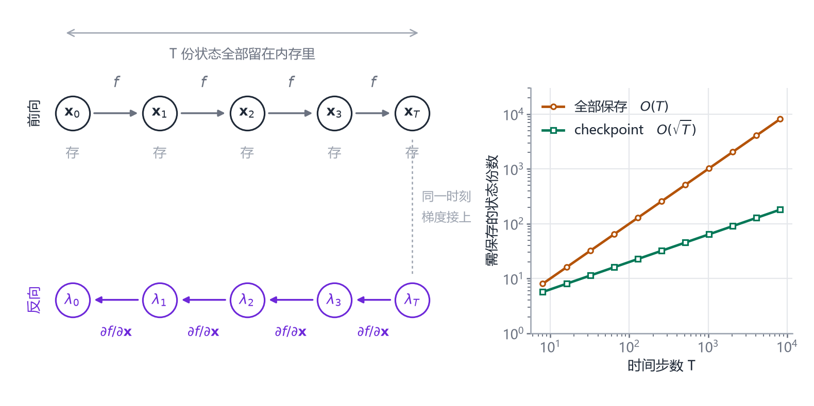
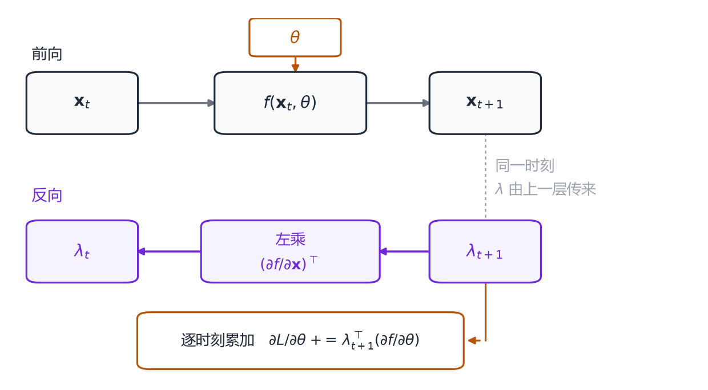
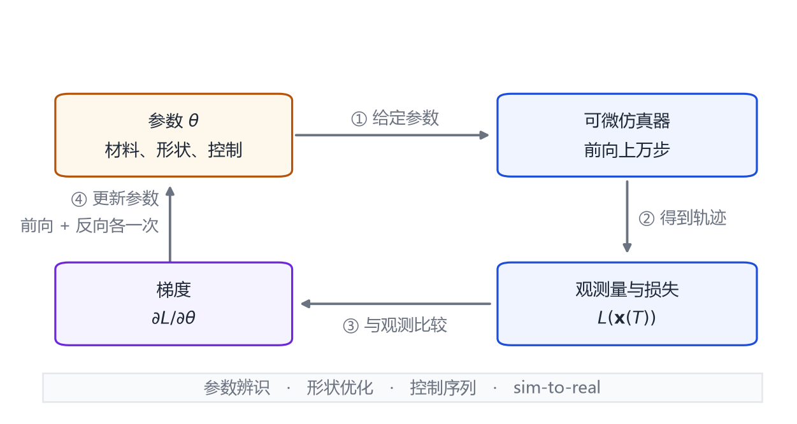

# 第 10 章 可微物理：让模拟反过来用

> 本章导读：前面所有章节都在回答“给定参数，结果是什么”。这一章问反过来的问题：看到结果，能不能反推参数，而且推得快。答案取决于一件很具体的事——模拟器能不能给出梯度。下面讲梯度的三条来路、穿过时间的代价、接触与隐式求解带来的麻烦，以及这件事今天被用来做什么。

## 10.1 正问题与反问题

一段高速摄影：一块丝绸从桌沿滑落，边缘卷起一个柔软的褶。你想让 CG 里的布和它对上，需要知道这块绸的弯曲刚度是多少。打开模拟器，把弯曲刚度填一个数，跑一遍，看形状；差得远，改一个数，再跑。手动试二十次，能凑个大概。

问题是参数不止一个。拉伸、剪切、弯曲、阻尼、面密度，五个参数各取五个值就是三千多种组合；再加上初始姿态和摩擦，穷举立刻失效。

这就是反问题的典型样子。正问题是给定参数 $\theta$，算出结果 $\mathbf{x}(T)$；反问题是给定观测 $\mathbf{x}^{*}$，反推 $\theta$：

$$
\min_{\theta}\;L\big(\mathbf{x}(T;\theta),\,\mathbf{x}^{*}\big),
$$

$L$ 衡量模拟终态与观测的差距，$\mathbf{x}(T;\theta)$ 表示“用参数 $\theta$ 模拟到第 $T$ 步的状态”。整个反问题被写成了一个优化问题。

难在三点。第一，不适定：弯曲刚度小一点、阻尼大一点，落下来的形状可以很像，不同的参数能给出几乎相同的轨迹。第二，带噪声：观测来自相机，有标定误差、有遮挡、有跟踪失败。第三，贵：每算一次 $L$ 都要跑一整段模拟。

高维是压垮骆驼的那根稻草。参数只是三个刚度时，穷举也许还行；但形状优化里参数是几千个顶点坐标，控制优化里参数是一整段力矩序列，每步三个分量，一千步就是三千维。对这些维度，无梯度方法要么样本量爆炸，要么收敛极慢。

无梯度方法并不是没人用。协方差自适应进化策略、贝叶斯优化，在几十维以内都能打，而且不怕目标函数不光滑、不可导、带噪声。它们的问题只在维度：样本量大致随维数增长，而每次采样都要跑一整段模拟。三千维的控制序列，哪怕每维只采十次，也是三万次仿真。梯度方法把这一步省掉了：一次前向加一次反向，就能拿到全部三千个偏导。

反问题在三个地方长得很不一样。材料参数辨识，未知量十来个，观测是一条轨迹；形状优化，未知量是几千个顶点，约束是几何不能自交；控制，未知量是一整段动作，约束是动力学必须成立。它们共用一个形式，但参数的含义不同，正则项也不同——比如形状优化要加一个拉普拉斯光滑项，否则优化器会把网格拉成尖刺。

## 10.2 梯度三条来路

知道 $L$ 对 $\theta$ 的梯度，优化就能沿最陡方向走，几百次迭代足以收敛。问题只剩一个：梯度从哪来。

**有限差分**最直接。给第 $i$ 个参数加一个小扰动 $h$，跑一遍，看损失变了多少：

$$
\frac{\partial L}{\partial\theta_i}\approx\frac{L(\theta+h\mathbf{e}_i)-L(\theta)}{h}.
$$

$n$ 个参数要 $n+1$ 次模拟，中心差分要 $2n$ 次。误差有两个来源：截断误差正比于 $h$（前向）或 $h^{2}$（中心），舍入误差正比于 $\epsilon/h$，$\epsilon$ 是浮点精度。两者相抵，最优的 $h$ 在 $\sqrt{\epsilon}$ 附近，双精度下约 $10^{-8}$。精度够用，代价在维度：三千维的控制序列要跑三千遍，哪怕一遍一秒也是一小时。

它还有一个用处：作为检验其他方法的标准。自己写的反向传播如果和中心差分对不上，多半是某个导数写错了符号或漏了一项。做法是对一个随机方向做方向导数对比，相对误差在 $10^{-6}$ 以内就算过。

**自动微分**换了思路：不扰动参数，而是记录程序里的每次运算，再按链式法则反向走一遍。前向模式一次得到一个方向的方向导数；反向模式从输出退到输入，一次得到全部 $n$ 个偏导。反向模式的成本与参数个数无关，大约是前向的两三倍。

代价是内存。要反着走，就得知道正向每一步用到了什么。一段一千步的模拟，每步状态几万个浮点数，全留下来就是几百兆到几吉字节。图 10-1 上半部分画的就是这两条线：前向从左往右，反向从右往左，相邻两个状态之间的运算要在反向时被重新访问。

前向与反向各有适合的形状。前向模式一次得到一个方向导数，适合输入少、输出多的情形；反向模式一次得到全部输入分量的导数，适合输入多、输出少的情形。优化问题恰好是后一种：三千个参数，一个标量损失。所以可微物理几乎全部用反向模式。

<figure class="fig">

<figcaption><b>图 10-1</b>　前向与反向两条时间线（结构示意），以及反向所需的存储量。上：状态 $\mathbf{x}_0$ 到 $\mathbf{x}_T$ 逐步前推，梯度 $\lambda$ 逐步回传，两者的时间方向相反；右侧小图给出全量保存与 checkpoint 的状态份数随步数的变化（$O(T)$ 与 $O(\sqrt{T})$，按复杂度公式绘制）。</figcaption>
</figure>

对物理模拟，反向自动微分还有个好处：它穿过的是你自己写的离散程序，得到的是这个离散程序本身的精确梯度，不是连续方程的近似。调试时用梯度检查与有限差分对比，能对上到 $10^{-7}$ 量级，就说明导数实现没错。

**伴随法**是连续版本的同一件事。不把时间切成一千步，而是把整条轨迹当成整体，引入拉格朗日乘子 $\boldsymbol{\lambda}(t)$：

$$
\mathcal{L}=L(\mathbf{x}(T))+\int_0^T\boldsymbol{\lambda}^{\top}\left(\dot{\mathbf{x}}-\mathbf{f}(\mathbf{x},\theta)\right)\mathrm{d}t,
$$

对 $\mathbf{x}$ 变分并令其为零，得到伴随方程

$$
\dot{\boldsymbol{\lambda}}=-\left(\frac{\partial\mathbf{f}}{\partial\mathbf{x}}\right)^{\top}\boldsymbol{\lambda},
\qquad
\boldsymbol{\lambda}(T)=\frac{\partial L}{\partial\mathbf{x}(T)},
$$

这是一条反向时间的微分方程，从终端条件往回积，参数梯度是 $\partial L/\partial\theta=\int\boldsymbol{\lambda}^{\top}\left(\partial\mathbf{f}/\partial\theta\right)\mathrm{d}t$。图 10-2 画的是它的一步。

<figure class="fig">

<figcaption><b>图 10-2</b>　伴随法的一步（流程示意）。上排是前向：$\mathbf{x}_t$ 经 $\mathbf{f}(\mathbf{x}_t,\theta)$ 得到 $\mathbf{x}_{t+1}$。下排是反向：$\lambda_{t+1}$ 左乘转置雅可比得到 $\lambda_t$，同时把 $\lambda_{t+1}^{\top}\partial\mathbf{f}/\partial\theta$ 累加到参数梯度上。同一个 $\theta$ 在每一步都被用到，所以它的梯度是各时刻贡献之和。</figcaption>
</figure>

伴随法的吸引力在内存：反向时重算前向状态就不必存整条轨迹，内存是常数。代价是计算量翻倍，而且在混沌系统里，“重算得到的状态”与“原先算出的状态”会有微小差别，长期积分后差得很远，梯度就不可信了。另一层代价是推导：连续形式的伴随方程要手推，换一个本构、加一项约束，推导就重来一遍。自动微分没有这个问题，代价是内存。

三条路的选择有个大致规律。参数只有十几个、需要粗略梯度、又不想改代码，用有限差分。参数多、代码是自己写的、内存够，用反向自动微分。参数极多、时间窗极长、内存紧张，用伴随法，并接受重算的代价。

## 10.3 穿过时间

把上面这些落到时间步进上，就是沿时间反向传播。名字来自循环神经网络，本质一样：把每一步积分当成网络的一层，$T$ 步就是一个 $T$ 层的深网络，只不过每层共享同一组权重。

前向是 $\mathbf{x}_{t+1}=\mathbf{f}(\mathbf{x}_t,\theta)$。设 $\boldsymbol{\lambda}_t=\partial L/\partial\mathbf{x}_t$，反向递推是

$$
\boldsymbol{\lambda}_{t}=\left(\frac{\partial\mathbf{f}}{\partial\mathbf{x}_t}\right)^{\top}\boldsymbol{\lambda}_{t+1}
+\frac{\partial L}{\partial\mathbf{x}_t},
\qquad
\frac{\partial L}{\partial\theta}=\sum_{t}\boldsymbol{\lambda}_{t+1}^{\top}\frac{\partial\mathbf{f}}{\partial\theta}.
$$

这个式子里藏着两个麻烦。

第一个是存储。反向要算转置雅可比，就得知道 $\mathbf{x}_t$。全部留下是 $O(Tn)$；$T=1000$、$n=30000$ 就是三千万个双精度数，两百多兆，加上中间量还要翻几倍。

checkpoint 是应付它的标准手段：少存多算。只存每 $k$ 步一个检查点，反向走到某一段时，从最近的检查点重新前向算出段内状态，再逐段反传。内存降到 $O(T/k+k)$，取 $k=\sqrt{T}$ 时是 $O(\sqrt{T})$；计算量增加到大约两倍，因为每个状态被前向算了两次。$T=1000$ 时，内存从一千份降到三十几份，这个折扣非常值。图 10-1 右侧把两条曲线放在一起，全存是直线，checkpoint 是平方根。

比起循环神经网络，物理模拟对内存更不友好。网络的隐状态可能只有几百维，而一段布的状态是三万维，同样步数下存储需求差两个数量级。这就是为什么在可微物理的实现里，checkpoint 几乎是标配而不是优化项。

checkpoint 还有更省的变体。均匀分段不是最优的：越靠近终点，重算的段越短，可以多存；越往起点，重算代价越大。按这种思路递归地二分时间区间，总计算量能压到最优的 $O(T\log T)$ 量级，内存仍是对数级。实际实现里很少做到那么细，均匀分段加一两次二分已经足够。

第二个是数值。$\boldsymbol{\lambda}$ 每退一步乘一个雅可比，$T$ 步之后是 $T$ 个矩阵的乘积。若这些矩阵的谱半径平均大于 1，梯度指数增长，几次迭代就溢出；小于 1 就指数衰减，早期的参数根本收不到信号。这和第 3 章讲的误差放大是同一件事，只是方向相反。

应付它，实践中更多靠工程而不是数学。做机器人控制时常把时间窗截短：不追求整段轨迹的梯度，只看未来几十步，滚动优化。这既避开爆炸，也让每次迭代更便宜；代价是短视，长期可能走偏。折中是在损失里加一项终端的启发式估计，相当于给短窗一个远景。另一个细节是多次 rollout：同一组参数在几个略有不同的初始状态下各跑一遍，把梯度平均，方向会稳很多；这比把时间窗拉长更划算。

## 10.4 可微求解器的难点

只要程序里每个操作都可导，梯度就能算出来。物理模拟里恰好有三处不是这样。

**接触不可导。** 两个物体是否接触是个布尔判断：距离大于零就没有约束，小于零就有。这个开关让损失对位置的关系出现折点——物体刚好贴上时，微小的位置变化让约束从无到有，力突然跳变，折点处的导数要么不存在，要么无穷大。摩擦更糟：静摩擦与动摩擦的切换、摩擦锥的边界，都在制造不连续。

处理办法有几类。一类是平滑：把硬接触换成很硬的弹簧，或者用一个势垒函数让力在接近零距离时连续上升；光滑化之后处处可导，但刚度大时梯度也大，数值上不好惹。IPC 把这件事做到极致：用距离趋零时发散的对数势垒，配合自适应缩小步长，保证穿透和翻转都不发生，同时保持能量对位置的二阶可导 [@li2020]。另一类是承认不连续，直接对接触求解那一小块微分：刚体接触每步解的是一个互补问题，可以把冲量当成参数的隐函数，对整个 KKT 系统求导 [@geilinger2020]，代价是要处理互补条件在激活与不激活之间的切换。还有一类是绕开，用随机化得到一个有噪声但方向大致对的梯度，样本效率低。

接触还有一个隐蔽的后果：损失曲面出现台阶。物体在某个参数下刚好不接触，参数再大一点就撞上，损失突然跳一截。台阶处梯度为零或者巨大，优化器会在边缘来回试探。缓解的办法是给接触一个软化的过渡带，或者在损失里加入对穿透深度的惩罚，把台阶变成斜坡。

**隐式求解要反解。** 隐式积分的下一步由 $\mathbf{F}(\mathbf{x}_{n+1},\mathbf{x}_n,\theta)=\mathbf{0}$ 隐式确定，不是显式算出来的。若直接对牛顿迭代的每一步做自动微分，计算图会包含整个迭代过程，内存和计算量都爆炸。正确做法是用隐函数定理：

$$
\frac{\mathrm{d}\mathbf{x}_{n+1}}{\mathrm{d}\theta}
=-\left(\frac{\partial\mathbf{F}}{\partial\mathbf{x}_{n+1}}\right)^{-1}
\frac{\partial\mathbf{F}}{\partial\theta}.
$$

中间那个逆矩阵不必真求，只需解一次线性系统，而前向求解时已经分解过同一个矩阵，可以直接复用。这要求求解器把“分解”和“求解”分开暴露出来，不少现成的物理库没有留这个接口。这也解释了一件事：可微往往要求重写求解器，而不是给现成引擎套一层自动微分。

**长时窗。** 梯度会爆炸或消失，物理模拟还有一层额外困难：混沌。两个几乎相同的初始状态，几百步后就分道扬镳，损失对参数的曲面因此长满尖峰和平台，梯度方向在相邻点之间剧烈变化。这时候即使梯度算得准，优化也走不动。

对策是降低对“长期精确”的要求：把损失定义在短窗上，或者定义在统计量上，比如平均速度、总能量、最终姿态，而不是逐帧位置。也有人用多起点、多随机种子的平均梯度压制噪声。这些手段都不优雅，但目前是主流。

## 10.5 用途

可微模拟的价值在四类问题上体现得最清楚。

**参数辨识。** 给定实拍或实测轨迹，反推材料参数：布的拉伸与弯曲刚度、颗粒的摩擦角、软体的杨氏模量，都写成“模拟轨迹与观测之差”来优化 [@liang2019]。它把“试二十次”变成“迭代两百次”，而且能同时调十几个参数。实操上通常先用少量参数拟合整体形状，再逐步放开细节；一次放开十几个，优化器容易陷进局部极小。

**形状优化。** 材料给定，问什么样的形状能完成任务。软体机器人的一条腿要多长、多厚、气腔怎么排，这些是几千维的设计变量。可微模拟把“设计到性能”这条链变成可导的，于是能用梯度直接改进设计，不必反复试制 [@diffaqua2021]。

**控制。** 给定目标和模型，求一段控制序列。模型预测控制每步要求解一个有限时域的最优控制问题，可微模拟提供的正是这个问题的一阶信息。软体机器人尤其需要：软体的动力学没有解析逆，只能靠仿真加梯度迭代 [@hu2019]。开环优化的结果是整段动作，用于离线生成；闭环要在每个时刻重新求解，用于在线控制，两者用的是同一套梯度。

**sim-to-real。** 仿真里训练的策略搬到真机上往往失效，因为摩擦、质量分布、执行器延迟都不一样。可微模拟给出了一条把真实轨迹回灌进仿真的通道：用真机数据反推仿真参数，让仿真更像真机，再在里面训练。这条路和强化学习结合得最紧，大规模并行仿真平台就是为它准备的 [@makoviychuk2021]。

<figure class="fig">

<figcaption><b>图 10-3</b>　可微模拟的闭环（流程示意）。参数给出后跑一次前向得到轨迹与损失，再一次反向得到梯度，回过来更新参数。四类用途共享这个循环，区别只在于参数是材料常数、顶点坐标还是一整段控制序列。</figcaption>
</figure>

四类用途其实在问同一个问题：哪些量是我们能改的，哪些量是我们能看的。能改的是参数，能看的是轨迹，中间那段不可见的因果链就是模拟器。把这条链变成可导的，反问题就从“猜”变成了“解”。这也是它比黑盒优化更吸引人的地方：梯度里带着结构信息，而不只是一个标量好坏。

## 10.6 工具

到 2020 年前后，可微模拟已经不再是实验室里的玩具，有几套能用的基础设施。

DiffTaichi 把可微做进了语言层 [@hu2020]。写模拟时用它的核函数语法描述每个粒子的更新，编译器生成并行的 CPU/GPU 代码，同时自动构建反向传播。好处是通用，刚体、软体、流体、MPM 都能写；代价是要学一套领域特定语言，而且反向的正确性依赖你写的每个核都可导。

Warp 是另一套 GPU 核函数框架，定位更偏工业，把稀疏矩阵、体积网格、碰撞几何这些物理原语做成了库，反向传播要自己写。它和主流机器学习框架能互操作，适合把已有的 CUDA 模拟迁移过来。

Brax 站在另一个极端：整个引擎用 JAX 写，所有运算都是纯函数，编译、批量、求导全部交给框架 [@freeman2021]。它主要做刚体，支持接触，优势是能在加速器上同时跑几万个环境；缺点是编程模型和传统面向对象的物理引擎差别很大，调试不直观。

MuJoCo 是控制领域的老牌引擎，接触模型细致、稳定 [@todorov2012]。它的 JAX 版本 MJX 把整条管线搬到加速器上，保留了原始接触模型，同时获得批量并行的能力。

还有专门针对接触的工作。刚体接触的可微性一直是难点，Dojo 用自定义的互补问题求解器加隐式微分，把整条链路做成可微的，并强调数值可靠性 [@werling2021]。

选择可以按问题分。刚体、接触多、要大规模并行训练策略，看 Brax 和 MJX。软体、流体、颗粒，要自己写本构，看 DiffTaichi 和 Warp。只做一次离线参数辨识、不强求速度，也可以用现成的自动微分框架包住自己写的模拟器，慢一点但省事。

有一点要提前知道：可微模拟给出的梯度，是你的离散模型的梯度，不是真实世界的梯度。模型错了，梯度再准也只是把你更快地带到一个错的答案上。参数辨识要留验证集，sim-to-real 要不断用真机数据修正模型，原因都在这里。

如果这些框架都不合适，还有一条笨办法：用 PyTorch 或 JAX 把模拟器的核心循环重写一遍，让它跑在张量上，反向交给框架。规模小时代码量增加不多，调试也直观；规模一大，计算图会变得巨大，就得回到手写伴随或者专用框架。
