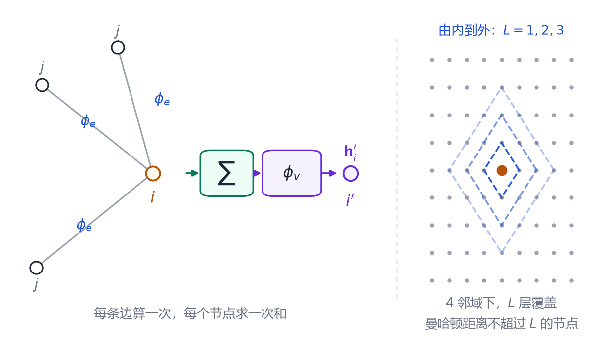
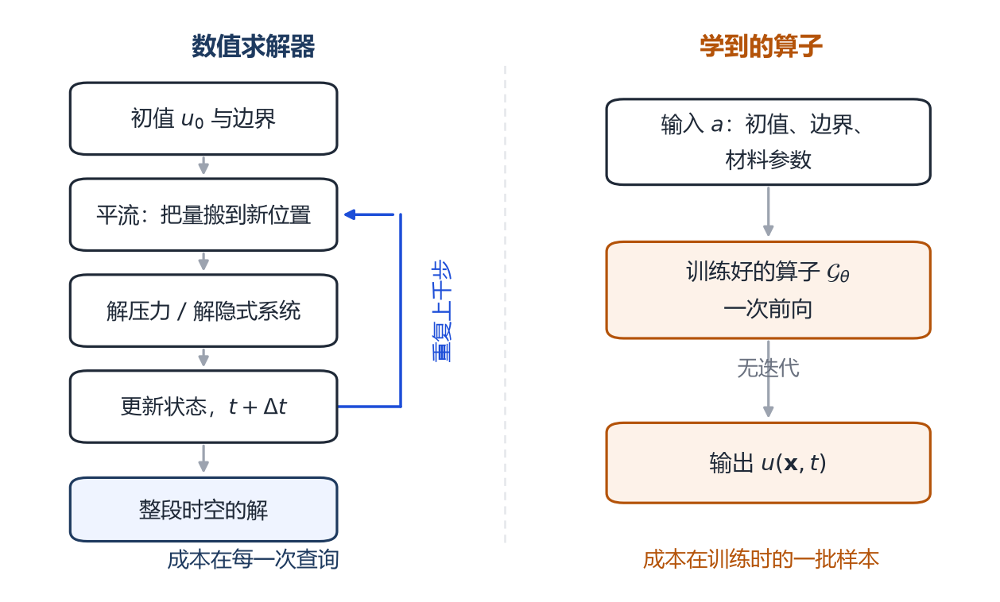
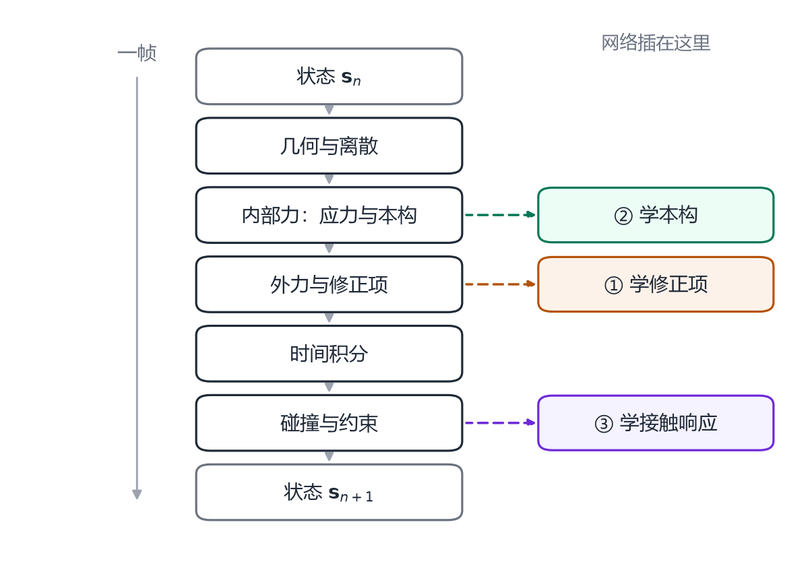

# 第 11 章 学习的介入：神经模拟器

> 本章导读：这一章讲把神经网络放进模拟里的几种放法，以及每种放法换来了什么、丢掉了什么。读完你应该能判断一个任务该不该用学习型代理，如果用了，网络该插在流水线的哪个位置。

## 11.1 一笔算不过来的账

短片里有个镜头：一杯热水冒出的烟升起来，绕过一只手，散在背景里。导演看完说，手再往前挪两厘米试试。用网格流体重算这一段，每帧都要在半拉格朗日平流之后解一次压力泊松方程，迭代到散度足够小。挪两厘米，几百帧从头再来一遍。

另一个活是给软体角色调材质，美术要的效果是“像发好的面团”。这个词落不到方程上：有弹性也有塑性，压过之后不完全回弹，含水率一变，软硬差得远。真去测，量得到“压下去三毫米、回弹两毫米”的宏观曲线，量不到内部的应力张量。本构写不出来，再好的求解器也只能算一个错的材料。

这两个例子指出四个不同的缺口。

**太慢。** 求解器的钱花在迭代上：压力泊松要迭代，隐式积分要牛顿迭代，接触要迭代到不穿透。每次迭代都是一次全场矩阵-向量乘。分辨率翻倍，格子数变四倍，迭代步数往往还要跟着涨。

**太贵。** 影视能接受一帧几十分钟，参数扫描不能：形状优化要几百次前向，训练策略要几百万次。

**本构未知。** 沙、雪、泡沫、肌肉、面团，本构要么写不准，要么参数测不到。离散、积分、投影这套骨架是通用的，卡住的是“给定变形，应力是多少”这个局部映射。

**网格太复杂。** 扫描来的几何、CAD 装配体、带孔洞的薄壳，网格生成本身就要人。断裂和飞溅每帧都改拓扑，网格质量很快恶化。

把界线划清：第 10 章的可微模拟让求解器可导，好去反推参数；本章的东西反过来，把求解器的一段换成网络，用一次前向代替一段迭代。

动机可以概括成一句：把成本从推理挪到训练。离线用求解器生成一批数据，做一次，之后所有重复查询由网络回答。前提是数据本身要花求解器的钱——任务只做一次，用代理是纯亏；要问一万次同一族的问题，账才划得来。

还有个差别比成本要紧。数值求解器的误差随迭代下降，残差会告诉你算到多准；网络的误差不随任何东西下降，它只是统计近似，错了不告诉你。求解器发散时残差会炸，网络发散时数字看起来一样平静。

## 11.2 把物理装进图里

状态怎么存，最先想到的是规则网格：能直接放进数组，卷积核滑过去就行；麻烦在于真实场景很少规则：布的顶点数随分辨率变，裂开之后拓扑变了，沙和水的粒子每帧在动。塞进固定形状的张量就得预先开足够大的数组补齐空位。

图是更松的容器。顶点代表物质点，边代表两点之间有相互作用，整张图还能带一组全局属性。粒子是天然的图：粒子当节点，邻居当边；网格也是图：顶点当节点，网格边当边。三种表示因此能进同一个框架。

有了容器，接下来是算子：边上算消息、节点上聚合、节点上更新。设节点 $i$ 的隐向量是 $\mathbf{h}_i$，$i$ 与 $j$ 之间边的属性是 $\mathbf{e}_{ij}$，一次消息传递是

$$
\mathbf{m}_{ij} = \phi_e(\mathbf{h}_i, \mathbf{h}_j, \mathbf{e}_{ij}), \qquad
\bar{\mathbf{m}}_i = \sum_{j \in \mathcal{N}(i)} \mathbf{m}_{ij}, \qquad
\mathbf{h}_i' = \phi_v(\mathbf{h}_i, \bar{\mathbf{m}}_i),
\tag{11.1}
$$

$\phi_e$ 和 $\phi_v$ 是两个小的多层感知机，$\mathcal{N}(i)$ 是节点 $i$ 的邻居集合。整个算子没有卷积核，也没有全场矩阵乘，只有每条边算一次、每个节点求一次和。

这个结构适合物理：聚合与排列无关，计算只在局部发生，邻居数量可变。

代价在“传得远”这一项。一层只把信息送到一跳之外，而流体里压力是全局量：活塞推一下，整片水域的压力同时变。要网络自己发现这一点就得堆层数，$L$ 层只覆盖 $L$ 跳，在 $100 \times 100$ 的网格上走不完十分之一宽度。补救有三条：加层数；加分层结构，让远距离节点在粗图上直连；加全局节点，一次传递等于全场广播。

图 11-1 画出了一次传递和层数带来的覆盖范围。

有分量的工作是 Sánchez-González 等人的图网络模拟器（GNS）[@sanchez2020]。粒子当节点，特征是位置、速度、材料编号和“是不是边界”的标记；边由半径搜索得到，特征是相对位移；网络输出加速度，用显式积分推一步。训练目标是单步加速度的均方误差，推理时把输出接回输入往下推。水会溅，沙堆会塌，粘液会拉丝，定性行为都对上了。

局限也直接：训练只看一步，推理要推上千步，偏差被后面每步放大。

Pfaff 等人的 MeshGraphNets 换了落点：节点放在网格顶点上，边除了网格边，还加一圈世界空间近邻边，特征里带上相对位置 [@pfaff2021]。这样网络可以直接吃有限元网格，复杂边界不用额外处理。它还多了一种数值方法难做到的能力：在误差大的区域加密节点，同一个网络接着算——它只看局部结构，不看网格总数。

账要算清楚：邻居搜索每帧都要做，和 SPH 是同一笔开销；消息传递在 GPU 上是不规则访存，带宽利用率上不去。它比规则网格上的卷积贵，换来的是几何的自由。

还有一类做法更轻：把卷积搬到粒子的邻域上，直接在点云上加权求和，Ummenhofer 等人的拉格朗日流体就是这样 [@ummenhofer2020]。邻居每帧重找，权重由相对位置给出，比消息传递轻，也比规则网格自由。

<figure class="fig">

<figcaption><b>图 11-1</b>　图网络里的一次消息传递。左边是节点 $i$ 与它的三个邻居：每条边先由 $\phi_e$ 算出消息，三条消息在节点上求和，再由 $\phi_v$ 更新节点状态。右边是以四邻域网格为例的效果：$L$ 层只能把信息送到曼哈顿距离 $L$ 以内，覆盖面是一层层向外扩的菱形。</figcaption>
</figure>

## 11.3 学一个算子

图网络学的是离散点到离散点的映射。另一条路把对象换成连续函数：不解某一个初值问题，而是学“从输入场到解场”的算子。

一个方程的解可以看成映射 $\mathcal{G}: a \mapsto u$，$a$ 是初值、边界、源项这些输入函数，$u$ 是解。求解器每次只算一个 $a$，算一万个就得求解一万次；学算子就是用一个参数化的 $\mathcal{G}_\theta$ 逼近 $\mathcal{G}$。

傅里叶神经算子（FNO）是这条路里结构最清楚的 [@li2021fno]。它把卷积搬到频域：

$$
\mathbf{v}_{l+1} = \sigma\Big(\mathbf{W}\mathbf{v}_l + \mathcal{F}^{-1}\big(\mathbf{R} \cdot \mathcal{F}(\mathbf{v}_l)\big)\Big),
\tag{11.2}
$$

$\mathcal{F}$ 是傅里叶变换，$\mathcal{F}^{-1}$ 是逆变换，$\mathbf{R}$ 是一组可学习的复权重，$\mathbf{W}$ 是逐点线性变换，$\sigma$ 是激活函数。关键在 $\mathbf{R}$：它不是空间卷积核，而是一串按频率编号的系数。能这么写，是因为线性平移不变的算子对角化之后就等于逐模态相乘。

只保留前若干个低频模态是另一个要点。它既省钱，也是一个先验：多数 PDE 的解能量集中在低频。这在扩散、热传导、低雷诺数流动上成立，在激波和湍流的小尺度上不成立。

FNO 还有个很实用的性质：$\mathbf{R}$ 的参数量跟网格数无关。在 $64 \times 64$ 上训练好的权重可以直接放到 $256 \times 256$ 上推理，这叫零样本超分辨率；数值求解器加密网格就得重算。两者的结构对照见图 11-2。

DeepONet 走另一条形式：把算子拆成两支，分支网络吃输入函数在若干传感器点上的取值，输出一组系数；主干网络吃查询点坐标，输出一组基函数值；两者做内积得到该点的解，

$$
\mathcal{G}(a)(\mathbf{y}) \approx \sum_{k=1}^{p} b_k(a)\, t_k(\mathbf{y}),
\tag{11.3}
$$

$b_k$ 来自分支网络，$t_k$ 来自主干网络，$p$ 是基的个数。这个结构对“一族问题”特别顺手：几何形状可以当成输入函数的一部分，同一套权重能处理不同形状的域；查询点任意取，不用固定网格。代价是每次查询都要过一遍主干网络。

两条路共同的麻烦是边界。傅里叶变换默认周期，非周期边界要补零、加窗，或者把边界信息塞进输入；不规则域更没法直接做快速傅里叶变换。所以 FNO 的主战场是规则网格上的参数化问题：渗流反演、材料均匀化。

<figure class="fig">

<figcaption><b>图 11-2</b>　神经算子与数值求解器的结构对照。左边是求解器：从初值出发按时间步循环，每步都要平流、解压力方程、更新状态，循环上千次才出结果。右边是学到的算子：一次前向给出整段时空的解，代价是训练时要见大量由左边生成的样本。中间的虚线分开两种成本位置——求解器把成本放在每次查询，算子把成本放在训练。</figcaption>
</figure>

## 11.4 把方程写进损失里

第三种放法连流水线都不用，直接拿网络当求解器。物理约束网络（PINN）的思路是：不离散方程，把方程本身当成一条要满足的约束，写进损失 [@raissi2019]。

让网络直接表示解，$u_\theta(\mathbf{x}, t)$ 输入时空坐标，输出那个点的物理量。网络可导，就能用自动微分算出 $\partial u/\partial t$、$\nabla u$、$\nabla^2 u$，代进方程得到残差。一维扩散方程 $u_t = D u_{xx}$ 的残差是

$$
r_\theta(\mathbf{x}, t) = \frac{\partial u_\theta}{\partial t} - D \frac{\partial^2 u_\theta}{\partial x^2},
\tag{11.4}
$$

$D$ 是扩散系数。训练让残差在域内一批随机采样点上尽量小，同时让网络在边界和初值上对上给定条件：

$$
\mathcal{L} = \mathcal{L}_{\text{data}} + \lambda_r \mathcal{L}_{\text{res}} + \lambda_b \mathcal{L}_{\text{bc}} .
\tag{11.5}
$$

三项分别是观测数据、方程残差、边界与初值，$\lambda_r$、$\lambda_b$ 是权重。没有观测数据时第一项可以去掉，剩下两项就足以定解。这是它最吸引人的地方：不需要网格，也不需要先离散再求解。

强项在反问题。方程里有个未知系数、未知源项、未知边界，把它当成可训练参数，和网络一起优化，观测数据会把它拉到位。Raissi 等人从少量浓度观测反推对流-扩散的系数，也从粒子图像测速的速度场上反推压力场——后者用数值方法做要解一个很难的泊松方程，PINN 只要把 NS 方程的残差写进损失 [@raissi2019]。

误用集中在几件事上。

**当成通用求解器。** 高雷诺数流动、激波、多尺度材料，解在空间上有很尖的结构，一个光滑的、只有几层的网络表示不了。硬要表示就得加宽加深，训练时间涨到不可接受，精度还追不上成熟的有限体积代码。

**一次解整个时空域。** 把 $t$ 当普通输入维，让网络一次吐出整条时间线，理论上优雅，实际上很难优化，长时段会糊。可行的是分时间窗：解一小段，末态当初值往前推，又回到时间步进，只是每步内部用一个网络。

**权重与量纲。** 残差项、数据项、边界项的量纲往往不同，量级差好几个数量级。不做无量纲化、不调权重，优化器会去压最大的那一项，其余形同虚设。这是初学者最常遇到的“训练不收敛”，根子不在网络结构。

**用残差当精度。** 残差小不等于解对。边界采样点太稀，网络可以在边界附近悄悄违反条件而不被抓到。评估必须在没参与训练的点上、对着解析解或高精度解做。

一句话：PINN 是求解器，不是模拟器的替代品。它适合数值方法难以下手的场合——反问题、高维、数据稀疏、几何怪异；不适合数值方法已经成熟的场合。

## 11.5 把网络插在哪儿

纯替代风险高，更常见的是混合：保留数值骨架，用网络补最不确定或者最贵的那一块。图 11-3 把一帧的流水线摊开，标出三个可插入的位置。

<figure class="fig">

<figcaption><b>图 11-3</b>　混合模拟的三种耦合位置。一帧的流水线自上而下是：当前状态、几何与离散、内部力（应力与本构）、外力与修正项、时间积分、碰撞与约束、下一状态。网络有两个位置可以进力的计算：替掉本构关系（②），或者在外力一侧补一个修正项（①）；第三个位置在约束求解里，预测接触响应（③）。</figcaption>
</figure>

**学修正项。** 保留原来的离散格式和求解器，只在某个闭合项上换网络。湍流的亚格子应力是典型例子：大尺度用网格解，小尺度的影响用一个应力项近似，这个项本来就有经验模型，换成网络只是把公式变成拟合。类似的还有数值耗散的多寡、SPH 里的粘性、粗网格上的子网格细节。

Kochkov 等人的做法在这一类里比较讲究 [@kochkov2021]：让傅里叶神经算子在一个粗网格上做大步推进，后面接一个小的、基于方程的修正步，把解拉回物理上允许的流形。修正步的计算量远小于从头求解，却让长时推演不会漂走——网络负责便宜地猜，数值方法负责把猜的结果拽回来。

**学本构。** 插入点在应力计算里。给定变形梯度或者应变，网络输出应力张量，塞回有限元或物质点法的装配环节。好处是能处理写不出解析式的材料：泡沫、肌肉、编织物、含水的颗粒。

难点不在拟合，在物理约束。本构必须满足客观性——整体旋转物体，应力跟着转；必须满足材料对称性——各向同性的材料不能因为输入方向不同而给出不同响应；还必须满足耗散——变形做正功时能量要真被消耗。直接学“应变到应力”，这三条都容易破。补救是把输入换成不变量，或者让网络学一个能量势函数，应力由它对变形求导得到。

**学接触响应。** 接触是整条流水线里最不光滑的一段：物体靠近到一定距离，力突然出现；摩擦有静动之分，滑移方向会跳变。用网络预测接触力或冲量，等于用光滑函数逼近分段函数。它在特定场景（同一类物体的抓取、同种材质的碰撞）能做得很快，但遇到没见过的接触构型，输出可能既不物理也不守恒。

混合方案的价值不在精度，在失效方式。端到端模型的错是无声的：数字看着正常，物理上全不对。混合方案里数值骨架还在，网络输出被限制在一个小量上，出错时最多是“修正得不准”。

## 11.6 推着推着就散了

不管哪种结构，只要推理是自回归的——上一步的输出是下一步的输入——就会碰到同一个问题。训练时网络见的是求解器给出的干净状态，推理时见的是自己上一步的输出，分布不同。小偏差进入下一步被放大，几千步之后轨迹可能和真值毫无关系。

这种增长可以粗略写成

$$
\varepsilon_n \approx \varepsilon_0 e^{\lambda n},
\tag{11.6}
$$

$\varepsilon_n$ 是第 $n$ 步的误差，$\varepsilon_0$ 是单步误差，$\lambda$ 是增长率的对数。单步误差再小，只要 $\lambda$ 为正，指数就会把小量放大。湍流本来如此，数值求解器用同样初值也会漂——评估时必须和同初值的数值解比，而不是和“唯一正确的答案”比。

失败有三种面貌。

**能量漂移。** 网络每步悄悄注入或耗散一点能量，几十步看不出来，两千步后物体自己动起来，或者整片布塌成一团。这一种最隐蔽，因为状态看起来一直正常。

**高频噪声。** 网络输出在网格尺度上不光滑，相邻两点的值差得莫名其妙。每步抖一下，累积起来就是“沸腾”：静止的液面一直颤，布上出现不该有的细纹。

**突然崩溃。** 状态滑出训练分布，某一帧开始输出离谱的值，之后再也回不来。前兆往往是局部速度突然变大，然后扩散到全场。

对付这些，办法分两侧。

训练这一侧常用多步损失：把输出接回输入展开若干步，只在最后一步算损失往前反传，网络被迫在自己的输出上工作。展开步数越多显存越吃紧，通常只展十几步，再配合加噪声，让网络见过脏状态。

结构这一侧才是真正能给出保证的地方。最干净的例子是把网络学成哈密顿量或者拉格朗日量，再用辛积分推进 [@greydanus2019][@cranmer2020]。辛积分器精确保持相空间体积，能量只在真值附近有界振荡，不会系统性漂走。网络只负责能量函数，推进交给积分器。

另一条路是投影。每步算完把状态拉回它必须待的集合：不可压流把速度投影到无散度的子空间，刚体把四元数归一化，碰撞把穿透推回去。投影是显式的、可验证的，不管网络输出多离谱，出来的状态至少满足这条约束。

还有一条路是改输出形式。让网络预测每个面上的通量而不是格心上的增量，相邻格子拿到的进出量天然相等，总质量自动守恒——这是有限体积法的老办法，搬到网络上一样管用。直接输出密度增量则相反，守恒只能靠惩罚项在训练集上近似成立。

按强度排一下：惩罚项最弱，只是希望它成立；投影居中，每步强制成立但会改动状态；结构最强，网络从一开始就不可能违反。

## 11.7 单步误差不够

一个模型报出“相对误差百分之二”，几乎说明不了任何事。

单步误差最容易算，也最容易骗人。它和长时行为脱节——单步误差很小的模型可能两百步就飘了，单步误差大一些的却因为误差在结构上守恒，反而推得久。

长时行为要看三样。rollout 误差随步数的曲线：平的、缓慢上升的，还是指数发散的；它的斜率跟同初值的数值解比，谁涨得快。频谱：把速度场做一次傅里叶变换，看网格尺度的能量是否在增长——那是高频噪声的直接证据。

守恒量要单独测。总质量、总动量、总能量各画一条相对误差曲线，好的模拟器在零附近有界振荡；某一条单调往上爬，那个量就没守住。

泛化要按维度拆开：时间更长、区域更大、分辨率更高、几何换了、边界换了、参数外插。前两项考稳定性，中间两项考离散无关性，后两项考模型学到的是物理还是训练集的外观。最常见的夸大来自只测第一项。

成本要算全：数据、训练、推理三项加起来，跟“用求解器在同等精度下算一次”比，才知道划不划算。只报推理速度是最常见的取巧——省下来的时间全花在了前面。

一个判断可以带走：一次性任务用求解器，重复几万次的查询才考虑学习型代理。中间地带几百次、精度要求不高，混合方案通常比纯替代更稳，出错时降级而不崩。
