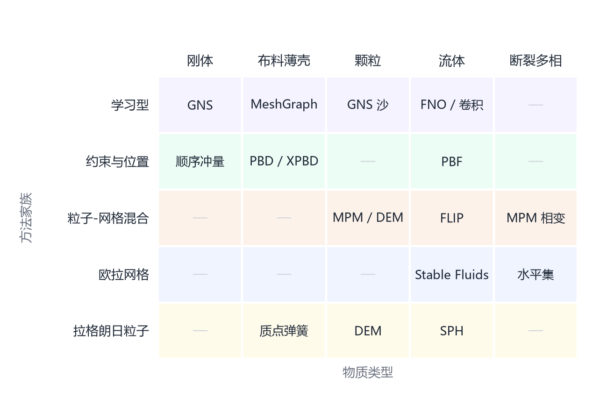
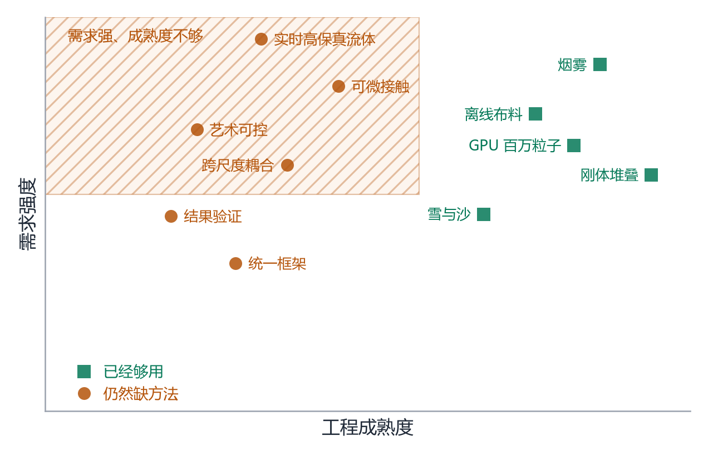
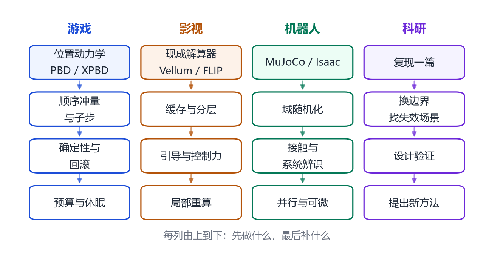

# 第 12 章 今天的地图与明天的边界

> 本章导读：前面十一章是一条线，这一章把它摊成一张地图。你会看到哪些格子已经被填满、哪些格子还空着，以及从一个空白格子走到另一头需要补什么。

## 12.1 一张摊开的地图

刚进这一行的人，最先遇到的不是理论，是一串缩写。SPH、MPM、PBD、XPBD、FLIP、FVM、DEM、GNN、FNO，每个后面都挂着一篇论文和一个仓库。它们看起来属于不同的世界，其实不是：多数缩写只是“用什么装物质”和“怎么算力”这两个选择的组合。

所以地图要有两根轴。横轴放物质类型：刚体、布料与薄壳、颗粒、流体、断裂与多相。纵轴放方法家族：拉格朗日粒子、欧拉网格、粒子-网格混合、约束与位置法、学习型。每个交叉点上填一到两个代表工作，填不出来的格子就空着。

先看几个例子，坐标是怎么定的。烟落在“流体 × 欧拉网格”上，因为烟的变形太大，网格不跟着物质走反而省事，密度场在固定格子上被平流、被投影，视觉上就对了。雪落在“颗粒 × 混合”上，因为雪既要有颗粒的堆积角，又要能压实成连续介质，物质点法正好把两者接起来。布料落在“薄壳 × 约束”上，因为布的抗拉几乎不可伸长，把“不可伸长”写成一条位置约束去投影，比把刚度调到很大再用显式积分稳得多。

同一个物质也能落在不同格子里，这不算矛盾。水既可以走欧拉网格，也可以走 SPH 粒子，还可以走 FLIP 的粒子带量加网格求解；三者在“大变形 / 细节 / 稳定性 / 成本”这四项上的得分不同，选哪个取决于镜头要什么。地图上的点因此不是唯一解，而是一组可选解里比较常用的那个。

读这张图有三条规则。

**方法跟着物质的写法走，不跟着行业走。** 同一个工作室做烟和做布用的是两套完全不同的代码，原因不是部门不同，是烟没有固定拓扑、布有。看到一个新问题，先问“这东西能不能用固定的连接关系表示”，答案决定了纵轴上半部分还是下半部分。

**同一格里，实时和离线是两套参数。** 实时要求每帧十六毫秒算完、结果可复现、不能有随机；离线要求形变对、能回滚、能分层缓存。同样是 XPBD，游戏里迭代几轮就交差，影视里迭代到残差足够小，代码可能一模一样，参数和流程差一个量级。

**空白的格子既可能是机会，也可能是坑。** 断裂和流体的交叉格一直很空，因为裂纹面要动、流体要穿过它，两套数据结构互相打架。有人在这里做出了东西，也有人在这里耗掉了两年。判断一个空格值不值得填，看的是“有没有一个必须同时满足两种物质行为的场景”，而不是“这个组合没人做过”。

地图还有一层时间。2007 年位置动力学把约束法推到前台，2013 年物质点法进了图形学，2019 年可微模拟成了一条独立的路，2021 年图网络把学习接了进来。这些变化都在改纵轴上的格子，但横轴一直是那五类物质——因为物质的行为不是被方法定死的。

<figure class="fig">

<figcaption><b>图 12-1</b>　技术全景矩阵。横轴是物质类型，纵轴是方法家族，格子里填代表工作。它不穷尽，也不互斥：同一个物质常常落在两三个格子里，选哪个取决于预算和镜头要什么。空白的格子表示这条路少有人走，不等于走不通。</figcaption>
</figure>

## 12.2 已经解决的问题

有些问题现在可以说了结了。判断标准不是“物理上完全正确”，而是“在预算内，干活的人不再需要绕开它”。

**刚体堆叠。** 一堆箱子摞起来、一堵墙被撞塌、一堆石头卡在缝里，这类场景今天调一调就能过。做法是把时间步切小（子步）、用顺序冲量解接触、加一点位置修正防穿透，再让不动的物体休眠。这几样东西叠起来，几百个刚体互相压着也不会明显抖或者陷进去。剩下的小毛病是长时间静置后的缓慢下沉，靠稳定化项压住，视觉上看不出来。

**离线布料。** 影视里的衣服今天基本不是难题，难的是“导演要的形状”。位置动力学的迭代投影让抗拉、抗弯、自碰撞能分开调 [@macklin2016]，几万到几十万顶点的衣服能算到不穿模、不起不该有的褶。整条管线的关键其实不在解算器，在缓存与分层：衣服按距离分几级精度，近景算细，远景算粗，最后拼起来。

**烟雾。** 半拉格朗日平流加大步长的压力投影，是这一行用了二十多年的老配方 [@stam1999]。它耗散大，会把细节抹平，所以还要加涡量约束把旋转补回去。补出来的东西不是真涡，但看起来对——对烟这类没有硬边界的物质，“看起来对”几乎就是全部要求。

**雪与沙。** 物质点法把雪从“一堆会飞的粒子”变成了“能压实、能成块、能被铲起来”的材料 [@stomakhin2013]。它的关键是粒子带物质、网格算应力，两边的转换让雪既保留了颗粒的堆积行为，又能被当成连续介质求应力。

**百万级的粒子。** GPU 上的并行前缀和、基数排序、空间哈希，让邻居搜索和粒子重排变成了带宽问题而不是延迟问题。有了这套基础设施，几百万粒子的 SPH 或者 MPM 在单卡上跑起来是常规操作。

这些事能算了结，有一个共同的机理：它们的误差都有界，而且能就地修补。刚体堆叠抖了，加子步；布穿模了，加迭代；烟太糊，加涡量。每一步的毛病都能在下一步之前看见，修起来不动全局。反过来，一旦误差会沿着结构传播——比如水花和水面互相带动、泡沫的生成与消亡又反作用于流场——那就不是一个参数能解决的问题，上面那张清单里也就没有它。

还得说清“解决”包着什么。这些方法都有它们能干的参数范围：布料的拉伸刚度到某个量级，解算器就不收敛；雪的 MPM 在极干或者极湿的时候会失效；烟在强浮力下会失真。工程上的办法是把镜头设计在这些范围之内，而不是把范围推到无限。所以“已解决”真正的意思是：在常见的镜头和常见的参数下，干活的人有一套稳定可用的默认值。

这五件事的天花板也在这里：它们解决的都是“给定一种物质、给定一个预算、把视觉上该有的行为做出来”，没有一件是“把物理算准到实验可验证的精度”。后者是另一个领域的目标，验证标准与这边完全不同。

## 12.3 还没解决的问题

地图上真正空的地方不多，但每一个都很硬。

**实时高保真流体。** 屏幕上的水，近看要有泡沫、有水花、有贴着物体爬的薄水膜，远看要有整体的涌浪；一帧十六毫秒里，这几样东西的分辨率需求差了几个数量级。现在的做法是分层：主体用粗网格或者粒子跑，细节用独立的粒子层叠上去，两层之间的耦合靠经验规则，不是靠方程。所以水花经常“贴不住”水面，泡沫的寿命也调不准。真正难的是耦合：细节从哪来、什么时候消失、能量怎么在两层之间传递，这些没有一套通用解法。

**可微接触的稳定性。** 第 10 章说过，接触是不连续的：物体在接触前一瞬间受力为零，接触后一瞬间受力非零。求导时这个跳变要么让梯度不存在，要么让梯度巨大。工程上的绕过办法是软化接触、用代理模型、或者只对接触状态之外的参数求导。但这些办法都会在“刚好接触”的临界状态失效，而临界状态恰恰是机器人抓取、堆叠、装配最需要判断的地方。

**验证。** 模拟出来的东西对不对，这件事在这一行格外难说。实验测量要么贵（粒子图像测速、高速摄影），要么只能测表面；解析解只存在于极少数情形；网格收敛性测试要跑好几遍全分辨率，成本高。于是多数工作的评估是“和参考解比”加“请人打分”。前者只能证明“和另一个模拟器一致”，后者无法复现。这是整个领域最薄弱的一环，也是学习型方法最难被接受的原因——它连“和参考解一致”这个弱标准都不容易满足。

**艺术可控。** 导演要的是“这里慢一点”“漩涡再多两个”“水花不要溅到脸上”。这些词和物理参数之间没有映射：粘度调大不会让某处的漩涡变多，重力调小会让整段变慢但也会让水花飞得不对。现在的办法是加控制力、加引导粒子、把模拟结果和手工动画混合，或者干脆让美术手动摆关键帧再让模拟去“修”。这一块的工作量往往比解算本身还大，但它很少出现在论文里。

**跨尺度。** 一杯水里同时有毫米级的泡沫和厘米级的水流；一件衣服上同时有纤维级的弯曲和米级的褶皱；一场雪崩里同时有颗粒碰撞和山体尺度的流动。单一分辨率要么算不动，要么算不准。自适应分辨率能缓解，但“什么时候加密、加密之后新旧网格怎么对齐、误差怎么估”都没有通用答案。跨时间尺度更难：爆炸的毫秒和沙漏的小时，没法用同一个步长。

**一个框架算所有物质。** 每隔几年就会有人提这件事：能不能用同一套数据结构、同一套积分器，把刚体、布、沙、水、火全装进去。物质点法一度被寄予厚望，因为它确实能把几种物质的边界放在同一张网格上。真用起来，每种物质还是要自己的本构、自己的时间步约束、自己的稳定性处理，共享的只是外层壳子。想要一套参数调所有材料，到今天还做不到；“统一”这个词在这里多半指的是工程接口，不是物理内核。

把这一节的几件事摆在一起，位置很像：需求很硬，成熟度不够。图 12-2 把这件事画成两轴，左上角那一块才是这一行真正的工作量所在。

<figure class="fig">

<figcaption><b>图 12-2</b>　成熟度与需求的错位（示意图）。横轴是工程成熟度，纵轴是需求强度。右上方是已经够用的部分，左下角是没人急着要的部分，左上角那一块——需求很强、成熟度不够——是这一行真正的工作量所在。</figcaption>
</figure>

## 12.4 怎么进来

想进这个领域，四条线要同时走一点，但不用等一条走完再走另一条。

**数学。** 真正每天用到的只有四样。线性代数，尤其是稀疏矩阵、特征值、条件数——你会在压力泊松、模态分析、预条件里反复碰到。常微分方程的数值方法，尤其是稳定性与辛结构——它决定了你的积分器会不会在长时间里把能量算飞。偏微分方程的基本分类——椭圆、抛物、双曲，决定了你该用隐式还是显式、该不该做投影。连续介质力学里的应力与变形梯度——不理解这两样，看本构模型只能看个热闹。优化可以晚一点补，接触求解和参数反演会逼着你学。

**代码。** 从二维开始，一天能跑起来的那种。第一步写 SPH 或者位置动力学：几百行，二维，能看见水花或者布料抖动，成就感足够支撑后面。第二步写不可压网格流体：平流、加力、解压力、投影，四步循环，二维的格子流体跑起来之后，你会真正理解“投影”在做什么。第三步写 XPBD，把约束、柔度、迭代次数三者的关系摸清楚。第四步才碰 MPM，它需要粒子到网格、网格到粒子的两套传递，写完会对“混合”这个词有实感。第五步再上 GPU，这时候你已知瓶颈在哪，不会把时间浪费在优化不重要的地方。

写的过程中比算法更值钱的是调试手段。把中间量画出来：速度场、压力场、约束残差、能量曲线。能量曲线尤其有用，它能一下子暴露出积分器在偷能量还是在吐能量。再把一两个有解析解的小例子（弹簧振子、静水压、单轴拉伸）写成测试，每次改完都跑一遍，很多“突然不对了”其实是几天前的改动埋的。

**论文。** 图形学的模拟论文集中在 SIGGRAPH、SIGGRAPH Asia、SCA 和 TOG 上。读的顺序有讲究：先读课程笔记和综述，把术语和脉络铺平；再挑一篇方法简单的复现，复现比读十篇有用；最后才读那些公式密集的。读一篇论文时，先看摘要和第一张图——那张图通常就是它想解决的问题；再看方法部分的“我们做了什么假设”，假设往往比方法更能说明它的边界。

**引擎。** 想快速看到效果，用现成的。Houdini 的 Vellum、FLIP、Pyro 覆盖了布料、流体、烟火三条主线，参数暴露得比较充分，适合建立直觉。Bullet、PhysX 适合看实时刚体与布料的工程实现。MuJoCo、Isaac 系列面向机器人与并行仿真，接口干净。想自己写又不想碰底层，Taichi 和 Warp 提供了可微、可并行的语言层，几十行就能跑起一个 SPH。

一条提醒：不要从“把数学全部补完”开始，也不要把“调库”当学习。前者会让人卡在预备知识里两年，后者会让人在参数面前永远不知道为什么。

## 12.5 四条路，四个起点

前面讲的是地图和方法，现在落到人身上：你是哪一类使用者，起点就该不一样。图 12-3 把四条路并排画在一起。

**做游戏。** 约束是硬性的：固定步长、结果可复现、每帧预算固定、不能有不可控的发散。起点选位置动力学加顺序冲量：布料、软体、刚体都用同一套约束框架，迭代次数按预算砍。不要在这条路上做全隐式的纳维-斯托克斯，也不要用需要整帧同步的全局求解器。可复现性要从第一天就守住：不能用随机数、不能用依赖线程顺序的累加、不能用浮点不确定的归约。

**做影视。** 约束是另一套：形变要对、能回滚、能分层、能让人干预。起点选现成的解算器（Vellum、FLIP、Pyro），先学管线而不是学方程：缓存怎么存、分层怎么切、解算失败的镜头怎么局部重算。真正决定成片质量的是“哪里要加密、哪里可以糊弄”，这是美术判断，不是数值判断。

**做机器人。** 需要的是速度、并行、可微、以及和真实的差距可控。起点选 MuJoCo 或者 Isaac：先把一个抓取任务跑通，再做域随机化，看策略在参数扰动下还稳不稳。接触模型是这条路上最大的坑：物理引擎里的接触是软化过的，真实接触有微观变形和粘附，两者之间的差距靠随机化和系统辨识去补，而不是靠把引擎调得更“准”。

**做科研。** 要的是新颖和可验证。起点是复现一篇方法简单、代码公开的论文，然后去找它的失效场景：换一种物质、换一个边界、把时间推长十倍。失效场景往往就是下一篇论文的题目。验证要提前设计：如果一个问题连“算对了是什么样”都说不清，做完也没法证明它有用。

四条路之间可以换，换的时候要认清代价。从游戏转影视，最不适应的是“可以慢慢算”：线上一帧十六毫秒的习惯会让人本能地拒绝高分辨率，而影视的解算恰恰靠分辨率换质量。从影视转游戏，最不适应的是“不能重算”：影视习惯了算到一半发现问题就从头再来，游戏里没有这个机会，所有决定得在写代码时做完。

四条路的起点不同，但要在中途补的课是同一批：稳定性、守恒、成本、验证。区别只在于谁先撞上哪一堵墙。游戏最先撞上的是预算，影视最先撞上的是可控，机器人最先撞上的是接触，科研最先撞上的是“怎么证明它对”。

地图会变。新的物质类型会出现，新的硬件会改变预算，学习方法会把某些格子的成本重写一遍。两根坐标轴不太会变：你总要决定拿什么装物质，也总要决定怎么算力。

<figure class="fig">

<figcaption><b>图 12-3</b>　四条学习路径的并列流程。四列分别是游戏、影视、机器人、科研，每列从“先做什么”走到“最后补什么”。横向看过去，同一行的方法在四列里出现的顺序不同，这正是起点不同带来的差别。</figcaption>
</figure>
