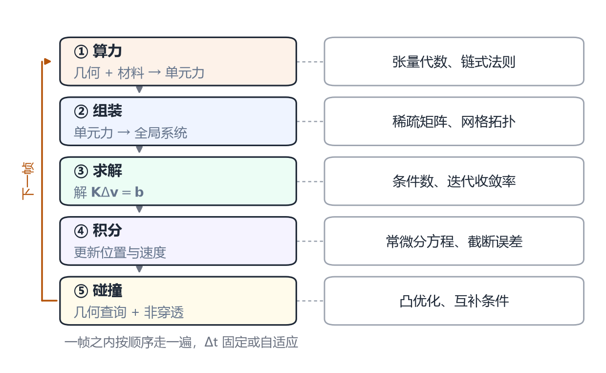
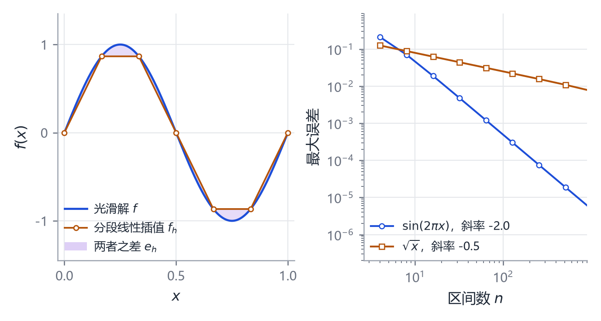
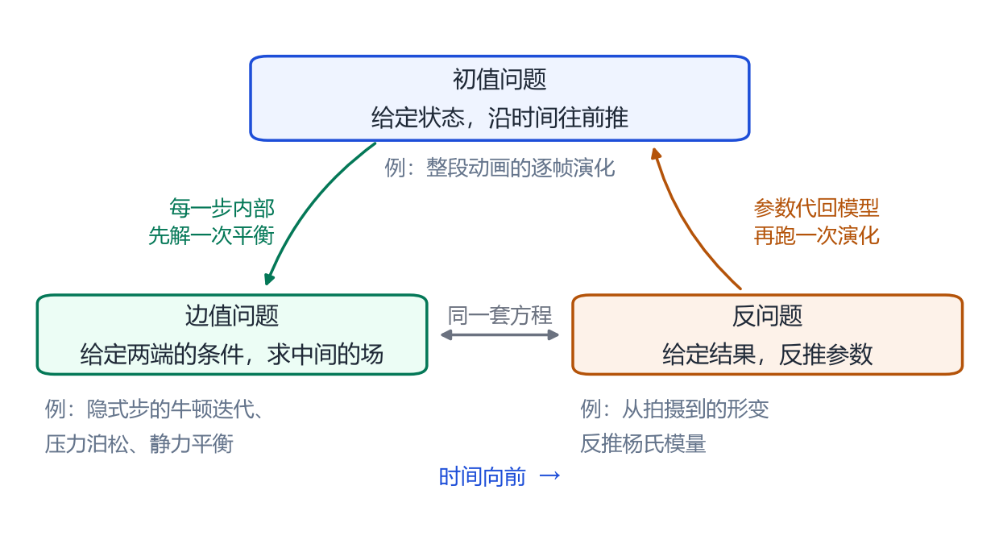

# 第 1 章 模拟器里到底有哪些数学

> 本章导读：这一章要回答的问题很朴素——按下一帧到画面刷新，中间到底用到了哪些数学。答案不是一张清单，而是一条链：几何给出力，力装成方程，方程要被解出来，解出来的增量再往前走一小步，最后被碰撞约束拉回可行区域。每一步都有自己的前提，前提不成立时，表现是画面炸掉或者物体突然变软，而不是弹一个报错框。读完这一章，你看到一段模拟的异常表现，应该能猜到是哪一类数学先出了问题。

## 1.1 把一次时间步拆开

一件衬衫从椅背上滑下来，搭在键盘上。这段动画在引擎里跑六十帧每秒，一帧给十六毫秒，扣掉渲染留给物理的不到十毫秒。这十毫秒里，引擎要把衬衫的六千个顶点从上一帧的位置挪到下一帧的位置，同时保证它们不穿过椅子、不互相穿透、不在下一帧突然弹开。

这件事被拆成固定的几步，顺序在几乎所有引擎里都一样：算力、组装、求解、积分、碰撞。看懂这个顺序，也就看懂了这一册为什么会分成现在这几篇。

**算力**。引擎手里有一份几何，每个三角形的顶点位置，可能还有每个顶点的速度；还有一份材料参数，这块布抗拉多强、抗弯多弱、阻尼多大。两者相乘得到每个单元的受力。这里的数学是张量代数和求导：把“拉伸了多少”换算成“有多大的力”，靠的是应变能对位移求导，材料模型不同，求导的对象就不同，但骨架不变。

**组装**。每个单元只知道自己那三个顶点的力，要变成“每个顶点受多少力”，得按顶点编号把这些贡献累加进一个全局向量。同时还要记下谁和谁相连，形成稀疏矩阵的结构。数学上这是把局部量映射到全局，用的是图与稀疏矩阵；代码里是把一个个 3×3 的小块按索引写进大数组。网格定了，稀疏结构就不再变，之后每帧只有数值在变。

**求解**。如果用了隐式积分，未知量不是“力”，而是“下一帧的位置”，而位置又决定力，于是得到一个方程。黏弹性布料的一步可能是一个几十万维的非线性方程组，加上摩擦接触再变成不等式组。这里上场的是线性代数与非线性方程：条件数决定迭代多少次收敛，矩阵是否对称正定决定能不能用共轭梯度。

**积分**。拿到速度或位移增量之后更新状态。这一步看着最简单，写起来一两行，但它的误差决定了长时行为：显式欧拉会让弹簧越振越猛，半隐式欧拉稳定但不保能量，Verlet 保能量却只有条件稳定。数学上是常微分方程的数值方法，关心的是截断误差和稳定域。

**碰撞**。几何查询先找出哪些三角形离得够近，再根据“不允许穿透”修正速度或位置。这个修正不是一次投影就能了事，因为约束之间会互相冲突：把 A 推开可能把 A 推进 B。数学上是凸优化与互补条件，写成方程组就是 KKT 条件。

<figure class="fig">

<figcaption><b>图 1-1</b>　一帧之内五步的分解，右侧是对应的数学。箭头是数据流，不是调用关系：求解这一步拿到的不是力，而是“力等于什么”的表达式；碰撞在积分之后，但很多实现把它折进求解里一起算。右侧一列是这一册后面各章的位置。</figcaption>
</figure>

图 1-1 里这五步不是并列的五件事，它们的“数学密度”差得很远。算力和碰撞由几何主导，组装几乎纯是数据结构，求解吃掉八成时间，积分决定稳定性。改一个参数，影响会顺着链条传下去：材料变硬，求解变慢；步长变大，积分先不稳；接触变多，求解器可能干脆不收敛。排查问题时先定位是哪一步坏了，比盲目调参数有用得多。

这套分法在有限元实现里几乎是标准流程，从能量密度到单元力、到全局矩阵、到时间推进，每一步都有成熟写法 [@sifakis2012]。它也不是唯一的：位置动力学把求解与碰撞两步合并成约束投影的反复迭代 [@muller2007]，看起来只剩三步，但数学成分没有变，仍然是解一个带不等式约束的方程组，只是解法从牛顿法换成了不动点迭代。

## 1.2 连续与离散

物理定律写在连续的空间里。一块布是一张二维曲面，一个映射把参数平面上的每一点送到三维空间里；水的速度是一个定义在三维区域上的向量场。计算机只能存有限个数字，所以第一件事永远是离散化。

“把连续的东西切碎”这个说法容易让人以为离散只是精度问题：切得越细越接近真解。事情没有这么简单。离散要做的事是**投影**：把属于无穷维函数空间的解，投到一个有限维子空间里去。这个子空间由基函数张成，不同的离散方法只是选了不同的基：

$$
u_h(\mathbf{x}) = \sum_{i=1}^{N} u_i\,\varphi_i(\mathbf{x}),
\tag{1.1}
$$

其中 $u_i$ 是待求的自由度（节点值），$\varphi_i$ 是基函数。有限元的基函数是分片多项式，只在单元上非零，这就是刚度矩阵稀疏的根源；有限差分的“基函数”是每个采样点上的脉冲，自由度就是采样值；粒子法的基函数是光滑核，权重随距离衰减。式 (1.1) 在模拟里的含义很直接：无论你写的是有限元、有限差分还是 SPH，最终存下来的都是有限个标量，连续场是它们与基函数的组合。

投影有讲究。插值要求 $u_h$ 在节点上等于 $u$，它简单，但不一定最优；$L^2$ 投影要求残差与整个子空间正交：

$$
\bigl(u - u_h,\ \varphi_j\bigr) = 0,\qquad j = 1,\dots,N,
\tag{1.2}
$$

其中 $(\cdot,\cdot)$ 是内积，对三维体就是体积分。式 (1.2) 的意思是“误差在子空间看来为零”，它是有限元弱形式的起点。两种投影给出的 $u_h$ 不同，误差常数也不同，但在模拟里很少需要区分——真正要关心的是误差随单元尺寸怎么变。

对这个误差，有一个几乎可以当工具用的估计：

$$
\|u - u_h\| \le C\,h^{p}\,\|u\|_{H^{p+1}},
\tag{1.3}
$$

$h$ 是单元特征尺寸，$p$ 是基函数里多项式的次数，$C$ 是与网格形状有关的常数，右端的范数度量解本身有多“弯”。式 (1.3) 在模拟里对应一个很实用的判断：单元从线性升到二次，误差大约降一个 $h$ 的量级；网格尺寸减半，误差降到四分之一——**前提**是解足够光滑，而且常数 $C$ 没被畸形的单元撑爆。

图 1-2 是用真实计算画的。左图把 $\sin(2\pi x)$ 在六个等分区间上用分段线性插值逼近，蓝色与橙色之间的阴影就是误差；右图把区间数从 4 加到 1024，量出最大误差，在双对数坐标下量斜率。光滑的正弦给出 $-2.0$，也就是二阶收敛；而 $\sqrt{x}$ 只给出 $-0.5$。同一个插值方法，同一个程序，两个截然不同的阶。

<figure class="fig">

<figcaption><b>图 1-2</b>　左：$f(x)=\sin(2\pi x)$ 及其在 6 个区间上的分段线性插值，阴影为逐点误差。右：区间数 $n$ 从 4 到 1024（每次加倍）时的最大误差，误差取 4001 个小区间中点上的最大值。拟合斜率分别是 $-2.0$ 与 $-0.5$。收敛阶由被逼近函数的光滑性决定，不由点数决定。</figcaption>
</figure>

$\sqrt{x}$ 在 $x=0$ 处导数无穷，这就是阶数掉下来的原因。布料上的褶皱脊线、裂纹尖端、两种材料的交界面，都会在局部造出这种“不够光滑”，于是那些位置的误差衰减得比理论慢。加密网格有用，但只是把 $h$ 变小，改不了指数。

由此可以得到三条反直觉的结论，每一条都在实际项目里见过实例。

**加密不总是变准。** 当误差已经被舍入主导时，把 $h$ 减半反而更差。二阶算子离散后的条件数按 $h^{-2}$ 增长，网格从 $128^2$ 加密到 $1024^2$，条件数涨六十多倍，迭代法的误差下限跟着抬高。真正该做的是换预条件，而不是继续加密。

**投影到错误的子空间，加密只会让错误更均匀。** 用线性三角形去表示不可压缩材料，会出现体积锁定：单元几乎不能变形，材料表现得像橡胶块。把网格加密，每块都锁，整体还是一块硬的，只是表面更光滑。

**分辨率不是精度。** 一张 $2048^2$ 的高度场可以画出很细的水波，但色散关系可能完全错：短波传播速度偏慢，波形在跑动中变形。分辨率决定你能表示多细的结构，格式决定这些结构走得对不对。

## 1.3 三类问题

数学物理里的问题分三类，模拟器里三类都出现，只是出现的位置不同。

**初值问题**给定某一时刻的完整状态，问之后怎么演化。写成标准形式是 $\dot{\mathbf{y}} = \mathbf{f}(\mathbf{y}, t)$，$\mathbf{y}(0)=\mathbf{y}_0$。一段动画从头放到尾，就是一个初值问题；每一帧的积分也是。这类问题有唯一解（在 $\mathbf{f}$ 足够光滑时），可以一步步往前推，所以适合实时。

**边值问题**给定区域边界上的条件，问区域内部的场。静电平衡、稳态热传导、给定两端位移的梁，都是这一类。它没有“往前推”的概念，所有位置必须同时满足，所以离散之后得到一个线性或非线性方程组，需要整体求解。

**反问题**给定观测结果，反推模型里的参数：方程里的系数、边界形状、初始状态。从高速摄影里反推布料的杨氏模量，从视频里估计流体的黏度，都属于这一类。反问题大多不适定——观测里的一点噪声会在参数上放大成很大的误差，需要正则化。

<figure class="fig">

<figcaption><b>图 1-3</b>　三类问题的关系（示意图）。实时模拟的主线是初值问题，但每一步内部先要解一个边值问题；反问题借用同一套方程，方向相反。三条箭头都不是自动成立的，需要额外的工作：向后 Euler 要解非线性方程，参数辨识要有观测和正则项。</figcaption>
</figure>

图 1-3 想说的是，模拟器的主体是初值问题，但它的每一步内部都在解边值问题。隐式积分的一步要求解“下一时刻的力与位置相互平衡”，把时间层固定住，剩下的就是一个空间上的平衡问题；流体的压力投影要求解 $\nabla\cdot\mathbf{v}=0$ 在边界不可穿透条件下的解，那是标准的边值问题。所以做实时模拟的人，一半时间花在初值问题上（步长、稳定性），另一半花在边值问题上（矩阵、迭代）。

## 1.4 线性与非线性，显式与隐式

这两个维度经常被混着说，其实是正交的。

**线性与非线性**说的是方程本身。线弹性的力与位移成正比，胡克定律那样；超弹性的力与位移的关系是曲线，大变形下更明显；接触是分段线性的，但“哪一段”取决于解本身，所以整体是非线性。

**显式与隐式**说的是求解方式。显式用当前已知的量算出下一步，不需要解方程；隐式把未知量写进方程两边，必须解出来才能前进。

两两组合，四种情况的性质完全不同。

*线性 + 显式*最便宜：一步是一次稀疏矩阵乘法，没有迭代。代价是稳定域最小：对振动问题，步长必须小于 $2/\omega_{\max}$，$\omega_{\max}$ 是系统最高频率。网格加密时 $\omega_{\max}$ 按 $h^{-1}$ 增长，步长被迫同比缩小，于是总计算量按 $h^{-3}$ 甚至更差增长。这就是“显式布料一加密就卡”的原因。

*线性 + 隐式*每步解一次线性系统，对线性问题无条件稳定。前提很硬：矩阵必须对称正定，否则共轭梯度不适用；矩阵必须良态，否则迭代不收敛。优点是步长可以按精度而不是稳定性来选。

*非线性 + 显式*每步只算力，实现简单，GPU 上效率极高，粒子法、MPM 都用这一路。稳定性不再是常数条件，而取决于当前构型下的局部刚度和最大特征值——布料被拉紧的那一瞬间，刚度突然变大，同一套参数可能就在那一刻炸掉。

*非线性 + 隐式*每步跑若干次牛顿迭代，每次迭代解一个线性系统。稳定性最好，能扛住很硬的材料和大步长，代价是每一步都可能不收敛，而且收敛到的解未必是你要的：步长太大时，牛顿法可能收敛到一个“单元已经翻转”的构型，那里能量更低，但几何上已经错了。

这里要说清一个常见误解：隐式不等于可以随便加大步长。步长变大改变的不只是计算速度，还有离散方程本身的解。后向 Euler 有数值阻尼，步长越大阻尼越强，一块该飘的布会变得像泡在水里。物理上正确的做法是先定误差预算，再定步长，而不是先定步长再解释结果。

## 1.5 误差、稳定性、收敛性

三个词常被混用，含义完全不同。

**截断误差**是把精确解代入离散格式后剩下的余项。一步之内的误差叫局部截断误差，累积到最后叫全局误差。显式 Euler 的局部误差是 $O(\Delta t^2)$，全局误差是 $O(\Delta t)$——局部高一阶，全局低一阶，这个规律对所有单步法都成立。

$$
\mathbf{y}^{n+1} = \mathbf{y}^{n} + \Delta t\,\mathbf{f}(\mathbf{y}^{n},t_n),
\tag{1.4}
$$

把真解 $\mathbf{y}(t)$ 代进去，泰勒展开后剩下的第一项是 $\tfrac{1}{2}\Delta t^2\ddot{\mathbf{y}}$，这就是局部误差的来源。式 (1.4) 在模拟里对应最朴素的一行更新代码；它的误差结构解释了为什么加半步（中点法）就能把全局阶提到二阶。

**舍入误差**来自浮点数的有限位。单精度有 24 位有效位，相对误差约 $6\times10^{-8}$；每一步都引入一点，做百万步之后累积成什么，取决于误差是被放大还是被平均掉。第 12 章会专门讲，这里只需要记住：误差有两个来源，减小步长只能压住第一个，压不住第二个，而且步长太小时第二个会反超。

**稳定性**说的是扰动会不会被放大。给初值加一个小扰动，如果它在后续步里始终有界，格式就是稳定的；如果它按指数增长，格式不稳定。对线性问题，稳定性可以精确判定：把格式写成 $\mathbf{y}^{n+1}=R(\Delta t\lambda)\mathbf{y}^{n}$，要求 $|R(z)|\le 1$。满足这个条件的 $z$ 的集合叫绝对稳定域。显式 Euler 的稳定域是以 $-1$ 为圆心、半径为 1 的圆盘，它连整个左半平面都盖不住，所以刚性问题上必须用很小的步长。

**收敛性**说的是 $\Delta t\to 0$ 时数值解是否趋近精确解。它和稳定性不是一回事：一个格式可以每步都很准（一致），但误差被放大到爆炸（不稳定）；也可以每步都有系统性偏差（不一致），却始终有界（稳定）。

Lax 等价定理把三者连了起来：对适定的线性初值问题，格式**一致**加**稳定**，等价于**收敛**。直观含义是，一致性保证每一步的局部误差随 $\Delta t$ 趋于零，稳定性保证这些局部误差不会被放大，两者合起来，总的误差就是“很多个越来越小的量之和”，必然趋于零。这个定理的价值在于它把“证明收敛”这件难事拆成了两件相对容易的事，而这两件事在实现里都有对应的检查手段：一致性靠泰勒展开验算，稳定性靠放大因子或能量估计。

前提必须说清楚。定理要求问题线性、适定，要求范数选得对。非线性问题没有这条定理，实际做法是局部线性化后逐段检查，或者干脆靠能量单调性给出更弱但更可靠的保证。布料、摩擦接触、流体都是非线性的，所以工业代码里很少有人在论文意义上“证明收敛”，更多是给出一组在大量场景下没炸的参数，再加上检测手段。

定理失效的后果很具体。中心差分做对流，格式是一致的（泰勒展开确实逼近原方程），但放大因子模长大于 1，于是高频分量被放大，画面出现越来越密的振荡，最后溢出。反过来，一阶迎风是稳定的，但耗散太大，长时间跑下去烟雾会糊成一团，那不是“误差小”，是收敛到了一个被过度平滑的解。两种情况都不是把步长调小能解决的。

## 1.6 记号约定与阅读路线

后面各章统一用这几套记号，遇到不一致的地方以这里为准。

向量用粗体小写 $\mathbf{x}$，矩阵用粗体大写 $\mathbf{A}$，张量用 $\mathbf{F}$、$\boldsymbol{\sigma}$ 这类符号并尽量在上下标里写明它是几阶。上标 $n$ 表示时间层，下标 $i$ 表示离散节点；$\Delta t$ 是时间步长，$h$ 是空间步长或单元尺寸。转置写 $\mathbf{A}^{\top}$，迹写 $\operatorname{tr}\mathbf{A}$，行列式写 $\det\mathbf{A}$。范数默认是 2 范数，矩阵范数用谱范数，需要 Frobenius 范数时写明 $\|\cdot\|_F$。应变能记作 $E$ 或 $\Psi$，力是能量的负梯度，这一点在第 3 章和第 8 章反复用到。

公式里的不等号一律写成 $\lt$ 与 $\gt$，避免和 Markdown 的标签语法打架；你读到时按普通不等号理解即可。

这一册按“空间—方程—离散”分三篇，不是按难度分。第一篇讲空间：向量、矩阵、旋转，然后是张量，它们决定几何怎么被表示和变换。第二篇讲方程与求解：常微分方程与积分器，偏微分方程与稳定性条件，稀疏线性系统，非线性方程与约束，最后用变分原理把这些串起来。第三篇讲离散与实现：有限元的弱形式与形函数，离散微分几何，概率与反问题，以及浮点数、条件数这些写代码时绕不开的细节。

阅读顺序不必严格。做实时布料的人可以从第 6 章和第 7 章切入，再回头看第 4 章；做离线流体的人先读第 5 章；做角色动画的人先读第 2 章和第 3 章。每一章开头都会说明它依赖前面哪些结论，跳读时按那个提示补齐即可。唯一建议不要跳的是第 3 章和第 9 章：前者定义应变和应力这两个后面反复出现的量，后者的弱形式是理解所有有限元代码的钥匙。
