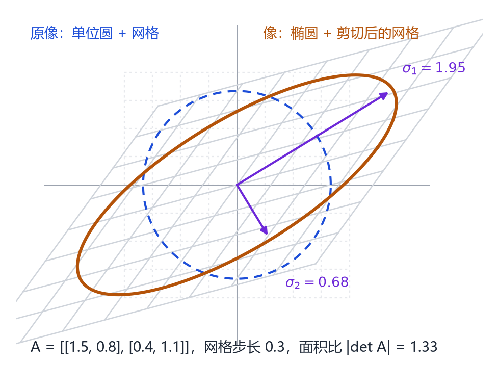
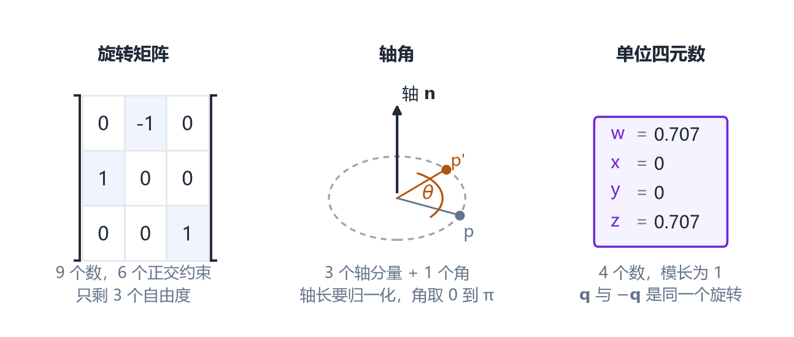
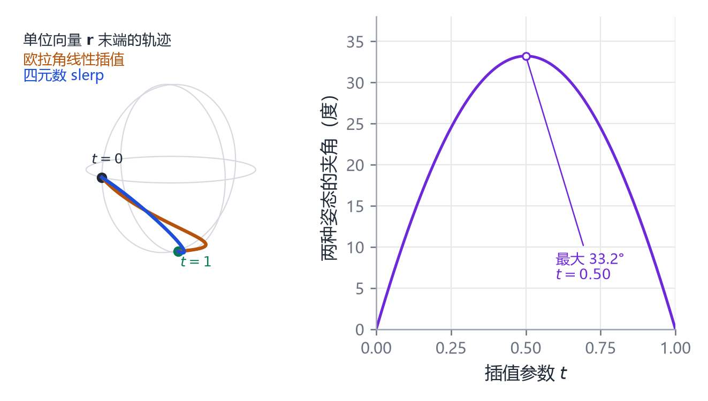

# 第 2 章 向量、矩阵与空间变换

> 本章导读：模拟器里几乎每个量都带方向：顶点位置、速度、法线、力矩、主应力方向。把这些量塞进数组很容易，难的是在换基、换参照系、层层父子关系里保持它们的意思不变。这一章从“坐标不是向量”这件小事讲起，一路到旋转的四种表示、法线为什么要用逆转置矩阵、以及为什么跑十几分钟之后物体会自己歪掉。这些都是排查“看起来对但慢慢跑偏”类问题的工具。

## 2.1 向量空间、基与坐标

一块布的静止形状存在模型的局部坐标里，这是建模软件给的；运行时它被摆到场景里的某个位置，顶点要换到世界坐标。这个转换看起来只是乘一个矩阵，但如果一开始没把“向量”和“坐标”分清楚，后面每一步都会含糊。

向量是几何对象：一个有方向有长度的箭头，或者更一般地，一个满足加法与数乘的东西。坐标是它在一组基下的系数。同一个向量，换一组基，坐标就变，向量本身没变。写成公式：

$$
\mathbf{v} = \sum_{i} c_i\,\mathbf{b}_i,
\tag{2.1}
$$

$\mathbf{b}_i$ 是基向量，$c_i$ 是坐标。式 (2.1) 在模拟里的意思是：你在数组里存的从来不是向量，而是坐标；数组本身不知道基是什么，基是你心里约定的。把局部坐标的数组直接当世界坐标用，数值上不会报错，几何上已经错了。

换一组基，坐标怎么变？设新基由矩阵 $\mathbf{P}$ 给出，$\mathbf{P}$ 的列是新基向量在旧基下的坐标，那么同一个向量的新坐标是

$$
\mathbf{c}' = \mathbf{P}^{-1}\mathbf{c}.
\tag{2.2}
$$

注意这里的逆：基变了，坐标要用**逆**变换；而同一个线性变换在新基下的矩阵是 $\mathbf{P}^{-1}\mathbf{A}\mathbf{P}$，两边各乘一次。这两个公式经常被记混，混淆的后果是把变换方向搞反，物体朝反方向动，或者旋转变成反向旋转。式 (2.2) 还有一个实际用途：当 $\mathbf{P}$ 是正交矩阵时，逆等于转置，换基就是一次转置乘法，这在做刚体局部坐标与世界坐标互转时天天用到。

位置和方向在这一点上必须分开。两个位置相减得到位移，位移是向量；两个位置相加没有几何意义。所以位置住在一个仿射空间里，它有一个原点，向量空间没有。模拟器里绝大多数 bug 不是出在数学上，而是出在把位置当向量加了：蒙皮时把两个顶点的位置取平均得到新顶点，这在数学上是“在仿射空间里做凸组合”，只有当权重和为 1 时才成立；权重和不为 1，顶点就会整体漂移。

## 2.2 线性变换、秩、行列式

矩阵是线性变换在一组基下的坐标表示。它把向量送到向量，保持加法与数乘。三维里这样的变换有平移除外的所有“平直”操作：旋转、缩放、剪切、投影、以及它们的复合。旋转是其中最常打交道的，它至少有三种常见写法；2.4 节逐个展开，图 2-1 把同一个旋转的三种写法并排放在一起。

**秩**是像空间的维数，也就是变换之后还能剩下几个独立方向。满秩意味着信息没丢，可以反解；降秩意味着有方向被压平了，那些方向上的信息永久丢失。三维里秩为 2 的矩阵把所有点压到一个平面上，秩为 1 压到一条线上。

**行列式**是体积的缩放比。单位立方体经过 $\mathbf{A}$ 之后变成平行六面体，体积是 $|\det\mathbf{A}|$；符号表示定向是否翻转。这一条在模拟里的分量比在课本里重得多：

$$
\det \mathbf{F} = \frac{\mathrm{d}V}{\mathrm{d}V_0},
\tag{2.3}
$$

$\mathbf{F}$ 是变形梯度，$V_0$ 是参考构型下的体积，$V$ 是当前构型下的体积。式 (2.3) 说明 $\det\mathbf{F}$ 就是局部体积比。布料、橡胶这类材料几乎不可压，$\det\mathbf{F}$ 应该贴着 1；如果它跑到 0 以下，说明这个单元被翻了过来，顶点顺序反了。这不是“数值有点大”，而是构型已经不合法：接下去算出来的应力方向是反的，能量会是负的，模拟会在一两帧内炸成一团。

所以工业代码里几乎都有这一行检查：每个单元算完 $\mathbf{F}$ 立刻判断行列式，小于阈值就报错、回退或者把这一步判为失败重新解。这个检查比任何调试输出都灵，因为单元翻转是“物理已经错了但画面还没崩”的典型状态，早发现能省掉一整天的排查。

行列式为 1 的变换很特殊：剪切就是其中之一。把正方形推成平行四边形，面积不变，形状变了；剪切改变方向，不改变体积，它的行列式恒为 1。流体的速度梯度也是这么拆的：散度（矩阵的迹）负责体积变化，剩下的剪切部分负责形状变化，两者在纳维-斯托克斯方程里对应不同的项。把变形梯度拆成“旋转 × 对称拉伸”，或者更细地拆成旋转、拉伸、剪切三份，第 3 章会用到。

矩阵乘法不交换，这句话在模拟里的分量是所有变换顺序都要写死。先缩放再旋转和先旋转再缩放，得到的是两个不同的盒子；先平移后旋转意味着绕世界原点转，先旋转后平移意味着绕自己转。引擎里常见两种约定，一种是 $\mathbf{T}\mathbf{R}\mathbf{S}$，一种是 $\mathbf{S}\mathbf{R}\mathbf{T}$，两者都对，但混用就是错。这也是为什么导入外部模型时经常出现“尺寸对了位置错了”的情况：建模软件和引擎的约定不同，转换脚本漏乘了一个顺序。

可逆性与条件数是两件事。可逆只要求行列式不为零，条件数要求它别太接近零。条件数的定义是最大与最小奇异值之比：

$$
\kappa(\mathbf{A}) = \frac{\sigma_{\max}}{\sigma_{\min}},
\tag{2.4}
$$

$\sigma$ 是奇异值，下一节详细讲。式 (2.4) 在模拟里对应“这个系统好不好解”：$\kappa=10$ 时迭代几步就收敛，$\kappa=10^{8}$ 时双精度的有效位只剩一半，单精度基本没救。一个又细又长的三角形，或者在两个方向刚度差一千倍的材料，都会把条件数顶上去。

## 2.3 特征值、奇异值与伪逆

特征值和特征向量描述“哪些方向在变换下只被拉伸，不被转向”：

$$
\mathbf{A}\mathbf{u} = \lambda\mathbf{u}.
\tag{2.5}
$$

$\lambda$ 是特征值，$\mathbf{u}$ 是对应的特征向量。式 (2.5) 在模拟里最典型的用法是惯性张量：它的特征向量是三个主轴，特征值是绕这三根轴转动时的转动惯量。刚体绕主轴转最“顺”，绕其他轴转会产生陀螺力矩。数值上还有一个好处：在主轴坐标系里惯性张量是对角的，求逆只要取倒数。

对称矩阵的特征向量互相正交，这一点让它可以分解成 $\mathbf{Q}\boldsymbol{\Lambda}\mathbf{Q}^{\top}$，$\mathbf{Q}$ 是正交阵。应力张量、应变张量、惯性张量都是对称的，所以都能这么办。非对称矩阵没有这个待遇，特征向量可能不正交甚至共线，这时候该用 SVD。

SVD 对任何矩阵都成立：

$$
\mathbf{A} = \mathbf{U}\boldsymbol{\Sigma}\mathbf{V}^{\top},
\tag{2.6}
$$

$\mathbf{U}$ 和 $\mathbf{V}$ 是正交阵，$\boldsymbol{\Sigma}$ 是对角阵，对角元 $\sigma_1 \ge \sigma_2 \ge \dots \ge 0$ 叫奇异值。几何上这是一个三步动作：先旋转 $\mathbf{V}^{\top}$，再沿坐标轴缩放 $\sigma_i$，最后旋转 $\mathbf{U}$。任何矩阵都是“转—拉—转”。

图 2-2 是一个二维的真实计算。取 $\mathbf{A}=\begin{bmatrix}1.5 & 0.8\\ 0.4 & 1.1\end{bmatrix}$，把单位圆和一张网格送进去，得到的椭圆半轴长正是两个奇异值 $1.95$ 与 $0.68$，面积比等于 $|\det\mathbf{A}|=1.33$，也就是两个奇异值之积。这张图想让人看到的是：矩阵作用在圆上，长轴方向变成 $\sigma_1\mathbf{u}_1$，短轴方向变成 $\sigma_2\mathbf{u}_2$，而这两个方向在原始网格里是垂直的。

<figure class="fig">

<figcaption><b>图 2-2</b>　SVD 的几何意义（真实计算）。虚线是单位圆与原始网格，实线是 $\mathbf{A}$ 作用后的椭圆与网格，紫色是两条主轴，长度恰为奇异值 $\sigma_1=1.95$、$\sigma_2=0.68$。参数：A = [[1.5, 0.8], [0.4, 1.1]]，网格步长 0.3，范围 $[-1.2,1.2]$。</figcaption>
</figure>

在形变分析里，把 SVD 用在变形梯度上，得到的就是主拉伸：$\sigma$ 接近 1 说明该方向几乎没变形，远大于 1 说明被拉长，远小于 1 说明被压扁。$\sigma_{\min}$ 趋于零的时候，材料在那个方向上被压成了一个薄片，网格塌了——这和上一节的行列式检查是一回事，只不过 SVD 还能告诉你塌在哪个方向。

伪逆处理的是矩阵不满秩的情形：

$$
\mathbf{A}^{+} = \mathbf{V}\boldsymbol{\Sigma}^{+}\mathbf{U}^{\top},
\tag{2.7}
$$

$\boldsymbol{\Sigma}^{+}$ 是把非零奇异值取倒数、零保持为零之后转置得到的对角阵。式 (2.7) 给出的是最小二乘意义下范数最小的解。模拟里什么时候会用到它？当一组约束在某些方向上根本没有定义时——比如一排粒子只受沿某个方向的约束，垂直方向完全自由——直接求逆会炸，伪逆会给出“在这些方向上不动”的答案，那正是想要的行为。形状匹配（shape matching）里求最优旋转也是同一个套路：先算一个 3×3 的协方差矩阵，它的 SVD 直接给出旋转，拉伸部分丢掉。

## 2.4 旋转的四种表示

旋转是模拟里出现频率最高的变换，也是最容易写错的一个。它有四种常见表示，各有各的坑。

**旋转矩阵**是 3×3 的正交阵，行列式为 1。除了冗余，它没有别的毛病：复合就是矩阵乘法，作用在向量上就是一次乘法，除了插值，其余都好。缺点是有 9 个数、6 个约束，只有 3 个自由度，存储和传输都浪费；反复相乘之后正交性会慢慢丢掉（2.6 节给实测）。

**欧拉角**是三个角，比如先绕 z 转 yaw、再绕 y 转 pitch、最后绕 x 转 roll。它最符合人的直觉，也最适合做 UI 和动画曲线。问题是顺序必须约定，换一个顺序得到的是另一个姿态；更麻烦的是它有奇异点。

**轴角**用一根单位轴 $\mathbf{n}$ 和一个角 $\theta$ 表示，四个数。它适合描述“绕某个铰链转了多少”，物理意义清楚。坑在于 $\theta=0$ 时轴没有定义，插值时轴的方向会乱跳；$\theta$ 接近 $\pi$ 时轴的正负号也不稳定。

**四元数**是四个数 $\mathbf{q}=(w,x,y,z)$，满足 $w^2+x^2+y^2+z^2=1$。它没有奇异点，复合是四元数乘法，插值有标准的球面插值。代价是它双覆盖：$\mathbf{q}$ 和 $-\mathbf{q}$ 表示同一个旋转，做点积判断相似度时必须先统一下符号，否则会挑出“绕远路”的那一支。另一个代价是它不直观，手写调试时很难一眼看出姿态对不对。

图 2-1 把同一个旋转——绕 z 轴转 90°——写成三种形式。矩阵那一栏的九个数字里，只有三个是独立的；轴角那一栏是四个数，但轴上有两个独立方向加一个角，也是三个；四元数四个数带一个单位约束，还是三个。三种表示装的是同一个东西，选哪种取决于你要拿它做什么。

<figure class="fig">

<figcaption><b>图 2-1</b>　同一个旋转（绕 z 轴 90°）的三种写法（示意图）：矩阵 $[[0,-1,0],[1,0,0],[0,0,1]]$、轴角（轴为 z，角为 90°）、单位四元数 $(0.707,0,0,0.707)$。矩阵有 9 个数但受 6 个正交约束，轴角与四元数各 4 个数，自由度都是 3。</figcaption>
</figure>

万向节锁值得单独说，因为它的名字容易让人误会。它不是“某个轴卡住了”，而是**两个旋转轴在某个姿态下重合**，于是少了一个独立的转动方向。以 yaw-pitch-roll 的顺序为例，当 pitch 转到 90° 时，绕 z 的 yaw 与绕 x 的 roll 作用在同一个方向上，两个角只能合成一个效果。此时姿态仍然是合法的，但从姿态反推角度时解不唯一：同一个姿态对应无穷多组 (yaw, roll)。做插值时，控制点落在奇异点附近，角速度会突然变得极大，画面上表现为角色猛地一扭。

图 2-3 是一组真实计算的对比。起止姿态是单位阵和“绕 z 转 150°、再绕 y 转 85°”，后者已经很接近奇异点。左边是单位向量末端在球面上的轨迹，橙色是欧拉角各自线性插值的结果，蓝色是四元数 slerp；右边是两种姿态在每个 $t$ 上的夹角，最大 33.2° 出现在 $t=0.5$。

<figure class="fig">

<figcaption><b>图 2-3</b>　两种插值的轨迹对比（真实计算）。起止姿态：单位阵与 ZYX 欧拉角 $(150°,85°,0°)$；采样 201 个 $t$。左：单位向量末端的球面轨迹，两端重合、中间分开，欧拉角插值走了一条绕远的路。右：两种姿态在每个 $t$ 上的夹角，峰值 33.2°。数值上两者终点完全一致，差别全在中途。</figcaption>
</figure>

33° 的偏差在画面上意味着什么？意味着插值到一半时，物体比它应该的位置偏了将近三分之一圈的一个可观比例。如果这是一个角色的手臂，会穿过身体；如果是一个相机，画面会甩一下。这就是为什么动画系统里姿态插值一律走四元数，而欧拉角只用来做输入和曲线。

物理积分里用四元数还有一层好处。姿态的导数可以写成角速度与当前四元数的乘积：

$$
\dot{\mathbf{q}} = \tfrac{1}{2}\,\boldsymbol{\omega}\,\mathbf{q},
\tag{2.8}
$$

$\boldsymbol{\omega}=(0,\omega_x,\omega_y,\omega_z)$ 是把角速度向量补一个零当四元数用，右边的乘法是四元数乘法。式 (2.8) 的好处是它没有奇异点，任何角速度都能积分；用欧拉角写同样的式子，在奇异点附近角速度会趋于无穷，积分直接溢出。代价是每步之后要归一化，否则模长会漂。

引擎通常内部存四元数、对外提供矩阵接口：求解和碰撞检测需要矩阵，插值和传输用四元数，两者之间来回转换。转换本身有开销，而且每次转换都会引入一次舍入，所以不要在有热循环里反复转。

四元数在结构上的用处也很直接。离散弹性杆要沿弧长连续地传递截面的朝向，稍不注意就会积累出并不存在的扭转 [@bergou2008]；用四元数把朝向的传递变成球面上的插值，奇异点就不会出现在参数里。

## 2.5 齐次坐标与仿射变换

平移不是线性变换：它对所有点加同一个向量，原点被移动了，而线性变换必须把原点固定。要在一个矩阵里同时表达旋转和平移，得升一维，这就是齐次坐标：

$$
\begin{bmatrix}\mathbf{x}'\\ 1\end{bmatrix}
=
\begin{bmatrix}\mathbf{M} & \mathbf{t}\\ \mathbf{0}^{\top} & 1\end{bmatrix}
\begin{bmatrix}\mathbf{x}\\ 1\end{bmatrix}.
\tag{2.9}
$$

$\mathbf{M}$ 是 3×3 的线性部分，$\mathbf{t}$ 是平移，右下角的 1 是让平移在矩阵乘法里生效的关键。式 (2.9) 在模拟里的用处不只是省代码：一串父子变换可以预先乘成一个矩阵，几万个顶点只做一次乘法；GPU 上的蒙皮就是把骨骼矩阵预先乘好再批量作用。

齐次坐标还有一个副产品：透视投影。第四维不是 1 时，除法会把远处的物体缩小，这就是透视的数学来源。模拟本身一般不需要它，但渲染管线需要，两边共用同一套矩阵约定时要注意别混用。

法线的变换是个经典陷阱。顶点用 $\mathbf{M}$ 变换，法线**不能**用 $\mathbf{M}$。原因是法线的定义：它垂直于切平面。若切向量 $\mathbf{t}$ 变成 $\mathbf{M}\mathbf{t}$，而法线变成 $\mathbf{N}\mathbf{n}$，要求两者的内积仍然为零：

$$
(\mathbf{N}\mathbf{n})^{\top}(\mathbf{M}\mathbf{t}) = \mathbf{n}^{\top}\mathbf{N}^{\top}\mathbf{M}\,\mathbf{t} = 0,
\quad \forall\,\mathbf{t} \;\Longrightarrow\; \mathbf{N}^{\top}\mathbf{M} = \mathbf{I}.
\tag{2.10}
$$

由式 (2.10) 得到 $\mathbf{N} = (\mathbf{M}^{-1})^{\top}$，这就是逆转置矩阵。推导本身只有两行，但它解释了为什么非均匀缩放会让光照出错：设 $\mathbf{M}$ 把球压扁成椭球，如果法线也按 $\mathbf{M}$ 变换，它会向压扁的方向倾斜，而正确的法线应该向相反方向翘起。用错矩阵的表现是光照方向看起来“脏”，棱角处出现不该有的亮斑，这类问题很难从画面上反推原因。

法线变换完之后要重新归一化，因为逆转置不保长度。这一步经常被忘，忘了以后 dot(normal, light) 会超过 1，高光变成一片死白。

## 2.6 数值细节

到这一节为止，所有公式在实数上都成立。浮点数上不是。

**旋转矩阵会失去正交性。** 每次相乘都引入一点舍入误差，误差在 ${\mathbf{R}}^{\top}\mathbf{R}$ 上累积，矩阵慢慢变成一个“几乎正交”的矩阵：行列式偏离 1，列向量之间不再严格垂直，长度也不再严格为 1。做一个小实验：用随机旋转矩阵连乘 36000 次（相当于 60 fps 跑十分钟），单精度下 $\|{\mathbf{R}}^{\top}\mathbf{R}-\mathbf{I}\|_F$ 约为 $3\times10^{-5}$，双精度下约为 $2\times10^{-13}$。十分钟、$3\times10^{-5}$ 听着无害，但如果这个矩阵还用来做逆变换、还要参与后续的求解，误差会被条件数放大。

修法有两类。便宜的是每若干帧做一次 Gram-Schmidt 正交化，代价小，但会引入轻微的各向异性偏置。更稳的是极分解：把当前矩阵分解成 $\mathbf{R}\mathbf{S}$，$\mathbf{R}$ 是最近的旋转，$\mathbf{S}$ 是对称的拉伸部分；模拟里通常直接丢掉 $\mathbf{S}$，只保留 $\mathbf{R}$。极分解可以用 SVD 或迭代法算，代价高一点，但不会像 Gram-Schmidt 那样偏向某一列。

**四元数需要归一化。** 每次乘法之后模长会偏离 1，偏离量同样是舍入级，但四元数乘法是双线性的，误差会随乘法次数增长。做法是每步之后除以模长，或者干脆在构造时就保证单位化。注意归一化的时机：如果在一个时间步里做了多次乘法，应该在最后归一化一次，中间不必；中间反复归一化除了浪费，还会让误差以另一种方式累积。

**父子链条会放大误差。** 角色的骨骼是树状的，手的位置要经过“根—脊柱—肩—肘—腕”五次变换。每一级的矩阵都带一点误差，位置误差随链条长度线性增长，姿态误差则可能指数增长——因为每一级的旋转误差会作用在整条子链的力臂上。这就是为什么长链末端（手指、发梢）抖动更明显。缓解办法是在关键节点上重新计算世界矩阵而不是逐级累乘，或者定期把累积的变换重新分解、取旋转部分。

**确定性。** 同一段模拟在两次运行中给出不同结果，最常见的原因不是浮点误差，而是遍历顺序不同：多线程下按线程完成顺序累加力，加法不满足结合律，最后一位就不一样。这个问题在联网同步和回放里是致命的，解决办法是固定归约顺序，或者用整数运算代替浮点累加。

这一章的每一件工具后面都会再用到：第 3 章的变形梯度是矩阵，第 4 章的积分器作用在向量上，第 9 章的单元刚度矩阵是矩阵的组装。真正需要记住的是两条：坐标依赖基，矩阵只在特定的基下才有意义；以及所有“看起来对但慢慢跑偏”的现象，几乎都能追到某一处该归一化而没有归一化的地方。
