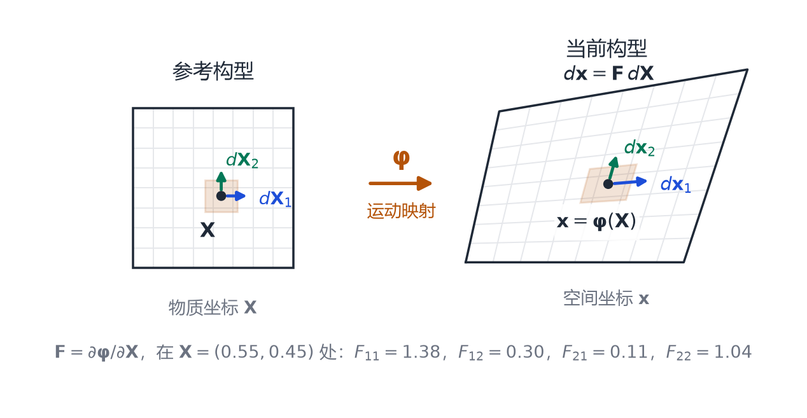
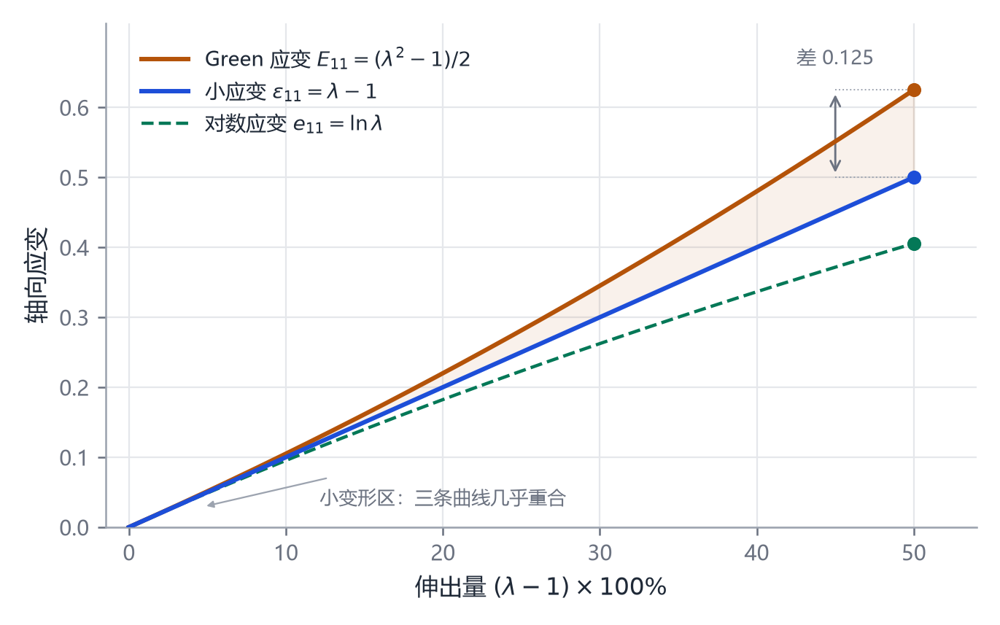
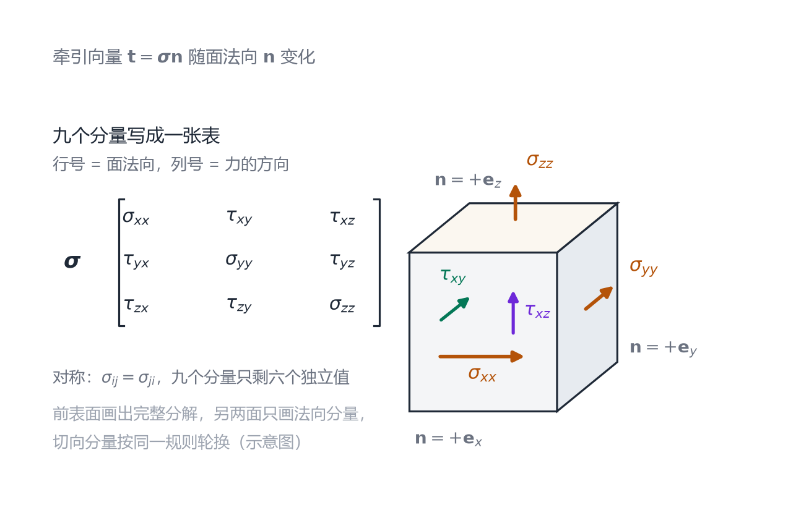

# 第 3 章 张量：应变、应力与守恒律

> 本章导读：橡皮筋被拉开，你要算出它内部每一点绷得有多紧，才能判断它会不会断、松手后回弹有多快。这里的“紧”其实是两件事：材料变形了多少，以及为了维持这个变形，内部传递了多大的力。要把这两件事写成与观察方向无关的形式，向量不够用。这一章从一张斜切口上的力讲起，把变形梯度、三种应力、守恒律和本构关系依次摆开，最后说清为什么本构不能依赖刚体旋转。

## 3.1 一张面上的力

手里有一根受拉的橡胶杆，横截面积两平方厘米，拉力一百牛顿。想知道杆中间某一点“受了多大的力”，最直接的办法是在那一点切一刀，看切口两侧互相拉多少。

刀口垂直于杆轴切下去，切口上的力沿轴向，大小就是一百牛顿，除以面积两平方厘米，得到五十万帕斯卡。换一个角度斜着切，情况立刻变了：切口面积变成 $A/\cos\theta$，$\theta$ 是刀口法向与杆轴的夹角，而两侧互相拉的力还是那一百牛顿。力没变，分摊的面积变大了，于是“单位面积上的力”变小；更关键的是，这个力不再垂直于切口，它可以分解成一个法向分量和一个切向分量。

$\theta$ 取四十五度时，切口面积是原来的 $1.414$ 倍，法向分量只剩约三十五万帕斯卡，切向分量也差不多是同样的量级。同一根杆，同一个点，只因为问的面不同，得到的“应力”在数值和方向上都不同。所以“这一点的应力是多少”这句话本身是不完整的，必须说成“法向为 $\mathbf{n}$ 的那张面上的牵引向量 $\mathbf{t}(\mathbf{n})$ 是多少”。

牵引向量依赖法向，这还不是全部。柯西做过一个很漂亮的论证，说明这九个数字就够了。在这一点周围取一个无穷小的四面体，三个面分别平行于坐标面，第四个面的法向是 $\mathbf{n}$。四面体的边长是 $h$，体积正比于 $h^3$，四个面的面积正比于 $h^2$。列受力平衡：面力正比于 $h^2$，体积力和惯性力正比于 $h^3$。让 $h$ 趋于零，$h^3$ 的项比 $h^2$ 的项消失得更快，剩下的只有面力之间的平衡：

$$
\mathbf{t}(\mathbf{n})\,dA = \mathbf{t}(\mathbf{e}_1)\,dA_1 + \mathbf{t}(\mathbf{e}_2)\,dA_2 + \mathbf{t}(\mathbf{e}_3)\,dA_3 ,
\tag{3.1}
$$

其中 $dA$ 是斜面面积，$dA_i$ 是三个坐标面的面积，$\mathbf{e}_i$ 是坐标轴方向的单位向量。斜面与坐标面之间有投影关系 $dA_i = n_i\,dA$，$n_i$ 是 $\mathbf{n}$ 的第 $i$ 个分量。代进去把 $dA$ 约掉，就得到一个纯粹关于方向的关系：

$$
\mathbf{t}(\mathbf{n}) = \boldsymbol{\sigma}\,\mathbf{n} ,
\qquad
\boldsymbol{\sigma} = \big[\,\mathbf{t}(\mathbf{e}_1)\ \ \mathbf{t}(\mathbf{e}_2)\ \ \mathbf{t}(\mathbf{e}_3)\,\big] .
\tag{3.2}
$$

这个 $\boldsymbol{\sigma}$ 就是柯西应力张量。它的三列不是随便凑的，正是三张互相垂直的坐标面上的牵引向量。给任意方向 $\mathbf{n}$，用矩阵乘一下就能得到那个面上的力。九个分量里，$\sigma_{ij}$ 的第一个下标 $i$ 表示力的方向，第二个下标 $j$ 表示面法向，这个顺序在文献里是统一的，写反了会让本构和边界条件全部错位。

把九个分量排成一张表，行是面法向、列是力的方向，这张表说明的才是张量的第一个特点：它是一个“吃进一个方向、吐出一个向量”的线性映射，而不是一堆散装的数。输入 $\mathbf{n}$，输出 $\mathbf{t}$，映射是线性的，因为式 (3.1) 里的叠加是线性的。这种“多重方向指标”的东西按阶数分类：标量是零阶，向量是一阶，应力是二阶，而把应变映射到应力的弹性张量是四阶，在三维里有 $3^4=81$ 个分量。

说到这里有必要澄清一个常见的混淆。矩阵不是张量，矩阵只是张量在某组基下的一串坐标。换一组基，同一根杆、同一个点的应力分量会全部变掉，但那根杆一点没变。设新基由正交矩阵 $\mathbf{Q}$ 描述，分量的变换是

$$
\boldsymbol{\sigma}' = \mathbf{Q}\,\boldsymbol{\sigma}\,\mathbf{Q}^{\mathsf{T}} ,
\qquad
\mathbf{t}' = \mathbf{Q}\,\mathbf{t} .
\tag{3.3}
$$

向量只乘一个 $\mathbf{Q}$，二阶张量左右各乘一个。这个式子后面还会出现一次，3.6 节讲客观性时，本构能不能容忍刚体旋转，判据就是它。

在模拟器里，应力和应变都是以这种形式存下来的。有限元里每个单元存一个张量，常应变三角形里它甚至是常量；物质点法里每个粒子存一个 $3\times3$ 的应力，跟着粒子走；布料是曲面，应力退化成二阶张量里的 $2\times2$ 块。

## 3.2 变形梯度与应变

连续体最省事的描述方式，是给每个物质点贴一个标签，记下它在初始时刻的位置 $\mathbf{X}$，然后跟踪它后来去了哪里 $\mathbf{x}$。这个对应关系写成映射

$$
\mathbf{x} = \boldsymbol{\varphi}(\mathbf{X},t) ,
\tag{3.4}
$$

其中 $\mathbf{X}$ 叫物质坐标，$\mathbf{x}$ 叫空间坐标，$\boldsymbol{\varphi}$ 是运动映射。图 3-1 把这个映射画成了两幅图：左边是没变形的参考构型，右边是变形后的当前构型，同一个物质点在两边各有一个位置。

<figure class="fig">

<figcaption><b>图 3-1</b>　参考构型到当前构型的映射。左图中一个物质点 $\mathbf{X}$ 带两条小线段 $d\mathbf{X}_1$、$d\mathbf{X}_2$，右图中它们被映射成 $d\mathbf{x}_1$、$d\mathbf{x}_2$，映射是局部的线性变换，矩阵就是变形梯度 $\mathbf{F}$。图中用的是 $\varphi_1=1.30X+0.20Y+0.18XY$、$\varphi_2=0.90Y+0.25XY$ 这个带二次项的变形场，标注的四个分量是 $\mathbf{F}$ 在 $\mathbf{X}=(0.55,0.45)$ 处的取值。</figcaption>
</figure>

把映射在当前点附近做一阶展开，就得到这一章的主角：

$$
d\mathbf{x} = \mathbf{F}\,d\mathbf{X} ,
\qquad
\mathbf{F} = \frac{\partial \boldsymbol{\varphi}}{\partial \mathbf{X}} ,
\tag{3.5}
$$

$d\mathbf{X}$ 是参考构型里的一小段，$d\mathbf{x}$ 是它变形后的样子，$\mathbf{F}$ 是 $3\times3$ 的雅可比矩阵，叫变形梯度。它的每一列是一根坐标轴方向单位线段变形后的像，所以 $\mathbf{F}$ 完整记录了局部的拉伸和转动。二维时它是 $2\times2$，正好能在纸上画出来。

$\mathbf{F}$ 的行列式有一个直白的含义：

$$
J = \det\mathbf{F} ,
\tag{3.6}
$$

$J$ 是局部体积比，变形前体积为 $dV_0$ 的小块，变形后体积是 $J\,dV_0$。橡胶这类材料几乎不可压，$J$ 应该一直等于一；金属塑性成形时 $J$ 也接近一；泡沫压缩时 $J$ 可以掉到零点几。模拟器里 $J$ 还有个诊断作用：一旦某个单元算出的 $J$ 小于零或者接近零，说明单元翻过来了，这个单元的面积成了负的，后面所有积分都会出错。看到仿真里某个三角形突然变黑或者力爆掉，第一件事就是去看 $J$。

$\mathbf{F}$ 有一个麻烦：它把刚体旋转也一起记住了。一根杆整体转了九十度，没有任何变形，但 $\mathbf{F}$ 是一个旋转矩阵，九个分量全都不平凡。直接拿 $\mathbf{F}$ 当应变用，一根翻转的杆会被算成“变形很大”，这显然不对。要去掉旋转，办法是让 $\mathbf{F}$ 自己乘自己。对 $\mathbf{F}$ 做极分解 $\mathbf{F}=\mathbf{R}\mathbf{U}$，$\mathbf{R}$ 是旋转，$\mathbf{U}$ 是对称正定的拉伸，那么

$$
\mathbf{C} = \mathbf{F}^{\mathsf{T}}\mathbf{F} = \mathbf{U}^{\mathsf{T}}\mathbf{R}^{\mathsf{T}}\mathbf{R}\,\mathbf{U} = \mathbf{U}^{2} .
\tag{3.7}
$$

旋转部分被 $\mathbf{R}^{\mathsf{T}}\mathbf{R}=\mathbf{I}$ 吃掉了，剩下的 $\mathbf{C}$ 只依赖拉伸。$\mathbf{C}$ 叫右柯西-格林变形张量。它和单位阵的差就是应变：

$$
\mathbf{E} = \tfrac{1}{2}\big(\mathbf{C} - \mathbf{I}\big) ,
\tag{3.8}
$$

叫 Green-Lagrange 应变。它的物理意义可以从单轴拉伸看出来：一根杆沿 $x$ 方向拉长到 $\lambda$ 倍，$\mathbf{C}$ 的 $xx$ 分量是 $\lambda^2$，于是

$$
E_{11} = \tfrac{1}{2}(\lambda^2 - 1) ,
\qquad
\varepsilon_{11} = \lambda - 1 .
\tag{3.9}
$$

右边那个 $\varepsilon_{11}$ 是小应变张量。它由位移 $\mathbf{u}=\mathbf{x}-\mathbf{X}$ 的梯度直接构造：

$$
\boldsymbol{\varepsilon} = \tfrac{1}{2}\big(\nabla \mathbf{u} + \nabla \mathbf{u}^{\mathsf{T}}\big) ,
\tag{3.10}
$$

对 $\lambda=1+u'$ 的一维情形，它就是 $u'$，也就是工程上常说的“伸长量除以原长”。式 (3.10) 里那个对称化不是装饰。位移梯度 $\nabla\mathbf{u}$ 本身包含转动，反对称部分 $\tfrac{1}{2}(\nabla\mathbf{u}-\nabla\mathbf{u}^{\mathsf{T}})$ 描述的正是局部刚体转动，把它减掉之后剩下的人才算应变。这也是为什么小应变张量天生对称，只有六个独立分量。

两种应变的差别在图 3-2 里。

<figure class="fig">

<figcaption><b>图 3-2</b>　同一次单轴拉伸，两种应变给出不同的数。横轴是伸出量 $(\lambda-1)\times100\%$，纵轴是轴向应变。拉伸到 $50\%$ 时，小应变是 $0.500$，Green 应变是 $0.625$，差 $0.125$，相对差 $25\%$；对数应变 $\ln\lambda=0.405$ 落在另一边。三条曲线在 $10\%$ 以内几乎重合，这就是小变形的实际边界。曲线由式 (3.9) 直接算出。</figcaption>
</figure>

拉伸百分之十以内，三条曲线几乎叠在一起，用哪个都行。拉到百分之五十，Green 应变比小应变大了四分之一。这个差距不是精度问题，而是定义问题：小应变默认“伸长量除以原长”就够了，Green 应变则在算伸长量时按变形后的长度做参考，所以它偏大。

小应变张量有两个前提，违反了就会出事。第一个是位移梯度要远小于一，不然式 (3.10) 丢掉的高阶项太大。第二个更隐蔽：转动也要小。取一根杆整体转 $\theta$ 角，没有任何变形，$\mathbf{F}$ 是旋转矩阵，按式 (3.10) 算出来的 $\varepsilon_{xx}=\cos\theta-1\approx-\theta^2/2$。转三十度，$\theta^2/2\approx0.14$，小应变模型认为这根杆被压缩了百分之十四，于是凭空产生一股推力。一条柔软的带子甩一下就会转过大角度，用纯小应变单元模拟，它会自己鼓起来。解决办法有两条：要么换用 $\mathbf{E}$ 或直接以 $\mathbf{F}$ 为变量，要么用 corotational 做法，把每个单元的旋转提出来，在随转的局部坐标系里再用小应变。前者更准确，后者更便宜，布料和软体模拟里两种都能见到。

## 3.3 三种应力

柯西应力 $\boldsymbol{\sigma}$ 的定义里藏着一个不方便的地方：它说的是“当前构型上单位面积受的力”。可模拟器算力的时候，手里拿的是没变形的单元，面积、体积、形函数全都是在参考构型上算好的。变形后的面积是多少，得另外算。这就需要一个把力折算回参考面积的量。

折算不只是面积缩放，法向也变了。变形前法向为 $\mathbf{N}$、面积为 $dA_0$ 的面元，变形后法向变成 $\mathbf{n}$、面积变成 $da$，两者由 Nanson 公式联系：

$$
\mathbf{n}\,da = J\,\mathbf{F}^{-\mathsf{T}}\mathbf{N}\,dA_0 .
\tag{3.11}
$$

把式 (3.2) 的力 $d\mathbf{f}=\boldsymbol{\sigma}\mathbf{n}\,da$ 代进去，得到

$$
d\mathbf{f} = J\,\boldsymbol{\sigma}\,\mathbf{F}^{-\mathsf{T}}\,\mathbf{N}\,dA_0
\;\equiv\; \mathbf{P}\,\mathbf{N}\,dA_0 ,
\qquad
\mathbf{P} = J\,\boldsymbol{\sigma}\,\mathbf{F}^{-\mathsf{T}} .
\tag{3.12}
$$

$\mathbf{P}$ 叫第一 Piola-Kirchhoff 应力。它的用法就是式 (3.12) 右边那样：给参考构型上的法向 $\mathbf{N}$，直接算出力。注意这个力仍然是当前构型里的力，只是面积换成了参考面积。$\mathbf{P}$ 一般不对称，因为力方向和面法向分处两个构型。

不对称在写本构时很别扭，于是再定义一个：

$$
\mathbf{S} = \mathbf{F}^{-1}\mathbf{P} = J\,\mathbf{F}^{-1}\boldsymbol{\sigma}\mathbf{F}^{-\mathsf{T}} .
\tag{3.13}
$$

$\mathbf{S}$ 是第二 Piola-Kirchhoff 应力，它对称。三个量的分工可以用一句话记住：$\mathbf{P}$ 负责算节点力，$\mathbf{S}$ 负责写能量，$\boldsymbol{\sigma}$ 负责和物理世界对话。三者在张量表里的位置完全相同，差别只在构型，图 3-3 把这一点画了出来。

<figure class="fig">

<figcaption><b>图 3-3</b>　同一点上，三张面的朝向不同，牵引向量就不同。前表面（法向 $+\mathbf{e}_x$）画出了完整分解：一个法向分量 $\sigma_{xx}$，两个切向分量 $\tau_{xy}$、$\tau_{xz}$；另两张面只画法向分量。右侧那张表把九个分量排成方阵，行是面法向，列是力的方向。立方体、箭头与标注均为示意，不表示具体应力数值。</figcaption>
</figure>

图 3-3 把三个量的关系画在了一起。立方体上是柯西应力：$\sigma_{xx}$、$\sigma_{yy}$、$\sigma_{zz}$ 是三个面上的法向分量，$\tau_{xy}$、$\tau_{xz}$ 是前表面上的两个切向分量，位置一换，名字跟着换。这张表则是存储形式，$\mathbf{P}$ 和 $\mathbf{S}$ 在代码里也用同一套 $3\times3$ 数组，唯一的区别是要记住它们对应哪个构型。

为什么要三个而不只留一个，理由全在“哪个构型”三个字上。$\boldsymbol{\sigma}$ 是物理真实，做断裂判据、测量对比、绘制云图都用它；$\mathbf{P}$ 是计算的接口，参考构型上的面积和梯度一次算好，不用每步重算；$\mathbf{S}$ 是理论的誊本，对称、和能量直接挂钩。三个量之间只差一个面积与法向的换算，代换关系由式 (3.12) 和 (3.13) 给死，没有别的自由度。

一维例子能把关系说透。一根不可压橡胶杆，原长 $L_0$、原截面 $A_0$，拉长到 $\lambda$ 倍。不可压意味着截面积缩成 $A_0/\lambda$。拉力记作 $F$，则

$$
\sigma = \frac{F}{A_0/\lambda} = \lambda\,\frac{F}{A_0} ,
\qquad
P = \frac{F}{A_0} = \frac{\sigma}{\lambda} .
\tag{3.14}
$$

取 $F/A_0=1$ MPa、$\lambda=1.5$，则 $P=1$ MPa，$\sigma=1.5$ MPa。同一根杆，同一个力，因为除的面积不同，两个数差了一半。写代码时如果把 $\mathbf{P}$ 当成 $\boldsymbol{\sigma}$ 用，力会小三分之一，模型看起来“偏软”，然后你会去怀疑材料参数，改半天也改不对。三个量的量纲都是帕斯卡，量纲检查抓不到这种错，只能靠盯住它定义在哪个构型上。

## 3.4 守恒律

连续介质的方程都是从几条守恒律推出来的，推导过程本身值得看一遍，因为它决定了离散之后每个单元贡献什么。图形学里这套推导与它的离散形式在综述里有完整交代 [@sifakis2012]，下面只取用得到的那几步。

质量守恒最直接。取任意一块物质，它的质量不随时间变：

$$
\frac{d}{dt}\int_{\Omega_t}\rho\,dV = 0
\quad\Longrightarrow\quad
\rho\,J = \rho_0 ,
\tag{3.15}
$$

$\rho$ 是当前密度，$\rho_0$ 是参考密度，$J$ 还是那个体积比。这条式子的意思是密度会随变形变：压缩时 $J$ 小于一，密度变大。模拟里它有一个实际后果，动量方程里的 $\rho$ 不能当常数用，除非材料不可压。

动量守恒是把牛顿第二定律搬到一块连续体上。取一块物质 $\Omega_t$，它的动量变化率等于体力和面力之和：

$$
\frac{d}{dt}\int_{\Omega_t}\rho\,\mathbf{v}\,dV
= \int_{\Omega_t}\rho\,\mathbf{b}\,dV + \int_{\partial\Omega_t}\boldsymbol{\sigma}\mathbf{n}\,da ,
\tag{3.16}
$$

$\mathbf{v}$ 是速度，$\mathbf{b}$ 是单位质量的体力，比如重力，$\partial\Omega_t$ 是这块物质的边界。把左边的物质导数展开，右边用散度定理把面积分变成体积分，就得到微分形式：

$$
\rho\,\dot{\mathbf{v}} = \nabla\cdot\boldsymbol{\sigma} + \rho\,\mathbf{b} .
\tag{3.17}
$$

这一步换来了两个前提。一是 $\boldsymbol{\sigma}$ 必须连续可微，跨材料界面时不能这么换，得单独写跳跃条件；二是 $\mathbf{n}$ 取外法向，符号弄反了整个方程会变成“负质量”。散度定理这一手在模拟里的对应物是：把单元内部平衡的强形式乘上测试函数做分部积分，变成弱形式，才有有限元的刚度矩阵。第 9 章会正式做这件事。

角动量守恒给出一条附加结论。在没有体力偶的情况下，它要求

$$
\boldsymbol{\sigma} = \boldsymbol{\sigma}^{\mathsf{T}} ,
\tag{3.18}
$$

应力张量对称。这就是 3.1 里那九个分量只剩六个的原因，也是为什么应力可以用 Voigt 记号压成六维向量存起来。

能量守恒稍微麻烦一点，因为机械能并不总是守恒。把式 (3.17) 点乘速度再积分，得到动能定理，右端出现一项

$$
\int_{\Omega_t}\boldsymbol{\sigma}:\mathbf{d}\;dV ,
\qquad
\mathbf{d} = \tfrac{1}{2}\big(\nabla\mathbf{v} + \nabla\mathbf{v}^{\mathsf{T}}\big) ,
\tag{3.19}
$$

$\mathbf{d}$ 叫变形率张量，是速度梯度的对称部分，和式 (3.10) 的小应变长得一样，只是把位移换成了速度。双点号表示两个二阶张量逐分量相乘再求和。这一项是应力在变形上做的功率，它一部分变成可恢复的弹性能，一部分被粘性或塑性耗散掉。本构关系要回答的正是“怎么分”。

离散之后，这些守恒律变成一句很短的话：每个单元对它的节点贡献一个力。用第一 Piola-Kirchhoff 应力写出来是

$$
\mathbf{f}_a = -\int_{\Omega_0}\mathbf{P}\,\nabla_{\mathbf{X}}N_a\;dV_0 ,
\tag{3.20}
$$

$N_a$ 是第 $a$ 个节点的形函数，$\nabla_{\mathbf{X}}$ 是对物质坐标求梯度，积分在未变形的单元上做。这就是 3.3 里说 $\mathbf{P}$ 负责算节点力的原因：面积和梯度都在参考构型上，一次算好，反复使用。装配、求解、更新这几步在后续章节展开，这里只要记住，式 (3.15) 到 (3.19) 是那些代码的出处。

## 3.5 本构关系

守恒律对任何材料都成立，但要算出具体数值，还缺一个“应力怎么由变形决定”的规则，这就是本构关系。下面四种覆盖了模拟里绝大多数情况。

线弹性是最老的一种，写成

$$
\boldsymbol{\sigma} = \lambda\,(\operatorname{tr}\boldsymbol{\varepsilon})\,\mathbf{I} + 2\mu\,\boldsymbol{\varepsilon} ,
\tag{3.21}
$$

$\lambda$ 和 $\mu$ 是 Lamé 常数，$\operatorname{tr}\boldsymbol{\varepsilon}$ 是体积应变，$\mathbf{I}$ 是单位张量。这个式子说应力分两部分：一部分正比于体积变化，各个方向一样；另一部分是偏斜的，只跟剪切有关。工程上更常用杨氏模量 $E$ 和泊松比 $\nu$，换算关系是

$$
\mu = \frac{E}{2(1+\nu)} ,
\qquad
\lambda = \frac{E\nu}{(1+\nu)(1-2\nu)} .
\tag{3.22}
$$

钢的 $E\approx200$ GPa、$\nu\approx0.3$，代入得 $\mu\approx77$ GPa、$\lambda\approx115$ GPa；橡胶的 $E$ 只有几 MPa，$\nu$ 接近 $0.5$，此时式 (3.22) 的分母趋近零，$\lambda$ 会爆掉。不可压材料的体积模量趋于无穷，用 $(\lambda,\mu)$ 作参数数值上很难受，改用体积模量和剪切模量会稳一些。

线弹性只在应变很小、转动很小时才准：它的能量泛函是用小应变写的，转大了那个泛函就不再是能量。

超弹性换了个起点，直接从能量出发：假定存在一个应变能密度 $\Psi$，它是变形梯度的函数，

$$
\mathbf{P} = \frac{\partial \Psi}{\partial \mathbf{F}} ,
\qquad
\boldsymbol{\sigma} = \frac{1}{J}\,\mathbf{P}\,\mathbf{F}^{\mathsf{T}} .
\tag{3.23}
$$

这组关系的好处是自动无耗散：变形做的功全部存进 $\Psi$，卸载时原样还回来，循环一圈能量不增不减。模拟里这点很重要，布料放一天不会自己塌下去。

最简单的超弹性模型是 St. Venant-Kirchhoff，取 $\Psi=\tfrac{\lambda}{2}(\operatorname{tr}\mathbf{E})^2+\mu\,\mathbf{E}:\mathbf{E}$。它把线弹性的形式套在 Green 应变上，大转动下也基本正确。但它有个致命的毛病：受到很大的压缩时，$\mathbf{P}$ 会非物理地增长，$J$ 趋近零时力趋于无穷。做挤压、折叠这类场景，用它必定会炸。

粘弹性描述的是“又弹又黏”的材料，比如肌肉、面团、湿布。最简的 Kelvin-Voigt 模型把弹簧和阻尼并联：

$$
\boldsymbol{\sigma} = \mathbb{C}:\boldsymbol{\varepsilon} + \boldsymbol{\eta}:\dot{\boldsymbol{\varepsilon}} ,
\tag{3.24}
$$

$\boldsymbol{\eta}$ 是粘性张量，$\dot{\boldsymbol{\varepsilon}}$ 是应变率。弹簧管瞬时刚度，阻尼管延迟响应：突然拉一下，阻尼先顶住，然后慢慢松弛到弹簧对应的应力。松弛的特征时间是 $\tau=\eta/E$，蜂蜜的 $\tau$ 是秒级，橡皮泥是分钟级。模拟里它常以“弹簧加阻尼”的形式出现，隐式积分时阻尼项进入刚度矩阵，显式积分时它限制步长。

塑性是另一类：变形超过某个界限之后，一部分不再恢复。判据是屈服函数

$$
f(\boldsymbol{\sigma}) \le 0 ,
\tag{3.25}
$$

$f$ 小于零表示还在弹性范围，等于零表示已经屈服。屈服之后，应变率分成弹性和塑性两部分，塑性部分按流动法则 $\dot{\boldsymbol{\varepsilon}}^{p}=\dot{\gamma}\,\partial f/\partial\boldsymbol{\sigma}$ 增长，$\dot{\gamma}$ 是塑性乘子，由一致性条件定出。数值上的标准做法叫 return mapping：先按弹性算一步预测应力，如果它跑到屈服面外，就沿某个方向把它拉回面上，同时记下这一步产生的塑性应变。所以塑性材料的状态里除了位置和速度，还要额外存塑性应变和硬化变量，这部分内存开销做大规模模拟时要提前算进去。

参数都得实测。单轴拉伸试样给出 $E$ 和屈服应力，松弛实验给出 $\tau$，双轴拉伸用来定超弹性的参数。模型选得再漂亮，参数错了曲线一样对不上。塑性这部分在图形学里还有一层额外麻烦：单元一旦翻转，$\mathbf{F}$ 的行列式变负，普通的形式会直接崩掉，工程上常见的做法是把 $\mathbf{F}$ 分解成旋转与对称部分分别处理，对奇异值做限制 [@irving2004]。

## 3.6 客观性与 Neo-Hookean

本构关系有一个必须满足的要求，叫客观性：材料的行为不应该依赖观察者怎么看它。把整块材料刚体旋转一个角度，内部该受的力在随体坐标系里应该一模一样。

写成公式，设旋转由正交矩阵 $\mathbf{Q}$ 表示，变形梯度变成 $\mathbf{Q}\mathbf{F}$，应力按式 (3.3) 变。客观性要求

$$
\Psi(\mathbf{Q}\mathbf{F}) = \Psi(\mathbf{F}) ,
\qquad
\boldsymbol{\sigma}(\mathbf{Q}\mathbf{F}) = \mathbf{Q}\,\boldsymbol{\sigma}(\mathbf{F})\,\mathbf{Q}^{\mathsf{T}} .
\tag{3.26}
$$

线弹性模型过不了这一关。把 $\mathbf{F}=\mathbf{Q}$ 代进式 (3.10)，得到 $\boldsymbol{\varepsilon}=\mathbf{Q}-\mathbf{I}$ 的对称部分，不是零，于是模型的反应是“这块材料被压了”，正如 3.2 节算过的那样。这不是实现错误，是模型本身的缺陷。

修法一是 corotational：把 $\mathbf{F}$ 极分解成 $\mathbf{R}\mathbf{U}$，用 $\mathbf{R}$ 建一个随单元转动的局部坐标系，在局部系里算 $\boldsymbol{\varepsilon}$ 和应力，再转回世界系。布料、软体、金属成形里这种做法很常见，因为它便宜，能直接复用线弹性的刚度矩阵。代价是它只是近似，转得很大、变形又很大时误差会浮出来。

修法二是换一个天生客观的能量。只要 $\Psi$ 写成 $\mathbf{C}$ 的函数，客观性就自动成立，因为 $\mathbf{C}=(\mathbf{Q}\mathbf{F})^{\mathsf{T}}(\mathbf{Q}\mathbf{F})=\mathbf{F}^{\mathsf{T}}\mathbf{F}$，旋转被吃掉了，这正是 3.2 节的式 (3.7)。Neo-Hookean 是这条路上用得最多的一个：

$$
\Psi = \frac{\mu}{2}\big(\operatorname{tr}\mathbf{C} - 3\big) - \mu\ln J + \frac{\lambda}{2}\big(\ln J\big)^{2} .
\tag{3.27}
$$

三项各管一件事。第一项 $\operatorname{tr}\mathbf{C}$ 是主拉伸平方和，衡量剪切变形，减三是因为未变形时 $\mathbf{C}=\mathbf{I}$、迹等于三，要让能量在自然状态下为零。第二项 $-\mu\ln J$ 惩罚体积变化，$J$ 小于一时它是正的，顶住压缩。第三项是体积的二次惩罚，$\lambda$ 越大越难压缩。对数在这里不是装饰，用 $\ln J$ 而不用 $J-1$，是为了让 $J\to0$ 时能量趋于无穷，避免材料被压成零体积。

对上式求导，得到第一 Piola-Kirchhoff 应力：

$$
\mathbf{P} = \mu\big(\mathbf{F} - \mathbf{F}^{-\mathsf{T}}\big) + \lambda\ln J\,\mathbf{F}^{-\mathsf{T}} ,
\qquad
\boldsymbol{\sigma} = \frac{\mu}{J}\big(\mathbf{b} - \mathbf{I}\big) + \frac{\lambda\ln J}{J}\,\mathbf{I} ,
\tag{3.28}
$$

$\mathbf{b}=\mathbf{F}\mathbf{F}^{\mathsf{T}}$ 叫左柯西-格林张量。检验一下客观性：取 $\mathbf{F}=\mathbf{Q}$，则 $J=1$、$\mathbf{b}=\mathbf{I}$、$\mathbf{F}^{-\mathsf{T}}=\mathbf{Q}$，代进去 $\mathbf{P}=\mu(\mathbf{Q}-\mathbf{Q})=\mathbf{0}$，应力为零，正确。

参数取 $\mu=1\times10^{5}$ Pa、$\lambda=1\times10^{6}$ Pa，比值十，接近不可压橡胶。按式 (3.22) 反算得 $E\approx2.9\times10^{5}$ Pa、$\nu\approx0.45$，是一块偏软的胶。拉伸到 $\lambda=1.5$，让横向自由收缩以保持单轴应力，解出横向伸长 $0.829$，$J=1.032$，轴向应力 $1.51\times10^{5}$ Pa。

Neo-Hookean 在模拟器里出现频率极高，原因很实际：它只有两个参数，能量处处可微，$J$ 很小时力会顶住而不是反向吸进去，写隐式积分时 Hessian 也容易算。它的缺点是不描述真实橡胶在高伸长下的应变硬化，也不描述各向异性。

回头看这一章的路：斜切口上的力逼出了二阶张量，局部变形逼出了 $\mathbf{F}$，去掉旋转逼出了 $\mathbf{C}$ 和 $\mathbf{E}$，面积折算逼出了 $\mathbf{P}$ 和 $\mathbf{S}$。这几个量名字很像，混用一次就是一整天的调试，所以值得记住每个量定义在哪个构型、对称不对称。
