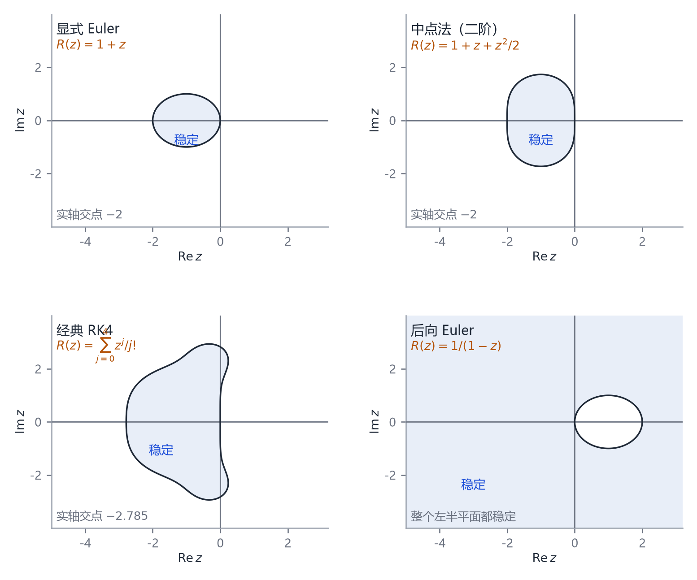
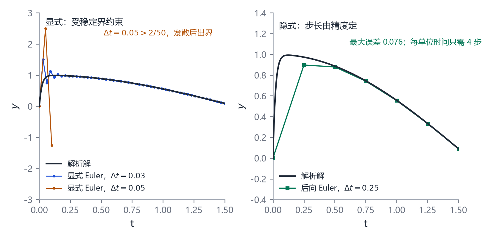
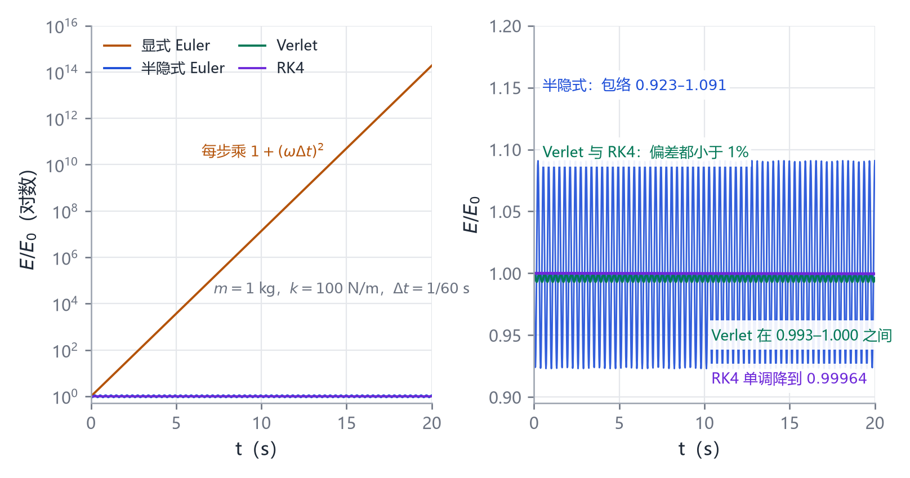

# 第 4 章 常微分方程与时间积分

> 本章导读：模拟器每算完一步，都要把“力”换成“下一刻的位置和速度”，这一步看着只有一行更新式，却是整个系统稳定性的源头。弹簧加硬一点就炸、布料拉紧一点就抖、碰撞一发生就穿模，原因大多落在这里。这一章从状态和相空间讲起，把显式与隐式两种推进方式的误差、稳定域、能量行为拆开，最后说清约束漂移和碰撞时刻是怎么处理的。

## 4.1 状态与相空间

物理模拟最终都落成一个一阶方程组：

$$
\dot{\mathbf{y}} = \mathbf{f}(\mathbf{y},t) ,
\qquad
\mathbf{y}(t_0)=\mathbf{y}_0 ,
\tag{4.1}
$$

$\mathbf{y}$ 是状态向量，$\mathbf{f}$ 是给定当前状态和时间后能算出的变化率。式子里没有二阶导数，因为二阶方程可以拆成两个一阶：把速度也放进状态里就行。

一根弹簧振子，质量 $m$、刚度 $k$，位置 $x$、速度 $v$，写成

$$
\mathbf{y}=\begin{bmatrix}x\\ v\end{bmatrix} ,
\qquad
\mathbf{f}(\mathbf{y}) = \begin{bmatrix} v \\ -\dfrac{k}{m}x\end{bmatrix} .
\tag{4.2}
$$

这样的写法看起来只是换了个记号，实际意义很大：积分器只认识 $\mathbf{y}$ 和 $\mathbf{f}$，不认识“位置”和“速度”的物理区别。同一段积分代码，喂给刚体、布料、流体都能跑。刚体的 $\mathbf{y}$ 里装位置、朝向四元数、线速度、角速度；布料的 $\mathbf{y}$ 里装几万个顶点的位置和速度；流体的 $\mathbf{y}$ 里装每个网格点的速度。它们共享同一套时间推进逻辑，这也是为什么图形学的积分器代码往往只有一个函数。

把 $\mathbf{y}$ 当成一个点画在坐标平面上，得到的就是相空间。振子的状态是二维平面上的一个点，随时间画出的轨迹是一个椭圆：位置最大时速度为零，速度最大时位置为零。有阻尼时椭圆变成向内卷的螺旋，最后停在原点。相空间的价值在于，它把“系统的长期行为”变成了一条曲线的形状问题，而不再是一堆随时间变化的数。

对模拟最有用的一个观察是：无阻尼振子的轨迹是闭合的，说明能量守恒。任何数值方法只要让轨迹缓慢向外扩或向内缩，就说明它在凭空造能量或者吃掉能量。这个诊断比看位置曲线直观得多，4.5 节会用它给几种积分器排队。

相空间还有一个实用价值：它把步长和系统的“快慢”直接挂上了钩。椭圆的长短轴比由刚度定，若一个系统里有两种周期差几十倍的运动，相空间里就会出现两个尺度完全不同的旋转，任何固定步长的方法都得迁就快的那一个。这也是 4.4 节“刚性”一词的几何说法。

## 4.2 显式方法

最朴素的推进方式是显式 Euler：

$$
\mathbf{y}_{n+1} = \mathbf{y}_n + \Delta t\,\mathbf{f}(\mathbf{y}_n,t_n) ,
\tag{4.3}
$$

$\Delta t$ 是步长，$\mathbf{y}_n$ 是第 $n$ 步的状态。它只看当前这一步的斜率，然后沿这条直线走一整步。代价是每步只算一次 $\mathbf{f}$，好处是简单到不会写错。

它的误差可以从一个能算解析解的例子看清。取 $\dot{y}=-y$、$y(0)=1$，真解是 $y(1)=e^{-1}=0.367879$。用 $\Delta t=0.1$ 走十步得 $0.348678$，误差 $1.92\times10^{-2}$；步长减半到 $0.05$，误差 $9.39\times10^{-3}$，正好减半。误差随步长线性下降，这叫一阶方法。

提高精度最直接的办法是每步多取几个斜率。中点法先走半步探一下：

$$
\mathbf{y}_{n+1} = \mathbf{y}_n + \Delta t\,\mathbf{f}\Big(\mathbf{y}_n + \tfrac{\Delta t}{2}\mathbf{f}(\mathbf{y}_n,t_n),\; t_n+\tfrac{\Delta t}{2}\Big) ,
\tag{4.4}
$$

内层的 $\mathbf{y}_n+\tfrac{\Delta t}{2}\mathbf{f}(\mathbf{y}_n)$ 是对中点的预测，外层用中点处的斜率走完整一步。同样那个例子，$\Delta t=0.1$ 时误差 $6.62\times10^{-4}$，$\Delta t=0.05$ 时 $1.59\times10^{-4}$，步长减半误差降到四分之一，二阶。

经典的四阶 Runge-Kutta 再取四次斜率加权：

$$
\begin{aligned}
\mathbf{k}_1 &= \mathbf{f}(\mathbf{y}_n,t_n), &
\mathbf{k}_2 &= \mathbf{f}\big(\mathbf{y}_n+\tfrac{\Delta t}{2}\mathbf{k}_1,\,t_n+\tfrac{\Delta t}{2}\big),\\
\mathbf{k}_3 &= \mathbf{f}\big(\mathbf{y}_n+\tfrac{\Delta t}{2}\mathbf{k}_2,\,t_n+\tfrac{\Delta t}{2}\big), &
\mathbf{k}_4 &= \mathbf{f}\big(\mathbf{y}_n+\Delta t\,\mathbf{k}_3,\,t_n+\Delta t\big),\\
\mathbf{y}_{n+1} &= \mathbf{y}_n + \tfrac{\Delta t}{6}\big(\mathbf{k}_1+2\mathbf{k}_2+2\mathbf{k}_3+\mathbf{k}_4\big).
\end{aligned}
\tag{4.5}
$$

四个斜率分别在起点、两个中点和终点取样，权重一比二比二比一，刚好能抵消到四阶的误差项。同一个例子，$\Delta t=0.1$ 时误差 $3.33\times10^{-7}$，$\Delta t=0.05$ 时 $2.00\times10^{-8}$，步长减半误差降到约十六分之一。四阶的意思就在这里：花四倍的函数求值，换来的精度提升远不止四倍，但在大步长下它并不比二阶好多少。

那为什么图形学里很少直接用 RK4 推布料？因为每步要算四次 $\mathbf{f}$，而 $\mathbf{f}$ 里通常包含邻居遍历、碰撞检测、本构求值，一次就不便宜，四次直接把一帧的预算吃掉。更麻烦的是后面 4.4 节要讲的稳定性：RK4 的稳定域虽然比显式 Euler 大，仍然是有界的，弹簧一硬照样要缩小步长。

这里要把两个误差分开。局部截断误差是“假设当前步完全准确，走一步引入多少偏差”，它和 $\Delta t^{p+1}$ 成正比；全局误差是把上千步的这些偏差加起来，阶数降一级，和 $\Delta t^{p}$ 成正比。上面那串数字测的是全局误差，所以斜率才对得上阶数。实用含义是：一阶方法想提高一个数量级的精度，步长得缩小十倍，一千步变成一万步；四阶方法只需要缩小到一点八倍。但全局误差的前提是系统本身不发散，若方法不稳定，再高的阶数也没意义。

## 4.3 隐式方法

后向 Euler 把斜率取在终点：

$$
\mathbf{y}_{n+1} = \mathbf{y}_n + \Delta t\,\mathbf{f}(\mathbf{y}_{n+1},t_{n+1}) .
\tag{4.6}
$$

式子里未知量出现在两边，不能直接算出来，得解方程。对线性问题 $\mathbf{f}=\mathbf{A}\mathbf{y}$ 直接移项求逆：

$$
(\mathbf{I}-\Delta t\,\mathbf{A})\,\mathbf{y}_{n+1} = \mathbf{y}_n ,
\tag{4.7}
$$

$\mathbf{I}$ 是单位矩阵。对非线性问题要跑牛顿迭代，也就是第 7 章的内容。这就是隐式的全部代价：每步要解一个线性或非线性系统，而不是做几次向量加法。

梯形法取两端的平均：

$$
\mathbf{y}_{n+1} = \mathbf{y}_n + \frac{\Delta t}{2}\big(\mathbf{f}(\mathbf{y}_n,t_n) + \mathbf{f}(\mathbf{y}_{n+1},t_{n+1})\big) ,
\tag{4.8}
$$

它是二阶的，同样要解方程。在模拟里它有个别名，耦合到热传导时叫 Crank-Nicolson。

付了这份代价换来什么？用前面那个例子看：$\Delta t=0.1$ 时后向 Euler 的误差 $1.77\times10^{-2}$，和显式 Euler 的 $1.92\times10^{-2}$ 是一个量级，还稍微小一点。精度上并没有质变，质变在稳定性上，这要留到下一节说。

隐式积分在图形学里的地位，很大程度上是 Baraff 和 Witkin 那篇布料论文奠定的 [@baraff1998]。他们指出，布料的刚度让显式方法的步长被压到毫秒以下，一帧要走上千步；而把方程隐式化之后，大步长也能走，代价是每帧解一个大型稀疏线性系统。这个取舍一直延续到今天，几乎所有追求稳定的布料和软体模拟都走这条路。

具体到实现，隐式步的成本分两块：组装和求解。组装要算每个单元的刚度块，也就是能量对位置的二阶导，再按节点编号累加到全局矩阵，这和显式方法算力差不多贵；求解则是显式方法里根本没有的开销，一块一万顶点的布，稀疏系统有大约三万个未知量，用预条件共轭梯度要几十次迭代。如果系统是非线性的，外面还要再套几层牛顿迭代，代价再乘几倍。所以隐式不是“免费换稳定”，它是把精度预算换成了每步的计算量。

## 4.4 稳定域与刚性

稳定性问题可以用一个方程说清。取试验方程

$$
\dot{y} = \lambda y ,
\qquad \lambda \in \mathbb{C} ,
\tag{4.9}
$$

任何方法作用在它上面都会得到一个放大因子 $R(z)$，$z=\lambda\Delta t$：

$$
y_{n+1} = R(z)\,y_n .
\tag{4.10}
$$

数值解不发散的条件是 $|R(z)| \le 1$。把满足这个条件的 $z$ 画在复平面上，就是方法的绝对稳定域。它是方法本身的属性，和具体问题无关，只要把问题的特征值乘上步长代进去看落在里面还是外面就行。

对显式 Euler，$R(z)=1+z$，条件 $|1+z|\le1$ 描述一个圆心在 $-1$、半径为 $1$ 的圆盘；对后向 Euler，$R(z)=1/(1-z)$，条件是 $|1-z|\ge1$，也就是那个圆盘的外面。图 4-1 把四种方法画在了一起。

<figure class="fig">

<figcaption><b>图 4-1</b>　四种积分器的绝对稳定域，浅色区域是 $|R(z)|\le1$ 的部分，竖线是虚轴。显式 Euler 只覆盖左半平面里的一个圆盘，实轴交点在 $-2$；中点法与它形状不同但同样有界；RK4 的域大得多，实轴到 $-2.785$，虚轴到约 $\pm2.83$；后向 Euler 覆盖整个左半平面，只把以 $+1$ 为圆心的单位圆挖掉。四条边界都由 $|R(z)|=1$ 直接算出，网格 $500\times500$。</figcaption>
</figure>

看懂这张图能解释很多现象。显式 Euler 的域里有虚轴上的零点，却没有虚轴上的其他点，意思是纯虚特征值（无阻尼振子就是）对它永远不稳定。把 $z=i\omega\Delta t$ 代进去，$|R|^2 = 1+(\omega\Delta t)^2$，每步能量乘上这个因子，必然增长。这就是弹簧振子用显式 Euler 会越振越大的原因，和精度无关，是结构性的。

RK4 在虚轴上的稳定区间是 $|\omega\Delta t| \lt 2.83$，所以弹簧振子用 RK4 时步长要满足 $\Delta t \lt 2.83/\omega$，比显式 Euler 的“完全不行”好得多，但仍然有上限。

绝对稳定域的另一个用处是定义两类更强的要求。如果一个方法的稳定域包含整个左半平面，叫 A-稳定，直观含义是：只要真实的解在衰减，数值解就不会增长，无论步长多大。后向 Euler 和梯形法都是 A-稳定的，显式方法一个都不是。再进一步，如果 $\mathrm{Re}(z)\to-\infty$ 时 $R(z)\to0$，叫 L-稳定，意思是极快的衰减分量会被迅速抹掉。后向 Euler 满足，梯形法不满足：它的 $R(z)\to-1$，那个分量不会消失，只会一步正一步负地跳。

这个区别在刚性问题上是决定性的。所谓刚性，指系统的特征值跨度很大，而且都落在左半平面：有的分量衰减得很慢，决定了解的形状；有的衰减得极快，逼着显式方法把步长压到极小。典型例子是

$$
y' = -50\,(y-\cos t) ,
\qquad
y(0)=0 ,
\tag{4.11}
$$

它的解析解是 $y=A\cos t+B\sin t-Ae^{-50t}$，其中 $A=2500/2501$、$B=50/2501$。稳态部分是一个振幅约一的慢振荡，瞬态部分以时间常数 $0.02$ 秒衰减。慢的部分要求步长覆盖 $0.1$ 秒量级，快的部分却要求 $\Delta t \lt 2/50=0.04$，两个要求差了一个量级。图 4-2 把两种做法放在一起。

<figure class="fig">

<figcaption><b>图 4-2</b>　刚性方程 $y'=-50(y-\cos t)$ 的两种推进方式。左图是显式 Euler，$\Delta t=0.03$ 还能跟上但带锯齿，$\Delta t=0.05$ 越过稳定界后迅速发散，曲线在 $t\approx0.1$ 就冲出画面。右图是后向 Euler，$\Delta t=0.25$ 只用四步走完一个单位时间，最大误差 $0.076$，曲线始终贴着解析解。两图的解析解由式 (4.11) 下方给出的系数算出。</figcaption>
</figure>

图 4-2 里那个对比是刚性问题最实用的一张图。显式方法被稳定界锁死，步长不是由精度决定，而是由那个快分量决定；隐式方法跳过了稳定性的限制，步长重新由精度决定。代价也很清楚：后向 Euler 每步要解方程，而显式每步只做一次乘加。

模拟器里的刚性从哪来？最常见的是刚度差异：一块布里同时有拉伸弹簧和弯曲弹簧，两者的等效频率差几十倍；碰撞用罚函数时，罚刚度往往比材料刚度大两三个数量级；粘性阻尼在大变形下也会引入快分量。所以只要场景里出现“硬碰硬”，就要考虑隐式。

## 4.5 Verlet 与能量

显式和隐式之外还有第三条路：不追求单步精度，只追求长期行为对。Verlet 积分是这条路线上最典型的代表：

$$
\mathbf{x}_{n+1} = 2\mathbf{x}_n - \mathbf{x}_{n-1} + \mathbf{a}_n\,\Delta t^2 ,
\tag{4.12}
$$

$\mathbf{x}$ 是位置，$\mathbf{a}_n$ 是当前步的加速度。它不需要显式存速度，速度隐含在相邻两步的位置差里。配套的速度形式（leapfrog）是

$$
\mathbf{v}_{n+1/2} = \mathbf{v}_{n-1/2} + \mathbf{a}_n\,\Delta t ,
\qquad
\mathbf{x}_{n+1} = \mathbf{x}_n + \mathbf{v}_{n+1/2}\,\Delta t ,
\tag{4.13}
$$

速度和位置错开半个步长，所以叫蛙跳。两种写法在数学上等价，$\mathbf{v}_{n-1/2}=(\mathbf{x}_n-\mathbf{x}_{n-1})/\Delta t$ 一代就回到式 (4.12)。

Verlet 的性质叫辛。粗略地说，它精确保持相空间的面积，于是一旦轨迹偏离真实能量的等值线，它只会绕着走，不会一路偏下去。表现出来就是能量有界振荡，不随时间增长也不衰减。这个性质不能用“精度”解释，RK4 精度高得多，但它的能量会慢慢漏掉。图 4-3 把四种方法画在同一根弹簧上。

<figure class="fig">

<figcaption><b>图 4-3</b>　弹簧振子的能量随时间，$m=1$ kg、$k=100$ N/m、$\omega=10$ rad/s、$\Delta t=1/60$ s、初值 $x_0=1$ m、$v_0=0$，积分 $20$ 秒。左图是对数纵轴：显式 Euler 的能量每步乘 $1+(\omega\Delta t)^2$，二十秒后涨到 $10^{14}$ 倍；另外三条都贴着 $1$。右图放大到线性坐标：半隐式 Euler 的能量在 $0.923$–$1.091$ 之间逐点交替，Verlet 在 $0.993$–$1.000$ 之间小幅振荡，RK4 单调下降到 $0.99964$。</figcaption>
</figure>

图 4-3 里的四个数值得记住。显式 Euler 的放大因子是 $1+(\omega\Delta t)^2=1.0278$，每步乘一次，一千二百步就是天文数字，这不是“精度差”，是系统性错误。半隐式 Euler（先更新速度再更新位置）把能量关在 $0.923$ 到 $1.091$ 的带子里，振荡幅度约百分之八，不增长，因为它也是辛的。Verlet 的带子窄得多，$0.7\%$。RK4 最不显眼却最有问题：它的能量单调下降到 $0.99964$，看起来只差万分之三，但这是持续单向的漏，跑一万秒差别就明显了。

这就引出一个取舍。要短时间的准确，用 RK4；要长时间的稳定，用辛方法。影视和游戏单个镜头只有几秒到几十秒，RK4 的漏能量看不出来，而它的高精度能省下不少步数；分子动力学和长期气候类模拟要跑几百万步，必须用辛方法，否则能量漏得面目全非。

辛方法有个必须遵守的条件：步长固定。它的保结构性质依赖于每步用同一个 $\Delta t$，一旦步长随情况变化，辛性就破坏了，能量开始漂。这一条在 4.7 节会成为一个真实的矛盾。

## 4.6 约束、漂移与稳定化

很多系统带约束。单摆的摆球必须待在一个圆上，布料的边长要尽量不变，刚体的接触面不能互相穿透。约束写成方程是

$$
\boldsymbol{\phi}(\mathbf{q}) = \mathbf{0} ,
\tag{4.14}
$$

$\mathbf{q}$ 是广义坐标，$\boldsymbol{\phi}$ 是约束函数，每个分量对应一条约束。单摆取原点在悬点，约束就是 $\phi=x^2+y^2-L^2$，$L$ 是摆长。

直接处理式 (4.14) 很别扭，因为它不含速度。工程上通常对它求两次时间导数，得到加速度层面的约束

$$
\mathbf{J}\dot{\mathbf{v}} + \dot{\mathbf{J}}\mathbf{v} = \mathbf{0} ,
\qquad
\mathbf{J} = \frac{\partial\boldsymbol{\phi}}{\partial\mathbf{q}} ,
\tag{4.15}
$$

$\mathbf{J}$ 是约束雅可比，$\mathbf{v}$ 是速度。这个“求导两次才出现加速度”的现象有个名字，叫约束的指标（index），这里指标是三。指标越高，数值上越难处理，因为要对一个本来很简单的条件做两次微分，误差会被放大两次。

解的时候把约束力写成 $\mathbf{J}^{\mathsf{T}}\boldsymbol{\lambda}$，$\boldsymbol{\lambda}$ 是拉格朗日乘子，然后和运动方程联立：

$$
\begin{bmatrix}\mathbf{M} & -\mathbf{J}^{\mathsf{T}}\\ \mathbf{J} & \mathbf{0}\end{bmatrix}
\begin{bmatrix}\mathbf{v}_{n+1}\\ \boldsymbol{\lambda}\end{bmatrix}
=
\begin{bmatrix}\mathbf{M}\mathbf{v}_n + \Delta t\,\mathbf{f}\\ -\dot{\mathbf{J}}\mathbf{v}\end{bmatrix} ,
\tag{4.16}
$$

$\mathbf{M}$ 是质量矩阵。这个分块矩阵叫 KKT 矩阵，它对称但不定，一般的共轭梯度解不了，得用专门的方法，第 6 章再谈。

只解到加速度层面会留下一个麻烦，叫约束漂移。式 (4.15) 保证的是加速度满足约束，不是位置满足。每步的积分误差累积起来，摆球会慢慢离开那个圆，一分钟后可能飘出去几厘米，视觉上就是手和绳子分家了。

修补有两类做法。一类是投影：每步结束把位置强行拉回约束面上，这正是基于位置的动力学（PBD）的核心，也是 XPBD 的做法 [@macklin2016]，它把刚度写成柔度参数，让约束的软硬和迭代次数解耦。另一类是 Baumgarte 稳定化：不投影，而是在约束方程右边加反馈项，

$$
\mathbf{J}\dot{\mathbf{v}} + \dot{\mathbf{J}}\mathbf{v} + 2\alpha\,\dot{\boldsymbol{\phi}} + \beta^2\boldsymbol{\phi} = \mathbf{0} ,
\tag{4.17}
$$

$\alpha$ 和 $\beta$ 是两个系数，$\dot{\boldsymbol{\phi}}$ 和 $\boldsymbol{\phi}$ 是当前的约束违反量。这相当于给约束加了一个弹簧加阻尼：偏了就拉回来，偏得快就多加点阻尼。

系数怎么选有讲究。$\beta$ 太大，恢复力过强，系统会以高频抖动的方式回弹，看起来像橡皮筋；$\beta$ 太小，漂移压不住。经验上取 $\beta$ 在 $1/\Delta t$ 的量级，$\alpha$ 略小于 $\beta$，让回弹接近临界阻尼。另外要注意，Baumgarte 注入的能量是凭空来的，它把一个应该精确满足的约束换成了一个近似满足的软约束，这是它的本质，不是实现问题。

## 4.7 自适应步长与事件

固定步长在两种情况下不够用：一是系统时快时慢，二是关键时刻落在一个步长中间。前者要自适应步长，后者要事件检测。

自适应步长的核心是估计局部误差。最简单可靠的做法是走一步 $\Delta t$，再走两步 $\Delta t/2$，两个结果之差就是误差估计。更省的做法是用嵌入式格式，一套系数同时给出四阶和五阶的结果，两者相减就是五阶解的误差估计，RK45 就是这样。

有了误差估计，步长按

$$
\Delta t_{\text{new}} = 0.9\,\Delta t\left(\frac{\text{tol}}{\|\mathbf{e}\|}\right)^{1/(p+1)}
\tag{4.18}
$$

调整，$\text{tol}$ 是容差，$\|\mathbf{e}\|$ 是误差估计，$p$ 是方法的阶，那个 $0.9$ 是安全因子，防止一步跨过头。用范数时要小心量纲：位置的单位是米，速度是米每秒，直接混在一个范数里，收敛判据会被数值大的那一项主导。常见做法是分别归一化再取最大值。

事件检测解决的是另一类问题。一个球以每秒十米飞向地面，步长十六毫秒，一步就是十六厘米，碰撞发生的那一刻几乎不可能正好落在步点上。如果只在每步末尾检查穿透，球会先进去一点，然后被弹出来，看起来像陷进地面又弹开。

正确做法是把“是否碰撞”当成一个关于时间的函数 $g(t)$，$g$ 是球心到地面的距离减去半径。检测 $g$ 在 $[t_n,t_{n+1}]$ 上是否变号，变号就在这个区间里找根。$g$ 通常是光滑的，用割线法或牛顿法几步就能找到碰撞时刻 $t_c$，然后把这一步切成两段：先积分到 $t_c$，处理碰撞响应，再从 $t_c$ 用剩下的时间继续。这个过程中找到的 $t_c$ 叫碰撞时间（TOI），工业上叫连续碰撞检测。

这里有一个和 4.5 节的冲突。自适应步长要改变 $\Delta t$，而辛方法要求固定步长，两者不能兼得。实际系统的处理办法有三种：把步长限制成几档离散值，在每档内部保持固定；只对非辛的部分启用自适应；接受能量缓慢漂移，用其他手段（比如定期投影到能量面）把它拽回来。选哪一种取决于场景跑多久，跑几十秒的镜头用第三种就够了。

实时系统里更常见的做法是反过来：步长固定为帧长的整数分之一，比如一帧六十赫兹就拆成四个子步，每个子步 $1/240$ 秒。子步数不够时先加子步而不是改步长，因为改步长会让结果不可重现，而回放与网络同步依赖可重现。事件检测在这种情况下依然要做，只是检测区间变短了，二分的步数也更少。

最后回到一开始那句话：积分器只是一行更新式，但它的性质决定了一个模拟能不能撑过一个镜头。显式方法便宜、有界、精度可控；隐式方法能扛刚性，代价是每步解系统；辛方法长期最稳，代价是不能变步长。这三者之间没有哪个全面胜出，只能按场景的时长、刚度、预算来选。
