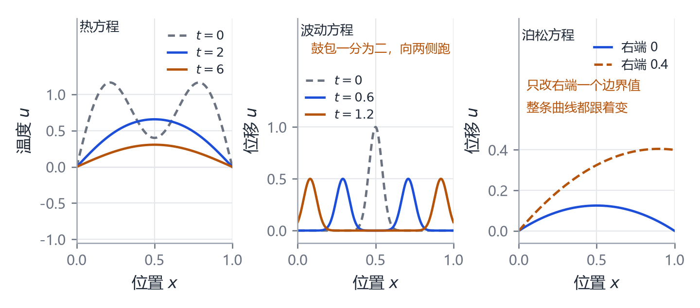
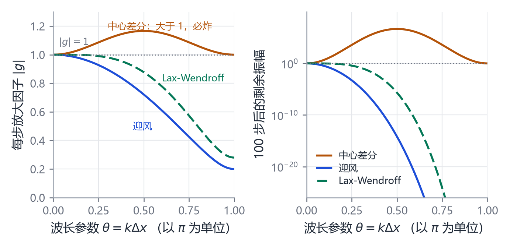
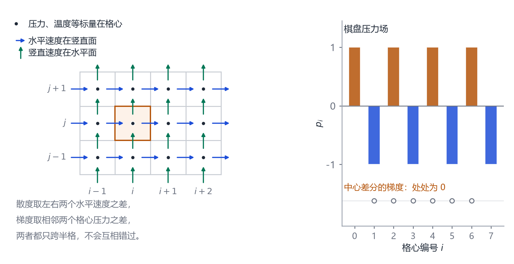

# 第 5 章 偏微分方程：热、波与流

> 本章导读：热、波、流三类方程在代码里长得几乎一样，行为差得很远。先给一条判别式，把它们的区别落在“信息怎么传播”这一件事上，再逐个交代各自的时间步限制：扩散的 $\Delta x^{2}$、波的 CFL、对流的振型。后面两节讲边界条件与交错网格，那是这些格式真正落地的地方。

## 5.1 三种行为，一个判别式

同一段显式推进的代码，拿来算一块铁板里的温度，步长六十分之一秒，跑得很稳。换成算一根绳子的横向振动，同样的步长，几十步之后整条绳子变成锯齿，再往下数值溢出。换成“给定边界、求内部压力”，这段代码根本不知道从哪里开始，因为里面没有时间。

三件事离散之后都长成“网格点上的二阶差分”，脾气却完全不同。差别在方程的类型，而类型可以只用一个判别式读出来。最一般的二阶线性方程写成

$$
A\,u_{xx}+B\,u_{xy}+C\,u_{yy}+D\,u_x+E\,u_y+F\,u=G ,
\tag{5.1}
$$

$u$ 是待求的场，下标是偏导数的简写，$u_{xx}=\partial^2u/\partial x^2$。$A$、$B$、$C$ 乘在二阶项上，决定信息怎么传播；$D$、$E$ 乘在一阶项上，相当于输运或者阻尼；$F$ 乘在零阶项上，相当于回复力；$G$ 是已知的源。判别式只用到三个二阶系数：

$$
\Delta=B^{2}-4AC .
\tag{5.2}
$$

$\Delta \gt 0$ 是双曲型，$\Delta=0$ 是抛物型，$\Delta \lt 0$ 是椭圆型。这个式子和解析几何里判断二次曲线的形状用的是同一个，原因也一样：二阶项决定等值线族的形状，而那些等值线正是信息传播的路径。双曲时有两族实特征线，扰动只能沿它们走；抛物时两族合成一族，扰动瞬间铺满全域但幅度随之衰减；椭圆时没有实特征线，任何一点的变化立刻影响整个区域。

三类各有一个标准样本，模拟里的方程大多是它们的变体：热方程 $u_t=\alpha u_{xx}$ 是抛物型，波浪方程 $u_{tt}=c^{2}u_{xx}$ 是双曲型，泊松方程 $u_{xx}+u_{yy}=f$ 是椭圆型。图 5-1 把三者的解放在一起。

<figure class="fig">

<figcaption><b>图 5-1</b>　三类方程的一维行为。左：热方程 $u_t=0.02\,u_{xx}$，初值 $\sin\pi x+0.6\sin 3\pi x$，两端固定，按解析解取 $t=0,\,2,\,6$，高频的起伏先被抹平，形状越来越接近正弦。中：波动方程 $u_{tt}=c^{2}u_{xx}$，$c=0.35$，初值为中心处的高斯鼓包（标准差 0.042），初速度为零，曲线是 d'Alembert 解在 $t=0,\,0.6,\,1.2$ 的值，鼓包一分为二向两侧走，形状不变。右：泊松方程 $-u''=1$，两个解只差右端边界值（0 与 0.4），边界改了一处，整条曲线都跟着变。</figcaption>
</figure>

三张图对应的数值做法几乎不重叠。热方程要处理“快慢差得极大”，显式格式必须跟着最快的分量走；波浪方程要处理“有限速度”，步长必须让数值信息的传播不慢于真实的波；泊松方程没有时间可推，一步之内就得让全场同时满足，只能解一个线性系统。

类型不是方程的永久标签。系数依赖解时，类型随解变化：跨声速流动里，低于声速的区域是椭圆型，高于声速的区域是双曲型，中间隔着一道声速线，激波就长在线上。还有一种更常见的情况：连续方程是一种类型，离散之后表现得像另一种。定常对流扩散方程

$$
-\nu\,(u_{xx}+u_{yy})+a\,u_x=0
\tag{5.3}
$$

里 $\nu$ 是扩散系数，$a$ 是流速。按判别式 $A=C=-\nu$、$B=0$，$\Delta=-4\nu^{2} \lt 0$，是椭圆型，扰动应该被抹平。可用中心差分离散之后，只要网格够粗，解里就出现一格高一格低的振荡，像双曲型的振铃。离散算子的性质由单元 Péclet 数 $a\Delta x/\nu$ 决定，这个数超过 2，中心差分的系数就变号，抹平变成了放大。判断类型时不能只看连续形式。

## 5.2 热方程：显式与隐式

热方程是所有扩散过程的原型：

$$
\frac{\partial u}{\partial t}=\alpha\,\frac{\partial^{2}u}{\partial x^{2}} ,
\tag{5.4}
$$

$u$ 可以是温度、浓度，也可以是速度的某个分量；$\alpha$ 叫扩散率，单位平方米每秒。量纲是“长度平方除以时间”，这一点很关键：扩散的时间尺度与距离的平方成正比，距离翻倍，时间要翻四倍。钢的 $\alpha$ 约 $1.2\times10^{-5}$ m²/s，一厘米见方的钢块冷到一半要几秒，同样尺寸的水要十几分钟。

离散用中心差分加显式 Euler：

$$
u_i^{n+1}=u_i^{n}+s\left(u_{i+1}^{n}-2u_i^{n}+u_{i-1}^{n}\right),\qquad
s=\frac{\alpha\,\Delta t}{\Delta x^{2}} ,
\tag{5.5}
$$

$i$ 是格点编号，$n$ 是时间层，$s$ 是无量纲的扩散数。更新式只说一件事：每个点的新值等于旧值加上“邻居比它低多少”。稳定性条件不必用傅里叶分析推，直接看系数就够：

$$
s\le \frac{1}{2d}\qquad (d=1,\,2,\,3),
\tag{5.6}
$$

$d$ 是空间维数：一维是 $1/2$，二维是 $1/4$，三维是 $1/6$。

$s \lt 1/2$ 时，式 (5.5) 里三个系数 $1-2s$、$s$、$s$ 都非负且和为 1，新值就是三个旧值的凸组合。凸组合不会产生新的极值，场的最大值不增、最小值不减，这叫极值原理。一旦破坏，数值解就会在平缓区域里造出鼓包，鼓包下一步被放大，几十步之内溢出。三维的 1/6 等于“每个点有几个邻居”的倒数：模板涉及 $2d+1$ 个点，稳定性要求 $s\le1/(2d)$，这条规则对所有显式扩散格式都成立。

代价来得很快。$\Delta x$ 减半，为保持 $s$ 不变，$\Delta t$ 要减到四分之一；三维里网格点变成八倍，步数变成四倍，总成本三十二倍。

隐式格式把空间差分放到新时间层：

$$
u_i^{n+1}-s\left(u_{i+1}^{n+1}-2u_i^{n+1}+u_{i-1}^{n+1}\right)=u_i^{n} ,
\tag{5.7}
$$

未知量是整条线上的新值，写成矩阵是 $(\mathbf{I}-s\mathbf{L})\mathbf{u}^{n+1}=\mathbf{u}^{n}$，$\mathbf{L}$ 是二阶差分矩阵，$\mathbf{I}$ 是单位阵。矩阵三对角、对称、对角占优，追赶法一步解完，成本与网格点数成正比。

稳定性无条件。把单模态 $u_i^{n}=g^{n}e^{\mathrm{i}ki\Delta x}$ 代进去，空间差分给出 $\mu=2-2\cos(k\Delta x)$，取值在 0 到 4 之间，放大因子

$$
g=\frac{1}{1+s\,\mu} ,
\tag{5.8}
$$

分母恒大于 1，所以 $|g| \lt 1$ 对所有 $s$ 成立。物理上讲得通：扩散没有有限的传播速度，高频扰动瞬间就被抹平，不存在“信息跑得比网格快”这回事，自然没有 CFL 限制。隐式把所有模态都压得比真实解更狠，但方向是对的，所以不会失稳。代价是精度：$s$ 很大时一步就把高频抹干净，细节随时间迅速丢失，所以隐式扩散适合“扩散本来就快到看不清”的场合，比如高粘流体。

流体里的粘性项就是三个方向上的热方程，扩散系数是运动粘度 $\nu=\mu/\rho$。蜂蜜约 $7\times10^{-3}$ m²/s，空气约 $1.5\times10^{-5}$。用 $\Delta t\le\Delta x^{2}/(6\nu)$ 估一下：一厘米的网格，算蜂蜜只能给到两毫秒多一点，算空气可以给到一秒。同样的代码算烟时步长被对流限制，算蜂蜜时被粘性限制，两边差两个多数量级。1999 年那篇把扩散和投影都写成线性系统来解的论文，正是为了让高粘流体也能用大步长 [@stam1999]。

## 5.3 波动方程：CFL 与特征线

波动方程描述另一回事：

$$
\frac{\partial^{2}u}{\partial t^{2}}=c^{2}\,\frac{\partial^{2}u}{\partial x^{2}} ,
\tag{5.9}
$$

$c$ 是波速，单位米每秒。时间方向是二阶导，所以需要两个初始条件——初始位移和初始速度，少给一个解就不唯一。二阶中心差分是最自然的离散：

$$
u_i^{n+1}=2u_i^{n}-u_i^{n-1}+\sigma^{2}\left(u_{i+1}^{n}-2u_i^{n}+u_{i-1}^{n}\right),
\qquad \sigma=\frac{c\,\Delta t}{\Delta x} ,
\tag{5.10}
$$

$\sigma$ 叫 Courant 数，无量纲。稳定性条件是 CFL 条件最朴素的形式：

$$
\sigma=\frac{c\,\Delta t}{\Delta x}\le 1 .
\tag{5.11}
$$

含义不看公式也能想明白：一步之内，真实的波传播 $c\Delta t$，数值信息最多传播一个 $\Delta x$。若 $c\Delta t \gt \Delta x$，真实解里已经互相影响的两个点，在格式里还没联系上，等于用一个信息不全的邻域去算下一步，误差每步叠加。

严格的写法是特征线。双曲方程有特征线 $x\pm ct=C$（$C$ 是常数），解沿特征线不变，所以某一点在 $t$ 时刻的值只依赖初始时刻的区间 $[x-ct,\,x+ct]$，这叫依赖域。离散格式也有依赖域：走 $n$ 步之后，第 $i$ 点依赖 $[x-n\Delta x,\,x+n\Delta x]$。CFL 条件就是要求数值依赖域包住解析依赖域。包不住，格式算的是另一个问题。

$\sigma=1$ 时格式精确，不是巧合。此时特征线正好落在网格对角线上，差分退化成沿特征线的平移。$\sigma \lt 1$ 时特征线落在格点之间，必须插值，插值就带来误差，表现是色散。把傅里叶模态代入式 (5.10) 得数值色散关系

$$
\sin\frac{\omega\Delta t}{2}=\sigma\,\sin\frac{k\Delta x}{2} ,
\tag{5.12}
$$

$\omega$ 是数值角频率，$k$ 是波数，真实关系是 $\omega=ck$。偏差随 $k$ 增大而增大：短波走得比长波慢。于是一个陡峭的脉冲在传播中被拉成“前面平、后面拖一串振荡”，振荡波长正好是两个网格。加密网格能减轻色散，减小步长不能——步长只管 CFL，不管空间离散的色散。

写成隐式也能无条件稳定，但意义不大。波形要算准，$\Delta t$ 仍被 $\Delta x/c$ 约束住，隐式还额外引入数值阻尼，波峰越算越钝。双曲问题用隐式换步长，省不下时间，还赔上精度。

模拟里最常见的波动方程不在水面上，在固体里。钢杆的纵波速度 $c=\sqrt{E/\rho}$，杨氏模量 200 GPa、密度 7800 kg/m³，算出 5060 m/s。网格取一毫米，CFL 要求 $\Delta t\le2\times10^{-7}$ 秒。这说明显式有限元算硬材料为什么贵：不是算法不好，是材料里的声速太快。工程上的对策是隐式积分，或者把材料做得软一点，后者在影视里很常见。

## 5.4 对流方程：三种格式

对流方程是最简单的一阶双曲方程：

$$
\frac{\partial u}{\partial t}+a\,\frac{\partial u}{\partial x}=0 ,
\tag{5.13}
$$

$a$ 是恒定流速。解析解就是初值沿 $x$ 平移，$u(x,t)=u_0(x-at)$，形状不变、幅度不变。解这么简单，让人以为数值上容易，实际上它是最难算对的方程之一。中心差分看起来最自然：

$$
u_i^{n+1}=u_i^{n}-\frac{\sigma}{2}\left(u_{i+1}^{n}-u_{i-1}^{n}\right),
\qquad \sigma=\frac{a\,\Delta t}{\Delta x} .
\tag{5.14}
$$

代入单模态 $u_i^{n}=g^{n}e^{\mathrm{i}\theta i}$，$\theta=k\Delta x$ 是无量纲波数，得

$$
g=1-\mathrm{i}\,\sigma\sin\theta ,
\tag{5.15}
$$

模长平方 $|g|^{2}=1+\sigma^{2}\sin^{2}\theta$，除了 $\theta=0$ 和 $\theta=\pi$，处处大于 1。任何步长都不稳定，再小也一样。

原因在结构上。中心差分是反对称的，离散算子的特征值全在虚轴上；显式 Euler 的稳定域是以 $-1$ 为圆心的单位圆，与虚轴只交于原点。时间推进把虚轴上的特征值推到圆外，一步放大一点，指数增长。空间算子与时间积分器不匹配，减小步长只让放大慢一点，不改变结论。表现是振铃：陡峭的部分被分解成各种波长的模态，波长接近两个网格的那些增长最快，几十步之后满场都是锯齿。

迎风格式换个方向看：信息只从上游来，差分也只取上游的点。$a \gt 0$ 时

$$
u_i^{n+1}=u_i^{n}-\sigma\left(u_i^{n}-u_{i-1}^{n}\right),
\tag{5.16}
$$

放大因子 $g=1-\sigma(1-e^{-\mathrm{i}\theta})$，模长平方

$$
|g|^{2}=1-2\sigma(1-\sigma)(1-\cos\theta) .
\tag{5.17}
$$

$0\le\sigma\le1$ 时 $|g|\le1$，稳定；$\sigma=1$ 时相位精确，格式等于把初值整体右移一格。代价是耗散：$\sigma \lt 1$ 时高频模态的 $|g|$ 明显小于 1，每步掉一点幅度。图 5-2 右边把这一点算得很清楚——走 100 步，迎风把最短波压到 $10^{-20}$ 以下，中心差分在同样的位置放大到 $10^{6}$ 量级。迎风把锯齿压住了，也把陡台阶抹成斜坡。

<figure class="fig">

<figcaption><b>图 5-2</b>　三种格式的 von Neumann 分析，Courant 数 $\sigma=0.6$，横轴是无量纲波数 $\theta=k\Delta x$。左：每步放大因子 $|g|$，中心差分整条曲线在 1 以上（$\theta=\pi/2$ 处约 1.17），迎风与 Lax-Wendroff 都在 1 以下，迎风压得更狠。右：同一批模态走 100 步后剩下的振幅，纵轴取对数；中心差分涨到 $10^{6}$ 量级，迎风把短波压到 $10^{-20}$ 以下，Lax-Wendroff 介于两者之间。三条曲线都由 $g$ 的解析式直接算出。</figcaption>
</figure>

Lax-Wendroff 想同时拿到二阶精度和稳定性。做法是把时间方向做泰勒展开，用方程本身把时间导数换成空间导数：

$$
u_i^{n+1}=u_i^{n}-\frac{\sigma}{2}\left(u_{i+1}^{n}-u_{i-1}^{n}\right)
+\frac{\sigma^{2}}{2}\left(u_{i+1}^{n}-2u_i^{n}+u_{i-1}^{n}\right).
\tag{5.18}
$$

第二项像扩散，但不是人为加的粘性，而是泰勒展开里自然出现的二阶项。放大因子

$$
g=1-\sigma^{2}(1-\cos\theta)-\mathrm{i}\,\sigma\sin\theta ,
\tag{5.19}
$$

模长平方 $|g|^{2}=1-\sigma^{2}(1-\sigma^{2})(1-\cos\theta)^{2}$，只要 $\sigma\le1$ 就稳定，耗散比迎风小得多。代价是色散：陡台阶后面拖一串衰减的振荡，台阶还会出现低于初始最小值的下冲。迎风的问题是糊，Lax-Wendroff 的问题是振铃，两者是同一矛盾的两面。

von Neumann 分析本身值得单说一句，因为它是后面所有稳定性判断的工具。做法是把单模态代进格式，解出 $g(\theta)$，要求 $|g|\le1$ 对所有 $\theta$ 成立。它成立的前提是线性、常系数、周期边界，真实的模拟三条都不满足。所以它给出的是必要条件，实践中的用法是“局部冻结系数”：在流场里取一小块当常系数看。绝大多数失稳都能这样预测到。

工程上的选择不止这三种。限制器把重构的斜率限住，保证不产生新极值，光滑区保精度、激波处退化成一阶，这类格式统称 TVD。图形学里更常见的是半拉格朗日：沿速度回溯一步，在回溯点插值。它无条件稳定，因为新值是旧值的加权平均，和 5.2 的凸组合论证一样；代价是每次插值都相当于一次低通滤波，耗散比迎风还大，烟越算越淡。稳定性、精度、耗散三者不可能同时拿到。

## 5.5 纳维-斯托克斯：三类混在一起

不可压流体的方程里，前面三种类型同时出现：

$$
\rho\left(\frac{\partial \mathbf{u}}{\partial t}+(\mathbf{u}\cdot\nabla)\mathbf{u}\right)
=-\nabla p+\mu\nabla^{2}\mathbf{u}+\mathbf{f},
\qquad \nabla\cdot\mathbf{u}=0 .
\tag{5.20}
$$

$\rho$ 是密度，$\mathbf{u}$ 是速度场，$p$ 是压力，$\mu$ 是动力粘度，$\mathbf{f}$ 是单位体积的外力。第一式是动量守恒，第二式是不可压约束。对流项 $(\mathbf{u}\cdot\nabla)\mathbf{u}$ 把速度沿流线搬运，特征线就是流线，属双曲型；粘性项 $\mu\nabla^{2}\mathbf{u}$ 把速度差抹平，作用方式与 5.2 的热方程完全一样，属抛物型；压力梯度配上散度为零，构成一个椭圆型约束——压力不是由局部状态决定的量，而是让全场散度为零的拉格朗日乘子。

三项的性质对应三套数值处理：对流要迎风或半拉格朗日，要 CFL；粘性要隐式或小步长；约束每一步都要解一个全局系统。流体模拟的一帧因此总被拆成几步来做。

两个步长限制分别来自双曲和抛物两部分：

$$
\Delta t\le \frac{\Delta x}{|\mathbf{u}|_{\max}},
\qquad
\Delta t\le \frac{\Delta x^{2}}{2d\,\nu} ,
\tag{5.21}
$$

$d$ 是维数，$\nu=\mu/\rho$ 是运动粘度，$|\mathbf{u}|_{\max}$ 是全场最大速度。两者之比是单元 Reynolds 数的一半：Re 大由对流限制，Re 小由粘性限制。水在 $1$ m/s、一毫米网格下，对流限制是 $10^{-3}$ 秒，粘性限制是 $0.17$ 秒，粘性一时还不起作用；网格要细到十微米附近，两者才打平。想比这更细，就得把粘性写成隐式的。

压力那一步是椭圆型的。由投影法的要求 $\mathbf{u}=\mathbf{u}^{*}-(\Delta t/\rho)\nabla p$ 满足无散条件，得

$$
\nabla^{2}p=\frac{\rho}{\Delta t}\,\nabla\cdot\mathbf{u}^{*} ,
\tag{5.22}
$$

$\mathbf{u}^{*}$ 是不含压力修正的临时速度，右端是已知散度。这个方程没有时间导数，离散后每个格子只与邻居相连，整体是一个规模等于网格点数的稀疏系统，每一帧都要重解一次。第 6 章会说明它的条件数按 $h^{-2}$ 增长，网格加密一倍，迭代次数也涨一倍。

把一帧拆成“平流—外力—投影”三步，是 1999 年那篇论文的核心 [@stam1999]。拆分合法性的问题值得说清：几个算子并不对易，先平流再扩散与反过来结果不同，所以分裂引入一阶误差 $O(\Delta t)$，比格式本身低一阶。换来的是每一步都是单一类型的子问题，各有成熟解法。用一阶误差换整体鲁棒性，这笔交易在图形学里几乎总是划算的：观众看不出时间精度，看得出炸不炸。

Reynolds 数在这里扮演双重角色。它是双曲项与抛物项之比，Re 大意味着惯性主导，涡一路级联到很小的尺度，网格必须细到能看见。它同时决定边界层厚度，量级 $L/\sqrt{\mathrm{Re}}$：一米长的物体、Re 为 $10^{6}$，边界层只有一毫米，厘米级的网格解不出来，壁面剪切被平均掉。这时“无滑移”已经从物理事实变成了建模选择，很多大尺度模拟改用自由滑移，只挡法向。

速度接近声速时，密度变化成为主角，压力由状态方程给出，系统转为双曲型为主。此时声速决定 CFL，而流速可能远小于声速，步长被一个看不见的波卡住，这叫低马赫数刚性，对策是预处理或者把声波滤掉。图形学的火与烟一般不碰这一区，游戏里的爆炸偶尔会。

## 5.6 边界条件

一个出流边界写错，整个房间的烟都会抖。这类事故在流体代码里很常见，而且难定位：症状在域内部，原因在边上。

Dirichlet 条件给定场值 $u=g$，固壁上的速度、自由表面上的压力都属于这类。Neumann 条件给定法向导数 $\partial u/\partial n=g$，绝热壁面的温度、对称面上的法向速度梯度属于这类，$g=0$ 表示没有东西穿过这个面。Robin 条件把两者混起来，$\alpha u+\beta\,\partial u/\partial n=g$，对流换热边界是这样。周期条件把域的两端接起来，$u(0)=u(L)$，它不是物理边界，而是“外面还是同样的东西”的声明，代价是任何扰动都会从另一边绕回来。

自由表面最特殊：它的位置是解的一部分，表面上压力为零（忽略表面张力），同时流体不能穿过表面，两条一起构成非线性边界条件。离散时界面落在格子之间，要么显式追踪，要么用水平集之类的隐式表示。

离散位置比类型更容易出错。交错网格上法向速度正好存放在壁面，无滑移就是把那个分量赋成壁面速度，零梯度也不需要额外处理。共位网格上所有量都在格心，壁面在半格之外，必须引入虚拟单元：在域外多放一层格子，让它们的值使壁面上的差分正好满足条件。Dirichlet 时虚拟值是镜像，Neumann 时是同号复制。

Neumann 条件有一个必须知道的坑。纯 Neumann 的泊松问题

$$
\nabla^{2}p=f\quad(\mathbf{x}\in\Omega),\qquad
\frac{\partial p}{\partial n}=g\quad(\mathbf{x}\in\partial\Omega) .
\tag{5.23}
$$

$\Omega$ 是求解区域，$\partial\Omega$ 是它的边界。这个方程有解的必要条件是 $\int_{\Omega}f\,dV=\oint_{\partial\Omega}g\,dS$，即源的总量等于边界流出的总量；不满足时无解，满足时解不唯一，加任何常数还是解。离散后的表现是矩阵奇异，零空间是一维常数向量，迭代法不收敛或者收敛到随机的东西。封闭盒子里的压力方程就是全 Neumann，必须把某个格子的压力固定住，否则求解器会在常数方向上漂移。

类型还决定适定性。双曲方程在入流边界给值，出流边界什么也不给（或者只给很弱的条件），给多了会反射。出流边界最容易出事：若简单令边界值等于内部值，出流的涡会反弹回来，整个域被污染。常见的补救是把条件写成“零法向梯度加对流输运”，让扰动离开而不是堆积。

精度也是边界的一部分。内部二阶、边界一阶单侧差分，整体收敛阶通常被拉到一阶，因为误差从边界向内传播。这个损失在高分辨率下才看得出来，调试时容易忽略：网格加密一倍，误差只降一半。

## 5.7 MAC 网格

把压力和速度都放在格心最省事，也最容易出问题。二维格心在 $(i,j)$，中心差分给出

$$
(\nabla p)_{i,j}=\left(\frac{p_{i+1,j}-p_{i-1,j}}{2\Delta x},\ \frac{p_{i,j+1}-p_{i,j-1}}{2\Delta y}\right) ,
\tag{5.24}
$$

注意梯度里没有 $p_{i,j}$ 自己，只有左右邻居。散度也用中心差分，代进泊松方程，得到的离散拉普拉斯是

$$
(\nabla^{2}p)_{i,j}=\frac{p_{i+2,j}-2p_{i,j}+p_{i-2,j}}{4\Delta x^{2}}
+\frac{p_{i,j+2}-2p_{i,j}+p_{i,j-2}}{4\Delta y^{2}} ,
\tag{5.25}
$$

模板跨两格而不是一格，把网格分成四套互不相干的子网格。于是压力场可以叠加形如 $p_{i,j}=(-1)^{i+j}$ 的分量而不改变梯度，因为这种分量在每套子网格上都是常数。这就是棋盘格：压力一格正一格负，速度场却看不出异常。图 5-3 右边把这个恒等式算了一遍，$p_i=(-1)^{i}$ 时 $(p_{i+1}-p_{i-1})/2$ 处处为零。棋盘压力落在零空间里，不影响残差，迭代法会在它上面随机漂移，结果里就带着一格一格的噪声。

<figure class="fig">

<figcaption><b>图 5-3</b>　交错存储（示意图）。左：MAC 网格上各量的位置，压力、温度等标量在格心，水平速度在竖直面上，竖直速度在水平面上；橙框是格 $(i,j)$，它的散度取左右两个水平速度之差，压力梯度取相邻两个格心之差，两者都只跨半格。右：共位网格允许的棋盘压力 $p_i=(-1)^{i}$，中心差分给出的梯度逐个算出来都是 0，这个场对求解器完全不可见；右图是恒等式的验证，不是实验数据。</figcaption>
</figure>

MAC 网格换了排布：压力仍在格心，水平速度放到格子的左右面，竖直速度放到上下面，每个分量存在自己方向的面元上。散度变成

$$
(\nabla\cdot\mathbf{u})_{i,j}=\frac{u_{i+1/2,j}-u_{i-1/2,j}}{\Delta x}
+\frac{v_{i,j+1/2}-v_{i,j-1/2}}{\Delta y} ,
\tag{5.26}
$$

半整数下标表示面元位置。梯度也在面元上取值：

$$
(\nabla p)_{i+1/2,j}=\frac{p_{i+1,j}-p_{i,j}}{\Delta x} .
\tag{5.27}
$$

两个算子都只跨半格，复合得到标准的五点（三维七点）格式，模板紧凑，零空间只剩常数向量。棋盘模态不再存在，因为它要跨两格的差分才看不见。

更好的性质是两个算子互为负转置。在合适的离散内积下 $\mathbf{D}=-\mathbf{G}^{\mathsf{T}}$，于是 $\mathbf{L}=\mathbf{D}\mathbf{G}=-\mathbf{G}^{\mathsf{T}}\mathbf{G}$ 对称半负定：对称意味着能用共轭梯度，半负定意味着投影永远在减少动能而不是增加。这不是巧合，交错网格是离散外微分在规则网格上的特例，散度、梯度、旋度各放在不同维度的单元上，伴随关系是结构自带的。旋度也有位置：二维的涡量是标量，存在格子角点上；三维的涡量是向量，分量存在棱上。这样 Stokes 定理在离散层面严格成立，绕面的环量等于穿过的涡量之和。

代价是复杂度。平流时速度在面上，采样点通常在格心或任意位置，必须先插值，插值又带来耗散。三维里三个分量各有各的索引偏移，写错一个下标，症状往往是“压力正常但流场微微发散”，很难查。

有没有不用交错的替代？Rhie-Chow 插值在共位网格上人为构造面元速度，让它依赖相邻两个格心的压力差，从而恢复紧凑耦合，工业 CFD 用得多，因为它能配非结构网格。图形学的规则网格几乎都用 MAC：格子规则，三个数组加偏移就够，棋盘问题一次解决，不必事后补救。
