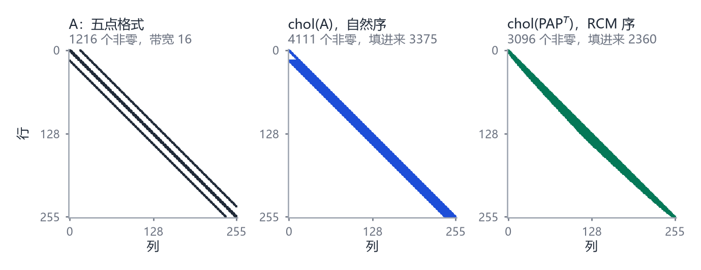
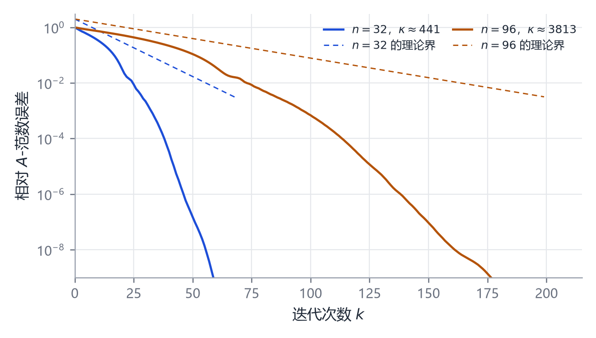
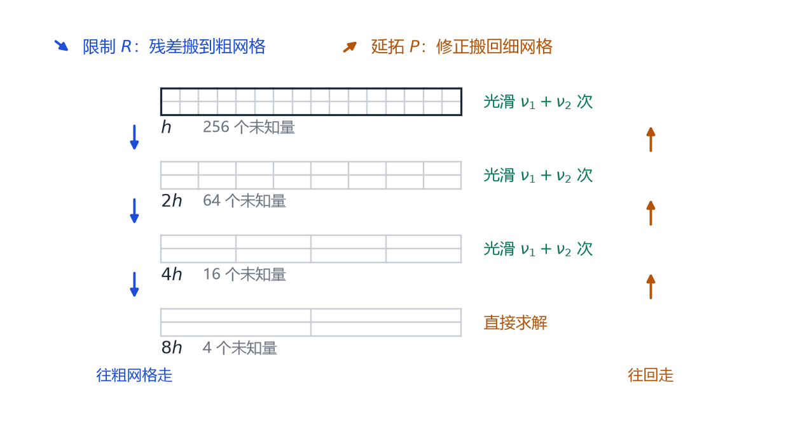

# 第 6 章 大规模线性系统

> 本章导读：隐式积分、压力投影、约束求解，最后都落到同一件事上——解一个很大的稀疏线性系统。这一章先说清这些矩阵从哪里来、为什么“稀疏”不等于“好解”，再依次看直接法、迭代法、预条件和多重网格各自的前提与代价，最后给一份按问题规模选方法的清单。

## 6.1 稀疏矩阵从哪里来，填充又是什么

一块两万顶点的布料，隐式积分一步要解六万个未知量。这个数字不算大，可要是按稠密矩阵存，六万乘六万是三十六亿个数，双精度下二十八 GB，光分配内存就失败。稀疏不是优化技巧，是这类问题能算的前提。

矩阵的形状由离散方式决定。隐式积分的每一步都在解

$$
\left(\frac{1}{\Delta t^{2}}\mathbf{M}+\mathbf{K}\right)\mathbf{x}=\mathbf{b} ,
\tag{6.1}
$$

$\mathbf{M}$ 是质量矩阵，$\mathbf{K}$ 是刚度矩阵，$\Delta t$ 是步长，$\mathbf{x}$ 是待求的位移增量，$\mathbf{b}$ 由惯性项、外力和上一步的状态组成。$\mathbf{M}$ 通常是对角或近似对角的，$\mathbf{K}$ 的非零结构则完全由网格的连接关系决定：两个顶点之间有一根弹簧或一条边，矩阵对应的位置就非零。

于是矩阵的行对应自由度，行里的非零元对应“这个点受哪些点影响”。二维五点格式的网格里，每个内部点连四个邻居加自己，一行五个非零；$n\times n$ 个点的网格，非零元总数是 $5n^{2}-4n$，而矩阵有 $n^{2}$ 行。二十万个未知量，非零元一百万个左右，密度不到万分之一。三维七点格式同理，非零元约 $7n^{3}$。

稀疏矩阵还有一个绕不开的量：带宽。按行的自然顺序编号，第 $i$ 个点和它的左右邻居只差一个编号，上下邻居差 $n$ 个，所以非零元最远离对角线 $n$ 格。带宽决定了直接法的成本，也决定了填充的上限。

填充是稀疏直接法里最反直觉的一件事。高斯消元消掉一个未知量时，要把它的方程代入其余方程，结果是它的所有邻居之间都长出一条新的非零元。二维网格上，消掉一个点会让它的四个邻居两两相连；一行一行消下去，会形成一条宽度约 $n$ 的“波前”，波前后面的部分全被填满。图 6-1 把这件事画了出来：$16\times16$ 的网格，原矩阵一千二百多个非零，Cholesky 因子却有四千多个，多出来的三千多个全是消元过程中长出来的。

<figure class="fig">

<figcaption><b>图 6-1</b>　五点格式的稀疏模式与 Cholesky 填充，$16\times16$ 网格、256 个未知量，按 $5\times5$ 模板组装后直接分解。左：原矩阵 1216 个非零，带宽 16。中：自然序的 Cholesky 因子，4111 个非零，填进来 3375 个，整个带宽被填成实心。右：同一矩阵按 RCM 重排后分解，3096 个非零，填进来 2360 个。三张图都是真实分解得到的结构，不是示意。</figcaption>
</figure>

填充量随问题规模涨得比想象快。二维按带宽消元，因子的非零元约 $N\cdot n$，计算量约 $N\cdot n^{2}$；三维带宽是 $n^{2}$，因子非零元约 $N\cdot n^{2}$，计算量约 $N\cdot n^{4}$。取 $128\times128$ 的二维网格，$N=16384$，带宽 128，计算量约 $1.3\times10^{8}$，一秒之内；换成 $64\times64\times64$ 的三维网格，$N=262144$，带宽 4096，计算量约 $2\times10^{12}$，还要八 GB 以上内存。同一份代码，二维能用，三维直接崩掉。

顺序可以改变填充。RCM（反向 Cuthill-McKee）沿着网格的层序编号，把非零元往对角线附近挤，填充随之减少；嵌套剖分递归地把区域切成两半、先消内部，二维的填充降到 $O(N\log N)$，三维降到 $O(N^{4/3})$。图 6-1 右边用的就是 RCM，填充少了三成——注意它的带宽没有变，省下的是带宽之内的那些零。这些重排只依赖结构、不依赖数值，所以可以在网格建好时算一次，之后一直用。

最后一条实践规则：结构不变、数值在变的时候，分解可以复用。隐式积分的每一步矩阵只有数值变化，拓扑和稀疏结构不变，符号分解（谁和谁相连、按什么顺序消）只做一次，每步只做数值分解和回代。拓扑一变——布料撕裂、物体断裂、网格重划——前面的分析全部作废，这一条决定了直接法在什么场合可用。

## 6.2 直接法：Cholesky 与 LU

对称正定的矩阵有专用的分解：

$$
\mathbf{A}=\mathbf{L}\mathbf{L}^{\mathsf{T}} ,
\tag{6.2}
$$

$\mathbf{L}$ 是下三角矩阵，对角元为正。这就是 Cholesky 分解，计算量是稠密情形下的 $N^{3}/3$，是 LU 的一半，而且不需要选主元——正定性保证了主元永远为正，数值上也稳定。

正定性从哪来，值得说清楚。式 (6.1) 里的 $\mathbf{M}/\Delta t^{2}$ 是正定的（质量总是正的），$\mathbf{K}$ 是半正定的：弹性势能 $E=\frac12\mathbf{x}^{\mathsf{T}}\mathbf{K}\mathbf{x}$ 对任何位移都非负，但整体平移和旋转不产生能量，所以 $\mathbf{K}$ 有一组零特征值，对应六个刚体模态。半正定加上正定的质量项，结果正定；如果 $\Delta t$ 取得极大，质量项趋近于零，矩阵就接近奇异，这也是“步长太大解不动”的数学原因之一。加了约束（固定点、接触）之后，刚体模态被消掉，矩阵回到严格正定。

分解失败时的信息很有用。Cholesky 遇到非正的主元会直接报错，而在弹性问题里出现负主元，往往意味着有单元翻了（体积变负，刚度贡献变成负的），或者材料参数写错了符号，或者约束给反了方向。比起迭代法算出一个看着像样的错误结果，直接法在这里反而是个诊断工具。

非对称的矩阵只能走 LU，$\mathbf{A}=\mathbf{L}\mathbf{U}$。选主元（把绝对值大的行换到主元位置）是数值稳定的保证，但换行会破坏稀疏结构，填充量随之上升。所以稀疏 LU 的实践是折中：只在必要时换行，用阈值主元策略，让稳定性与稀疏性各让一步。对称但不定（有正有负的特征值）的矩阵用 $\mathbf{L}\mathbf{D}\mathbf{L}^{\mathsf{T}}$，主元是 $1\times1$ 或 $2\times2$ 的块。

直接法的账要算清。它的优点是结果精确、对条件数不敏感、多右端时特别划算——分解一次，每换一个右端只花 $2N^{2}$ 的回代。缺点有两个：填充带来的内存和计算量，以及拓扑变化时必须重做。工程上的典型用法是把不含接触的弹性部分先分解好，每帧只回代，接触作为额外的约束在外层迭代处理 [@mcadams2011]；换个说法，把隐式积分写成能量最小化、内层解一个对称正定系统，靠的是同一个事实 [@gast2015]。这个做法成立的前提是对象内部拓扑不变——衣服不会每帧撕裂，器官不会每帧重划网格。

## 6.3 迭代法：Jacobi、Gauss-Seidel、CG、GMRES

迭代法不分解矩阵，只反复用矩阵乘向量去逼近解。最简单的两个是把矩阵拆成对角部分和非对角部分。

Jacobi 迭代把 $\mathbf{A}=\mathbf{D}+\mathbf{L}+\mathbf{U}$ 里的 $\mathbf{L}+\mathbf{U}$ 移到右端：

$$
\mathbf{x}^{(k+1)}=\mathbf{D}^{-1}\left(\mathbf{b}-(\mathbf{L}+\mathbf{U})\mathbf{x}^{(k)}\right) ,
\tag{6.3}
$$

$\mathbf{D}$ 是对角部分,$\mathbf{x}^{(k)}$ 是第 $k$ 次迭代的解。它收敛的充要条件是迭代矩阵 $\mathbf{D}^{-1}(\mathbf{L}+\mathbf{U})$ 的谱半径小于 1。对二维五点拉普拉斯,谱半径是 $\cos(\pi h)$,$h=1/n$。$n=128$ 时 $\cos(\pi/128)\approx0.9997$,误差每步只减万分之三,要把残差降到 $10^{-6}$ 需要四万六千次迭代。Gauss-Seidel 用刚算出来的新值,收敛因子是它的平方,迭代次数减半,两万三千次。两个方法都要 $O(N)$ 次迭代，加密一倍，次数约涨四倍。

共轭梯度（CG）换了个思路。它只在对称正定的矩阵上工作，但它不是把误差一步步磨小，而是在一个不断扩张的子空间里找使误差在 $\mathbf{A}$ 范数下最小的那个点。每步只需要一次矩阵乘向量和几次内积，存储只要四个向量。收敛速度由条件数决定：

$$
\frac{\|\mathbf{e}^{(k)}\|_{\mathbf{A}}}{\|\mathbf{e}^{(0)}\|_{\mathbf{A}}}
\le 2\left(\frac{\sqrt{\kappa}-1}{\sqrt{\kappa}+1}\right)^{k} ,
\tag{6.4}
$$

$\kappa=\lambda_{\max}/\lambda_{\min}$ 是条件数，$\|\mathbf{e}\|_{\mathbf{A}}=\sqrt{\mathbf{e}^{\mathsf{T}}\mathbf{A}\mathbf{e}}$ 是误差的能量范数。$\kappa$ 越大，括号里的比值越接近 1，收敛越慢。图 6-2 是两个规模的实际曲线：$32\times32$ 的网格条件数 441，47 次到 $10^{-6}$；$96\times96$ 的网格条件数 3813，139 次。规模涨九倍，迭代次数涨三倍，接近 $\sqrt{\kappa}$ 的关系。

<figure class="fig">

<figcaption><b>图 6-2</b>　共轭梯度的收敛，二维五点拉普拉斯、单位右端、零初值。纵轴是相对能量范数误差，实线为实测，虚线为式 (6.4) 给出的界。$32\times32$ 网格条件数 441，47 次降到 $10^{-6}$；$96\times96$ 网格条件数 3813，139 次。实测比界快，因为 CG 在特征值成簇时会出现超线性加速，界只按最坏情形估计。</figcaption>
</figure>

这里要强调 CG 的前提。矩阵必须对称正定，内积必须是标准内积。用在非对称的系统上，它不会报错，只会慢慢不收敛或者收敛到错误的东西。实践中最常见的误用是拿它解对流主导的方程，那里的离散算子反对称成分很大，CG 的表现会莫名其妙。

非对称系统用 GMRES。它在 Krylov 子空间里最小化残差的二范数，每一步都对全部已有基向量做正交化，所以必须把整个基存下来：内存随迭代次数线性增长，大问题里要重启（丢掉旧基重新开始），而重启会破坏它原本的“残差单调下降”性质，严重的会出现停滞——残差在一个水平上不动，怎么迭代都不降。它的收敛不仅取决于特征值，还取决于特征向量的分布（非正规矩阵），所以预条件对 GMRES 比对 CG 更关键。

对称但不定的系统用 MINRES，它和 CG 一样只存短递推，但允许负特征值。双共轭梯度稳定化（BiCGStab）用在既非对称又不想存整个基的场合，代价是收敛曲线不单调，偶尔会崩。鞍点系统（不可压约束耦合速度与压力、接触问题耦合位移与力）属于对称不定，直接上 CG 会失败，要么用 MINRES 配块预条件，要么消去一块化成 Schur 补再解。

## 6.4 条件数与预条件

条件数衡量“输入的小扰动会被放大多少倍”：

$$
\kappa(\mathbf{A})=\|\mathbf{A}\|\,\|\mathbf{A}^{-1}\| ,
\tag{6.5}
$$

对称正定时它等于最大特征值与最小特征值之比。它给出的是解的相对误差与残差的相对大小之间的关系：

$$
\frac{\|\mathbf{x}-\hat{\mathbf{x}}\|}{\|\mathbf{x}\|}
\le \kappa(\mathbf{A})\,\frac{\|\mathbf{r}\|}{\|\mathbf{b}\|} ,
\tag{6.6}
$$

$\hat{\mathbf{x}}$ 是计算得到的解，$\mathbf{r}=\mathbf{b}-\mathbf{A}\hat{\mathbf{x}}$ 是残差。这条式子说明一件容易被忽略的事：残差小不等于误差小。$\kappa=10^{6}$ 时，残差降到 $10^{-6}$，误差可能还有 1。

条件数还决定了浮点精度的损失。双精度有十六位有效数字，$\kappa=10^{6}$ 就丢掉六位；单精度只有七位，$\kappa=10^{6}$ 之后只剩一位，解基本是噪声。这就是为什么单精度 GPU 上跑 CG 经常“残差降到某个值就不动了”。

二维五点拉普拉斯的条件数有解析估计：

$$
\kappa\approx\frac{4}{\pi^{2}h^{2}} ,
\tag{6.7}
$$

$h$ 是网格间距。$n=32$ 时约 440，$n=96$ 时约 3800，$n=512$ 时到 $10^{5}$。三维的常数不同，量级一样，都是 $h^{-2}$。网格加密一倍，条件数涨四倍，CG 的迭代次数涨一倍。

预条件就是把方程两边乘一个近似逆：解 $\mathbf{M}^{-1}\mathbf{A}\mathbf{x}=\mathbf{M}^{-1}\mathbf{b}$，其中 $\mathbf{M}\approx\mathbf{A}$ 但容易求逆。目标不是把 $\mathbf{M}$ 做得多准，而是让 $\mathbf{M}^{-1}\mathbf{A}$ 的特征值聚在一起、条件数降下来。CG 要求 $\mathbf{M}$ 对称正定，否则连理论保证都没有。

最便宜的是对角预条件（Jacobi），$\mathbf{M}=\operatorname{diag}(\mathbf{A})$。它对变系数、对角占优的矩阵有用，但对常系数的拉普拉斯完全无效：那里的对角元是常数 $4/h^{2}$，除以它只是把整个矩阵缩了一个常数，特征值比例一点没变，条件数原封不动。这个反例值得记住，因为它说明“加个预条件总比不加好”是错的。

SSOR 用对称的 Gauss-Seidel 两步做预条件，对拉普拉斯能把条件数从 $O(h^{-2})$ 降到 $O(h^{-1})$，迭代次数从 $O(h^{-1})$ 降到 $O(h^{-1/2})$——好了一个量级，但次数仍随网格增长。

不完全 Cholesky（IC）在分解时禁止填充：只保留原矩阵非零位置上的因子，其余丢掉。它把条件数降得比 SSOR 多，成本又和一次矩阵乘向量同量级，是通用稀疏求解器里最常见的预条件。它的麻烦在于不一定存在：一般对称正定矩阵的 IC 分解可能在某个主元上变负而中断。对 M 矩阵（非对角元非正、对角占优）它一定存在，而五点拉普拉斯正是 M 矩阵；弹性问题的刚度矩阵则不是，泊松比接近 0.5 时非对角元变大，IC 常常失败或者效果极差。

还有一类问题跟数学无关：单位混在一起。同一个系统里既有位移（米，量级 $10^{-1}$）又有转角（弧度，量级 $10^{0}$），还有压力（帕，量级 $10^{5}$），对角元的量级差五个数量级，条件数凭空多出 $10^{10}$。行缩放（把每行除以它的对角元或者它的范数）能解决大半，这也是很多求解器默认做的一步。

## 6.5 多重网格：把误差按频率分开处理

Jacobi 和 Gauss-Seidel 有一个容易被忽略的性质：它们抹高频很快，抹低频几乎不动。$n=128$ 的网格上，一个波长两个网格的误差，一趟 Gauss-Seidel 就压掉一半；一个波长横跨全场的误差，一趟只衰减万分之三。原因是这两类误差在局部看起来完全一样——平滑算子只看得到邻居，分辨不出这是“局部的小起伏”还是“大尺度斜坡的一部分”。

多重网格把这个性质变成方法。既然低频误差在细网格上几乎不动，就把它搬到粗网格上去：在粗网格看来，原来的低频变成了高频，同样的平滑算子又能快速压掉。这就是图 6-3 的结构。

<figure class="fig">

<figcaption><b>图 6-3</b>　V 循环（示意图）。四层网格，每层格点数减半，未知量减到四分之一。左侧向下是限制 $R$，把残差从细网格搬到粗网格；右侧向上是延拓 $P$，把修正量搬回细网格；每层上做 $\nu_{1}$ 次前置光滑与 $\nu_{2}$ 次后置光滑，最粗的一层未知量极少，直接求解。</figcaption>
</figure>

一个 V 循环由四样东西组成。光滑器就是 Gauss-Seidel 或者带阻尼的 Jacobi，作用是把当前层的高频误差压下去。限制算子 $R$ 把细网格上的残差取样到粗网格，二维最常用的是全权重，中心权重 $1/4$，边中点 $1/8$，角点 $1/16$，权重和为 1，相当于一次局部平均。延拓算子 $P$ 把粗网格上解出来的修正量插值回细网格，双线性插值就够。粗网格算子可以直接在粗网格上重新离散，也可以用 Galerkin 形式 $\mathbf{A}_{2h}=R\mathbf{A}_{h}P$，后者在变系数时更稳。

流程是：在当前层光滑 $\nu_{1}$ 次，算出残差，限制到粗层；在粗层递归地做同样的事，直到最粗的一层直接求解；然后逐层延拓修正量回来，再光滑 $\nu_{2}$ 次。粗层的未知量是上一层的四分之一（三维是八分之一），各层工作量加起来是一个几何级数：

$$
W_{\mathrm{V}}\approx 2(\nu_{1}+\nu_{2})\,N\left(1+\frac{1}{4}+\frac{1}{16}+\cdots\right)
=\frac{8}{3}(\nu_{1}+\nu_{2})\,N ,
\tag{6.8}
$$

$N$ 是细网格的未知量数,系数 2 是因为每个尺度上做了前置和后置两次。二维的级数和是 $4/3$,三维是 $8/7$(每层缩到八分之一)。于是一整趟 V 循环的工作量只是细网格上几次光滑的量。一次 V 循环通常把误差压低一个数量级,$n=32$ 和 $n=4096$ 都是这个数。于是总成本是 $O(N)$:未知量涨十倍,多重网格的代价也只涨十倍,而 CG 大约涨三十倍。这个性质叫最优复杂度，是它唯一的卖点。

W 循环是它的变体：每层往粗网格递归两次而不是一次。工作量大约翻倍，但对难缠的问题（强各向异性、系数跳变）更稳，因为粗网格上的解算得更准。

多重网格的失效方式和它的成功一样有规律。各向异性扩散是典型：$x$ 方向的系数比 $y$ 方向大一千倍时，点光滑在 $y$ 方向几乎不起作用，因为那里的耦合本来就弱；粗化又在两个方向同时进行，结果 $y$ 方向的误差始终没被处理。对策是线光滑（沿强耦合方向整条线一起解）或者半粗化（只在弱方向粗化）。系数跳变（比如水流穿过不同介质）会让粗网格算子失真，因为 $R\mathbf{A}P$ 把界面抹平了；对策是算符型的粗化或者代数多重网格。

代数多重网格（AMG）不看网格，只看矩阵：从矩阵的强连接关系自动构造粗层，把“几何上相邻”换成“数值上强耦合”。它能处理非结构网格和复杂系数，代价是构造阶段贵，且参数需要调。规则网格上的泊松方程，几何多重网格又快又简单；非结构网格上的弹性问题，AMG 往往是唯一可用的选择。

## 6.6 矩阵自由与并行

迭代法只需要“乘以矩阵”这一个操作，矩阵本身不必存在：直接按差分模板算就行。

矩阵自由的好处是内存。五点格式存成 CSR 需要三个数组（值、列号、行指针），每个非零元约十二字节；模板法只需要一个场数组，每个点读五个值。对三维七点、$256^{3}$ 的网格，这个差别是 1.4 GB 与 0.5 GB。更极端的是有限元：高阶单元的单元矩阵稠密，组装成全局矩阵再乘，内存能差一个数量级。

代价是预条件。凡是需要矩阵结构的预条件（IC、SSOR、直接法）都不能用了，只剩下对角预条件、多项式预条件，或者把多重网格写成矩阵自由的形式。这也解释了为什么规则网格上的流体求解器几乎都选多重网格：它既能矩阵自由地实现，又是最优复杂度的。

并行化的第一个障碍是 SpMV（稀疏矩阵乘向量）本身。它每个非零元只做两次浮点运算，却要读一个值、一个列号、一个向量分量。算术强度大约 0.1 到 0.2 次浮点运算每字节，而现代 GPU 的算力与带宽之比在 20 到 30 之间。也就是说，SpMV 只能跑到峰值算力的百分之一二，瓶颈在内存带宽而不是计算。$256^{3}$ 网格、七点格式，非零元一亿一千七百万，CSR 存下来一点四 GB。一次乘向量要多久，可以直接估：

$$
t\approx\frac{12\,N_{\mathrm{nz}}}{B} ,
\tag{6.9}
$$

$N_{\mathrm{nz}}$ 是非零元个数，每个非零元在 CSR 里占 12 字节（值 8 字节、列号 4 字节），$B$ 是内存带宽。$B=1.5$ TB/s 时，上式给出约一毫秒。这个数字就是整个求解器的时间下限：一次乘向量一毫秒，一千次迭代就是一秒，而一秒只有十几帧。

第二个障碍是全局同步。CG 每步要做两次内积，内积是全局归约，所有线程必须等齐。并行规模越大，归约的延迟占比越高，几千个核之后加速比就不再增长。对策是把内积合并、用流水线形式的 CG 把两次归约压成一次，或者用通信避免的变体，代价是数值稳定性变差。

第三个障碍是顺序依赖。Gauss-Seidel 用刚更新的值，天然是串行的。并行版本用着色：把网格点按棋盘分成红黑两组，同组之间没有依赖，可以同时更新；两组交替，收敛速度与串行版本接近但不等同。更粗的做法是分块，块内串行、块间用上一次的值，收敛性要靠松弛因子补救。

多 GPU 还要处理分区与光晕交换：每个子域边缘多存一层邻居的数据，每步交换一次。粗网格上的求解会成为瓶颈——粗层只有几百个未知量，分到几十块 GPU 上，通信开销压过计算。常见的做法是粗层退回单卡或者用直接法。

最后是精度。消费级 GPU 的双精度吞吐只有单精度的三十二分之一，全用双精度等于浪费。混合精度是个实用方案：矩阵和向量存单精度，残差和内积用双精度累加，或者外层用双精度、内层迭代用单精度。前提是条件数不能太大，否则单精度的舍入误差会让迭代停滞在 $10^{-4}$ 附近，怎么迭代都不动。

## 6.7 怎么选

选法的顺序大致是这样。

规模小于几千个未知量，直接法。填充无所谓，Cholesky 一次分解、多次回代，精度有保证，也不用调参数。同一个矩阵要解很多个右端时，直接法的优势随右端数线性放大。

中等规模（$10^{4}$ 到 $10^{6}$）、矩阵对称正定，CG 加预条件。预条件从对角开始试，无效就换 IC(0)，再不行考虑多重网格。判断是否值得换的标准很直接：算一次预条件应用的成本，与它省下的迭代次数比。

十万未知量以上的规则网格、泊松型的问题，几何多重网格。它的成本与网格无关，没有别的办法能比。非结构网格或者系数跳变，用 AMG，接受它构造阶段的开销。

非对称系统，GMRES 或 BiCGStab，配 ILU 类的预条件。这类系统在模拟里主要出现在三处：对流主导的输运方程、流固耦合的联合求解、带摩擦的接触问题（摩擦锥使雅可比非对称）。遇到不收敛，先看预条件，再看重启长度，最后才怀疑格式。

拓扑会变的场合（撕裂、断裂、重划网格），别用直接法。分解的结构每帧都变，符号分解的成本会把收益吃光。

不收敛时的排查顺序也值得记下来。第一步看残差是不是真的在降：打印每步的残差，如果它在前几步降得很快然后卡住，多半是预条件在这个问题上失效。第二步验证矩阵是不是你以为的那个：对称性、正定性、有没有零空间（自由漂浮的物体有六个刚体模态，不解掉它们 CG 必然失败）。第三步看尺度：把每个自由度按它的物理量纲归一化，很多“莫名其妙不收敛”其实是米和帕混在一个矩阵里。第四步才是换方法。

最后提醒一句：求解器报告“收敛”，只说明残差小于阈值，不说明解是对的。条件数大的时候，残差和解的误差可以差好几个数量级；矩阵组装错了的时候，残差照样能降到零——它降到的是另一个问题的解。
