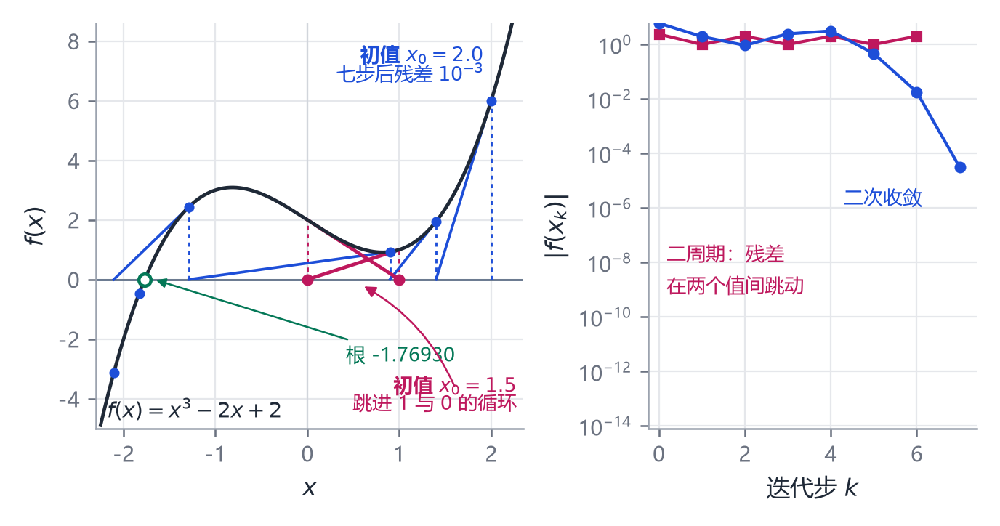
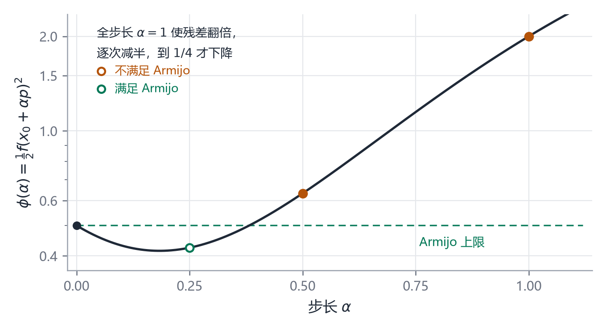
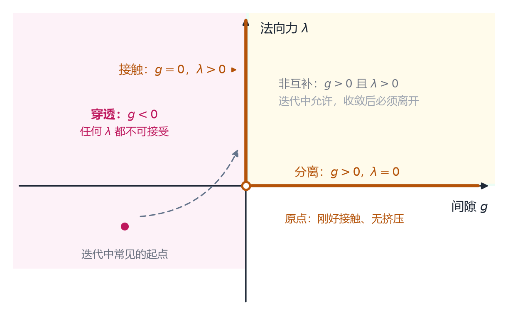

# 第 7 章 非线性方程与约束

> 本章导读：模拟器每一步的最后一项工作，通常是解一个方程——位置要让力平衡，速度要让物体不互相穿透。只要力不是位置的线性函数，或者解必须落在某个可行域里，这件事就没有一次算完的公式。这一章讲两件事：怎么把一个非线性方程组逼到解上，以及约束怎么变成方程的一部分。

## 7.1 一步隐式积分背后是一个求根问题

把一次隐式时间步摊开。上一帧的位置是 $\mathbf{x}_n$，速度是 $\mathbf{v}_n$，先算出没有新力作用时的预测位置

$$
\tilde{\mathbf{x}} = \mathbf{x}_n + \Delta t\,\mathbf{v}_n ,
\tag{7.1}
$$

$\Delta t$ 是步长。这一帧的位置 $\mathbf{x}$ 要满足后向 Euler 的离散方程

$$
\frac{\mathbf{M}}{\Delta t^2}\left(\mathbf{x} - \tilde{\mathbf{x}}\right) - \mathbf{f}(\mathbf{x}) = \mathbf{0},
\tag{7.2}
$$

$\mathbf{M}$ 是质量矩阵，对粒子系统是对角阵，对角元是各粒子的质量；对刚体是每块的 $3\times3$ 惯性张量。$\mathbf{f}(\mathbf{x})$ 是新位置上的合力。左边整体记作 $\mathbf{R}(\mathbf{x})$，称为残差。式 (7.2) 的含义很直白：惯性与合力必须平衡，不平衡的部分就是残差。

求解器要做的事，是找 $\mathbf{x}$ 让 $\mathbf{R}$ 的每个分量都为零。问题在于 $\mathbf{f}$ 通常不是 $\mathbf{x}$ 的线性函数：弹簧力依赖两点距离，距离是位置的平方根；弯曲力依赖夹角，夹角是反余弦；碰撞法向随几何而变。所以式 (7.2) 是一个非线性方程组，未知数个数是 $3N$（$N$ 个粒子）或 $6N$（$N$ 个刚体），在这个规模上没有任何解析解可用。

牛顿法是最直接的思路。一维情形下，把 $\mathbf{R}$ 在当前点做切线，取切线与横轴的交点

$$
x_{k+1} = x_k - \frac{R(x_k)}{R'(x_k)},
\tag{7.3}
$$

$R'$ 是导数。这一步之所以有效，是因为在解附近 $R$ 近似是一条直线，切线交点会落在解很近的地方。把 $R(x_{k+1})$ 在 $x_k$ 处展开到二阶，代入式 (7.3)，能得到误差的传递关系

$$
e_{k+1} \approx \frac{R''(x^\star)}{2R'(x^\star)}\, e_k^2 ,
\tag{7.4}
$$

$e_k = x_k - x^\star$ 是第 $k$ 步与真解的差，$x^\star$ 是解。误差被平方，这是二次收敛的确切含义：当前误差 $10^{-3}$，下一步变成 $10^{-6}$，再下一步 $10^{-12}$。代价是它对初值极其敏感，因为式 (7.4) 只在 $e_k$ 足够小时成立。

多维情形把导数换成雅可比矩阵

$$
\mathbf{J}(\mathbf{x})\,\Delta\mathbf{x} = -\mathbf{R}(\mathbf{x}),\qquad
\mathbf{x}_{k+1} = \mathbf{x}_k + \Delta\mathbf{x},
\tag{7.5}
$$

$\mathbf{J}$ 的第 $i$ 行第 $j$ 列是 $\partial R_i/\partial x_j$。对式 (7.2) 求导，$\mathbf{J} = \mathbf{M}/\Delta t^2 - \partial\mathbf{f}/\partial\mathbf{x}$；后面那一项取负号就是刚度矩阵，弹性体的切线刚度、约束的几何刚度都在这里。所以隐式积分每一步的牛顿迭代，内部要解一个形如式 (7.5) 的线性系统，而 $\mathbf{J}$ 每次迭代都会变，第 6 章的分解不能一直复用。

<figure class="fig">

<figcaption><b>图 7-1</b>　同一个方程 $f(x)=x^3-2x+2$ 上的两种命运。左图是切线构造：从 $x_0=2.0$ 出发，前五步依次落在 1.4、0.899、$-1.289$、$-2.106$、$-1.829$，第七步到 $-1.76929$；从 $x_0=1.5$ 出发，第一步到 1.0，第二步回到 0.0，此后在两点间来回。右图是残差 $|f(x_k)|$ 的半对数曲线，蓝色一路下探到底，粉色停在 1 与 2 之间不动。</figcaption>
</figure>

图 7-1 的两种结果值得逐项看清楚。从 $x_0=2.0$ 出发时，$f(2)=6$，$f'(2)=10$，第一步到 $1.4$；此时 $f(1.4)=1.944$，$f'(1.4)=3.88$，第二步到 $0.899$。后面几步跨过了根，$|f|$ 一度涨到 3.1，但方向没坏，仍是往回收的。七次迭代后残差降到 $10^{-3}$ 以下，这就是二次收敛的样子。

从 $x_0=1.5$ 出发就不一样了。$f(1.5)=2.375$，$f'(1.5)=4.75$，第一步恰好落在 $1.0$，因为 $f(1.5)/f'(1.5)=0.5$，正好半个步长，把轨道送进了坏点。而在 $x=1$ 处，$f=1$，$f'=1$，牛顿步是 $-1$，落到 $0$；在 $x=0$ 处，$f=2$，$f'=2$，牛顿步又是 $+1$，回到 $1$。两点互为对方的像，构成一个二周期。残差在这两点上分别是 1 和 2，永远不会减小，迭代次数再多也没用。

这个例子的实际含义是：牛顿法只保证在解的某个邻域内收敛，这个邻域叫收敛域。收敛域的大小取决于函数的曲率与根附近导数的行为。在模拟里，初值几乎总是上一帧的解，帧间隔越小，初值离真解越近，收敛域问题就越少出现。真正麻烦的是三种情况：第一次进入模拟（初值靠摆放）、物体突然受到大冲量（一步之内位置变化很大）、以及单元在压缩中接近翻转（$\mathbf{J}$ 接近奇异）。

最后一种最危险。光滑的牛顿法在 $\mathbf{J}$ 奇异时给出的步长会爆掉，数值上表现为位置飞出几个数量级，随后所有力的计算都返回 NaN。工程上的对策是在解线性系统之前检查 $\mathbf{J}$ 的对角元与行列式，或者干脆给 $\mathbf{J}$ 加一个小正则项 $(\mathbf{J} + \epsilon \mathbf{I})$，代价是这一步只解到近似。

## 7.2 线搜索：把“方向对”和“步长对”分开处理

式 (7.5) 隐含一个假设：$\Delta\mathbf{x}$ 是让残差下降的方向。这个假设在多维、非凸的问题里经常不成立。求解弹性体的静平衡时，能量面在单元翻转附近会出现负曲率，牛顿方向朝着能量更高的地方走；即便是凸问题，离解很远时全步长也可能冲过头。

把求根改成求最小，是处理这件事的常用办法。定义价值函数

$$
\phi(\mathbf{x}) = \frac{1}{2}\left\lVert \mathbf{R}(\mathbf{x}) \right\rVert^2 ,
\tag{7.6}
$$

它的梯度是 $\nabla\phi = \mathbf{J}^{\mathsf{T}}\mathbf{R}$。求 $\mathbf{R}=\mathbf{0}$ 变成求 $\phi$ 的全局最小，而这个最小值的下界是 0，达到 0 就意味着找到了解。有了方向之后，步长按一条规则挑。Armijo 条件要求

$$
\phi(\mathbf{x} + \alpha\mathbf{p}) \le \phi(\mathbf{x}) + c_1\,\alpha\,\nabla\phi^{\mathsf{T}}\mathbf{p},
\tag{7.7}
$$

$\mathbf{p}$ 是搜索方向，$\alpha$ 是步长，$c_1$ 一般取 $10^{-4}$。右端是一条过当前点、斜率为 $\nabla\phi^{\mathsf{T}}\mathbf{p}$ 的直线，只是被 $c_1$ 压得很平。这个条件说的是：新点的函数值必须落到这条线以下。只要求“比原来小”是不够的，因为那样可能在几乎水平的区域里挪一点点就宣布成功；压平斜率是为了逼出“足够明显”的下降。

<figure class="fig">

<figcaption><b>图 7-2</b>　回溯线搜索。函数仍取 $f(x)=x^3-2x+2$，从 $x_0=1.0$ 出发，牛顿方向 $p=-1$，纵轴是价值函数 $\phi(\alpha)=\tfrac12 f(x_0+\alpha p)^2$ 的对数。全步长 $\alpha=1$ 时 $\phi=2.0$，是出发点 $\phi=0.5$ 的四倍；减半到 $\alpha=1/2$ 仍有 $\phi=0.633$；再减半到 $\alpha=1/4$ 才降到 $0.425$，低于 Armijo 上限。绿色虚线是式 (7.7) 的右端，几乎水平，和 $\phi=0.5$ 贴在一起。</figcaption>
</figure>

图 7-2 用的就是 7.1 里那个不听话的点。从 $x_0=1.0$ 出发，$f=1$，$f'=1$，牛顿方向是 $p=-1$，全步长落到 $x=0$，那里 $f=2$，残差翻倍。回溯的做法是令 $\alpha \leftarrow \rho\alpha$，$\rho$ 常取 $0.5$，每退一次算一次 $\phi$：$\alpha=1$ 不满足，$0.5$ 不满足，$0.25$ 满足，接受。代价是两次额外的函数求值。

在模拟里，函数求值就是一次全场的力计算，可能占总时间的很大一块。所以常见的做法是“先试 $\alpha=1$，失败再从 0.5 开始”，而不是每次都从很小的步长爬。另一些实现干脆不用线搜索，改用固定的小步长加过松弛，靠后续迭代纠偏——PBD 这类位置法就是如此。

线搜索之外还有一条路，叫信赖域。它不问“沿这个方向走多远”，而问“在半径 $\Delta$ 的球内，模型可信吗”。做法是解一个带约束的子问题 $\min \mathbf{g}^{\mathsf{T}}\mathbf{p} + \tfrac12\mathbf{p}^{\mathsf{T}}\mathbf{B}\mathbf{p}$，约束是 $\lVert\mathbf{p}\rVert \le \Delta$，然后比较实际下降与模型预测下降的比值

$$
\rho_k = \frac{\phi(\mathbf{x}_k) - \phi(\mathbf{x}_k + \mathbf{p}_k)}
{\phi(\mathbf{x}_k) - m_k(\mathbf{p}_k)} ,
\tag{7.8}
$$

$m_k$ 是二次模型。$\rho_k$ 接近 1 说明模型准，可以放大 $\Delta$；$\rho_k$ 很小甚至为负说明模型不可信，缩小 $\Delta$ 并拒绝这一步。信赖域的好处是它天然处理负曲率：当 $\mathbf{B}$ 不定时，子问题仍有定义，解会沿负曲率方向走到边界上，而线搜索在这种情形下连方向都选不出来。

工程上更常见的是 Levenberg-Marquardt：解 $(\mathbf{J}^{\mathsf{T}}\mathbf{J} + \mu\mathbf{I})\Delta = -\mathbf{J}^{\mathsf{T}}\mathbf{R}$。$\mu$ 大时退化成梯度下降的小步，$\mu$ 小时接近牛顿步，$\mu$ 本身就是信赖域半径的代理。这个式子在布料与软体的静态求解里出现得很多，因为它只依赖 $\mathbf{J}^{\mathsf{T}}\mathbf{J}$，总是半正定，不会因为 $\mathbf{J}$ 奇异而崩掉。

## 7.3 拟牛顿：不组装雅可比也能走快

牛顿法有两个成本：算 $\mathbf{J}$（解析推导每一项，或者用有限差分做 $3N$ 次力计算），解线性系统（$O(N^3)$ 或稀疏情形下的分解）。对 $10^4$ 量级自由度的问题，第二项可以靠稀疏结构压下去；对更高维、只给得出能量和梯度的场景，第一项才是瓶颈。

拟牛顿法换个思路：不用解析地算二阶信息，而是从相邻两步的梯度差里“猜”出来。设目标是最小化 $E(\mathbf{x})$，梯度 $\mathbf{g} = \nabla E$。沿着 $\mathbf{s}_k = \mathbf{x}_{k+1} - \mathbf{x}_k$ 走了一步，梯度变化了 $\mathbf{y}_k = \mathbf{g}_{k+1} - \mathbf{g}_k$。如果 $E$ 是二次的，两者满足

$$
\mathbf{B}_{k+1}\mathbf{s}_k = \mathbf{y}_k ,
\tag{7.9}
$$

$\mathbf{B}$ 是海森的近似。这叫割线条件：新模型在 $\mathbf{s}_k$ 这个方向上必须复现真实的梯度变化。一个方程定不出整个矩阵，剩下的自由度用“离上一步最近”来填，就得到 BFGS 更新

$$
\mathbf{B}_{k+1} = \mathbf{B}_k
+ \frac{\mathbf{y}_k\mathbf{y}_k^{\mathsf{T}}}{\mathbf{y}_k^{\mathsf{T}}\mathbf{s}_k}
- \frac{\mathbf{B}_k\mathbf{s}_k\mathbf{s}_k^{\mathsf{T}}\mathbf{B}_k}{\mathbf{s}_k^{\mathsf{T}}\mathbf{B}_k\mathbf{s}_k} .
\tag{7.10}
$$

这个式子看起来复杂，作用却很干净：第一项补上沿 $\mathbf{y}$ 方向的新信息，第二项削掉旧模型在那个方向上的错误。若 $\mathbf{s}_k^{\mathsf{T}}\mathbf{y}_k \gt 0$，更新后的 $\mathbf{B}$ 保持对称正定，这正好是“能当海森用”的条件。

式 (7.10) 还有个等价的逆形式，直接更新 $\mathbf{H} = \mathbf{B}^{-1}$，这样求方向时不用解线性系统，只做矩阵乘：

$$
\mathbf{H}_{k+1} = \left(\mathbf{I} - \frac{\mathbf{s}_k\mathbf{y}_k^{\mathsf{T}}}{\mathbf{y}_k^{\mathsf{T}}\mathbf{s}_k}\right)\mathbf{H}_k
\left(\mathbf{I} - \frac{\mathbf{y}_k\mathbf{s}_k^{\mathsf{T}}}{\mathbf{y}_k^{\mathsf{T}}\mathbf{s}_k}\right)
+ \frac{\mathbf{s}_k\mathbf{s}_k^{\mathsf{T}}}{\mathbf{y}_k^{\mathsf{T}}\mathbf{s}_k} ,
\tag{7.11}
$$

方向就是 $\mathbf{p}_k = -\mathbf{H}_k\mathbf{g}_k$。矩阵乘的代价是 $O(n^2)$ 内存，对 $10^5$ 自由度还是太大，这就是 L-BFGS 出场的地方。

L-BFGS 只保留最近 $m$ 对 $(\mathbf{s}_k, \mathbf{y}_k)$，$m$ 通常取 5 到 20。求 $\mathbf{H}_k\mathbf{g}$ 时不显式构造矩阵，而是用两循环递推：先用最新的几对把 $\mathbf{g}$ 往“曲率坐标”里投，再倒序投回来。整个过程的代价是 $O(mn)$，内存也是 $O(mn)$，与自由度成线性。

模拟里用到 L-BFGS 的场合，多半是能量最小化：找布料的静止形状、找软体的平衡位形、标定材料参数让模拟结果贴合一段实拍。它不需要二阶导数，梯度往往能解析地写出来（内力就是负梯度），实现成本低。代价是收敛只有超线性，靠近解时不如牛顿法干脆；而且它对精度不敏感，残差降到 $10^{-6}$ 之后就很难再降。实时应用里，这通常已经够用。

曲率条件 $\mathbf{s}^{\mathsf{T}}\mathbf{y} \gt 0$ 在凸能量上自然成立，在非凸或带约束的问题上经常不成立。此时式 (7.10) 的分母可能为负，$\mathbf{B}$ 失去正定性，方向不再是下降方向。标准做法是跳过这次更新，保留旧的 $\mathbf{B}$，或者用阻尼的 BFGS 先把 $\mathbf{y}$ 修正到满足条件。

## 7.4 等式约束：拉格朗日乘子是力

到这一步为止，力都是“给定位置就能算出来”的量。约束不同：一根刚性杆把两个粒子连在一起，杆里的力不是材料的本构决定的，而是“为了不让距离变”这个要求逼出来的。要算这个力，必须把约束写进方程，让它自己解出来。

约束的标准写法是 $\mathbf{C}(\mathbf{x}) = \mathbf{0}$，$C$ 的维数等于约束个数。距离约束是 $C = \lVert\mathbf{x}_1 - \mathbf{x}_2\rVert - l_0$，$l_0$ 是杆长；关节约束把相对位置和相对姿态都固定，写成向量形式；体积守恒约束是 $C = V(\mathbf{x}) - V_0$。目标是

$$
\min_{\mathbf{x}} E(\mathbf{x}) \quad \text{s.t.} \quad \mathbf{C}(\mathbf{x}) = \mathbf{0},
\tag{7.12}
$$

$E$ 是总势能（隐式积分时再加上惯性项）。把约束乘上待定系数加进目标，得到拉格朗日函数

$$
\mathcal{L}(\mathbf{x}, \boldsymbol{\lambda}) = E(\mathbf{x}) + \boldsymbol{\lambda}^{\mathsf{T}}\mathbf{C}(\mathbf{x}),
\tag{7.13}
$$

$\boldsymbol{\lambda}$ 是每个约束一个的乘子。对 $\mathbf{x}$ 和 $\boldsymbol{\lambda}$ 分别求偏导并令其为零，得到一阶条件

$$
\nabla E(\mathbf{x}) + \mathbf{J}_c^{\mathsf{T}}\boldsymbol{\lambda} = \mathbf{0},
\qquad
\mathbf{C}(\mathbf{x}) = \mathbf{0},
\tag{7.14}
$$

$\mathbf{J}_c = \partial\mathbf{C}/\partial\mathbf{x}$ 是约束雅可比。式 (7.14) 的第一行很像力平衡：$\nabla E$ 是内力，$\mathbf{J}_c^{\mathsf{T}}\boldsymbol{\lambda}$ 就是约束力。这不是类比，是同一个东西——约束力等于乘子乘上约束梯度，方向沿约束梯度的方向，大小就是乘子的值。

拿距离约束验算一遍。$C = \lVert\mathbf{x}_1 - \mathbf{x}_2\rVert - l_0$，对 $\mathbf{x}_1$ 求导得单位向量 $\mathbf{n} = (\mathbf{x}_1-\mathbf{x}_2)/\lVert\mathbf{x}_1-\mathbf{x}_2\rVert$，对 $\mathbf{x}_2$ 得 $-\mathbf{n}$。于是 $\mathbf{J}_c^{\mathsf{T}}\lambda$ 在两端给出 $+\lambda\mathbf{n}$ 与 $-\lambda\mathbf{n}$，一对大小相等、方向相反、沿连线的力。$\lambda$ 为正时是拉力，为负时是压力。这正是杆的轴力，而它从来不需要本构方程。

式 (7.14) 是非线性的，照样用牛顿法。在当前点线性化，得到一个分块系统

$$
\begin{bmatrix}
\mathbf{H} & \mathbf{J}_c^{\mathsf{T}} \\
\mathbf{J}_c & \mathbf{0}
\end{bmatrix}
\begin{bmatrix}
\Delta\mathbf{x} \\
\Delta\boldsymbol{\lambda}
\end{bmatrix}
=
\begin{bmatrix}
-\nabla E - \mathbf{J}_c^{\mathsf{T}}\boldsymbol{\lambda} \\
-\mathbf{C}
\end{bmatrix},
\tag{7.15}
$$

$\mathbf{H}$ 是 $E$ 的海森（含惯性项 $\mathbf{M}/\Delta t^2$）。这个矩阵叫 KKT 矩阵，它对称但不定：右下角的零块让特征值有正有负。这带来两个后果。一是第 6 章那些依赖正定性的方法（Cholesky、CG）不能直接用，得换成能处理不定系统的分解，比如 $\mathbf{L}\mathbf{D}\mathbf{L}^{\mathsf{T}}$ 这种块对角形式；二是解出来的是鞍点而不是极小点，$\boldsymbol{\lambda}$ 的符号没有“越小越好”的含义。

式 (7.15) 在实践中常被简化。若只取 $\mathbf{H}$ 的对角块，就是逐约束独立求解，回到 7.6 的迭代法；若忽略 $\mathbf{H}$ 里与约束耦合的部分，只保留 $\mathbf{M}/\Delta t^2$，得到的是约束投影（把无约束的解拉回可行流形）。后者的代价小得多，但对刚性约束的收敛慢。

还有一个绕不开的问题：式 (7.15) 只保证线性化之后 $\mathbf{C}=\mathbf{0}$。位置更新之后，原来的非线性约束又有了残差，叫约束漂移。漂移的累积会让杆慢慢变长、关节慢慢松脱。处理办法有三类：每步之后做一次投影（把位置投回约束面）、在约束里加稳定化项（Baumgarte，把 $-\beta\mathbf{C}/\Delta t$ 塞进右端）、以及用速度级约束（约束速度而不是位置，让漂移不累积）。三者的取舍会在讲刚体那一章展开；KKT 给出的是精确解，数值解永远差一点，差值要单独管。

## 7.5 不等式约束：接触为什么会写成互补

接触和杆的本质区别在于它是单边的。杆可以拉也可以压，力可正可负；两块石头之间只能推，不能拉。这个“不能拉”在数学上就是不等式。

设两个物体之间的间隙是 $g(\mathbf{x})$，分离为正、穿透为负。接触要满足三件事：不穿透，$g \ge 0$；只能推，法向力 $\lambda \ge 0$；以及有间隙时不能有力。第三条写成乘积为零

$$
g \ge 0,\qquad \lambda \ge 0,\qquad g\,\lambda = 0 .
\tag{7.16}
$$

三个条件合起来叫互补条件，简写为 $0 \le \lambda \perp g \ge 0$。它的几何含义是：解只能落在 $g$–$\lambda$ 平面的两条半轴上，要么分离无力，要么接触有推力，中间那片“有间隙还用力”的区域是不允许的。

<figure class="fig">

<figcaption><b>图 7-3</b>　力–间隙平面上的分区（示意图）。橙色半轴是互补解集：横轴是分离、法向力为零，纵轴是接触、间隙为零；原点对应刚好贴上但没有挤压。粉色区域 $g \lt 0$ 是穿透，物理上不可接受；黄色区域 $g \gt 0$ 同时 $\lambda \gt 0$，两个条件互相矛盾，但求解过程中经常从那里经过，迭代的任务就是把它推回半轴。</figcaption>
</figure>

把式 (7.16) 代进动力学，得到的是速度级的线性互补问题。设 $\mathbf{v}_{\text{free}}$ 是这一步在没有接触冲量时的速度，$\mathbf{J}_c$ 是接触法向的雅可比，冲量 $\mathbf{z}$ 作用后接触点的法向相对速度是

$$
\mathbf{w} = \mathbf{M}_c\mathbf{z} + \mathbf{q},\qquad
0 \le \mathbf{z} \perp \mathbf{w} \ge 0 .
\tag{7.17}
$$

$\mathbf{M}_c = \mathbf{J}_c\mathbf{M}^{-1}\mathbf{J}_c^{\mathsf{T}}$ 是接触空间里的有效质量矩阵，$\mathbf{q} = \mathbf{J}_c\mathbf{v}_{\text{free}}$ 是外部速度的贡献。

式 (7.17) 就是 LCP 的标准形式：给定矩阵与向量，找一对互补的非负向量。把接触写成这个形式再用于隐式时间步进，框架由 Stewart 与 Trinkle 给出 [@stewart1996]；摩擦锥的处理后来被补成可解的形式 [@anitescu1997]。它有解的条件比线性方程组苛刻得多：$\mathbf{M}_c$ 必须属于某一类保证解存在的矩阵（半正定加上一定的结构），否则可能出现“有解但迭代找不到”或“根本没有解”的情况。摩擦让情况更糟：Coulomb 摩擦把互补条件从非负象限搬到二阶锥上，力与速度之间的关系不再是一个对称矩阵，标准 LCP 的存在性结论不适用；工程上普遍把锥近似成多面体锥，用一组线性不等式换可解性。

求解式 (7.17) 的主力是投影迭代。核心是一个投影算子：给定当前冲量，先算它对应的速度，再把冲量投影回非负象限

$$
\mathbf{z} \leftarrow \max\left(\mathbf{0},\ \mathbf{z} - \omega\,\mathbf{w}\right),
\tag{7.18}
$$

$\omega$ 是松弛因子，$\mathbf{w}$ 的每个分量是当前速度违背互补的程度。式 (7.18) 逐分量做，简单到可以在 GPU 上跑；把它套在 Gauss-Seidel 的循环里，就是 PGS（投影高斯-赛德尔），几乎所有实时刚体引擎都用它。

投影的作用可以用 Moreau 分解来看：任意向量都能唯一地拆成“锥内的部分”加“对偶锥内的部分”，两者正交。投影算子算的就是锥内那一半。互补条件说的正是：$\mathbf{w}$ 与 $\mathbf{z}$ 互为对偶锥中的分解，一个是可行方向上的速度，另一个是对偶锥里的力。这个视角解释了为什么投影迭代能收敛——每次投影都在减少分解的残差，只是收敛速度依赖锥的形状与耦合强度。

## 7.6 固定点迭代：约束求解器的另一条路

PGS 每一步做的事，可以用一个更简单的框架概括。把“当前所有约束的满足情况”记作状态 $\mathbf{x}$，一次扫描（依次处理每个约束）把它变成 $\mathbf{x}'$。如果这个映射是

$$
\mathbf{x}' = G(\mathbf{x}),
\tag{7.19}
$$

那么解就是 $G$ 的不动点，$\mathbf{x}^\star = G(\mathbf{x}^\star)$。这类方法统称固定点迭代，收敛的充分条件是 $G$ 为压缩映射：存在 $L \lt 1$，使得任意两点经过 $G$ 之后距离缩小 $L$ 倍。误差随迭代按 $L^k$ 衰减。

$L$ 在最简单的情形下就是谱半径。把 $G$ 在当前点线性化，$G(\mathbf{x}) \approx \mathbf{x}^\star + \mathbf{A}(\mathbf{x}-\mathbf{x}^\star)$，误差 $\mathbf{e}_{k+1} = \mathbf{A}\mathbf{e}_k$。$\mathbf{A}$ 的最大特征值绝对值小于 1 就收敛，越接近 1 越慢。分块 Gauss-Seidel 的 $\mathbf{A}$ 是 $(\mathbf{D}+\mathbf{L})^{-1}\mathbf{U}$，它的谱半径取决于块与块之间的耦合有多强。

这个分析解释了模拟里最熟悉的现象：单个约束收敛很快，堆叠起来就慢得离谱。一摞十块砖，底层约束的修正会推动上面九块，上面九块的修正又会反过来压底层，信息在约束图里来回传，一次扫描只能传一跳。堆得越高，需要的扫描次数越多，往往要几十次才能把穿透压到可见阈值以下。

迭代的组织方式有两种。Jacobi 式同时更新所有约束，每个约束只看上一轮的值，天然可并行，但收敛慢。Gauss-Seidel 式顺序更新，后面的约束立刻用上前面的结果，收敛快一倍左右，代价是结果依赖处理顺序——同一个场景换个遍历顺序，堆叠的稳定性会变。工程上的折中是图着色：把互不耦合的约束分到同一组，组内并行，组间串行。

过松弛是另一个常用手段。把式 (7.19) 的更新写成 $\mathbf{x} \leftarrow \mathbf{x} + \omega(G(\mathbf{x}) - \mathbf{x})$，$\omega \in (1,2)$ 时每一步走过头一点，能明显加快收敛；$\omega$ 超过某个临界值（通常在 1.5 到 1.9 之间，取决于耦合强度）就会振荡发散。临界值事先算不准，实际靠试。

XPBD 这类方法给固定点迭代提供了一个更清楚的解释 [@macklin2016]。它把每个约束写成柔度形式 $\tilde{\alpha}\Delta\lambda = -C - \tilde{\alpha}\lambda$，$\tilde{\alpha}$ 是柔度（刚度的倒数除以步长平方）。$\tilde{\alpha}=0$ 时退化成硬约束的投影；$\tilde{\alpha} \gt 0$ 时，迭代若干次之后残差不会趋于零，而是停在一个由 $\tilde{\alpha}$ 决定的值上。这个“停住”不是失败，而是物理：约束本来就是弹性的，允许一点残余变形。柔度把“迭代次数”和“材料刚度”这两件事解耦了，同一套迭代器可以表达从刚性到很软的材料，这是它被广泛采用的原因。

## 7.7 不收敛时按什么顺序查

求解器不收敛的表现通常一致：残差先降后平，或者干脆不降，偶尔在几个值之间跳。按下面的顺序排查，比随机改参数有效。

**先确认残差是怎么定义的。** 最常见的错误是把不同量纲的残差直接加在一起：约束残差是米，力的残差是牛顿，速度残差是米每秒。加起来开方，数值上被量级最大的那项支配，看起来“不收敛”，其实是另外几项早就收敛了。正确做法是按类型分别统计，或者每项除以一个特征量做归一化。

**再看条件数。** 刚度跨度大的场景（比如一根很硬的杆连着很软的布），KKT 矩阵的条件数可以到 $10^{10}$ 以上，双精度下有效位数不够，迭代会在舍入噪声上打转。症状是残差降到某个平台后不再下降，且平台高度随参数微小改动而变。对策是缩放：把约束按刚度分组，或者用对角预条件把各块拉到同一量级。

**第三查约束冲突。** 三个刚性距离约束首尾相接，如果三条边长的组合不满足三角不等式，这个系统根本无解。求解器不会报错，它会在最小二乘意义下找到一个“尽量满足”的点，残差永远降不到零。判断方法很简单：把约束按类型拆开，看是不是总有那么一两个约束的残差恒为正——那就是冲突的那一对。碰撞里的同类问题是两个物体被别的东西同时顶住，中间没有空间，穿透只能在两边来回搬。

**第四查单位。** 米与毫米混用、密度写成 $1000$ 却按 $1$ 用、重力取 $9.8$ 而长度用厘米，这些错误不会让程序崩，只会让刚度量级差出 $10^3$ 到 $10^6$，表现和条件数问题一模一样。把包围盒、总质量、典型速度打印出来，量级不对一眼可见。

**最后查雅可比。** 解析推导的雅可比错一个符号、少一项，牛顿法照样能走几步，但在某类位形下会突然不收敛。用有限差分校验一遍：随机取一个方向 $\mathbf{d}$，比较 $\mathbf{J}\mathbf{d}$ 与 $(\mathbf{R}(\mathbf{x}+\epsilon\mathbf{d}) - \mathbf{R}(\mathbf{x}))/\epsilon$，相对误差应该在 $10^{-6}$ 量级。这一步几分钟，能省掉几天。

排查次序也有讲究：先二分，把摩擦关掉、再把接触关掉、再把非线性材料换成线性，看哪一步开始收敛；定位到子系统之后，再用上面的清单逐项排除。盯着总残差猜参数，通常在原地打转。
