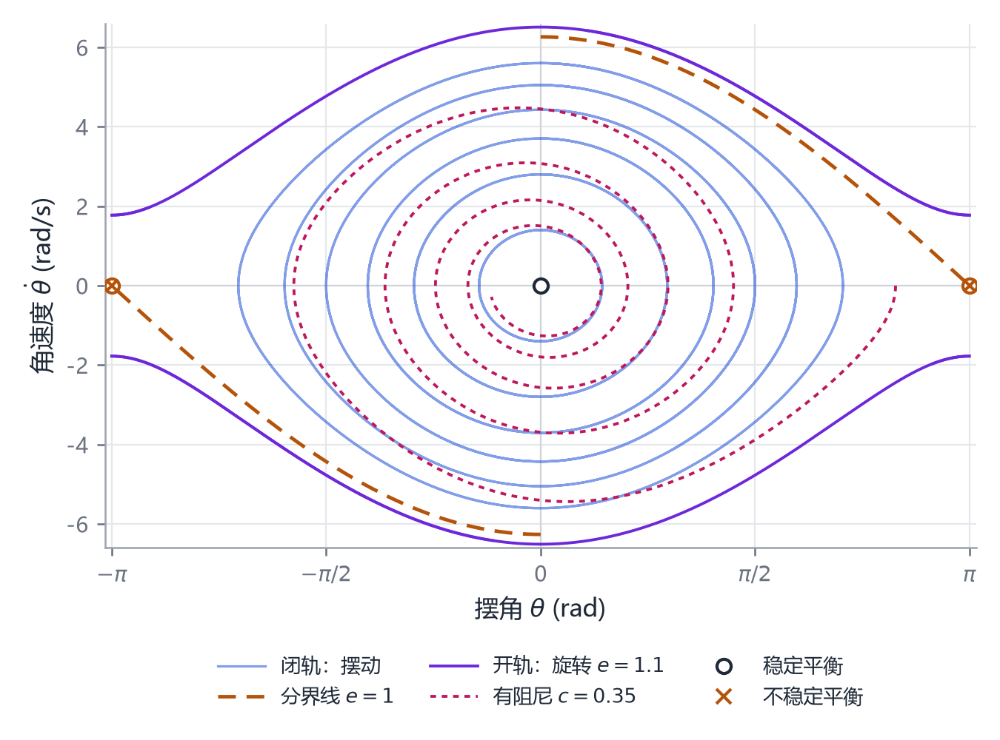
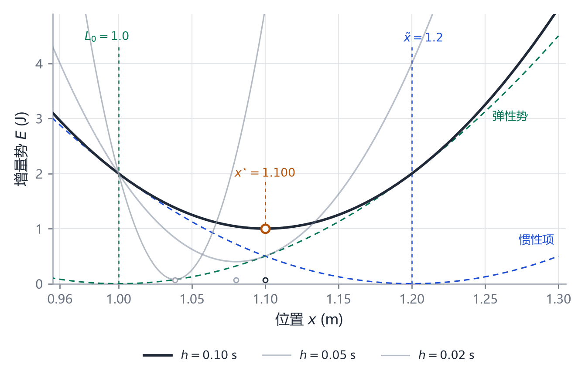
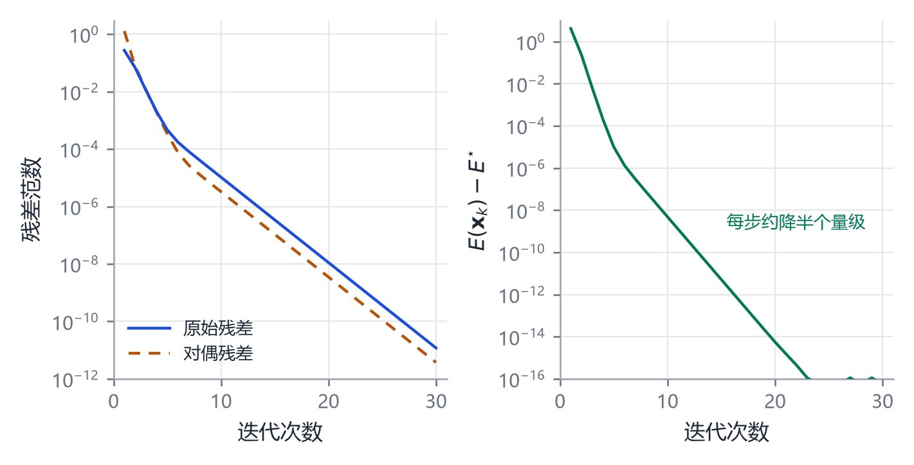

# 第 8 章 变分原理与最优化

> 本章导读：同一段运动可以有两种写法。一种是逐点平衡——每个质点上合力等于质量乘加速度；另一种是整体取极值——所有可能的轨迹里，真实的那条让某个积分取驻值。后一种写法在模拟里更耐用：它把时间积分变成最小化，把约束变成乘子，把接触变成投影。这一章从作用量出发，一路走到离散变分积分器和投影动力学。

## 8.1 作用量与拉格朗日量

牛顿的写法是逐点平衡。这种写法要求你知道所有力，包括约束力：一根杆拉住两个球，得先算出杆里的张力，才能写这两个球的方程。张力本身不是材料的属性，而是“距离不能变”这个要求的结果，先算它等于绕了一圈。

分析力学换个问法：在所有满足端点条件的轨迹里，真实的那条有什么整体性质。答案是作用量取驻值。作用量定义为拉格朗日量对时间的积分

$$
S[\mathbf{q}] = \int_{t_0}^{t_1} L(\mathbf{q}, \dot{\mathbf{q}}, t)\,dt ,
\tag{8.1}
$$

$\mathbf{q}$ 是广义坐标，可以是位置、角度、或者任何能唯一确定位形的一组数；$\dot{\mathbf{q}}$ 是它的时间导数；$S$ 是一个泛函，输入一整条轨迹，输出一个数。式 (8.1) 里的积分说明它不是逐点判断，而是对整段运动打分。

拉格朗日量取动能减势能

$$
L(\mathbf{q}, \dot{\mathbf{q}}) = T(\dot{\mathbf{q}}) - V(\mathbf{q}) ,
\tag{8.2}
$$

$T$ 是动能，$V$ 是势能，两者都是能量，所以 $L$ 也是能量，量纲是焦耳。这个“减”看起来不讲道理，因为直觉上总能量该是 $T+V$。检验的办法是算一遍再对答案，看它能不能给出正确的运动方程。

拿单摆验。摆长 $l$，质量 $m$，摆角 $\theta$ 从竖直向下量起。动能是 $\tfrac12 m l^2\dot{\theta}^2$，势能（以最低点为零）是 $mgl(1-\cos\theta)$，于是

$$
L = \frac{1}{2}ml^2\dot{\theta}^2 - mgl(1-\cos\theta)
= \frac{1}{2}ml^2\dot{\theta}^2 + mgl\cos\theta - mgl .
\tag{8.3}
$$

最后那个常数 $mgl$ 对运动没有影响，因为作用量里加减常数不改变驻点，通常直接丢掉，得到 $L = \tfrac12 ml^2\dot{\theta}^2 + mgl\cos\theta$。注意第二项是正的：势能越低，$L$ 越大。

如果式 (8.2) 取成 $T + V$，单摆的 $L$ 就会变成 $\tfrac12ml^2\dot{\theta}^2 - mgl\cos\theta$，下一节算出方程时符号会反，摆会往上跑。这个符号不是约定问题，是可检验的对错。

## 8.2 欧拉-拉格朗日方程

驻值条件怎么算？思路是扰动。取一条候选轨迹 $\mathbf{q}(t)$，给它加一个小扰动 $\epsilon\boldsymbol{\eta}(t)$，其中 $\boldsymbol{\eta}$ 在两端为零（起点和终点固定，扰动不能改端点）。真实的轨迹要求作用量对任意这样的扰动一阶不变

$$
\left.\frac{d}{d\epsilon}S[\mathbf{q} + \epsilon\boldsymbol{\eta}]\right|_{\epsilon=0} = 0 .
\tag{8.4}
$$

把式 (8.1) 代进去，被积函数有两处依赖 $\epsilon$：一处通过 $\mathbf{q}$，一处通过 $\dot{\mathbf{q}}$。展开到一阶

$$
\delta S = \int_{t_0}^{t_1}\left(
\frac{\partial L}{\partial \mathbf{q}}\cdot\boldsymbol{\eta}
+ \frac{\partial L}{\partial \dot{\mathbf{q}}}\cdot\dot{\boldsymbol{\eta}}
\right)dt .
\tag{8.5}
$$

第二项里 $\dot{\boldsymbol{\eta}}$ 不好处理，用分部积分把它转成 $\boldsymbol{\eta}$

$$
\int_{t_0}^{t_1}\frac{\partial L}{\partial \dot{\mathbf{q}}}\cdot\dot{\boldsymbol{\eta}}\,dt
= \left[\frac{\partial L}{\partial \dot{\mathbf{q}}}\cdot\boldsymbol{\eta}\right]_{t_0}^{t_1}
- \int_{t_0}^{t_1}\frac{d}{dt}\left(\frac{\partial L}{\partial \dot{\mathbf{q}}}\right)\cdot\boldsymbol{\eta}\,dt .
\tag{8.6}
$$

边界项为零，因为 $\boldsymbol{\eta}(t_0)=\boldsymbol{\eta}(t_1)=\mathbf{0}$——这正是要求扰动在端点为零的用处。剩下的积分对任意 $\boldsymbol{\eta}$ 都为零，被积函数必须恒为零

$$
\frac{d}{dt}\left(\frac{\partial L}{\partial \dot{\mathbf{q}}}\right)
- \frac{\partial L}{\partial \mathbf{q}} = \mathbf{0} ,
\tag{8.7}
$$

这就是欧拉-拉格朗日方程，每个广义坐标一个。它的结构很特别：左边第一项是“动量对时间的导数”，第二项是“广义力”，整个式子说的是广义动量守恒（在没有对应广义力时）。

代回单摆。$\partial L/\partial\dot\theta = ml^2\dot\theta$，$\partial L/\partial\theta = -mgl\sin\theta$，代入式 (8.7) 得

$$
ml^2\ddot{\theta} + mgl\sin\theta = 0
\quad\Longrightarrow\quad
\ddot{\theta} = -\frac{g}{l}\sin\theta .
\tag{8.8}
$$

结果是对的。整个过程里没有出现张力：摆绳的拉力垂直于速度，不做功，所以不出现在能量里，也就不会出现在方程里。约束力被自动消掉了，这是分析力学相对牛顿写法最实际的便利——物体越多、约束越复杂，这个便利越明显。

式 (8.8) 里的 $ml^2$ 是转动惯量，$mgl\sin\theta$ 是重力矩。把它和牛顿写法对照，能看出两种语言如何互译：$\partial L/\partial\dot\theta$ 对应动量，$d/dt$ 对应惯性项，$\partial L/\partial\theta$ 对应广义力。多体系统的拉格朗日量就是各自动能之和减去总势能，写出来代进式 (8.7)，得到的就是那套熟悉的 $\mathbf{M}\mathbf{a} = \mathbf{f}$。

有一点必须提前说明：欧拉-拉格朗日方程只描述保守系统。阻尼、摩擦、塑性耗散都不来自某个势函数，写不进式 (8.2)。工程上的处理是加一个 Rayleigh 耗散项 $R = \tfrac12\mathbf{c}\dot{\mathbf{q}}^2$，把 $-\partial R/\partial\dot{\mathbf{q}}$ 添到方程右边；或者干脆承认这一项是“外力”，回到逐点平衡的写法。这个缺口在后面几节会反复出现：凡是带耗散的结论，都不能简单套用变分框架。

## 8.3 哈密顿力学与辛结构

做一次变量替换，把二阶方程降成一阶方程组，能看出另一层结构。定义共轭动量

$$
\mathbf{p} = \frac{\partial L}{\partial \dot{\mathbf{q}}} ,
\tag{8.9}
$$

对单摆就是 $p = ml^2\dot\theta$，即角动量。再定义哈密顿量

$$
H(\mathbf{q}, \mathbf{p}) = \mathbf{p}\cdot\dot{\mathbf{q}} - L ,
\tag{8.10}
$$

这个变换叫勒让德变换。对绝大多数力学系统，$H$ 恰好等于总能量 $T + V$：单摆的 $H = p^2/(2ml^2) - mgl\cos\theta$，第一项是动能，第二项是势能（差一个常数）。式 (8.10) 里那个“减 $L$”不是随手写的，它保证 $H$ 只依赖 $\mathbf{q}$ 和 $\mathbf{p}$，不再显含 $\dot{\mathbf{q}}$。

把 $H$ 微分一遍并和 $L$ 的微分对照，能得到一对对称的方程

$$
\dot{\mathbf{q}} = \frac{\partial H}{\partial \mathbf{p}},\qquad
\dot{\mathbf{p}} = -\frac{\partial H}{\partial \mathbf{q}} .
\tag{8.11}
$$

第一行说位置的变化率由动量决定，第二行说动量的变化率由势能的梯度决定。两行合起来写成一个式子

$$
\dot{\mathbf{z}} = \mathbf{J}\,\nabla H(\mathbf{z}),\qquad
\mathbf{z} = \begin{bmatrix}\mathbf{q}\\ \mathbf{p}\end{bmatrix},\qquad
\mathbf{J} = \begin{bmatrix}\mathbf{0} & \mathbf{I}\\ -\mathbf{I} & \mathbf{0}\end{bmatrix},
\tag{8.12}
$$

$\mathbf{z}$ 是相空间里的点，维数是广义坐标的两倍；$\mathbf{J}$ 是常数矩阵，只由“哪些是位置、哪些是动量”决定，与具体系统无关。这个矩阵满足 $\mathbf{J}^{\mathsf{T}} = -\mathbf{J}$，它定义了一个辛形式。

辛形式带来一个守恒量：相空间的体积。把式 (8.12) 看成速度场，它的散度是 $\nabla\cdot(\mathbf{J}\nabla H) = 0$（因为 $\mathbf{J}$ 反对称），散度为零意味着流不可压缩，这就是刘维尔定理。二维情形下，它退化成“相面积守恒”：任何一团初始状态，随时间演化，形状会扭曲拉伸，面积不变。

<figure class="fig">

<figcaption><b>图 8-1</b>　单摆的相空间，横轴摆角、纵轴角速度，参数 $l=1$ m、$g=9.81$ m/s²，各条轨迹由 RK4 以 $\Delta t=10^{-3}$ s 积分得到。归一化能量 $e = E/(mgl)$ 取 $-0.9$ 到 $0.6$ 时是闭合的环，摆只在一个角度范围内往复；$e=1$ 是分界线，从 $(0,\pm 2\sqrt{g/l})$ 出发恰好停在倒立位置；$e=1.1$ 的两条开轨越过 $\theta=\pm\pi$，摆整圈旋转。粉色虚线是加了 $c=0.35$ 阻尼的轨迹，从 $(\theta,\dot\theta)=(2.6,0)$ 出发向内螺旋，最终停在原点。</figcaption>
</figure>

图 8-1 把上面几个概念摆在了同一张纸上。闭合的环是等能线，一圈就是摆往复一次；环越靠内，周期越接近 $2\pi\sqrt{l/g}$，越靠外周期越长，靠近分界线时发散到无穷——这就是单摆周期随振幅变化的原因。分界线把“往复”与“旋转”两种运动分开，它是同宿轨道，两端都连到倒立平衡点。倒立点本身是鞍点，稳定流形与不稳定流形在这里相接。

这张图对数值方法的意义在于：相空间是判断积分器好坏的放大镜。显式 Euler 每步把点沿切线推出去，面积会越推越大，轨迹向外螺旋；后向 Euler 反过来向内螺旋，把面积压小。两者都破坏了辛结构，区别只是放大还是缩小。辛积分器的每一步都是相空间的保面积映射，能量误差不累积，只在真值附近振荡，轨迹看起来就像画在了一条带上。

辛映射的定义很干脆：一个映射 $\Phi$ 是辛的，如果它的雅可比 $\mathbf{M}$ 满足

$$
\mathbf{M}^{\mathsf{T}}\mathbf{J}\mathbf{M} = \mathbf{J} .
\tag{8.13}
$$

这个条件比“保能量”弱，但更有用。保能量的积分器很难构造，而且一旦能量有微小误差就再也不会回来；保辛的积分器不保能量，但它把误差限制在振荡里，不漂移。对长时间模拟，后者的行为更接近真实系统。

## 8.4 约束怎么进作用量

7.4 里约束是通过 KKT 条件进方程的。在变分框架里，它有更自然的入口：约束乘子不是常数，而是时间的函数 $\lambda(t)$，把它和被约束的量一起放进作用量

$$
S[\mathbf{q}, \boldsymbol{\lambda}] = \int_{t_0}^{t_1}\left[L(\mathbf{q},\dot{\mathbf{q}})
+ \boldsymbol{\lambda}^{\mathsf{T}}\mathbf{C}(\mathbf{q})\right]dt .
\tag{8.14}
$$

对 $\mathbf{q}$ 变分，$\boldsymbol{\lambda}^{\mathsf{T}}\mathbf{C}$ 这一项贡献 $\mathbf{J}_c^{\mathsf{T}}\boldsymbol{\lambda}$，方程右边多出一个广义力；对 $\boldsymbol{\lambda}$ 变分，得到 $\mathbf{C}(\mathbf{q})=\mathbf{0}$。两件事一次做完：约束力被解出来，约束本身也被满足。这与 7.4 的 KKT 条件完全一致，区别只在于这里是连续时间的写法，离散之后乘子变成一个数（每个约束每个时间步一个）。

乘子法的代价是系统变成鞍点问题，$\boldsymbol{\lambda}$ 的符号不受约束，求解器要处理不定矩阵。另一条路是把约束当成一根很硬的弹簧，直接从能量里罚

$$
L_k = L - \frac{1}{2}k\left\lVert\mathbf{C}(\mathbf{q})\right\rVert^2 ,
\tag{8.15}
$$

$k$ 是罚刚度。这样方程里不再有额外的未知数，代价是约束只能近似满足：稳态误差大约是 $k^{-1}$ 量级。要让误差小，$k$ 就得大；$k$ 一大，系统的最高频率变成 $\sqrt{k/m}$，显式积分的步长被压到 $\Delta t \lt 2/\sqrt{k/m}$，同时刚度矩阵的条件数也随 $k$ 线性变差。这就是罚函数在实时模拟里“好用但不敢用大”的原因。

增广拉格朗日把两者合起来。它在罚项之外保留乘子，并且让乘子迭代更新

$$
L_{\text{AL}} = L + \boldsymbol{\lambda}^{\mathsf{T}}\mathbf{C} - \frac{1}{2}k\left\lVert\mathbf{C}\right\rVert^2 ,
\qquad
\boldsymbol{\lambda} \leftarrow \boldsymbol{\lambda} + k\,\mathbf{C} .
\tag{8.16}
$$

更新式的作用是：这一轮没满足的约束，下一轮用更大的乘子补上。迭代收敛后 $\mathbf{C}\to\mathbf{0}$，而 $k$ 不必取得很大，条件数也就不会爆掉。代价是要多存一份 $\boldsymbol{\lambda}$，并且需要多轮迭代。

XPBD 里的柔度写法就是式 (8.16) 的离散版本 [@macklin2016]。它把约束写成 $\tilde\alpha\,\Delta\lambda = -C - \tilde\alpha\,\lambda$，$\tilde\alpha = 1/(kh^2)$ 是柔度。$\tilde\alpha$ 为零时是硬约束，每一步都精确投影；$\tilde\alpha$ 大于零时，$\lambda$ 的更新里带着上一轮的值，正是增广拉格朗日的结构。这个改写让“约束的软硬”变成一个可以直接调的参数，而不需要改迭代次数。

三种处理放在一起看，取舍很清楚。乘子法精确，但系统不定、实现复杂；罚函数简单，但刚度与步长绑死；增广拉格朗日两头兼顾，代价是多一层迭代。实时应用里见得多的是第三种和它的变体，因为它的收敛行为对参数不敏感。

## 8.5 隐式积分就是在最小化增量势

回到式 (7.2)。把合力写成势能的负梯度，$\mathbf{f} = -\nabla V(\mathbf{x})$，后向 Euler 的方程变成

$$
\frac{\mathbf{M}}{h^2}\left(\mathbf{x} - \tilde{\mathbf{x}}\right) + \nabla V(\mathbf{x}) = \mathbf{0} ,
\tag{8.17}
$$

$h$ 是步长，$\tilde{\mathbf{x}} = \mathbf{x}_n + h\mathbf{v}_n$ 是惯性预测位置。这个式子的左边，恰好是下面这个函数的梯度

$$
E(\mathbf{x}) = \frac{1}{2h^2}\left(\mathbf{x}-\tilde{\mathbf{x}}\right)^{\mathsf{T}}\mathbf{M}
\left(\mathbf{x}-\tilde{\mathbf{x}}\right) + V(\mathbf{x}) ,
\tag{8.18}
$$

求导得 $\nabla E = \mathbf{M}(\mathbf{x}-\tilde{\mathbf{x}})/h^2 + \nabla V$，与式 (8.17) 逐项相同。所以解隐式积分一步，等于最小化式 (8.18)。这个函数叫增量势：第一项是“这一帧移动了多少”的代价，权重是质量除以步长平方；第二项是材料的弹性能。

<figure class="fig">

<figcaption><b>图 8-2</b>　一维弹簧的增量势，参数 $m=1$ kg、$k=100$ N/m、$L_0=1$ m、$x_n=1$ m、$v_n=2$ m/s。黑色实线是 $h=0.1$ s 时的总势能，蓝色虚线是惯性项 $\frac{m}{2h^2}(x-\tilde x)^2$，绿色虚线是弹性能 $\frac{k}{2}(x-L_0)^2$；两条虚线之和就是实线，极小点在 $x^\star=1.100$。灰线是同一问题在 $h=0.05$ s 与 $h=0.02$ s 下的总势能，极小点分别移到 1.080 与 1.038，底部的三个小圈是它们的位置。</figcaption>
</figure>

一维的情形可以手算。总能量是两个抛物线之和，极小点满足

$$
x^\star = \frac{x_n + hv_n + \dfrac{kh^2}{m}L_0}{1 + \dfrac{kh^2}{m}} ,
\tag{8.19}
$$

分子里第一、二项给出惯性预测位置 $\tilde x$，第三项把解往弹簧的静止长度拉。图 8-2 的参数代进去：$kh^2/m = 100\times0.01 = 1$，于是 $x^\star = (1+0.2+1)/2 = 1.100$，与图上标的一致。

这个式子里藏着两个值得记住的极限。$h$ 很小时，$kh^2/m \to 0$，$x^\star \to x_n + hv_n$，也就是位置几乎按旧速度平移，弹簧来不及起作用——这不是“误差”，是物理：时间太短，弹簧的力还推不动质量。$h$ 很大或 $k$ 很大时，$kh^2/m \gg 1$，$x^\star \to L_0$，位置直接被拉到弹簧静止长度，惯性被忽略。实时模拟常用 $h=1/60$ s、$k=100$ N/m，$kh^2/m \approx 0.028$，$x^\star$ 与 $\tilde x$ 只差千分之一，惯性项完全主导。

把求根改写成最小化，好处不只是换一种说法。最小化问题有一整套现成的工具：线搜索可以保证每步能量下降，因此迭代不会发散；信赖域能处理非凸的能量面；拟牛顿法只需要梯度；加了约束就变成带约束的优化，直接接回第 7 章的 KKT 条件。更重要的是，能量本身是一个可以监控的量：残差下降不一定意味着物理合理，能量下降才意味着这一步没有凭空造出运动 [@gast2015]。

前提也得说清楚。式 (8.17) 要求 $\mathbf{f}$ 是某个势的梯度。弹性、重力、约束力满足这个要求；阻尼力 $-\mathbf{c}\dot{\mathbf{x}}$ 不满足，但它可以被写成耗散项，只要步长足够小，增量势里加一个近似的耗散势仍然能保持下降性。真正麻烦的是碰撞与摩擦：它们不可微，增量势在这些点上没有定义，需要分段处理，或者退回到速度级的互补问题。

## 8.6 投影动力学：把能量拆成局部项

式 (8.18) 的最小化，对一般材料并不好做：弹性能是位置的高次函数，海森矩阵每步都变。投影动力学（PD）换了一种拆法，把总能量写成若干个局部项之和

$$
E(\mathbf{x}) = \frac{1}{2h^2}\left(\mathbf{x}-\tilde{\mathbf{x}}\right)^{\mathsf{T}}\mathbf{M}
\left(\mathbf{x}-\tilde{\mathbf{x}}\right)
+ \sum_i \frac{w_i}{2}\left\lVert\mathbf{A}_i\mathbf{x} - \mathbf{p}_i\right\rVert^2 ,
\tag{8.20}
$$

$\mathbf{A}_i$ 是一个线性算子，把全局位置映射成第 $i$ 个单元的局部量（边长、面积、二面角），$w_i$ 是权重（刚度乘步长平方），$\mathbf{p}_i$ 是这一项希望局部量取的值。关键在于 $\mathbf{p}_i$ 不是常数，它由当前构型投影出来

$$
\mathbf{p}_i = \operatorname{proj}_i(\mathbf{A}_i\mathbf{x}) ,
\tag{8.21}
$$

投影算子对每个单元单独算：三角形要它保持面积，就算出面积最接近目标的那个形状；弹簧要它保持长度，就把两端沿连线挪到目标距离。投影是闭式的、逐单元的，代价很小。

固定 $\mathbf{p}_i$ 之后，式 (8.20) 对 $\mathbf{x}$ 是二次的，最小值由一个线性系统给出

$$
\left(\frac{\mathbf{M}}{h^2} + \sum_i w_i\mathbf{A}_i^{\mathsf{T}}\mathbf{A}_i\right)\mathbf{x} = \mathbf{b},
\tag{8.22}
$$

右端 $\mathbf{b}$ 含惯性项与投影结果。左边这个矩阵与构型无关，只与网格拓扑、质量、权重有关。这个性质是 PD 的核心：分解可以做一次，之后每一步只做回代；而传统隐式积分每一步都要重新组装、重新分解，因为刚度矩阵随形变变化。

算法因此变成两步循环：局部步用式 (8.21) 更新所有 $\mathbf{p}_i$，全局步用式 (8.22) 解一次稀疏系统。这个交替在数学上是块坐标下降——固定一组变量优化另一组，每轮都让总能量下降，所以不会发散。收敛速度取决于局部项之间的耦合强度：网格越刚、连接越密，收敛越慢，实际用十来次迭代能把残差压下去。

<figure class="fig">

<figcaption><b>图 8-3</b>　用 ADMM 求解一根 10 节点的弹簧链，目标是最小化 $\frac12\lVert\mathbf{x}-\tilde{\mathbf{x}}\rVert^2 + \frac{k}{2}\sum_i(x_{i+1}-x_i-L_0)^2$，参数 $k=100$ N/m、$L_0=1$ m、$\tilde x_i = 0.9i$ m、罚参数 $\rho=10$。左图是原始残差 $\lVert\mathbf{D}\mathbf{x}-\mathbf{d}\rVert$ 与对偶残差 $\lVert\rho\mathbf{D}^{\mathsf{T}}(\mathbf{d}-\mathbf{d}^{\text{old}})\rVert$ 的半对数曲线，每步降到约四分之一。右图是目标值与最优值之差，11 步内从 4.1 降到 $3\times10^{-10}$，之后在 $10^{-16}$ 附近停住，那是双精度的舍入底。</figcaption>
</figure>

投影动力学与 ADMM 是同一个东西的两种写法。ADMM 解的是

$$
\min_{\mathbf{x},\mathbf{z}} f(\mathbf{x}) + g(\mathbf{z})
\quad\text{s.t.}\quad \mathbf{A}\mathbf{x} = \mathbf{z},
\tag{8.23}
$$

它的迭代由三步组成：$\mathbf{x}$ 步最小化 $f$ 加上增广项，$\mathbf{z}$ 步最小化 $g$ 加上增广项，最后更新对偶变量

$$
\mathbf{x}^{k+1} = \arg\min_{\mathbf{x}} f(\mathbf{x}) + \frac{\rho}{2}\left\lVert\mathbf{A}\mathbf{x} - \mathbf{z}^k + \mathbf{u}^k\right\rVert^2 ,
$$
$$
\mathbf{z}^{k+1} = \arg\min_{\mathbf{z}} g(\mathbf{z}) + \frac{\rho}{2}\left\lVert\mathbf{A}\mathbf{x}^{k+1} - \mathbf{z} + \mathbf{u}^k\right\rVert^2 ,
\qquad
\mathbf{u}^{k+1} = \mathbf{u}^k + \mathbf{A}\mathbf{x}^{k+1} - \mathbf{z}^{k+1} .
\tag{8.24}
$$

把 $g$ 取成“局部量必须落在可行集内”的指示函数，$\mathbf{z}$ 步就变成往可行集上的投影，$\mathbf{x}$ 步是一个与式 (8.22) 同形的线性系统。所以 PD 的局部–全局交替不是启发式，是 ADMM 在特定分裂下的展开 [@bouaziz2014]；图 8-3 那条残差曲线，就是 ADMM 在这个分裂下的收敛速度。

这条曲线的形状说明两件事。前几步下降得快，因为有大的局部违背需要修正；后面变成一条直线，是线性收敛，斜率由 $\rho$ 与耦合强度决定。$\rho$ 取得太小，$\mathbf{x}$ 步对约束的响应弱，收敛慢；取得太大，$\mathbf{z}$ 步的投影被压得太狠，同样慢。实践中 $\rho$ 常按单元刚度自适应，或者随迭代放大。

ADMM 之后还有别的分裂方式。把弹簧链按图着色分成互不耦合的组，每组内部并行投影，组间用 Jacobi 更新，这是并行版本 [@li2020]；把全局系统换成多重网格求解，能让大变形下的收敛不受网格规模影响 [@narain2016]。这些改进都在同一个框架里：能量拆成局部项，局部项各自投影，全局项用一个常数矩阵连起来。

## 8.7 离散变分积分器

前面几节把连续的作用量变成了离散的最小化。还有一条更彻底的路：直接从离散的作用量出发，让离散系统自己继承连续系统的结构。

做法是把作用量里的积分用一步的近似代替，拉格朗日量在中点取值

$$
L_d(\mathbf{q}_k, \mathbf{q}_{k+1}) = h\,L\left(
\frac{\mathbf{q}_k+\mathbf{q}_{k+1}}{2},\
\frac{\mathbf{q}_{k+1}-\mathbf{q}_k}{h}\right) ,
\tag{8.25}
$$

$h$ 是步长，$\mathbf{q}_k$ 是第 $k$ 步的广义坐标。式 (8.25) 用的是中点位置与平均速度，误差是 $O(h^3)$ 一步。离散作用量就是这些项的和 $S_d = \sum_k L_d$。

对离散作用量求驻值，得到离散欧拉-拉格朗日方程

$$
\mathbf{D}_2L_d(\mathbf{q}_{k-1},\mathbf{q}_k) + \mathbf{D}_1L_d(\mathbf{q}_k,\mathbf{q}_{k+1}) = \mathbf{0},
\tag{8.26}
$$

$\mathbf{D}_1$、$\mathbf{D}_2$ 分别是对第一个、第二个自变量求偏导。这个式子的形式与式 (8.7) 一一对应：连续情形是 $d/dt$ 作用在动量上，离散情形是“后一项对前一个位置的导数”加上“前一项对后一个位置的导数”。

把 $L = \tfrac12\dot{\mathbf{q}}^{\mathsf{T}}\mathbf{M}\dot{\mathbf{q}} - V(\mathbf{q})$ 代进去，会得到

$$
\mathbf{M}\frac{\mathbf{q}_{k+1} - 2\mathbf{q}_k + \mathbf{q}_{k-1}}{h^2}
= -\nabla V(\mathbf{q}_k) ,
\tag{8.27}
$$

这正是 Verlet。也就是说，Verlet 不是“凑出来”的二阶格式，它是中点离散作用量的驻点条件。这条线索解释了 Verlet 那些看起来碰巧的好性质：它保辛，因为离散作用量的驻点映射总是辛映射；它保动量，因为作用量对平移不变，离散 Noether 定理给出离散动量守恒。这些性质不依赖步长，也不依赖具体的时间长度。

离散 Noether 定理的内容和连续版本一样：作用量有一个连续对称性，就有一个守恒量。平移对称给出总动量守恒，旋转对称给出角动量守恒。区别在于，连续情形要求方程精确成立，离散情形只要求离散作用量在该变换下不变。Verlet 的动量守恒是精确的（在舍入误差内），这在实际模拟里很有用：一个自由飞行的物体不会因为积分格式而莫名加速。

代价在精度上。式 (8.25) 只有二阶精度，步长减半误差降四倍，想再高一阶就得换更复杂的离散拉格朗日量：用高阶多项式插值轨迹，或者用 Galerkin 方法在每步内解一个小边值问题。这些做法的精度可以到四阶甚至更高，但每一步都要解一个耦合的系统，代价比 Verlet 大一个量级。工程上很少用，除非问题本身对长期精度要求极高，比如天体力学。

选哪一种写法，取决于时间预算和能接受的误差。要长期稳定、不在乎每步成本，用辛积分器或变分积分器；要大时间步、能接受近似，用增量势最小化再加投影动力学；要处理成千上万个接触，还是得回到第 7 章的互补问题。三者的分界不在数学上，而在你能给多少毫秒。
