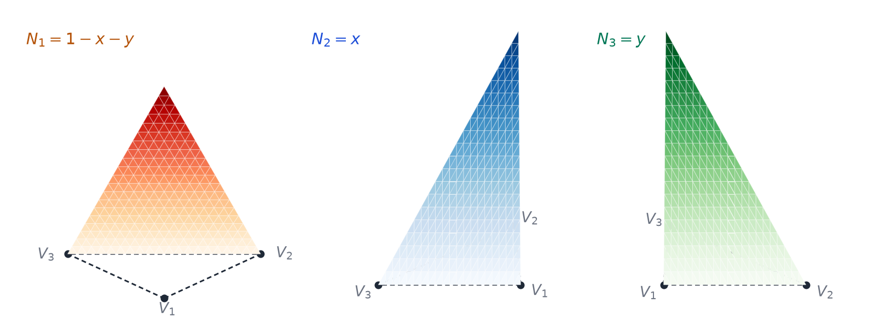
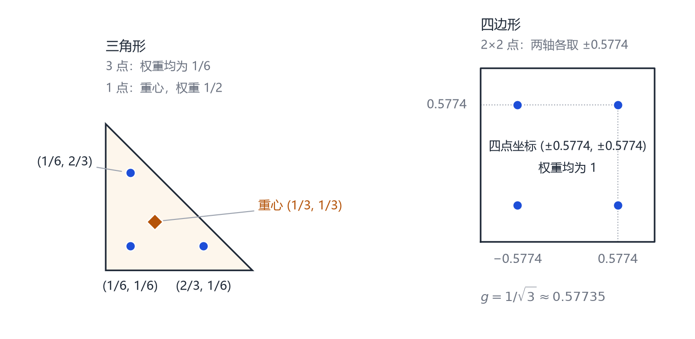
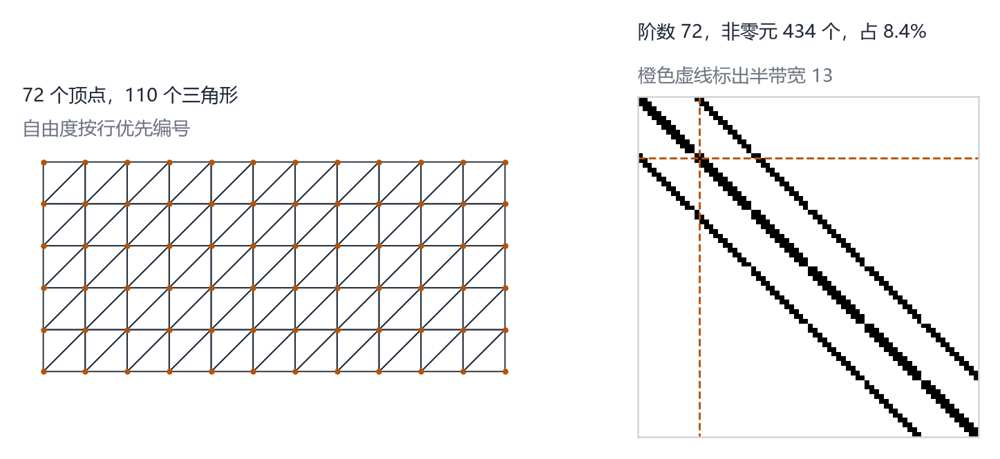

# 第 9 章 有限元数学：弱形式与形函数

> 本章导读：这一章讲有限元里真正承重的三段数学：为什么要把微分方程改写成积分形式、插值函数怎么选、积分点为什么能算准。读完你应该能看懂单元刚度矩阵是怎么算出来的，也能解释为什么有些网格很密却很硬、有些单元会出现沙漏。

## 9.1 从强形式到弱形式

一块硅胶被两根手指捏住，隐式步要算的下一个状态是平衡态：在这块体积里，内部应力产生的效果与外力和惯性项相互抵消。把它写成方程，就是

$$
-\nabla\cdot\boldsymbol{\sigma}(\mathbf{u})=\mathbf{f},
\tag{9.1}
$$

$\boldsymbol{\sigma}$ 是柯西应力张量，$\mathbf{u}$ 是位移场，$\mathbf{f}$ 是单位体积的外力（含重力与惯性项）。左边是应力场的散度，读作“这一小块物质四面八方的应力合起来还剩多少”，平衡时它必须被抵掉。

这个写法叫强形式。它要求 $\boldsymbol{\sigma}$ 在场内可微，而 $\boldsymbol{\sigma}$ 依赖应变，应变依赖位移的一阶导数，所以强形式实际上要求 $\mathbf{u}$ 有二阶导数。麻烦在于我们手上唯一方便构造的近似是分片线性的：三角形内部 $\mathbf{u}$ 是线性的，梯度在单元内是常数，跨越单元边时跳一下。它的二阶导数在单元内部是零，在单元边界上是无穷大，代回式 (9.1) 两边都不成立。这不是精度问题，是“根本不能代入”。

出路是把等式两边乘上一个测试函数 $\mathbf{w}$，再在整个区域上积分：

$$
\int_\Omega \big(-\nabla\cdot\boldsymbol{\sigma}\big)\cdot\mathbf{w}\,dV=\int_\Omega \mathbf{f}\cdot\mathbf{w}\,dV .
\tag{9.2}
$$

积分把一个逐点的要求换成了加权平均的要求。测试函数 $\mathbf{w}$ 的作用是“从哪个方向检查这个平衡”，它的选取决定了方程组的行。接着对左边做分部积分，把导数从应力身上挪到 $\mathbf{w}$ 身上：

$$
\int_\Omega \boldsymbol{\sigma}:\nabla\mathbf{w}\,dV-\int_{\partial\Omega}(\boldsymbol{\sigma}\mathbf{n})\cdot\mathbf{w}\,dS=\int_\Omega \mathbf{f}\cdot\mathbf{w}\,dV ,
\tag{9.3}
$$

$\mathbf{n}$ 是边界外法向，$\partial\Omega$ 是整个边界，冒号表示两个张量的双点积（对应分量相乘再求和）。这一步是全部的技巧：应力只需要一阶导数，而 $\mathbf{w}$ 承担了另一份一阶导数，两边各掉一层，分片线性的 $\mathbf{u}$ 就能代入了。

边界上那一项要拆开处理。边界分成两段：位移给定的那一段记作 $\Gamma_D$，力给定的那一段记作 $\Gamma_t$。在 $\Gamma_t$ 上，$\boldsymbol{\sigma}\mathbf{n}$ 就是给定的面力 $\mathbf{t}$，是已知量，移到右边去；在 $\Gamma_D$ 上，我们要求测试函数取零，$\mathbf{w}=0$，该项自动消失。于是得到

$$
\underbrace{\int_\Omega \boldsymbol{\sigma}(\mathbf{u}):\nabla\mathbf{w}\,dV}_{a(\mathbf{u},\mathbf{w})}
=\underbrace{\int_\Omega \mathbf{f}\cdot\mathbf{w}\,dV+\int_{\Gamma_t}\mathbf{t}\cdot\mathbf{w}\,dS}_{l(\mathbf{w})}.
\tag{9.4}
$$

$a(\cdot,\cdot)$ 叫双线性形式，它对两个自变量都是线性的；$l(\cdot)$ 叫线性泛函。式 (9.4) 的意思是：对任意一个测试函数 $\mathbf{w}$，这个积分等式都成立。这就是弱形式，“弱”指的是对解的光滑性要求降低了。

两种边界条件的地位完全不同。面力条件是“自然”的：它直接进右端项，不需要额外处理。位移条件是“本质”的：必须通过限制试探空间来实现——挑出满足 $\mathbf{u}=\bar{\mathbf{u}}$ 的函数当作候选，相应地让测试函数在该边界上取零。这条区别到实现时会变成两种截然不同的代码：前者什么也不用做，后者要改矩阵。

接下来把连续问题离散化。取一组基函数 $N_1,\dots,N_n$，令

$$
\mathbf{u}_h=\sum_{j=1}^{n}u_j\mathbf{N}_j,\qquad \mathbf{w}=\mathbf{N}_i ,
\tag{9.5}
$$

$u_j$ 是待求的节点位移，$\mathbf{N}_j$ 是第 $j$ 个基函数（每个基函数是一个只在节点 $j$ 附近非零的分片多项式）。把式 (9.5) 代入式 (9.4)，对每个 $i$ 都要求成立，就得到线性方程组

$$
\mathbf{K}\mathbf{u}=\mathbf{b},\qquad K_{ij}=a(\mathbf{N}_j,\mathbf{N}_i),\qquad b_i=l(\mathbf{N}_i).
\tag{9.6}
$$

式 (9.6) 就是模拟器里那个 $\mathbf{K}$。它是对称的，因为 $a(\cdot,\cdot)$ 对称；它是稀疏的，因为 $\mathbf{N}_i$ 与 $\mathbf{N}_j$ 只在共享一个单元时才有重叠的支集。所谓“组装”，无非是把每个单元贡献的那一小块加进全局矩阵。

还有一个等价的看法。对超弹性材料，式 (9.6) 的解就是总势能

$$
\Pi(\mathbf{u})=\frac{1}{2}\int_\Omega \boldsymbol{\varepsilon}:\boldsymbol{\sigma}\,dV-\int_\Omega \mathbf{f}\cdot\mathbf{u}\,dV-\int_{\Gamma_t}\mathbf{t}\cdot\mathbf{u}\,dS
\tag{9.7}
$$

对 $\mathbf{u}$ 求导置零的结果。$\boldsymbol{\varepsilon}$ 是应变。所以“解弱形式”和“最小化能量”是同一件事，隐式步的每一步都在解一个最小化问题。这条等价关系在讲投影动力学时还会再用一次：能量拆成若干平方项，每项单独求极小，交替投影就能大步长前进。

## 9.2 两个函数空间的直观含义

式 (9.4) 里出现了 $\int\boldsymbol{\sigma}:\nabla\mathbf{w}$，要让这个积分有意义，$\nabla\mathbf{w}$ 至少要平方可积。这就引出了两个空间。

$L^2(\Omega)$ 是平方可积函数的集合，配上范数

$$
\|u\|_{L^2}=\Big(\int_\Omega |u|^2\,dV\Big)^{1/2},
\tag{9.8}
$$

读作“这个函数的能量有多大”。一个函数可以属于 $L^2$ 但在某条线上跳变，只要跳变不占体积；分片线性函数的梯度跳变正好属于这类。

$H^1(\Omega)$ 在 $L^2$ 的基础上多要求一阶导数也平方可积：

$$
\|u\|_{H^1}^2=\|u\|_{L^2}^2+\|\nabla u\|_{L^2}^2 .
\tag{9.9}
$$

在二维和三维，$H^1$ 里的函数不允许有跳变，但允许有折痕——导数可以跳。分片线性函数正好落在这条线上：连续，梯度在每个单元内是常数、跨边跳。这就是为什么有限元用 $C^0$ 连续的分片多项式，而不用 $C^1$。

应变能是 $\frac{1}{2}\int\boldsymbol{\varepsilon}:\boldsymbol{\sigma}\,dV$，线弹性下它正比于 $\int|\nabla\mathbf{u}|^2$。所以“应变能有限”与“$\mathbf{u}\in H^1$”是同一句话。

弱解的存在性有一个干净的判据：Lax-Milgram 引理。它要求双线性形式 $a$ 连续且强制（存在常数使 $a(\mathbf{u},\mathbf{u})\ge \alpha\|\mathbf{u}\|^2$）。弹性问题在给定足够位移边界时满足强制条件，靠的是 Korn 不等式：应变能控制住了整个位移梯度，而不只是它的对称部分。

强制条件失效时会怎样，这一点比定理本身有用。全部边界都是自由面时，$a(\mathbf{u},\mathbf{u})$ 对刚体运动（平移加旋转）是零，$\mathbf{K}$ 奇异，解不唯一。模拟里所谓的“物体漂了”“解出来整体转了个角度”，正是这个零空间在作怪。处理办法要么是加三个以上的约束钉住刚体模态，要么是加一个小的对角项把零空间抬起来。前者干净，后者省事但有代价。

另一类失效来自奇异载荷。把集中力加在一个顶点上，二维弹性下梯度按 $1/r$ 增长，$\int|\nabla u|^2$ 在 $r\to 0$ 时对数发散，解根本不在 $H^1$ 里。后果不是“算不出来”，而是收敛变慢：均匀加密网格，误差按 $h^\alpha$（$\alpha \lt 1$）下降而不是 $h^2$。凹角、裂纹尖端、材料界面上有同一回事。

## 9.3 形函数

现在具体构造基函数。取一个参考三角形，顶点 $(0,0)$、$(1,0)$、$(0,1)$，坐标为 $(\xi,\eta)$，三个线性形函数直接写出来：

$$
N_1=1-\xi-\eta,\qquad N_2=\xi,\qquad N_3=\eta .
\tag{9.10}
$$

它们各自在对应顶点取 1、在对边上取 0，单元内部线性过渡。图 9-1 把三个函数画成了曲面：每张都是一个倾斜的平面，峰值落在不同的角上。

<figure class="fig">

<figcaption><b>图 9-1</b>　参考三角形上三个线性形函数的图像。每张曲面都是平面，在对应顶点取 1、在对边上取 0，虚线是参考三角形本身。三项相加恒等于 1，这是“单位分解”；在顶点 $j$ 处等于 1、在其余顶点处等于 0，这是“插值性”。两条性质合起来保证了常数场可以被精确表示。</figcaption>
</figure>

这三项满足单位分解与插值性，又都是线性的，所以形如 $a+bx+cy$ 的场可以被精确表示，这个性质叫线性完备。直接的后果是单元内部的应变是常数（线性场的梯度是常数），这类单元因此叫常应变三角形。

四边形单元用双线性函数。参考单元取正方形 $[-1,1]^2$，四个形函数是

$$
N_k=\frac{1}{4}(1+\xi_k\xi)(1+\eta_k\eta),
\tag{9.11}
$$

$(\xi_k,\eta_k)$ 是第 $k$ 个角点的参考坐标，取 $(\pm1,\pm1)$。每个 $N_k$ 是双线性的而不是线性的：里面有 $\xi\eta$ 项，能表示“沿两个方向都变化”的场，但也正因为这个交叉项，它在任意方向上都不是线性的。四边形的弯曲行为比三角形好，一部分原因就在这里。

四面体把式 (9.10) 直接再加一维：$N_1=1-\xi-\eta-\zeta$，$N_2=\xi$，$N_3=\eta$，$N_4=\zeta$。六面体则是式 (9.11) 的三维版本，八个形函数。这几种单元在图形学里出现频率差别很大：三角形和四面体几乎统治了一切，因为容易生成、容易处理拓扑变化 [@sifakis2012]；四边形和六面体精度更高，但网格生成麻烦，形状一被拉歪性能就掉得很快。

插值函数拼起来之后是 $C^0$ 的。证明很短：两个相邻三角形共享一条边，在这条边上，第三个顶点对应的形函数恒为零，剩下的两项只依赖这条边上的两个顶点值，所以两侧的限制完全一致。这条性质也是 9.6 节讨论锁死时的一个伏笔——$C^0$ 意味着法向梯度跨边跳，弯曲刚度就不在单元内部，得靠额外手段补。

插值误差有一个标准估计：如果真解足够光滑（$\mathbf{u}\in H^2$），那么

$$
\|\mathbf{u}-\mathbf{u}_h\|_{H^1}\le C\,h\,|\mathbf{u}|_{H^2},
\tag{9.12}
$$

$h$ 是单元的特征尺寸，$C$ 是不依赖网格的常数，$|\cdot|_{H^2}$ 只算二阶导数那一部分。翻译过来：网格缩小一半，位移和应变的误差一起减半，也就是一阶收敛。注意这个估计默认了单元形状“不太歪”——细长比极大的单元会让 $C$ 变得很大，误差照样下不去。这条限制在模拟里非常实际：大变形把网格拉成长条之后，不仅条件数变差，插值精度本身也掉了。

## 9.4 等参映射与高斯积分

参考单元形状规整，实际网格里的单元却歪七扭八。连接两者的桥梁是一个映射 $\mathbf{x}(\xi,\eta)$。等参单元的做法是：几何也用形函数插值，

$$
\mathbf{x}(\xi,\eta)=\sum_{k}x_k\,\mathbf{N}_k(\xi,\eta),
\tag{9.13}
$$

$x_k$ 是单元角点的坐标。用同一组函数描述几何和场，就是“等参”两个字的来历。好处是曲面边界可以被精确表示，代价是积分要在参考坐标里做，必须带上雅可比。

雅可比矩阵是 $J=\partial\mathbf{x}/\partial\boldsymbol{\xi}$，它的行列式 $|J|$ 是面积（三维是体积）的局部缩放因子：

$$
\int_{\Omega_e} f\,dA=\int_{\hat{\Omega}} f\big(\mathbf{x}(\xi,\eta)\big)\,|J(\xi,\eta)|\,d\xi\,d\eta .
\tag{9.14}
$$

线性三角形上 $J$ 是常数，$|J|$ 就是二倍面积；四边形被拉歪之后 $|J|$ 随位置变，一旦某个角上 $|J|\le 0$，单元就翻面了，这时候算出来的刚度没有任何意义，必须报错或者回退（第 3 章讲行列式时提过同一件事）。

积分用数值求积代替。一维高斯求积用 $n$ 个点可以精确积分 $2n-1$ 次多项式，因为节点取成了勒让德多项式的根，求积误差项里那个多项式与所有低次多项式正交。二维就在两个方向各做一次：

$$
\int_{-1}^{1}\!\!\int_{-1}^{1} f\,d\xi\,d\eta\approx\sum_{p}\sum_{q}w_p w_q\,f(\xi_p,\eta_q).
\tag{9.15}
$$

两点时 $w=1$，$\xi=\pm 1/\sqrt{3}\approx\pm0.5774$，这套参数在四个点上算出的结果对三次多项式完全精确。三角形上的规则不按张量积构造，1 点规则取重心、权重 $1/2$（就是参考三角形的面积），对线性场精确；3 点规则取重心坐标 $(1/6,1/6)$、$(2/3,1/6)$、$(1/6,2/3)$，每点权重 $1/6$，对二次场精确。图 9-2 把这些点画了出来。

<figure class="fig">

<figcaption><b>图 9-2</b>　两种常用求积规则的积分点位置。左边是三角形：3 点规则的三点落在各边中点附近，坐标由重心坐标给出，权重都是 1/6；1 点规则只有重心，权重 1/2。右边是正方形单元上的 2×2 规则，两轴各取 $\pm 1/\sqrt{3}\approx 0.5774$，四点权重都是 1。这些数值是精确的，不是示意。</figcaption>
</figure>

为什么积分点的选择与“锁死”直接相关？因为一个求积点就是一条约束：应变在积分点上被采样，采样点越少，单元能“感觉到”的变形模式越少。这句话现在听着抽象，9.6 节会看到它的两个后果：约束太多则单元变硬（锁死），约束太少则某些变形模式完全不被察觉（沙漏）。

对常应变三角形，$B$ 是常数矩阵，被积函数是常数，1 点规则已经精确。对双线性四边形，$B$ 里含 $\xi$、$\eta$，被积函数是二次的，$2\times2$ 规则刚好够；但单元一旦是梯形而非平行四边形，雅可比不再是常数，被积函数成了有理式，任何求积都不精确，$\pm0.5774$ 只是折中。标准做法总是尽量让四边形接近平行四边形。

还有一处积分在动态模拟里很关键：质量矩阵 $M_{ij}=\int_\Omega \rho\,\mathbf{N}_i\cdot\mathbf{N}_j\,dV$。按这个式子算出来的是“一致质量矩阵”，稀疏结构与刚度矩阵相同，但每行有好几个非零元。显式积分只关心 $\mathbf{M}^{-1}\mathbf{f}$，于是工程上常把它“集中”成对角阵——每行非零元加起来放到对角线上。这一步牺牲了高频模态的精度，换来的是求逆只要一次除法。布料和软体的显式求解器几乎都这么干。

## 9.5 组装与约束

把一个单元的刚度算出来，形式是

$$
\mathbf{K}_e=\int_{\hat{\Omega}}\mathbf{B}^{\mathsf T}\mathbf{D}\mathbf{B}\,|J|\,d\xi\,d\eta ,
\tag{9.16}
$$

$\mathbf{B}$ 是应变-位移矩阵（把节点位移映射成积分点上的应变），$\mathbf{D}$ 是材料的弹性矩阵（把应变映射成应力），两者都是常数矩阵时，被积函数只剩 $|J|$。算完之后，把 $\mathbf{K}_e$ 的每一个元素按局部节点到全局节点的映射加进全局矩阵。这个“加”必须是累加，不能是赋值：一个内部节点被六个三角形共享，它的对角元是六份贡献的和。

图 9-3 是一张真实的装配结果。11 列 5 行的方格、每格切两个三角形，得到 72 个顶点、110 个三角形；按行优先给顶点编号，组装出的矩阵有 434 个非零元，占全矩阵的 8.4%，半带宽 13。

<figure class="fig">

<figcaption><b>图 9-3</b>　一个二维三角网格装配出的刚度矩阵结构。左图是网格本身，右图是矩阵的非零元分布，黑点为非零。矩阵的非零元集中在几条斜带上：主对角、相邻编号的两条带（宽度 1）、上下各差一行编号的两条带（宽度 11），以及三角形斜边带来的宽度 12 的那条。半带宽 13 意味着消元时每行最多影响 13 行，这个数字与带宽大小的乘积决定了直接法的填充量。</figcaption>
</figure>

带宽由编号方式决定。同一个网格，换一种节点编号，非零元的个数一个不变，带宽可以从 13 变成 5，也可以变成 60。第 6 章讲稀疏消元时的“填充”就是这么来的：带宽越大，消元过程中新产生的非零元越多。所以网格生成之后往往还要跑一遍重排序，把带宽压下来。

约束怎么加，有三种主流做法，各自的失效方式不同。

消元法把已知位移的节点从未知量里剔掉。好处是矩阵保持对称正定，直接丢给共轭梯度就行，没有额外误差；坏处是需要重新编号，而且要小心处理右端项的移项。约束多而集中（比如把一整面墙钉住）时，消元最干净。

罚函数法在能量里加一项 $\frac{1}{2}k\|\mathbf{u}-\bar{\mathbf{u}}\|^2$，等价于在那个自由度上加一个大刚度弹簧。实现只有一行代码，代价是两件事：一是约束永远不会精确满足，总有一点残余位移，大小是 $O(1/k)$；二是 $k$ 一大，矩阵的条件数跟着 $k$ 涨，迭代求解的收敛速度崩塌。$k$ 取 $10^{12}$ 而弹性模量是 $10^{5}$ 时，这个矩阵在双精度下基本没法解。罚函数在实时应用里常见，在需要精度的场合很少用。

拉格朗日乘子法引入额外的未知量 $\boldsymbol{\lambda}$，把约束写成方程：

$$
\begin{bmatrix}\mathbf{K}&\mathbf{C}^{\mathsf T}\\ \mathbf{C}&\mathbf{0}\end{bmatrix}
\begin{bmatrix}\mathbf{u}\\ \boldsymbol{\lambda}\end{bmatrix}=
\begin{bmatrix}\mathbf{b}\\ \mathbf{d}\end{bmatrix},
\tag{9.17}
$$

$\mathbf{C}$ 是约束矩阵（每行一个约束），$\mathbf{d}$ 是约束的目标值。约束被精确满足，代价是矩阵不再正定，成了鞍点系统，共轭梯度不能直接用，要换成 MINRES 或分块消元。乘子的物理意义是约束反力，这对调试很有用：某个乘子大得离谱，就知道那里在硬撑。

接触是这套东西的不等式版本：约束一旦被激活就变成等式，只是激活与否要事先判定，这套结构在第 7 章的互补条件里。

## 9.6 锁死、沙漏、体积锁定

有一类失败很隐蔽：程序不报错，残差也收敛，结果就是“太硬”。弯曲一块薄板它像钢板一样不动，压缩一块橡胶它像混凝土。这类现象统称锁死，根源都是约束比自由度多。

先看剪切锁死。用完全积分的双线性四边形去模拟纯弯曲，单元本该发生的变形是上下两条边一伸一缩、中间不产生剪切。可是 $2\times2$ 的四个积分点遍布整个单元，其中两个点上算出的剪切应变不为零，而单元只有那么几个自由度，没法同时满足“曲率”和“零剪切”，求解器只能选个折中：少弯一点。表现就是抗弯刚度过高，量级按 $(t/h)^2$ 放大，$t$ 是厚度、$h$ 是单元尺寸，所以薄板最严重。

再看体积锁定。近不可压材料的泊松比接近 0.5，变形时体积几乎不变，也就是 $\det\mathbf{F}\approx 1$。这个约束在每个积分点上都成立，一个单元有四个积分点就有四条约束，而平面单元总共只有八个自由度，剩下能用于变形的所剩无几。剪切锁死和体积锁死在数学上是同一个机制：离散的约束个数超过了离散自由度能承受的量。

最直接的补救是减缩积分：少取积分点。四边形只取中心一个点，约束从四条降到一条，锁死消失，单元马上变软。代价是沙漏。单点积分时，应变只在中心采样，而有一种变形模式在中心点的应变恰好为零：四个角点呈“领结”状错开，两条对角线一伸一缩，中心不动。这个模式不产生任何应变能，是刚度矩阵的零空间成员，一旦被激励就会无限增长，网格上表现为棋盘格状的锯齿。

处理沙漏有三条路。一是加稳定项：识别出这个模式的形状向量，给它补一个小的刚度，让它不再是零能量模式。二是换被积函数：$B$ 矩阵（或体积部分）在单元内取平均后再积分，等于把约束“摊平”，锁死和沙漏一起消失，这类做法叫 $B$ 平均或 $F$ 平均。三是选择性积分：体积项用减缩积分、偏斜项用完全积分。

图形学里的选择与工程软件不完全一样。线性四面体在完全积分下不存在沙漏（应变本来就是常数），所以它是软体模拟的默认选项；短板是弯曲刚度不足，需要足够密的网格来补，或者用共转形式把刚体旋转提出来单独处理 [@muller2002]。对近不可压材料，还有一条更贴合图形学思路的路：把不可压条件写成约束交给求解器，而不是塞进单元内部 [@macklin2021]，代价是系统变成鞍点问题。

诊断这几类问题有几个可靠信号：一致地偏硬（把网格加密一倍，变形量几乎不变）、位移场出现棋盘格或领结状的高频图案、能量随加密不下降而是在某个值上停住。遇到这些，先查积分规则，再查单元形状。

## 9.7 误差估计与自适应

式 (9.12) 是先验估计，它告诉你“网格缩小一半误差减半”，但有一个致命前提：真解足够光滑。真实的模拟里光滑性经常不成立——凹角、点载荷、材料交界、接触边界，都会让解在局部丢掉一两阶光滑性。这时候均匀加密是浪费：远离奇异点的地方早就收敛了。

后验估计换了个思路：先用当前解算出一个“哪里错了”的指标。最常用的是单元残差估计，

$$
\eta_K^2=h_K^2\|r\|_{L^2(K)}^2+\frac{h_K}{2}\|j\|_{L^2(\partial K)}^2,
\tag{9.18}
$$

$r=\mathbf{f}+\nabla\cdot\boldsymbol{\sigma}_h$ 是单元内部的残差（把算出来的应力代回原方程，看差多少），$j$ 是跨过单元边界的面力跳变，$h_K$ 是单元尺寸。两项都是可以算出来的量，不需要知道真解。第一项衡量“单元内部不平衡”，第二项衡量“单元之间接不上”，量纲相同，相加才有意义；开方之后就是这一单元的误差指标。

有了 $\eta_K$，就可以做标记与加密：把 $\eta_K$ 超过总量某个比例的单元挑出来细分，其余不动，再解一遍。这个循环叫 $h$ 自适应。也可以不细分而提高单元阶次（$p$ 自适应），或者只挪动节点位置（$r$ 自适应）。对奇异点，$h$ 自适应能把均匀网格的 $O(h^\alpha)$ 恢复到最优的 $O(N^{-p/2})$。

在图形学的模拟器里，这套流程很少被完整实现——每次加密都要重新生成网格、重新组装、还要迁移塑性应变这类历史变量。但它的判断逻辑随时在用：褶皱处、接触处、断裂尖端要加密，平坦区域用大单元不影响观感。有些工作把误差指标换成更粗糙的几何量（曲率、边长、穿透深度），本质是同一个想法。

误差有三个独立来源，不能混为一谈。离散误差来自“用有限维空间近似无限维空间”，随 $h$ 下降；求积误差来自“用有限个点近似积分”，对常应变单元是零，对畸形四边形可能占主导；第三类是模型误差，比如把接触当成刚体、把材料当成线弹性，它与网格无关，加密也消不掉。把网格加密一倍，误差按 $h$ 或 $h^2$ 下降的是第一类；几乎不变的多半是第三类。
