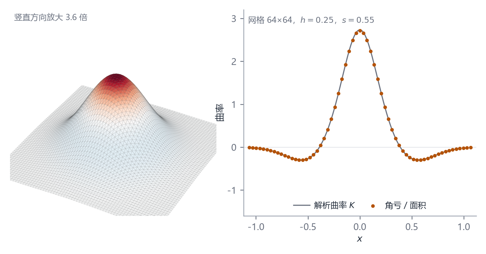
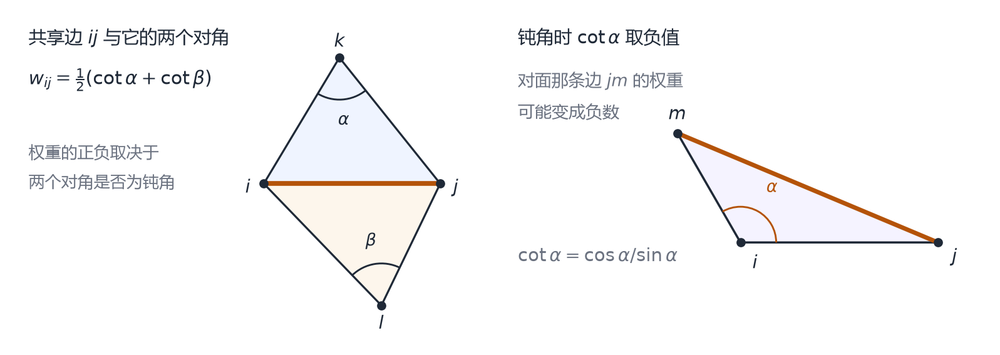
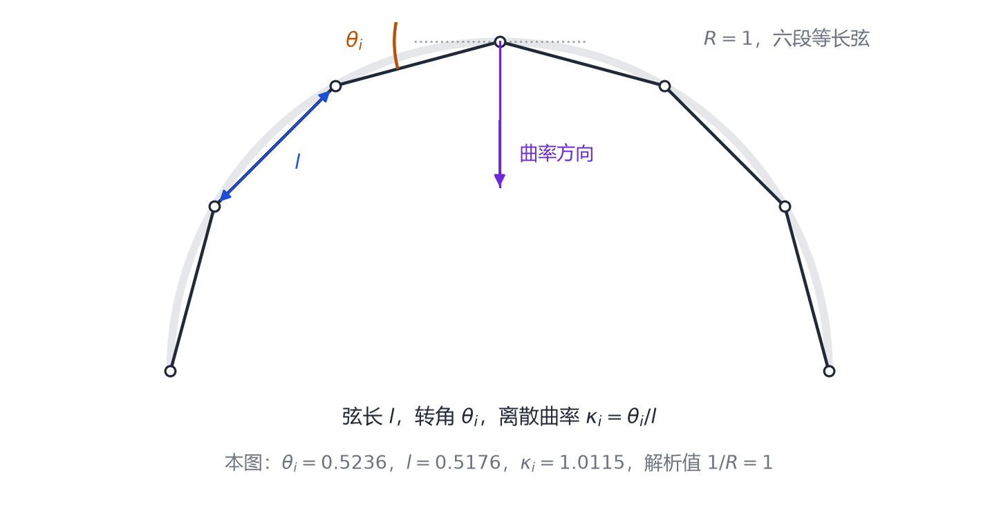

# 第 10 章 离散微分几何

> 本章导读：这一章讲的是“把连续几何里的曲率、梯度、拉普拉斯搬到网格上”这件事。它要回答三个问题：网格作为一个组合对象有什么不变量，曲率怎么从一个顶点周围的角算出来，为什么那套好用的余切权重有时会给出负数。读完你应该能在看到一条陌生的网格公式时，判断它依赖的是拓扑还是度量。

## 10.1 单纯复形与网格拓扑

一块布料的网格有一万个顶点、两万个三角形。程序里它是一张索引表：每个三角形存三个顶点编号。这个存法够用，但它把两件不同的事混在了一起——哪些三角形挨着哪些三角形（组合关系），以及顶点在空间里的坐标（几何）。很多算法只关心前者，比如邻域查询、拓扑修补、曲率求和；把它们分开看，很多公式会突然变得清楚。

组合关系的那一层，数学上叫单纯复形。顶点是 0 维单纯形，边是 1 维，三角形是 2 维，四面体是 3 维。一个合法的复形要求任意两个单纯形要么不相交，要么恰好交在一个公共的面上：两条边可以共享一个顶点，不能只共享半个顶点；两个三角形可以共享一条边，不能只共享半条边。这条规则排除了一类麻烦情况——一条边上挂着三个三角形。它算不算合法网格？工程上偶尔会出现，但所有基于“每条边恰好两个邻面”的公式在它身上都会给出没有意义的结果，而且不会报错。

复形有一个与形状无关的整数不变量，欧拉示性数：

$$
\chi=V-E+F ,
\tag{10.1}
$$

$V$、$E$、$F$ 分别是顶点、边、面的个数。一个四面体有 4 个顶点、6 条边、4 个面，$\chi=2$。把四面体细分成一千个小三角形，$V$、$E$、$F$ 都涨了，$\chi$ 还是 2。球面上的任何三角剖分都是 2，环面是 0，有两个洞的曲面是 $-2$。写成一般式是 $\chi=2-2g$，$g$ 是亏格（洞的个数）。

这条不变量的用处在于它是个检查工具。细分之后 $\chi$ 变了，说明代码里有重复顶点或者漏掉的面；边翻转前后 $\chi$ 必须不变，否则翻转的条件写错了；撕裂操作会改变 $\chi$（新增了边界），这是它和翻转的本质区别。一张开放曲面（比如一块布）的 $\chi$ 是 $1$，因为它是圆盘拓扑，边界本身也参与计数。

实际的数据结构比索引表复杂。要回答“这条边的两个邻面是谁”“这个顶点的邻居按顺序排成什么”，至少要存半边或者有向边：每条边存两个方向，每个方向记录它的起点、邻面和下一条半边。有了它，一环邻域可以在与价数成正比的代价内取出来。余切权重、角亏、离散曲率全都是一环上的求和，所以这个查询的速度直接决定了整个算法的速度。

顶点的价（连着几条边）是另一个常用指标。规则网格内部是 6，边界上是 4 或者更少，细分曲面上会出现 3、4、5 这类奇异价。价不等于 6 的顶点在离散曲率里天然带一点“缺陷”：它的角亏不为零，哪怕曲面是平的。这不是 bug，而是离散化的代价——一个平面上的不规则三角剖分，角亏在顶点上正负交替，加起来恰好抵消（因为平面的 $\chi$ 与形状无关，总角亏等于 $2\pi\chi$ 减边界项）。

## 10.2 离散外微分与 DEC

连续几何里的梯度、旋度、散度是三个不同的算子，各自有各自的公式。离散之后它们其实只有一个算子，只是作用在不同维度的单纯形上。这个统一的视角叫离散外微分（DEC，discrete exterior calculus），它值得花一节讲，因为它解释了为什么网格上的拉普拉斯公式长那样，也解释了为什么边界条件不需要特殊处理。

核心想法是把“场”定义在单纯形上，而不是定义在点上。一个定义在顶点上的标量（温度、高度、势函数）叫 0-形式；把 0-形式沿着每条边做差，得到一个定义在边上的量，叫 1-形式；再沿着每个面的边界把 1-形式累加，得到一个定义在面上的量，叫 2-形式。这种“只在单纯形上取一个数”的对象叫上链，可以理解成“在单纯形上积分的结果”。

差分这一步就是离散的 $d$。对边 $e_{ij}$（从顶点 $i$ 指向 $j$），

$$
(\mathrm{d}u)_{ij}=\frac{u_j-u_i}{|e_{ij}|},
\tag{10.2}
$$

$|e_{ij}|$ 是边长。这就是沿边方向的梯度分量。对三角形 $T$，把三条边上的 1-形式按定向加起来再除以面积，得到的是旋度：

$$
(\mathrm{d}\omega)_T=\frac{1}{A_T}\sum_{e\subset\partial T}\pm\,\omega_e ,
\tag{10.3}
$$

$A_T$ 是三角形面积，$\pm$ 由边的定向与三角形的定向是否一致决定。这就是格林公式的离散版本：环量除以面积。

这个 $d$ 有一个漂亮的性质：连做两次等于零。$\mathrm{d}(\mathrm{d}u)$ 在每个面上都是三条边上的差再相加，写成 $(u_j-u_i)+(u_k-u_j)+(u_i-u_k)$，恰好消掉。这就是“边界的边界为空”的代数形式。在矩阵表示下它更直白：$d$ 是一个关联矩阵，每一列对应一个单纯形，每一行记录它与低一维单纯形的关联，两次相乘必然是零矩阵，不是“数值上接近零”，而是严格为零。

度量信息不在这两个算子里，它全部集中在另一个对象上，叫霍奇星算子。霍奇星把 $k$-形式映射到 $n-k$ 形式，离散版本就是一个对角矩阵，对角元是单纯形的体积：边上是长度，面上是面积，顶点上是它的对偶胞腔面积（通常取一环三角形面积的三分之一之和）。换句话说，$d$ 只认连接关系，霍奇星只认长度和面积。把两者组合起来，就得到拉普拉斯：

$$
\boldsymbol{\Delta}=\mathrm{d}^{\mathsf T}\,\boldsymbol{\star}\,\mathrm{d},
\tag{10.4}
$$

严格说是 $\star^{-1}\mathrm{d}^{\mathsf T}\star\mathrm{d}$，符号约定各家不同。把它展开到一个三角网格上，算出来的正是 10.4 节那个余切矩阵。这就是为什么余切权重的表达式看起来像一堆角度——角度是边长关系的另一种写法，而边长正是霍奇星里装的度量。

这套框架的价值在于它保证了离散算子有正确的零空间。常值函数在离散拉普拉斯下的结果严格是零，无旋场严格等于某个函数的梯度，这些性质在连续世界里成立，在离散世界里也严格成立，而不是“误差足够小”。模拟器里一个常见的 bug 是散度与梯度用的不是同一套离散化，结果压力投影之后速度场仍然有残余散度，反复迭代也压不下去。用同一套 $d$ 构造出来的算子不会有这个问题。

代价在精度上。离散霍奇星是一阶近似，它假设每个单纯形内部几何变化不大，所以网格质量差的时候收敛很慢。更麻烦的是对偶胞腔的取法：对偶顶点若取外心，钝角三角形的外心会跑到三角形外面，算出来的面积成了负数——这正是 10.4 节余切权重变负的几何来源，而不是公式写错了。

## 10.3 角亏、平均曲率、高斯曲率

曲率在连续情形是一个逐点的量，在离散情形只能集中到顶点上。这不是妥协，而是唯一可行的做法：三角网格在面内部是平的，曲率只能以“缺陷”的形式藏在顶点周围。

高斯曲率用角亏定义。想象一个顶点周围的一圈三角形，把它们摊平在平面上，环绕一周的角度和是 $2\pi$；在曲面上，这个和小于 $2\pi$，差值就是这一点“缺掉的角度”：

$$
K_i=\frac{2\pi-\sum_{j}\theta_{ij}}{A_i},
\tag{10.5}
$$

$\theta_{ij}$ 是顶点 $i$ 的第 $j$ 个邻接三角形的内角，$A_i$ 是顶点 $i$ 的对偶面积（相邻三角形面积的三分之一之和）。边界上的顶点只有半圈，求和时要把 $2\pi$ 换成 $\pi$，否则会算出一个虚假的负曲率。

这个定义有一个非常强的性质：它的积分是精确的。把式 (10.5) 乘上面积再对全网格求和，得到的是总角亏，而总角亏只依赖拓扑：

$$
\sum_i K_iA_i=2\pi\chi ,
\tag{10.6}
$$

对封闭的球面拓扑，$\chi=2$，总和恒等于 $4\pi$。注意这是对任意形状、任意三角剖分都成立的等式，不是近似。也就是说离散高斯曲率“总量对、分布近似”：不管网格多粗糙，加起来一点不差；局部分配到每个顶点上有误差，网格越细误差越小。

平均曲率是另一回事。它依赖曲面怎么嵌在空间里，而高斯曲率只依赖角度。一个圆锥的侧面可以摊平成平面而不改变任何角度，所以它的高斯曲率处处为零（除了顶点），但平均曲率不为零。离散的平均曲率由余切拉普拉斯直接给出：

$$
(2H\,\mathbf{n})_i=\frac{1}{2A_i}\sum_{j}\big(\cot\alpha_{ij}+\cot\beta_{ij}\big)\big(\mathbf{x}_i-\mathbf{x}_j\big),
\tag{10.7}
$$

$\mathbf{x}_i$ 是顶点位置，$\mathbf{n}$ 是单位法向，$H$ 是平均曲率，$\alpha_{ij}$ 与 $\beta_{ij}$ 是边 $ij$ 两侧对着它的两个角。等式左边是一个向量，长度是 $2H$，方向是法向；实际计算里拿不到分开的 $H$ 与 $\mathbf{n}$，能拿到的只有这个向量本身，这正好也是弯曲能量和流动所需要的。

<figure class="fig">

<figcaption><b>图 10-1</b>　离散高斯曲率与解析曲率的对照。左图是一个高斯凸包曲面 $z=h\exp(-r^2/s^2)$，$h=0.25$、$s=0.55$，网格 $64\times64$，颜色是每个顶点的角亏除以对偶面积（竖直方向放大了 3.6 倍）。右图沿 $y=0$ 切一刀，灰线是解析曲率 $K=(rt-s^2)/(1+p^2+q^2)^2$，橙点是离散值。峰顶 $K\approx2.7$，外围那一圈负值是鞍形区域，两者都对上了；偏差最大的地方在峰顶附近，因为那里一个单元跨过的曲率变化太多。</figcaption>
</figure>

图 10-1 里的对比值得看细节。离散值在平坦区域几乎是零，与解析解一致，但那里的相对误差没有意义（分母趋于零）。在峰顶附近，离散值略微偏低：角亏是在顶点上算的，而峰顶的曲率在一个单元范围内变化剧烈，顶点采样必然低估极值。这个偏差随网格加密按 $O(h^2)$ 减小，是一个正常的收敛过程，不是公式错了。

## 10.4 拉普拉斯-贝尔特拉米与余切权重

网格上最常用的算子不是曲率，而是拉普拉斯。它在三个地方反复出现：平滑（把顶点往邻居的加权平均挪）、参数化（解一个调和映射）、以及膜能量（把拉伸能写成梯度的平方和）。

连续情形下，标量场 $u$ 的狄利克雷能量是 $\frac{1}{2}\int|\nabla u|^2\,dA$，它的变分给出拉普拉斯-贝尔特拉米算子。离散之后，这个积分可以精确地写成一个二次型：

$$
E(u)=\frac{1}{2}\sum_{(i,j)}w_{ij}\,(u_i-u_j)^2,\qquad
w_{ij}=\frac{1}{2}\big(\cot\alpha_{ij}+\cot\beta_{ij}\big),
\tag{10.8}
$$

求和跑遍所有边，$\alpha_{ij}$ 与 $\beta_{ij}$ 是边 $ij$ 的两个对角，如图 10-2 所示。权重取这个形式不是凑出来的：在每个三角形上，形函数的梯度是常数，两个梯度的内积积出来正好是“对角余切的一半再取负”，两条边一拼，就得到式 (10.8) 里的系数。

<figure class="fig">

<figcaption><b>图 10-2</b>　余切权重对应的两个角（示意图）。左边：边 $ij$ 被两个三角形共享，$w_{ij}$ 只由边对面的两个角 $\alpha$、$\beta$ 决定，与边本身的两端无关。右边：当 $\alpha$ 超过 $90^\circ$ 时 $\cot\alpha$ 为负，对面那条边 $jm$ 的权重可能变成负数。两个对角都偏大时，它们的和很容易超过 $180^\circ$，这种瘦长三角形最容易出问题。</figcaption>
</figure>

把它写成矩阵，$L_{ij}=-w_{ij}$（$i\neq j$），$L_{ii}=\sum_j w_{ij}$，每行加起来是零，所以常值向量在核里——这与连续的拉普拉斯一致，也是“能量对整体平移不变”的代数表达。$L$ 对称，这一点从式 (10.8) 的对称形式就能看出来。

问题出在符号上。如果某条边的两个对角之和超过 $180^\circ$，$\cot\alpha+\cot\beta$ 就是负的，$w_{ij}$ 为负。此时式 (10.8) 不再是“若干个平方的非负组合”，整个二次型可能取负值，矩阵不再半正定。后果是一连串的：平滑一步可能把顶点推到邻居围成的区域之外，出现新的极值（离散最大值原理失效）；用共轭梯度解隐式方程会失败（前提不成立）；用 $L$ 做参数化会得到翻转的三角形。

什么样的网格不会出这种事？二维有一个干净的判据：所有边满足 $\alpha+\beta\le\pi$ 时，所有权重非负，这个条件等价于网格是 Delaunay 三角剖分。所以负权重不是“坏运气”，而是网格不满足 Delaunay 的警报。反过来，只要不断翻转不满足条件的边，就能把任意三角网格变成 Delaunay 的（10.6 节），而且这个操作不改变顶点位置、不改变拓扑。

有三条修法，代价不同。一是翻转边，恢复 Delaunay 性质，权重全部非负，代价是连通关系变了，任何按边存的历史量都要迁移。二是直接截断权重（把负的置零或取绝对值），代码只有一行，但能量不再对应真实的几何，收敛性和收敛到的极限都可能改变。第三种做法是在内在度量上做 Delaunay（不按当前三维位置、而按边长重新三角化），它能处理曲面嵌入在三维里、投影会翻面的情况，代价是实现复杂。

## 10.5 离散壳与弹性杆

有了曲率，就能写弯曲能量。薄壳的能量由两部分组成：面内的拉伸（改变边长）和弯曲（改变角度）。拉伸那部分就是第 9 章的膜单元，弯曲那部分在离散情形下的自然变量是相邻两个三角形之间的二面角。

设边 $e$ 被两个三角形共享，它们法向的夹角是 $\theta_e$，那么弯曲能量写成

$$
E_b=\sum_{e}\frac{k_b}{l_e}\big(\theta_e-\bar{\theta}_e\big)^2 ,
\tag{10.9}
$$

$k_b$ 是弯曲刚度（对厚度为 $t$ 的各向同性板，它正比于 $Et^3$），$l_e$ 是边长，$\bar{\theta}_e$ 是静止时的二面角。$1/l_e$ 这个因子不能省：连续能量密度是曲率的平方，而曲率是“角度除以长度”，摊到一条边上要再乘一个长度权重，否则细分之后总能量会随网格变密而趋于零 [@grinspun2003]。

这里有一个容易忽略的陷阱。静止构型如果是平的，$\bar{\theta}_e=0$，没问题；如果静止构型本身是弯的（比如一片预先卷曲的叶子），$\bar{\theta}_e$ 就是靠初始网格量出来的，一旦细分，新边的夹角与旧边不同，总能量会莫名其妙地变化。离散壳那篇工作的贡献之一，就是把缩放因子设计成让离散能量在细分下收敛到同一个连续极限，而不是随网格漂移。

杆件的道理相同，只是降了一维。一条离散杆由节点 $\mathbf{x}_0,\dots,\mathbf{x}_n$ 串起来，每段是一条边 $\mathbf{e}_i=\mathbf{x}_{i+1}-\mathbf{x}_i$。弯曲由相邻两条边的夹角描述，但直接存角度不能插值，工程上用的是曲率副法向：

$$
\boldsymbol{\kappa}\mathbf{b}_i=\frac{2\,\mathbf{e}_{i-1}\times\mathbf{e}_i}{|\mathbf{e}_{i-1}||\mathbf{e}_i|+\mathbf{e}_{i-1}\cdot\mathbf{e}_i},
\tag{10.10}
$$

$\mathbf{b}$ 是副法向，$\boldsymbol{\kappa}$ 是曲率向量，分母里的点积把两条边的夹角编码进去（两条边平行时分母取 $2|e|^2$，夹角越大分母越小）。这个式子的几何意义很清楚：它是把 $\mathbf{e}_{i-1}$ 转到 $\mathbf{e}_i$ 的那个旋转的轴与转角，写成向量形式。弯曲能量就是 $\frac{1}{2}\boldsymbol{\kappa}\mathbf{b}^{\mathsf T}\mathbf{B}\,\boldsymbol{\kappa}\mathbf{b}\,/\,\bar{l}$，$\mathbf{B}$ 是抗弯刚度矩阵。

<figure class="fig">

<figcaption><b>图 10-3</b>　离散杆的节点、转角与曲率（示意图，数值来自真实计算）。一条半径 $R=1$ 的半圆弧被六段等长弦替代，橙色扇形的圆心角是节点处的转角 $\theta_i$，蓝色双箭头是弦长 $l$。取 $\theta_i=0.5236$、$l=0.5176$，离散曲率 $\kappa_i=\theta_i/l=1.0115$，比解析值 $1/R=1$ 高 1.15%；加密到更多段时这个偏差按 $O(l^2)$ 收敛到零。紫色箭头是曲率方向，指向圆心。</figcaption>
</figure>

图 10-3 也说明了离散曲率的收敛行为。用 $\theta_i/l$ 定义曲率，在均匀段长下误差是 $O(l^2)$：段长减半，误差降到四分之一。这正是离散弹性杆 [@bergou2008] 能用几十个节点准确复现一根头发弯曲的原因——误差是二阶的，而节点数只要够描述形状就行。

杆的完整模型还要加两样东西：扭转（材料框架绕切向转过的角度）和不可伸长约束。扭转由每个节点上的材料框架与参考框架之间的夹角描述，能量形式同样是二次的。这两部分合起来，一套离散杆方程的解与连续 Kirchhoff 杆的预测在弯、扭、拉伸上都对得上，这就是名字里“弹性杆”三个字的由来。

## 10.6 边翻转、细分、重网格

网格不是一次生成就永远不变的。大变形会把单元拉成细长条，而细长条的余切权重会变得巨大或者为负，条件数跟着恶化；碰撞和撕裂会改变连通关系；有时候又需要更密的网格来表现细节。三类操作覆盖了这些需求：翻转改连通、细分加密、重网格整体重建。

边翻转是最小的改动。取共享边 $ij$ 的两个三角形 $(i,j,k)$ 和 $(j,i,l)$，把公共边换成 $kl$，得到 $(k,l,i)$ 和 $(l,k,j)$。顶点数不变，边数不变，面数不变，所以 $\chi$ 不变——这也是判断翻转写对了没有的最快方式。翻转的合法性有一个几何条件：四边形 $i,k,j,l$ 必须是凸的，否则换出来的三角形会翻面（面积变负）。

翻转的用途是改善质量。二维有一个漂亮的结论：如果一条边两侧的角满足 $\alpha+\beta\gt\pi$，翻转它会让最小角变大；反复翻转直到所有边都满足 $\alpha+\beta\le\pi$，得到的就是 Delaunay 三角剖分，且这个过程一定终止。这条算法同时解决两个问题：网格质量（最大化最小角）和 10.4 节的负权重（恢复 Delaunay 性质）。三维没有这么干净：三维的边翻转（把两个四面体换成三个）能否终止、能否达到 Delaunay，至今没有一个简洁的答案。

细分把每个三角形一分为四，多出来的顶点放在边中点。直接放中点会让曲面越分越“皱”，所以 Loop 细分给新顶点一个加权位置：

$$
\mathbf{x}_{\text{new}}=\frac{3}{8}\big(\mathbf{x}_a+\mathbf{x}_b\big)+\frac{1}{8}\big(\mathbf{x}_c+\mathbf{x}_d\big),
\tag{10.11}
$$

$\mathbf{x}_a,\mathbf{x}_b$ 是这条边的两个端点，$\mathbf{x}_c,\mathbf{x}_d$ 是两个邻接三角形的对顶点。老顶点也要挪：它被拉向自己邻居的平均位置，权重由价数决定。这一套规则收敛到一个 $C^2$ 的极限曲面（奇异点处降到 $C^1$），代价是每分一次面数涨四倍。

细分在模拟里的作用要分清。如果目的是提高求解精度，细分是对的，因为插值误差随 $h$ 下降；如果目的是让轮廓看起来更圆，那细分只是在改渲染，物理上什么也没变。这两件事经常被混着说，但代码里是两回事：前者要重新组装刚度矩阵、重新初始化历史变量，后者只要在渲染前插值。

重网格是前两者的组合。常见的循环是：对每条边判断长度，太长的劈开，太短的塌缩，然后翻转改善价数，最后把顶点沿切向挪一点让分布均匀。这一整套操作要保持 $\chi$ 不变（也就是不改变拓扑），否则就变成了撕裂。真正麻烦的部分不是几何，而是状态迁移：塑性应变、损伤变量、纹理坐标都定义在旧网格上，换到新网格必须插值，插值一错，后续所有物理都错。

在实时应用里，重网格的另一个动因是锁死。第 9 章的分析说过，单元越薄越硬；大变形会把单元压薄，于是材料越算越硬，直到完全不动。这时候除了换单元类型，唯一的出路就是把网格重建成各向接近等边的形状。代价是每次重建都要重新分解矩阵、重新预热迭代，所以工程上常用折中：只在质量指标跌破阈值时才触发局部重建，其余区域不动。
