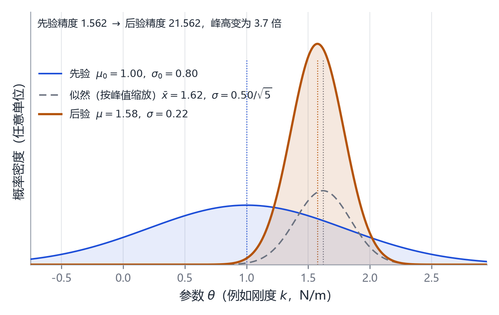
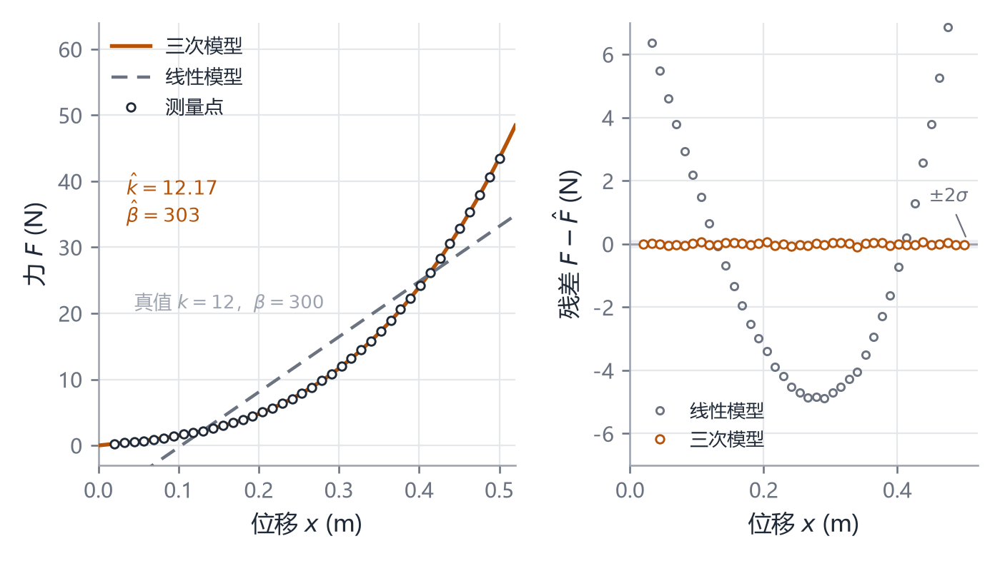
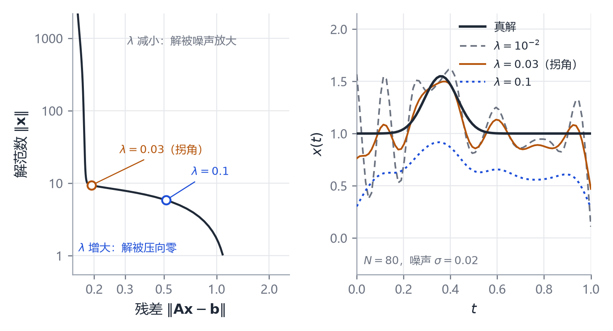

# 第 11 章 概率、估计与反问题

同一条裙子，两段镜头里的摆动不一样。第一段是美术手调的布料参数，走起来像丝绸；第二段换了一个人接手，同一个模型、同一套网格，只是把弯曲刚度从 0.8 改成 1.6，下摆立刻变硬。导演问哪一版对，没人答得上来，因为没人测过那块布。

另一件事更麻烦。要做一段冰面行走的动画，需要摩擦系数；要做一块肌肉的收缩，需要本构参数；要从一段实拍视频里重建烟的速度场，需要解一个反问题。这些量都测不到，或者只能间接测到。模拟器不会因为参数不知道就拒绝工作，它照样算出一个结果，把不确定性藏在了一个确定的数字里。

这一章讲怎么把“不知道”写进计算里。做法分三步：把不确定的东西描述成分布，用数据和模型更新它，再把更新后的分布推过模拟器，看结果的分布。

## 11.1 不确定性来源

模拟里的不确定性有四个来源，混在一起谈会做错决策。

**参数。** 杨氏模量、泊松比、阻尼、摩擦系数、屈服应力。有些能查表，但表里的数字来自某次实验，材料批次不同就差一倍。有些根本测不到：布料的弯曲刚度能在悬臂实验里量，剪切刚度就难。更麻烦的是它们常常不是常数，而随含水率、温度、应变率变。

**模型。** 本构选错了，参数再准也没用。用线弹性描述橡胶的大变形，误差随应变增长；用各向同性模型描述编织物，方向性一律丢掉。还有被忽略的效应：空气阻力、纤维之间的滑移、接触面的粗糙度。模型误差不会因为算得更细而消失，它随细化收敛到一个非零的偏差上。

**测量。** 传感器有噪声，标定有漂移，采样有延迟；从视频里提取轨迹时，遮挡和模糊又加一层。测量误差通常零均值、大致独立，这是它最讨人喜欢的地方：多测几次能压下去。

**离散化。** 网格粗、步长大、迭代没收敛，都会带来误差。它和测量误差性质相反：系统性，不会因为多跑几次而变小，只会在加密时按某个阶下降。当成随机噪声处理，会得到过于乐观的置信区间。

后两类要分清，处理方式相反：噪声能平均掉，离散误差不能；噪声给分散的点，离散误差给偏移的中心。做参数辨识时，离散误差若比测量噪声大，拟合出的参数会把数值误差当物理效应吸收，这叫模型偏差反演。症状很明显：网格加密一倍，辨识出的参数跟着变。

参数和模型都叫“不知道”，能不能靠数据缩小却不一样。参数有限维，测够了就能定下来；模型形式是结构性的选择，再多数据也只能告诉你“这个模型不合适”，不能告诉你不合适在哪里。前者叫可辨识，后者叫模型错配。做反问题之前先问一句“我是在估参数，还是在检验模型”，答案不同，做法完全不同。

## 11.2 贝叶斯与最大似然

把“不知道”写成分布，最自然的工具是贝叶斯公式：

$$
p(\theta \mid \mathcal{D}) = \frac{p(\mathcal{D} \mid \theta)\, p(\theta)}{p(\mathcal{D})},
\tag{11.1}
$$

$\theta$ 是待估的参数，$\mathcal{D}$ 是观测数据，$p(\theta)$ 是先验，$p(\mathcal{D}\mid\theta)$ 是似然，$p(\theta\mid\mathcal{D})$ 是后验，分母 $p(\mathcal{D})$ 是一个与 $\theta$ 无关的归一化常数。这四项的作用可以一句话记住：先验写你动手之前相信什么，似然写数据怎么说，后验写两者加权之后你相信什么。

似然是这一整套里唯一含有物理的部分。它把模拟器接进来：给定一组参数，跑一遍模拟，看它产生的观测和实测差多少。若观测噪声是独立同分布的高斯，标准差为 $\sigma$，那么

$$
p(\mathcal{D} \mid \theta) \propto \exp\!\left(-\frac{\|\mathbf{A}\theta - \mathbf{y}\|^2}{2\sigma^2}\right),
\tag{11.2}
$$

$\mathbf{A}$ 把参数映射到观测（在这里就是“跑一遍模拟”这个动作），$\mathbf{y}$ 是实测数据。取负对数，指数里的二次型就变成最小二乘的目标函数。所以最大似然估计在高斯噪声下等价于最小二乘，这件事在 11.4 还会再遇到一次：不是巧合，是同一条式子的两种读法。

先验的作用常被低估。参数辨识里的先验不是“主观意见”，它至少干三件事：压住不可辨识的方向、写进物理约束（弹性模量不能为负）、带进量级信息。没有先验时，似然在平坦方向上一片平原，优化器会停在一个数值上任意的点上。

高斯先验配高斯似然有一个干净的解析结果。设先验为 $\mathcal{N}(\theta_0, \sigma_0^2)$，做了 $n$ 次独立测量、每次标准差 $\sigma$、样本均值 $\bar{x}$，那么后验还是高斯，均值和方差是

$$
\frac{1}{\sigma_{\mathrm{post}}^2} = \frac{1}{\sigma_0^2} + \frac{n}{\sigma^2},
\qquad
\mu_{\mathrm{post}} = \sigma_{\mathrm{post}}^2\left(\frac{\theta_0}{\sigma_0^2} + \frac{n\bar{x}}{\sigma^2}\right).
\tag{11.3}
$$

第一式说的是精度（方差的倒数）相加：先验有一份信息，每次测量各贡献一份，后验的精度是它们的和。这条规则是卡尔曼滤波的骨架，11.3 会看到它换一身衣服重新出现。第二式说的是后验均值是先验均值和样本均值的加权平均，权重就是各自的精度。

图 11-1 画的就是这个加权过程。先验是 $\mathcal{N}(1.00, 0.80^2)$，五次测量给出样本均值 1.62、单次标准差 0.50，似然的标准差就是 $0.50/\sqrt{5}=0.224$。精度从 1.562 涨到 21.562，后验收窄到 $\sigma=0.215$，均值落在 1.575——比样本均值更靠近先验，因为先验还在说话。峰高从 0.50 涨到 1.85，约 3.7 倍，这就是“数据把不确定度压下去”的图像。

<figure class="fig">

<figcaption><b>图 11-1</b>　高斯先验与高斯似然的合成。先验为 $\mathcal{N}(1.00, 0.80^2)$；五次独立测量、单次标准差 0.50、样本均值 1.62，对应似然 $\mathcal{N}(1.62, 0.224^2)$，为便于比较按峰值缩放画出；后验为 $\mathcal{N}(1.575, 0.215^2)$。三条竖虚线分别是先验均值、样本均值与后验均值，后验均值夹在两者之间，偏向数据更多的一方。</figcaption>
</figure>

值得强调的是，后验不是一个数，是一条曲线。取它的众数（最大后验估计）只拿走了峰的位置，把宽度扔掉了。宽度恰恰是决策需要的：如果后验宽度比两个候选参数的差还大，“哪个更好”在当前数据下就没有答案，硬选一个只是在制造确定性。

## 11.3 卡尔曼滤波：预测与更新

卡尔曼滤波处理的是另一类问题：状态随时间变，观测有噪声，要在每一帧把它估出来。它的前提是线性、高斯，写成状态空间形式：

$$
\mathbf{x}_k = \mathbf{F}\mathbf{x}_{k-1} + \mathbf{B}\mathbf{u}_k + \mathbf{w}_k,
\qquad \mathbf{w}_k \sim \mathcal{N}(\mathbf{0}, \mathbf{Q}),
\tag{11.4}
$$

$$
\mathbf{z}_k = \mathbf{H}\mathbf{x}_k + \mathbf{v}_k,
\qquad \mathbf{v}_k \sim \mathcal{N}(\mathbf{0}, \mathbf{R}).
\tag{11.5}
$$

$\mathbf{x}_k$ 是第 $k$ 步的状态（位置、速度，或者参数），$\mathbf{F}$ 是状态转移矩阵（在模拟里就是一步积分器），$\mathbf{u}_k$ 是已知输入，$\mathbf{w}_k$ 是过程噪声，$\mathbf{Q}$ 是它的协方差；$\mathbf{z}_k$ 是观测，$\mathbf{H}$ 是观测矩阵，$\mathbf{v}_k$ 是测量噪声。整件事和 11.2 是同一个贝叶斯更新，只不过先验由上一步的后验传下来。

一步分两半。预测（先验）只做传播，不看数据：

$$
\hat{\mathbf{x}}_k^- = \mathbf{F}\hat{\mathbf{x}}_{k-1},
\qquad
\mathbf{P}_k^- = \mathbf{F}\mathbf{P}_{k-1}\mathbf{F}^{\mathsf{T}} + \mathbf{Q},
\tag{11.6}
$$

$\mathbf{P}$ 是状态协方差，上标负号表示“还没看观测”。$\mathbf{F}\mathbf{P}\mathbf{F}^{\mathsf{T}}$ 是把不确定度按动力学往前推，$\mathbf{Q}$ 是这一步新加进来的不确定度。注意协方差的传播和状态本身的传播用的是同一个 $\mathbf{F}$，但一个作用在向量上，一个作用在矩阵上。

更新（后验）把观测接进来：

$$
\mathbf{K}_k = \mathbf{P}_k^-\mathbf{H}^{\mathsf{T}}\left(\mathbf{H}\mathbf{P}_k^-\mathbf{H}^{\mathsf{T}} + \mathbf{R}\right)^{-1},
\tag{11.7}
$$

$\mathbf{K}$ 叫卡尔曼增益，分母 $\mathbf{H}\mathbf{P}_k^-\mathbf{H}^{\mathsf{T}}+\mathbf{R}$ 是预测观测的协方差。有了它，状态与协方差的更新写成

$$
\hat{\mathbf{x}}_k = \hat{\mathbf{x}}_k^- + \mathbf{K}_k\left(\mathbf{z}_k - \mathbf{H}\hat{\mathbf{x}}_k^-\right),
\qquad
\mathbf{P}_k = \left(\mathbf{I} - \mathbf{K}_k\mathbf{H}\right)\mathbf{P}_k^- .
\tag{11.8}
$$

括号里那个差叫新息，是“实测减预测”。整个更新就是把预测往新息的方向挪一步，挪多少由 $\mathbf{K}$ 决定。

$\mathbf{K}$ 的结构和式 (11.3) 的加权平均一模一样。用一个标量情形看得最清楚：状态是一个常数，$\mathbf{F}=1$，$\mathbf{H}=1$，令 $p=P^-$、$r=R$，则 $K=p/(p+r)$，后验方差是 $pr/(p+r)$。若测量噪声很大（$r \gg p$），$K$ 接近 0，滤波器基本相信模型；若模型很差（$p \gg r$），$K$ 接近 1，滤波器基本照抄观测。所以增益不是调出来的参数，它是两个精度之比自动算出来的。把 $\mathbf{Q}$、$\mathbf{R}$ 当旋钮随手调，平滑效果也能看，但已经和“最优”没关系了。

在模拟里，卡尔曼滤波最常见的用法是从噪声传感器数据估刚体的位置与速度。速度通常不可直接测，滤波器靠模型把位置的差分和动力学连起来，间接把它估出来，这比数值微分稳得多——微分会把高频噪声放大成剧烈抖动，而 $\mathbf{Q}$ 正好给了一个“物理上允许多快变化”的上界。

一条工程细节：式 (11.8) 的协方差更新在数值上会慢慢失去对称正定性，几千步后可能出现负方差。实践里改用 Joseph 形式 $\mathbf{P} = (\mathbf{I}-\mathbf{K}\mathbf{H})\mathbf{P}^-(\mathbf{I}-\mathbf{K}\mathbf{H})^{\mathsf{T}} + \mathbf{K}\mathbf{R}\mathbf{K}^{\mathsf{T}}$，多一次矩阵乘，换来无论 $\mathbf{K}$ 取什么值都对称正定。

非线性系统里把 $\mathbf{F}$、$\mathbf{H}$ 换成雅可比矩阵，就是扩展卡尔曼滤波，前提是局部线性化足够准；非线性更强时改用一组采样点传播均值和协方差（无迹卡尔曼滤波）。两者的共同毛病是协方差只能有一个峰：状态真有两个可能的位置（比如被挡住后重新出现）时，单一高斯表达不了。

## 11.4 参数辨识与最小二乘

回到最开始的问题：给定测量数据，估一块材料的刚度。设模型给出的预测是 $\mathbf{A}\boldsymbol\theta$，实测是 $\mathbf{y}$，最直接的判据是最小化残差的平方和：

$$
J(\boldsymbol\theta) = \|\mathbf{A}\boldsymbol\theta - \mathbf{y}\|^2
= (\mathbf{A}\boldsymbol\theta - \mathbf{y})^{\mathsf{T}}(\mathbf{A}\boldsymbol\theta - \mathbf{y}).
\tag{11.9}
$$

对 $\boldsymbol\theta$ 求梯度并令其为零，得到正规方程

$$
\mathbf{A}^{\mathsf{T}}\mathbf{A}\,\boldsymbol\theta = \mathbf{A}^{\mathsf{T}}\mathbf{y},
\qquad
\boldsymbol\theta = (\mathbf{A}^{\mathsf{T}}\mathbf{A})^{-1}\mathbf{A}^{\mathsf{T}}\mathbf{y}.
\tag{11.10}
$$

这两个式子教材里都有，麻烦全在右边那个逆上。$\mathbf{A}^{\mathsf{T}}\mathbf{A}$ 的条件数是 $\mathbf{A}$ 的条件数的平方：

$$
\kappa(\mathbf{A}^{\mathsf{T}}\mathbf{A}) = \kappa(\mathbf{A})^2 .
\tag{11.11}
$$

这不是理论上的小瑕疵。$\kappa(\mathbf{A})=10^4$ 时，$\kappa(\mathbf{A}^{\mathsf{T}}\mathbf{A})=10^8$，双精度还剩 8 位有效数字；单精度（约 7 位）就全部丢光。$\kappa(\mathbf{A})=10^6$ 时，双精度也不够。所以显式构造 $\mathbf{A}^{\mathsf{T}}\mathbf{A}$ 再求逆，是把一个还能做的问题变成一个做不了的问题——信息在这一步被平方损耗掉，后面用什么算法都救不回来。

正确的做法是对 $\mathbf{A}$ 本身做分解。$m \ge n$ 时，Householder 变换给出 $\mathbf{A}=\mathbf{Q}\mathbf{R}$，$\mathbf{Q}$ 正交、$\mathbf{R}$ 上三角，然后解 $\mathbf{R}\boldsymbol\theta = \mathbf{Q}^{\mathsf{T}}\mathbf{y}$，条件数只放大一倍。秩亏时用 SVD，把小于阈值的奇异值扔掉，得到伪逆解而不是一个巨大的垃圾。

图 11-2 是一个具体的例子。一块超弹性弹簧的力-位移测量，真模型是 $F = kx + \beta x^3$，$k=12$ N/m，$\beta=300$ N/m$^3$，在 $x\in[0.02,0.50]$ m 上取 40 个点，加标准差 0.05 N 的高斯噪声。用三次多项式拟合，得到 $\hat{k}=12.17$、$\hat{\beta}=303$，残差均方根 0.038 N，和噪声水平相当；用线性模型拟合，斜率被拉成 83.7 N/m——它不是在估 $k$，是在用一个斜率去近似整条曲线，残差呈现明显的三次形状，均方根 4.29 N，是噪声的近百倍。

<figure class="fig">

<figcaption><b>图 11-2</b>　同一批测量数据的两种模型。真值 $F=kx+\beta x^3$，$k=12$ N/m，$\beta=300$ N/m$^3$，$x$ 在 $[0.02,0.50]$ m 上取 40 点，噪声标准差 0.05 N，随机种子 7。三次拟合得 $\hat{k}=12.17$、$\hat{\beta}=303.1$，残差均方根 0.038 N；线性拟合的斜率是 83.7 N/m，残差均方根 4.29 N。右图的灰带是 $\pm2\sigma$。</figcaption>
</figure>

左图看出拟合好坏，右图看出模型对不对。残差没有结构，说明模型把能解释的都解释了；残差有形状，说明还有系统性成分没被吸收。后者不能靠加数据解决——加多少，那条三次形状都还在——只能换模型。这就是做参数辨识时必须看残差图、而不是只看残差大小的原因。

还有一层数值细节在图里看不到：三次多项式的设计矩阵条件数是 593，$\mathbf{A}^{\mathsf{T}}\mathbf{A}$ 是 $3.5\times10^5$，正好是平方。这个规模下正规方程还能用，但已经丢了约 5 位有效数字。拟合到 $x^8$ 时条件数涨到 $10^{10}$ 以上，正规方程在双精度下就不能用了；改成正交多项式（Legendre 或 Chebyshev）基可以压回 $10^2$ 量级。数学没变，变的只是你选的基。

## 11.5 不适定性与正则化

有一类反问题，数据稍微一变，解就面目全非。Hadamard 给“适定”下了三个条件：解存在、解唯一、解连续依赖于数据，第三条最容易被违反。模拟里真实遇到的例子是从表面温度反推内部热源，或者从模糊图像反推原始图像。这类问题的算子是“平滑”的——它把高频细节抹掉，反过来，从平滑数据里恢复高频就等于把噪声乘上一个巨大的因子。

离散之后，“不适定”变成“病态”，可以量化。把算子写成 $\mathbf{A}$，用 SVD 展开，$\mathbf{A}=\sum_i \sigma_i\mathbf{u}_i\mathbf{v}_i^{\mathsf{T}}$，$\sigma_1 \ge \sigma_2 \ge \cdots \ge 0$ 是奇异值，则最小二乘解是

$$
\mathbf{x} = \sum_{i=1}^{n}\frac{\mathbf{u}_i^{\mathsf{T}}\mathbf{b}}{\sigma_i}\,\mathbf{v}_i .
\tag{11.12}
$$

数据里的噪声 $\delta\mathbf{b}$ 被同一个公式放大：

$$
\|\delta\mathbf{x}\| \le \frac{\|\delta\mathbf{b}\|}{\sigma_n}.
\tag{11.13}
$$

$\sigma_n$ 是最小的奇异值。高斯核在 80 个点上离散后，条件数能到 $10^{18}$，这意味着 $\sigma_n$ 比 $\sigma_1$ 小 18 个数量级，1% 的噪声会被放大成 $10^{16}$ 的解误差。这不是“精度不够”，是这个问题在双精度下本来就没有可用的解。

Tikhonov 正则化的做法是给目标函数加一项惩罚：

$$
\min_{\mathbf{x}} \; \|\mathbf{A}\mathbf{x}-\mathbf{b}\|^2 + \lambda^2\|\mathbf{L}\mathbf{x}\|^2
\quad\Longrightarrow\quad
\mathbf{x}_\lambda = \sum_i \frac{\sigma_i^2}{\sigma_i^2+\lambda^2}\cdot\frac{\mathbf{u}_i^{\mathsf{T}}\mathbf{b}}{\sigma_i}\,\mathbf{v}_i .
\tag{11.14}
$$

$\lambda \gt 0$ 是正则化参数，$\mathbf{L}$ 是一个惩罚算子，取单位阵时惩罚解的范数，取一阶或二阶差分时惩罚解的梯度或曲率。右式里的因子

$$
f_i = \frac{\sigma_i^2}{\sigma_i^2+\lambda^2}
\tag{11.15}
$$

叫滤波因子，它把每个奇异方向按比例压小：$\sigma_i \gg \lambda$ 的方向几乎不动（真实信号所在的大奇异值方向），$\sigma_i \ll \lambda$ 的方向几乎清零（噪声放大的方向）。正则化做的不是“让结果好看”，是在这些方向上主动放弃信息，用一个可控的偏差换掉一个不可控的方差。

$\lambda$ 怎么选，教科书的答案是 L 曲线：把残差范数和解范数都画在对数坐标上，随 $\lambda$ 由大到小，曲线先沿一条近乎水平的腿走，再拐弯进入一条近乎竖直的腿，拐角是两者的平衡点。竖腿意味着解范数爆炸（过拟合噪声），横腿意味着残差不再下降（过平滑）。图 11-3 是一个例子：高斯核的第一类积分算子，真解是一个凸起，数据加了 $\sigma=0.02$ 的噪声。

<figure class="fig">

<figcaption><b>图 11-3</b>　Tikhonov 正则化的 L 曲线与三个解。算子在 $[0,1]$ 上取 $N=80$ 个点，核为 $\exp(-(s-t)^2/(2\cdot0.05^2))\cdot h$，真解 $x(t)=1+0.55\exp(-((t-0.36)/0.10)^2)$，观测加标准差 0.02 的高斯噪声（随机种子 3），罚项取 $\lambda^2\|\mathbf{x}\|^2$，曲线由 140 个 $\lambda$ 扫出。拐角在 $\lambda\approx0.026$，此时相对误差 0.12；$\lambda=10^{-2}$ 时相对误差 0.24，曲线已经带明显波纹；$\lambda=0.1$ 时解被压平，相对误差 0.42。</figcaption>
</figure>

三个 $\lambda$ 的对比说明一件事：正则化参数的合适区间相当宽。从 0.01 到 0.03，误差从 0.24 变到 0.12，肉眼几乎看不出差别；但向两边各走一个数量级，结果就明显坏了。不必为选“最优”的 $\lambda$ 做精细搜索，把量级定对就够；真正危险的是完全不正则化，或者把 $\lambda$ 定大了三个数量级。

别的方法还有广义交叉验证与 Morozov 偏差原理（残差降到噪声水平就停）。工程上最省事的做法是先估噪声水平，把 $\lambda$ 定在“残差降到噪声水平附近”的量级，再用 L 曲线确认没落在竖腿上。

## 11.6 伴随法与梯度

有了参数化，接下来的问题是优化：调参数让模拟结果接近观测，或者让某个目标（落地冲击、飘动幅度）达到期望。这需要目标对参数的梯度。参数少时好求，参数多时——逐顶点的材料分布、逐时刻的初始状态——就变成了一件事的关键。

设目标函数是 $J(\boldsymbol\theta)$，参数有 $n$ 个。最笨的办法是有限差分：对每个参数加一个小扰动各重跑一次，得到

$$
\frac{\partial J}{\partial \theta_j} \approx \frac{J(\boldsymbol\theta + h\mathbf{e}_j) - J(\boldsymbol\theta)}{h},
\tag{11.16}
$$

$\mathbf{e}_j$ 是第 $j$ 个单位向量，$h$ 是步长。代价是 $n+1$ 次模拟。参数有一万个，就要跑一万零一次，这在离线渲染里可以做，在交互里不行。

有限差分的误差也不好办。$h$ 太大，截断误差 $O(h)$ 主导；$h$ 太小，两个相近数相减，舍入误差 $O(\epsilon/h)$ 主导。最优步长在 $h \approx \sqrt{\epsilon}\approx10^{-8}$，此时相对误差约 $10^{-8}$，这个上限算不掉。中心差分把截断误差降到 $O(h^2)$，最优误差仍受限于 $\epsilon^{2/3}$，代价是模拟次数翻倍。

伴随法把代价从“与参数个数成正比”降到“与参数个数无关”。思路是引入一组拉格朗日乘子，把整条时间步链上的约束乘进去：

$$
\mathcal{L} = J(\mathbf{x}_N,\boldsymbol\theta) + \sum_{k=1}^{N}\boldsymbol\lambda_k^{\mathsf{T}}\left(\mathbf{x}_k - \mathbf{f}(\mathbf{x}_{k-1},\boldsymbol\theta)\right),
\tag{11.17}
$$

$\mathbf{x}_k$ 是第 $k$ 步的状态，$\mathbf{f}$ 是一步的更新（积分器加力计算），$\boldsymbol\lambda_k$ 是第 $k$ 步的乘子。对 $\mathbf{x}_k$ 求偏导并令其为零，得到乘子的反向递推：

$$
\boldsymbol\lambda_N = \left(\frac{\partial J}{\partial \mathbf{x}_N}\right)^{\mathsf{T}},
\qquad
\boldsymbol\lambda_{k-1} = \left(\frac{\partial \mathbf{f}}{\partial \mathbf{x}_{k-1}}\right)^{\mathsf{T}}\boldsymbol\lambda_k .
\tag{11.18}
$$

这个递推从最后一步往回走，每一步乘一个雅可比的转置——所以叫“反向传播”，也叫离散伴随。走完之后，梯度是

$$
\frac{\partial J}{\partial \boldsymbol\theta}
= \frac{\partial J}{\partial \boldsymbol\theta}\bigg|_{\text{显式}}
- \sum_{k=1}^{N}\boldsymbol\lambda_k^{\mathsf{T}}\frac{\partial \mathbf{f}}{\partial \boldsymbol\theta},
\tag{11.19}
$$

第一项是目标函数里显式含 $\theta$ 的部分，第二项是动力学通过 $\theta$ 间接影响目标的部分。整个梯度的代价是一次前向加一次反向，与 $n$ 无关。

这里有一个取舍：反向递推需要 $\mathbf{x}_{k-1}$ 与 $\partial\mathbf{f}/\partial\mathbf{x}_{k-1}$。存下所有步的状态，内存随步数线性增长，一千帧就存不下；不存就得重算。检查点的做法是把时间轴切段、每段起点存一个状态，反向时按段重算前向，内存降到 $O(\sqrt{N})$，计算量涨两三倍。

接触让这件事变难。法向力的大小和方向依赖接触状态，接触状态是离散切换，严格来说不可导；穿透量为零的那一刻，力的导数是一个冲激。直接对穿透量求导会得到量级巨大且符号错误的梯度，优化要么不收敛，要么收敛到把物体挤在一起的解。几种处理各有取舍：把接触软化成一个光滑的罚函数（简单，但引入刚度与步长的耦合）；用互补条件的平滑近似；或者在接触求解器内部对隐式关系做微分 [@hu2020]。Werling 等人把接触冲量的求解过程本身当作一层可导的算子，代价是梯度精度依赖内层求解的收敛程度 [@werling2021]；Li 等人用障碍函数把非穿透写成连续可微的能量项，整条链上不再有离散切换 [@li2020]。

伴随法的正确性可以自己测：随机取一个方向 $\mathbf{v}$，比较 $(\partial J/\partial\boldsymbol\theta)\cdot\mathbf{v}$ 与 $(J(\boldsymbol\theta+\epsilon\mathbf{v})-J(\boldsymbol\theta))/\epsilon$，两者应当在 $\epsilon$ 很小时一致。这个测试叫点积测试，是排查转置错误最有效的手段。

## 11.7 蒙特卡洛与拉丁超立方

参数有了分布，下一步是把它推过模拟器。最直接的方法是蒙特卡洛：从先验或后验里抽 $N$ 组参数，各跑一次，得到 $N$ 个结果，用它们的统计量近似结果的分布。

蒙特卡洛的误差有一个干净的结论。若单次结果的方差是 $\sigma^2$，$N$ 次样本均值的标准差是

$$
\mathrm{std}\left(\frac{1}{N}\sum_{i=1}^{N} g(\boldsymbol\theta_i)\right) = \frac{\sigma}{\sqrt{N}} .
\tag{11.20}
$$

误差按 $1/\sqrt{N}$ 下降，与参数维数无关——这是它最大的优点，也是它唯一的优点。要高一个数量级的精度，样本数得涨一百倍。三五维的参数空间还能忍；上万维的逐顶点材料，一次采样就是一次模拟，成本直接压死人。

$1/\sqrt{N}$ 的常数因子由采样策略决定，这就是分层与拉丁超立方的价值。一维时把区间分成 $N$ 层、每层取一个点，方差能降一个量级。高维时无法对每一维都做全分层（需要 $N^d$ 个点），拉丁超立方是一个折中：在每一维上都分成 $N$ 层、每层恰好取一个点，而各维之间的配对顺序随机打乱。这样每个一维投影都是完美分层的，而点集不会退化成网格对角线上的一串。

对模拟来说，这个性质正好对上路子。敏感性分析常常是逐维看的：固定其他参数，看某一个参数单独的影响。投影性质让逐维观察不被聚簇污染。简单随机采样时，$N=100$ 个点在某个投影上可能出现几个紧挨的点、旁边一片空白，这一维的响应曲线就采得失真了。

还有几种方差缩减手段值得知道。对偶变量：$g$ 关于参数近似线性时，同时算 $g(\theta)$ 与 $g(2\mu-\theta)$ 取平均，一阶项正好抵消。控制变量：找已知均值的近似量 $h(\theta)$，用 $g-h$ 的采样均值修正估计，两者越相关降方差越多。重要性采样把点集中到影响大的区域，用似然比修正权重，适合估尾部风险。

蒙特卡洛在流水线里通常出现在三个位置。一是参数扫描：给定参数区间算结果的区间，用来做稳健性判断，比如“刚度在这个范围内波动时，这个结构会不会塌”。二是敏感性分析：把输出方差分解到各个输入上（Sobol 指数），找出哪个参数最值得去测。三是稳健优化：目标不是标称参数下最好，而是参数分布下期望最好、方差可控，内层每步都要跑一批样本。

三个位置的共同点是：不追求单次模拟的精度，追求分布的准确性。这也解释了它在小样本上的糟糕表现——几百个样本只能看出一阶矩，二阶矩还在噪声里。单次模拟便宜时蒙特卡洛是首选；参数维度高或者单次模拟贵，要么换代理模型，要么先做敏感性分析把维数砍下来。
