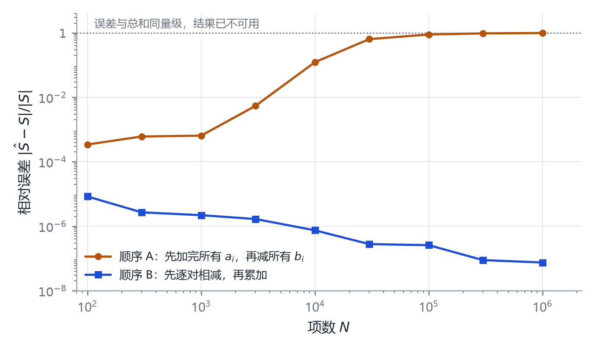
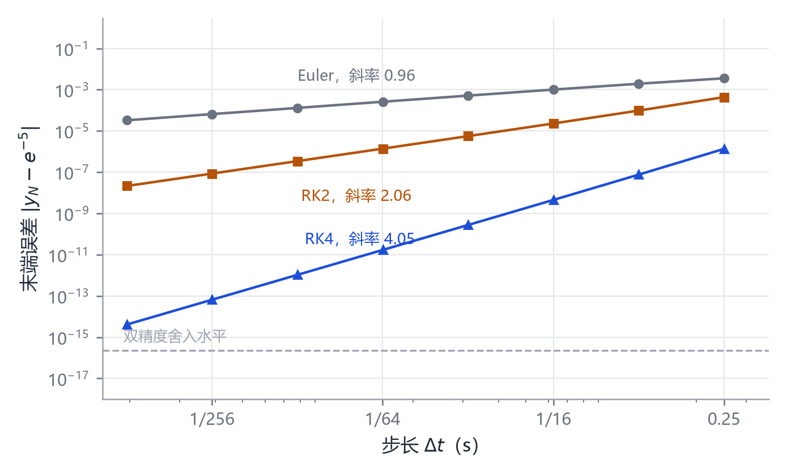
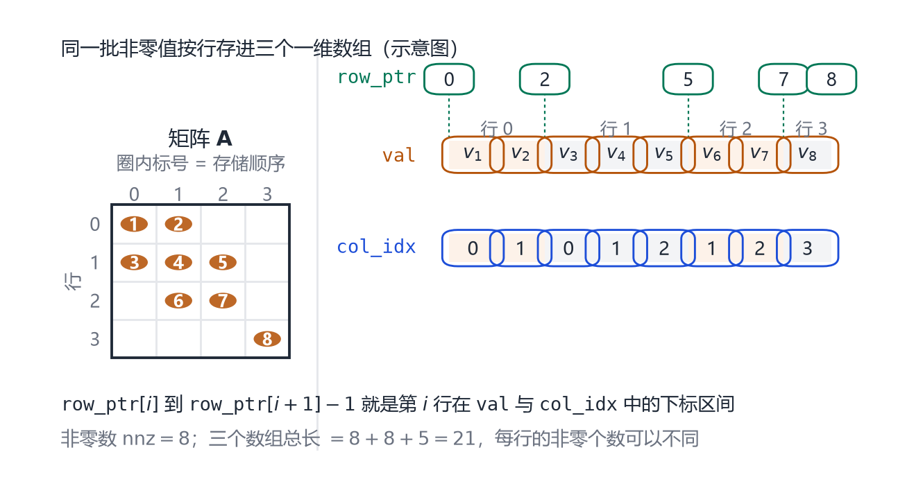

# 第 12 章 数值实现中的数学

一个球停在了半空中。它已经落在刚体地板上，接触约束满足，速度为零，位置却比地面高两厘米。把时间步长改小一半，它落下来了，但开始抖动。把摩擦系数从 0.4 改成 0.4000001，整堆箱子塌了。

另一种情况：布料在低分辨率下正常，加密到四万顶点之后开始自发振荡；刚体塔叠到第八层就散架，前七层稳得很；同一份代码在 Windows 上算出能量守恒，在另一台机器上能量缓慢上漂。

这些都不是物理错了。方程是对的，离散格式是对的，求解器也是对的，错的是方程落到浮点数上之后发生的事。这一章讲的都是这一类：数学上成立、实现上不成立。

## 12.1 浮点数与有效位

一个双精度浮点数占 64 位：1 位符号，11 位指数，52 位尾数。单精度是 1、8、23。它表示的数可以写成

$$
x = (-1)^{s}\left(1 + \sum_{i=1}^{p} b_i 2^{-i}\right)2^{e},
\tag{12.1}
$$

$s$ 是符号位，$b_i$ 是尾数的第 $i$ 位（取 0 或 1），$p$ 是尾数位数（双精度 52，单精度 23），$e$ 是指数。那个开头的 1 是隐含的，不存，所以双精度的有效位数是 53 位，单精度是 24 位。换算成十进制，双精度大约 16 位有效数字，单精度大约 7 位。

“大约 16 位”这个说法容易让人误解，因为有效位数不是均匀分布的。相邻两个可表示数之间的间距是

$$
\mathrm{ulp}(x) = 2^{\lfloor \log_2 |x| \rfloor - p},
\tag{12.2}
$$

$\lfloor\cdot\rfloor$ 是向下取整。这个式子说的是：间距与数值本身的量级成正比。$x=1$ 附近双精度的间距是 $2^{-52}\approx2.2\times10^{-16}$；$x=10^{6}$ 附近是 $1.16\times10^{-10}$。两者相差六个数量级，而“有效数字”这个说法把它们说成一样。

单精度的情形值得单独算一遍，因为它决定了实时模拟里能用的坐标范围。单精度在 $10^3$ 附近的间距是 $2^{-14}=6.1\times10^{-5}$，也就是 0.06 毫米；在 $10^5$ 附近是 $2^{-7}=7.8\times10^{-3}$，也就是 7.8 毫米。一个上百公里见方的场景（坐标量级 $10^5$ m），如果把世界坐标直接用单精度存，地面上移动一个物体时位置的最小变化是 7.8 毫米——接触判断的容差通常就在毫米量级，于是“贴没贴上”这件事被舍入噪声决定了。

这就是很多引擎用“浮动原点”的原因：坐标不存绝对位置，而存相对于某个局部原点的偏移，原点跟着相机或主角走。数学上只是换了个坐标系，数值上把参与运算的量级从 $10^5$ 压回 $10^2$ 以内，间距立刻小三个数量级。另一半做法是位置用双精度、其余（速度、颜色、法线）用单精度，GPU 上双精度的算力通常是单精度的三十二分之一到六十四分之一，混着用能省下大部分。

浮点还有两类边界情况会咬人。一是次正规数：绝对值小于 $2^{-126}$（单精度）的数，尾数不再有隐含的 1，有效位数随数值变小而减少，某些硬件上处理它们的速度慢一到两个数量级。模拟里出现次正规数通常意味着某个量本该是零却没清零，比如一个几乎完全抵消的力。二是 NaN：它会在一次乘法之内传遍全场，一个 NaN 顶点会让整张网格的包围盒失效、BVH 崩掉、优化器不收敛。工程上的习惯是在每次求解之后断言“状态里没有 NaN 也没有 Inf”，而不是等到几百帧之后看画面出问题再回头找。

还有一个容易忽略的来源是累加。求一个节点上的合力，是把几十上百个贡献加起来；求总动能，是把所有粒子加起来。每加一次都要舍入一次，误差随项数累积；更糟的是当加数比累加器小得多时，它会被整个吃掉——1 加 $10^{-12}$ 还是 1。图 12-1 是一个可复现的实测：要算的量是 $\sum_i (a_i-b_i)$，其中 $a_i$ 与 $b_i$ 只差 $10^{-12}$ 量级。先把所有 $a_i$ 加完再减去所有 $b_i$，误差从 $N=100$ 时的 $3.4\times10^{-4}$ 涨到 $N=10^6$ 时的 0.99，结果完全失真；改成逐对相减再累加，误差始终在 $10^{-6}$ 以下。

<figure class="fig">

<figcaption><b>图 12-1</b>　同批数的两种求和顺序。数据为 $a_i=1+10^{-12}u_i$、$b_i=1$，$u_i$ 在 $[0,1]$ 上均匀，参考值由精确求和给出，每个 $N$ 取 5 个随机种子的中位数。顺序 A 先把 $a$ 全加完再减 $b$，相对误差随 $N$ 增长并很快撞到 1，也就是结果与真值同量级、不再含有效数字；顺序 B 先逐对相减再累加，误差始终低于 $10^{-5}$，并随项数增加反而下降。</figcaption>
</figure>

舍入误差在另一个方向上有一下限。把步长减半，格式的截断误差按阶下降（一阶减半、二阶减到四分之一、四阶减到十六分之一），但降到某个量级就不再下降，因为舍入误差开始主导。图 12-2 是 $y'=-y$ 从 0 积到 5 的末端误差：Euler、RK2、RK4 的双对数斜率分别是 0.96、2.06、4.05，与一阶、二阶、四阶对得上；RK4 在 $\Delta t=1/256$ 附近已经贴到 $2\times10^{-16}$ 的双精度地板，再减步长只是白花机时。这条地板就是“有效位”的实际含意；单精度下同一条曲线的地板高出七八个数量级，在 $10^{-9}$ 附近就开始走平。

<figure class="fig">

<figcaption><b>图 12-2</b>　收敛阶的对数-对数验证。方程 $y'=-y$，$y(0)=1$，积到 $T=5$ s；纵轴是 $|y_N-e^{-5}|$，横轴是步长 $\Delta t$ 从 $2^{-2}$ 到 $2^{-9}$ s，斜率由前 6 个点拟合。三条直线的斜率 0.96、2.06、4.05 分别对应 Euler、RK2、RK4 的名义阶 1、2、4。水平虚线是双精度的单位舍入 $2.2\times10^{-16}$，RK4 在最左端已经碰到它，误差不再随步长下降。</figcaption>
</figure>

## 12.2 条件数与矩阵求逆

线性系统的解对数据的敏感度由条件数刻画：

$$
\frac{\|\delta\mathbf{x}\|}{\|\mathbf{x}\|} \le \kappa(\mathbf{A})\,\frac{\|\delta\mathbf{b}\|}{\|\mathbf{b}\|},
\qquad
\kappa(\mathbf{A}) = \|\mathbf{A}\|\,\|\mathbf{A}^{-1}\| .
\tag{12.3}
$$

$\delta\mathbf{b}$ 是右端项的扰动，$\delta\mathbf{x}$ 是解的扰动，$\kappa$ 是条件数。这个界说的是：输入的相对误差进到解里，最多被放大 $\kappa$ 倍。$\kappa=1$ 时问题最稳（正交矩阵），$\kappa=10^{16}$ 时双精度已经解不出有意义的答案。

准备一个能自己手算的例子。$\mathbf{A}=\begin{pmatrix}1 & 1\\ 1 & 1+10^{-8}\end{pmatrix}$，行列式是 $10^{-8}$，条件数约 $4\times10^{8}$。右端项的最后一位变一下，解的两个分量可以差出百分之一百。矩阵本身看起来完全正常——元素都是 1 附近，没有大数——但它的两行几乎平行，几乎平行就是几乎线性相关，几乎线性相关就是求逆放大器。

再看一个更贴近模拟的例子。有限元的单元刚度矩阵在单元退化成薄片时条件数会暴涨；六阶 Hilbert 矩阵 $\mathbf{H}_{ij}=1/(i+j-1)$ 的条件数是 $1.5\times10^{7}$，八阶是 $1.5\times10^{10}$。这类矩阵在双精度下还能解出五六位有效数字，再大就没了。它们出现在模拟里的方式是：混合单元的刚度块、约束雅可比里单位不一致的行、同一套系统里同时有 $10^{11}$ 的杨氏模量和 $10^{-3}$ 的阻尼。

所以矩阵求逆要小心，有两层意思。第一层是精度：显式求 $\mathbf{A}^{-1}$ 的舍入误差比做一次 LU 分解再回代要大，而且中间量可能溢出。真要解 $\mathbf{A}\mathbf{x}=\mathbf{b}$，就做分解，不要先求逆再乘。第二层是判断：残差 $\|\mathbf{A}\mathbf{x}-\mathbf{b}\|$ 小，不代表 $\mathbf{x}$ 对。高斯消元是后向稳定的，它给出的解是一个“被扰动了 $\epsilon$ 的方程组”的精确解；真实的误差还要乘上条件数。残差是 $10^{-12}$ 而解错了 90%，这在病态系统里完全正常。

模拟里的处理方式有两种。一种是改善条件数：把单位统一（见 12.5 节），把行做均衡缩放（每行除以它的最大元素），剔除或修正退化的单元，约束雅可比的每一行按约束类型缩放。另一种是承认它病态，改成对病态不敏感的算法：用最小二乘而不是正规方程（见 11.4 节），用带预条件的迭代法，或者在约束求解里加一点正则化，把几乎相关的约束方向压掉。

## 12.3 稀疏存储与缓存

有限元、刚体接触、流体压力方程组装出来的矩阵，非零元占比通常在 $10^{-5}$ 以下。存成稠密数组，$10^6$ 阶就要 8 TB；存成稀疏格式，非零元只有 $10^7$ 个，几百 MB。这件事没什么可选的。

最常用的格式是 CSR（按行压缩）。三个数组：

- $\mathtt{val}$，长度 $\mathrm{nnz}$，按行依次存放非零值；
- $\mathtt{col\_idx}$，长度 $\mathrm{nnz}$，存每个非零值对应的列号；
- $\mathtt{row\_ptr}$，长度 $n+1$，$\mathtt{row\_ptr}[i]$ 是第 $i$ 行在 $\mathtt{val}$ 里的起点，$\mathtt{row\_ptr}[n]$ 是 $\mathrm{nnz}$。

图 12-3 画的是一个四阶的小例子。第 0 行有两个非零，第 1 行三个，第 2 行两个，第 3 行一个，于是 $\mathtt{row\_ptr}=[0,2,5,7,8]$，$\mathtt{col\_idx}=[0,1,0,1,2,1,2,3]$。要取第 $i$ 行，就看 $\mathtt{row\_ptr}[i]$ 到 $\mathtt{row\_ptr}[i+1]$ 之间的那一段。行可以任意长，这是它比“每行固定长度”的格式灵活的地方。

<figure class="fig">

<figcaption><b>图 12-3</b>　CSR 的三个数组（示意图）。左图的圈内标号是非零值按行存储的顺序，右图是同一批值的三个一维数组；绿色方框是 $\mathtt{row\_ptr}$，它落在每一行的起止位置上，虚线把它和 $\mathtt{val}$ 的对应位置连起来。这个 $4\times4$ 矩阵有 8 个非零元，三个数组的总长度是 $8+8+5=21$，而稠密存储需要 16 个数（不算索引）。</figcaption>
</figure>

CSC 是同一个结构按列组织，$\mathtt{col\_ptr}$ 换成列指针。两者选哪个，取决于你遍历的方向：矩阵-向量乘 $\mathbf{y}=\mathbf{A}\mathbf{x}$ 用 CSR 更顺，因为按行遍历时 $\mathtt{val}$ 和 $\mathtt{col\_idx}$ 顺序访问，只有 $\mathbf{x}$ 是随机访问；如果要按列累加（比如算 $\mathbf{A}^{\mathsf{T}}\mathbf{y}$），只有 CSC 能顺序读写。组装阶段通常两个都不顺手：按单元循环时，你不知道某个 $(i,j)$ 落在 CSR 的哪个位置，于是先用 COO（行、列、值三个等长数组），再排序合并转成 CSR，两趟扫描、$O(\mathrm{nnz}\log \mathrm{nnz})$ 或计数排序后 $O(\mathrm{nnz})$。

稀疏矩阵乘的瓶颈不在计算，在内存带宽。$10^6$ 行、每行 10 个非零的矩阵，$\mathtt{val}$ 是 $10^7$ 个双精度数（80 MB），$\mathtt{col\_idx}$ 用 32 位整数是 40 MB，$\mathtt{row\_ptr}$ 是 4 MB，合计 124 MB。一次乘-加只做两个浮点运算、读 12 个字节，算术强度约 0.17 flop/byte。按 100 GB/s 的带宽算，一次乘遍要 1.2 毫秒，其中浮点运算的时间可以忽略。这就是为什么 GPU 上的 SpMV 优化几乎都是访存优化：合并访问、用共享内存缓存 $\mathbf{x}$ 的行块、把索引压成 16 位、把结构相同的几行打包成块（block CSR）。

块结构在模拟里很常见：三维弹性每个节点三个自由度，矩阵天然是 $3\times3$ 的块。存成块格式，索引数量降到三分之一，每次取出的 9 个数是连续的，编译器能向量化。代价是要处理不满的块——接触、边界条件都会破坏块结构，只能退化成标量格式或者补零。

## 12.4 数值稳定的几个套路

浮点误差不会自己消失，但可以不让它放大。下面几种改写在模拟代码里出现频率极高。

**避免相近数相减。** 两个几乎相等的数相减，结果的绝对误差不变、相对误差爆炸。标准例子是 $1-\cos x$，$x$ 很小时 $\cos x$ 接近 1，有效位被吃光：

$$
1-\cos x = 2\sin^2\frac{x}{2},
\tag{12.4}
$$

右式不含相减，$x=10^{-4}$ 时左式在双精度下只剩八位左右，右式仍是十六位。同类改写还有 $\log(1+x)$ 用 log1p、$e^x-1$ 用 expm1、$\sqrt{a}-\sqrt{b}$ 写成 $(a-b)/(\sqrt{a}+\sqrt{b})$、$\arccos$ 在自变量接近 1 时换成 $\arcsin\sqrt{1-x^2}$ 的形式。

**二次方程的两个根要分开算。** 方程 $ax^2+bx+c=0$ 的标准求根公式在 $b^2\gg 4ac$ 时，其中一个根是两个相近数相减，另一个是相加。稳妥的做法是用稳定形式算那个相加的根，另一个用 $x_1x_2=c/a$ 反推：

$$
x_1 = \frac{-b-\mathrm{sign}(b)\sqrt{b^2-4ac}}{2a},
\qquad
x_2 = \frac{c}{a x_1}.
\tag{12.5}
$$

**对数求和用 log-sum-exp。** 计算 $\log\sum_i e^{x_i}$ 时，若某个 $x_i$ 大于 709，$e^{x_i}$ 溢出；若都小于 $-745$，全部下溢成零。取最大值 $m$ 提出来：

$$
\log\sum_i e^{x_i} = m + \log\sum_i e^{x_i-m},
\tag{12.6}
$$

括号里每一项都落在 $(0,1]$，既不上溢也不下溢，而且至少有一项等于 1，不会全丢。这个技巧在概率、软约束、高斯混合里到处都是。

**把约束维持住。** 四元数每一步乘法之后都要归一化，否则模长缓慢偏离 1，姿态会漂；旋转矩阵每隔若干步做一次极分解或 Gram-Schmidt 重新正交化，否则剪切会累积成可见的形变；卡尔曼滤波的协方差用 Joseph 形式（见 11.3 节）；约束求解之后做一次位置投影，把穿透清零。

**不要用 epsilon 掩盖问题。** 把分母写成 $x+10^{-8}$ 这种写法在代码里到处都是，它确实能避免除零，但也把“分母本该是零”这个错误变成了一个巨大的、看起来正常的数。正确的做法是先判断再算：分母的绝对值小于容差时，要么报错、要么换一种公式（比如用几何量代替代数量）、要么退回到一个已知的极限值。加 epsilon 是最后手段，而且要按量的量级选，不能一律 1e-8——对一个 $10^{-12}$ 的量它太大，对一个 $10^{6}$ 的量它太小。

## 12.5 单位与量纲

模拟代码里最便宜的一类 bug 是单位错，也是最少被认真检查的一类。

一个具体例子。碰撞检测的容差写成 $10^{-4}$，本意是 0.1 毫米。如果场景的坐标单位是米，这个值是 0.1 毫米，合理；如果某次导入的模型用的是毫米，同一个 $10^{-4}$ 变成了 0.0001 毫米，等于没有容差，两个面看起来已经贴上了却始终判不出接触。反过来更常见：把重力写成 9.8 而长度单位是毫米，物体下落会慢一千倍，看起来像“管道里有什么东西托着”。

量级上的错误比单位混淆更隐蔽，因为它不会立刻暴露。常见的几组数：杨氏模量从橡胶的 $10^6$ Pa 到钢的 $2\times10^{11}$ Pa，跨度五个数量级；密度从空气的 1.2 到金属的 $10^4$ kg/m$^3$；时间步在实时模拟里是 $10^{-3}$ 到 $10^{-2}$ s，在地质尺度模拟里是 $10^{3}$ s。把这些数放进同一个刚度矩阵，矩阵元素跨十几个数量级，条件数（见 12.2 节）自然就大。这不是物理问题，是单位选择的问题。

处理方式是两条。第一条是把单位写进名字：stiffness_pa、dt_s、density_kgm3、length_mm。名字长一点，读代码时不会猜错。第二条是在入口处做一次断言：读进来的模长是不是在合理的量级区间、时间步是不是小于特征周期、密度是不是正的且在 $10^0$ 到 $10^4$ 之间。这类断言的成本是几行代码，收益是把一个跑三天才发现的错误变成启动时就报出来。

更彻底的做法是无量纲化。取特征长度 $L$、特征时间 $T$、特征密度 $\rho$，把长度除以 $L$、时间除以 $T$、质量除以 $\rho L^3$，方程里的参数就只剩几个无量纲组。这样做有三个好处：数值范围被压到 1 附近，条件数改善；参数的个数变少（原来是七个，现在可能是三个）；结果可以直接外推到别的尺寸——同样一个无量纲参数下的流动，在厘米尺度和米尺度上是一样的。

代价是多一层换算，而且换算容易出错。折中的做法是在代码里保持 SI，只在求解器内部做缩放：组装矩阵之前把长度、模量各除以它的名义值，解完再乘回去。这样外部接口仍然是人能看懂的单位，内部矩阵的条件数是被修过的。

## 12.6 验证：制造解、收敛阶、守恒量

代码写完，怎么知道它算得对？这一步在图形学里常被跳过，在工程仿真里是流程的一部分。做法有三层，混起来谈会得出错误结论。

**代码验证**回答的是“方程解对了吗”，与物理无关。最基本的手段是制造解：自己选一个光滑函数当解，把它代进微分方程算出对应的源项和边界条件，然后让代码去解这个被改造过的问题，看数值解能不能回到你选的那个函数。以一维问题 $-u''=f$ 在 $[0,1]$ 上、两端为零为例，取 $u(x)=\sin(\pi x)$，则 $f(x)=\pi^2\sin(\pi x)$，边界条件自然满足。离散之后，把数值解和 $\sin(\pi x)$ 逐点比较，误差应该随网格加密按格式的阶下降。这个做法的好处是有精确解可比，坏处是它只检验“离散是否一致”，不检验物理。

**解的验证**回答的是“这次算的误差有多大”。没有精确解时，用网格收敛研究估误差：在三个以上分辨率上算同一个问题，看误差随 $h$ 的变化，用 Richardson 外推估出渐近值和误差量级。前提是已经进入渐近区——如果最粗的两级还在预渐近区，拟合出来的阶数是假的，误差估计也会偏。

**确认**回答的是“这个模型对不对”，只能靠实验。这三层里，代码验证最便宜也最该先做，确认最贵也最不确定。

收敛阶的测法就是图 12-2 的做法：固定其他一切，只改步长，把误差画在双对数坐标上，斜率就是阶。几个陷阱值得提前知道。误差不能取单点，取单点会被偶然的抵消污染，通常取范数或若干个点的均方根。误差里不能混进别的误差源——如果边界条件的处理只有一阶精度，那么内部格式是四阶也没用，整体斜率会掉到一阶，这是初学者最常遇到的“阶数不达标”。最后，步长范围要落在渐近区，太小的步长会被舍入地板托住（图 12-2 最左端），拟合斜率变成 0 甚至负数。

守恒量是最省事的检查，因为它不需要精确解。动量、角动量、质量、能量，理论上是常数，数值上应该只有舍入级的漂移。做法是在每一步之后累加，画成一条曲线：如果它单调下降，说明格式有数值耗散，量级告诉你耗散率；如果它有界振荡，说明格式近似保能量，这是辛积分器的典型行为（第 4 章）；如果它指数增长，说明格式不稳定。总动量的检查对碰撞尤其有效——两个物体相撞，冲量应该成对出现，合动量不变；如果总动量在碰撞帧跳变，说明冲量的符号或配对错了。

还有一类检查是回归测试。把几个小规模、确定性强的算例固定下来：单摆的周期、弹簧振子的能量、Poiseuille 流的流量、一个方块自由落体到静止的时间。每次改动之后重跑，和存档的结果比。这类测试不能告诉你新加的代码对不对，但能立刻告诉你它有没有弄坏别的部分，这个价值在实践中比想象的大。

## 12.7 常见 bug 的数学根源

最后把反复出现的几个错误归一下类。它们的共同点是：代码跑得通、结果有形状、看起来像对的。

**符号错。** 法线朝里还是朝外、摩擦力的方向取反、应力拉为正还是压为正、拉格朗日乘子的符号，这四处是最容易错的地方。符号错的特征是“物理反了”：物体互相吸引而不是排斥、摩擦助推而不是阻碍、拉伸时体积变大。检查的办法是回到定义：法线由哪个面指向哪个面、乘子对应的约束力加在哪个物体上。写成公式核对一遍，比盯着代码看有效。

**转置错。** 矩阵的存储顺序（行主序与列主序）混了，或者雅可比的布局搞反了。数学上 $\partial\mathbf{f}/\partial\mathbf{x}$ 的第 $i$ 行第 $j$ 列是 $\partial f_i/\partial x_j$，代码里存成 $(j,i)$ 也能用，只要组装、求乘、求解三处一致。真正危险的是混着用，尤其是从两个库各拿一半的时候。梯度与散度互为负伴随，$-\nabla^{\mathsf{T}}$ 与 $\nabla$ 差一个转置和一个符号，离散之后再差一个网格权重，这一处错会让系统“看起来收敛但结果偏一点”。点积测试专门抓这类错误：随机取一个向量 $\mathbf{v}$，比较 $\mathbf{g}\cdot\mathbf{v}$ 与 $(J(\mathbf{x}+\epsilon\mathbf{v})-J(\mathbf{x}))/\epsilon$，两者不一致就说明某个转置或符号错了。

**行列式错。** 变形梯度的行列式用来检测单元翻转和体积变化，二维时它是 $2\times2$ 的行列式，三维时是 $3\times3$，两者不能混用。常见错误是把平面问题的面积比当体积比、忘记除参考体积、在 $J$ 接近零时直接取倒数。$J \lt 0$ 表示单元翻转，插值已经失效，这时算出来的应力没有意义，正确的做法是停下来或者退回上一步，而不是继续算。

**约束方向错。** 等式约束 $\mathbf{C}(\mathbf{x})=\mathbf{0}$ 的乘子符号决定力是推还是拉；不等式约束 $\mathbf{C}(\mathbf{x})\ge 0$ 要把互补条件写成“约束成立则乘子为零、乘子为正则约束取等号”。把不等式当等式解，会得到负的接触力，也就是吸引。另一种错误是把约束的梯度方向搞反：梯度指向约束增大的方向，投影要把点往梯度方向推还是往回拉，取决于约束的形式，试错时容易凭“看起来对了”定下来。

这些错误的共同排查手段是造一个退化解。对称的初始条件必须保持对称，静止的物体必须保持静止，匀速运动的物体不该有加速度，两个相同物体相撞应该对称地分开，把参数设成零应该退化成简单情形（无重力、无摩擦、无阻尼）。这些测试每个只要几行代码，能在几分钟内把上面四类错误筛掉大半。
