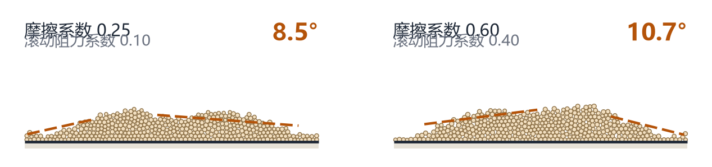
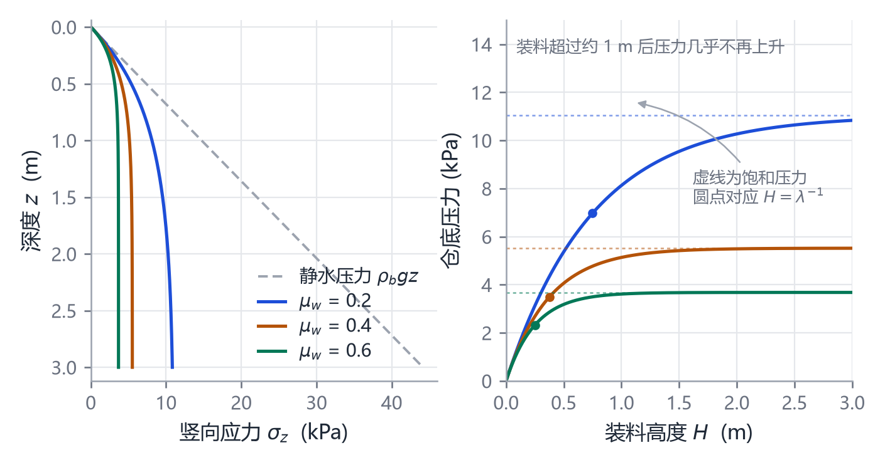

# 第 1 章 颗粒物质的悖论

> 本章导读：一堆干沙能堆出三十多度的斜坡，抓起来却像液体一样从指缝里流走；同一堆沙装进筒仓，仓底承受的压力并不随装填高度一直增长。这一章先把这两个现象摆出来，用休止角和粮仓效应量出它们的尺度，再说清楚颗粒的三种运动状态、连续介质模型在哪里失真，以及离散元与连续体两条路线各自把材料当成什么。

## 1.1 同一堆沙，两副面孔

抓一把干沙松手，它在桌上落成一个小圆锥。锥面的倾角几乎是固定的，再往上加沙，锥面并不变陡，只是整体往外长。把同样的沙倒进一杯水里，它立刻散开，沉到杯底铺成一层接近水平的薄毯。同一批颗粒，一堆能立住，一堆不能，差别不在材料，在周围有没有让它彼此卡住的条件。

再换一个场景会更清楚。踩在干沙上脚会陷，陷下去的地方周围的沙往脚边挤；踩在被海水反复浸过的湿沙上，脚下几乎不下陷，而且沙面会先变干再变湿，一圈水痕往外扩。湿沙颗粒之间有水的毛细桥，能承受一点点拉力；干沙不能。这条差别把颗粒物质和普通固体分开了：它能承受压力与剪切，但基本不能承受拉力。悬臂梁靠的是抗拉，所以沙堆做不出悬挑，超过某个角度就只能靠一个斜面来支撑自己。

“沙堆能立住”这句话要说得准确些。沙堆能立住，是因为它在自重下把剪切应力控制在某个上限之内，而不是因为颗粒被胶结在一起。这个上限与法向应力成正比，比例系数就是摩擦系数。颗粒之间没有拉扯，只有推挤和摩擦。摩擦系数会作为参数反复出现在这一册里，原因就在这里：它同时决定了堆多陡、什么时候塌、塌下来流多快。

沙漏给出另一个方向的反例。颗粒从底部孔口流出，流量几乎不随上方沙层的高度变化：装满时和只剩薄薄一层时，流速差不多。液体完全不是这样，水位越高孔口流速越快，因为压头在那里。颗粒在筒仓里把一部分重量分给了侧壁，底部的压力被截断了，孔口附近的压力梯度因此近似为常数。这件事在 1959 年被 Beverloo 整理成一个经验公式，

$$W=C\,\rho_b\sqrt{g}\,(D-k\,d)^{5/2}$$

$W$ 是质量流量，$D$ 是孔口直径，$d$ 是颗粒直径，$\rho_b$ 是堆积密度，$k$ 是与颗粒形状有关的常数，量级在 1 到 2 之间，$C$ 是无量纲系数。公式里没有装料高度，这是它最反常的地方。一个能被倒空的容器，里面的东西却感觉不到上面压了多少——连续介质的直觉第一次在这里失灵。

## 1.2 休止角

自由表面与水平面的夹角叫休止角。干石英砂在 30 到 35 度之间，圆润的玻璃珠只有 22 到 24 度，棱角分明的碎石可以到 40 度，新雪在 35 度上下，湿沙能立到 45 度甚至接近垂直。这些数字背后有两层不同的机制，混在一起谈就会得出错误的结论。

第一层是单颗颗粒在斜面上的力平衡。坡面上取一颗沙，重力沿坡向下的分量是 $mg\sin\theta$，最大静摩擦是 $\mu mg\cos\theta$，临界条件

$$\tan\theta_c=\mu$$

$\theta_c$ 是临界角，$\mu$ 是颗粒与坡面的摩擦系数，$m$ 是颗粒质量，$g$ 是重力加速度。这给出一个干净的答案：角度只由摩擦系数决定。但拿 $\mu=0.4$ 代进去只有 22 度，比实测的 33 度低了一大截。差额不在推导错，而在这幅图景漏掉了坡面本身也是颗粒做的。

第二层是颗粒之间的几何互锁。坡面上的颗粒不是躺在一块光滑斜板上，而是卡在下面一层颗粒的凹坑里。要让它翻过前面的颗粒，整层颗粒得先松开一点，让出空间。这个“松开”就是剪胀：密实的颗粒堆积在受剪时必须体积膨胀，否则颗粒没有位置可换。体积一膨胀，法向应力被卸掉一部分，但几何约束同时提供了额外的抵抗力，两者叠加，实测角度就比 $\tan\theta=\mu$ 高。形状越不规则、棱角越多，互锁越强，休止角越高；玻璃珠是圆的，几乎不互锁，所以角度最低。

这也解释了为什么在离散元里只调摩擦系数做不出正确的沙堆。摩擦系数决定滑动，但决定堆形的是颗粒怎么互相卡住，而卡住需要滚动阻力来代表：两颗圆球接触时，即使摩擦系数很大，只要没有力矩阻止它们相对滚动，整个接触点就像一个铰，堆就会自己摊平。加上一层滚动阻力，同样的摩擦系数就能堆出陡得多的坡。这不是数值技巧，是把“颗粒不是球”这件事补回模型里。

休止角决定了两件工程上很实际的事：堆的形状，以及崩塌从哪一刻开始。影视里要一个“看起来像沙子”的堆，先把这个角度调对，比调任何其他参数都有效；角度差五度，观众立刻觉得材质不对。

<figure class="fig">

<figcaption><b>图 1-1</b>　两种摩擦系数下的沙堆（真实二维离散元计算，规模很小）。400 个圆盘从上方定点落下堆积，法向用弹簧-阻尼，切向用库仑摩擦并加滚动阻力，颗粒直径 1、重力 $g=1$、法向刚度 $2\times10^3$、时间步 $2\times10^{-3}$，共 4 万步。左：摩擦系数 0.25、滚动阻力系数 0.05；右：摩擦系数 0.6、滚动阻力系数 0.25。锥面上的直线是对自由表面拟合的结果，量出的休止角分别为 $18.6^\circ$ 与 $31.4^\circ$，后者接近干砂的实测值。颗粒数只有四百，坡面上能看到明显的分层与架空，真实沙堆里这些细节小到看不见。</figcaption>
</figure>

## 1.3 粮仓效应

把一个高筒仓装满沙，测仓底的压力，会得到一个与直觉相反的曲线：压力随深度先涨，涨到某个深度之后几乎不再变。继续加沙，底压只增加一点点。同样深度的水，压力随深度线性增长，越深越危险；沙不是。

Janssen 在 1895 年给出的解释至今仍在用。取一段厚度 $\mathrm{d}z$ 的水平薄片，半径 $R$，堆积密度 $\rho_b$，竖向应力 $\sigma_z$，侧向应力 $\sigma_h$。薄片上下表面的压力差要平衡它自己的重量，同时侧壁的摩擦把一部分重量往上托：

$$\pi R^2\,\mathrm{d}\sigma_z+\tau_w\,2\pi R\,\mathrm{d}z=\rho_b g\,\pi R^2\,\mathrm{d}z$$

$\tau_w$ 是壁面剪应力。假设壁面摩擦已经充分发挥，$\tau_w=\mu_w\sigma_h$，再假设侧向应力与竖向应力之比为常数 $K=\sigma_h/\sigma_z$，代进去整理得到

$$\frac{\mathrm{d}\sigma_z}{\mathrm{d}z}=\rho_b g-\lambda\sigma_z,\qquad \lambda=\frac{2\mu_w K}{R}$$

$\lambda$ 的量纲是长度的倒数，它的倒数 $\lambda^{-1}=R/(2\mu_wK)$ 是这场竞争的尺度：重力想把应力往下加，壁摩擦把它卸掉，谁在更短的距离里起作用，谁的规则就主导。方程的解是

$$\sigma_z(z)=\frac{\rho_b g}{\lambda}\left(1-e^{-\lambda z}\right)$$

深度远大于 $\lambda^{-1}$ 时，指数项消失，应力停在一个饱和值 $\rho_b g/\lambda=\rho_b g R/(2\mu_wK)$，与深度无关。饱和值与半径成正比：仓越宽，能挂住的比例越小，底压越高，这也是大直径筒仓更容易出事故的原因。

代入一组具体数字。$R=0.15$ m，$\rho_b=1500\ \mathrm{kg/m^3}$，$\mu_w=0.4$，$K=0.5$，于是 $\lambda=2.67\ \mathrm{m^{-1}}$，深度尺度 0.375 m，饱和压力 5.5 kPa。同样深度下水的静压是 $\rho g z$：1 m 处 14.7 kPa，2 m 处 29.4 kPa，3 m 处 44.1 kPa，一路线性上涨；沙在 1 m 处 5.1 kPa，2 m 处 5.5 kPa，3 m 处仍是 5.5 kPa。两者的比值从 0.35 掉到 0.12，而这个比值还在继续往下掉。图 1-2 把这两条曲线画在一起。

<figure class="fig">

<figcaption><b>图 1-2</b>　粮仓效应的压力曲线（按 Janssen 公式真实计算）。左：竖向应力随深度的变化，横轴为应力，纵轴为深度向下，灰线是同密度的静水压力 $\rho_b g z$ 作参照，三条实线对应壁摩擦系数 0.2、0.4、0.6，其余参数 $K=0.5$、$R=0.15\ \mathrm{m}$、$\rho_b=1500\ \mathrm{kg/m^3}$。右：仓底压力随装料高度的变化，不同高度对应的曲线在 $H$ 超过约 1 m 之后就不再上升，虚线标出各自的深度尺度 $\lambda^{-1}$。</figcaption>
</figure>

这个结果有三处延伸值得记住。第一，沙漏的流量与装料高度无关，原因就在底压饱和：孔口上方的压力梯度近似常数，颗粒是被局部重力而不是被整柱重量推出去的。第二，沙层越深越难拔出一根插进去的杆，因为侧向应力被放大成法向压力，摩擦随深度一起变大。第三，它暴露了一个方法论上的问题：应力不是由局部的应变决定的，而是由“重量怎么沿接触网络分配到墙上”这个全局过程决定的。换一种装料方式，同样的沙、同样的深度，底压可以不一样，这叫历史相关。连续介质本构里没有任何一项能表达“这批沙是怎么装进去的”。

Janssen 的假设也很强。$K$ 取常数意味着侧向应力与竖向应力同步涨落，实际筒仓里 $K$ 随深度变化；壁摩擦被假定处处充分发挥，实际在装料和卸料时方向相反，峰值也不同。偏心卸料时侧壁的局部压力可以远高于 Janssen 的估计，这正是筒仓设计规范里要额外乘系数的原因。模型的边界在哪里，比模型本身更值得记住。

## 1.4 三种状态

颗粒物质的行为随“动得多快”换面孔，而快慢不是用速度直接衡量的，要用一个把速度、颗粒尺寸和围压放在一起的无量纲数。取剪切速率 $\dot\gamma$、颗粒直径 $d$、围压 $p$、颗粒密度 $\rho_s$，定义惯性数

$$I=\frac{\dot\gamma d}{\sqrt{p/\rho_s}}$$

分母 $\sqrt{p/\rho_s}$ 是压力对应的特征速度，可以理解为颗粒被压紧时声速的量级；分子是颗粒在一个直径的距离上被剪切推开的速度。两者相除，衡量的是“重排比压缩快多少”。这个数的完整用法留到讲流变的章节，这里只需要它划分出的三段。

$I$ 小于 $10^{-3}$ 是准静态。颗粒之间的接触网络持续存在，变形靠局部的小幅重排，颗粒的动能相对弹性势能可以忽略。沙堆缓慢加高、地基沉降、沙漏上部几乎不动的沙层，都在这个区间。这时用静力平衡加摩擦屈服面描述是合适的，力链贯穿整个堆积，把荷载从顶部送到某个远处的支点上。

$I$ 在 $10^{-3}$ 到 $10^{-1}$ 之间是稠密流动。接触仍然频繁，但重排的速度已经跟压缩波同量级，颗粒之间的碰撞还没结束就又开始下一次接触。沙漏孔口下方、搅拌机里、雪崩的滑动层，都在这个区间。速度剖面不再线性，靠近底面的颗粒被摩擦拖慢，离底面几个直径之外才接近自由流动，中间那层就是剪切带。

$I$ 大于 $10^{-1}$ 是稀薄气体。颗粒之间的自由飞行时间远长于接触时间，碰撞变成瞬时事件，颗粒的轨迹像分子，只是碰撞是非弹性的、形状是不规则的。风沙的近地跃移层、爆破后的飞石、雪崩前锋抛出的雪雾，都属于这一类。这时应该用动理学理论，而不是弹塑性力学。

用具体数字感受一下这个划分。取 $p=1$ kPa、$d=0.3$ mm、$\rho_s=2500\ \mathrm{kg/m^3}$，特征速度是 0.63 m/s。$I=10^{-3}$ 对应 $\dot\gamma\approx2\ \mathrm{s^{-1}}$，$I=10^{-1}$ 对应 $\dot\gamma\approx200\ \mathrm{s^{-1}}$。沙漏里颗粒下落速度约 0.1 m/s，跨越 1 cm 的孔口区域，剪切速率约 $10\ \mathrm{s^{-1}}$，$I$ 约 $5\times10^{-3}$，正好在稠密流动的下段。这个位置很微妙：既不是准静态，也远没到碰撞主导，所以沙漏既不能用静力平衡算，也不能用气体动理论算。

三种状态不是三种材料，而是同一批颗粒在不同驱动强度下的三种响应。麻烦在于它们可以在同一时刻共存：雪崩的滑动面上，滑动层是稠密流动，下面几厘米的雪是准静态的固体，上面扬起的是稀薄气体。一个模型如果只能表达其中一种，就必须在界面上做切换，而界面在哪里、怎么切换，往往比每种状态内部的方程更难写对。

还有第四类材料需要单独提一句：有粘聚的颗粒物质。湿沙、雪、粉末、面团，颗粒之间有毛细力或烧结颈，能承受拉力，因此可以立成垂直的墙、可以悬垂、可以被拉断。它们的屈服面像一个带拉伸截断的库仑面，处理时要在摩擦之外再加一个粘聚项。这一册后面讲雪的本构时会把这一项具体化。

## 1.5 连续介质为什么会在这里失效

把颗粒物质当成连续体，需要三件事成立：存在一个远小于宏观尺度又远大于颗粒尺度的体积元，在这个体积元上平均出来的应力与应变率有确定关系；应力只依赖局部的应变率与状态；边界条件能唯一确定解。颗粒物质三件事都不完全成立，只是程度不同。

第一件，尺度分离。一颗沙 0.3 mm，一个沙堆 1 m，比值三千，看起来够小。但塑性变形不发生在整个沙堆里，发生在剪切带里，而剪切带的宽度只有五到十个颗粒直径。也就是说，真正需要本构关系的那一层，厚度只有两三个毫米，里面装着不到十层颗粒。在这一层里，颗粒的排列、某一条力链是否恰好穿过，都直接影响结果，平均没有意义。

第二件，应力的确定性。给定一个容器和一堆沙，平衡方程加屈服条件并不能唯一确定应力场。原因是接触网络是离散的：荷载沿着某些链传递，链的走向由堆积历史决定，不由当前的宏观应变决定。两块完全相同的沙，装法不同，底部压力分布可以差出几成。连续体理论里应力是应变的历史积分，颗粒物质里应力更像是一张固定的、由接触拓扑决定的网络上的流量分配。这被称为静不定性，它不是数值误差，是材料本身的性质。

第三件，非局部。在孔口附近、在剪切带两侧、在刚性壁面附近，扰动的影响可以传出五到十个颗粒直径，远超局部本构能覆盖的范围。薄层流动是最刺眼的例子：同样剪切速率下，一层只有几个颗粒厚的沙比厚层流得慢，因为颗粒被上下边界同时约束，重排需要协调；用任何只依赖局部 $\dot\gamma$ 和 $p$ 的模型，都算不出这个差别。补救办法是在本构里引入一个长度尺度，让应力依赖邻域的平均，这就是非局部流变。

还有一条更根本的：剪胀。密实的沙受剪必须膨胀，否则颗粒没有空间错位。关联流动法则要求塑性应变的方向垂直于屈服面，而剪胀的方向与屈服面的法向不一致，两者夹角叫剪胀角，通常比摩擦角小好几度，松沙甚至为零。这意味着连续体模型必须写成非关联的，切线刚度矩阵因此不对称，数值求解的代价和难度都上一档。

这些不是说连续介质模型不能用，而是说它的参数不再是从材料手册上查来的常数，而是要在特定工况下标定出来的量。把它当“近似”用可以，把它当“真理”用就会在薄层、孔口、壁面附近出问题。

## 1.6 两条路线

面对同一个沙堆，有两种造法。

第一条是离散元。把每颗沙当成一个刚体，位置、速度、转角、角速度是状态，颗粒之间的接触用弹簧、阻尼、摩擦来算力，然后显式积分。1979 年 Cundall 与 Strack 提出这套做法时，算的是岩石力学里的二维圆盘，几百颗；今天同一套方程可以喂给 GPU 算上亿颗。它的好处是把“颗粒”这件事保留到了最后一步：可以有不同的粒径分布、不同的形状、不同的表面摩擦，力链会自动长出来，不需要谁去假设。它的代价也直接：时间步由最硬的接触刚度决定，刚度越大步长越小；参数标定没有解析公式，只能对着实验反推；而且它本质上是个采样，颗粒数不够时堆的形状会随机的抖。

第二条是连续体。把沙当成一种带屈服面的材料，写本构，解动量方程。最朴素的做法是库仑塑性加关联流动，效果不好；改进的方向有两个，一是把摩擦系数写成惯性数的函数 $\mu(I)$，让材料自己随剪切强度在固体与流体之间过渡；二是把求解器换成能扛大变形的方法，比如物质点法。物质点法把物质挂在粒子上、把动量方程放在网格上解，天然适合沙这种“流起来像液体、堆起来像固体”的东西。zhu2005 用高度场加粒子网格混合的方法做过浅层沙的流动，把沙当不可压流体处理，摩擦通过边界条件施加；daviet2016 把 Drucker-Prager 屈服面塞进半隐式物质点法，让沙和雪在刚度很大时也不至于被显式步长拖死。这两条都属于“先承认它是连续体，再想办法让它在屈服前后都算得动”。

两条路线的分界不在精度，在“这一刻把材料当固体还是当流体”。准静态堆积、颗粒尺寸影响显著、需要每颗颗粒的轨迹（比如沙粒从坡面滚下来的路径），用离散元；大范围流动、颗粒数远超算力、只关心自由表面和整体形状，用连续体。中间的稠密流动区两条都能用，也都有偏差：离散元受颗粒数限制，连续体受本构限制。

还有第三条路，把两者接起来：近处用离散元保证细节，远处用连续体节省算力，界面处交换质量、动量与应力。这条路的困难全在界面上——颗粒从哪一刻开始算连续体，连续体又怎么吐回颗粒。这一册后面讲两相耦合时会再碰到它。

## 1.7 尺度

先算清楚数量级，后面的取舍才有依据。

一颗中砂粒径 0.3 mm，体积约 $1.4\times10^{-11}\ \mathrm{m^3}$。掌心一把沙大约十万颗。一立方米松散的干沙，按孔隙率 0.4 计算，颗粒体积 0.6 立方米，除以单颗体积，得到约 $4\times10^{10}$ 颗。也就是说，影视镜头里一个两米见方的沙坑，颗粒数以百亿计。

离散元算一颗颗粒一步的代价，大约是它与十个邻居的接触计算，每个接触几十次浮点运算，加上积分与邻居搜索，实测量级在每颗每步一百到三百次运算。取中间值 200，颗粒数 $10^6$，每步 $2\times10^8$ 次运算。这意味着一帧里能跑的步数是有限的：60 分之一秒的预算下，即便有 10 TFLOP/s 的有效算力，也只能跑几百步；而为了保证稳定，步长常常在 $10^{-5}$ s 量级，一帧需要上千步。所以百万颗粒在 GPU 上跑实时，靠的不是算力过剩，而是牺牲：减小刚度、放大颗粒、减少子步、用更大的时间步配更强的阻尼。这些牺牲在画面上未必看得出来，但它们决定了模拟结果能不能被当作物理来信任。

数量级差得太远时，只能换方法。百亿颗粒的沙坑不可能逐颗算，连续体方法把自由度从颗粒数降到网格数：同样两米见方的区域，网格 128 立方，自由度两百万，比颗粒数少四个数量级。代价是失去了颗粒尺度的一切：粒径分布、颗粒形状、力链、以及“沙从指缝漏下”这种必须逐颗才能表现的细节。

工程上的折中是分层。镜头近处的沙用离散元，几万到几十万颗，保证近景的颗粒感和崩塌的碎块；中景用连续体，网格分辨率刚好能表现坡面的起伏；远景只保留一层贴图或程序化噪声。三层的交界要处理两件事：几何上不能有缝，动力学上不能有质量与动量的凭空产生或消失。这一册第 9 章会具体讲这套做法。

尺度还有另一层含义：时间。准静态堆积要跑到系统自己停下来，特征时间是 $\sqrt{H/g}$，$H$ 是堆高，1 m 的堆约 0.3 s，但要跑到接触网络稳定，实际要几秒到几十秒的模拟时间；而一次雪崩从起滑到停止只有几秒。两种过程对步长的要求差得远，对结果的容忍度也差得远：堆积算歪一点没人看得出，雪崩的起滑时刻错半秒，镜头就废了。
