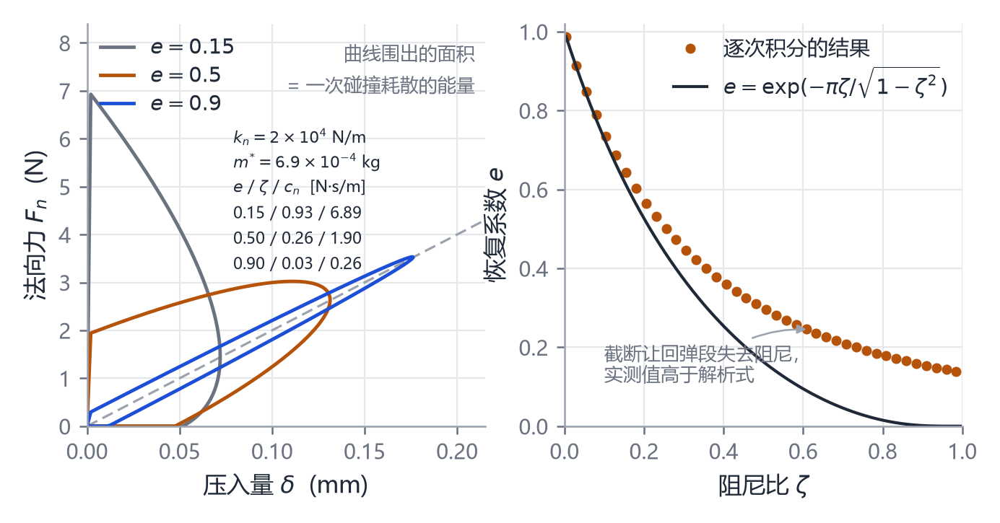
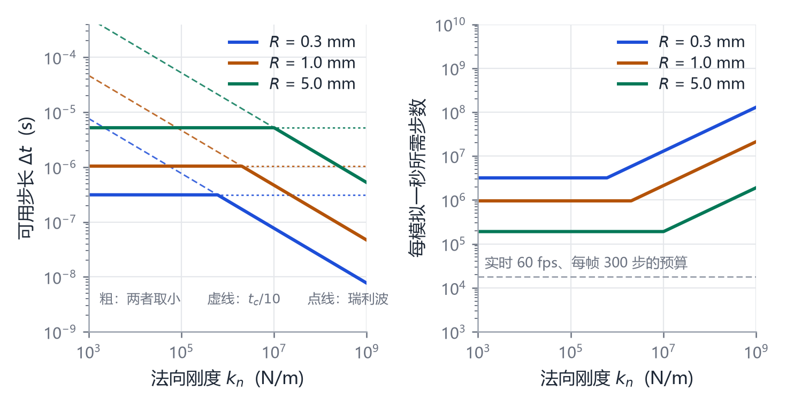

# 第 2 章 离散元与接触模型

> 本章导读：离散元把每一颗沙当成一个刚体，剩下的问题全在接触上：两颗颗粒压在一起时力有多大，滑开时摩擦怎么记，滚起来又靠什么停。这一章从两个球的对撞开始，依次给出法向、切向、滚动三个方向的接触模型，然后是邻居搜索、时间步与稳定性，最后是非球形颗粒的几种表示和一套能落地的参数标定流程。

## 2.1 两颗球的对撞

拿两颗玻璃球对撞，听声音、看回弹，能得到两条信息：接触持续了多久，弹回来多快。这两条几乎定义了法向接触模型需要的全部参数。

真实的接触是一个很小的面积。两颗半径 0.3 毫米的石英球，在 1 N 的载荷下互相压进约 1.4 微米，接触圆的半径只有十几微米。这个尺度用 Hertz 理论算：两个弹性球的正压力与压入量的关系是

$$F_n=\frac{4}{3}E^{*}\sqrt{R^{*}}\;\delta^{3/2}$$

$\delta$ 是压入量，$R^{*}$ 是等效半径，两个球半径分别为 $R_1,R_2$ 时 $1/R^{*}=1/R_1+1/R_2$；$E^{*}$ 是等效弹性模量，$1/E^{*}=(1-\nu_1^2)/E_1+(1-\nu_2^2)/E_2$，$E$ 与 $\nu$ 分别是杨氏模量与泊松比。指数 $3/2$ 意味着刚度不是常数：压得越深越硬。把 1 N 与 1.4 微米代回去，割线刚度约 $1.1\times10^{6}\ \mathrm{N/m}$，也就是一牛每微米。这个数字后面会反复出现，因为它直接决定了时间步能取多大。

Hertz 定律在离散元里用得不多，原因很实际：它让每一步都要算一次 $3/2$ 次幂，而在颗粒互相挤压、接触不断生灭的情况下，用一条斜率固定的弹簧代替它，结果的差别远小于参数标定本身的误差。于是绝大多数代码用线性弹簧

$$F_n=k_n\delta+c_n\dot\delta$$

$k_n$ 是法向刚度，$c_n$ 是阻尼系数，$\dot\delta$ 是压入速率。$\delta$ 大于零时才有这个力，两颗颗粒分开的瞬间弹簧就不能再拉——颗粒之间没有粘接，这一点必须显式判断，写成 $\max(0,\cdot)$，漏掉它颗粒会被粘在一起。

阻尼项决定了弹回多少。对线性弹簧-阻尼系统，一个压缩-回弹周期结束后的速度比是

$$e=\exp\left(-\frac{\pi\zeta}{\sqrt{1-\zeta^{2}}}\right)$$

$e$ 是恢复系数，$\zeta=c_n/(2\sqrt{k_n m^{*}})$ 是阻尼比，$m^{*}=m_1m_2/(m_1+m_2)$ 是等效质量。反过来用更方便：量到 $e$ 之后

$$\zeta=\frac{-\ln e}{\sqrt{\pi^{2}+\ln^{2}e}}$$

干石英砂的 $e$ 在 0.5 到 0.7 之间，湿沙更低，金属球可以到 0.9。这个数不是材料常数，它随撞击速度下降：慢速对撞时接触时间长，阻尼有时间把能量耗掉，$e$ 接近静态值；速度上去之后，接触时间缩短，来不及耗散，$e$ 反而变大。工程上取一个中速下的平均值就够了，但如果场景里有从高处落下的颗粒，用同一个 $e$ 会低估反弹。$e=0.5$ 对应 $\zeta=0.215$，$e=0.9$ 对应 $\zeta=0.028$，$e\to0$ 时 $\zeta\to1$。图 2-1 左边把三个恢复系数下的力-位移曲线画在一起，右边是这条公式与数值积分的对照。

<figure class="fig">

<figcaption><b>图 2-1</b>　单次对撞的力与位移（真实计算）。等效质量 $m^{*}=6.9\times10^{-4}\ \mathrm{kg}$（半径 5 mm 的石英球），刚度 $k_n=2\times10^{4}\ \mathrm{N/m}$，入射速度 1 m/s，时间步 $2\times10^{-6}$ s，半隐式欧拉。左：力随压入量的变化，三个闭合环对应三个恢复系数，环的面积就是一次碰撞耗掉的能量，$e$ 越小环越胖；细虚线是纯弹簧 $F_n=k_n\delta$，加载支在它上方、卸载支在它下方，偏离量正是阻尼力 $c_n\dot\delta$，图内直接标出了每组的 $\zeta$ 与 $c_n$；回弹末段算出的力会变成负值（阻尼在拉），实现里截断到零，所以曲线贴着横轴收尾，实测恢复系数因此略高于解析式；右：扫描阻尼比得到的恢复系数，点是积分结果，曲线是 $e=\exp(-\pi\zeta/\sqrt{1-\zeta^{2}})$，最大偏差出现在 $\zeta$ 接近 1 的过阻尼区，因为那时弹簧还没来得及推开，颗粒就已经被阻尼拖住了。</figcaption>
</figure>

## 2.2 切向摩擦：必须记住历史

法向只管压，切向才决定沙堆能不能立住。切向力不能用一条“当前相对位移乘刚度”的公式，因为摩擦是有历史的：两颗颗粒先被推着错开一点，再推回来，力不会沿原路返回，而是沿着一条滞回曲线走。这个滞回就是能量耗散，也是静摩擦能“记住”自己站在斜坡上的原因。

Cundall 与 Strack 的做法是给每个接触配一个切向位移 $\boldsymbol{\xi}$，每一步积分

$$\boldsymbol{\xi}\leftarrow\boldsymbol{\xi}+\mathbf{v}_t\,\Delta t,\qquad F_t=\min\left(k_t|\boldsymbol{\xi}|,\;\mu F_n\right)$$

$\mathbf{v}_t$ 是接触点处的相对切向速度，$k_t$ 是切向刚度，$\mu$ 是摩擦系数，$F_t$ 的方向与 $\boldsymbol{\xi}$ 相反。第二个式子的意思是：切向力先按弹簧长，长到 $\mu F_n$ 就封顶，之后颗粒开始滑动，$\boldsymbol{\xi}$ 被拉回到刚好等于上限的位置。这一步“拉回”不能省，否则弹簧会越拉越长，卸载时弹出一个远大于摩擦上限的力。

这里有一个很容易写错、而且错了很难看出来的地方：$\mathbf{v}_t$ 必须是接触点处的速度，不是两颗颗粒质心的速度差。接触点在颗粒表面，颗粒自转会让接触点额外获得 $\boldsymbol{\omega}\times\mathbf{r}$ 的速度，$\boldsymbol{\omega}$ 是角速度，$\mathbf{r}$ 是从质心指向接触点的向量。漏掉自转项，摩擦力矩就变成一个只驱动自转、没有反作用的东西：每次接触都在给颗粒加速旋转，而切向弹簧感觉不到旋转，永远不会把这个力矩还回去。堆积看起来会像被加热过，颗粒在原地高速打转，整堆缓慢摊开。这类错误的症状是能量不守恒而动量守恒，用一次总能量检查就能抓到。

切向弹簧还带来一个结构上的变化：接触变成有状态的。两颗颗粒的接触状态依赖它们从第一次接触以来的全部相对运动，所以一对接触不能在每一帧重新计算，必须跨帧保存。这也是为什么离散元的数据结构里，接触表和颗粒表一样重要，接触消失时要把状态清掉，接触再现时要重新从零开始——把旧状态留给一对刚碰上的颗粒，相当于凭空给它们一段历史。

摩擦系数在这里的物理含义比中学课本里窄。它只是“滑动开始”的门槛，不包含颗粒形状带来的互锁。对圆球，$\mu$ 取 0.5 也只能堆出二十几度的坡；要在数值里还原三十多度的沙堆，还得靠下一节的滚动阻力。

## 2.3 滚动阻力：圆球不是沙

一颗圆球放在斜面上，只要坡度超过零，它就会滚下去，哪怕摩擦系数无穷大。原因是滚动时接触点没有相对滑动，摩擦力矩为零，没有任何东西阻止它转。真实沙粒不是球，棱角卡在邻居的凹坑里，要滚过去必须先把自己抬起来，这个几何障碍在数值里被压缩成一个力矩：滚动阻力。

$$M_r=-\mu_r R_{\mathrm{eff}}F_n\,\mathrm{sgn}\left(\omega_i-\omega_j\right)$$

$\mu_r$ 是无量纲的滚动阻力系数，$R_{\mathrm{eff}}$ 是等效半径，通常取两球半径的平均或 $R^{*}$，$\omega_i-\omega_j$ 是相对角速度。力矩方向永远与相对转动相反，大小正比于法向力——挤压越紧，越难滚。这个形式和库仑摩擦同构：一个是“力封顶”，一个是“力矩封顶”。

实现时要注意两点。第一，力矩不能写成对角速度的黏性阻尼，那样 $\mu_r$ 越大阻力越大，但永远停不下来，颗粒会一直慢慢转。写成库仑封顶才能真的止住转动。第二，封顶值要跟时间步配合：一步之内力矩最多只能把相对角速度降到零，超过就会反向，产生抖动。稳妥的写法是把力矩取成

$$|M_r|\le\min\left(\mu_rR_{\mathrm{eff}}F_n,\;\frac{I_{\mathrm{eff}}\,|\omega_i-\omega_j|}{\Delta t}\right)$$

$I_{\mathrm{eff}}$ 是两个转动惯量的调和平均。第二个限保证了过冲不会发生，代价是它在极快转动时把 $\mu_r$ 的作用削弱了一点，但在颗粒尺度上这点差别看不出来。

$\mu_r$ 的取值没有第一原理可依，只能标定。圆球用 0.05 到 0.1，能堆出二十度出头；带棱角的砂用 0.2 到 0.4，能到三十度以上。它同时影响流动的阻力：$\mu_r$ 调大，沙漏的出流会变慢，雪崩的滑行距离会变短。所以标定时不能只看休止角，要至少同时对上两个量，比如休止角与孔口流量。

三个方向的接触放在一起，可以写出一句话总结：法向管“顶住”，切向管“滑不滑”，滚动管“滚不滚”。这三件事在真实颗粒上是同一件——形状与表面性质共同决定——在模型里被拆成三个独立参数，这既是离散元好调的地方，也是它容易调出“像但不对”的结果的地方。

## 2.4 邻居搜索与时间步

每颗颗粒每一步要找出所有可能与它接触的邻居。最直接的办法是两两比较，代价 $O(N^2)$：十万颗颗粒就是五十亿对，一步都跑不完。实际的邻居数是常数，一颗埋在内陆的颗粒周围只有六到十二个接触，所以正确做法的复杂度应该与颗粒数成正比。

常用的是均匀网格。把空间切成边长不小于最大颗粒直径的格子，每颗颗粒只可能与同格或相邻二十六格的颗粒接触。这样每步的候选对数正比于 $N$ 乘以每格平均颗粒数，与总颗粒数无关。格子数要控住：格子太小，邻居格数爆炸；格子太大，每格里的颗粒太多。经验上格子边长取两倍最大半径，每格平均装一到两颗。

格子每步重建。对百万颗粒，重建本身要遍历所有颗粒算格号，然后按格号排序，代价 $O(N)$，但常数不小，通常是每帧的主要开销之一。改进办法是只在颗粒跨格时更新，或者用 Morton 码把三维格号压成一个整数排序，让同格的颗粒在内存里连续，顺便把访存也理顺了。

另一层优化是 Verlet 表：把“可能接触”的阈值放大一点，多存一圈邻居，若干步重建一次。放大出来的余量叫 skin，一般取颗粒直径的十分之一到二分之一。判据是：如果所有颗粒在这一步里移动的最大距离不超过 skin 的一半，表就仍然有效；一旦超了就得重建。换成速度就是重建周期 $n\le\mathrm{skin}/(2v_{\max}\Delta t)$，$v_{\max}$ 取全场最大速度。这一步需要每步追踪最大位移，成本很低，换来的是重建次数下降一个数量级。

数据布局也影响这一步的代价。颗粒属性存成结构体数组时，遍历邻居会跨步访问内存，缓存命中率低；拆成每个属性一个数组，接触计算只需要位置与速度两个数组，其余属性留在别处，带宽立刻降下来。这类改动不改算法，只是让同样的访问次数落在更少的缓存行上。

时间步和邻居搜索是绑在一起的。步长太小，搜索与重建的次数跟着涨；步长太大，接触被“跳过”——两颗颗粒一步之内从没碰上到深深重叠，弹簧给出一个巨大的力，颗粒被弹飞。这个失效模式在画面上表现为莫名其妙的爆发，而且往往只在个别颗粒上出现，很难定位。

## 2.5 时间积分与稳定性

离散元几乎都用显式积分，因为接触力只依赖当前状态，没有需要联立求解的隐式项。最常用的是半隐式欧拉：

$$\mathbf{v}^{n+1}=\mathbf{v}^{n}+\mathbf{a}^{n}\Delta t,\qquad \mathbf{x}^{n+1}=\mathbf{x}^{n}+\mathbf{v}^{n+1}\Delta t$$

先更新速度，再用新速度更新位置。它是一阶格式，但辛，长时间跑不会像显式欧拉那样让能量单调上涨。需要更高精度时用 Velocity Verlet，代价是多存一份加速度，位置精度到二阶。

显式积分的稳定上限由最硬的弹簧决定。把一对接触近似成质量为 $m^{*}$、刚度为 $k_n$ 的弹簧振子，它的周期是

$$t_c=2\pi\sqrt{\frac{m^{*}}{k_n}}$$

半个周期是接触持续时间，数值上要求步长小于它的十分之一左右，$\Delta t\lesssim t_c/10$。还有一条来自弹性波的上限：颗粒内部的瑞利波在一步之内不能穿过整颗颗粒，

$$\Delta t_{R}=\frac{\pi R_{\min}}{0.8766+0.163\nu}\sqrt{\frac{\rho}{G}}$$

$R_{\min}$ 是最小颗粒半径，$\rho$ 是密度，$G$ 是剪切模量，$\nu$ 是泊松比。两条上限取小的那个，才是能用的步长。

把石英的数字代进去会得到一个不舒服的结论。半径 0.3 毫米、$k_n=10^{6}\ \mathrm{N/m}$ 的接触，$t_c/10$ 约 $2.4\times10^{-7}$ s；瑞利波给出的上限是 $3.1\times10^{-7}$ s，两者同一量级。也就是说，一秒钟的物理时间要算四百万步。一百万颗颗粒乘四百万步，任何硬件都不可能实时。

工程上的出路只有一条：放大颗粒，顺带把刚度调软。只降刚度几乎不省时间——对 $R=0.3$ mm 的颗粒，$k_n$ 从 $10^{6}$ 降到 $10^{4}$，接触周期给出的上限涨了十倍，但瑞利波上限是一条水平线，取小之后可用步长只从 $2.4\times10^{-7}$ s 涨到 $3.1\times10^{-7}$ s，一秒钟照样要算三百万步；同时重叠量按 $F/k_n$ 长，接触从“硬”变“糊”，力的传递变得迟钝。真正有效的是把颗粒一起放大：影视里的沙粒常常按毫米级建模，$R$ 到 5 mm 时瑞利波上限放开到 $5\times10^{-6}$ s，配 $k_n=10^{4}$ 到 $10^{5}$、重叠控制在直径的百分之一以内，一帧（1/60 s）三千步左右就能跑完。代价是碰撞变“软”、弹性波速被压低、颗粒之间的动量传递变慢。好在沙堆的宏观行为（休止角、流动形态）对刚度的依赖是弱的，只要刚度远大于重力引起的应力、重叠远小于粒径，结果就基本一致。这条经验叫软球近似，它是离散元能用在影视里的前提。

<figure class="fig">

<figcaption><b>图 2-2</b>　刚度与临界步长（真实计算）。左：两条限制随法向刚度的变化，双对数坐标，虚线为接触周期限制 $\Delta t=t_c/10$（$t_c=2\pi\sqrt{m^{*}/k_n}$），点划线为瑞利波限制 $\Delta t_R=\pi R\sqrt{\rho/G}/(0.8766+0.163\nu)$，石英参数 $\rho=2650\ \mathrm{kg/m^3}$、$G=29\ \mathrm{GPa}$、$\nu=0.2$，三条实线对应半径 0.3、1、5 mm，实际可用的步长是两者的下包络；右：同样三条曲线换成“每模拟一秒需要多少步”，横轴仍是刚度。可以看到步长在刚度低的一侧被瑞利波上限压平（对 $R=0.3$ mm 一直压到 $10^{6}\ \mathrm{N/m}$ 附近），只有刚度高的一侧才轮到接触周期，按 $k_n^{-1/2}$ 往下走；两者的交点随颗粒半径往右移，颗粒越大越容易让接触周期成为瓶颈。</figcaption>
</figure>

图 2-2 的右半张解释了一个常见的误解：很多人以为把刚度调小就能无限提速。刚度降到一定程度之后，瓶颈从接触周期换成了波在颗粒内部的传播，此后降刚度只增加重叠、不减少步数。要再快，只能放大颗粒或者减少颗粒数。

另一条路是根本不接受软球近似：把沙当连续体，刚度就不再决定步长。Daviet 与 Bertails-Descoubes 把 Drucker-Prager 屈服面塞进半隐式物质点法，每个粒子只在局部解一次带摩擦锥的最优性条件，时间步可以比显式大两个数量级 [@daviet2016]；Zhu 与 Bridson 用高度场加 PIC 把浅层沙当不可压流体推，摩擦通过速度边界施加，刚度这个概念在公式里根本不出现 [@zhu2005]。两者都不做逐颗接触，代价是丢掉颗粒尺度的细节——粒径分布、力链、坡面上的单颗滚动，好处是步长只受网格上的对流条件限制。选哪条，取决于镜头里要不要看见颗粒本身。

## 2.6 非球形颗粒

圆球是最便宜的表示，也是最不真实的一种。沙粒的形状介于棱角状与圆润之间，形状直接影响休止角、堆积密度、剪切带的宽度和流动的各向异性。离散元里有三种常见做法。

多球聚合是把若干个球刚性地焊在一起，形成一个刚体。接触检测仍然只处理球-球，代码不用改，代价是接触数变多：一个由八到十二个球组成的颗粒，候选接触是单球的数倍。优点是稳、好实现、和已有的球代码完全兼容；缺点表面不够光滑，颗粒的外形有一圈“疙瘩”，滚动时会感觉到周期性起伏，除非球足够小、数量足够多。

超椭球用隐式方程定义表面：

$$\left|\frac{x}{a}\right|^{n}+\left|\frac{y}{b}\right|^{n}+\left|\frac{z}{c}\right|^{n}=1$$

$a,b,c$ 是三个半轴，$n$ 控制棱角程度：$n=2$ 是椭球，$n$ 越大越接近方块。它的好处是一个颗粒只有一个形状参数组，接触检测要解一个一维求根，计算量比多球聚合小，表面光滑且棱角可控。麻烦在接触点与法向的求解：两个超椭球之间的最近点没有解析解，要用迭代，迭代不收敛时会出现力突变。

凸包是把颗粒的外形直接当成一个凸多面体，顶点来自扫描或手工建模。接触检测用 GJK 求最近点、用 EPA 求穿透深度，两个算法都是迭代的，复杂度与顶点数有关。它最真实，也最贵：每次接触要跑几十次迭代，而且在 GPU 上不好并行，因为每个接触的迭代次数不一样。Tasora 与 Anitescu 走的是另一条路 [@tasora2010]，把大量颗粒的接触写成凸互补问题，用投影迭代一次解掉全部非穿透约束，适合大规模流动，但对形状的支持仍然以凸体为主。

三种表示的选择取决于要什么。要的是堆的形状与流动的整体感，多球聚合最划算；要的是颗粒在斜面上“卡住”的这个细节，超椭球或凸包更合适；要在 GPU 上跑几百万颗，多半还是圆球加滚动阻力，把形状折算进摩擦参数里。

形状还带来一个容易被忽略的后果：堆积密度。同样大小的球随机堆积，孔隙率在 0.36 到 0.40 之间；换成有棱角的颗粒，可以堆到 0.45 甚至更高。如果只改形状不改粒径，颗粒总数不变而体积变大，整堆会明显“鼓”起来。这个问题在混合使用球与非球资产的场景里很常见。

## 2.7 参数标定

离散元的参数没有一条能从材料手册上直接查到，全靠对着实验反推。可用的实验有四类：休止角、堆积密度、孔口流量、单轴压缩。四个量分别约束不同的参数，配起来用才不至于调出一个“单项对、整体错”的组合。

休止角主要约束 $\mu$ 与 $\mu_r$。做法是做一个塌落或漏斗堆积的数值实验，量自由表面斜率。注意测量方式：从锥顶到坡脚取直线拟合，去掉顶部圆角与底部坡脚；用最大高度乘二除以底宽，得到的是平均角，比局部坡角小几度。

堆积密度约束粒径分布与形状。把颗粒倒进一个容器，压实到稳定，量总质量除以体积得到堆积密度，与实验对比。偏差大说明粒径分布太窄（单分散的球堆不密）或形状太圆。

孔口流量约束摩擦与恢复系数。Beverloo 公式的系数对 $\mu$ 敏感，流量对 $e$ 敏感：$e$ 大，颗粒碰撞后横向飞散得多，流量下降。

单轴压缩约束刚度与粘聚。压缩曲线的前段斜率给出等效模量，峰值后的软化给出粘聚与剪胀。这一项在沙上不好做，在雪和泡沫上很重要。

标定的顺序建议从粗到细。先定粒径分布与形状，这两个是几何量，改了它们所有力学量都要重调；再定 $\mu$ 与 $\mu_r$ 使休止角对上；然后用孔口流量微调 $e$；最后检查堆积密度是否合理，不合理就回头改粒径分布。整个流程里最忌讳的是同时改三个参数——每改一次都要重跑全部实验，迭代次数会爆炸。

刚度放在最后调，而且只按性能需要调。前面说过，宏观结果对刚度不敏感，所以先在物理合理的范围内取一个刚度，跑出一个可接受的步长，再看结果对不对。如果结果对刚度敏感（比如颗粒被压得很扁，或者接触时间长到与宏观流动时间同量级），说明刚度取得太低，软球近似已经不成立，这时应该放大颗粒尺寸而不是继续压刚度。

举一个具体的例子。目标是一堆干砂，实测休止角 33 度、堆积密度 $1600\ \mathrm{kg/m^3}$。先把粒径按 0.25 到 0.4 毫米的正态分布定下来，球半径放大到毫米级以换取步长；然后固定 $e=0.5$，扫 $\mu$ 与 $\mu_r$，找到 $\mu=0.45$、$\mu_r=0.25$ 时休止角落在 32 到 34 度之间；接着量孔口流量，偏大就把 $\mu$ 往上抬一点，偏小就降；最后查堆积密度，若只有 1500，说明粒径分布太窄，把标准差加大再来一轮。三轮之内通常能收敛，超过五轮还没对上，多半是某个量的测法有问题，而不是参数没调好。

参数定好之后建议存成一份带说明的文件，写清每个数对应的实验、测法、容差。这套参数在换场景时往往还要微调：同一批沙，倒在平板上的休止角与倒在粗糙地面上的不一样，尺度放大之后，边界摩擦占的比例变小，堆会变陡。这类差异不是模型的错，是它诚实地反映了边界条件，值得在工程记录里写下来。
