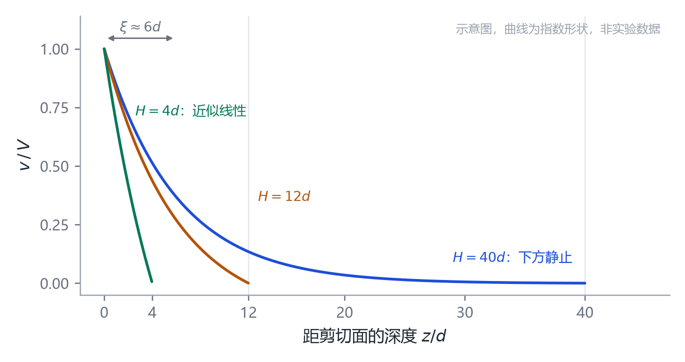

# 第 3 章 从颗粒到连续体的流变

沙漏是最古老的计时器之一，它的可靠性建立在一个反直觉的事实上：上半球里的沙从满到空，沙面下降了十倍，流出的速度几乎没有变化。换成水就不行——水的孔口出流速度是 $\sqrt{2gh}$，水位一低，流速立刻跟着掉，一个水漏计时器根本没法用。

这个差别卡住了所有想把颗粒当成流体来算的人。连续介质力学的整套机器——应力、应变率、本构方程——都是为"物质填满空间、应力通过接触面传递"准备的。颗粒确实填满了空间（在宏观尺度上看），也确实传递应力，可它传递应力的方式跟水完全不同：靠的是接触点上的摩擦和互锁，而这些接触点在流动时不断地断开、重连。要写出一本构方程，得先搞清楚颗粒流动到底由什么控制。

这一章要讲的 $\mu(I)$ 流变，是目前最成功的一个答案。它只用三个参数，就能把准静态的沙堆和奔流的沙崩放进同一个公式里。

## 3.1 沙漏不遵守托里拆利定律

先把沙漏的现象说准。Beverloo 等人在 1961 年给出一组系统的实验：一个平底料仓，底部开圆孔，测流量随孔径、颗粒直径、装料高度的变化。结论是一个纯经验的幂律

$$
\dot{W} = C\,\rho_b \sqrt{g}\,(D - k d)^{5/2}
\tag{3.1}
$$

$\dot{W}$ 是质量流量，$\rho_b$ 是堆积密度，$g$ 是重力加速度，$D$ 是孔径，$d$ 是颗粒直径，$C$ 与 $k$ 是无量纲常数，玻璃珠上大致取 $C \approx 0.58$、$k \approx 1.4$。装料高度根本不在式子里。孔径比颗粒直径大不到两倍时流量归零，这就是 $D - kd$ 这一项的作用：孔口被几颗颗粒卡住，形成稳定的拱。

流量对高度的独立性说明孔口处的颗粒不是被上方的重量"压"出来的。真正发生的事情是：料仓内部大部分颗粒根本不动，它们通过接触网络把自重传到侧壁上，形成一个承受压力的"拱"；只有孔口上方一个高约几倍孔径的区域在持续塌落、重排。这个活跃区里的应力状态由局部几何决定，跟上面压了多少料无关——上面压得再重，力量也被拱分流到壁面去了。这就是粮仓效应，第 1 章提过的那个"压力不随深度线性增长"的现象。

拱的稳定性有个量化的后果：孔径小于约两倍颗粒直径时，拱几乎不会塌，流量断开；孔径再大，拱会周期性塌落重建，流量就出现了脉动——细听沙漏会有轻微的嘶嘶声，那不完全是一颗颗沙粒落下的声音，其中一部分是拱在塌。真要做时间很长的沙漏计时器，这个脉动就是误差来源，所以工业沙漏的沙粒都经过筛选，粒径分布很窄。

拿数字把式 (3.1) 走一遍。$\rho_b$ 是堆积密度（bulk density），包含颗粒之间的空隙，玻璃珠装满大约 1500 到 1600 kg/m³，比颗粒本身的 2650 低得多；$\dot W$ 的单位是 kg/s，也就是每秒漏出多少千克沙。设 $D=1$ 厘米、$d=0.5$ 毫米、$\rho_b=1600$ kg/m³：先算括号 $D-kd=0.01-1.4\times0.0005=0.0093$ 米，再算 $(0.0093)^{5/2}\approx8.3\times10^{-6}$，代进去得 $\dot W\approx0.58\times1600\times3.13\times8.3\times10^{-6}\approx0.024$ kg/s。也就是说，每秒 24 克，装 500 克沙要漏 21 秒；把装料高度从 10 厘米加到 50 厘米，这 21 秒几乎不动。

5/2 这个指数不是纯拟合的巧合，可以先估出来再对照。流量等于“孔口面积乘特征速度”，面积正比于 $D^2$，而孔口上方塌落区的特征速度只可能由重力加速度和孔径拼出来，量纲上唯一的组合是 $\sqrt{gD}$，于是 $\dot W\sim D^2\sqrt{gD}=D^{5/2}$。也就是说，这个指数只用了量纲分析和“重力是唯一驱动力”两条假设。式 (3.1) 里那个 $-kd$ 修正，是因为孔径小到只剩几颗颗粒宽时，孔口的有效尺寸要按颗粒直径打个折。

反例就在手边：把同样的料仓换成水。孔口出流速度 $v=\sqrt{2gh}$，$h$ 是水头，流量正比于 $h^{1/2}$。同样 1 厘米的孔，水头 10 厘米时 $v=1.4$ m/s，孔口面积 $7.9\times10^{-5}$ m²，流量约 0.11 kg/s，比沙快四倍多；水头掉到 2.5 厘米，流量立刻减半。一个水漏计时器做不到等速，而沙漏天生就是等速的。这条对比说明的不是“沙比水慢”，而是“沙的流量由一个局部的、与上方载荷无关的几何结构决定”，这个结构就是拱。

真实场景在化工和粮食行业里天天遇到。设计一个装 20 吨塑料粒子的料仓，工程师最怕两件事：起拱（arching）和穿孔（piping）。起拱是孔口上方架起一座稳定的拱，料彻底不下来；穿孔是料仓中心先流出一条细通道，四周的料留在原地不动。两者的诊断都要靠式 (3.1) 那类关系——把孔径、粒径、壁面摩擦代进去，看拱能不能撑住。也就是说，这条 1961 年的经验公式今天还在图纸上活着。

把这件事翻译成连续体的语言：颗粒流动的驱动力是**剪切**，不是压力梯度。沙子不会因为压力大就往低压处流，它会因为被剪切而流动。而阻碍流动的是摩擦——但这个摩擦系数并不像固体那样是个常数，它随剪切速率变。剪切得越快，颗粒之间的接触越来不及稳定，摩擦表现得越小，于是流得越顺。这个反馈是颗粒流变的核心，也是 $\mu(I)$ 要表达的东西。

## 3.2 惯性数

要描述"剪切得快不快"，光用剪切速率 $\dot\gamma$ 不行——它的量纲是 1/秒，跟颗粒大小和压力都无关，而这个材料的行为明显依赖这两者。粗砂和细砂在同样的剪切速率下表现完全不同，压紧的沙和松散的沙也不同。

用两个时间尺度来比。一个是宏观剪切的时间尺度：要让一颗颗粒被邻近层"挤过去"一个自身直径的距离，需要的时间是 $1/\dot\gamma$。另一个是颗粒自己躲开的时间尺度：在围压 $p$ 下，一颗颗粒受到的力大约是 $p d^2$，质量是 $\rho_s d^3$（$\rho_s$ 是颗粒材料本身的密度，不是堆积密度），于是加速度是 $p/(\rho_s d)$，移动一个直径 $d$ 需要的时间是

$$
t_p = \sqrt{\frac{\rho_s d^2}{p}}
\tag{3.2}
$$

两个尺度相除，得到一个无量纲数：

$$
I = \dot\gamma\, \sqrt{\frac{\rho_s d^2}{p}} = \frac{\dot\gamma d}{\sqrt{p/\rho_s}}
\tag{3.3}
$$

这就是惯性数。分母 $\sqrt{p/\rho_s}$ 是一个速度量纲，可以理解为"压力驱动下颗粒重排的特征速度"；分子 $\dot\gamma d$ 是相邻颗粒层之间的相对速度。$I$ 小，说明剪切慢到颗粒有充分时间重排、找到新的稳定接触；$I$ 大，说明剪切快到颗粒还没来得及重排就被撞上了。

$I$ 的一个反直觉性质在分母上：**压力越大，$I$ 越小**。同样把沙子搅动得多快，压得越紧它越"像固体"，越不容易流。这跟直觉里"压得紧就流不动"的说法一致，但机制不是"摩擦力变大"，而是"颗粒有更多机会重排成稳定结构"。

$I$ 里唯一带长度的量是颗粒直径 $d$，这一点值得单独记下来。它意味着基于 $I$ 的本构必然带尺度：把同样的实验按比例放大，只要 $d$ 变了而 $\dot\gamma$ 和 $p$ 不变，$I$ 就变了，材料行为跟着变。这不是数学上的瑕疵，而是物理事实——颗粒材料没有尺度不变性。等到 3.5 节讲非局部效应，这个 $d$ 会以另一种方式再出现一次。

换个写法，$I$ 就是两个时间的比值。把式 (3.3) 拆开：$t_p=\sqrt{\rho_s d^2/p}$ 是颗粒在压力驱动下挪动一个自身直径所需的时间，$t_{\dot\gamma}=1/\dot\gamma$ 是外层剪切把颗粒挤过一个直径所需的时间，两者相除正是 $I=t_p/t_{\dot\gamma}$。也就是说，$I$ 量的不是“剪切有多快”，而是“重排来得及来不及”：$I\ll1$ 时颗粒有充裕时间找到新的稳定接触，$I\gg1$ 时它还没落稳就被撞走了。

把 $I$ 对 $\dot\gamma$ 画出来是一条直线。固定 $p$ 与 $d$，式 (3.3) 对 $\dot\gamma$ 线性，双对数坐标下斜率正好是 1；固定 $\dot\gamma$ 改 $p$，$I$ 按 $p^{-1/2}$ 下降，斜率是 $-1/2$。所以文献里那张“惯性数曲线”其实不是一个变量，而是三张图：$I$ 随 $\dot\gamma$ 上升、$I$ 随 $p$ 下降，以及把两者合起来的 $\mu(I)$ 主曲线。读图前先看清横轴是哪一个，否则很容易把“压得更紧”误读成“流得更慢”。

同一个 $\dot\gamma$ 在不同深度会给出完全不同的 $I$。还是 0.5 毫米的石英砂，$\rho_s=2650$ kg/m³，取 $\dot\gamma=10$ s⁻¹：在 1 米深的沙层里 $p\approx\rho_bgh\approx1600\times9.81\times1\approx16$ kPa，$\sqrt{p/\rho_s}=2.46$ m/s，$I=10\times0.0005/2.46\approx2\times10^{-3}$；在自由表面下 1 厘米处 $p\approx160$ Pa，$\sqrt{p/\rho_s}=0.25$ m/s，$I\approx0.02$。同一个应变率，$I$ 差了一个数量级。也就是说，“这块沙在流”这个判断不能只看速度梯度，还要看它埋得多深。

$I$ 常被拿来和雷诺数类比。雷诺数比较惯性与粘性，$I$ 比较重排时间与剪切时间，都是无量纲数，都在小值端显得“有序”、大值端显得“混乱”。但机制不同：雷诺数大起来，流动变成湍流，应力仍由粘性主导；$I$ 大起来，颗粒流变成碰撞流，应力的来源从持续接触换成了瞬时撞击。这个差别决定了 $\mu(I)$ 不能像粘性系数那样一路外推到无穷，它上端是有天花板的。

## 3.3 摩擦系数随惯性数变化

有了 $I$，就可以把剪切应力 $\tau$ 和围压 $p$ 的比值写成一个函数：

$$
\mu(I) = \frac{\tau}{p}
\tag{3.4}
$$

这个 $\mu$ 就是等效摩擦系数。静力学里它是 $\tan\varphi$（$\varphi$ 是内摩擦角），是个常数；在颗粒流动里它不是。

大量斜槽与环剪实验给出的曲线形状高度一致：$\mu$ 随 $I$ 单调上升，在 $I \to 0$ 时趋于一个非零的截距，在 $I$ 较大时趋于另一个平台。一个能把两端都拟合住、且形式最简单的表达式是

$$
\mu(I) = \mu_s + \frac{\mu_2 - \mu_s}{I_0/I + 1}
\tag{3.5}
$$

三个参数各管一段。$\mu_s$ 是准静态极限，对应材料在几乎不流的时候能承受的最大摩擦比，也就是休止角的正切——把沙子慢慢堆起来，堆到 $\mu = \mu_s$ 的角度就塌，这个角度是唯一能从静态实验直接读出来的。$\mu_2$ 是大 $I$ 极限，反映颗粒完全来不及重排时的"碰撞摩擦"，通常比 $\mu_s$ 大不少。$I_0$ 是过渡位置，$I = I_0$ 时 $\mu$ 走到两个平台的中点。图 3-1 左图画的就是这条曲线。

颗粒在剪切时还会胀开：密堆的颗粒被剪切时必须互相翻越，体积分数下降。这个剪胀也可以写成 $I$ 的函数，图 3-1 右图用最简单的线性近似 $\varphi(I) = \varphi_{\max} - a I$ 表示，$\varphi_{\max}$ 是临界堆积分数（约 0.6），$a$ 是剪胀系数。真实曲线在 $I$ 很大时会弯下去趋向一个下限，线性近似在那里不成立，但稠密流动区（$I$ 小于 0.1）用它够了。

剪胀（dilatancy）值得单独说，它是颗粒材料最容易被忽略、又最容易在画面上露馅的性质。数字上：$\varphi_{\max}=0.60$、$a=0.15$、$I=0.05$ 时 $\varphi=0.5925$，体积分数只掉了 1.25%，换算成体积却是 $0.60/0.5925-1\approx1.3\%$ 的膨胀。一层 10 厘米厚的沙被整体剪切，表面会抬起来 1.3 毫米。这个抬升在沙盘实验里看得见；模拟里如果漏掉，沙面会“陷下去”，看起来像在压实而不是在流动。

真实场景：湿沙滩上踩一脚，脚印周围一小圈会突然变干。原因是脚下的沙被剪切、剪胀、体积变大，空隙体积增加，表层的水被吸了进去。这个现象一百多年前被 Osborne Reynolds 当众演示过，也是“沙在剪切下必然膨胀”的第一个直观证据。反过来说，松散堆着的沙一开始体积分数低于临界值，剪切时会先压实再剪胀，线性剪胀式描述不了这段“先缩后胀”，得换成带状态参数的形式。

<figure class="fig">

<figcaption><b>图 3-1</b>　左：$\mu(I)$ 曲线，按式 (3.5) 计算，取玻璃珠的典型值 $\mu_s=0.38$、$\mu_2=0.64$、$I_0=0.3$，横轴取对数。$I \to 0$ 时曲线压到 $0.38$（对应休止角 $21^\circ$），$I \gg I_0$ 时趋向 $0.64$（$33^\circ$）；底纹分出准静态、稠密流动、惯性三段，两条虚线是两个平台，橙点线是 $I_0$。右：同一批参数下的体积分数，按线性剪胀关系 $\varphi = \varphi_{\max} - aI$ 计算，$\varphi_{\max}=0.60$、$a=0.15$，$I$ 从 0 到 0.2 时从 0.60 降到 0.57。</figcaption>
</figure>

曲线的两端各自对应一种已经成立的模型。$I \to 0$ 是准静态区，$\mu$ 是常数，这正好是经典土力学的理想塑性；$I \gg 1$ 是碰撞区，颗粒之间偶尔撞一下就走，应力来自动量交换，那是气体动理论的领域。$\mu(I)$ 的价值在于中间那一段——稠密流动区，$I$ 大约从 $10^{-3}$ 到 $10^{-1}$——那里既不能当固体算，也不能当气体算，而工程和影视里绝大多数沙雪镜头都落在这一段。

把 $I$ 换算到具体数字上更有感觉。一个直径 0.5 毫米的石英砂，颗粒密度 2650 kg/m³，在 1 kPa 的围压下（大约十几厘米深的沙层），$\sqrt{p/\rho_s}$ 是 0.61 m/s；如果剪切带里颗粒的相对速度是 0.1 mm/s，$\dot\gamma d \approx 0.2$ mm/s，$I \approx 3\times 10^{-4}$，落在准静态区，材料这时表现出来的就是一条 $\mu \approx \mu_s$ 的摩擦面。要让同一批砂进入稠密流动区，剪切速率得提高两三个量级，或者把围压降到几十帕——后者就是自由表面附近发生的事，这也是为什么沙堆边坡的运动总在表层几十个颗粒直径内。

把式 (3.5) 在几个 $I$ 上取值，曲线的形状就清楚了。用图 3-1 的参数 $\mu_s=0.38$、$\mu_2=0.64$、$I_0=0.3$：$I=0.01$ 时 $\mu=0.38+0.26/31\approx0.388$；$I=0.1$ 时 $\mu=0.38+0.26/4\approx0.445$；$I=0.3$ 时两项各占一半，$\mu=0.51$；$I=1$ 时 $\mu=0.38+0.26/1.3\approx0.58$；$I=3$ 时 $\mu\approx0.616$。也就是说，从 $I=0.01$ 到 $0.3$，$I$ 涨了 30 倍，$\mu$ 只涨了 0.12。曲线的陡峭段集中在 $I_0$ 附近那个窄窗口里，其余部分是两条飞快压平的尾巴。

这也解释了一种常见的失败。有人图省事把 $\mu$ 取成常数 0.5，等于把整条曲线拍平。结果是：慢速堆积时材料要撑到 $\arctan0.5\approx26.6^\circ$ 才塌，比真实的 $21^\circ$ 陡得多，沙堆看起来“立”得住，像湿沙；快速崩塌时又给出过大的阻力，流不动、摊不开，像糖浆。同一次模拟里既太硬又太黏，因为一个常数没法同时满足曲线的两端。

真实场景可以把两端对上。干沙堆的休止角约 $21^\circ$，对应 $\tan21^\circ=0.384$，这就是 $\mu_s$；雪崩前锋的速度能到 10 到 20 m/s，颗粒直径按 0.3 毫米、围压按 1 kPa 估算，$I$ 落在 0.05 到 0.1，$\mu$ 已经在 0.45 以上。也就是说，同一个雪堆，静止时和崩落时用的根本不是同一个摩擦系数。

这条曲线也有它表达不了的东西。它假设剪切应力和压力同轴，忽略中间主应力的影响（也就是忽略 Lode 角），也忽略各向异性——真实的颗粒在持续剪切下会形成方向性的力链和颗粒取向，回头再反向剪切时响应不一样。这些是二级效应，对视觉影响不大，对精密实验影响很大。

## 3.4 它其实是 Drucker-Prager 的一个变体

做图形学的人通常先认识 Drucker-Prager，再认识 $\mu(I)$，因为前者在 MPM 代码里到处都是。两者对比着看，$\mu(I)$ 的位置就很清楚了。

Drucker-Prager 屈服面写成

$$
q \le \mu p + c
\tag{3.6}
$$

$q = \sqrt{3J_2}$ 是偏应力第二不变量对应的等效应力（$J_2$ 是偏应力张量的第二不变量），$p$ 是平均应力，$\mu$ 是摩擦系数，$c$ 是粘聚力。$q$ 超过右端就开始塑性流动，应力被拉回屈服面上。这是一个率无关的模型：加载快慢不影响结果，只要应力到了边界就流。

一个数字例子：单轴压缩，轴向应力 $-100$ kPa，两个侧向应力为零。$p=(100+0+0)/3=33.3$ kPa，偏应力的主值是 $-66.7$、$33.3$、$33.3$ kPa，$J_2=\frac12(66.7^2+33.3^2+33.3^2)\approx3.3\times10^3$ kPa²，$q=\sqrt{3J_2}=100$ kPa，正好等于轴向应力差。取 $\mu=0.38$、$c=0$，屈服边界是 $q\le0.38p=12.7$ kPa。加载到 100 kPa 时 $q$ 远超边界，材料必然屈服——也就是说，一根干沙柱在这么低的围压下根本立不住，一加载就散。

$\mu(I)$ 做的事情只有一件：把式 (3.6) 里的常数 $\mu$ 换成式 (3.5) 的函数。因为 $\mu$ 依赖 $I$，而 $I$ 依赖 $\dot\gamma$，整个模型就变成了率相关的粘塑性。应力状态决定了 $\mu = \tau/p$，$\mu$ 决定了 $I$，$I$ 又通过 $I$ 的定义决定了 $\dot\gamma$。把式 (3.5) 反解出来：

$$
\frac{I}{I_0} = \frac{\mu - \mu_s}{\mu_2 - \mu}, \qquad
\dot\gamma = \frac{I_0}{d}\sqrt{\frac{p}{\rho_s}}\;\frac{\mu - \mu_s}{\mu_2 - \mu}
\tag{3.7}
$$

这个式子是实际写求解器时最有用的形式，因为它把应变率直接写成了应力的函数，跟塑性力学里的"过应力"模型长得一样：$\mu$ 刚好等于 $\mu_s$ 时 $\dot\gamma = 0$，材料不动；$\mu$ 超过 $\mu_s$ 越多，流得越快；$\mu$ 逼近 $\mu_2$ 时分母趋零，应变率发散，说明这个应力状态维持不住，材料必然加速到稀薄区去。

顺手做个量纲检验，能防止实现时把常数放错位置。式 (3.7) 右边：$I_0$ 无量纲，$1/d$ 的单位是 m⁻¹，$\sqrt{p/\rho_s}$ 的单位是 m/s，乘起来是 s⁻¹，正好是 $\dot\gamma$ 的单位；后面那个分式无量纲。也就是说，$I_0/d$ 整体像一个“频率”，再乘上应力比的组合就得到应变率。如果代码里算出 $10^6$ 或 $10^{-6}$ 这种离谱量级的 $\dot\gamma$，先回来查这一项。

写成粘性形式还便于和流体求解器接轨。定义等效粘度

$$
\eta = \frac{\tau}{\dot\gamma} = \frac{\mu p}{\dot\gamma}
\tag{3.8}
$$

代进式 (3.7)，$\eta$ 在 $\mu \to \mu_s$ 时趋于无穷，在 $\mu \to \mu_2$ 时趋于零。无穷大的粘度意味着"这一段不流"，用它的求解器必须做正则化：要么把 $\dot\gamma$ 截断在一个下限（等价于给材料一个极大的但有限的粘度），要么把 $\mu$ 的取值夹在 $[\mu_s, \mu_2]$ 之间。两种做法都会在静止区附近留下一点人为的蠕变，这是所有粘塑性模型共同的代价。

把径向返回算一遍，这一步就具体了。设某粒子当前 $p=1000$ Pa，试探偏应力给出 $q^{\text{trial}}=500$ Pa，取 $\mu_s=0.38$、$c=0$，屈服值 $q_y=\mu_sp=380$ Pa。试探值超出 120 Pa，说明这一小步的纯弹性预测不成立。于是把偏应力整体缩放到屈服面上，缩放因子 $380/500=0.76$，新的 $q=380$ Pa，应力张量的偏量部分乘 0.76，体积部分不动。也就是说，超出的那部分应力没有“消失”，它转成了塑性应变，材料形状在这一步里永久改变了一点。

换成 $\mu(I)$，同一步要多算一件：$q/p=0.5$ 给出 $\mu=0.5$，代进式 (3.7)，$(0.5-0.38)/(0.64-0.5)=0.857$，于是 $I=0.857I_0=0.257$，$\dot\gamma=(I_0/d)\sqrt{p/\rho_s}\times0.857$。取 $d=0.5$ 毫米、$\rho_s=2650$ kg/m³、$\sqrt{p/\rho_s}=0.614$ m/s，得 $\dot\gamma=(0.3/0.0005)\times0.614\times0.857\approx316$ s⁻¹，塑性应变增量是 $\dot\gamma\Delta t$，$\Delta t=10^{-4}$ s 时约 3.2%。一步就吃掉 3% 的应变，是个偏大的增量，说明这个应力状态下网格和步长都得收紧。

等效粘度也顺手有了数：$\eta=\mu p/\dot\gamma=0.5\times1000/316\approx1.6$ Pa·s。比水（$10^{-3}$ Pa·s）稠三个量级，比蜂蜜（约 10 Pa·s）还稀一点。也就是说，在数值上稠密颗粒流很像一锅“重一点的糖水”，摩擦的效果被折叠进粘度里去了。

实现上，式 (3.7) 通常写成一次径向返回：已知试探应力，算出试探的 $\mu$，超过 $\mu_s$ 就按式 (3.7) 求出 $\dot\gamma$，再把偏应力按 $\tau = \mu p$ 缩回屈服面。整个过程是显式的，每个粒子每步只做几次标量运算，代价很低。真正的困难不在这一步，而在 $\dot\gamma$ 趋零时的刚度：粘度从接近无穷变到很小，一步之内跨度好几个量级，显式积分在这里最容易失稳，这也是后面讨论隐式积分时要处理的主要矛盾之一。

跟 Drucker-Prager 的关系还牵出一个实践问题：剪胀。关联流动法则（塑性势等于屈服函数）会把剪胀角算成等于摩擦角，对沙来说这明显偏大——真实沙的剪胀角通常只有几度到十几度。所以正经的颗粒本构都用非关联流动：偏量部分用 $\mu(I)$ 决定何时流、流多快，体积部分单独用 $\varphi(I)$ 或一个小的剪胀角控制胀缩。把这条流变装进 MPM 求解器的完整叙述在 [@jiang2017] 里，那份课程材料也是目前最清楚的实现参考。

回到剪胀和流动法则。塑性理论里，“材料往哪个方向产生塑性应变”由一个叫塑性势（plastic potential）的函数决定；如果图省事让塑性势等于屈服函数，就叫关联流动法则（associated flow rule）。对摩擦材料做这个选择，数学上会强制剪胀角等于摩擦角：$\mu_s=0.38$ 对应 $21^\circ$，那么沙在剪切时必须以 $\sin21^\circ\approx0.36$ 的比率膨胀。真实干沙的剪胀角只有几度，对应比率 0.05 到 0.15。差三到七倍，模拟出来的沙会像开了瓶的啤酒一样不停往上冒。

反过来也要说清楚：如果只把 $\mu$ 当常数、完全忽略 $I$，得到的就是率无关的 Drucker-Prager。堆沙堆、算挡土墙、做静态的雪堆造型，它够用，而且便宜稳定。一旦材料真的流起来，它给出的响应是"要么不动，要么无限快"——因为率无关模型没有内禀的时间尺度，无法告诉你流动有多快。这正是很多早期沙雪模拟看起来"发黏"或"突然塌掉"的原因。

## 3.5 非局部：薄层为什么不听话

局部本构有一个共同的假设：某一点的应力只由该点的应变率和压力决定。颗粒材料在这一点上不太老实。

经典的证据来自剪切盒实验。在一个装颗粒的盒子顶部加一块板，让板以恒定速度平移，测内部的速度剖面。厚盒子里，速度从顶板往下迅速衰减，衰减的特征长度大约是 5 到 10 个颗粒直径，下面大半盒颗粒完全不动——这就是剪切带。剪切带宽度跟着颗粒直径走，不跟着盒子尺寸走。可是把盒子做到只有四五个颗粒直径厚，整层都会动，速度剖面近乎线性，测出来的等效摩擦系数比厚盒子低一截。

局部本构解释不了这个现象。薄层里每一处的 $I$ 都可以很小，按 $\mu(I)$ 应该几乎不流，但事实上整层在缓慢蠕动。原因是力链：颗粒之间的接触网络会把远处的信息传过来，剪切带附近的剧烈重排通过力链"通知"了本来看起来不动的区域，让它们也开始缓慢屈服。这个传递有一个长度尺度，大约就是几颗颗粒的尺寸，而局部模型里没有任何机制能表达它。

修补的办法是在本构里加一个长度尺度。一种常见的做法是引入"流动性"场 $g$（granular fluidity），让 $\mu$ 不只依赖当地的 $I$，而是依赖 $g$，而 $g$ 满足一个带拉普拉斯的扩散方程，扩散系数正比于 $\xi^2$，$\xi = A d$，$A$ 在 5 到 10 之间。这样剪切带宽度自然是 $\xi$ 的量级，薄层也会整体蠕动，因为扩散把流动性从边界渗了进去。图 3-2 是三种层厚的速度剖面示意。

写成方程看得更清楚（这里只写标量形式，够说明机制）：$\partial_tg=\Gamma(\mu)-g/\tau+\xi^2\nabla^2g$。$g$ 是当地“愿意流动的程度”，叫流动性（fluidity）；$\Gamma(\mu)$ 是由局部应力比决定的源项，$\mu$ 超过 $\mu_s$ 才开始供料；$\tau$ 是松弛时间；$\xi^2\nabla^2g$ 是扩散项。也就是说，某一点能不能流，不只取决于它自己的应力，还取决于以它为中心、半径 $\xi$ 的范围内有没有人在流。

数字上：$d=0.5$ 毫米、$A=6$，$\xi=3$ 毫米。网格取 1 厘米时，$\Delta x\approx3.3\xi$，剪切带能被解析出来；网格取 2 毫米时，$\Delta x<\xi$，解出来的剪切带厚度就退化成网格尺寸，换个分辨率答案就变。这就是非局部模型必须配一条“网格不得细于 $\xi$”的纪律的原因——不是想加密就加密，加密反而更不准。

代价也得说清楚。一个非局部本构要多解一个标量场，每步多做一次扩散，边界上还要给 $g$ 定条件；要调的参数从四个变成五个，多出来的 $\xi$ 又最难测。所以影视项目里更常见的做法是干脆不写非局部项，改成把网格限制在 2 到 5 倍的剪切带宽度，用分辨率把那一项物理换掉。这是工程折中，代价是剪切带出现的位置和厚度可能与真实差一两个网格。

<figure class="fig">

<figcaption><b>图 3-2</b>　剪切盒内的速度剖面，示意图（曲线按指数形状 $\mathrm{e}^{-z/\xi}$ 画，再平移到端点归零，$\xi = 6d$，不是实验数据）。纵轴是水平速度与顶板速度之比，横轴是距剪切面的深度，单位为颗粒直径。厚层（$H = 40d$）的速度在顶部约 $6d$ 内衰减完，下面几乎不动；层厚降到 $12d$ 时剖面的摩尾长得多；薄到 $4d$ 时整个深度上都有速度，剖面接近线性，剪切带这个概念本身失效。</figcaption>
</figure>

对做模拟的人，这件事的含义很具体：**网格尺寸必须远大于剪切带宽度**。如果网格比 $10d$ 还细，你解出来的剪切带厚度就是由网格给的，不是由材料给的——换一个分辨率，答案就变，而且不收敛。反过来，如果网格严重大于剪切带，局部模型会把剪切带抹平成一整片均匀变形，看起来"太软"。实践里常见的折中是让网格尺寸落在 2 到 5 倍剪切带宽度之间，然后接受一点分辨率依赖。这条约束在纯 DEM 的世界里不存在，因为 DEM 的分辨率天然就是颗粒本身；一旦转到连续体，它就是硬约束。

## 3.6 参数从哪里来

$\mu_s$、$\mu_2$、$I_0$、$\varphi_{\max}$ 这四个数，标定方法差别很大。

$\mu_s$ 最好办。把材料慢慢倒成一堆，量休止角，取正切。也可以用慢速环剪或三轴压缩，但休止角实验最便宜，而且对视觉最敏感——观众判断"这堆沙像不像沙"主要看坡角。

$\mu_2$ 和 $I_0$ 必须靠流动实验。最经典的是斜槽：让颗粒在一个倾斜的槽里铺成稳定的一层流下来，改变槽的倾角和供料流量，测自由表面速度和层厚，反算出 $\tau/p$ 和 $\dot\gamma$。斜槽的美妙之处在于它能扫过很宽的 $I$ 范围，而且应力和应变率都容易测。

有一组常被引用的量级可以当作起点：玻璃珠 $\mu_s \approx 0.38$、$\mu_2 \approx 0.64$、$I_0 \approx 0.3$；棱角砂的 $\mu_s$ 会到 0.45 以上，$I_0$ 更大一些，意味着它要流得更快才"变滑"。图 3-1 用的就是这组值。

标定的坑比参数本身多。同一批材料，斜槽和环剪给出的 $\mu_s$ 能差 10% 到 20%，因为壁面摩擦、装料密度、颗粒取向都不一样。$\mu_2$ 和 $I_0$ 在拟合中高度相关——把 $I_0$ 调大再配一个更大的 $\mu_2$，曲线在中段可以几乎没有区别，所以指望用一组流量实验同时定死这两个参数是不现实的。湿度的影响被严重低估。

两颗直径 0.5 毫米的玻璃珠之间只要夹一小片水膜，毛细力大约 $2\pi R\gamma$，取 $R=0.25$ 毫米、水的表面张力 $\gamma=0.072$ N/m，算出来 $1.1\times10^{-4}$ N；这颗珠子自重的量级是 $1.6\times10^{-6}$ N，差了七十倍。所以含 1% 水的沙能把休止角从 $32^\circ$ 抬到 $45^\circ$ 以上，而手摸上去还是干的。另一个坑在级配上。粒径分布宽的材料更麻烦，$\mu(I)$ 本身是按单分散颗粒推出来的，宽级配的砂石里细颗粒填在粗颗粒之间，力学行为完全不是一条曲线能概括的。

还有一件容易忽略的事：这些参数是按“颗粒材料本身”定义的，但模拟里的 $I$ 由网格尺度的应变率算出来，而网格尺度永远比颗粒尺度粗。如果网格是 2 厘米而颗粒是 0.5 毫米，那么“网格里的应变率”和真实剪切带里的应变率不是一回事，直接代入式 (3.3) 会算出完全不同的 $I$，进而给出偏小的 $\mu$。常见的补救是把 $d$ 换成网格尺寸量级的“等效颗粒直径”，让曲线在可解析的尺度上给出合理的摩擦值——这明显是权宜之计，但比让模拟里的沙变成没有摩擦的流体要好。

把标定步骤排成顺序，比零散地记参数有用。第一步，慢速堆积测休止角，定 $\mu_s$，顺便看一眼堆面——如果坡面上出现明显的粗细分层，说明粒径分布太宽，后面所有参数都会漂。第二步，斜槽实验扫流量，用最小二乘同时拟合 $\mu_2$ 与 $I_0$，但只取 $I$ 跨两个数量级的那批数据，否则两个参数分不开。第三步，拿一组没参与拟合的实验（转鼓的雪崩周期最方便）做验证，如果预测的崩塌周期差一倍以上，回第二步换数据重来。也就是说，先定死一个能直接测的，再用一组覆盖面够宽的数据定两个相关的，最后拿第三组没见过的数据验收。

工程上的实用做法是分层：$\mu_s$ 认真标，因为它决定静态形态；$\mu_2$ 和 $I_0$ 取文献值，然后靠在镜头里看崩塌速度和流动距离微调。这不是严谨，但在影视的时间预算里是合理的取舍，前提是你知道自己在动哪个旋钮。

## 3.7 什么情况下不该用它

$\mu(I)$ 有明确的适用边界，越界之后不是"精度差一点"，而是错得没有意义。

$I$ 的下界大约在 $10^{-4}$。低于这个值，颗粒的变形几乎是瞬时的弹性响应加蠕变，$\mu(I)$ 给不出正确的启动条件，需要非局部流变或者干脆用静力学。$I$ 的上界大约在 1：再快就进入碰撞主导的稀薄区，应力不再来自持续接触，而是来自飞行中的颗粒互相撞击，那是气体动理论的地盘，$\mu(I)$ 会低估应力。

把上界换成速度更直观。$d=0.5$ 毫米、$p=1$ kPa 时，$I=1$ 对应 $\dot\gamma=\sqrt{p/\rho_s}/d=0.614/0.0005\approx1.2\times10^3$ s⁻¹，剪切带里相邻颗粒层的相对速度约 $\dot\gamma d\approx0.6$ m/s。沙以 0.6 m/s 的速度互相错动时，颗粒已经在飞了，一次接触的时间远短于一次碰撞的时间，基于持续接触的模型到这里就该交班。

压力也有要求。$I$ 的定义里 $p$ 在分母，自由表面附近 $p \to 0$ 时 $I$ 会虚高，模型给出"到处都是稀薄流"的错误图像。实际实现里总要给 $p$ 加一个小下限，或者在自由表面附近切换到别的处理。

材料方面，粘聚性材料（湿沙、雪）、细粉（$d$ 小于 100 微米，范德华力压过重力）、形状极不规则的碎石，都不在这套模型的覆盖范围内。雪的模拟之所以另走一条路（用 MPM 加可压缩塑性本构，见 [@stomakhin2013]），就是因为雪有压实硬化和粘聚，$\mu(I)$ 描述不了它"捏成团"的能力。

最后给一个粗判据：当问题的最小特征尺寸（层厚、孔径、刀刃前的堆积区厚度）与颗粒直径之比小于 20 时，连续体模型就开始不可信了，因为那个尺度上剪切带占满了整个区域，非局部效应压倒局部本构。反过来，砂堆、雪崩、沙漏、混凝土搅拌这些尺度跨度大的问题里，$\mu(I)$ 加 MPM 或者 $\mu(I)$ 加 SPH 是目前性价比最高的组合：几百万颗粒的 DEM 要跑一晚上，连续体模型几分钟就出结果，代价是丢掉颗粒尺度的细节——而这部分细节在画面上通常由渲染补回来。

用数字走一遍这条判据。动画里一把雪铲切入雪堆，刃前压实区厚约 2 厘米，雪粒直径 0.3 毫米，比值 67，远大于 20，连续体模型站得住；同一把铲子去铲碎石，压实区还是 2 厘米，石块直径 2 厘米，比值只有 1，这时连续体算出的“应力”只是几颗石头之间接触力的平均，没有物理意义。也就是说，粒径本身不是判据，粒径与被解析的最小尺度之比才是。

现实里的折中是承认这条线，然后在视觉上补。碎石场景如果非要用连续体，就把 $d$ 换成“等效粒径”并调低 $\mu_s$，让材料更容易塌，靠渲染时的碎块和粉尘掩盖颗粒尺度的缺失。这不算正确，但它是一个可控的、知道自己在骗哪一部分的近似。

