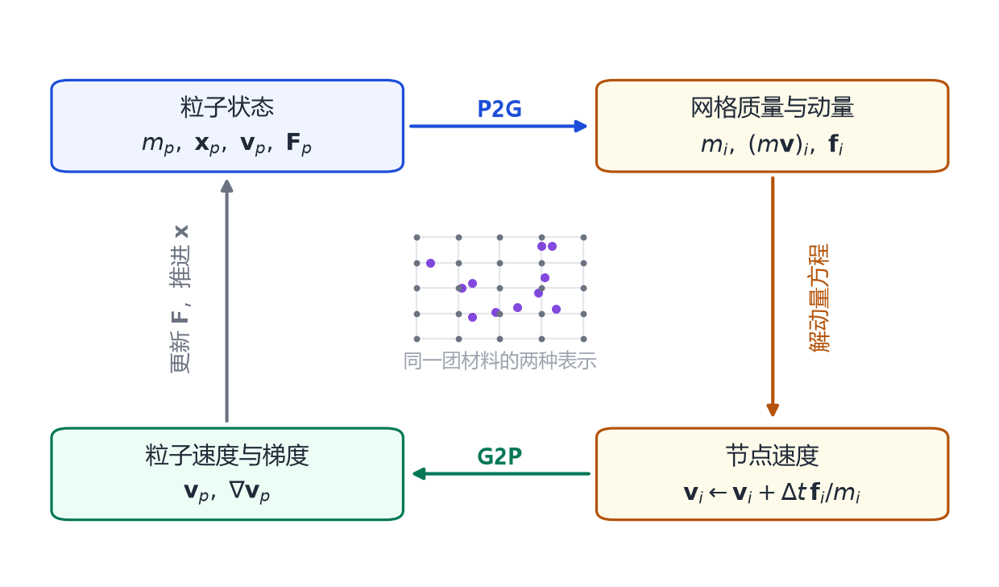

# 第 4 章 物质点法的基本循环

踩进深雪的时候，脚下那团雪会先撑住一瞬，然后突然塌下去，边缘裂成几块，碎块翻着跟斗滑开。这个过程里，材料从"有形状的固体"变成了"一堆碎块加一团压实了的粉"，拓扑变了，历史也变了——被压过的那部分雪密度更高、更硬，没压过的还是松的。

拿网格去算这件事很难受。让网格跟着材料变形（拉格朗日网格），它会在大变形处缠结、翻转，一个单元翻过来，雅可比行列式变成负数，整套计算失效。让网格固定不动（欧拉网格），缠结的问题没有了，但材料的界面变成了一件麻烦事：雪和空气的边界要额外追踪，界面一糊，雪的"块状感"就没了。而且欧拉网格没有记忆——它不知道脚下这块材料在这之前被压过多少次。

物质点法（material point method，MPM）的答案是把两件事拆开：物质的历史放在粒子上，运动方程放在网格上。粒子随材料一起动，所以它记得自己被压过、转过、裂过；网格固定在空间里，每一步只用来算一次力，算完就丢掉重来，所以它永远不会缠结。

本章沿着这条主线走：先说清粒子和网格各背什么账，再把一轮循环的五个步骤逐个拆开——散射、算力、积分、聚集、更新，每一步都写公式、解释符号、给一个能对上的数字。然后用一个可以完全手算的一维例子把整轮跑一遍，最后谈边界、接触，以及它跟 SPH、FLIP 的分工。读完这一章，你应该能在一张纸上写出完整的 MPM 时间步，并且大致判断出它会在哪里出错。

## 4.1 粒子带物质，网格算动量

先把这套分工讲清楚。

每个粒子是一个小的物质团，带着质量 $m_p$、位置 $\mathbf{x}_p$、速度 $\mathbf{v}_p$、体积 $V_p$，以及一个描述它变形了多少的量——通常是变形梯度 $\mathbf{F}_p$，有时还加一个仿射速度矩阵（第 5 章再说）。这几样东西加起来，就足以让材料模型算出这个粒子当前的应力 $\boldsymbol\sigma_p$。粒子随时间随材料一起移动，所以这些量是真正的"物质历史"：同一个粒子今天被压扁了，明天还是被压扁的状态，除非它被卸载。

网格是另一回事。它是一张规则的格子，节点上只有质量 $m_i$、动量 $(\mathbf{m}\mathbf{v})_i$、力 $\mathbf{f}_i$ 这些临时量。每一步开始时它们是空的，P2G 把粒子上的信息聚集上来，解一次动量方程，G2P 把速度送回去，然后把节点清零。网格上不保存任何跨步的状态，它只是这一瞬间的一个计算脚手架。

清单列一下，因为写代码时少存哪一个都会出问题。粒子端必须有：质量 $m_p$、位置 $\mathbf{x}_p$、速度 $\mathbf{v}_p$、体积 $V_p$、变形梯度 $\mathbf{F}_p$，再加上材料模型的内部变量（比如等效塑性应变、硬化参数）。网格端只有：质量 $m_i$、动量 $\mathbf{m}\mathbf{v}_i$、力 $\mathbf{f}_i$，全部每步重建、用完即扔。也就是说，判断一个量该放哪边，只需要问一句：它是“这块材料的历史”吗？是历史就放粒子，只是“这一刻的中间结果”就放网格。

真实场景能把这条原则凸显出来。一团雪从坡上滑下来，中途碎了三次、又两两粘回去。粒子上记的密度、硬化程度、裂纹历史一样没丢；网格从头到尾就是同一张格子，既没变形也没重建拓扑。反例是把同一件事交给纯拉格朗日网格：雪块翻一个身，单元跟着翻一个身，雅可比行列式变负，单元“内外翻转”，应力和密度全变成 NaN。要让拉格朗日网格活下来得做重网格（remeshing），而重网格引入的插值误差比 MPM 的两次插值还大。

<figure class="fig">

<figcaption><b>图 4-1</b>　一轮计算的四个步骤，示意图。左上：粒子携带质量、速度与变形梯度；右上：P2G 把质量和动量散射到网格节点，并算出节点内力；右下：在网格上解动量方程得到节点速度，这一步没有对流项；左下：G2P 把节点速度插值回粒子，同时算出速度梯度，用它更新变形梯度并把粒子推到新位置。中间画的是同一团材料的两种表示，网格每步重建，粒子一直存在。</figcaption>
</figure>

这个分工带来的好处是别的方法很难同时拿到的两样东西。第一样是不缠结：网格永远规则，不管材料怎么翻卷、折叠、破碎，网格单元的雅可比永远不变。第二样是守恒：动量方程在网格上离散，网格单元的邻居关系是固定的，所以动量通量天然配平，不会像纯粒子法那样因为邻居表变化而泄漏。

代价也很明确。每一步要把信息在粒子与网格之间搬两趟，每次搬运都是一次插值，插值会抹平细节、耗散能量。搬得越频繁、形函数越"糊"，耗散越大。这是 MPM 所有精度问题的总根源，后面每一章的技术——APIC、MLS、高阶样条——本质上都是在对付这两次插值。

这两次插值到底折损多少，可以粗糙地估一下：每一步插值相当于给速度场做一次轻微的低通滤波，抹掉波长约两个网格的扰动；波长越短，被抹得越狠。也就是说，MPM 天生出不了比两倍网格更细的结构，画面看着“有点糊”的根子就在这里，换参数是治不好的，只能换形函数或者加密。

## 4.2 P2G：把质量与动量搬到网格

把粒子上的量搬到节点上，靠的是形函数 $w_{ip}$：粒子 $p$ 对节点 $i$ 的权重。它满足两条要求：对所有节点求和等于 1（质量不丢），并且只在粒子附近几个节点上非零（便宜）。

质量、动量的散射是直接的加权求和：

$$
m_i = \sum_p w_{ip}\, m_p, \qquad
(\mathbf{m}\mathbf{v})_i = \sum_p w_{ip}\, m_p\, \mathbf{v}_p
\tag{4.1}
$$

节点的内力要麻烦一点。直觉上你会想"把每个粒子的应力加起来平均一下"，但应力是张量，节点要的是力，正确的桥梁是虚功原理。给节点 $i$ 一个虚位移 $\delta\mathbf{u}_i$，粒子 $p$ 处的虚位移是 $w_{ip}\delta\mathbf{u}_i$，虚应变是 $\nabla w_{ip}\cdot\delta\mathbf{u}_i$，内力做的虚功等于应力在虚应变上的积分。让两边相等，得到

$$
\mathbf{f}_i = -\sum_p V_p\, \boldsymbol\sigma_p\, \nabla w_{ip}
\tag{4.2}
$$

$\boldsymbol\sigma_p$ 是柯西应力张量，取拉为正；$\nabla w_{ip}$ 是形函数在粒子处的梯度；$V_p$ 是这个粒子的当前体积。负号的意思是应力做负功：材料被拉伸（应力为正）时，节点受到指向内部的拉力。

式 (4.2) 值得多看两眼。它说明节点力正比于应力的**散度**，而不是应力本身。一块均匀受压的材料，内部节点感受到的力是零，因为两侧的贡献互相抵消；只有应力不均匀的地方才有净力。这也解释了为什么 MPM 里"均匀应力"的初始状态不会自己动起来，以及为什么自由表面附近的粒子会往外飞——那里应力从有到无，梯度最大。

把式 (4.2) 算一个数。设一颗直径 0.5 毫米的沙粒，体积 $V_p=6.5\times10^{-11}$ m³，$\sigma_{xx}=-1000$ Pa（受压），它落在单元内距左节点 $0.23\Delta x$ 处，二次 B 样条给出的梯度 $\partial_xw=-46$ m⁻¹。则 $f_0=-V_p\sigma_{xx}\partial_xw=-(6.5\times10^{-11})(-1000)(-46)=-3.0\times10^{-6}$ N。负号表示力指向 $-x$：受压的粒子把左边节点往外推。单颗粒子的力小得可以忽略，可一个单元里有一万颗，叠起来就是 0.03 N 量级，乘上 $\Delta t$ 正好给出看得见的速度。也就是说，节点力是“很多小力加起来”的结果，不是某个代表性粒子的力。

形函数的阶数决定插值有多"糊"。线性形函数只用两个节点（一维），计算便宜，但粒子附近的权重分布很尖，粒子一跨过节点，节点质量就会突变，容易出噪声。二次 B 样条用三个节点，权重连续、梯度连续，粒子移动时节点量的变化平滑得多，是目前的主流选择。

二次 B 样条的权重有封闭形式。令 $u_i=(x_i-x_p)/\Delta x$ 为节点到粒子的距离（以网格步长为单位），则 $|u|\le0.5$ 时 $w=\frac34-u^2$，$0.5<|u|<1.5$ 时 $w=\frac12(1.5-|u|)^2$，更远处为零。粒子走到哪，这三个权重就跟着变，而且权重之和恒为 1、梯度恒连续。

代入一个具体位置：$\Delta x=1$ 厘米，粒子在单元内偏离左节点 $0.23\Delta x$。三个节点的 $u$ 分别是 $-0.23$、$0.77$、$-1.23$，权重是 $0.697$、$0.2665$、$0.0365$，加起来正好 1。也就是说，一个粒子把质量分成三份，最近的节点拿七成，次近的拿两成七，最远的只拿百分之四。换成线性形函数就只剩两个非零权重 $0.77$ 和 $0.23$，粒子一跨过节点中点，权重从“一尖一平”突然换向，节点质量随之跳变，噪声就是这么来的。

图 4-1 中间那个小图想传达的就是这件事的空间图像：粒子落在网格里，给周围几个节点分权重。式 (4.1) 与 (4.2) 是 MPM 的标准形式，各家实现在形函数和更新顺序上各有变体，[@jiang2017] 把它们并排列出过一轮，适合拿自己的代码逐项对照。

这里有两套常用术语要对上。把粒子信息送到节点叫散射（scattering），把节点信息送回粒子叫聚集（gathering）；也有文献按方向叫投影（projection）和插值（interpolation）。名字不同，做的是同一件事：用 $w_{ip}$ 这个权重矩阵在两种表示之间来回搬一趟。要留心的是，质量、动量、内力三样必须用同一套 $w_{ip}$，否则总质量会随粒子移动而漂移——粒子每跨一次单元边界，权重和就不再严格等于 1，一秒钟漂掉百分之几，十秒后整块材料的密度就不对了。

粒子跨单元边界时的噪声有个名字：网格穿越噪声（grid-crossing noise）。粒子从单元 A 走到 B，它支撑的那几个节点整个换了一批，节点质量分布突变，力曲线上出现一个尖峰。线性形函数下尖峰能到平均值的一倍，二次样条能压到十分之一左右，代价是散射时要访问九个节点。也就是说，形函数阶数不只是精度旋钮，还是噪声旋钮。

## 4.3 网格上的动量方程

节点上有了质量和力，剩下的就是最普通不过的常微分方程：

$$
\frac{\mathrm{d}\mathbf{v}_i}{\mathrm{d}t} = \frac{\mathbf{f}_i}{m_i} + \mathbf{g}
\tag{4.3}
$$

$\mathbf{g}$ 是重力加速度。显式积分一步就是

$$
\mathbf{v}_i^{n+1} = \mathbf{v}_i^{n} + \Delta t\left(\frac{\mathbf{f}_i}{m_i} + \mathbf{g}\right)
\tag{4.4}
$$

这里有个容易忽略但很关键的性质：**网格上不需要对流项**。流体求解器里最贵、最容易出错的一步是平流——把速度场沿着自身搬运，用半拉格朗日法或者更复杂的格式，总归要引入数值耗散或者过冲。MPM 没有这个问题，因为网格是固定的，物质在动，网格节点不需要"跟着流"。物质的对流由粒子的运动完成，而粒子的运动不产生耗散（粒子就是走过去而已）。这是 MPM 相对欧拉流体方法的一个真实优势，也是它在雪、沙这类"又像固体又像流体"的材料上特别受欢迎的原因之一。

时间步长受波动方程的限制：

$$
\Delta t \le \frac{\Delta x}{c}, \qquad c = \sqrt{\frac{K}{\rho}}
\tag{4.5}
$$

$\Delta x$ 是网格尺寸，$K$ 是材料的体积模量，$\rho$ 是密度。雪的体积模量在 10 万帕量级（松雪）到几兆帕（压实雪），换算出来的波速是几十到几百米每秒；网格如果是 1 厘米，步长就是几十微秒。一秒钟的动画要几万步，这是 MPM 做雪最直接的困难，也是第 7 章要讲隐式积分的原因。跟所有显式波动求解器一样，这条稳定边界是硬的：步长超过它，误差按几何级数长，几帧之内就会出现肉眼可见的爆炸，而想跑快一点，只能把刚度从时间步限制里拆出去。

把这条限制代进数字。雪的体积模量取 $K=10^6$ Pa、密度 300 kg/m³，于是 $c=\sqrt{10^6/300}\approx58$ m/s；网格 1 厘米时 $\Delta t\le1.7\times10^{-4}$ s，实际再打一半折扣，约 $8\times10^{-5}$ s。一秒 60 帧，每帧就要 200 步上下；一段 10 秒的镜头是 12 万步。每一步都得把百万粒子的质量和动量散射一遍、再聚集一遍，这就是 MPM 做雪最贵的地方。也就是说，材料越硬，步长上限越低，同样的镜头时长就要多算几倍的步。

还有一组容易和式 (4.5) 混淆的量：粒子间距。网格尺寸决定精度和步长，粒子间距决定物质的分辨率。两者最好在同一量级，每个网格单元里放一到四个粒子。粒子比网格稀太多，空间就有空洞，P2G 之后节点质量剧烈起伏，速度场一片噪声；粒子比网格密太多，计算量白花，因为同一单元里的多个粒子对节点的贡献几乎一样，插值根本分辨不出来。

空节点的处理要留一句。P2G 之后总有一些节点没有粒子贡献，$m_i = 0$，式 (4.4) 里除以零会得到无穷大或者 NaN。惯例是把这些节点速度置零，并且让它们不参与后面的插值。这个细节写错了，模拟会在几步之内炸掉，而症状出现在完全无关的地方——通常是某个粒子突然飞到屏幕外。

空节点还有一层危险。$m_i=0$ 时式 (4.4) 的分母是零，如果 $f_i$ 也恰好是零，浮点运算给的是 $0/0=\text{NaN}$；NaN 会顺着下一次插值污染相邻粒子，再通过 P2G 扩散回网格，几步之内整场都是 NaN。排查时先看“第一步之后有没有 NaN”，能立刻分清是初始化写错了，还是空节点没处理。

## 4.4 G2P：把速度带回去

网格这一步算完，节点速度 $\mathbf{v}_i^{n+1}$ 要送回粒子，两个量都要：

$$
\mathbf{v}_p = \sum_i w_{ip}\, \mathbf{v}_i, \qquad
\nabla\mathbf{v}_p = \sum_i \mathbf{v}_i \otimes \nabla w_{ip}
\tag{4.6}
$$

第一个是速度插值，第二个是速度梯度——它是张量，分量写法是 $(\nabla\mathbf{v})_{ab} = \sum_i v_{ia}\,\partial_b w_{ip}$。

有了速度梯度，就能更新变形梯度：

$$
\mathbf{F}_p^{n+1} = \left(\mathbf{I} + \Delta t\, \nabla\mathbf{v}_p\right)\mathbf{F}_p^{n}
\tag{4.7}
$$

$\mathbf{I}$ 是单位矩阵。这个更新式的意思是：速度梯度给出这一小段时间里材料被拉伸、剪切、旋转的速率，乘上 $\Delta t$ 得到增量变形，再叠到原来的变形上。

为什么用 $\mathbf{F}$ 而不用应变张量？因为 $\mathbf{F}$ 同时携带了两件事：变形和旋转。极分解 $\mathbf{F} = \mathbf{R}\mathbf{S}$ 把旋转 $\mathbf{R}$ 和纯拉伸 $\mathbf{S}$ 分开，材料模型可以只用 $\mathbf{S}$ 算应力，也可以按需要处理各向异性。小应变张量 $\boldsymbol\varepsilon = (\mathbf{F} + \mathbf{F}^{\mathsf T})/2 - \mathbf{I}$ 在大转动下会把刚体转动误判成应变，一块被整体转过来 90 度的雪会被算出巨大的剪切，然后莫名其妙地弹开。雪的模拟里这种情形到处都是——雪块翻滚时整体转动很大，$\mathbf{F}$ 是唯一稳妥的表示。

更新完 $\mathbf{F}$，粒子的体积也跟着变：$V_p = \det(\mathbf{F}_p)\,V_p^{0}$，$V_p^0$ 是初始体积。式 (4.2) 里用的就是当前体积，这样材料被压缩时粒子变小、对节点的力也跟着变小，体积的改变是自洽的。如果偷懒一直用初始体积，材料会越压越“硬”，因为同样多的粒子在传递不变的力，而它们实际占的空间已经小了。

然后用材料模型算出新的应力 $\boldsymbol\sigma_p$，把粒子推到新位置：

$$
\mathbf{x}_p^{n+1} = \mathbf{x}_p^{n} + \Delta t\, \mathbf{v}_p
\tag{4.8}
$$

一轮就这么结束了。注意应力的更新放在 G2P 之后——这一步用到了新算出的速度梯度，下一步的 P2G 用这个应力算节点力。把顺序颠倒过来（"先更新应力"的变体）在弹性问题上结果差不多，但在塑性问题上差别明显，因为塑性流动对当前应变率敏感。

把式 (4.6) 第二个式子也代个数。一维情形，两个节点速度 $v_0=0$、$v_1=0.01$ m/s，间距 $\Delta x=0.01$ 米，则 $\partial_xv=(0.01-0)/0.01=1$ s⁻¹，意思是这一小段材料每秒被拉长 100%。二维里更常见的是简单剪切：$v_x$ 只随 $y$ 变化、梯度 10 s⁻¹，那么 $\mathbf{F}$ 的 $xy$ 分量每秒涨 0.01，十秒就是 0.1，对应 $\arctan0.1\approx5.7^\circ$ 的剪切变形。

$\mathbf{F}$ 的行列式还有一个用途：它就是体积比。$\det\mathbf{F}=1.21$ 说明这块材料当前体积是初始的 1.21 倍。极分解 $\mathbf{F}=\mathbf{R}\mathbf{S}$ 则把“整体转了多少”和“被拉了多少”分开：一块雪整体转 $90^\circ$ 再拉伸 10%，$\mathbf{R}$ 记那个 $90^\circ$、$\mathbf{S}$ 记那个 10%，材料模型只看 $\mathbf{S}$，不会被转动误导。

反例正好说明为什么不能用小应变张量。取 $\boldsymbol\varepsilon=(\mathbf{F}+\mathbf{F}^{\mathsf T})/2-\mathbf{I}$，让一块雪整体转 $45^\circ$、一点没变形。旋转矩阵的对称部分等于 $\cos45^\circ\mathbf{I}=0.707\mathbf{I}$，于是 $\boldsymbol\varepsilon=(0.707-1)\mathbf{I}$，算出来是 29% 的体积压缩；转 $90^\circ$ 时 $\cos90^\circ=0$，$\boldsymbol\varepsilon=-\mathbf{I}$，压缩 100%。也就是说，小应变张量会把刚体转动当成变形，雪块一翻滚就被“压扁”再弹开，画面上表现为莫名其妙的爆开。

$\mathbf{F}$ 的更新里还有一处隐性的信息损失。线性插值下，粒子只记住节点速度的加权平均，丢掉了它相对网格的转动和剪切，于是材料转动时会悄悄泄掉角动量，表现为雪团越转越慢、慢慢塌成一坨。第 5 章的仿射粒子（affine particle-in-cell，APIC）给每个粒子额外存一个速度梯度矩阵，把这份信息留住；代价是每个粒子多 4 个（二维）或 9 个（三维）浮点数，以及 P2G 时多做几次矩阵乘法。

## 4.5 五十行代码与一根弹性柱

这套循环短到可以在一页纸上写完，所以验证它不需要复杂的场景。一维、线弹性、自由边界，就有精确解。

取一根长 $L=1$ 米的杆，密度 $\rho = 1000$ kg/m³，杨氏模量 $E = 10^6$ Pa，于是波速 $c = \sqrt{E/\rho} \approx 31.6$ m/s。初始条件取一个纯粹的呼吸模态：位移 $u(x,0) = A\cos(\pi x/L)$，速度为零，$A = 5$ 毫米。这个模态的两端应力为零，所以不需要任何边界条件——杆自己一伸一缩，位移精确解是

$$
u(x,t) = A\cos\frac{\pi x}{L}\cos(\omega t), \qquad \omega = \frac{\pi c}{L}
\tag{4.9}
$$

周期 $2\pi/\omega \approx 63.2$ 毫秒，最大应变 1.57%，还在小应变范围里。初始的变形梯度按解析式设成 $F(x,0) = 1 - (\pi A/L)\sin(\pi x/L)$，其余交给循环。

选自由边界而不是一端固定，是为了把边界本身排除在误差之外。上一节说过，固定节点会把边界附近半个网格内的材料“志愿”地拉慢，而那个误差会随着波在壁上反弹一次次累积，最后盖过真正的离散误差。自由边界不施加任何约束，杆的两端应力本来就为零，模型和方程完全对应，所以看到的误差都来自插值与积分。做代码验证时，这种“先把边界这个变量去掉”的习惯很有用。

把这套循环在一个只有 3 个节点的小例子上走一遍，每一步的算术都对得上。网格取 $\Delta x=0.5$ 米，节点在 $x=0$、$0.5$、$1$；截面积按 1 m² 算，两个粒子各代表半根杆，$V_p=0.5$ m³、$\rho=1000$ kg/m³，于是 $m_p=500$ kg。材料是线弹性，$E=10^6$ Pa。

初始位移取 $u(x)=A\cos(\pi x/L)$、$A=5$ 毫米，两个粒子因此被推到 $x_1=0.25354$、$x_2=0.74646$（初始在 $0.25$ 与 $0.75$）。变形梯度按解析式设成 $F=1-(A\pi/L)\sin(\pi x/L)=0.9889$，两个粒子相同——整根杆此时均匀受压，端部位移最大，中点为 0。

① 散射（P2G，质量与动量）。线性形函数给出 $w_0=1-0.50708=0.49292$、$w_1=0.50708$，第二个粒子对称，$w_1=0.50708$、$w_2=0.49292$。于是 $m_0=246.46$ kg、$m_1=507.08$ kg、$m_2=246.46$ kg，加起来 1000 kg，一点没丢。

② 算力。$\sigma=E(F-1)=10^6\times(-0.01107)=-1.11\times10^4$ Pa，两个粒子都是这个值。一维下 $\partial_xw=\pm1/\Delta x=\pm2$ m⁻¹，代入式 (4.2)：$f_0=-0.5\times(-11108)\times(-2)=-1.11\times10^4$ N，$f_2=+1.11\times10^4$ N，中间节点两侧的贡献正好抵消，$f_1=0$。三个力加起来是零，动量守恒在第一步就成立。

③ 积分。取 $\Delta t=5\times10^{-4}$ s，$c=\sqrt{E/\rho}=31.6$ m/s，$\Delta t$ 只有 $\Delta x/c=0.0158$ s 的 3%，稳定裕度很大。$v_0=5\times10^{-4}\times(-11108/246.46)\approx-0.0225$ m/s，$v_1=0$，$v_2=+0.0225$ m/s。

④ 聚集（G2P）。第一个粒子的速度 $v_p=0.49292\times(-0.0225)+0.50708\times0\approx-0.0111$ m/s，速度梯度 $\nabla v_p=(-0.0225)(-2)+0=+0.045$ s⁻¹，正号说明它在膨胀——受压的杆开始回弹。变形梯度更新为 $F=(1+5\times10^{-4}\times0.045)\times0.9889=0.98891$，体积几乎没动。

⑤ 推位置。$x_1=0.25354+5\times10^{-4}\times(-0.0111)=0.253534$ 米。下一个时间步从这个状态重新开始，而节点上的质量、动量、力全部清零。

最后对一下精确解。$v(x,t)=-A\omega\sin(\omega t)\cos(\pi x/L)$，$\omega=\pi c/L=99.3$ rad/s，代入 $t=\Delta t$ 得 $v(0.25)\approx-0.0174$ m/s。手算给的是 $-0.0111$ m/s，低了 36%。差这么多不奇怪：整根 1 米的杆只有两个粒子，每个代表半米，比图 4-2 里 5 毫米的网格粗两个数量级。也就是说，每一步的格式都能算对，但“算得对”不等于“算得准”——守恒是格式的事，精度是分辨率的事，两件事要分开查。

手算还能抓出三类典型的 bug。第一类是梯度漏了 $1/\Delta x$：此时节点力大 50 倍（$\Delta x=0.5$），一帧之内杆就飞了。第二类是忘了用当前体积：$V_p$ 一直取 0.5，材料被压得越狠、力越大，表现成“越压越硬”。第三类是空节点没有清零：$m_i=0$ 的节点上若残留上一帧的动量，下一步会把一个孤立节点加速到无穷。三个 bug 的症状都是“几步之后炸掉”，但原因完全不同，用这种能对解析解的小例子逐个排查最快。

<figure class="fig">

<figcaption><b>图 4-2</b>　一维弹性杆的呼吸模态，$L=1$ m、$\rho=1000$ kg/m³、$E=1$ MPa（$c=31.6$ m/s）、$A=5$ mm、周期 63.2 ms。左：左端粒子的位移随时间，实线是式 (4.9) 的精确解，点是 MPM 的结果（200 个网格单元、每格 2 个粒子、$\Delta t = 5\times10^{-5}$ s，即 $0.32\Delta x/c$），误差主要出现在振幅最大处。右：一个半周期内的最大相对误差随网格尺寸变化，$\Delta x$ 取 20、10、5、2.5 mm 四档，误差从 0.20 降到 0.022，$\Delta t$ 同时按 $0.32\Delta x/c$ 缩小，双对数斜率接近 1.0，说明这一项误差由插值和显式积分共同带来，是一阶的。</figcaption>
</figure>

图 4-2 那个 5% 已经算好的了。同一个求解器，粒子数减半，误差立刻翻倍；粒子数加倍，误差只降到七成——因为网格尺寸没动，插值分辨率没动。也就是说，粒子和网格得一起加密才有效，只加一边基本是白花钱。

图 4-2 左边两条曲线贴得很紧，误差在振幅最大处最明显，约百分之五；右边把网格逐次加密，误差 20% 降到 10%、5%、2.2%，每加密一倍减半。这个收敛阶不高，一阶对于"只跑一次"的图形学模拟可以接受，但它说明了一件事：MPM 不是高精度方法，基准测试里能给到百分之几就算实现正确。

误差的来源可以逐项点出来。P2G 和 G2P 各做一次插值，二次 B 样条在粒子偏离单元中心时会把峰值"抹"掉一点，粒子每跨过一个单元边界，节点上的质量分布就变一次，等效于一次轻微的脉冲；显式积分对波动方程有一阶的时间误差；粒子本身在动，它的体积 $V_p$ 变化和形函数支撑域的变化不完全同步。三者叠加，落在百分之几的量级。想让误差降到千分之一，得换高阶样条、加粒子分裂合并、或者上隐式——每一样都不便宜。

一阶收敛是什么概念，可以和别的量比一比。网格加密一倍，误差减半，要把误差压到 0.1%，得在每一维都加密 200 倍，三维就是八百万倍的单元数——完全不现实。这就是 MPM 的改进大多不靠“多算”而靠“换形函数、补粒子、改积分”的原因：在同一套分辨率下把常数因子压下来，比死磕收敛阶划算。

## 4.6 边界、摩擦与接触

MPM 的边界处理跟网格法一样朴素：把边界上的节点固定住，法向速度为 0，材料就出不去。

$$
\mathbf{v}_i \leftarrow \mathbf{0} \quad (i \in \text{边界节点})
\tag{4.10}
$$

这个做法在大多数情况下够用，因为插值把边界"抹开"了半个到一个网格：粒子靠近墙面时，它的一部分权重落在被固定的节点上，于是它的速度被部分拉回零。副作用是材料会略微陷进墙里，深度大约是半个网格；网格越粗，陷得越深，所以“墙看起来变软”往往不是摩擦参数的事，而是分辨率不够。想干净一点，就在 G2P 之后对粒子的速度做一次修正：如果粒子越过了墙面，把它推回去，并消掉法向速度。

陷进墙的深度可以估。粒子靠近固定节点时，有 $w$ 这一份权重落在该节点上，它的速度和位移也就有 $w$ 的比例被拉回零，量级是 $w\Delta x$；粒子正好在墙面附近时 $w\approx0.5$，所以陷进去大约半个网格。$\Delta x=1$ 厘米是 5 毫米，$\Delta x=4$ 厘米就是 2 厘米。也就是说，网格调粗一倍，“墙”的软度跟着翻倍，看起来像摩擦不够，其实是分辨率不够。

摩擦在节点上处理最方便。做法是在网格速度更新完之后，把边界节点的切向速度按库仑条件缩放：

$$
\mathbf{v}_i^{\,\text{tan}} \leftarrow \mathbf{v}_i^{\,\text{tan}} \cdot \min\left(1,\; \frac{\mu_w\,|\mathbf{v}_i^{\,\text{nor}}|}{|\mathbf{v}_i^{\,\text{tan}}|}\right)
\tag{4.11}
$$

$\mathbf{v}^{\,\text{nor}}$ 和 $\mathbf{v}^{\,\text{tan}}$ 是速度的法向与切向分量，$\mu_w$ 是壁面摩擦系数。这一步的物理含义是"切向动量最多被法向冲量乘以摩擦系数消掉"，跟刚体求解里的摩擦冲量是同一件事，只是这里作用在节点上。

摩擦也代个数。设某边界节点的法向速度 $-0.1$ m/s（正在压向墙面）、切向速度 $0.3$ m/s，壁面摩擦系数 $\mu_w=0.4$。式 (4.11) 里的比例是 $0.4\times0.1/0.3=0.133$，小于 1，所以切向速度被缩到 $0.3\times0.133=0.04$ m/s，一下削掉 87%。切向速度本身很小的时候，这个比例会超过 1，于是切向速度直接归零，材料与墙之间不再有相对滑动，这就是粘住。

三种边界条件在节点上只是三种处理。滑移（slip）：只把法向速度清零，切向不动，材料像在冰面上滑；粘住（stick）：法向和切向都清零，材料被粘死；库仑：法向清零，切向按式 (4.11) 缩放。分离反而需要额外判断——法向速度朝外时就不该再清零，否则材料会被一堵“看不见的墙”吸住，这是实现里最常见的“粘墙”bug。

MPM 有一个挺特别的性质：**它不需要接触检测**。两团材料互相撞上，各自的粒子把动量散射到同一批节点上，节点上自然就把两份动量加在一起，然后按总质量分配回去，相当于一次完全非弹性的动量交换。分离也是自动的，因为一旦速度方向分开，节点上的合力就指向分离。这种"隐式"的接触处理很省事，但精度不高：它无法区分"贴住"和"穿过"，对于薄的物体（一片雪板、一层薄壳）尤其危险，因为粒子可能直接越过对方而完全不碰到同一批节点。

量级上就能看出问题。网格单元宽 1 厘米、雪板厚 2 毫米，雪板上任意一点离最近的网格节点都可能超过半个单元，它散射出去的动量落在对方粒子的支撑域之外，两边就像没看见彼此。厚材料不吃这个亏，因为总有一层粒子落在同一批节点上；薄壳、薄板、飘落的纸片才需要额外加距离检测和冲量修正。

刚体耦合还有一处容易漏掉的对称性。粒子受到的冲量必须按牛顿第三定律反作用回刚体，而刚体上受力点的位置是由最近的粒子决定的，于是刚体的质量必须远大于一小片区域里粒子的总质量；否则一颗雪球砸在钢板上，钢板会被算得弹起来。常见的做法是把刚体密度设成真实值的十倍，或者显式地给反作用力乘一个系数。

跟刚体这种“硬”边界相比，自由表面是另一个极端。MPM 处理自由表面不需要任何判据：粒子周围没有邻居，它散射到节点上的质量就少，应力梯度把它往外推，它就自然飞出去。这种“自动”的好处是代码短，坏处是它不知道表面在哪里，也就无法施加表面张力，也无法区分“飞得很远的粒子”和“本来就不存在的空节点”。粉尘、飞溅、碎裂这些细节在 MPM 里一直是弱项，多半要另外加一层粒子跟踪或者后期解算。

跟刚体的双向耦合要额外处理。一种做法是把刚体表面采样成一层"边界粒子"，让它们参与 P2G 但质量很大，这样刚体被推动的程度可以忽略；另一种是显式地算碰撞：检测粒子与刚体表面的距离，施加冲量和摩擦，再把刚体受到的反作用力积分回去。后一种做法在 [@hu2018] 里做得比较完整，它同时处理了位移跳变（材料开裂）和刚体摩擦耦合，是目前 MPM 与刚体交互的常用参考。

## 4.7 与 SPH、FLIP 的区别

把 MPM 和两种同样"粒子加场"的方法放在一起，差别就出来了。

SPH 不用网格。它用核函数在邻居粒子上做加权平均，近似场量和梯度。粒子间没有固定拓扑，所以大变形、飞溅、破碎都天然处理；代价是每一步都要找邻居（空间哈希或者排序网格），而且当粒子被拉伸得稀疏时，核近似会失效，出现"拉伸不稳定"——一根细流会被撕成断断续续的点。MPM 的"核"是背景网格的形函数，邻居是固定的一圈节点，所以没有邻居搜索，也没有拉伸不稳定。反过来，MPM 的插值会丢角动量（第 5 章的 APIC 就是修这个），而且粒子不能真的离得太远——离网格太远就没人给它权重了。

FLIP 是另一条路。它也是粒子加网格，但粒子只带速度，网格上解的是不可压流体的纳维-斯托克斯方程：先平流，再加重力，然后解一个压力泊松方程把速度投影到无散场，最后把速度的**增量**回插给粒子。FLIP 的粒子是示踪点，它的作用是把网格解出来的速度场"记下来"，让细节不被网格抹平。粒子本身没有应力状态，也不记得自己 deformation 过。

这句话是 FLIP 和 MPM 的分水岭。让 FLIP 的粒子去“记住”一个应力，等于让示踪点承担物质身份，数值上立刻不稳——速度增量回插的推导里就假设了粒子只带速度。也就是说，两者的差别是方程结构不同，不是实现细节不同，不能靠打补丁互换。

MPM 的粒子不是示踪点，是物质点。它带 $\mathbf{F}$、带应力、带材料参数，能表达"这块材料被压过、硬化了、现在处于塑性状态"。这是 FLIP 做不到的，因为 FLIP 的方程里根本没有应力这个量——流体的应力就是压力，压力是网格上的拉格朗日乘子，不需要粒子记住。所以两者的分工是按材料分的：水、烟、火这类没有剪切记忆的材料用 FLIP 或网格法；雪、沙、泡沫、粘弹体这类有历史、能保持形状的材料用 MPM。

补一句 SPH 的位置。需要颗粒级细节、又不需要保持形状的材料——飞溅的浪花、泡沫、飘散的粉尘——交给 SPH 更合适，它用每步一次的邻居查找换来了对极度分散形态的适应性。实际制作里常见的是混着用：雪崩主体走 MPM，卷起的雪雾走 FLIP 或松散粒子，最外层粉尘交给体积渲染。

一句话概括三者的区别：SPH 是"粒子算一切"，FLIP 是"粒子记速度、网格解流体"，MPM 是"粒子记物质、网格解动量"。第三种分工之所以值得多花一次插值的代价，就是因为它让固体力学和流体力学能用同一套代码处理，而雪恰好是这两者的混合体——[@stomakhin2013] 的那个雪模拟之所以成为经典，一半功劳在本构，另一半就在这个"用一套循环同时处理压实、失效、飞散"的框架上。后续的改进大多沿着两条线走：把插值做得更准（[@jiang2015]、[@hu2018]），把积分做得更稳（第 7 章）。框架本身在这十几年里没有大变，这大概是对一个方法最好的评价。
