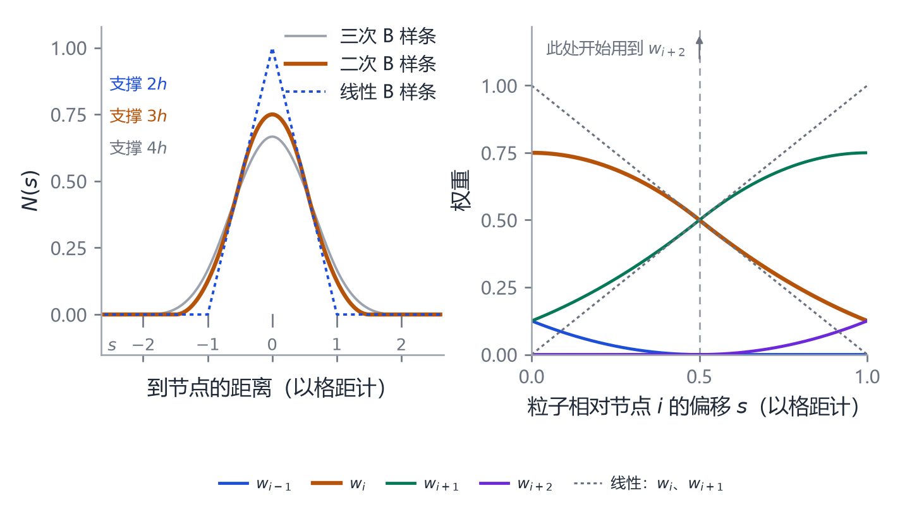
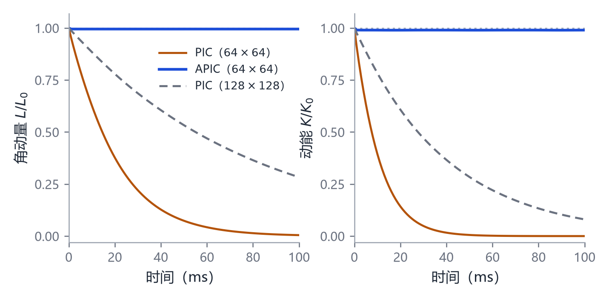

# 第 5 章 形函数、APIC 与 MLS-MPM

> 本章导读：粒子把质量交给网格，再从网格取回速度，这一来一回之间丢掉了什么。这一章从形函数的阶数讲起，说明二次 B 样条为什么成了默认选择，PIC 为什么会让一个自由旋转的物体慢慢停住，APIC 用一只矩阵把它救回来，MLS-MPM 又怎样把两趟搬运压成一趟。

把一只雪球扔出去，让它边飞边转。除了重力和空气，没有别的东西碰它，转速就不该变。可要是在物质点法里跑这段动画，多半会看到它越飞越慢：0.1 秒之后几乎停住，像在半空里泡了糖浆。这个毛病不来自本构模型，也不来自时间积分，它出在粒子与网格之间那一趟搬运上。做 MPM 的人曾经把它当"数值阻尼"，靠加密网格让它慢一点，然后接受它。2015 年之后不必了：每颗粒子多存一只小矩阵，旋转就能一点不丢。

## 5.1 一颗粒子该压几个格点

物质点法里，粒子与网格之间只有一条通道：权重 $w_{ip}$，第 $p$ 颗粒子分给第 $i$ 个节点的份额。这个数由形函数算出来。粒子落在某个格子里，权重就取决于它离周围各个节点有多远：

$$
w_{ip}=N\left(\frac{x_p}{h}-i\right)N\left(\frac{y_p}{h}-j\right)N\left(\frac{z_p}{h}-k\right)
\tag{5.1}
$$

$h$ 是格距，$i,j,k$ 是节点编号，$N$ 是一维形函数。三维的权重是三个一维函数的乘积，所以真正要挑的只有那个一维的 $N$。

最省事的是线性 B 样条，也就是帐篷函数：$N(s)=1-\lvert s\rvert$，在 $\lvert s\rvert\lt 1$ 之外为零。它只碰两个节点，权重和为 1，插值出来的速度场在每个格子内部是线性的。二次 B 样条写成

$$
N(s)=
\begin{cases}
\dfrac34-s^2, & \lvert s\rvert\le\dfrac12,\\[6pt]
\dfrac12\left(\dfrac32-\lvert s\rvert\right)^2, & \dfrac12\lt\lvert s\rvert\lt\dfrac32,\\[6pt]
0, & \text{其余},
\end{cases}
\tag{5.2}
$$

支撑半径 $1.5h$。三次 B 样条再往外扩到 $2h$，分段更多，这里不写出来，只记住一个规律：$d$ 次样条在最坏情况下要碰 $d+2$ 个一维节点。三维的总数是它的三次方，所以线性是 8 个、二次是 27 个、三次是 64 个。

这四个数字决定成本，而下面四条性质决定能不能用。

单位分解：$\sum_i w_{ip}=1$。少了这一条，均匀的速度场搬到网格上就变成不均匀的，粒子会无端加速。

线性再现：$\sum_i w_{ip}\left(\mathbf{x}_i-\mathbf{x}_p\right)=\mathbf{0}$。它比单位分解更强，意思是权重对位置的加权平均正好落在粒子上。有了它，一个刚体平移或者一个线性速度场搬上网格再搬回来，结果一模一样。B 样条只要是一次以上就自动满足，代价为零，但后面 5.3 节会看到它值多少钱。

非负：$w_{ip}\ge 0$。负权重等于负质量，除质量求节点速度时会变号，应力方向就反了。所有 B 样条都非负，这是它们比高阶多项式插值好用的地方。

局部支撑：权重只在一个小邻域内非零。这条纯是为了成本，和精度无关，但如果谁想用全局核（比如某些无网格法里的指数核），P2G 会退化成稠密矩阵乘法。

还有一个不写在公式里、但调试时最先撞上的性质：光滑性。线性 B 样条是 $C^0$ 的，它在节点处有一个尖角。粒子从节点一侧走到另一侧，那个节点的权重导数从 $-1/h$ 跳到 $+1/h$，内力跟着跳变。对一块几乎静止的弹性材料，这两下跳变就是持续的激励，粒子会在格子边界附近来回抖，抖动的幅度不随时间衰减，看起来像材料在"发麻"。这叫跨格不稳（cell crossing），是早期 MPM 最典型的伪影。二次 B 样条是 $C^1$ 的，导数连续，抖动消失；这也是绝大多数生产级实现默认用二次的根本原因，而不是因为它"精度更高"。

高阶梯形看起来更美，但有一个反方向的代价。把 P2G 与 G2P 合起来看，它们对速度场做的事相当于用 $N$ 连续做两次加权平均，也就是两次卷积。转换到频域，每一次搬运把波数为 $\kappa$ 的分量乘上 $\hat N(\kappa)$，两次就是 $\lvert\hat N\rvert^2$。在网格能表示的最短波长（$\kappa h=\pi$，即两格一周期）处，线性核给出 $\lvert\hat N\rvert^2=(2/\pi)^4\approx0.16$，二次核是 $(2/\pi)^6\approx0.067$，三次核是 $(2/\pi)^8\approx0.027$。也就是说，二次 B 样条一步就把最短波长削掉九成以上，三次削掉九成七。阶数越高，越光滑，也越耗散。这一点在后面所有"为什么材料看起来发黏"的问题里都会再出现。

二次 B 样条站在中间：它消掉了跨格抖动，又没把细节抹干净；支撑 27 个节点，比线性的 8 个贵三倍多，但还在可接受范围。图 5-1 是这两个事实的图像版。

<figure class="fig">

<figcaption><b>图 5-1</b>　三种 B 样条与粒子在格子内部移动时的权重分配。左图横轴以格距为单位，纵轴为 $N(s)$：线性核（点线）在 $\lvert s\rvert=1$ 处归零，二次核（粗实线）在 $\lvert s\rvert=0.5$ 处二次过渡、在 $\lvert s\rvert=1.5$ 处归零，三次核（细实线）铺到 $2h$。右图是一颗粒子从节点 $i$ 走到节点 $i+1$ 的过程中，四个节点的权重随偏移量的变化：三条或四条曲线之和恒为 $1$；在 $s=0.5$ 附近需要用到第 $i+2$ 个节点，这是"二次样条要写四个偏移"的由来，漏掉它权重和就不再是 $1$。作为对照，线性核的两个权重用虚线画出，它在 $s=0$ 处有尖角，粒子跨过节点时力会突跳。</figcaption>
</figure>

## 5.2 PIC 丢掉的不是动量

最初的写法叫 PIC，步骤直白：粒子把质量和动量散到节点上，节点相除得到网格速度，再插值回粒子。

$$
m_i=\sum_p w_{ip}m_p,\qquad m_i\mathbf{v}_i=\sum_p w_{ip}m_p\mathbf{v}_p
\tag{5.3}
$$

$$
\mathbf{v}_p^{\text{new}}=\sum_i w_{ip}\mathbf{v}_i
\tag{5.4}
$$

先澄清一个常见的误会：PIC 不丢线性动量。把式 (5.4) 代进总动量，$\sum_p m_p\mathbf{v}_p^{\text{new}}=\sum_i\mathbf{v}_i\sum_p w_{ip}m_p=\sum_i m_i\mathbf{v}_i$，右边就是 P2G 结束时的网格总动量，一步不差。PIC 丢的是角动量和能量。

原因藏在"平均"这两个字里。节点上的速度是邻域内粒子的质量加权平均，所以它等于速度场在**邻域质心**处的值，而不是在节点位置处的值。粒子分布均匀时，质心恰好落在节点上，两者没有区别；分布一不均匀——自由表面附近必然不均匀——质心就偏，节点速度就带上一份偏差。插值回粒子时，这份偏差被摊到每个粒子上，效果是把局部速度差抹平。旋转正是"局部速度差"最典型的形式：速度沿半径线性变化，抹平速度差等于给整块材料裹上一层黏性。

角动量的定义是

$$
\mathbf{L}=\sum_p m_p\,\mathbf{x}_p\times\mathbf{v}_p
\tag{5.5}
$$

它只对速度场里"绕着某点转"的那一部分敏感。均匀平移不贡献角动量，所以 PIC 保得住它；而角动量的那一部分恰好被平均掉了。

图 5-2 是这个过程的直接测量：一个不受任何外力的弹性圆盘，初始给一个刚体转动，然后让它自己飞。物理上它应该一直转下去，弹性波在盘内来回跑，角动量和能量都是常数。PIC 让它在 0.1 秒内几乎停住，角动量只剩 0.5%；同一时刻动能只剩 $4\times10^{-5}$。这不是数值不稳定，场是光滑的、步长是保守的，纯粹是搬运过程在耗散。

还有一条更能说明性质的结果：把网格从 $64\times64$ 加密到 $128\times128$，同一时刻的角动量从 0.5% 变成 28%。衰减慢了，但没有消失，而且代价是三维里八倍的粒子数。这说明损失不是"分辨率不够"的低级错误，而是 PIC 这个格式本身的性质——它只会随格子变小而变弱。

另一条路是 FLIP：干脆不重采样速度，只把网格上的速度增量加回粒子，$\mathbf{v}_p\leftarrow\mathbf{v}_p+\sum_i w_{ip}\left(\mathbf{v}_i^{n+1}-\mathbf{v}_i^{n}\right)$。这样角动量和能量都保住了，代价是网格插值的高频误差也一起回到了粒子上。跑几百步之后粒子开始自己抖，抖动的能量不断累积，材料像在沸腾。PIC 太黏、FLIP 太吵，这两个极端之间曾经没有旋钮，只能靠混合系数硬调。

<figure class="fig">

<figcaption><b>图 5-2</b>　自由飞行的弹性圆盘在 MPM 里的角动量（左）与动能（右），都以初始值为 1。圆盘半径 0.22 m，粒子间距 $h/2$，$64\times64$ 网格（$h=1/64$ m），密度 400 kg/m³，杨氏模量 $10^5$ Pa，泊松比 0.3，初始角速度 2 rad/s，步长 $10^{-4}$ s，共 1000 步，无重力、无边界、二次 B 样条。PIC（实线）的角动量衰减到初始值的 0.5%，动能几乎清零；APIC（粗线）停在 99.5%，此后 2000 步内的漂移小于 0.01%。虚线是把网格加密到 $128\times128$ 的 PIC：衰减明显变慢，但没有停下来。</figcaption>
</figure>

## 5.3 给粒子一只矩阵

把 5.2 节的诊断说短一点：PIC 假定一颗粒子只记得自己在网格上的那个平均速度，而真实的速度场在一个格子内部有梯度。旋转就是这个梯度里反对称的那一半。既然丢的是梯度，就把梯度存下来。APIC 做的就是这件事 [@jiang2015]。

APIC 给每颗粒子存一只矩阵 $\mathbf{C}_p$，二维是 $2\times2$，三维是 $3\times3$，粒子附近的速度场重构成仿射形式：

$$
\mathbf{v}(\mathbf{x})=\mathbf{v}_p+\mathbf{C}_p\left(\mathbf{x}-\mathbf{x}_p\right)
\tag{5.6}
$$

$\mathbf{x}$ 是支撑域内的任一点。$\mathbf{C}_p$ 是速度梯度在粒子处的估计：它的反对称部分是角速度张量，对称部分是应变率。换句话说，PIC 只知道粒子"走多快"，APIC 还知道它"周围的东西怎么转、怎么被拉"。

P2G 时把整个仿射场搬上网格：

$$
m_i\mathbf{v}_i=\sum_p w_{ip}m_p\left[\mathbf{v}_p+\mathbf{C}_p\left(\mathbf{x}_i-\mathbf{x}_p\right)\right]
\tag{5.7}
$$

G2P 时从同一批节点速度里既取回速度，也重新拟合梯度：

$$
\mathbf{v}_p=\sum_i w_{ip}\mathbf{v}_i,\qquad
\mathbf{C}_p=\frac{4}{h^2}\sum_i w_{ip}\mathbf{v}_i\left(\mathbf{x}_i-\mathbf{x}_p\right)^{\mathsf T}
\tag{5.8}
$$

式 (5.8) 里的系数 $\frac{4}{h^2}$ 值得单独说，它是二次 B 样条的第二个不可替代之处。严格写，$\mathbf{C}_p$ 应当是一个加权最小二乘拟合的斜率，要乘上矩量矩阵的逆：

$$
\mathbf{D}_p=\sum_i w_{ip}\left(\mathbf{x}_i-\mathbf{x}_p\right)\left(\mathbf{x}_i-\mathbf{x}_p\right)^{\mathsf T}
\tag{5.9}
$$

在一般核函数下 $\mathbf{D}_p$ 随粒子在格子里的位置变化，每颗粒子都得求一次逆。二次 B 样条有一个精确的恒等式：只要粒子不贴着网格边界，$\mathbf{D}_p=\frac{h^2}{4}\mathbf{I}$ 与粒子在哪一格、格内偏多少完全无关。把粒子放在格心、放在偏离 $0.1h$ 处、放在偏离 $0.37h$ 处，三节点上算出来的 $\sum_i w_{ip}\left(x_i-x_p\right)^2$ 都是 $0.25h^2$。于是逆矩阵是常数，不用求逆，也不用存。名字里的 moving least squares 说的就是这件事：它是一次加权最小二乘拟合，只是核选得好，矩阵成了常数。

角动量为什么就守恒了。把式 (5.7) 代进网格角动量 $\mathbf{L}_{\text{grid}}=\sum_i\mathbf{x}_i\times m_i\mathbf{v}_i$：

$$
\mathbf{L}_{\text{grid}}=\sum_p m_p\left[\left(\sum_i w_{ip}\mathbf{x}_i\right)\times\mathbf{v}_p+\sum_i w_{ip}\mathbf{x}_i\times\mathbf{C}_p\left(\mathbf{x}_i-\mathbf{x}_p\right)\right]
\tag{5.10}
$$

第一项由线性再现给出 $\sum_i w_{ip}\mathbf{x}_i=\mathbf{x}_p$，正好是 $\mathbf{x}_p\times\mathbf{v}_p$。第二项把 $\mathbf{x}_i$ 拆成 $\mathbf{x}_p+\left(\mathbf{x}_i-\mathbf{x}_p\right)$，得到两个叉积：一个含 $\left(\mathbf{x}_i-\mathbf{x}_p\right)\times\mathbf{C}_p\left(\mathbf{x}_i-\mathbf{x}_p\right)$，自己与自己叉乘恒为零；另一个含 $\sum_i w_{ip}\left(\mathbf{x}_i-\mathbf{x}_p\right)$，由线性再现也恒为零。两项都消失，于是 $\mathbf{L}_{\text{grid}}=\sum_p m_p\mathbf{x}_p\times\mathbf{v}_p$，网格上的角动量与粒子自己的角动量严格相等，一步不差。图 5-2 里 APIC 那条平直的线就是这个恒等式的数值版本。

代价很实在。每颗粒子多存 9 个浮点数（二维 4 个），P2G 里每个粒子与节点的交互从 3 次乘加涨到 9 次左右，内存大约多三成。换来的是旋转不再衰减、能量不再被吃掉，而且不需要额外的时间步或者特殊的边界处理。这是一笔非常划算的买卖，2015 年之后几乎所有的 MPM 实现都换成了它。

一个实践中的注意：粒子被拉得很散之后，$\mathbf{C}_p$ 可能变得很大，P2G 会把动量"过度搬运"到远处节点，表现为局部的超调。有些实现在 $\mathbf{C}_p$ 的分量上加一个限幅，或者干脆把跑出太远的粒子重采样掉，都是为了防这个。

## 5.4 把两趟搬运并成一趟

标准写法里，P2G 要遍历粒子两次：一次搬质量和动量（用 $w_{ip}$），一次搬内力（用梯度 $\partial w_{ip}/\partial\mathbf{x}_p$）。两次都要对每颗粒子的 27 个（二维 16 个）节点做散射累加。在 CPU 上这是单纯的开销，在 GPU 上它还要加上原子操作的冲突——同一批粒子往同一批节点上写，硬件只能排队。

MLS-MPM 的做法是不再单独算一遍梯度 [@hu2018]：二次 B 样条的梯度在支撑域内与偏移量同向，比例是一个常数，于是它可以写成"偏移量乘权重"的形状：

$$
\frac{\partial w_{ip}}{\partial\mathbf{x}_p}\approx\frac{4}{h^2}\left(\mathbf{x}_i-\mathbf{x}_p\right)w_{ip}
\tag{5.11}
$$

这里写约等号：这个替换与原函数并不逐点相同，在格心与支撑边缘处吻合，中间最大差四成。但它保住了两条更要紧的性质。总内力里出现的是 $\sum_i w_{ip}\left(\mathbf{x}_i-\mathbf{x}_p\right)$，由线性再现为零，线性动量不丢；总力矩里出现的是 $\sum_i w_{ip}\left(\mathbf{x}_i-\mathbf{x}_p\right)\left(\mathbf{x}_i-\mathbf{x}_p\right)^{\mathsf T}$，正好是 $\mathbf{D}_p=\frac{h^2}{4}\mathbf{I}$，反对称部分消失，角动量也不丢。换句话说，这个替换只改变力在支撑域内各格点之间的分配细节，不改变守恒。系数 $\frac{4}{h^2}$ 正是 $\mathbf{D}_p^{-1}$ 的对角元。

把式 (5.11) 代进内力项，粒子对节点的两项贡献就共享同一个因子 $w_{ip}\left(\mathbf{x}_i-\mathbf{x}_p\right)$，可以合成一只矩阵：

$$
m_i\mathbf{v}_i^{\text{new}}=\sum_p w_{ip}\left[m_p\mathbf{v}_p+\mathbf{A}_p\left(\mathbf{x}_i-\mathbf{x}_p\right)\right]+\Delta t\,m_i\mathbf{g}
\tag{5.12}
$$

$$
\mathbf{A}_p=m_p\mathbf{C}_p-\Delta t\,\frac{4}{h^2}V_p\boldsymbol{\sigma}_p
\tag{5.13}
$$

$V_p$ 是粒子体积，$\boldsymbol{\sigma}_p$ 是柯西应力，$V_p\boldsymbol{\sigma}_p$ 与 $V_p^0\mathbf{P}_p\mathbf{F}_p^{\mathsf T}$ 是同一个量（$V_p=V_p^0\det\mathbf{F}_p$）。符号来自梯度的方向：节点在粒子右侧时 $\partial w/\partial\mathbf{x}_p\gt 0$，受压的粒子（$\boldsymbol{\sigma}$ 为负）把右侧节点往外推。

这一改，一趟散射就把质量、动量和内力全写完了，节点只被访问一次。省下的不只是循环次数：$\mathbf{A}_p$ 可以在粒子阶段算完，散射循环的内层只剩一次矩阵乘向量，寄存器压力小了，原子冲突也少了一半。同一篇论文里还给 $\mathbf{C}_p$ 加了一项秩一修正，让一个粒子的支撑域里能存在速度的跳变，用来表示裂缝——那是另一件事，这里只需要知道 $\mathbf{C}_p$ 是一个可扩展的容器，不只放梯度。

代价是紧凑性换来的耦合。原本"应力"和"速度"是两件独立的事，现在被塞进同一只矩阵，调试时想单独关掉内力看纯对流，就得把 $\Delta t$ 那一项置零。写论文里的公式容易，实现时这一点要留意。

## 5.5 网格上的动量账

把动量交给网格算，代价是它必须在两步之间借出去再还回来。这一借一还里容易漏水，漏水的地方有三处。

第一处是内力。没有外力的材料不该自己加速，这要求总内力为零：

$$
\sum_i\mathbf{f}_i=-\sum_p V_p\boldsymbol{\sigma}_p\sum_i\frac{\partial w_{ip}}{\partial\mathbf{x}_p}
\tag{5.14}
$$

括号里那一项是权重之和对位置的导数，由单位分解 $\sum_i w_{ip}=1$ 求导得到，恒为零。所以只要权重在完整支撑上求和是 1，内力自动抵消。反过来，靠近网格边界的粒子，支撑被截掉一角，和不再是 1，就会凭空多出一点力，方向指向网格内部。表现出来是贴边的材料被一股看不见的力往里吸，堆在边界上的沙会自己往中间缩。

修法很土：网格比材料大出至少两格。二次 B 样条的支撑半径是 $1.5h$，两侧各留两格就够。另一种是补幽灵节点，把边界外的节点用镜像权重填上，效果一样，但要注意镜像只对法向成立，角落上会重叠计数。

第二处是重力。重力要加在节点上——$\mathbf{v}_i$ 加上 $\Delta t\,\mathbf{g}$——而不是加在粒子上。看上去多此一举，其实这是唯一严格的做法。因为 $\sum_i m_i=\sum_p m_p$ 严格成立（还是那个单位分解），加在节点上的总动量增量正好是 $\Delta t M\mathbf{g}$，一颗粒子都不少。如果先把 $\Delta t\mathbf{g}$ 加到粒子上再靠 P2G 搬上网格，就要经过一次可能被截断的权重和，边界处的粒子会少加一点重力。一步看不出来，一万步之后材料自己往上飘了。

第三处是边界。壁面条件在网格上做：把节点速度的法向分量清零。这一步等价于给材料一个冲量，而壁面本来就该提供反作用，所以冲量本身不是问题；问题是它到哪去了。如果同一时刻有刚体在推这堆材料，这份冲量必须被积分出来交给刚体，否则动量在这一步凭空蒸发，刚体会显得"推得动石头、推不动雪"。只在网格上清零、不记账，是这类耦合最常见的漏。

顺带说清一件事：G2P 之后粒子速度的总动量与 P2G 结束时网格的总动量严格相等，跟形函数是几阶无关，跟是不是 APIC 也无关。线性动量在 PIC 和 APIC 里都是精确守恒的，两者差的是角动量和能量——而这两样恰好是眼睛最敏感的：转不转、弹不弹。

## 5.6 粒子太稀，网格太密

MPM 有两个分辨率：粒子间距和格距。它们不必相等，但必须匹配。经验值是二维每格四颗、三维每格八颗，也就是粒子间距取 $h/2$。这个数字两头都有惩罚。

粒子太稀，一颗粒子独占一格，网格上有节点分不到质量，有节点分到的质量全来自同一颗粒子。分不到质量的节点在求速度时只能跳过，于是它周围的粒子少了一条受力通道，材料在那一小块上失去内聚力，会自己裂开。这叫数值断裂：不是本构模型预测的破坏，是离散化造成的破坏。它的外观很有特点——裂缝沿着格子走，笔直，而且随网格一起转，跟材料自身的纹理没有关系。

网格太密，粒子间距大于格距，一颗粒子的支撑域里没有别的粒子。P2G 退化成"把质量倒进最近的几个节点"，材料表面出现体素化的台阶，代价还翻倍；更麻烦的是 $\mathbf{C}_p$ 全靠一颗粒子自己的节点值拟合，那份梯度基本是噪声。

网格太粗，方向反过来：材料被过度平滑，细结构被抹成糊。雪粉的边缘、沙堆的尖角都保不住，速度场分辨率不够，材料整体显得发黏、走得慢。图 5-2 里加密网格让 PIC 的衰减变慢，说的是同一件事的另一面——格子越粗，一个格子里塞进去的速度变化越多，被平均掉的就越多。

拉伸会让局部失配。材料被拉开，拉伸方向上的粒子间距变大，某些区域掉到"一格一颗"，那里就开始数值断裂。所以 MPM 里材料的"断"有两种：本构模型说它该断（雪的抗拉强度低，本来就该裂），和离散化说它断了（粒子散开，网格上再没有共同的节点）。做艺术指导时这两种断要分开处理——前者调参数，后者加密或者重采样。分不清的时候，看裂缝的方向：跟着格子走的，一定是后者。

重采样是标准补丁：变形梯度的行列式超过阈值就分裂一颗粒子，低于阈值就合并两颗，质量、动量、$\mathbf{C}_p$ 按体积分配。它有效，但会引入新的误差和噪声，而且破坏确定性——同一帧重算两次结果不同。影视管线里这一点比精度更要紧，所以重采样通常只在预算够、或者镜头必须撑住的时候才开。

## 5.7 循环里的琐事

把这些写成代码，性能全压在 P2G 的内层循环上。几条实战经验。

索引。给定粒子坐标，先算基准节点 $\lfloor\mathbf{x}_p/h\rfloor$，再遍历偏移 $\{-1,0,1,2\}^3$。是四个偏移，不是三个：支撑半径 $1.5h$ 意味着粒子位于格子后半段时，第 $+2$ 个节点仍有非零权重（图 5-1 右）。少写一个偏移，权重和就不再是 1，质量凭空少掉一截，而且只在粒子走到每个格子的后半段时发生——表现成整个材料被诡异地震荡衰减，查起来非常费劲。这是这类代码最常见的错。

一维权重只算四次，三维用乘积；导数是"一个方向求导、另两个方向取函数值"，所以四次函数求值加四次导数求值就够铺满 64 个节点，不必对每个节点单独套分段公式。

数据布局。位置、速度、$\mathbf{C}_p$、$\mathbf{F}_p$、质量、体积各存一个连续数组。P2G 顺序遍历粒子，节点下标是散乱的，这是访存最不友好的地方，也没法根治；能做的是先按格子给粒子排序，让同一格的粒子在内存里连续，相邻粒子访问同一批节点，缓存就能命中。排序本身要时间，所以通常每几帧做一次，而不是每帧。

原子操作。P2G 是散射，多颗粒子写同一节点，GPU 上只能用原子加。浮点原子加在冲突多时很慢，而且顺序不定，同一帧重算两次结果会有微小差别。三条出路：按格子分桶后改成 gather（每个节点自己去找覆盖它的粒子），用定点整数做原子加，或者像 5.4 节那样把两趟散射并成一趟。G2P 是 gather，没有冲突，可以放心并行。

精度。质量和动量的累加是长求和，粒子多、权重小时单精度会掉有效位，质量最好用双精度累加或者 Kahan 求和，速度用单精度足够。追求可复现的实现会把累加顺序固定下来——按节点收集、按粒子编号排序后归约——代价是慢一点，换来同一帧重算一万次结果一模一样。

内存。三维里一颗粒子带位置 3、速度 3、$\mathbf{C}$ 9、$\mathbf{F}$ 9、质量 1、体积 1，加上材料编号和对齐，一百字节上下。一千万颗粒子就是一个 GB，这个数字决定了后面讨论显存预算时的所有结论。

这一章讲的都是搬运：粒子怎么把信息交给网格，网格怎么还回来。搬运本身不产生应力，应力由本构模型给出。而雪被压实之后模量能到 $10^7$ Pa 量级，为了让这套循环稳定，显式步长得压到 $10^{-4}$ 秒以下，一帧要跑上千次。到那一步，成本和稳定性得重新算账。
