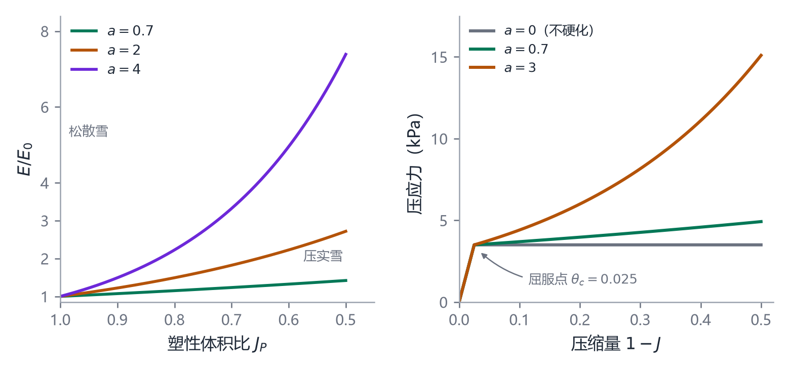
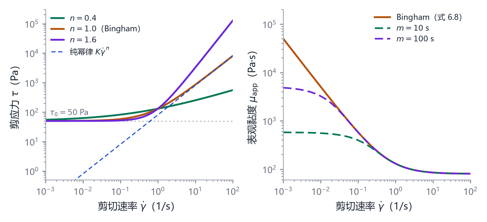

# 第 6 章 雪、沙、泡沫与相变

> 本章导读：抓一把雪攥成球，材料没变，密度变了，手感就换了一种。这一章讲雪为什么越捏越硬、沙为什么攥得住却一剪就松、泡沫为什么立得住又流得动，以及相变和潜热怎样让一个雪人在太阳底下塌掉。

冬天捏雪球的过程里藏着三件事。手套里抓起来的雪是松的，密度大约每立方米一两百公斤，一捏就跑到四百，手感从"粉"变成"硬"；再捏下去，它会在某个瞬间"啪"一声裂开，从可塑变成脆。同一把雪，密度、模量、破坏方式一起变了，而材料始终是冰加水。写本构模型时这三件事必须一起交代，只写一条应力-应变曲线是不够的。

## 6.1 雪：从粉末到硬块

雪的组成很简单：冰的骨架加空气。松散新雪的相对密度只有百分之十几，压实之后到百分之五十，冰本身是百分之九十二。这个跨度意味着模量要跨四五个数量级：松散雪几十千帕，压实雪几十兆帕，冰是吉帕量级。一个模型不可能用一个常数模量覆盖它，模量必须跟着密度走。

先把密度写进变量里。用变形梯度 $\mathbf{F}$ 描述局部变形，做乘法分解：

$$
\mathbf{F}=\mathbf{F}_E\mathbf{F}_P,\qquad J=\det\mathbf{F},\qquad J_P=\det\mathbf{F}_P
\tag{6.1}
$$

$\mathbf{F}_E$ 是弹性部分，负责产生应力；$\mathbf{F}_P$ 是塑性部分，记录永久变形。$J$ 是总体积比，$J_P$ 是塑性体积比。雪的压实就是 $J_P$ 从 1 一路掉到 0.5 甚至更低——骨架被挤塌，空气被赶出去，这部分体积再也不回来。

先把三个词说白。本构模型（constitutive model）就是"给定变形、回答应力是多少"的那条规则，材料的一切手感都塞在里面。变形梯度（deformation gradient）$\mathbf{F}$ 是把一小块材料从初始形状映到当前形状的线性化映射：初始时它是单位矩阵 $\mathbf{I}$，被拉伸时它的奇异值大于 1，被压缩时小于 1，被整体转一圈它只换方向。乘法分解 $\mathbf{F}=\mathbf{F}_E\mathbf{F}_P$ 说的是一句很朴素的话：这块材料先发生了永久变形，再在这个基础上做弹性变形，两者相乘才是你看到的形状。

顺带说清 $\mathbf{F}_P$ 不是"看得见的形状"。它只记录哪部分变形被永久吃掉了。同一块雪，被压扁一半又回弹一点，$\mathbf{F}_P$ 记住的是那一半，弹性那点回弹记在 $\mathbf{F}_E$ 里。也就是说，$\mathbf{F}_P$ 是历史账本，$\mathbf{F}_E$ 是当下的欠账。

弹性部分用固定共旋模型（fixed corotated）：

$$
\Psi=\mu\lVert\mathbf{F}_E-\mathbf{R}_E\rVert_F^2+\frac{\lambda}{2}\left(J_E-1\right)^2,
\qquad
\mathbf{P}=2\mu\left(\mathbf{F}_E-\mathbf{R}_E\right)+\lambda\left(J_E-1\right)J_E\mathbf{F}_E^{-\mathsf T}
\tag{6.2}
$$

$\mathbf{R}_E$ 是 $\mathbf{F}_E$ 极分解里的旋转部分，$\mu$ 和 $\lambda$ 是拉梅参数，$\mathbf{P}$ 是第一类皮奥拉-基尔霍夫应力，$\lVert\cdot\rVert_F$ 是矩阵的弗罗贝尼乌斯范数。这个模型的好处是旋转不产生假应力：一块雪原地转一圈，能量不变。用新胡克模型也能算，但它在纯旋转下会给出一个虚假的体积响应，雪这种几乎不可压的材料会因此莫名其妙地胀起来。

先把 $\left(\mu,\lambda\right)$ 说白。它们叫拉梅参数（Lamé parameters）：$\mu$ 管剪切，也就是"掰弯要多少力"；$\lambda$ 管体积，越大越难压。工程上更熟悉的杨氏模量 $E$ 和泊松比 $\nu$ 可以互算，$\mu=\frac{E}{2\left(1+\nu\right)}$，代码里直接存 $\left(\mu,\lambda\right)$ 更省事，因为应力公式里用的就是它们。

那个"虚假的体积响应"值得多一句。新胡克模型的体积项是 $\frac{\lambda}{2}\ln^2J_E$，纯旋转时 $J_E=1$、$\ln J_E=0$，看上去没问题；可它的应力带 $J_E^{-1}$ 因子，浮点误差让 $J_E$ 偏一点，就会冒出各向同性的假压力，把材料往外撑。固定共旋把体积项写成 $\frac{\lambda}{2}\left(J_E-1\right)^2$，$J_E=1$ 时值和导数同时为零，误差没地方放大。也就是说，选哪个弹性模型在纯旋转下不是精度问题，而是有没有系统偏差的问题。

雪的声速也能估：$c=\sqrt{E/\rho}$。松雪 $E=1.4\times10^5$ Pa、$\rho=200$ kg/m³ 给出 26 m/s；压实到 $E=10^6$ Pa、$\rho=400$ 给出 50 m/s。真实雪里的声速在 100 到 300 m/s，模型偏低——这套"模量按密度指数上升"的拟合很擅长给手感，不擅长给波速，两件事不能兼顾。

日常场景里最能看出压实效应的，是滑雪板刃压过的雪道：刃口压出一条 1 cm 深的槽，槽壁的雪被压实，模量升一个量级；第二趟沿同一条线滑过去会明显更硬、更快，雪场反复压过的地方最后变成水冰面。这就是"越压越硬"的实地版。

雪的这套写法由 Stomakhin 等人给出 [@stomakhin2013]，模量随压实变化的是一对指数：

$$
E\left(J_P\right)=E_0\,e^{a\left(1-J_P\right)},\qquad
\nu\left(J_P\right)=\nu_0+\left(1-\nu_0\right)\xi\left(1-e^{-b\left(1-J_P\right)}\right)
\tag{6.3}
$$

$E_0$ 是未压实时的杨氏模量，$a$ 控制硬化的陡度，$\nu_0$ 是初始泊松比，$b$ 和 $\xi$ 控制泊松比向 $1$ 靠近的速度——雪被压实后几乎不可压，泊松比必须往 0.5 走，否则压下去会横向鼓出来，看着像橡皮。

这一条实现上有个坑。泊松比 $\nu$ 一旦逼近 0.5，拉梅参数 $\lambda=\frac{E\nu}{\left(1+\nu\right)\left(1-2\nu\right)}$ 的分母就趋零，模量发散。所以代码里通常把 $\nu$ 夹在 0.49 以下，并且直接存 $\lambda$ 与 $\mu$，不必每步从 $E$、$\nu$ 反算。做雪球被捏爆的镜头时，这一条会直接决定它"喀"一声之前会不会先冒出一块僵硬的壳。

图 6-1 左就是这条曲线：$J_P$ 从 1 掉到 0.5 的过程里，模量按指数往上爬，$a$ 越大爬得越陡。

代数字看一眼。$E_0=1.4\times10^5$ Pa（松雪的量级），$J_P=0.7$ 时，$a=2$ 给出 $E=1.4\times10^5\times e^{0.6}\approx2.6\times10^5$ Pa，翻了不到两倍；$a=4$ 给出 $1.4\times10^5\times e^{1.2}\approx4.6\times10^5$ Pa，翻了三倍多。压到 $J_P=0.55$（比较硬的雪块），指数分别是 $e^{0.9}\approx2.5$ 与 $e^{1.8}\approx6.0$，模量到 $3.4\times10^5$ 与 $8.5\times10^5$ Pa。这就是"越捏越硬"的数值版：同样的压缩量，$a$ 大四倍的雪硬一倍以上。

塑性流动的写法决定了雪"能压不能拉"。把 $\mathbf{F}_E$ 做奇异值分解，三个方向的弹性伸长各自被夹在一个区间里：

$$
1-\theta_c\le \sigma_i\left(\mathbf{F}_E\right)\le 1+\theta_s
\tag{6.4}
$$

$\sigma_i$ 是第 $i$ 个奇异值，$\theta_c$ 是允许的弹性压缩量，$\theta_s$ 是允许的弹性拉伸量。超出区间的部分被搬进 $\mathbf{F}_P$，成为永久变形。雪的两个阈值很不对称：弹性压缩量能到百分之二三才屈服，而拉伸超过千分之几就断；但这是弹性限度，总压缩量可以很大，超出的部分全转成塑性体积。这就是为什么雪球一捏就成型（压缩塑性充足），一掰就裂（拉伸塑性几乎没有）。

$\mathbf{F}_P$ 每步怎么更新，可以写得很具体：先按弹性试探算奇异值，超上界的乘一个缩放因子拉回 $1+\theta_s$，超下界的拉回 $1-\theta_c$，这些因子连乘成一个对角矩阵，右乘到 $\mathbf{F}_P$ 上；$\mathbf{F}_E$ 再用 $\mathbf{F}\mathbf{F}_P^{-1}$ 重算。也就是说，弹性部分永远待在夹断区间里，多出来的变形全部变成历史。

走一遍数字。假设某颗粒子这步的 $\mathbf{F}_E$ 最小奇异值是 0.7，$\theta_c=0.025$，允许的下界是 0.975；于是缩放因子 $0.7/0.975\approx0.72$ 被搬进 $\mathbf{F}_P$，�� 0.6 降到 0.43，模量按式 (6.3) 从 $3.1\times10^5$ 爬到 $4.4\times10^5$ Pa（取 $a=2$）。这一步里"压缩变硬"和"压缩变永久"是同一个动作的两面。

图 6-1 右是把这套机制压到一维之后的样子。横轴是总压缩量，纵轴是压应力。曲线分两段：开头一小段是弹性的，斜率就是 $E_0$，一直走到 $\theta_c$ 对应的屈服点；此后压缩全部转成塑性，弹性压缩量钉在 $\theta_c$ 不再增加，应力水平变成 $\theta_c E\left(J_P\right)$，随 $J_P$ 下降而抬高。硬化的效果全在后半段的抬升速度上：不硬化（$a=0$）时它是一条水平线，压多少应力都不涨，材料像湿泥；$a=3$ 时压缩一半，应力从 3.5 kPa 爬到 15 kPa，越压越费力，这才是"捏实"的手感。

真实世界里雪成块的另一半原因是烧结：颗粒接触点上会结成冰桥，桥随时间变粗。模型不管这个过程，只把 $J_P$ 的变化当成硬化的全部来源。做动画够了，做雪的力学分析不够。知道自己省掉了什么，比省掉本身更重要。

有一个常见错误是把压实也做成可恢复的：让 $\mathbf{F}_P$ 在卸载时慢慢回到 $\mathbf{I}$，理由是"雪也会回弹"。这样做出来的雪像海绵——压下去变硬，松手全弹回来，体积一点没少。真实的雪被压实后空气已经跑掉，那部分体积再也回不来，所以 $\mathbf{F}_P$ 必须单向。手感上的"回弹一点"是 $\mathbf{F}_E$ 在起作用：卸载时弹性放开，塑性留着。也就是说，弹和塑各管一件事，混在一起就两头不讨好。

<figure class="fig">

<figcaption><b>图 6-1</b>　雪的压实硬化。左：按式 (6.3) 计算的模量随塑性体积比的变化，纵轴是相对 $E_0$ 的倍数，$a$ 取 0.7、2、4 三条曲线；横轴从 1（松散）指向 0.5（压实），模量按指数上升，$a$ 越大越陡。右：一维压缩下按式 (6.4) 的奇异值夹断算出的压应力与压缩量关系，$E_0=1.4\times10^5$ Pa、$\theta_c=0.025$，$a=0$、$0.7$、$3$ 各一条；三条曲线在屈服点之前重合（弹性段，斜率 $E_0$），之后 $a=0$ 走平，$a=0.7$ 与 $a=3$ 分别在压缩一半时升到 4.9 kPa 与 15.1 kPa。</figcaption>
</figure>

## 6.2 沙：摩擦与剪胀

干沙攥在手里能成团，松手一碰就散。这个"团"不是靠黏结，是靠摩擦：颗粒之间有法向压力和摩擦系数，只要压力还在，剪切就走不动；压力一撤，摩擦提供的那点强度立刻消失。所以沙的屈服面必须写成"强度正比于压力"的形式：

$$
q\le \mu p+c,\qquad q=\lVert\operatorname{dev}\boldsymbol{\sigma}\rVert,\quad p=-\frac13\operatorname{tr}\boldsymbol{\sigma}
\tag{6.5}
$$

$q$ 是应力偏量的范数（剪切强度），$p$ 是平均压应力（压为正），$\mu$ 是等效摩擦系数，$c$ 是黏聚。$\mu$ 与内摩擦角 $\varphi$ 的关系大致是 $\mu=\tan\varphi$，干沙的 $\varphi$ 在 $30^\circ$ 到 $35^\circ$ 之间，对应 $\mu$ 约 0.6。$c$ 对干沙接近零，对湿沙有几 kPa——那一层水膜提供了表观的黏聚，也是沙堡能立起来的原因。

代个数：$\varphi=30^\circ$ 时 $\mu=\tan30^\circ=0.577$，$\varphi=35^\circ$ 时 $\mu=0.700$。差别看着不大，但堆出来的形状完全不同——摩擦角就是沙堆能站住的坡度：同样高度的沙堆，底半径从 $1.73$ 倍高度缩到 $1.43$ 倍，缩了一成七。

在三维主应力空间里，式 (6.5) 是一个以静水压轴为轴的圆锥。真实的沙更接近六棱锥（Mohr–Coulomb），工程上常把六棱锥外接成一个光滑圆锥，取法不同，$\mu$ 与 $\varphi$ 的换算系数也不同。差别在平面应变和三轴压缩之间能到百分之十几，做动画不必较真，做地基承载力就必须较真。

沙还有一件反直觉的事：剪胀。踩在湿沙滩上，脚印周围会鼓起来一圈，脚底下的沙被剪切，体积反而变大。密实的沙剪切时膨胀，松散的沙剪切时收缩，两种趋势一直持续到某个密度——临界状态——之后体积不再变，强度也稳定下来：

$$
q=Mp,\qquad M=\frac{6\sin\varphi}{3-\sin\varphi}
\tag{6.6}
$$

$\varphi=30^\circ$ 时 $M=1.2$。临界状态的意思是：不管初始多密多松，剪得足够久，沙都会走到同一条线上。这条线是沙的"记忆终点"，也是为什么反复剪切之后沙堆的休止角会稳定在一个值附近。

代个数核一下：$\varphi=30^\circ$ 时 $M=\frac{6\times0.5}{3-0.5}=1.2$；$\varphi=35^\circ$ 时 $M=\frac{6\times0.574}{3-0.574}\approx1.42$。$M$ 就是"剪多狠才动"的门槛，越大越难剪。它的用处很直接：堆底的应力状态靠不靠得上这条线，决定沙堆能堆多高——超过就只能从脚下滑。

数值上要小心剪胀。如果按关联流动写——塑性流动方向取屈服面的法向——沙在剪切时会一直膨胀，堆不起坡，而且膨胀到一定程度的体积会撑破网格。真实材料是非关联的：流动方向由一个独立的塑性势给出，塑性势与屈服面在 $q$ 方向上一致、在 $p$ 方向上有差别，差多少由剪胀角 $\psi$ 描述。实用写法是把塑性修正只做在偏量上，体积变化交给 $J$ 和一个单独的体积硬化/软化规则，这样既能表现剪胀，又不会失控。

物质点法处理沙的方式有一个别人比不了的好处：每颗粒子自己带着 $\mathbf{F}$ 和应力状态。静止的沙有完整的变形历史，是一个有记忆的弹塑性固体；流动的沙只需要更新 $\mathbf{F}$ 和应力，不需要换求解器。一块沙堆从静止到坍塌，中间没有"切换模型"的动作，这在两套求解器拼接的方案里是个大麻烦。

## 6.3 泡沫：立得住，也流得动

剃须泡挤在手上能堆成一个小尖，倾斜盘子它才慢慢流走。这说明它有一个屈服应力：应力小于某个值时它像固体，超过之后才像液体。描述这种材料最常用的是 Herschel–Bulkley 模型：

$$
\tau=\tau_0+K\dot\gamma^{\,n}
\tag{6.7}
$$

$\tau$ 是剪应力，$\dot\gamma$ 是剪切速率，$\tau_0$ 是屈服应力，$K$ 是稠度系数，$n$ 是流动指数。$n\lt 1$ 时剪切变稀，$n=1$ 时退化成 Bingham 塑性。剃须泡的 $\tau_0$ 在几十帕，$n$ 在 0.3 到 0.5 之间，所以它一边流动一边变稀。

把式 (6.7) 除以剪切速率，得到表观黏度：

$$
\mu_{\text{app}}=\frac{\tau}{\dot\gamma}=\frac{\tau_0}{\dot\gamma}+K\dot\gamma^{\,n-1}
\tag{6.8}
$$

第一项在 $\dot\gamma\to0$ 时发散。这是泡沫在数值上最讨厌的地方：静止的泡沫黏度无穷大，式子里出现 $0/0$，显式格式直接算不了。图 6-2 右那条往上冲的曲线就是它。

"变稀"的来处也值得一句。低剪切率下气泡几乎不变形，液体只能在泡膜之间慢慢渗，阻力大；剪切率上去以后气泡被拉成椭圆，顺着流向排开，通路变宽，阻力就小了。也就是说，$n\lt1$ 不是随手拟合出的弯度，它背后是气泡形状在变。

两条出路。一条是正则化，把发散的项换成一个在低剪切率下有限的形式：

$$
\mu_{\text{reg}}=\frac{\tau_0\left(1-e^{-m\dot\gamma}\right)}{\dot\gamma}+K\dot\gamma^{\,n-1}
\tag{6.9}
$$

$m$ 越大，越接近理想的 Herschel–Bulkley；$m$ 足够大时，低剪切率下表观黏度饱和在 $\tau_0 m+K$，数值上就有了一个上限。另一条是把泡沫当弹塑性固体来算：给它一个屈服面（Von Mises 或者带压力相关项的圆锥），应力在屈服面之内就按弹性处理，超出去就做塑性回映。物质点法里后者更自然，因为粒子本来就带着 $\mathbf{F}$，屈服面也是现成的。

回映这两行代码写出来很短。先按纯弹性试算一个试探应力 $\boldsymbol{\sigma}^{\text{tr}}$，算它的偏量范数 $q^{\text{tr}}=\lVert\operatorname{dev}\boldsymbol{\sigma}^{\text{tr}}\rVert$；$q^{\text{tr}}\le\tau_0$ 时材料还没屈服，试探应力就是真应力；超过了就把偏量按比例缩回屈服面，$\operatorname{dev}\boldsymbol{\sigma}=\operatorname{dev}\boldsymbol{\sigma}^{\text{tr}}\cdot\frac{\tau_0+K\dot\gamma^{\,n}}{q^{\text{tr}}}$，剩下的能量记成塑性功。也就是说，"立得住"在代码里就是一次条件判断加一次缩放。

用式 (6.7) 算两个点。$\tau_0=50$ Pa、$K=80$、$n=0.4$，剪切速率 $\dot\gamma=10$ s⁻¹ 时 $\tau=50+80\times10^{0.4}\approx251$ Pa，表观黏度 $25$ Pa·s；$\dot\gamma=0.01$ s⁻¹ 时幂律项只有 $80\times0.01^{0.4}\approx12.7$ Pa，表观黏度被 $\tau_0/\dot\gamma$ 顶到 $6.3\times10^3$ Pa·s。两个数差两百多倍，这就是"快搅像水、慢推像膏"的量化说法。

一层剃须泡抹在斜玻璃上，就是这套数的现场演示：应力小于 $\tau_0$ 时它纹丝不动，连边缘都不流；手指一抹，局部应力超了阈值，那一片开始按幂律流动；手指离开又能停住，断面留下清晰的边。反例是去掉 $\tau_0$ 只用幂律：泡沫在斜面上会永远缓慢下滑，堆不出尖，看起来像兑了水的洗发水。

屈服应力和泡的大小直接挂钩：泡膜的表面张力 $\gamma$ 拉住气泡，泡越小曲率越大，拉得越紧，粗略有 $\tau_0\sim\gamma/R$。剃须泡的 $\gamma\approx0.03$ N/m，泡半径 50 μm 时 $\gamma/R=600$ Pa，而实测屈服应力几十帕，说明前面的系数在 0.1 上下；泡径减半，屈服应力大致翻倍。也就是说，"摇得越细越立得住"不是错觉。

再说说屈服面的形状，它决定泡沫怎么碎。最简单的是 Von Mises：$q\le\tau_0$，与压力无关，意味着泡膜被压得多狠都不会更容易破。真实泡沫不这样——被压扁的泡膜更脆，所以常用带压力项的锥面 $q\le\tau_0+\mu_f p$，$\mu_f$ 取 0.1 到 0.3 量级。加上这一项之后，杯底被压住的那层会先破，而不是整杯均匀地流；倒啤酒时泡沫层"下实上松"就是这件事。

泡沫还有两件事和普通流体不一样。

一是可压。泡沫里有大量气泡，体积模量比液体低两个数量级，而且压缩时气泡被压小、内压升高，越压越硬。视觉上这就是泡沫被手掌压扁时"先软后硬"的手感，松手之后只回弹一部分。用不可压模型做泡沫，手感会变成一个硬邦邦的橡皮球。

二是壁面滑移。泡沫贴着管壁流动时，壁面附近有一层液体膜，表观上泡沫在壁面上"滑"。实验里测泡沫的表观黏度会发现它和管径有关——同一批泡沫，管径细的测出来更黏，因为滑移层占的比例更大。这个效应有标准的校正方法，做数值时如果按无滑移壁面算，压降会被高估；如果按完全滑移算，泡沫会整体做塞流（中间不剪切），两种极端都不对。折中的做法是给壁面一个滑移长度，让滑移速度与壁面剪应力成正比。

泡沫还有一点常被忽略：它能受一点拉力。泡膜弯着的时候，液体把两个气泡拉在一起，材料表现出几帕到几十帕的抗拉强度；拉力超过这个值，泡膜就破，材料开裂。所以泡沫既能像固体一样裂，也能像液体一样流，取决于应力状态里有没有拉。只用 Herschel–Bulkley 的话，压力一变成负值它就当纯液体处理，裂缝永远不会出现；要做泡沫碎裂的镜头，得另外给它一个拉伸方向的强度上限。

泡沫放久了会塌，原因是液体从泡膜之间排走，气泡合并、变大，材料变干变硬，最后碎成粉。这个过程叫排液，是个慢过程，做几分钟的镜头可以不管；要做"泡沫从蓬松到塌陷"的长镜头，就得让密度和屈服应力随时间演化，或者干脆用一个简单的年龄参数驱动。

<figure class="fig">

<figcaption><b>图 6-2</b>　泡沫的屈服行为。左：按式 (6.7) 计算的剪应力与剪切速率（双对数），取 $\tau_0=50$ Pa、$K=80$、$n=0.4$、$1.0$、$1.6$ 三条曲线，虚线是去掉屈服应力的纯幂律 $\tau=K\dot\gamma^{\,n}$（图中取 $n=1$）——低剪切率下它与 Bingham 线的间距就是 $\tau_0$。右：按式 (6.8) 与式 (6.9) 计算的表观黏度，$n=1$（Bingham）；理想模型的曲线在 $\dot\gamma\to0$ 时冲向上方，取 $m=10\,\text{s}$ 与 $m=100\,\text{s}$ 正则化之后，低剪切率端分别饱和在约 $5.8\times10^2$ 与 $5.1\times10^3$ Pa·s。</figcaption>
</figure>

## 6.4 相变：融雪要多少热

零度的雪化成零度的水，温度一度没变，却要吸一大口热：一公斤冰的熔化潜热是 334 kJ。作为对比，把同样一公斤冰从 $-10\,{}^\circ$C 加热到 $0\,{}^\circ$C，只需要 21 kJ，因为冰的比热是 2.1 kJ/(kg·K)。也就是说，融化一公斤雪所需的能量，是把这公斤雪从深冬的温度捂到冰点所需能量的十六倍。

这个比例解释了为什么雪堆能在零度附近撑很久，也决定了相变在模拟里必须认真处理——把潜热忽略掉，雪会化得快一个数量级，镜头里那点"慢慢塌"的味道全没了。

物质点法处理传热的方式是把温度放到网格上算。热扩散是个拉普拉斯型的方程：

$$
\rho c_{\text{eff}}\frac{\partial\theta}{\partial t}=\nabla\cdot\left(k\nabla\theta\right)
\tag{6.10}
$$

$\theta$ 是温度，$\rho$ 是密度，$k$ 是导热系数，$c_{\text{eff}}$ 是表观热容。粒子的温度先按权重搬到节点，在网格上解一步扩散，再把节点温度插回粒子。放在网格上是因为扩散需要邻居——粒子的邻居集合每帧都在变，网格的邻居是固定的。

潜热的处理办法是把熔化区间抹开一点。真实的冰在 $0\,{}^\circ$C 一个点上熔化，数值上让它在 $\left[\theta_m-\Delta\theta,\ \theta_m+\Delta\theta\right]$ 这个窄区间内完成，并把潜热摊进这个区间的热容里：

$$
c_{\text{eff}}=c+\frac{L}{2\Delta\theta},\qquad \theta\in\left[\theta_m-\Delta\theta,\ \theta_m+\Delta\theta\right]
\tag{6.11}
$$

$L$ 是潜热，$2\Delta\theta$ 是区间宽度。在区间之外 $c_{\text{eff}}=c$。这样热容在熔化区间里出现一个尖峰，热量进去先"填"这个尖峰，温度纹丝不动——这正是潜热的物理含义。同时相分数可以写成温度的线性函数，$\phi=\left(\theta-\theta_m+\Delta\theta\right)/\left(2\Delta\theta\right)$ 夹在 0 与 1 之间，$\phi=0$ 是纯冰，$\phi=1$ 是纯水。

有了 $\phi$，材料参数就能插值：模量、屈服应力、黏度都写成 $(1-\phi)$ 乘固体值加 $\phi$ 乘液体值。物质点法在这里占便宜——它不需要"把固体换成流体"这样的重构，只需要在同一个粒子上换一套参数，粒子的位置、速度、变形梯度都连着。粒子带温度、网格解扩散、相分数插值材料参数，这套结构就是增广物质点法的核心 [@stomakhin2014]。

插值里有个坑：模量不能直接线性插。固体模量 $10^6$ Pa、液体按 0 算，$\phi=0.5$ 时得到 $5\times10^5$ Pa，看上去很"半化"；实际上一半冰一半水的混合物几乎没有抗剪强度——水一点不抗剪，冰的骨架也已经泡断。所以液相的剪切模量应该直接给一个小值（$10^2$ Pa 量级，代表泥浆的稠度），让 $\phi$ 过 0.5 之后迅速失去强度，而不是线性地衰减。这是糊状区最难调的地方。

尖峰有多尖，算一下就知道。$L=334$ kJ/kg，取 $2\Delta\theta=1$ K，则 $L/\left(2\Delta\theta\right)=3.34\times10^5$ J/(kg·K)，是冰的比热 $2.1\times10^3$ 的一百六十倍。也就是说，在熔化区间里，同样的热流只能把温度推动百分之一的距离。这一条也提醒我们别把区间取宽：取 10 K，潜热被摊薄十倍，雪面会糊里糊涂地一路化下去。

再给一个时间尺度。太阳照到雪面，净吸收按 250 W/m² 算；一平方米、厚 1 cm、密度 300 kg/m³ 的雪是 3 kg，熔化要 $3\times3.34\times10^5\approx10^6$ J，除以 250 W 得 4000 s，一个多小时。这个数说明两件事：镜头里雪人"慢慢塌"是对的；漏掉潜热时同一份能量足够把 3 kg 雪升温一百五十多开，温度不再被钉在 0 °C，雪面几分钟就越过熔点、之后一路"过热"，画面很快就崩。

潜热还让"化多快"变成一个前沿问题。热从表面进去，先化表层，再靠导热往深处推；已化的湿雪导热差，层越厚传得越慢，于是前沿深度大致按 $\sqrt{t}$ 走：化 1 cm 要一个多小时，化 4 cm 不是四小时，而是十几个小时。也就是说，雪堆塌的速度不是匀速的，越到后面越慢——镜头的节奏要跟着这个走，开头快、后面几乎停住。

热扩散在雪的尺度上其实很慢。取 $\rho=300$ kg/m³、$c=2\times10^3$ J/(kg·K)、$k=0.2$ W/(m·K)，热扩散率 $\alpha=k/(\rho c)\approx3\times10^{-7}$ m²/s；网格 $h=1$ cm 时，显式扩散的稳定步长在几十秒量级，比力学步长大五六个数量级。所以稳定性的瓶颈不在传热，在相变带来的两件事。

第一件是体积突变。冰的密度 917 kg/m³，水 1000，融化时体积缩小百分之八。如果按体积守恒更新，这百分之八会立刻变成压力脉冲，把周围的材料炸开；正确做法是按质量守恒，让体积跟着密度走，压力由状态方程或体积约束慢慢建立。同一件事反过来发生在冻结时：水结冰体积膨胀百分之九，能把石头缝撑裂，模型里同样要按质量算，不能按体积算。

代数字：1 m³ 的冰是 917 kg，化成水是 0.917 m³，缩小 8.3%；反过来，1 m³ 的水结成冰是 1.09 m³，涨 9%。如果代码里按体积守恒更新粒子体积，这 8% 会在一个步长内变成 8% 的体积应变，而水的体积模量是 2.2 GPa，乘上去就是 $1.8\times10^8$ Pa 的压力——足够把周围的雪炸飞出画面。按质量守恒更新，体积从密度反算，压力才是一步步建立起来的。

第二件是刚度突变。融化的雪失去全部抗剪强度，变成水，而水的体积模量是 2.2 GPa，比压实雪高两个数量级。同一颗粒子前后两种状态的刚度差这么大，显式时间步会被最硬的那一端锁死。所以带相变的镜头通常要额外限制每一步的相变量——不能让一颗粒子在一个步长里从纯冰跳到纯水，否则刚度、体积、应力三个量同时跳变，迭代会崩。

量级上：压实雪 $E=10^6$ Pa、$\rho=400$ kg/m³，声速 50 m/s，$h=1$ cm 时显式步长上限约 $h/c=2\times10^{-4}$ s；水声速 1500 m/s，同一个 $h$ 只剩 $7\times10^{-6}$ s。也就是说，一颗粒子从冰变成水，允许的步长会小三十倍。这就是为什么带相变的镜头必须给每步相变量设阈值。

还有蒸发和升华。这两个过程让质量真的离开模拟，处理时必须成对地减：粒子质量归零的同时，它携带的动量也要一起消掉，否则材料的质心会缓缓漂移。做雪在阳光下的特写时，这一项决定了表面那层"毛边"能不能出现。

一个具体场景：屋檐下的冰凌中午开始滴水。滴水那个点就是相变前沿——冰在那里化成水、带走潜热，周围的冰靠导热把热补上来，所以冰凌总是从尖端变短、变细。反例是只算温度不算相变：冰凌会整体一起变软，像蜡烛一样塌下去，而不是从尖上一滴一滴地消失。

## 6.5 多材料：界面被抹开一格

物质点法的多材料几乎是免费的。每颗粒子带一个材料编号和一组参数，P2G 时把质量和动量按权重撒到节点，节点不知道自己是雪还是岩石；G2P 时每颗粒子用自己那套本构算应力。没有界面网格，没有浸入边界，也不需要追踪界面的拓扑变化——雪化成水，只是参数变了。

免费的东西总有代价：界面被抹开一格。一个节点上的质量可能来自三种材料，它的速度是这些材料动量的平均。平均意味着界面处的一层薄壳表现得像两种材料的混合物，厚度大约一个格距。对密度接近的两种材料（雪和水、沙和水）这没什么；对刚度差三个数量级的两种材料（岩石和雪），问题就出来了。

岩石颗粒子附近的节点，质量有很大一部分来自雪。节点的速度被雪拖着走，岩石的加速度就偏小，看起来像面团。反过来，界面附近的雪被岩石的惯性带着跑，本该被压碎的地方会显得很硬。这不是本构的问题，是离散化把两种材料强行塞进同一个速度场的结果。

偏多少可以估。岩石密度 2500 kg/m³、雪 300，界面上一格一半一半时，节点质量里岩石占 $2500/\left(2500+300\right)\approx89\%$，速度偏差不到一成，问题不大；换成压实的湿雪（600 kg/m³），比例掉到 81%，偏差近两成，岩石在界面上会明显发软。也就是说，同样是"石头砸雪"，松雪能过、湿雪常常要上双向耦合。

三种处理方式，按成本排。最省的是加密网格，界面那一格变薄，误差跟着变小，代价是粒子数和计算量。其次是按材料分网格：P2G 时每种材料往自己的一套节点数组上撒，各算各的内力，最后在节点上按质量（或体积）比例把力合成。这样界面处的两种材料不会被同一个速度场强行平均掉，代价是内存和散射次数乘以材料数。最贵的是把刚体拿出来单独用刚体求解器算，再和 MPM 双向耦合 [@hu2018]——刚体把自己的质量、惯量和接触力传进网格，网格把冲量积分出来还给刚体。岩石、道具、角色与雪的交界，基本都靠这一招。

混合法则有个规律值得记住：节点上的平均偏向"等应变"，也就是两种材料像串联的弹簧，等效刚度偏向软的那一端。所以界面附近总是偏软、偏黏，不会偏硬。方向知道了，调参时就不会在错的地方找问题。

沙和水这类两相材料另有一套语言：孔隙压力、有效应力、渗透率。它们不适合靠节点平均来混合，因为水在沙的孔隙里流动，尺度比格距小得多。这类问题要么用两套网格分别解两相再耦合，要么把沙水当成一个混合物处理，参数由孔隙率决定。孔隙压力本身是一个独立场，需要单独的方程，不是靠权重插值能得到的。

## 6.6 参数与视觉

本构模型的参数不是物理常数，是旋钮。每个旋钮拧动之后，画面上的哪一部分会变，值得先想清楚再动手。

$E_0$ 决定"材料有多硬"，在雪上表现为塌陷的深度和雪堆边缘的垂度。太小，雪像棉花，落下来就摊平；太大，雪像石膏，砸在地上会弹起来，边缘锋利得不真实。压实硬化系数 $a$ 决定"能不能捏实"：$a$ 大，压一层就硬，雪面上会形成一层硬壳，脚踩上去先是"咔"一声再陷下去；$a$ 小，雪一直是粉的，捏不成球。

摩擦系数 $\mu$ 决定休止角。$30^\circ$ 的沙堆和 $40^\circ$ 的沙堆，在画面上一眼就能分辨：前者摊成一片，后者陡得能立住一个锥。这也是最容易调的参数——它几乎只影响最终形状，不影响运动过程。黏聚 $c$ 决定"能不能立起来"，湿沙能堆出城堡，全靠这几 kPa。

屈服应力 $\tau_0$ 决定泡沫立不立得住，也决定它流动的样子。$\tau_0$ 小，泡沫往盘子上一倒就摊开，像牛奶；$\tau_0$ 大，它堆成一座小山，要晃很久才塌。流动指数 $n$ 决定"流得顺不顺"：$n$ 小，一动就稀，停下来又立刻变稠，这个反差就是剃须泡的手感。

相变温度区间的宽度 $\Delta\theta$ 决定融化是糊状还是突变。区间窄，雪面像被刀切一样整齐地退；区间宽，表面会先变成一层湿雪泥，再慢慢塌。潜热 $L$ 决定整体融化的快慢，也决定雪堆能不能在零度附近"撑住"——把 $L$ 调小，太阳一出来雪堆就没了。

最后一个提醒：这些参数和网格分辨率是绑在一起的。网格粗，数值耗散相当于给材料加了一层额外的黏性，同一组参数在粗网格上看着更"稠"；网格细，材料显得更"活"，还可能露出不该有的抖动。换分辨率就要重新标定，这件事没有捷径。实践中的顺序是先定模量（塌陷高度对不对），再定摩擦（堆形对不对），最后定屈服和相变（局部形态对不对），每一步只动一个参数。

举个具体流程。做雪块落地的镜头：先只看落地后第一秒的塌陷深度，把 $E_0$ 调到陷进去约自身高度的三分之一；再等它摊开，看边缘坡度，调 $a$ 让边缘不那么"流"；最后看表面，碎块太圆就说明 $\theta_s$ 给大了，往千分之二收。顺序不能倒——先调 $\theta_s$ 会改变碎块尺寸，塌陷深度跟着变，前面的工作白做。

反例也很常见：同一组参数从 1 cm 网格换到 2 cm，雪突然显得"稠"，塌得慢、边缘圆。这不是参数错了，是数值耗散厚了一层。换分辨率就重新标定，别指望一套数字通吃。
