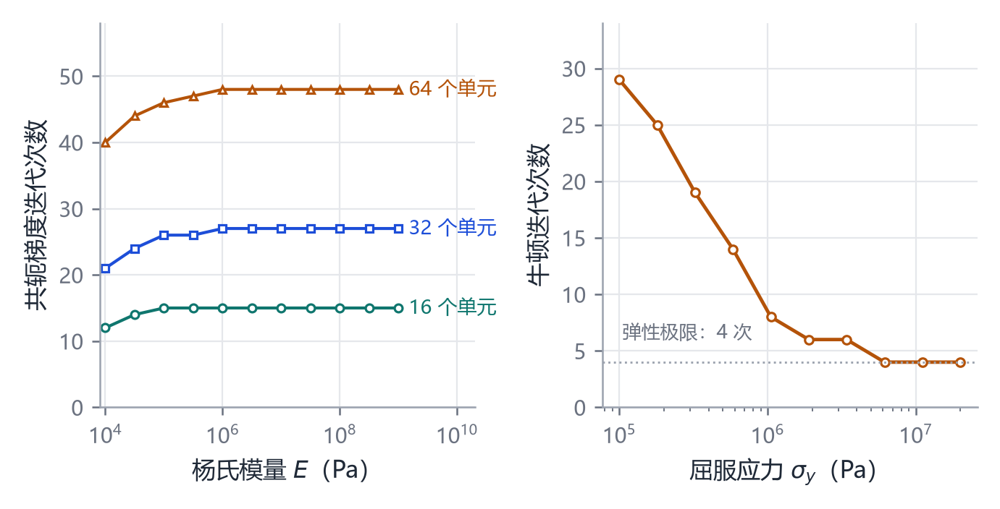

# 第 7 章 隐式 MPM 与刚度

> 本章导读：一铲雪落地，半秒之内摊开、压实、边缘碎成小块。显式求解器要跟住这一幕，时间步得压到万分之一秒；换成隐式，一步可以走满一帧的几十分之一，代价是每步要解一个线性系统。这一章算这笔账：刚度怎样变成矩阵，矩阵为什么是稀疏的，牛顿迭代什么时候收敛、什么时候卡住，半隐式省掉了哪一部分，以及在什么情况下隐式其实不划算。

## 7.1 一铲雪落地

把一铲湿雪倒在地上。雪团触地的一瞬间，底部先被压扁，上部还在往下走，中间那层被挤得向四周铺开，边缘拉出一圈薄片，薄片撑不住自己，碎成小块弹开。整个过程不超过半秒，但里面几乎同时发生了压实、剪切、拉伸失效和飞溅。

用显式 MPM 做这个镜头，第一版多半撑不过三帧。雪团穿进地面，或者粒子以每秒几十米的速度飞出画面。检查形函数、检查权重、检查边界，都是对的。问题出在时间步上。

显式积分有一条硬限制：一个步长内，信息不能跨过太多个网格单元。这条限制的根源是材料里的波。雪的密度在三百到四百千克每立方米之间，压实状态的压缩模量在 $10^{6}$ 帕量级，声速

$$
c=\sqrt{\frac{E}{\rho}}
\tag{7.1}
$$

算出来是五十米每秒上下；压得更实的雪，模量到 $10^{7}$ 帕，声速一百七十米每秒。$\rho$ 是密度，$E$ 是压缩模量。显式 MPM 的稳定步长和声速、网格间距 $h$ 的关系近似是

$$
\Delta t \le \frac{h}{c} .
\tag{7.2}
$$

网格取一厘米，$c=50$ 米每秒，$\Delta t$ 上限约五千分之一秒；$c=170$ 米每秒，约一万七千分之一秒。一帧二十四分之一秒，就是两百到七百个子步。一个五秒的镜头一百二十帧，两万五千到八万步。一百万粒子的场景，每步的 P2G 和 G2P 各是几千万次散点累加，一帧要跑几十秒。这个成本不是"再优化一下"能解决的，它长在稳定性条件里。

更麻烦的是雪不是一种刚度。孔隙被压塌的过程里，模量从软雪的 $10^{5}$ 帕一路涨到冰点的 $10^{9}$ 帕。用常数模量建模，取软值，雪会像橡皮一样弹回来；取硬值，步长按最坏的那一处付，整个场景跟着变慢。显式的成本由最硬的那个局部决定，不由平均值决定，这是它在非均匀材料上吃亏的地方。

隐式的承诺很直接：对线性弹性，后向欧拉无条件稳定，$\Delta t$ 只受精度限制，不受 $h/c$ 限制。于是有人把步长从五千分之一秒提到四十八分之一秒，一百倍的差距，一步顶一百步。代价马上出现：每一步都要解一个非线性方程组，未知量是网格节点的速度，方程数也是节点数。这条路能不能走通，取决于这个方程组有多难解。

还有一条常被忽略的隐形成本。显式并不是完全不能算，而是必须贴着稳定边界跑，再靠阻尼压住最短波长的振荡。阻尼给够了，材料就带上胶水感：雪落地不碎，而是缓慢地摊成一张饼。很多显式雪的"发黏"不是本构的问题，是阻尼为了稳定而加过头了。

## 7.2 把一步写成求根

先把网格上的动量方程写清楚。节点 $i$ 的质量是 $m_i$，速度从 $\mathbf{v}_i^{n}$ 走到 $\mathbf{v}_i^{n+1}$，外力是 $\mathbf{f}_i^{\text{ext}}$（重力、边界、接触），内力来自粒子的应力：

$$
m_i\,\frac{\mathbf{v}_i^{n+1}-\mathbf{v}_i^{n}}{\Delta t}=\mathbf{f}_i^{\text{ext}}+\mathbf{f}_i^{\text{int}} .
\tag{7.3}
$$

内力写成对粒子求和的形式：

$$
\mathbf{f}_i^{\text{int}}=-\sum_p V_p\,\mathbf{P}_p\,\nabla w_{ip} ,
\tag{7.4}
$$

$V_p$ 是粒子体积，$\mathbf{P}_p$ 是第一类皮奥拉-基尔霍夫应力（把参考构形上的力映到当前构形），$\nabla w_{ip}$ 是形函数在粒子处的梯度，$w_{ip}$ 是节点 $i$ 对粒子 $p$ 的权重。负号表示应力把节点往粒子那边拉。

这个式子里，$\mathbf{P}_p$ 不是常数。它由粒子的变形梯度决定，而变形梯度在这一步里由速度梯度推进：

$$
\mathbf{F}_p^{\text{new}}=\left(\mathbf{I}+\Delta t\,\nabla\mathbf{v}_p\right)\mathbf{F}_p^{n},
\qquad
\nabla\mathbf{v}_p=\sum_j \mathbf{v}_j\otimes\nabla w_{jp} .
\tag{7.5}
$$

速度越大，粒子被拉得越快，应力越高，内力越大。把式 (7.3) 移项，定义残差

$$
\mathbf{r}_i(\mathbf{v})=m_i\,\frac{\mathbf{v}_i-\mathbf{v}_i^{n}}{\Delta t}-\mathbf{f}_i^{\text{ext}}-\mathbf{f}_i^{\text{int}}(\mathbf{v}) ,
\tag{7.6}
$$

求 $\mathbf{r}(\mathbf{v})=0$ 就是求这一步的速度。这个残差有两项很不一样的性格：惯性项对 $\mathbf{v}$ 是线性的，斜率是 $m_i/\Delta t$，是个正数；内力项是 $\mathbf{v}$ 的非线性函数，斜率可能是正的也可能是负的，取决于材料当前是硬化还是软化。

牛顿法把残差在当前猜测处线性化。设第 $k$ 次迭代的速度是 $\mathbf{v}^{(k)}$，解

$$
\mathbf{J}\,\delta\mathbf{v}=-\mathbf{r}\!\left(\mathbf{v}^{(k)}\right),
\qquad
\mathbf{v}^{(k+1)}=\mathbf{v}^{(k)}+\alpha\,\delta\mathbf{v} ,
\tag{7.7}
$$

其中 $\mathbf{J}=\partial\mathbf{r}/\partial\mathbf{v}$ 是雅可比矩阵，$\alpha$ 是线搜索给的比例。对式 (7.6) 求导：

$$
\mathbf{J}=\frac{\mathbf{M}}{\Delta t}+\mathbf{K},
\qquad
K_{ij}=\Delta t\sum_p V_p\left(\frac{\partial \mathbf{P}}{\partial \mathbf{F}}\right)_{\!p}\nabla w_{ip}\,\nabla w_{jp} .
\tag{7.8}
$$

$\mathbf{M}$ 是集中质量矩阵（对角），$\mathbf{K}$ 叫切线刚度矩阵，$\partial\mathbf{P}/\partial\mathbf{F}$ 是材料的切线模量。在一维里这三项的量纲可以直接对上：$V_p$ 是长度，切线模量是帕，两个形函数梯度各是长度的倒数，乘起来是牛每米，节点刚度的量纲；再乘 $\Delta t$ 是千克每秒，正好和 $m_i/\Delta t$ 一致。量纲对不上，说明某一项漏了体积或者多乘了 $\Delta t$，这类错在三维里不容易靠肉眼发现，值得在写代码时先手算一遍。

以亨奇材料为例，一维应力 $P=E\ln F$，切线模量

$$
\frac{\partial P}{\partial F}=\frac{E}{F} ,
\tag{7.9}
$$

$F$ 接近一时就是杨氏模量本身。取对数而不是取线性应变，是因为压缩到 $F=0.5$ 时线性应变的应力会算成负的一半，而对数应力还保持着正确的符号和增长趋势。雪、泡沫这类材料在大压缩下必须用对数或者更复杂的体积罚函数，否则压到一定程度应力会开始下降，材料自己塌陷。

牛顿迭代的收敛速度值得单独说。在解的邻域内，误差满足 $\|\mathbf{e}_{k+1}\|\approx C\|\mathbf{e}_k\|^{2}$，也就是每迭代一次有效数字翻倍：残差从 $10^{-1}$ 掉到 $10^{-2}$、$10^{-4}$、$10^{-8}$，四次迭代就到位。这是牛顿法在理想情况下的表现，前提是切线模量正确、能量在解的附近足够光滑。图 7-1 给出了一次真实的一维隐式求解的残差曲线。

<figure class="fig">

<figcaption><b>图 7-1</b>　一维隐式 MPM 单步求解的牛顿残差，横轴是牛顿迭代次数，纵轴是相对残差 $\|\mathbf{r}\|/\|\mathbf{r}_0\|$（对数）。左图是弹性材料（$P=E\ln F$），$E$ 取 $10^{6}$、$10^{7}$、$10^{8}$ 帕三条曲线，几乎完全重合，五次迭代落到 $10^{-11}$ 以下，每迭代一次后残差的指数约翻倍，是二次收敛；右图对同一套方程加了平滑屈服 $P=\sigma_y\tanh(E\ln F/\sigma_y)$，$\sigma_y$ 取 $0.5$ 与 $1.0$ 兆帕，$E=10^{7}$ 帕，屈服区内切线模量接近零，残差先在前十几次迭代里几乎不动，之后才恢复下降，$\sigma_y=1$ 兆帕要 8 次、$0.5$ 兆帕要 16 次。计算用 32 个单元的网格、240 个粒子、$\Delta t=1/120$ 秒，初值速度为零，初始变形梯度从 $0.98$ 到 $0.63$，右端节点以 $-1.5$ 米每秒向左压。</figcaption>
</figure>

图 7-1 左图里三条曲线的迭代次数几乎一样，这一点常让人意外：刚度差一百倍，收敛次数没变。原因是牛顿法对标量刚度的缩放不敏感，$E$ 变大时解本身变小，残差和雅可比同时按比例变，比值不动。刚度真正影响的是线性系统的条件数，也就是每个牛顿步里那个 $\mathbf{J}\delta\mathbf{v}=-\mathbf{r}$ 有多难解，这件事留到 7.3 和 7.6 说。右图里的退化则是另一回事：屈服让切线模量在部分区域变成零，牛顿拿到的斜率信息不全，只能一小步一小步地摸过去。前十几次迭代残差几乎停在 $1$ 附近，不是算错了，是线搜索在反复砍步长：屈服边界在迭代中来回移动，每跨过一次，应力就换一段斜率，整步走完反而离解更远。

## 7.3 刚度矩阵的形状

$\mathbf{K}$ 的元素只有一部分非零，原因在形函数。二次 B 样条在三维里覆盖 $3\times3\times3$ 个节点，一个粒子只和这二十七个节点有往来。把式 (7.8) 按粒子逐项累加，非零元只出现在"被同一个粒子覆盖"的节点对之间。反过来看，节点 $i$ 的一行会和哪些节点有非零元？凡是和 $i$ 共享某个粒子的节点。共享粒子的条件是两者距离不超过两格，三维里就是 $5\times5\times5$ 的邻域，一百二十五个节点。

于是每一行的非零块数是一百二十五，每块是 $3\times3$（三个速度分量互相耦合），标量非零元三千多个。这个数字和节点总数无关，只和形函数阶数有关。六十四的三次方是二十六万节点、七十八万个未知量，稀疏矩阵的非零元约九亿，双精度存下来七吉字节出头，加上索引还要更多。稠密存法在同样的规模下是六乘十的十一次方个元素，差三个数量级，这就是稀疏性值钱的地方。

矩阵的结构还有两个特点。第一，它不是对称正定的，除非材料是超弹性的且没有塑性。超弹性材料的切线模量来自能量对 $\mathbf{F}$ 的二阶导，是对称的；塑性、摩擦、接触都会破坏对称性。这一点决定了求解器：共轭梯度只能用在对角占优或者对称正定的近似上，一般情况要靠 GMRES 或者带对称化的拟牛顿。

第二，矩阵的填充和排序关系很大。稀疏直接法（比如稀疏 Cholesky）在消元时会凭空生出新的非零元，这叫填充。二维规则网格用嵌套剖分排序，填充量是 $O(N\log N)$；三维是 $O(N^{4/3})$，看着不算爆炸，实际常数很大，八十万未知量以上基本就跑不动了。所以三维隐式 MPM 里的直接法多用在单帧、小网格、或者分块求解上，全场景还是迭代法加预条件。

迭代法要一个预条件子。最便宜的是对角预条件，用 $\mathbf{J}$ 的对角线做缩放，它能把条件数压掉一部分，但不改变条件数随分辨率的增长。更好的是几何多重网格：把误差的低频部分放到粗网格上解，而 MPM 的网格本身就是规则的，粗化很自然。麻烦在于边界和自由表面，粗网格上的边界条件得重新构造，粗糙一点没关系，预条件子不需要精确。

还有一件事让 MPM 和有限元很不一样：网格每步都要重建。有限元里矩阵装配一次，分解一次，接下来几十上百步都用同一个分解，隐式的成本被摊薄了。MPM 的粒子在动，形函数每步都变，矩阵每步都不一样，分解只能用一次。所以隐式 MPM 的成本要按"每步一次完整求解"来算，不能指望摊销。这也是为什么 matrix-free 的做法在这里受欢迎：不装配矩阵，每次乘 $\mathbf{K}\mathbf{v}$ 时遍历粒子，用 $\sum_p V_p(\partial\mathbf{P}/\partial\mathbf{F})_p(\nabla w_{ip}\cdot\mathbf{v}_p)\nabla w_{jp}$ 现算，内存只需要存向量，不需要存九亿个非零元。

条件数还和 $\Delta t$ 有关。$\mathbf{J}=\mathbf{M}/\Delta t+\mathbf{K}$，$\Delta t$ 很小时对角项大，矩阵接近对角占优，条件数接近一，共轭梯度几步就收敛；$\Delta t$ 变大，刚度项占比上升，条件数按 $O(h^{-2})$ 增长，迭代次数按 $O(h^{-1})$ 增长。这条规律解释了隐式的"甜点"位置：步长不能大到让线性系统解不动，也不能小到白付隐式的成本。图 7-2 把这个关系算了出来。

<figure class="fig">

<figcaption><b>图 7-2</b>　刚度、分辨率与迭代次数，两组都是真算的。左图是一维隐式单步的雅可比矩阵用雅可比预条件共轭梯度求解到相对残差 $10^{-10}$ 所需的迭代次数，横轴 $E$ 取对数，三条曲线对应 16、32、64 个单元，每个单元 7.5 个粒子，$\Delta t=1/120$ 秒；低刚度段迭代次数随 $E$ 上升，之后分别饱和在约 15、27、48 次，饱和高度随网格加密而升高。右图是同一网格（32 个单元、$E=10^{7}$ 帕）上牛顿迭代次数随屈服应力的变化，$\sigma_y$ 从 20 兆帕降到 0.1 兆帕，迭代次数从 4 次（弹性极限）升到 29 次。</figcaption>
</figure>

左图不是一条 $E^{1/2}$ 的斜线，这值得解释。$\mathbf{J}=\mathbf{M}/\Delta t+\mathbf{K}$ 的条件数在刚度项还压不过对角质量项时按 $E$ 增长，迭代次数按 $\sqrt{E}$ 涨；一旦刚度项占了绝对主导，条件数就饱和到 $\mathbf{K}$ 自己的条件数，而 $\mathbf{K}$ 的条件数只由网格分辨率决定——一维里是 $O(N^{2})$，于是迭代次数按 $N$ 涨。图里 16、32、64 个单元的三条曲线饱和在 15、27、48 附近，正好是这个规律。这在实践里有直接的意味：把网格加密一倍，线性求解的代价大约翻倍；把模量调硬一百倍，代价只在过渡区涨，进了平台反而不涨。右图是另一半账：屈服越充分，切线刚度归零的区域越大，牛顿越接近线性收敛，迭代次数从 4 次涨到 29 次。两部分乘起来，才是隐式在大刚度下的真实代价。

## 7.4 卡住的几种方式

牛顿法在教科书上是二次收敛，在真实材料上经常只跑到一半就卡住。卡住的方式有几种，认得出它们能省很多时间。

最常见的是塑性。屈服之后，应力被限制在屈服面上，切线模量在塑性加载方向上是零，牛顿拿到的斜率比真实响应软得多，步长被高估，然后过冲、回弹、再压下去。表现出来就是残差在 $10^{-3}$ 附近来回跳，跳十几步也不掉。一维里这个现象很干净，屈服区越大，退化越明显，图 7-1 右图就是这个过程。补救办法是"一致切线"：不用解析的 $\partial\mathbf{P}/\partial\mathbf{F}$，而是对返回映射本身求导，把"屈服面上滑动"这件事的斜率也算进去。写起来麻烦，收敛却能从线性拉回接近二次。

第二种是拉压不对称。雪和泡沫抗压不抗拉，拉伸方向几乎没有刚度。能量曲面在 $F$ 略小于一的地方有个折角，二阶导不连续，牛顿从远处过来会一步跨过折角，落到另一侧，再被弹回来。做法有三种：对 $F$ 做下限截断（简单，但截断处应力不连续，残差跳变），把折角换成光滑的软化（牺牲一点物理），或者在迭代里加线搜索，每步保证残差真的下降。

第三种是单元翻转，$\det\mathbf{F}\le 0$。对数应变在 $F=0$ 处发散，代码里第一个 NaN 通常来自这里。粒子被压到体积为零，$P=E\ln F$ 变成负无穷，内力变成 NaN，一步之后整个网格报废。防御手段是在本构里给体积一个硬下限，比如把 $\ln F$ 换成 $\ln(F+\epsilon)$，或者在 $F$ 掉到阈值以下时拒绝这一步、把 $\Delta t$ 减半重来。后者更干净，因为它不改变物理，只是承认这一步走不通。

第四种是接触和摩擦。接触是活动集问题：哪些节点贴着地面，哪些离开了，在迭代过程中会变。摩擦更糟，静摩擦和动摩擦之间是互补条件，不是光滑函数。把接触塞进同一个牛顿里（增广拉格朗日），系统会变得又大又不定；放在外面做外迭代，又会出现内外循环互相追赶的慢收敛，节点一点一点地爬。

第五种是步长本身太大。方程有解，牛顿也收敛，解却不是物理的。一步之内粒子走过了一个网格，P2G 采样到的速度场已经不能代表这一段路径上的运动，冲量被抹平，冲击变成缓慢的挤压。隐式稳定不等于准确，这条界限比稳定性更难说清：稳定性有公式，准确性只能靠对比——把 $\Delta t$ 减半再跑一遍，看结果差多少。

工程上的处理很实用：牛顿迭代给个上限，五到八次；残差到 $10^{-6}$ 就接受，不追求机器精度；超过了就回滚，把 $\Delta t$ 减半，从上一个状态重来。回滚需要保存三样东西：粒子位置、变形梯度、网格速度。这三样东西的备份成本远低于一次失败的求解，值得每步都留一份。

## 7.5 半隐式：只隐掉最硬的那一项

既然隐式的贵在于解系统，那就少解一点。半隐式的思路是：把本构拆成两部分，只把最硬的那部分放进隐式求解，软的、塑性的、需要精确处理的留在显式。

对雪和沙，这个拆法有物理依据。压缩模量比剪切模量高一到两个数量级，而且压缩项对应的是一个标量问题——体积变化，而不是完整的张量。把应力写成 $\mathbf{P}=-p\,J\,\mathbf{F}^{-\mathsf T}+\mathbf{s}$，$p$ 是压力，$J=\det\mathbf{F}$，$\mathbf{s}$ 是偏应力，只把 $p$ 隐式化，得到的是一个关于节点速度散度的泊松型方程：

$$
\left(\frac{\mathbf{M}}{\Delta t}+\Delta t\,\mathbf{A}\right)\mathbf{v}=\mathbf{b},
\qquad
\mathbf{A}_{ij}=\sum_p V_p\,\kappa_p\,\nabla w_{ip}\cdot\nabla w_{jp} ,
\tag{7.10}
$$

$\kappa_p$ 是粒子的体积模量，$\mathbf{A}$ 是形函数梯度点乘出来的拉普拉斯型矩阵，对称正定，条件数比完整刚度矩阵好得多，多重网格在它上面效率很高。偏应力用上一步的 $\mathbf{F}$ 显式计算，不参与迭代。这一招在流体里叫压力投影，在固体里叫体积-偏量分裂，本质相同。

第二种半隐式更省事：每步只做一次牛顿迭代。切线用上一步的或者初始状态的，冻结不变，于是每步只解一个线性系统，等价于一次拟牛顿。对线性弹性，它就是精确解；对塑性，它只是慢慢磨，靠时间步累积把误差磨掉。实践里这个做法出奇地好用，因为冻结切线的误差主要集中在低频，而低频恰恰是视觉最不敏感的部分。代价是收敛慢，遇到真正硬的冲击会明显"软"下去。

第三种是达维耶和贝尔泰-德斯库德针对颗粒材料提出的路线 [@daviet2016]。他们不组装全局刚度矩阵，而是把库仑摩擦和屈服当成每个粒子自己的局部问题：给定粒子周围网格的速度，粒子要解一个小规模的最优性条件，求出满足摩擦锥的应力；再把应力散回网格，更新网格速度；如此扫描几遍。粒子对网格速度的响应用一个局部的"德拉克鲁瓦算子"表示，规模只有几十，可以稠密分解。这条路线的好处是摩擦被精确满足，不是罚函数近似，时间步能比显式大两个数量级；坏处是收敛依赖扫描顺序，粒子密集的地方扫得慢，而且扫描本质上是高斯-赛德尔，并行度不如全局迭代。

XPBD 那条线也常被拿来当半隐式用：把刚度换成柔度，用约束投影迭代，刚度不进矩阵，只影响需要迭代多少轮。它实现极简，稳定，缺点是迭代轮数多的时候等效于加数值阻尼，雪会显得发面、沙会显得黏。要做到"硬而脆"，还是得回到带切线的牛顿或者精确的局部求解。

## 7.6 成本与稳定性怎么权衡

把两边的成本写成式子，比较才有意义。显式的总成本约等于

$$
C_{\text{expl}}\approx N_p\,\frac{T_{\text{frame}}\,c}{h}\,C_{1} ,
\tag{7.11}
$$

$N_p$ 是粒子数，$C_1$ 是一次 P2G 加 G2P 的成本，$T_{\text{frame}}\,c/h$ 是一帧需要的子步数。隐式的成本约等于

$$
C_{\text{impl}}\approx N_p\,I_{\text{newton}}\,I_{\text{cg}}\,C_{1} ,
\tag{7.12}
$$

一次矩阵乘向量遍历一遍粒子，成本和一次 P2G 同阶，所以用 $C_1$ 做单位是合理的（忽略了预条件和全局归约的额外开销，它们在 GPU 上不小）。

两者的比值就是 $T_{\text{frame}}c/(h\,I_{\text{newton}}I_{\text{cg}})$。代入一组具体的数：$c=100$ 米每秒，$h=0.01$ 米，一帧 $1/24$ 秒，子步数约四百；牛顿五次、共轭梯度四十次，乘积两百。隐式便宜一半，但只是一半，不是数量级。若材料更软，$c=20$ 米每秒，子步数八十，显式反而更快。若材料极硬，$c=1000$ 米每秒（冰、湿沙的压实），子步数四千，隐式便宜二十倍，这时候才真正值得。

这组数字给出一个直接的判断线：显式子步数不到一百，别碰隐式；超过一千，隐式或者半隐式基本是唯一选择；中间那一段看实现质量，谁优化得好谁快。

代价不只在算力上。隐式大步长会把冲击的细节抹平，落地瞬间的飞溅、颗粒的弹跳、薄片的撕裂，这些都要小步长才能出来。真实的制作流程常常是混合的：整体用隐式走大步长，撞击区、飞溅区用显式子步，两边的边界用一层插值衔接。这种做法在流体里早有先例，格尔谢夫斯基等人做大规模飞溅时就是粗网格负责主体、粒子负责细节 [@gerszewski2009]，颗粒和雪的问题结构是一样的。

内存也得分一笔账。显式每步只需要粒子数据和一套网格数组，内存占用和粒子数线性相关。隐式要存矩阵或者至少存若干个 Krylov 向量，PCG 每轮要留四五个全场向量，网格节点上百万时这部分就和粒子数据同量级了。GPU 上还有并行度的问题：P2G 是散射，写得好的话能跑满带宽；PCG 每轮都有全局归约，延迟成为瓶颈，实际效率常常只有理论的一半。

稳定性这边还有一条容易忘的：隐式对刚度无条件稳定，但对平流不是。粒子一步走过多个网格，P2G 的权重就采不到正确的速度场，结果是被数值平滑，表现为材料"糊"在地上。所以隐式的时间步也要受粒子运动的限制，$\Delta t\le h/\|\mathbf{v}\|_{\max}$，只是这个限制比 $h/c$ 松得多，因为速度通常比声速小一两个数量级。

最后是一个实践上的选择顺序。先估声速和网格间距，算子步数；子步数在几十的量级，用显式，把精力放在接触和阻尼上；子步数上千，且材料以弹性、体积变形为主，上隐式，用 matrix-free 的牛顿-共轭梯度，配多重网格预条件；材料以塑性、摩擦为主，且需要精确的库仑条件，考虑达维耶那类局部求解；只是想让画面稳定、不追求物理精确，XPBD 式的投影最省事，但要接受它带来的额外阻尼 [@jiang2017]。这套判断不保证最优，但能避免在最开始就选错方向——选错方向的代价，往往是把一个本来两小时能出的镜头拖成两天。
