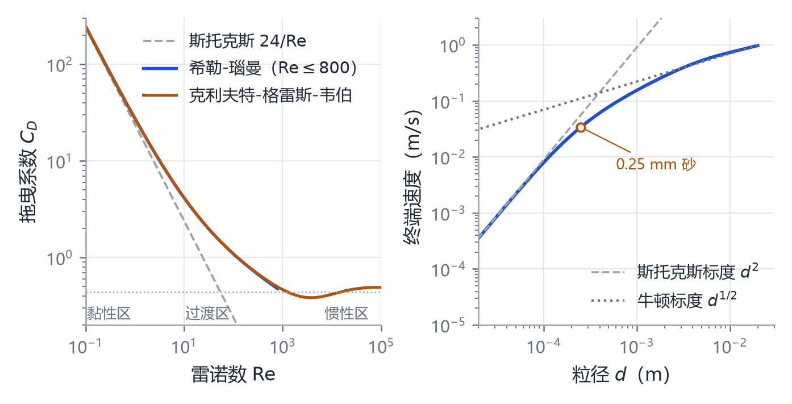
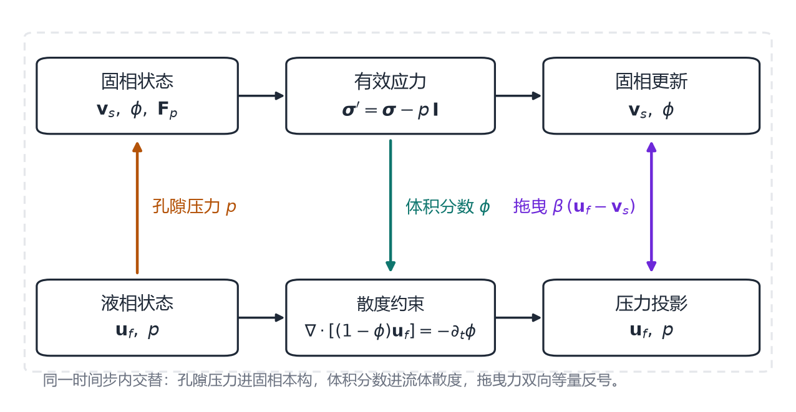

# 第 8 章 颗粒与流体的两相耦合

> 本章导读：一把沙撒进水里，粗的几秒就沉底，细的在水中悬成一片浑浊，要等半天才落定；同一条河道，平时水是清的，暴雨之后整条沟变成翻滚的泥浆，石头都能推着走。颗粒和流体在一起时，谁主导不是看体积，而是看颗粒有多大、流体有多黏、两者谁推得动谁。这一章从一颗沙粒的沉降讲起，把拖曳、孔隙压力、有效应力和耦合稳定性逐个拆开，最后说清为什么大规模场景必须放弃逐颗模拟。

## 8.1 一颗沙粒沉到杯底

装一杯清水，捏一撮建筑砂从水面上撒下去。粗的颗粒几乎是落下去就停，细的悬在半空，把水搅成一片灰雾，十几秒后才慢慢沉到底，杯底积起一层，最上面那层细粉要过几分钟才定下来。同样是从手里撒出去，颗粒的沉降速度差了上百倍，而它们的直径不过差了十几倍。

先算最简单的情形：一颗小球在静止流体里沉降。它只受三个力——重力往下，浮力往上，阻力逆着运动方向。重力减浮力是净重

$$
W=\left(\rho_s-\rho_f\right)V g ,
\tag{8.1}
$$

$\rho_s$ 是颗粒密度，也就是"颗粒本身有多重"；$\rho_f$ 是流体密度；$V$ 是颗粒体积；$g=9.81$ 米每二次方秒。石英砂的 $\rho_s$ 约 $2650$ 千克每立方米，水的 $\rho_f$ 是 $1000$，净重只有真实重量的六成，剩下四成被浮力抵掉。

也就是说，泡在水里的石头，比空气里轻了四成。这不是小修正，它直接决定了颗粒下沉的速度量级。

举个具体数：直径 $0.25$ 毫米的砂粒，体积 $V=\frac{\pi}{6}d^{3}\approx8.2\times10^{-12}$ 立方米，净重 $1650\times8.2\times10^{-12}\times9.81\approx1.3\times10^{-7}$ 牛。这个力小到手指完全感觉不到，但对这颗颗粒来说，它就是全部的下沉动力。

阻力在低雷诺数下正比于速度和直径，斯托克斯（Stokes）解出

$$
\mathbf{f}_d=3\pi\mu d\left(\mathbf{u}_f-\mathbf{v}_p\right),
\tag{8.2}
$$

$\mu$ 是动力黏度，衡量"流体有多黏"，水的值是 $10^{-3}$ 帕·秒；$d$ 是颗粒直径；$\mathbf{u}_f$ 是流体速度；$\mathbf{v}_p$ 是颗粒速度。括号里是两者之差。

白话讲，阻力只取决于颗粒和周围流体"差多少"，不取决于颗粒本身跑多快。水流和颗粒同速，括号为零，阻力就是零——这就是随水漂的细沙几乎不"沉"的原因，不是没有重力，是没有相对运动。

让阻力和净重平衡，得到终端速度

$$
v_t=\frac{d^{2}\left(\rho_s-\rho_f\right)g}{18\mu} .
\tag{8.3}
$$

$v_t$ 是终端速度（terminal velocity），也就是加速度减到零、匀速下沉时的速度。推导只有一步：把式 (8.2) 的一维大小 $3\pi\mu d v_t$ 和式 (8.1) 的净重画等号，解出 $v_t$。$d^{2}$ 这个平方关系很重要——粒径翻倍，沉速翻四倍。

代一组数进去：直径 $0.25$ 毫米的砂，水的黏度 $10^{-3}$ 帕·秒，

$$
v_t=\frac{(2.5\times10^{-4})^{2}\times1650\times9.81}{18\times10^{-3}}\approx 0.056\ \text{米每秒} .
\tag{8.4}
$$

按这个速度，十厘米高的水柱一秒半就沉到底。可实际观察是十几秒。差在哪里？把速度代回去算雷诺数

$$
\mathrm{Re}=\frac{\rho_f\,v_t\,d}{\mu}\approx\frac{1000\times0.056\times2.5\times10^{-4}}{10^{-3}}=14 ,
\tag{8.5}
$$

已经远超过斯托克斯公式适用的范围（大致 $\mathrm{Re}\lt 0.5$）。真实阻力比斯托克斯大，速度要低得多。用下一节的拖曳系数重新解，得到的速度是 $0.03$ 米每秒左右，量级和观察对上了。

这个例子的意义在于：先算雷诺数，再选公式，顺序反过来就会得到一个"看起来很像那么回事、实际错一倍"的数。美术看画面只觉得"沉得有点快"，没人会想到问题出在公式的适用区间。

尺寸再小一些，情况完全反过来。直径 $0.02$ 毫米的粉砂，斯托克斯速度是

$$
v_t=\frac{(2\times10^{-5})^{2}\times1650\times9.81}{18\times10^{-3}}\approx 3.6\times10^{-4}\ \text{米每秒} ,
\tag{8.6}
$$

一小时沉一米三。一杯水里悬着的细粉要几小时才澄清，不是因为它"轻"，是因为黏性阻力在小尺度上压倒一切。

这里可以看清标度：粒径缩到十分之一，沉速缩到百分之一。所以同一堆沙里，粗颗粒和细颗粒的沉降时间能差两个数量级，倒进水里之后立刻分层——粗的在下，细的在上，中间是一片缓慢澄清的浑水。

这也解释了泥浆为什么能长时间保持浑浊：细颗粒的沉降时间以小时计，任何一点水流扰动都能把它重新搅起来。想让它澄清，光靠静置不够，得让细颗粒聚成团，把等效粒径做大。

反方向是砾石。直径两厘米的石子，雷诺数上万，阻力主要来自颗粒后面脱落的涡，和黏度关系不大。用平板绕流的量级估，拖曳系数在 $0.5$ 上下，终端速度大约一米每秒——扔进水里"咕咚"一声就到了底。

这时候浮力仍然抵掉四成重量，但阻力已经和速度平方成正比，速度对密度的敏感度大幅下降。也就是说，砾石沉得快不快，主要看它有多重、有多大，水的黏度几乎不起作用。

三种尺度对应三种物理，这也决定了数值方法的选择。细颗粒的耦合是"阻力主导"，时间尺度是 $\tau=\rho_s d^{2}/(18\mu)$，$0.25$ 毫米的砂算出来是九毫秒，任何显式耦合的时间步都得比它小；粗颗粒的耦合是"惯性主导"，阻力是速度平方，非线性但不刚，显式就好用。

同一个杯子里同时有两种颗粒，那就得两种处理都写。这一段的现象是后面所有"耦合要多紧"的根源：不是算法挑剔，是物理本身有两个时间尺度。

## 8.2 拖曳系数不是一个常数

把阻力写成无量纲的拖曳系数

$$
\mathbf{f}_d=\tfrac{1}{2}C_D\,\rho_f\,A\left|\mathbf{u}_f-\mathbf{v}_p\right|\left(\mathbf{u}_f-\mathbf{v}_p\right),
\tag{8.7}
$$

$A$ 是颗粒在来流方向的投影面积，球是 $\pi d^{2}/4$；$C_D$ 是拖曳系数（drag coefficient），一个无量纲的数；$\tfrac{1}{2}\rho_f|\mathbf{u}_f-\mathbf{v}_p|^{2}$ 是动压，也就是"迎面吹来的风有多大劲"。也就是说，$C_D$ 回答的问题是：迎风那块面积上的动压，有多少变成了阻力。

$C_D$ 不是常数，它是雷诺数的函数，而且这个函数分三段。这是本章最容易写错的一个量：很多人把它当成材料常数写进代码，结果整场戏的粒度分层都不对。

先算一个具体例子。直径 $0.25$ 毫米的砂粒，投影面积 $A=\pi(2.5\times10^{-4})^{2}/4\approx4.9\times10^{-8}$ 平方米；终端速度取 $0.034$ 米每秒，对应 $\mathrm{Re}\approx8.5$。

用希勒-瑙曼公式算 $C_D\approx4.7$，代回式 (8.7)：阻力 $=\tfrac{1}{2}\times4.7\times1000\times4.9\times10^{-8}\times0.034^{2}\approx1.3\times10^{-7}$ 牛，正好等于前面算的净重。平衡成立，说明这套公式自洽。

斯托克斯区（$\mathrm{Re}\lt 1$）里 $C_D=24/\mathrm{Re}$，把它代回式 (8.7) 就还原成式 (8.2)。这一段阻力几乎全是黏性剪切，颗粒前后的压差可以忽略。也就是说，低速时水像糖浆一样"粘"住颗粒，靠的是摩擦，不是推挤。

中间区（$1\lt \mathrm{Re}\lt 800$）里颗粒尾部开始出现稳定的分离涡，压差阻力上来，$C_D$ 从二十几掉到一附近，但掉得比 $24/\mathrm{Re}$ 慢。工程上最常用的是希勒-瑙曼（Schiller–Naumann）关联式

$$
C_D=\frac{24}{\mathrm{Re}}\left(1+0.15\,\mathrm{Re}^{0.687}\right),
\tag{8.8}
$$

指数 $0.687$ 是拟合出来的，没有理论含义，但它在 $\mathrm{Re}\lt 800$ 的范围里误差在百分之几以内，被引用的次数比它该有的多。括号里的第二项就是在说：雷诺数越大，压差阻力的份额越大。

高雷诺数区（$\mathrm{Re}\gt 1000$）里尾流完全湍化，$C_D$ 趋于常数 $0.44$ 左右，阻力与速度平方成正比，与黏度无关。这一段的完整拟合常用克利夫特-格雷斯-韦伯（Clift–Grace–Weber）形式，在式 (8.8) 上加一个饱和项：

$$
C_D=\frac{24}{\mathrm{Re}}\left(1+0.15\,\mathrm{Re}^{0.687}\right)+\frac{0.42}{1+42500/\mathrm{Re}^{1.16}} .
\tag{8.9}
$$

第二项在 $\mathrm{Re}$ 小的时候几乎为零，大的时候趋近 $0.42$，正好补上第一项在高雷诺数下偏小的问题。这个"加一个饱和项"的写法在经验公式里很常见：一个幂律项管中低段，一个饱和项管高段，中间平滑衔接。

图 8-1 左图把这三段画在一起，能看出交叠的位置：$24/\mathrm{Re}$ 在 $\mathrm{Re}=1$ 处比真实值低一成（$24$ 对 $27.6$），$\mathrm{Re}=10$ 处只剩六成（$2.4$ 对 $4.2$），$\mathrm{Re}=100$ 处不到四分之一（$0.24$ 对 $1.09$）。

只用斯托克斯公式模拟砂石沉降，阻力被算小，速度就会被高估；反过来，把 $0.44$ 这个常数用到低雷诺数区，阻力被算大，细颗粒就沉不下去。两种错都会在画面上留痕：前者是"沙沉得太快、堆得太散"，后者是"细粉浮在水面不肯走"。

<figure class="fig">

<figcaption><b>图 8-1</b>　左图是球体拖曳系数随雷诺数的变化，双对数坐标：灰虚线是斯托克斯解 $24/\mathrm{Re}$，蓝线是希勒-瑙曼关联式（式 8.8，只画到它适用的 $\mathrm{Re}\le 800$），橙线是克利夫特-格雷斯-韦伯关联式（式 8.9，一直算到 $\mathrm{Re}=10^{5}$），水平点线是 $0.44$ 的高雷诺数平台，底层三段文字标出黏性区、过渡区、惯性区的大致分界。右图是石英砂（$\rho_s=2650$ 千克每立方米、$\rho_f=1000$、$\mu=10^{-3}$ 帕·秒）在水中的终端速度随粒径的变化，用式 8.9 的 $C_D$ 数值求解力平衡得到，双对数坐标，两条灰虚线分别是斯托克斯标度 $v\propto d^{2}$ 与牛顿标度 $v\propto d^{1/2}$，可以看出 $0.1$ 毫米以下和 $2$ 毫米以上两段斜率完全不同；空心圆点是 $0.25$ 毫米砂的位置，终端速度 $0.034$ 米每秒，雷诺数 $8.5$。</figcaption>
</figure>

右图是同一套公式的直接推论：终端速度对粒径的依赖在两个区间里完全不同。小于 $0.1$ 毫米，$v_t\propto d^{2}$，粒径减半速度掉到四分之一；大于 $2$ 毫米，$v_t\propto d^{1/2}$，粒径减半速度只掉三成。

模拟里如果用一个固定的 $C_D$，等于把这两个区间抹平，细颗粒会沉得太快、粗颗粒会沉得太慢，最后堆积出来的粒度分层是错的。这个错不会报错，只会让画面"不太像"——而美术说不清哪里不对。

球形假设本身也是个问题。砂粒是有棱角的，棱角让边界层提前分离，尾流更大，同样雷诺数下 $C_D$ 比球高百分之二十到五十；片状的云母、针状的纤维差得更多。

工程上用一个"球形度"修正，把式 (8.8) 里的 $C_D$ 乘上一个和形状有关的因子。颗粒形状还影响沉降姿态：扁平颗粒会摆动、翻滚，轨迹不是直线，堆积时的取向有统计规律。

这些细节在视觉上很重要——沙落进水里的那种散射感，一半来自形状带来的横向摆动。用一个完美的球去模拟，水花会"太整齐"，像倒糖浆而不是倒沙。

## 8.3 三条建模路线

颗粒和流体在一起，要离散两套东西，还要让它们互相交换动量。按"哪一边被当成连续体"分，主流做法有三条。这个分类很实用，因为它直接告诉你成本随什么增长——随体积，还是随颗粒数。

第一条是双流体模型。颗粒相也被当成连续介质，用体积分数 $\phi(\mathbf{x},t)$ 描述。$\phi$ 的含义是：一个很小的体积元里，颗粒占了百分之几。$\phi=0.6$ 就是典型的堆积状态，$\phi=0.01$ 是稀相悬浮。

固相和液相各有一套质量和动量方程，中间用一个交换项耦合：

$$
\mathbf{f}_{\text{exchange}}=\beta\left(\mathbf{u}_f-\mathbf{v}_s\right),
\tag{8.10}
$$

$\beta$ 是拖曳系数密度，单位体积的阻力系数，量纲是千克每立方米每秒；$\mathbf{u}_f$ 是流体速度，$\mathbf{v}_s$ 是固相速度；$\mathbf{f}_{\text{exchange}}$ 是单位体积上的交换力，量纲牛每立方米。

也就是说，$\beta$ 是一个"汇率"：它把两相的速度差换算成单位体积上的力。速度差为零，交换力为零；$\beta$ 越大，两相越"粘"在一起，越难相对滑动。

代个数：$\beta=10^{5}$ 千克每立方米每秒，速度差 $0.1$ 米每秒，交换力就是 $10^{4}$ 牛每立方米。一立方米的泥浆里有一万牛的拖曳力，比同样体积的水重十倍，这就是浓密两相流"稠"的来源。

$\beta$ 由经验关系给出。低浓度时用基于单颗粒拖曳的稀释公式，也就是把式 (8.7) 乘上颗粒数密度；高浓度时用厄贡（Ergun）关系：它把压降写成黏性项和惯性项之和，前者正比于 $\mu(1-\phi)^{2}/(\phi d^{2})$，后者正比于 $\rho_f(1-\phi)\left|\mathbf{u}-\mathbf{v}\right|/d$。

白话讲，$(1-\phi)$ 是流体的份额，$\phi$ 是颗粒的份额，两者一个在分子一个在分母，说明"颗粒越挤，流体能走的通道越窄"；通道窄了，同样的流量需要更大的压差，于是 $\beta$ 急剧增大。这也是为什么泥浆的黏度能比水高几百倍，尽管水的黏度没变。

双流体的好处是便宜，网格可以很粗，几百万立方米的泥石流也能算。坏处是固相的流变必须另外给：$\phi$ 接近堆积浓度时，固相需要一个屈服准则，否则它会像液体一样摊平，堆不出休止角。

这就是一个具体的反例：只写双流体方程、忘了屈服准则，一堆沙会自己"流"成平面，静置一会儿连痕迹都不剩。加上 $\mu(I)$ 流变或者 Drucker–Prager 之后，休止角才出现。

代价是模型参数多，标定麻烦，而且颗粒的个体行为全丢了——你看不到某颗石头被冲走。做泥石流镜头时，如果导演要求"这块石头滚到那里停住"，双流体给不了。

第二条是 DEM-CFD。颗粒逐颗用离散元（discrete element method）算，流体在网格上解，颗粒所在的网格单元把拖曳力作为源项加给流体，流体把速度插值回颗粒。这就是所谓的"点颗粒"（point-particle）模型，颗粒尺寸要小于网格，通常一个网格里放几颗到几十颗。

优点是颗粒的碰撞、堆积、摩擦全是真实算出来的，休止角不用给；缺点是颗粒数被卡死。按 8.1 节算的那笔账，十升（$0.01$ 立方米）沙子按 $0.5$ 毫米粒径算约有一亿五千万颗，一个立方米就是一千五百亿颗。

而 DEM-CFD 在单机上能算的颗粒数在百万量级，差四到五个数量级。所以这条路只适合小尺度：螺旋输送、流化床的一小段、河床表面的推移质。也就是说，它算的是"细节"，不是"场面"。

第三条是 MPM 混合。颗粒用 MPM 的粒子表示，流体用另一套粒子或者网格表示，共用一个背景网格，或者各用一套网格再用插值交换。

优点是固相能承受大变形、能压实、能失效，比双流体多了本构的自由度；流体那边如果是 FLIP，界面能拉出细丝。这条路线在影视里用得最多，因为它的成本随分辨率走，不随颗粒数走。

缺点也明显：粒子的"颗粒性"被抹掉了，一堆沙被表示成连续体。除非额外加摩擦和剪胀，否则堆不出正确的休止角——这和双流体的问题同源，只是换了个载体。

三条路线不是互斥的，实际制作里常常混用：远场用双流体，近场用 MPM，特写用 DEM。分界线放在哪，取决于镜头里能不能看清单颗。看不清的地方，颗粒数就是浪费 [@jiang2017]。

把三条路线共有的骨架抽出来（图 8-2），其实只有三步：固相算出自己的速度和体积分数，液相算出自己的速度和压力，中间按三条通道交换信息。

第一条是动量：拖曳力 $\beta(\mathbf{u}_f-\mathbf{v}_s)$ 从液相流向固相，反作用等量反向地流回去。这条最容易实现，也最容易漏掉反作用——漏了之后，颗粒被水推着走，水却毫发无伤，能量凭空产生，画面会"越跑越快"。

第二条是体积：固相压实或膨胀，$\phi$ 变化，液相可用的孔隙体积跟着变，这条信息进的是流体的散度约束。也就是说，颗粒挤占空间这件事，必须让流体"让路"，不然两边会互相穿透。

第三条是压力：孔隙压力 $p$ 从液相传给固相，进的是有效应力。这条最容易被忽略，也最影响画面——湿沙立不立得住，全看它。

三条通道的方向不同，隐含的时间尺度也不同，耦合的松紧主要由它们决定。动量通道最快（拖曳的松弛时间是毫秒级），体积通道次之（压实波的传播），压力通道最慢（排水需要时间）。

<figure class="fig">

<figcaption><b>图 8-2</b>　两相耦合的结构示意。上排是固相支路（状态 $\mathbf{v}_s,\phi,\mathbf{F}_p$ → 有效应力 $\boldsymbol{\sigma}'=\boldsymbol{\sigma}-p\,\mathbf{I}$ → 更新），下排是液相支路（状态 $\mathbf{u}_f,p$ → 散度约束 → 压力投影），三条竖箭头是交换通道：孔隙压力 $p$ 从液相进固相的本构，体积分数 $\phi$ 从固相进流体的散度约束，拖曳力 $\beta(\mathbf{u}_f-\mathbf{v}_s)$ 双向等量反号。虚线框表示三条通道都落在同一个时间步的交替迭代里；把它们拆开分步算就是松耦合，轻颗粒时会振荡。</figcaption>
</figure>

## 8.4 孔隙压力与有效应力

湿沙能堆成沙堡，干沙不能。同样一堆沙，加水之后休止角从三十度涨到接近垂直，能挖出隧道、能立起城墙。这不是水的黏性把沙粘住了——水的黏度太低，粘不住任何东西。起作用的是孔隙压力。

饱和沙里，水填满颗粒之间的空隙。取一个代表性的体积元，总应力 $\boldsymbol{\sigma}$ 由颗粒骨架和水共同承担。泰尔扎吉（Terzaghi）的有效应力原理写成

$$
\boldsymbol{\sigma}=\boldsymbol{\sigma}'+p\,\mathbf{I} ,
\tag{8.11}
$$

$\boldsymbol{\sigma}$ 是总应力，也就是"外部施加的力除以面积"；$\boldsymbol{\sigma}'$ 是有效应力，作用在颗粒骨架上，是颗粒之间真正互相顶着的力；$p$ 是孔隙水压力，各向同性，作用在孔隙里的水上；$\mathbf{I}$ 是单位矩阵，表示"各向同性"——水压从哪个方向看都一样。

也就是说，外部压下来的力被两个东西分担：一部分由颗粒骨架扛，一部分由孔隙水扛。摩擦、剪胀、屈服，全都由 $\boldsymbol{\sigma}'$ 决定，而不是总应力。

代一组数：一米深的饱和沙，饱和重度约 $2000$ 千克每立方米，总应力 $\sigma=2000\times9.81\times1\approx19.6$ 千帕。如果地下水位正好在地面，孔隙水压力 $p=1000\times9.81\times1\approx9.8$ 千帕。

有效应力只剩 $\sigma'=19.6-9.8=9.8$ 千帕。也就是说，一半的重量被水扛着，颗粒骨架实际承受的只有一半。摩擦强度正比于有效应力，所以水下的沙比干沙"软"一半。

这一条是整个土力学的基石，也是两相模拟里最容易写错的地方：把总应力直接喂给摩擦准则，湿沙会变得和干沙一样软，沙堡立不住，隧道会塌。

沙堡能立住的原因就在式 (8.11) 里。手压沙堡时，总应力增加，但如果孔隙水排不出去（不排水条件），水压也跟着涨，有效应力涨得很少，沙堡不会被压塌。

同时水的表面张力在颗粒间形成毛细桥，提供一点额外的黏聚，让沙能立起来。毛细桥的力很小，每平方厘米只有几牛，但在一颗沙粒的尺度上足够压过重力。

挖隧道时，洞壁的沙要靠有效应力撑住，而洞内的水压是零。水往洞里渗，孔隙压力下降，有效应力上升，沙壁就稳定了——和直觉相反，排水反而让沙更结实。

反过来的情形也成立：如果水位突然上涨，孔隙压力上升，有效应力下降，原本稳定的沙壁会突然塌。这个"看起来没动任何东西，坑就塌了"的现象，在工程上叫渗透破坏。

反向的过程是液化。饱和松砂受到震动或者快速剪切时，颗粒想重排、想压实，但水来不及排出（不排水），孔隙压力被顶上去。

有效应力 $\boldsymbol{\sigma}'=\boldsymbol{\sigma}-p\mathbf{I}$ 被削到接近零，摩擦失去依托，沙子整体失去抗剪能力，表现得像液体。地震时整片地基"冒浆"、建筑物整体下沉倾斜，就是这个机制。

踩在湿沙滩上脚下一软，也是局部液化：脚的压力让孔隙水压力升高，脚下的沙瞬间变成流体，等你抬脚才重新固结。做动画时这个"软一下"的细节很值钱，它比任何水花都更能说明"这是湿沙"。

再看一个极限例子：地下水位高于地面两米，一米深处的孔隙压力是 $3\times9.81\approx29.4$ 千帕，比总应力 $19.6$ 千帕还大，有效应力成了负值。真实的沙扛不住拉力，这时会发生流土（管涌）：沙粒被水顶起来，地面冒泡、翻砂。

模拟里处理有效应力有几种做法。最简单的是把孔隙压力当成一个标量场，单独解一个压力方程（流体的不可压条件就给出 $p$），然后在计算固相应力时减去 $p\mathbf{I}$。

这样摩擦准则用的是有效应力，液化能自然出现：只要 $p$ 涨到接近总应力，固相的屈服面就收窄，材料开始流动。代价是要解两套压力，而且两相的体积分数必须一致——固相压实一点，流体就得被挤出去，这个约束比单相流体的不可压条件难满足。

更省事的做法是分区：干燥区用单相颗粒本构，饱和区把浮力折进重力，用一个"浸没重度"代替真实密度。这个近似在静态、缓变的问题上够用，动态问题（冲击、液化、渗流）就不行了。

因为它把孔隙压力的时间尺度抹掉了。液化本质上是个时间过程：压力从零涨到总应力需要多久，取决于渗透率和排水路径长度。用浸没重度等于假设"排水瞬间完成"，永远不会液化。

对颗粒材料，把有效应力接进 $\mu(I)$ 流变是一个自然的组合：惯性数里的压力用 $p'$（有效压力）而不是总压力，摩擦系数随 $I$ 变化。这样同一套本构既能描述干沙，也能描述水下的沙，只要有 $p$ 的来源。

惯性数的定义是 $I=\dot{\gamma}d/\sqrt{p'/\rho_s}$，$\dot{\gamma}$ 是剪切率。代个数：$\dot{\gamma}=10$ 每秒、$d=0.5$ 毫米、$p'=1$ 千帕、$\rho_s=2650$，分母 $\sqrt{1000/2650}\approx0.61$ 米每秒，$I=10\times5\times10^{-4}/0.61\approx8\times10^{-3}$。

$I$ 这么小，说明这套参数下沙处于准静态，摩擦系数接近它的下限（约 $0.4$）。把 $p'$ 降到 $0.1$ 千帕，$I$ 涨三倍，摩擦系数上升，沙变"黏"——这正是快流和慢流手感不同的来源。

达维耶等人在半隐式颗粒 MPM 里处理的就是这一类问题：摩擦和屈服在有效应力的空间里解，孔隙压力作为外部场耦合进去 [@daviet2016]。

## 8.5 耦合要多紧

两相各写一个求解器，中间交换力，这个结构看着简单，稳定性却比单相难得多。麻烦来自两处：附加质量和阻力松弛。

附加质量是颗粒加速时带动周围流体一起加速的效应。球体的附加质量约等于排开流体质量的一半：

$$
\mathbf{f}_{\text{am}}=\tfrac{1}{2}\rho_f V\left(\frac{D\mathbf{u}_f}{Dt}-\frac{d\mathbf{v}_p}{dt}\right).
\tag{8.12}
$$

$\mathbf{f}_{\text{am}}$ 是附加质量力，$\tfrac{1}{2}\rho_f V$ 就是"附加质量"本身，$D\mathbf{u}_f/Dt$ 是流体加速度，$d\mathbf{v}_p/dt$ 是颗粒加速度，括号里是两者的相对加速度。

白话讲，颗粒往前挤，前面的水必须让开，周围的水也被带着动。水有惯性，不肯被随便带动，于是它对颗粒施加一个反作用力。这个力不在式 (8.2) 里，因为斯托克斯解假设流体准静态；一旦颗粒加速快，它就冒出来。

对沙和水，$\rho_f/\rho_s$ 约 $0.38$，附加质量相当于颗粒惯性的零点二倍，不算大。但如果颗粒本身很轻——雪、泡沫、有机絮体，$\rho_s$ 可能只有水的三分之一甚至十分之一——附加质量就变成颗粒惯性的两倍到五倍。

代个数：雪取 $300$ 千克每立方米，附加质量与颗粒质量之比是 $0.5\times1000/300\approx1.7$；泡沫取 $100$，就是 $5$。也就是说，推一块泡沫，你实际推的是六份质量。

这时候显式分区耦合会发散：流体推颗粒，颗粒反过来推流体，两边都用上一轮的速度算力，力的方向总是滞后，振荡幅度每步放大，几十步就炸掉。

这个不稳定不是时间步太小造成的，减小步长反而更糟（滞后比例不变），只能靠欠松弛或者把耦合放进同一个隐式系统里。这是它和 CFL 限制最不一样的地方：CFL 靠减步长解决，附加质量不稳定靠减步长解决不了。

阻力松弛是另一回事。颗粒在流体里被拖曳，速度向流体速度指数逼近，时间常数

$$
\tau=\frac{\rho_s d^{2}}{18\mu} .
\tag{8.13}
$$

$\tau$ 叫松弛时间（relaxation time），意思是"速度差缩小到原来的三分之一需要多久"。$0.25$ 毫米的砂是九毫秒，$0.02$ 毫米的粉砂是六十微秒。

显式地把阻力当成常数力加进去，要求 $\Delta t\lt 2\tau$。粉砂的时间步就得到几十微秒，比颗粒碰撞的时间步还小。二十四帧的 $\Delta t$ 是四十二毫秒，比沙的 $2\tau=18$ 毫秒还大——也就是说，连 $0.25$ 毫米的砂在常规帧率下都显式不稳定。

做法是把阻力做半隐式处理：在一个步长内解析地积分阻力方程，

$$
\mathbf{v}^{n+1}=\mathbf{u}_f+\left(\mathbf{v}^{n}-\mathbf{u}_f\right)\exp\!\left(-\frac{\Delta t}{\tau}\right),
\tag{8.14}
$$

$\mathbf{v}^{n}$ 是这一步开始时的颗粒速度，$\mathbf{u}_f$ 是流体速度（这一步内视为常数），$\exp$ 是自然指数。这个式子的意思是：速度差按指数衰减，衰减多少只取决于 $\Delta t/\tau$ 这个比值。

代个数：$\Delta t=1/24$、$\tau=9$ 毫秒，$\Delta t/\tau\approx4.6$，$e^{-4.6}\approx0.01$。一步之后速度差只剩百分之一，颗粒基本跟上了流体，符合物理——这么长的时间内它确实该跟上了。

这一步只用到当前流体的速度，对任意 $\Delta t$ 都稳定，而且物理上正确（指数趋近）。代价是阻力不再是显式的力，反作用到流体的动量要另外算，通常用平均速度差近似。

这是两相模拟里最划算的一个技巧：一个指数函数换掉一个刚性问题。同样的思路在刚体—流体耦合、弹簧—阻尼系统里都成立，凡是"力正比于速度差"的地方都能这么处理。

还有体积分数的耦合。流体要满足的是"孔隙里的体积守恒"，不是整个空间的不可压：

$$
\nabla\cdot\left[\left(1-\phi\right)\mathbf{u}_f\right]=-\frac{\partial\phi}{\partial t} ,
\tag{8.15}
$$

$\nabla\cdot$ 是散度，衡量"流体从哪里冒出来、往哪里挤进去"；$(1-\phi)\mathbf{u}_f$ 是流体的实际通量（只有 $(1-\phi)$ 的空间是水）；右边是固相体积分数的变化率。

也就是说，固相压实，$\phi$ 变大，右边为负，流体的有效体积缩小，压力升高。这个方程把流体压力解和固相的变形绑在一起：固相一动，流体的右端项就变，压力要重解。

代个数：一秒内 $\phi$ 从 $0.60$ 涨到 $0.65$，$\partial\phi/\partial t=0.05$ 每秒，流体散度就是 $-0.05$ 每秒。一立方米里每秒要挤出五十升水，这些水必须有去处，否则压力会涨到不合理的高度。

分区求解时这一项常常滞后一步，结果是压实波传播得比实际慢，或者压力出现锯齿。把 $\phi$ 的更新放进流体求解的同一个迭代里，能明显改善，代价是两套代码耦合更紧。

工程上的折中方案是子循环：流体用小步长，固相用大步长，一个固相步里跑若干流体步，交换量的时间平均保持一致。

这个做法对"流体快、固相慢"的问题有效（细颗粒在水里），对"固相快、流体慢"的问题（石块砸进水里）就要反过来。判断依据还是时间尺度：谁的特征时间短，谁用小子步。

## 8.6 大规模场景

真实的泥石流、溃坝、雪崩入水，规模动辄上万立方米。按前面算的账，一立方米沙子约一千五百亿颗，一万立方米就是一千五百万亿颗。

这个数量级下，逐颗模拟没有任何可能，不管 GPU 多快。做个换算：即使每秒能处理十亿颗的碰撞，一千五百万亿颗也要一百五十万秒，约十七天——而这只是一个时间步。所以大规模场景一定是连续体或者混合的。

连续体的代价是参数。双流体模型需要给固相一个流变，$\mu(I)$ 里的摩擦系数、惯性数参考值、堆积浓度，每一个都要标定；有效应力需要渗透率、压缩系数；两相之间的拖曳系数需要 $\beta(\phi,\mathrm{Re})$ 的关系式。

这些参数在实验室里能测，在现场往往只能反推。参数错了，画面会以很具体的方式错：泥浆流得太稀、堆积太扁、或者冲不上岸。做影视的人常说"泥石流最难调"，难的不是算法，是这几个数。

分辨率的分配也需要判断。泥石流的视觉重点是前锋：前锋翻卷、裹挟石块、在岸上留下痕迹。这些结构在几米到几十厘米的尺度上，用连续体加自适应网格能抓住；而飞溅的水花、单个石块的翻滚，需要粒子。

混合方案通常这样分：主体用粗网格两相连续体，前锋附近加密，飞溅用粒子。格尔谢夫斯基等人做大规模飞溅液体时用的就是这个思路：粗网格负责主体运动，粒子负责液滴和薄膜，两者在界面处交换质量和动量 [@gerszewski2009]。

颗粒版本的结构相同，只是"粒子"那边带的是颗粒的摩擦本构而不是液体的黏性。这一步换掉之后，飞溅的形态会变——水花是细丝，沙花是颗粒团，不能共用一套渲染。

内存和带宽是另一个天花板。双流体每个网格单元要存 $\phi$、两相速度、压力，三维一千万单元就是几个吉字节；如果还要存历史量（用于隐式或者时间积分），翻倍。

GPU 上的两相求解还有个特点：固相和液相的求解核交替启动，每次切换都有全局同步，规模越大同步越贵。把两个核融合成一个，让同一个线程处理同一单元的两相，能省掉一半的同步，代价是寄存器压力上升。

最后说一个容易被忽略的量：颗粒在流体里的沉降和堆积会改变流体的有效黏度。浓度高的悬移质让水变稠，稠的水又让颗粒更难沉，这是一个正反馈。

真实的泥石流里，这个反馈是维持流动的关键——粗颗粒靠细颗粒的"泥浆"托着，才不会被甩到后面。模拟里如果只算清水加颗粒，粗颗粒会迅速沉底，前锋失去粗料，画面变得"干净"得不像泥石流。

要还原这个效果，拖曳公式里的黏度必须是混合物的有效黏度，而不是清水的黏度。这类细节不写在公式里，但决定画面像不像。
