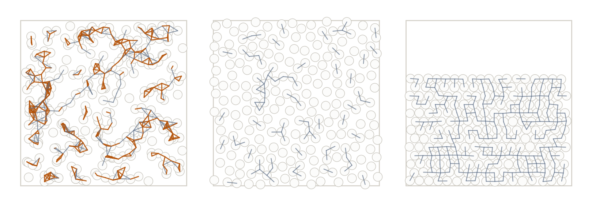
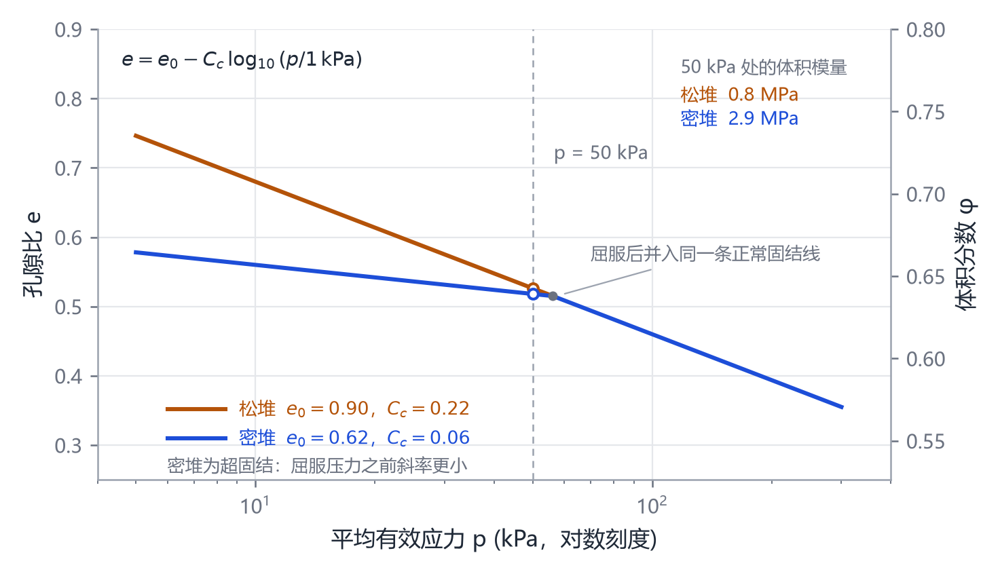

# 第 9 章 堆积、压实与大规模场景

> 本章导读：一车沙倒进场地的镜头，难的从来不是倒下去的那两秒，而是倒完之后那堆沙要老老实实待在那里。堆是怎么放进场景的，决定了后面几百帧是在算物理还是在收拾初始条件的烂摊子。这一章讲三种堆积做法、压实怎么把步长吃掉、静止的颗粒怎么被划走不算，以及一个百万颗粒的镜头要吃掉多少内存和时间。

## 9.1 先决定颗粒有多大

场景是一块 10 米见方的场地，沙堆到 1 米高。堆积体积分数取 0.6，固体体积就是 60 立方米。一颗半径 $r$ 的球体积是 $\tfrac{4}{3}\pi r^{3}$，颗数

$$
N=\frac{\phi V_{\text{box}}}{\tfrac{4}{3}\pi r^{3}}
$$

$\phi$ 是体积分数，$V_{\text{box}}$ 是包围盒体积。把几个半径代进去，得到的数字差别大得不像同一个问题：

| 颗粒直径 | 单颗体积 | 颗数 |
| --- | --- | --- |
| 0.5 mm（真实沙粒） | 6.5×10⁻¹¹ m³ | 9.2×10¹¹ |
| 5 mm | 6.5×10⁻⁸ m³ | 9.2×10⁸ |
| 1 cm | 5.2×10⁻⁷ m³ | 1.2×10⁸ |
| 2 cm | 4.2×10⁻⁶ m³ | 1.4×10⁷ |
| 4 cm | 3.4×10⁻⁵ m³ | 1.8×10⁶ |

再看屏幕。1920 像素铺满 10 米，一个像素 5.2 毫米。直径 2 厘米的颗粒在画面里 4 个像素，直径 1 厘米的只有 2 个像素。比这更小的颗粒不会带来任何视觉收益，颗数却按半径的三次方往上涨。所以粒径是被像素预算选出来的，不是被物理选出来的。

选完粒径，"沙"这个材料的一部分性质就跟着丢了。真实沙的休止角来自颗粒的棱角和表面粗糙度，一颗 2 厘米的光滑球给不出那个角。后面我们会用摩擦系数、滚动阻力这些等效参数把它补回来，但这些参数的来源是"让堆的形状对"，不是"测量得到"。

粒径还决定了另外两件事。一是邻居数：半径 2 厘米、体积分数 0.6 的球堆，每颗接触 6 个邻居，意味着每帧要做 $1.4\times10^{7}\times 6$ 次接触计算。二是步长：显式方法的步长上限由最硬的接触和最小的颗粒决定。这两个约束在 9.3 节会具体算。

## 9.2 三种起点

### 随机撒点

最省事的做法是在包围盒里均匀随机地扔点：每颗颗粒的位置从三个独立均匀分布里各取一个。它有三个麻烦，一个比一个难缠。

重叠是最直接的。两颗半径 $r$ 的球，球心距离小于 $2r$ 就算重叠。均匀撒在体积 $V_{\text{box}}$ 里，一对颗粒重叠的概率是 $\tfrac{4}{3}\pi(2r)^{3}/V_{\text{box}}$，期望重叠对数

$$
\langle n_{\text{ov}}\rangle\approx\frac{N(N-1)}{2}\cdot\frac{\tfrac{4}{3}\pi(2r)^{3}}{V_{\text{box}}}
$$

代入 $N=1.4\times10^{7}$、$r=0.01$ m、$V_{\text{box}}=100$ m³：单对重叠概率 $3.4\times10^{-7}$，对数约 $3.3\times10^{7}$。每对牵涉两颗，于是平均每颗颗粒和五颗别的颗粒重叠。这不是"少数几对需要修正"，而是整堆沙有一半在互相插着。

求解器处理重叠的办法是产生分离速度。穿透 1 厘米、步长 1/60 秒，要求的速度是 0.6 m/s。放在静止的一堆沙里，这个速度足以让整堆在第一帧炸开，视觉上像爆米花。更糟的是这些速度还会通过接触网络传播，前二十帧全在处理初始条件。

第二个麻烦是局部密度。均匀随机点在空间里是泊松过程，任意一块小区域里的颗数服从泊松分布：均值 10 的话，标准差是 3.2。也就是说 30% 的密度起伏是天然存在的。压力对密度差极其敏感，这 30% 会直接变成第一帧的压力噪声。

第三个麻烦是能量。随机撒点的邻接关系是任意的，初始势能很高，一开算就全部转成动能。你放进去的是一堆悬在半空的颗粒。

随机撒点唯一的优点是快，$O(N)$，没有参数，能在几毫秒里铺满整个包围盒。它适合当别的算法的输入，不适合当模拟的起点。

### 泊松盘

泊松盘采样的目标是：任意两颗的距离不小于 $d$。二维里最常用的是 Bridson 的活跃列表算法——从一个种子点出发，在它周围半径 $[d,2d]$ 的环里随机取候选点，检查是否和已有全部点冲突，接受就把它加进活跃列表，一个点的候选试满 $k$ 次都不成功就从列表里删掉。

三维的推广是一样的，候选点从一个环变成一层球壳。密度上限由三角格给出：二维面密度 $2/(\sqrt{3}d^{2})$，Bridson 的算法实测能做到最优值的七成左右。三维里这个比例更低，越接近密堆，一个点要试几百次。

实际用的时候不要追求极限密度。取 $d=0.9\times2r$，让接触留一点点间隙，堆会显得自然。追求 $d=2r$ 的完美密堆，第一帧的接触会全部同时生效。

泊松盘的优点是干净：没有重叠、密度均匀、可以直接生出一个"压得比较紧"的初始状态。缺点是形状不好控制。在任意形状（比如美术给的一个沙丘模型）里采样，要么用拒绝采样（丢掉形状外的点，边界处会有空缺），要么按有向距离场做密度调制，两种做法都会在边界附近留下痕迹。另一个缺点是密度是常数，做不了"底下压实、上面松散"这种真实的分层。

图 9-1 把三种起点画在一起。随机撒点的接触网络是各向同性的乱麻，泊松盘的接触网络有很多规整的小三角，沉降之后的接触网络则明显沿重力方向有结构。这张图是示意，只表现接触网络的形态差别，不代表任何一次真实计算的输出。

<figure class="fig">

<figcaption><b>图 9-1</b>　三种初始堆积的接触网络（示意图）。左：均匀随机撒点，接触方向各向同性，存在大量重叠与局部空洞。中：泊松盘采样，最小间距固定，接触网络里规整的三角结构占主导。右：重力沉降后的状态，接触网络沿竖直方向出现分层的支撑链。三格包围盒与颗粒半径相同，仅表现接触网络与堆积形态的差别；左格中橙色连线标出互相重叠的颗粒对。</figcaption>
</figure>

### 重力沉降

第三种做法是让颗粒自己找位置：先撒得稀一点（允许轻度重叠），开重力，把摩擦和阻尼设成目标值，跑几百帧，等它停下来。

这是最"物理"的做法，代价是时间。沉降几百帧意味着几十万次接触计算，而且这些计算的结果会在结尾被丢掉——你只要位置，不要速度。它的好处也很明确：得到的配位数、接触网络、内部应力都是自洽的，堆的坡面就是这颗颗粒在重力下能站住的角度。用随机撒点，你得花二三十帧才能让堆达到同样的自洽。

摩擦必须在沉降开始时就设成目标值。摩擦为零时休止角为零，堆会摊成一薄层；等摊平了再把摩擦调回来，堆不会自己长回去。这是最常见的错误，改起来只能从头跑。

沉降的结束判据要写清楚。常用的两条同时满足：总动能降到初始值的千分之一，且最大单帧位移小于颗粒直径的百分之一并持续十帧。只看总动能不够，因为一颗远处的颗粒在慢慢滑也会让总动能停在某个小值上不下来。

结尾要把速度清零。不清零的话，残余的毫米每秒级速度会让堆在之后几百帧里持续蠕变，镜头里看起来是"沙堆在呼吸"。

还有一件省一半算力的事：先按目标形状的有向距离场撒点，把形状外的点直接拒掉，再开始沉降。全场撒点再沉降，等于花一半时间算那些最后会被裁掉的颗粒。

## 9.3 压实与体积

雪被踩实、铲斗压过沙面、粮仓底部的沙比顶部紧，这些现象的共同点是：颗粒材料的体积会随压力变化，而且变化是不可逆的。

描述这件事的标准变量是孔隙比

$$
e=\frac{V_{\text{void}}}{V_{\text{solid}}},\qquad \phi=\frac{1}{1+e}
$$

$V_{\text{void}}$ 是孔隙体积，$V_{\text{solid}}$ 是固体体积，$\phi$ 是体积分数。松堆 $e\approx0.9$（$\phi=0.53$），轻拍之后 $e\approx0.65$（$\phi=0.61$），振动到密实 $e\approx0.55$（$\phi=0.65$）。体积分数的两个极限：随机密堆 0.64，规则六方堆积 0.74。自然界里看到的沙，体积分数基本落在 0.58 到 0.64 之间，差别只有一成，但这一成决定了堆是"能站住"还是"会塌"。

压力与孔隙比的关系，在土力学里用一条半对数的直线描述：

$$
e=e_{0}-C_{c}\log_{10}\frac{p}{p_{\text{ref}}}
$$

$e_{0}$ 是参考压力 $p_{\text{ref}}$ 下的孔隙比，$C_{c}$ 叫压缩指数，$p$ 是平均有效应力。这条线叫正常固结线，对沙、粉土都成立，$C_{c}$ 在 0.05 到 0.3 之间，取决于颗粒形状和初始密度。雪要陡得多，$C_{c}$ 能到 0.5 以上，因为雪压实的过程中颗粒本身也在破碎和粘结。

图 9-2 画了两条曲线。松堆从 $e_{0}=0.90$ 出发，$C_{c}=0.22$；密堆从 $e_{0}=0.62$ 出发，$C_{c}=0.06$，而且它是超固结的——历史上被压过又被卸载，所以屈服压力之前斜率很小。两条线在 56 kPa 处汇合，之后密堆并入松堆那条正常固结线。这个汇合点就是老路基踩不动的来源：在它之前，密堆的压缩量只有松堆的四分之一；过了它，两者一样软。

<figure class="fig">

<figcaption><b>图 9-2</b>　压实曲线。按 $e=e_{0}-C_{c}\log_{10}(p/p_{\text{ref}})$ 计算，$p_{\text{ref}}=1$ kPa。松堆 $e_{0}=0.90$、$C_{c}=0.22$；密堆为超固结状态，$e_{0}=0.62$、$C_{c}=0.06$，在 56 kPa 处屈服后并入同一条正常固结线。横轴为平均有效应力，对数刻度，5 kPa 到 300 kPa；左轴为孔隙比，右轴为由 $\phi=1/(1+e)$ 换算的体积分数。图中的两个圈标出 50 kPa 处的两个状态点，对应的体积模量分别为 0.8 MPa 与 2.9 MPa。</figcaption>
</figure>

压实真正要紧的地方不在体积，在刚度。对上面的式子求导，$de/dp=-C_{c}/(p\ln 10)$，再由 $V=V_{\text{solid}}(1+e)$ 得 $dV/V=de/(1+e)$，体积模量

$$
K=-\frac{dp}{dV/V}=\frac{(1+e)\,p\,\ln 10}{C_{c}}
$$

$K$ 是体积模量，单位与压力相同。代入 50 kPa 这一列：松堆 $e\approx0.53$，得 $K\approx0.8$ MPa；密堆 $e\approx0.52$，得 $K\approx2.9$ MPa。两者的孔隙比几乎一样，体积模量差三倍半，差别全在曲线的斜率上。刚度不是密度的函数，是压缩历史的函数，这句话值得记住。

这个三倍半会被波速放大。$c=\sqrt{K/\rho}$，$\rho=\rho_{s}/(1+e)$，$\rho_{s}=2650$ kg/m³ 是颗粒密度。两堆的密度都在 1740 kg/m³ 附近，于是 $c$ 分别是 21 与 41 m/s。显式方法的步长受 $\Delta t\lt h/c$ 限制，$h$ 取 2 厘米的网格间距，松堆允许 $9.3\times10^{-4}$ 秒，密堆只允许 $4.9\times10^{-4}$ 秒。差 1.9 倍，还只是沙。

雪更狠。新雪密度 100 kg/m³，压过之后 400 kg/m³，体积模量从零点几兆帕涨到十几兆帕的量级，波速涨五倍以上，步长掉到五分之一。所以你在镜头上看到的"雪被压实"这个动作，同时也在改写这一帧的时间预算。这不是附带的麻烦，是这类材料最本质的耦合：变形改变刚度，刚度改变你能走多快。

离散元里的表现是另一条路径。压实让配位数从 4 涨到 6，接触数涨一半，同时每对接触的重叠量变大，Hertz 接触的力按 $\delta^{3/2}$ 长，等效刚度涨得更快。离散元的步长由全场最硬的那一对接触决定，一颗被压得很深的颗粒就能把整场的步长拉下来，其他的颗粒都在陪它跑小步。

物质点法里的表现是本构的历史。压实是塑性体积应变，模型必须把它记下来，作为硬化变量存进每个粒子。只按当前密度算应力是不够的：卸载之后体积会弹回来，看起来像橡皮；而真实的沙被压过就回不去了。第 6 章讲雪的硬化时提过这件事，落到实现上就是每个粒子多存一个标量。

## 9.4 休眠

一个静止的沙堆，一万四千颗里有几颗在动？通常不到百分之一。剩下的颗粒每帧被邻居搜索扫一遍、被接触计算摸一遍、被积分推一遍，输出和上一帧一模一样。

休眠就是把这些颗粒划出去。判据写起来简单：

$$
\left\|\mathbf{v}\right\|\lt v_{\text{th}},\qquad
\left\|\mathbf{x}_{n}-\mathbf{x}_{n-m}\right\|\lt d_{\text{th}}
$$

第一条是速度阈值，第二条是最近 $m$ 帧的累计位移。两个条件同时满足，就把这颗粒标成休眠，不再积分，不再算它自己受到的力。

$v_{\text{th}}$ 和 $d_{\text{th}}$ 的选法要跟屏幕挂钩。颗粒直径 2 厘米，位移阈值取直径的 2%，也就是 0.4 毫米；一帧 16.7 毫秒，对应的速度阈值是 0.024 m/s。这个量级的速度带来的位移在画面里不到十分之一像素，看不见。反过来，如果颗粒直径只有 2 毫米，位移阈值按比例要缩到 0.04 毫米，速度阈值也就跟着降一个数量级。

$m$ 取十到二十帧。取三帧会误判：一颗正在翻倒的颗粒在最高点速度接近零，位移也小，三帧之后就休眠了，然后停在半空。取二十帧的代价是休眠生效晚三分之一秒，镜头里能看出来"堆在停顿一下之后才彻底不动"。

休眠的麻烦全在唤醒。一颗休眠颗粒的邻居里出现了活跃颗粒，它必须被叫醒，否则上面滑下来的沙会直接穿过去。唤醒半径至少要是 $2r+v_{\max}\Delta t$，$v_{\max}$ 是这一步全场最大速度。半径取小了，高速颗粒会从休眠颗粒之间的缝里漏过去。

链式唤醒是更隐蔽的问题。一排休眠颗粒，只有最左边那颗被叫醒，它这一帧动了一点，唤醒第二颗；第二颗下一帧才动，唤醒第三颗。十颗排成一列，最右边那颗要等到第十帧才醒过来。五分之一秒的延迟，在雪崩镜头里就是一条明显的"波浪"。修法是唤醒时做一次迭代到不动点的传播，或者把休眠按网格单元组织，唤醒一个单元就整格叫醒。

两种错法都很常见。一种是把休眠的颗粒从模拟里删掉，省了内存也省了算力，但上面的颗粒没有支撑，会陷进去。另一种是保留颗粒但把速度清零、力照算，看着安全，实际一点性能都没省。

正确的做法是让休眠颗粒当静态碰撞体：位置固定，不积分，不作为主动方去查邻居，但可以作为被动方被查。接触力照算，只不过只作用在活跃的那一侧。离散元里处理静态墙用的就是这个套路，搬到颗粒上没有任何新东西 [@macklin2014]。

休眠 90% 的颗粒，接触对确实少了 90%，但邻居搜索和排序是 $O(N)$ 的，不会跟着降；内存带宽也不会跟着降。总的每帧时间通常降到三分之一到五分之一，不是十分之一。休眠省的是力的计算，不是数据的搬运。想省搬运，得靠空间局部性（第 10 章），或者干脆不加载（9.5 节的 LOD）。

视觉上还有一个副作用。休眠会冻住颗粒的细微调整，坡面上本来会缓慢滚落的小颗粒停在半路，堆的轮廓出现轻微的棱角。解法是休眠前让堆多跑几十帧，或者让阈值随距离变化：近处严，远处松。

## 9.5 远场与 LOD

镜头给一座雪山，前景 5 米，远景 500 米。整座山按 2 厘米粒径算，颗数是个十一位数。没有任何硬件能扛，也不需要扛。

标准的分层是四档。感兴趣区域（镜头真正看得清的那块）用全分辨率；中景合并颗粒；远景换成高度场或者程序化噪声；视锥外冻结或者降频。四档边界跟着镜头走，每帧重算一次归属。

合并的规则要保证守恒。$2\times2\times2$ 的八颗合成一颗：质量取和，位置取质心，速度取动量平均，半径乘二。质量和动量都守恒。但接触网络不守恒：八颗颗粒原来有二十四个接触，合成一颗之后只剩六个，接触数掉到四分之一，而截面积只涨了四倍。宏观模量对不上，休止角也会偏。

补救的办法是按粒径缩放接触刚度，让宏观体积模量匹配上。模量能对上，摩擦角对不上，因为摩擦角取决于接触面的方向分布，而合并把方向分布抹平了。所以远处那座山的坡面会比近处的缓一些。这个误差在 300 米外看不出来，同一镜头从远推到近时会被看见，只能靠足够宽的过渡带摊开。

接缝是 LOD 最容易出 bug 的地方。两层颗粒在同一个空间里同时存在，边界上的颗粒被两套规则同时约束，容易互相穿过。三种做法：重叠带（两层都画，权重渐变）、概率切换（每帧随机决定边界颗粒属于哪层，避免整齐的边）、以及最土的一种——两层之间留一条真空带，谁也不进去。前两种好看但难调，第三种难看但不会错。

视锥外的冻结要小心。冻结是可以的，但镜头摇回来的时候需要"补算"，补算的那几帧会出现位置跳变，因为冻结期间的重力没有积分。折中是降频：视锥外每四帧算一次，用四倍的步长。步长变大，稳定性和压实历史都会偏，但至少不会跳。

## 9.6 缓存与重算

影视管线里，模拟的产物是一串缓存帧，不是一段程序。每帧存下位置、速度、体积（或者密度）、材料编号，物质点法还要存变形梯度。按每颗粒 32 字节算，一千四百万颗就是 450 MB 一帧；三秒镜头一百八十帧，八十个 GB。这个数字决定了后面所有工程决策。

缓存必须压缩。位置量化到 16 位定点，相对区块原点存：区块边长 2 米，量化步长 $2/65536\approx30$ 微米，比粒径小两个数量级，肉眼看不出量化台阶。速度同样量化到 16 位，用每帧的全局最大值做归一化。再叠一层时间压缩，每四帧存一个关键帧，中间帧用插值重建。三样加起来通常能压到原始的六分之一。

重算是更麻烦的部分。颗粒系统是路径相关的：改一个摩擦系数，正确做法是从第零帧重跑，因为整堆沙的每一次滑动都被那个系数改写了。影视里没人愿意这么干，所以常用的折中是"保留前半段缓存，从第 $k$ 帧之后重算"。这条路的隐患是第 $k$ 帧的状态和新的参数不匹配，接缝处会出现一次不自然的调整。

分区重算是另一条路：只重算受影响的区域，边界用缓存的速度当输入条件。代价是边界会反射出假的波，因为这些速度本来是自由演化的，现在被强行钉住了。工程上的惯例是把重算区域往外扩 20%，只取中间 80% 的输出，把反射波留在外面。

还有一件在 GPU 上绕不过去的事：确定性。如果力的累加用了原子加法，浮点求和顺序每帧都不同，同一份输入跑两次结果就不一样，几百帧后分岔。缓存重算的前提是"给定状态，结果唯一"，这个前提在并行累加下不成立。解法有三个：定点数累加（整数加法可交换）、确定性归约（固定归约树结构）、以及放弃——每段独立模拟，接缝用混合过渡盖住。第三条最常用，因为不用改模拟器。

## 9.7 规模的三条线

规模问题其实是三条线。

内存线。颗粒本身每颗 32 字节：位置 12、速度 12、半径或体积 4、材料编号 4。一千万颗 320 MB，一亿颗 3.2 GB，十亿颗 32 GB。真正吃内存的是网格：物质点法的 512³ 网格有 1.34 亿个节点，每个节点存三个速度分量和一个质量，按 32 字节算就是 4.3 GB。网格是立方增长的，粒子是线性增长的，所以规模一上去，网格先撑不住。这也是为什么大场景里网格分辨率不会跟着粒子数一起涨。

邻居表是另一个陷阱。每颗存 32 个邻居索引，就是 128 字节，比颗粒本身大四倍。一亿颗要 12.8 GB，而且每帧都要重写一遍，写的时候是散射，带宽全浪费在随机地址上。所以实际实现里不存邻居表，每帧现算——邻居搜索的成本因此变成整个循环里最贵的固定开销 [@hu2018]，这是第 10 章要展开的。

时间线。每颗颗粒每帧要做 $z$ 次接触计算，$z$ 是有效配位数，取 6。每次接触按 200 次浮点运算算，一千万颗就是 $1.2\times10^{10}$ 次浮点运算每帧。一张现代 GPU 的峰值在 $10^{13}$ 到 $10^{14}$ 次每秒，理论上几毫秒就够，实际上因为访存和分支，能跑到峰值的十分之一就算不错。所以百万颗粒每帧几十毫秒、千万颗粒每帧几百毫秒，是这一代硬件的量级。

人线。三秒镜头一百八十帧，每帧一秒就是三分钟；参数改五轮，一刻钟。这个节奏导演能接受，再慢就会打断创作。所以"每帧一秒"是影视里百万颗粒的实际红线，超过它就得降分辨率、减颗粒，或者把远处的部分换成不物理的东西。这条线比任何硬件指标都硬，因为它是人的耐心，不是机器的。

三条线里，内存线是硬的，时间线是软的，人线是最终的。真正做过大场景的人最后都会承认：颗粒模拟的规模不是被算法限制的，是被"改一次要等多久"限制的。
