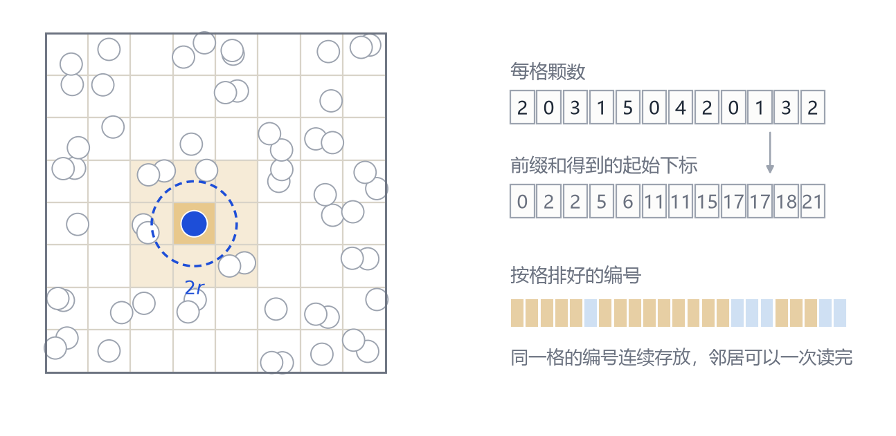
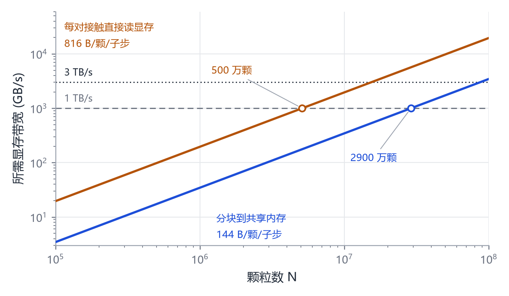

# 第 10 章 GPU 上的百万颗粒

> 本章导读：一千万颗沙，每帧要让每一颗知道它身边有谁、被谁推了一下、下一帧该去哪。这件事在 CPU 上算不完，在 GPU 上算得完但喂不饱。这一章讲为什么颗粒是 GPU 最擅长也最不擅长的负载、邻居搜索怎么组织、内存怎么摆、原子加法为什么让结果不可复现，以及一条能把帧时间提前算出来的性能模型。

## 10.1 一帧的账

先算一遍账，看看一千万颗粒一帧要多少运算。

每颗颗粒每帧要找 32 个邻居候选，其中真正接触的约 6 个。一次接触计算包含法向弹簧阻尼、切向摩擦、滚动阻力，摊到每对接触上大约 200 次浮点运算。于是一个子步的运算量是

$$
F = N\,k\,c_{\text{pair}} = 10^{7}\times 32\times 200 = 6.4\times10^{10}
$$

$N$ 是颗粒数，$k$ 是邻居候选数，$c_{\text{pair}}$ 是每对接触的浮点运算次数。一帧跑四个子步、每秒 60 帧，需要的算力是每秒 $1.5\times10^{13}$ 次浮点运算。

一颗八核 CPU，每核每周期做 16 次单精度乘加，主频 3 GHz，峰值是 $3.8\times10^{11}$。实际能跑到峰值的两成就算不错，也就是 $7.6\times10^{10}$。差了整整两百倍。这不是优化能补上的差距，是架构决定的：CPU 的晶体管大部分用在缓存和乱序执行上，GPU 把大部分晶体管用在算术单元上，代价是它只会做整齐划一的事。

换成 GPU，峰值在 $10^{13}$ 到 $10^{14}$ 之间，算力这一栏刚好够。但账面还有第二栏。

每次接触要从内存里读两颗颗粒的位置和速度，48 字节。一千万颗、每颗 32 个候选，一个子步搬 15 GB。四个子步、60 帧，每秒 3.7 TB/s。而当前最强的加速卡，显存带宽是 3.3 TB/s 上下。也就是说，如果每对接触都老老实实去显存里取邻居数据，光搬数据就把带宽占满了，算术单元全在等。

算力刚好够、带宽差一点，这个组合决定了颗粒模拟在 GPU 上的全部工程做法：想办法让同一份邻居数据被多次使用，把每字节能换到的计算次数提上去。后面几节讲的所有技巧——排序、分块、共享内存、数据布局——本质上都在做这一件事。

## 10.2 哪些部分适合，哪些不适合

颗粒对 GPU 友好，原因有三条。

同构。所有颗粒跑同一段代码，没有类型分派，没有虚函数，没有指针追逐。一个 warp 里的 32 个线程执行同一条指令，差别只在数据上。

局部。接触只在两倍半径内发生，信息传播是短程的。这意味着可以把空间切开分给不同的线程块，块之间几乎不需要通信。

无全局耦合。显式积分的每一步都是"读邻居、算力、积分"，不需要解一个全局的线性系统 [@macklin2014]。这一点比前两条更关键：隐式方法在 GPU 上最难的部分不是并行化，而是那个稀疏线性求解器在显存里根本跑不起来（矩阵太大、访存太随机）。

它不友好的地方也有四条，而且都在同一个方向上：不规则。

接触数在 0 到 12 之间变。一个 warp 里 32 颗颗粒，有的在堆内部被压得满满的，有的在表面只有一两个接触，有的悬空。SIMT 的规矩是整组一起走，于是循环按最多的那个跑，效率按最少的那个算。堆内部接触数 8、表面 2，平均效率就是 25%。

散射写。每颗颗粒算出来的力要加到别的颗粒或者网格节点上，写地址不连续。这在 GPU 上是最贵的一种访存。

原子操作。几颗颗粒同时写同一个网格节点时，需要原子加法，冲突时串行化。

动态拓扑。颗粒在空间里跑，邻居关系每帧都在变，任何"预先建好的图结构"都会很快过期。

对不规则的三种处理，按代价排序。

最省事的是接受它，让 warp 按最坏情况跑。接触数上限设成 12，循环固定 12 次，不够的填零。这种做法简单、可预测，堆内部效率高、表面效率低，整体大概能到三四成。做实时应用时这个代价通常可以接受，因为它换来了没有任何压缩和重排的开销。

第二种是把活跃线程压紧。用一个前缀和把"这一帧真的有接触要算"的线程编号连续写到一个列表里，然后只对这些编号开线程。这叫压缩，效率能提到七八成，代价是多一次前缀和和一次间接寻址。前缀和本身在 GPU 上是标准操作，写起来不难，但它让访存从连续变成了间接，有时候省下的算术还不够付访存的账。

第三种是把不规则的部分搬回 CPU，这在混合管线里很常见：颗粒的主体在 GPU 上跑，少数需要精确求解的部分（比如角色踩在沙上、道具和颗粒的耦合）交给 CPU 上的求解器。代价是每帧一次同步和一次数据往返，从 GPU 到 CPU 的内存拷贝大约 10 GB/s 量级，一帧搬几兆还受得了，搬几十兆就不行了。

还有一条路是改算法，让不规则消失。把一个大步分成二十个小步，每步的位移都很小，邻居集合几乎不变，接触判定不再是"有没有"的定时事件，而是稳定的"有多少"。这个思路在 [@macklin2019] 里叫小步长模拟：用很多便宜的小步代替一次昂贵的大步，稳定性靠步数而不是靠隐式求解器。对 GPU 来说这个交换特别划算，因为小步之间天然并行，没有全局求解，唯一的新成本是邻居搜索要重复做——于是"搜索一次、多个子步复用"就成了关键设计，10.3 节会讲怎么做。

## 10.3 邻居搜索

邻居搜索是每一帧都要做一次的固定开销，也是整个循环里最容易做坏的一段。它的任务很单纯：给每颗颗粒找出半径 $2r$ 内所有其他颗粒的编号。

标准做法是均匀网格。把空间切成边长 $h$ 的立方体格，每颗颗粒按坐标落进一个格。如果 $h\ge 2r$，那么任何可能与中心颗粒接触的同伴，一定在它所在格及其相邻的 26 个格子里。这句话是全部正确性的来源：两颗颗粒能接触的前提是球心距不超过 $2r$；如果它们的格子编号在某个方向上差了 2 格或更多，两颗在这个方向上就至少相隔一个格宽 $h$ 的距离，而 $h\ge 2r$，不可能接触。所以检查 27 个格子就够了，不需要全场景搜索。

$h$ 取 $2r$ 是下限，实际取 $2.2r$ 到 $2.5r$。留余量有两个原因：一是颗粒在一步里会移动，格子按帧初的位置算，帧末可能已经出了格；二是浮点边界上的颗粒偶尔会被算到隔壁格，余量能吸收这种误差。代价是 27 个格子里装的颗粒变多，检查的候选数上升。$h$ 从 $2r$ 涨到 $2.5r$，格子体积涨一倍，候选数也差不多翻倍。这个权衡要靠实测定，没有通用答案。

网格建好之后，需要把颗粒按格子重新排列，让同一个格子的颗粒在数组里连续。这样查邻居时只要知道"第 $c$ 个格子从下标 $a$ 开始、有 $n$ 个"，就能连续读出来，不用再算地址。这个重排用计数排序：

第一遍扫全部颗粒，数出每个格子有多少颗；第二遍对格子做前缀和，得到每个格子的起始下标；第三遍再扫一遍颗粒，把它写到"自己格子的下一个空位"，并把空位加一。三遍都是线性扫描，总代价 $O(N+C)$，$C$ 是格子数。

$C$ 是个陷阱。3D 稠密网格的格子数是 $(L/h)^{3}$。$L=100$ 米、$h=0.04$ 米，就是 $2500^{3}\approx1.6\times10^{10}$ 个格子，光计数器就要 64 GB。所以实际实现里，网格从来不是稠密的：要么用空间哈希把 $(i,j,k)$ 映射到一个几百万槽位的表里，要么只对"当前被占用的格子"编号。后者更常见：先用哈希找出这一帧有哪些格子非空，给它们连续编号，再把颗粒按这些编号排序。哈希冲突用开放寻址解决，探测两三次就够，因为负载因子可以压到 0.5 以下。

排序每帧都做一次，代价不低。有一个折中叫半排序或者增量排序：只在颗粒跨越格子边界的时候搬动它。一颗颗粒每帧移动的距离通常远小于格宽，绝大多数帧根本不需要换格。于是每帧的排序退化成"检查一遍谁越界了，把越界的搬走"，绝大部分工作被省掉。代价是格子内部的顺序不再严格，但邻居查询本来也不关心格内顺序，所以这个代价是零。真正的代价在别处：搬动会打乱"下标随空间单调"这个性质，缓存局部性变差一点点，实测影响在 5% 以内。

图 10-1 把这个过程画成两部分。左边是空间里的网格和 27 邻域，中间那颗颗粒的候选集合就是九个格子里所有的点（二维示意，三维是 27 个）。右边是排序之后的三条数组：每格的计数、前缀和得到的起始下标、以及按格排好的颗粒编号。这张图是示意，真实的三维版本只是把九宫格换成 27 格。

<figure class="fig">

<figcaption><b>图 10-1</b>　均匀网格邻居搜索（示意图，二维）。左：格边长 $h\ge 2r$，中心颗粒的候选集合是它所在格与相邻八格里的全部颗粒，图中阴影区域为半径 $2r$ 的接触范围。右：计数排序的三条数组——每格颗数、前缀和给出的起始下标、按格重排后的颗粒编号，同一格的编号在数组里连续存放。</figcaption>
</figure>

## 10.4 数据布局

颗粒的状态有位置、速度、半径、材料编号。怎么把它们摆进显存，直接决定带宽利用率。

两种摆法。一种是数组的结构（AoS）：每颗颗粒的字段挨在一起存成一个结构体，热字段是 32 字节，带上颜色这类冷数据往往就是 48 字节。另一种是结构的数组（SoA）：所有 x 坐标放一个数组，所有 y 坐标放另一个，以此类推。

GPU 的访存以 warp 为单位。32 个线程同时读地址 $a_{0},a_{1},\dots,a_{31}$，如果这些地址连续，硬件把它们合并成一次 128 字节的事务，一次搬完；如果地址散开，每个不同的 128 字节区间都要单独一次事务。

现在假设 warp 里 32 个线程分别处理 32 颗相邻编号的颗粒，每颗要读自己的位置。SoA 下，32 个线程读 `pos_x[i0..i0+31]`，地址连续，128 字节一次搬完，利用率 100%。AoS 下，线程 0 读的地址是基址加 0，线程 1 是基址加 48（结构体 48 字节），线程 31 是基址加 1488。这 32 个地址横跨 1488 字节，需要 12 次事务，每次只用到其中 128 字节里的一小段。带宽利用率掉到四分之一，等于把 3 TB/s 的卡当 750 GB/s 用。

这个算术解释了为什么所有 GPU 颗粒代码都是 SoA 的，也解释了为什么结构体大小要卡着 2 的幂：32 字节正好是缓存行的四分之一，warp 的访问能整齐地铺满整行。48 字节是最坏的尺寸，既不是 2 的幂，又刚好跨过行边界。

布局还有第二层，比第一层影响更大：排序带来的空间局部性。

邻居查询时，一颗颗粒要读它的 32 个邻居。如果颗粒按空间排过序，邻居的编号通常落在自己编号的几百之内，这些数据大概率在 L2 缓存里（几十兆的容量，能装下几十万颗颗粒的状态）。如果没排序，邻居的编号可能散落在整个一千万的范围里，每一次读都是一次全新的显存访问。实测的差别常常是两三倍，远大于 SoA 和 AoS 之间的差别。所以排序不只是为了邻居搜索的连续性，它同时也在给整个力的计算阶段做缓存预热。

热数据和冷数据也要分开。每帧都要读写的（位置、速度、半径）放一组，连续 32 字节；很少改的（颜色、出生时间、材质索引、美术用的标记）放另一组。合并在一起的话，每次读位置都会顺带把用不上的字节搬进缓存，白白占掉带宽。这个道理在 CPU 上也成立，在 GPU 上更直接。

## 10.5 原子操作

力的计算有两种写法，决定了要不要原子操作。

一种是对偶遍历：只处理 $i\lt j$ 的颗粒对，算出一份力，同时加到 $i$ 和 $j$ 上。这样每对只算一次，算术省一半。但两个线程可能同时写同一颗颗粒——线程 A 处理 $(i,j)$ 时写 $j$，线程 B 处理 $(j,k)$ 时也写 $j$，两个加法撞在一起，不加原子就会丢一个。

另一种是每颗颗粒自己找全部邻居，力只写回自己。这样写地址唯一，不需要原子，但每对接触算了两遍。

离散元通常选第一种，因为算术量减半比省掉原子更值钱。物质点法没得选：P2G 阶段每颗颗粒要把质量和动量散到周围 27 个网格节点上，一个节点会被几十颗颗粒同时写，这是结构性的冲突，必须用原子加法 [@hu2018]。

原子的代价取决于冲突率。同一个地址上平均有几个线程在排队？一千万颗颗粒、每颗散到 8 个节点，是 $8\times10^{7}$ 次写；网格若是 $256^{3}=1.7\times10^{7}$ 个节点，平均每个节点 4.8 次写。冲突率接近 5，意味着这部分的有效带宽掉到五分之一。把网格加密到 $512^{3}$，节点数涨八倍，冲突率掉到 0.6，原子几乎不打架，但网格本身的内存和遍历成本涨了八倍。这个权衡在物质点法里是常年的议题。

比性能更麻烦的是确定性。浮点加法不满足结合律：$(a+b)+c$ 和 $a+(b+c)$ 的最后几位可能不同。原子加法的顺序由硬件调度决定，每帧都不一样，于是同一份初始状态跑两遍，结果在几百帧之后分岔。这在影视制作里是硬伤——重算一段、接上缓存、对比两版参数，全都依赖"同样的输入给同样的输出"。

三种解法。把浮点换成定点整数累加，整数加法可交换，顺序无关，最后再转回浮点，代价是动态范围和精度要事先定好；用确定性归约，固定一棵归约树，每个节点按固定顺序合并子节点的贡献，代价是要多一遍遍历和一块临时显存；或者接受不确定，每一段独立模拟，段与段之间用混合过渡盖住接缝。第三条在制作里最常见，因为它不需要改模拟器，只需要改流程。

小步长会让不确定性问题变严重：子步从 4 个涨到 20 个，累加次数涨五倍，浮点顺序的差异也放大五倍。这不是反对小步长，而是提醒：一旦选了这条路，确定性就得单独设计，不能指望它自己成立。

## 10.6 多 GPU 与区域分解

一千万颗粒能塞进一张卡，一亿颗塞不进。这时候要把空间切开，每张卡负责一块。

最直接的分法是沿一个轴切片。四张卡，每张管四分之一的 $z$ 范围。麻烦在边界：一张卡上的颗粒，它的接触对象可能在隔壁卡上。所以每张卡要在自己的边界外多存一层"幽灵颗粒"，宽度至少是 $2r+v_{\max}\Delta t$，$v_{\max}$ 是一步里最快的颗粒速度。$v_{\max}\Delta t$ 这一项容易被忘掉，忘了就会看到颗粒以每秒几十米的速度穿过边界，从另一侧消失。

算一下通信量。一个 4 米见方的立方体域，颗粒数密度 $1.4\times10^{5}$ 每立方米（对应 2 厘米直径、体积分数 0.6），一千万颗正好装满。切一刀，界面 16 平方米，幽灵层厚 0.04 米，体积 0.64 立方米，约九万颗，按每颗 32 字节是 2.9 MB。一个子步双向交换 6 MB，四个子步、60 帧，每秒 1.4 GB。PCIe 4.0 的一条 x16 链路是 25 GB/s，这个量完全在射程内。

卡数一多，账就变了。八张卡沿一个轴切，每张卡的域厚 0.5 米，幽灵层还是 0.04 米，占比从 8% 涨到 16%。也就是说每张卡要额外搬运和计算 16% 的颗粒，这些颗粒在两张卡上都算了一遍。有效加速比不再是 8，而是 $1/(1/8+0.16)$ 左右，落到三倍半。这就是为什么颗粒模拟的多 GPU 扩展性普遍不好，多数工程止步于四到八张卡。想再往上，得改成三维切块，让界面面积随卡数的立方根增长而不是线性增长，代价是通信拓扑变成三维网格，延迟和同步都更难处理。

负载不均比通信更难缠。雪崩的时候，颗粒全往一个方向涌，负责那个区域的卡成了瓶颈，其他卡在等。静态分区只能按平均密度分，遇到这种事毫无办法。动态再平衡的做法是按格子迁移：每隔几十帧统计一次各卡的负载，把负载高的卡边缘的一些格子整体划给邻居。迁移的代价是搬运颗粒数据并重建邻居表，一次几毫秒，做太频繁反而更慢。

同步开销也要算进去。每个子步结束要等所有卡到齐，等待时间等于最慢那张卡的耗时。如果负载差 10%，八张卡的整体效率就掉 10%。这是与粒子数无关的固定损耗，小规模问题上多卡不划算。

## 10.7 性能模型

把前面几节的东西收成一条公式，就能在动手之前估出帧时间。

每颗粒每帧要搬的字节数

$$
b = b_{\text{state}} + k\,b_{\text{pair}}
$$

$b_{\text{state}}$ 是读写自身状态的字节，位置和速度各 12 字节，读写各一遍约 48 字节；$k$ 是邻居候选数；$b_{\text{pair}}$ 是取一个邻居数据的字节数，位置加速度 24 字节。整个场景每秒需要的带宽是

$$
B = s\,f\,N\,b
$$

$s$ 是子步数，$f$ 是帧率。代入 $s=4$、$f=60$、$k=32$、$b_{\text{state}}=48$、$b_{\text{pair}}=24$，得到每颗颗粒每子步 816 字节。

这个数是最坏情况：它假设每对接触都去显存里取邻居的位置和速度，一点缓存都不命中。真实的实现会分块——把一块空间里的颗粒数据先搬进共享内存，块内几十颗颗粒的接触全部在共享内存里完成。一个装了 64 颗的空间块，块内的邻居数据被复用大约 8 次，$b_{\text{pair}}$ 的有效值掉到 3 字节上下，每颗每子步降到 144 字节附近。

图 10-2 把这两条曲线画在一起：横轴是颗粒数，纵轴是所需带宽，两条水平线分别是 1 TB/s（消费级显卡的显存带宽）和 3 TB/s（数据中心卡的量级）。不分块的那条线在五百万颗附近撞上 1 TB/s，一千五百万颗撞上 3 TB/s；分块之后，同样的线上移了五倍多，要到两千九百万颗才撞上 1 TB/s。两条线的斜率相同，差距就是那 5.7 倍。

<figure class="fig">

<figcaption><b>图 10-2</b>　所需显存带宽随颗粒数的变化（复杂度模型，非实测）。按 $B=sfNb$ 计算，$s=4$ 个子步、$f=60$ 帧每秒、$k=32$ 个邻居候选。上曲线为每对接触都直接读显存的朴素实现，$b_{\text{state}}=48$ 字节、$b_{\text{pair}}=24$ 字节，合计每颗每子步 816 字节；下曲线为分块到共享内存、邻居数据复用 8 次后 $b_{\text{pair}}$ 的有效值降到 3 字节，合计 144 字节。两条水平线为 1 TB/s 与 3 TB/s 的显存带宽参考。曲线只含接触计算与状态读写的流量，不含排序与网格原子操作。</figcaption>
</figure>

这条模型还能回答另一个问题：优化该往哪使劲。

先算算术强度。每对接触 200 次浮点运算、48 字节流量，比值是 4.2 次浮点每字节。一张带宽 3 TB/s、峰值 60 TFLOP/s 的卡，它的拐点在 20 次每字节。4.2 远在拐点左边，说明颗粒模拟是彻底的带宽受限负载，算术单元的利用率到不了三成。

推论很明确：减少浮点运算带来的收益会被带宽吃掉，减少访存才是有效的优化。把每对接触从 200 次运算压到 150 次，帧时间可能一点不变；把邻居数据的复用从 1 次提到 8 次，帧时间直接砍到五分之一。这也解释了为什么这个领域里最值钱的技巧都是关于排序和分块的，而不是关于指令级并行的。

模型还可以反过来用：给定一张卡和一段镜头，估一下极限。3 TB/s 的卡，分块之后每颗每子步 144 字节，四个子步 60 帧，于是 $N = 3\times10^{12}/(144\times240)\approx 8.7\times10^{7}$。八千万颗是带宽允许的上限，算力允许的上限要比它低一些，实际能做到两千万到四千万颗，剩下的差距来自排序、原子、分支和同步这些模型里没写的固定开销。经验上按总额的 30% 到 50% 留出杂项，估出来就比较靠谱。

所有性能模型都只对量级负责。真跑起来，一块被压实的区域、一次雪崩、一段没有休眠判定的静止堆，都能让实际时间偏离模型一倍以上。模型的价值不是预测精确的毫秒数，而是在你还没写代码的时候告诉你天花板在哪、瓶颈是算力还是带宽、以及该不该把力气花在排序上。
