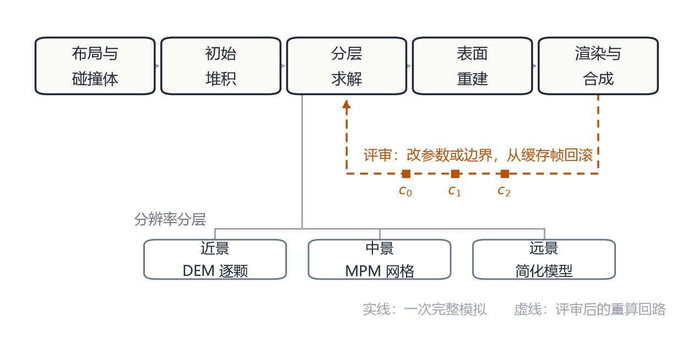

# 第 11 章 艺术指导与工程案例

> 本章导读：前面十章讲怎么算对，这一章讲怎么算成要的样子。从一个镜头被退回三次说起，把"太粉了"这类评语翻译成可调的量，再看目标形状靠什么引导、结果怎么缓存与回滚、粒子怎么变成表面，最后落到雪崩、沙堡、泥浆三个镜头和一张参数表。

## 11.1 一句"太粉了"对应哪个数

放映厅里第三遍放那段雪崩。导演说："雪太粉了，像有人在楼上筛面粉。"这句话里没有一个物理量，却指向三件可以分开改的事：前锋扬起的细颗粒太多、落下来的雪不结块、压过的地方看不到回弹。三件事分别由粉尘判据、临界拉伸、硬化和刚度控制，改错一个，另外两个往往跟着变坏。

先把它拆成形态。画面上"粉"的主要来源是前锋的粉尘层，那层是稀薄颗粒，由主体的变形速率决定什么时候被甩出去。判据阈值定低了，主体每动一下就往空气里撒一把粒子，画面上永远像在下雪；定高了，雪崩又没有气势，像一块湿泥在坡上滑。"不结块"来自临界拉伸太小：雪一受拉就断，断口全是鸡蛋大的碎屑，找不到半米见方的雪块，而真实的雪崩滑下来常常是整块整块地翻。"不回弹"来自硬化太弱：压实的雪没有变硬，履带压过的地方塌成一片，看上去像被抹子抹过的水泥。

换一种材料，同一套翻译照样成立。沙堡被评价为"像湿面团"，指的是坡面太圆、塔身耷拉、表面太光滑；泥浆被评价为"太水"，指屈服应力不够，落下去立刻摊成一张饼，边缘没有厚度；把屈服应力提上去，又容易过冲成挤牙膏，一圈一圈堆着不流动。参数之间是耦合的，每一次改对了一个，都可能顺手改坏了两个。

所以第一件事是把形容词换成可测量的量。坡角、块度（碎块的特征尺寸）、塌落时间（从起滑到静止）、粉尘量（单位时间抛出的稀薄粒子数），这四个量足够覆盖大部分反馈。测量方式很土：从固定机位渲一张侧视图，量坡面与水平线的夹角；数一数最大碎块的像素宽；在前锋位移曲线上标出斜率突变的时间。

调参的工程做法是单变量扫描。固定相机、光照、初始状态，把待调的参数取五个值，每个值只算半秒的低分辨率小样，拼成一张对比图。五个值里通常有一个明显越界，太黏或者太散，另外四个挤在一段，下一轮就在那一段里再取五个。两三轮之后参数落进一个可用区间，剩下的差别交给美术判断。前提是结果可复现：同样的初值与参数必须给出同样的结果，否则对比图里的差别分不清是参数造成的还是随机性造成的。可复现性在并行求解器里不是默认的，11.4 会讲。

## 11.2 能拧的旋钮只有几个

一套求解器对外暴露的参数看上去有十几个，真正改变形态的只有五组：摩擦、粘聚、刚度、屈服与硬化、阻尼。其余几项，密度、粒径、网格分辨率，多半由场景尺度决定，拿来调形态只会把时间步和内存一起拖垮。

摩擦分两处。材料内部的摩擦角 $\varphi$ 进入屈服面，决定堆多陡、剪胀多强；材料与刚体、地面的边界摩擦 $\mu_w$ 决定它滑不滑得动。两者常被混为一谈。坡面上的雪站不住，是内部摩擦角太小；雪滑到坡脚还在往前滑、堆不起来，是边界摩擦太小。前者要改本构，后者只要改接触参数。摩尔-库仑准则写成

$$\tau=c+\sigma_n\tan\varphi$$

$\tau$ 是破坏面上的剪应力，$\sigma_n$ 是同一个面上的法向应力，$c$ 是粘聚，$\varphi$ 是内摩擦角。把它塞进以平均应力 $p$ 和等效剪应力 $q=\sqrt{3J_2}$ 表达的 Drucker-Prager 圆锥时，平面应变条件下匹配的参数是

$$\alpha=\frac{2\sin\varphi}{\sqrt3\,(3-\sin\varphi)},\qquad k=\frac{6c\cos\varphi}{\sqrt3\,(3-\sin\varphi)}$$

$J_2$ 是偏应力第二不变量，$\alpha$ 与 $k$ 分别是圆锥的斜率与截距。摩擦角与粘聚不能各自独立地调到"看起来对"，它们共同决定屈服面在拉伸与压缩两侧的形状，改一个，另一个的可用区间也会挪。

粘聚是让沙堡站住的那一项。两颗半径 $r$ 的湿沙颗粒之间有一座水桥，桥面收缩产生的毛细力约为

$$F_c\approx 2\pi r\gamma$$

$\gamma$ 是水的表面张力，取 0.072 N/m。代入 $r=0.1$ mm，得到 $4.5\times10^{-5}$ N；同一颗石英颗粒的自重是 $\rho_s g\frac{4}{3}\pi r^3\approx1.1\times10^{-7}$ N，两者差了四百倍。一点点水就能让沙堆立起来，原因就在这里。含水率继续上升，孔隙被水填满，孔隙压力升高、有效应力下降，粘聚反而消失，沙重新变成一摊。湿沙的粘聚因此不是含水率的单调函数，峰值通常在饱和度百分之五到十之间。

宏观上，粘聚换算成一个能站多高的直立面。直立土柱的极限高度由拉应力上限决定，量级是

$$H_c\approx\frac{2c}{\rho g}$$

$\rho$ 是堆积密度，$g$ 是重力加速度。取 $\rho=1900\ \mathrm{kg/m^3}$、$c=2.8$ kPa，得到 $H_c\approx0.30$ m。一座三十厘米高的沙堡需要的粘聚就是三千帕上下，与湿沙的实测值同量级。这条式子还给了调参的方向感：想让塔高翻倍，粘聚要翻倍，把摩擦角调大没有用。

刚度是另一类参数，它几乎不影响最终停在哪，但支配中途怎么变。弹性波在材料里的纵波速度是

$$c_p=\sqrt{\frac{E(1-\nu)}{\rho(1+\nu)(1-2\nu)}}$$

$E$ 是杨氏模量，$\nu$ 是泊松比。显式积分要求

$$\Delta t\le \frac{0.5\,\Delta x}{c_p}$$

$\Delta x$ 是网格间距。这两个式子连起来就是影视雪必须变软的原因：真实冰的 $E$ 接近 $9\times10^9$ Pa，密度 900，$c_p$ 约 4000 m/s，网格 2 cm 时步长上限只有 $2.5\times10^{-6}$ s，一帧要几万步。雪的 MPM 论文 [@stomakhin2013] 给出的参数里 $E=1.4\times10^5$ Pa、$\rho=400\ \mathrm{kg/m^3}$，$c_p$ 只有 20 m/s 上下，步长上限升到 $5\times10^{-4}$ s，一帧几十步。刚度砍掉四个量级，画面上的雪却仍然像雪，因为决定形态的是摩擦、粘聚和屈服，刚度只决定软硬的手感和碎块边缘的锐利程度。

屈服与硬化决定碎块。雪的抗压远强于抗拉，模型里因此有两个临界应变：压缩到 $\theta_c$ 开始压溃，拉伸到 $\theta_s$ 就断裂，同一篇论文取 $\theta_c=0.025$、$\theta_s=0.0075$ [@stomakhin2013]，再配一个硬化系数 $\xi=10$，让越压越硬。$\theta_s$ 调小，雪变脆，一碰就碎成粉；调大，雪变韧，能拉出一整片雪板。沙没有这套拉伸强度，但需要剪胀角小于摩擦角，否则密实的沙在剪切时会被算成越剪越紧，应力虚高，堆形反而立不住。

阻尼是最后一组，也最容易被滥用。数值阻尼能吃掉高频振荡，让画面稳定；给多了，雪崩像在糖浆里滑，颗粒像泡在蜂蜜里。判断标准很直接：让一团材料自由落体撞地，看它弹几下。真实雪的恢复系数在 0.1 到 0.3，弹两下就该停；弹五六下是阻尼不足，一下都不弹、贴地摊开是阻尼过量。

<figure class="fig">

<figcaption><b>图 11-1</b>　参数到形态的映射（示意图）。三行分别是摩擦、粘聚、刚度单独变化时落堆的形状：坡角按库仑楔体的 $\theta=\arctan\mu$ 画出，直立高度按 $2c/(\rho g)$ 的比例画出，刚度一行只表现塌落后的轮廓差别，不对应具体数值。真实材料里这三者会互相牵制，这张图只用来判断该先拧哪个旋钮。</figcaption>
</figure>

## 11.3 目标形状：五个抓手

这些方法解的都是初值问题：给定初始状态和参数，结果自己长出来。想让结果长成某个样子，只能从五个层次干预，按物理性的强弱排下来。

最物理的是初始条件。把目标形状往前推一步作为初始状态，让模拟从它即将变化的时刻开始。沙堡就是这么做的：先用模具把湿沙压成塔形，再让模具抬起；雪崩是先按层铺好雪，让弱层在重力下自己失稳。初始条件不引入任何非物理的力，代价是要多做一个建模步骤，而且初始状态必须是求解器能接受的：密实、无穿透、应力大致平衡。把一个不满足静力平衡的形状塞进去，第一步就会炸开。

第二层是边界与道具。挡板、漏斗、模具、铲子、地形，都是碰撞体。改变边界是几何问题，不是物理参数问题，所以最可控，也最容易被导演理解。模具抬起的速度、铲子切入的角度、漏斗口的宽度，都能精确到帧。代价是碰撞体本身要处理摩擦：模具内壁太滑，抽模时沙子会整块跟着上来；太涩，塔壁会被拖塌。这个两头都不行的窗口，恰好也是真实沙堡的难点。

第三层是空间变化的参数。真实材料并不均匀：坡脚的雪被压过，密度和刚度都高；沙堡表面一层被风吹干，粘聚低；泥浆底部沉淀得更稠。把这些差异写成一个场 $\mu(\mathbf{x})$、$c(\mathbf{x})$，按粒子位置采样，同一块材料就能在不同区域表现不同。实现上让每个粒子携带自己的材料参数，投影到网格时按质量加权平均，参数才不会被网格抹平。要注意的是，参数在空间上突变会产生应力集中，界面两侧的单元被撕开，形成一条本不该有的裂缝，所以过渡带至少留三到五个网格宽。

第四层是外力场与速度覆盖。风、爆炸、水流、吸引子，都是往系统里注入动量和能量，它们不守恒，只适合做短时脉冲：在起滑的一瞬间给弱层一个切向速度，或者在扬雪时给前锋一层向上的风。持续施力会让整个系统变成被推着走，看起来像有只看不见的手。速度覆盖更粗暴，直接改粒子速度，只在初始化或者需要瞬移时用。

第五层是约束投影，把粒子往目标表面上拉。这是最容易做出橡皮感的一类：约束力与物理力竞争，材料会表现出没有惯性的弹性。可行的做法是只在最初几帧用弱约束把形状扶正，随后逐帧减小权重，让本构接管。权重下降的曲线要平滑，否则切换的那一帧能看到明显的松手。

比这些更常见的做法是改镜头：相机推近、加一点景深、让前景的雪块挡住接缝，比再算一遍便宜得多。

## 11.4 缓存、分层与重算

先算一笔账。一帧的成本等于粒子数乘子步数乘单粒子步的代价。两百万粒子、每帧两千子步、每粒子步两百次浮点运算，一帧是 $8\times10^{11}$ 次运算；有效算力按 10 TFLOP/s 算，一帧八十秒。一段三秒、每秒二十四帧的镜头共七十二帧，一遍一个半小时。导演看一遍提三条意见，改完再算，一天能跑五遍就算顺利。这个数量级决定了流程必须围绕不要从头算来设计。

要缓存的东西分两种。只给渲染用，存位置、体积比 $J$、材料编号就够，每粒子十六字节；要能重算，必须存完整的本构状态，包括变形梯度 $\mathbf{F}$、硬化变量、孔隙率，每粒子六十四字节以上。两百万粒子，前者三十二兆一帧，后者一百二十八兆一帧，七十二帧分别是 2.3 GB 和 9.2 GB。前者放得进内存，后者要落盘压缩。

压缩不能直接用半精度。半精度的相对误差约千分之一，场景尺寸两米时绝对误差两毫米，表面会出现看得见的台阶。更稳的做法是先减去场景中心，再用十六位定点数把两米映射到六万五千格，分辨率 0.03 mm，误差比半精度小两个数量级，体积还只有原来的一半。

分层有三个方向。时间上，每十二帧存一个完整检查点，中间帧只存渲染用的瘦数据。空间上，近景用高分辨率，中景降一档，远景交给程序化噪声；三层用不同的步长，每若干步交换一次边界上的速度与位置，交换频率要高于波穿过边界所需的时间，否则边界会反射出假波。语义上，把还能保持形状的碎块从主体里剥离出来冻成刚体，只让主体继续用连续体求解，碎块通常只占粒子总数的百分之几，却能省掉一大半的接触计算。

重算的前提是确定性。并行归约的顺序不固定，同样的输入两次运行会差在最后几位，误差被混沌放大，几秒之后两条轨迹就完全分开。这时两版对比，差别里有多少来自参数、多少来自舍入，是分不清的。可行的做法是固定归约树、固定步长、固定粒子顺序，代价是损失一点性能，换来的是能做对比和可靠回滚。这一步在项目初期就该定下来，等到中期发现结果不可复现，前面的对比全部作废。

局部改参数时，影响会往外传，传播速度就是 $c_p$。重算范围要外扩 $c_p$ 乘剩余模拟时间那么远，简单点就外扩二三十个网格。外扩不够，边界上会出现旧状态和新状态相接的接缝，接缝随波来回反射，最后在画面上变成一条亮线。

最后是分支。从同一个检查点出发，用五组参数并行算五个版本，评审时并排播，改一版等一天就变成一次看五个。代价是存储和算力成倍增长，所以要挑检查点：在运动平缓、状态稳定的时刻存，分支出去的结果差异更干净；在起滑前一帧存，所有分支继承同一个扰动，对比才有意义。

<figure class="fig">

<figcaption><b>图 11-2</b>　一次模拟的流程与重算回路（示意图）。上半行是从布局到渲染的主链，左下是求解时三档分辨率的分工，虚线是评审之后的重算路径：改参数或者改边界，从最近的缓存帧（$c_0$ 到 $c_2$）回滚，而不是从第一帧重来。</figcaption>
</figure>

## 11.5 从粒子到表面

粒子是散点，渲染需要连续表面，这一步对观感的影响往往比求解器精度更大。从表面重建到渲染的整条链路，在 [@jiang2017] 那份课程讲义里有更完整的整理。

第一步把粒子变成标量场。每个粒子带一个体积 $V_p$，在它周围铺一个核函数 $W$，把邻域内的贡献加起来：

$$\phi(\mathbf{x})=\sum_p V_p\,W(\mathbf{x}-\mathbf{x}_p)$$

$\mathbf{x}_p$ 是粒子位置，$W$ 常用三次或四次多项式核，支撑半径取粒子间距的两到三倍，等值面 $\phi=\phi_0$ 用 marching cubes 提出来。

这里有一个几乎每个项目都会踩的坑：$V_p$ 不是常数。物质点法的粒子初始体积是 $V_p^0=m_p/\rho_0$，变形之后的体积是 $J V_p^0$，$J=\det\mathbf{F}$。体素化时如果每个粒子都用同一个半径，被压实的雪会在表面上膨胀回原来的体积，履带压过的地方反而鼓起来。正确的做法是让权重乘上当前体积，压实的区域贡献更集中，表面才会跟着凹下去。

分辨率取粒子间距的零点五到一倍。太粗，雪面上五厘米的台阶被抹平，看上去像塑料；太细，粒子分布的随机性直接变成噪点，顶点数也要翻几倍。实用的折中是在表面附近建窄带，带内细、带外粗。提完等值面还要平滑，拉普拉斯平滑会让体积收缩，塔尖越磨越矮，所以用一正一负交替的 Taubin 平滑，次数别超过五遍，否则雪的细节就没了。

纹理有两个来源。一是把粒子在初始状态的位置存下来做 UV，表面怎么变形纹理都跟着走，不会滑动；二是世界坐标的三平面投影，适合大范围雪地，接缝靠噪声打散。压实的区域用 $J$ 驱动粗糙度和颜色，压过的地方更暗更光滑，这是雪地最容易被认出的一组视觉线索。

泡沫和飞溅是另一套粒子，不参与主体求解，位置由主体表面的状态决定，判据通常是几个量的加权：

$$f=\max\left(0,\ \frac{|\mathbf{v}|-v_0}{v_1}+\frac{1-J}{J_1}+\frac{\kappa}{\kappa_0}\right)$$

$\mathbf{v}$ 是粒子速度，$\kappa$ 是自由表面的曲率，$v_0$、$v_1$、$J_1$、$\kappa_0$ 是各自的尺度。$f$ 超过阈值的地方喷出泡沫粒子，寿命一到两秒，之后淡出。速度项抓撞击，$J$ 项抓被压实又突然松开的区域，曲率项抓薄片破碎的边缘。三项权重不能照抄，$v_0$ 取 1 m/s 还是 5 m/s，直接决定前锋是扬起薄雾还是整片白墙。雪崩的粉尘层不是泡沫，是稀薄的雪粒，单独模拟一层并单向接受主体的速度与抛出率，渲染时用体积散射。

输出的通道要提前约定。深度、速度、密度、$J$、材料编号、泡沫掩码、相变用的温度，这几张图交给合成，运动模糊与次表面散射才有依据。等后期想加运动模糊才发现速度场没存，返工就来不及了。

## 11.6 三个镜头

雪崩。四十米宽的山坡，雪板整块下滑，前锋卷起雪雾。地形是静态碰撞体，雪层分三层：底层八十厘米高密度雪（$\rho=350$），中间十五厘米弱层（粘聚近于零），表层三十厘米新雪（$\rho=120$）。弱层是起滑的关键，真实雪崩的起滑面几乎总在某个确定的深度层里。参数用 [@stomakhin2013] 那组：$E=1.4\times10^5$ Pa、$\nu=0.2$、$\theta_c=0.025$、$\theta_s=0.0075$、$\xi=10$、$\varphi=20^\circ$，弱层的摩擦角降到 $15^\circ$。网格八厘米，粒子四厘米，约两百万粒子，下滑八秒共 192 帧。最常见的三个毛病都不难认：数值粘性让雪像在糖浆里滑，前锋速度上不去；硬化太强让整片雪变成混凝土板，滑到坡脚也不碎；粉尘判据太敏感，画面上永远在下雪。症状都是看着不对，要改的参数完全不同。

沙堡。一只手把模具提起来，塔立着，然后被捏塌。湿沙含水率控制在百分之五到八，摩擦角 $35^\circ$，粘聚 2 到 4 kPa，$E$ 取 $10^7$ Pa。模具是薄壁碰撞体，壁面摩擦 0.4 到 0.6，抽模速度 0.15 m/s。抽模这一段是整段的看点：内壁拖着塔壁往上走，塔顶被拉出几道裂纹，裂纹在重力与毛细粘聚的竞争下停在半途。抽得太快，塔被整块带起来；太慢，塔在模具里就塌了。三十厘米高的塔要在画面上看清边缘，粒子取 1.5 到 2 mm，百万量级。干燥是免费的戏剧性：让粘聚随时间从 3 kPa 降到 0.5 kPa，塔会在某个时刻自己开始垮，而且越垮越快，因为裂纹一旦出现，承载力就下降。

泥浆。一车泥浆从翻斗倒到地面，摊开，溅到墙上。它不是颗粒主导的稠密流动，是细颗粒加水的屈服流体，用 Herschel-Bulkley 描述

$$\tau=\tau_y+K\dot\gamma^{\,n}$$

$\tau_y$ 是屈服应力，$\dot\gamma$ 是剪切速率，$K$ 是稠度，$n$ 小于 1 表示剪切变稀。取 $\rho=1600\ \mathrm{kg/m^3}$、$\tau_y=200$ Pa、$K=50$、$n=0.7$，落下去会摊成一张有厚度的饼，边缘停住不流。屈服应力决定摊多远，大到 500 Pa 会在翻斗口堆成小山，小到 50 Pa 落地就摊平；粘度决定摊多快。两件事分开调，比调总粘度有效。数值上要用隐式或者半隐式，因为屈服前的刚度很大，显式步长会被压到不可用，半隐式物质点法 [@daviet2016] 正是为这类材料准备的，它把摩擦型屈服面放进隐式求解，刚度大也不至于让步长塌掉。粒子散开后表面重建会丢掉薄边，用 $J$ 修正能补回一部分，剩下的靠渲染时给边缘加厚。

三个镜头共用同一套代码，差别只在参数与边界。把项目拖垮的从来不是方程，是流程：一次算一天、改一个数要重来、渲出来才发现接缝。

## 11.7 参数速查表

这张表是起步值不是标定值：同一材料在不同尺度上参数不同，照搬往往差一个量级。

**表 11-1**　颗粒与雪材料参数速查（数量级，供起步用）

| 材料 | 密度 $\mathrm{kg/m^3}$ | 内摩擦角 | 粘聚 | $E$ (Pa) | 本构 | 显式步长 | 备注 |
| --- | --- | --- | --- | --- | --- | --- | --- |
| 干沙 | 1600 | $32^\circ$ | 0 | $5\times10^6$ | Drucker-Prager | $1.5\times10^{-4}$ | 加滚动阻力才能堆陡 |
| 湿沙 | 1900 | $35^\circ$ | 2–4 kPa | $10^7$ | DP 加拉伸截断 | $1.2\times10^{-4}$ | 粘聚随含水率非单调 |
| 新雪 | 400 | $25^\circ$ | 0.2 kPa | $1.4\times10^5$ | 弹塑性加硬化 | $5\times10^{-4}$ | 密度随压实变化 |
| 压实雪 | 450 | $30^\circ$ | 0 | $5\times10^6$ | 同上 | $1\times10^{-4}$ | 摩擦角随风化上升 |
| 泥浆 | 1600 | — | 屈服应力 200 Pa | — | Herschel-Bulkley | $3\times10^{-3}$ | 受粘度限制 |
| 泡沫 | 120 | — | 屈服应力 50 Pa | $10^4$ | 屈服应力流体 | $9\times10^{-4}$ | 壁面滑移明显 |

表里的步长按 $c_p$ 与 $\mathrm{CFL}=0.5$、$\Delta x=2$ cm 估算，泥浆一栏换成粘性限制，因为它的时间步由粘度而不是波速决定。刚度一栏是为稳定服务，影视里常再往下调一两个数量级，代价是碎块变软、回弹消失。真正需要对着参考实拍校准的只有两行：坡角和塌落时间。坡角对了，材料就像了；塌落时间对了，重量感就有了。其余的差异，观众分辨不出来。
