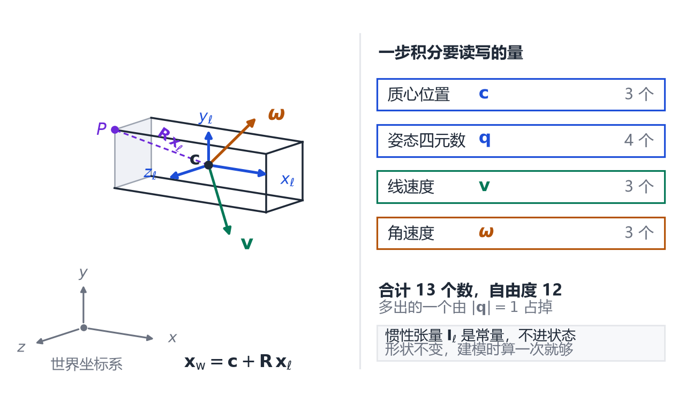
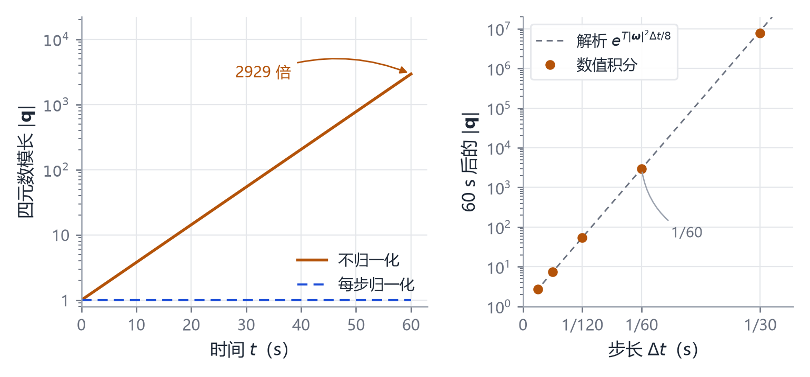

# 第 1 章 刚体的六个自由度

> 本章导读：一个会翻身的箱子，比一颗粒子多记了哪些数；这些数为什么不能随便挑三个角来代表；角速度为什么不是姿态的导数；一步积分里各步的先后顺序会带来什么误差；除了位姿和速度，状态里还得塞进哪些东西。这一章把这些账算清楚，不涉及任何碰撞。

## 1.1 一只箱子滚下台阶

关卡末尾有三级台阶，玩家把一只木箱踢下去。箱子在第二级上磕了一下，翻了个身，落到最下面那级，晃两下停住。这段动作要连续、可重复，还要允许玩家再踢一脚。

要把它算出来，先得回答一个问题：箱子此刻处于什么状态。

一颗粒子的答案很简单，位置三个数、速度三个数。箱子不行，因为它会翻。翻转这件事说明，除了“在哪”，还得知道“朝哪边”，以及“转得多快”。

手工做动画也能出这段，但做不久。玩家每次踢的角度、位置、力度都不一样，动画师没法穷举；更难的是这只箱子还要跟下一级的箱子、栏杆、角色互动，谁压住谁、先往哪边倒，事前画不出来。要一套演化规则的理由就在这里：给定此刻的状态和这一步的力，下一帧的状态唯一确定，规则不关心力是谁给的。

刚体这个假设说的是，物体上任意两点之间的距离保持不变。听着只是“不变形”，实际买到的东西比这多。质量属性在建模时算一次，之后是常数；碰撞形状不随运动改变，包围盒、凸包、支撑函数都能预计算；求解器要对付的只有十几个数的耦合，不必管几千个顶点各自在哪。

代价同样清楚。箱子落地那一下的闷响、木板的轻微弯曲、被压扁的纸箱角，全都不存在。模拟里的刚体是绝对硬的，两个刚体接触时接触面积为零，力集中在一个点上，这在物理上不可能发生，只能靠恢复系数和摩擦系数去补。

判断一样东西能不能当刚体算，看变形量占尺寸的比例。千分之一以下，当刚体没问题；百分之一以上，弯曲和褶皱人眼就能看出来，该换柔体。网球拍的拍弦、两毫米厚的塑料板、一张纸都属于后者，它们看起来很硬，实际在碰撞瞬间的变形决定了它弹向哪里。

## 1.2 形状固定之后剩下的数

位置三个、姿态三个，一共六个自由度。这个“六”不是随手数的，它是刚体可以独立变动的方向数，也是求解器里每一行约束要对付的变量数。

位置好理解，质心在空间里的三个坐标。姿态要绕一点：它不是一个三维向量，而是三维空间里的一个旋转。旋转可以用三乘三矩阵表示，矩阵有九个元素，但这九个元素不自由。要让矩阵只做旋转、不做拉伸和镜像，得满足

$$\mathbf{R}^{\mathsf{T}}\mathbf{R}=\mathbf{E},\qquad \det\mathbf{R}=1$$

$\mathbf{E}$ 是三阶单位阵。正交条件给出六个方程，三列各自长度为 1，两两内积为零；九个未知数减六个方程，剩三个。所以旋转空间的维数是三，跟“绕三根轴各转一点”的直觉对得上，但它的形状完全不是平的。

这件事在代码里有直接后果。姿态不能像位置那样做加减：两个姿态矩阵相加，得到的通常既不正交也不保长度，不再是一个姿态。想在两个姿态之间取“中间那一个”，也不能对九个元素求平均。姿态所在的空间是弯的，速度不住在这个空间里，而是住在它的切空间里。每个姿态都有自己的切空间，这就是角速度必须跟着姿态一起存、而不能由姿态推出来的原因。

把状态写全，是质心位置 $\mathbf{c}$ 三个数、姿态四个数、线速度 $\mathbf{v}$ 三个数、角速度 $\boldsymbol{\omega}$ 三个数，一共十三个。姿态四个数对应三个自由度，多出来的那个被长度约束占掉。十三个数装十二个自由度，这是几乎所有刚体引擎状态结构的由来，也是内存布局、序列化、网络同步里反复出现的一组数字。

这套坐标不是最小参数化。一个铰链上的物体其实只有一个自由度，用上面十二个数去描述它，等于把十一个约束当成外力去解，白花力气。所以有一类引擎走另一条路：把整个机构写成广义坐标，只留关节角，用质量矩阵把这些角的动力学拼起来，约束就在坐标选择里消失了 [@todorov2012]。代价是碰撞变得难写，得先知道某个几何点对应哪组广义坐标，再算它的雅可比。没关系先摆在那里的多刚体，用笛卡尔坐标加约束更直接；机器人、布娃娃这类有确定拓扑的，用广义坐标更省。两条路都有人在用，区别不在精度，在你要先付哪一笔账。

## 1.3 三个角为什么存不住姿态

大多数人的第一反应是存三个角：绕 $x$ 轴转一点、绕 $y$ 轴转一点、绕 $z$ 轴转一点。飞机上的滚转、俯仰、偏航是这套，建模软件的旋转手柄也是这套。它当人机接口很好用，当状态很差，坏在三处。

第一处是死锁。按 $z$ 偏航、$y$ 俯仰、$x$ 滚转的顺序复合

$$\mathbf{R}=\mathbf{R}_z(\psi)\,\mathbf{R}_y(\theta)\,\mathbf{R}_x(\varphi)$$

当俯仰角 $\theta=90^\circ$ 时，三个矩阵乘开可以化简成

$$\mathbf{R}_z(\psi)\,\mathbf{R}_y(90^\circ)\,\mathbf{R}_x(\varphi)=\mathbf{R}_z(\psi-\varphi)\,\mathbf{R}_y(90^\circ)$$

右边只出现 $\psi-\varphi$ 这一个组合。于是 $(\psi,\varphi)=(30^\circ,0^\circ)$ 和 $(60^\circ,30^\circ)$ 给出一模一样的姿态，两个参数退化成一个，你少了一根能转的轴。这不是浮点误差，是这套参数自带的一个洞。

第二处是插值和比较。$359^\circ$ 和 $1^\circ$ 只差两度，数值上差三百五十八；对三个角各自取平均，得到的常常不是最短的那条路，有时候还会绕远路转一整圈。做动画的人对这个坑很熟，两个关键帧之间角色忽然反着扭一下，多半是这里出的问题。

第三处最容易被忽略：角速度不是三个角的导数。写出来的关系是 $\boldsymbol{\omega}=\mathbf{E}(\psi,\theta,\varphi)\,\dot{\boldsymbol{\theta}}$，$\dot{\boldsymbol{\theta}}$ 是三个角的变率，$\mathbf{E}$ 是一个随角度变化的矩阵，里面含有 $\cos\theta$ 这样的因子，在 $\theta=\pm90^\circ$ 处它降秩。也就是说，在死锁点上连“角速度乘时间得到角度增量”这句最朴素的话都会失效，方程解不出来。

另外还有一层麻烦在约定上，它不属于上面三处，但排障时经常撞上。三个角的轴序可以排成十二种，每种又分内旋和外旋，两个工具用不同的约定时，同一组数给出的姿态完全不同。接口里只写“旋转（度）”而不写轴序，早晚要对上一次这样的账。

## 1.4 四种存法与引擎里的取舍

姿态有四种常见存法，引擎里都见得到，各管一段。

旋转矩阵是九个数的方阵，直观，能直接乘向量。缺点是九个元素只有三个自由度，多出的六个约束会被数值误差一点点破坏，连续相乘上千次之后，矩阵会慢慢带上微小的拉伸。修的办法是每隔一段时间重新正交化，或者干脆不把它当状态，需要时从四元数现算。

四元数是四个数 $(w,x,y,z)$，满足 $w^2+x^2+y^2+z^2=1$。它表示绕单位轴 $\mathbf{n}$ 转过角 $\varphi$：

$$\mathbf{q}=\left(\cos\frac{\varphi}{2},\ \sin\frac{\varphi}{2}\,\mathbf{n}\right)$$

四个数表示三个自由度，多一个由长度约束占掉。它有两个好处：合成两次旋转只要十六次乘加，比矩阵乘矩阵的二十七次便宜；两个姿态之间能做球面线性插值，走最短弧。它也有一个怪处，$\mathbf{q}$ 和 $-\mathbf{q}$ 表示同一个姿态，因为绕过 $2\pi$ 等于没转，代码里要保证相邻两帧取的符号连续，否则插值时物体会突然反向转一圈。

轴角是 $(\mathbf{n},\varphi)$，四个数带一个约束。它是人的写法，也是关节的写法：铰链就是绕一根固定轴转，限位直接写成对 $\varphi$ 的区间。麻烦在于转角接近零时轴没有定义，两个轴角相乘也没有便宜的公式，所以它很少单独当状态。

欧拉角三个数，没有约束，只在编辑器和调试面板里出现，不进积分器。它的价值意外地高：数值输入、关键帧、导出给美术工具，都得靠它；只是这些场景不需要对时间积分，退化点也不会出现在中间帧之外。

**表 1-1**　四种姿态表示

| 表示 | 数字个数 | 约束 | 合成一次 | 转一个向量 | 典型用途 |
|---|---|---|---|---|---|
| 旋转矩阵 | 9 | 6 | 27 次乘加 | 9 次乘加 | 渲染、碰撞变换 |
| 四元数 | 4 | 1 | 16 次乘加 | 约 15 次乘加 | 状态、插值 |
| 轴角 | 4 | 1 | 无廉价公式 | 需先展成矩阵 | 关节轴、限位 |
| 欧拉角 | 3 | 0 | 靠矩阵 | 靠矩阵 | 编辑界面 |

取舍的底线是：状态里存四元数，需要矩阵时现算。这几乎是所有实时引擎的共同选择，因为每帧对每个物体做一次四元数归一化只要一次开方，而维护一个正交矩阵要贵得多。

如果一定要存矩阵，代价算得出来。最简单的修法是 Gram-Schmidt：三次归一化加三次内积，大约二十次乘加，但它会把误差偏向第一个轴；好一点的是极分解，拿牛顿迭代求正交因子，两三轮就到单精度极限，代价是每次迭代两次矩阵乘。一个场景五百个物体、六十帧，这些开销加起来不能忽略，而四元数那一侧只需要每帧一次开方。这就是取舍的依据，不是审美。

<figure class="fig">

<figcaption><b>图 1-1</b>　刚体状态与两个坐标系（示意图）。质心 $\mathbf{c}$ 与世界坐标系的三个轴决定物体在哪，蓝色局部轴 $x_\ell,y_\ell,z_\ell$ 与姿态 $\mathbf{R}$ 决定它朝哪，点 $P$ 的世界位置由 $\mathbf{x}_{\mathrm{w}}=\mathbf{c}+\mathbf{R}\mathbf{x}_\ell$ 得到。右侧把一步积分要读写的量摊开：位置三个、姿态四个、线速度三个、角速度三个，共十三个数，对应十二个自由度。</figcaption>
</figure>

## 1.5 角速度不是姿态的导数

姿态和角速度之间的关系，是整个刚体动力学里最容易被写错的一行。

姿态矩阵的三列，是物体的三根局部坐标轴在世界坐标里的方向。物体以角速度 $\boldsymbol{\omega}$ 转动时，任何一根固定在物体上的向量 $\mathbf{x}$ 满足 $\dot{\mathbf{x}}=\boldsymbol{\omega}\times\mathbf{x}$。对三列分别用这一条，拼起来就得到

$$\dot{\mathbf{R}}=[\boldsymbol{\omega}]_\times\mathbf{R}$$

$[\boldsymbol{\omega}]_\times$ 是把叉乘写成矩阵的那个反对称阵：

$$[\boldsymbol{\omega}]_\times=\begin{pmatrix}0&-\omega_z&\omega_y\\ \omega_z&0&-\omega_x\\ -\omega_y&\omega_x&0\end{pmatrix}$$

它满足 $[\boldsymbol{\omega}]_\times\mathbf{x}=\boldsymbol{\omega}\times\mathbf{x}$。写成矩阵不是为了好看，是为了把“绕轴转”变成线性算子，能和姿态矩阵直接相乘、能求逆、能进雅可比。

这个反对称阵有一个好用的性质：$[\boldsymbol{\omega}]_\times^3=-|\boldsymbol{\omega}|^2[\boldsymbol{\omega}]_\times$。三次幂又回到自己，所以矩阵指数 $\exp([\boldsymbol{\omega}]\Delta t)$ 能写成闭式，就是罗德里格斯公式：绕轴 $\mathbf{n}=\boldsymbol{\omega}/|\boldsymbol{\omega}|$ 转 $|\boldsymbol{\omega}|\Delta t$。想在一步里把转得很快的物体算准，直接用这个闭式，比先切成十几个子步便宜。

这一行公式里藏着一个坐标系问题。$\boldsymbol{\omega}$ 如果在世界坐标里表达，就右乘 $\mathbf{R}$；如果在物体自己的坐标里表达，就换成

$$\dot{\mathbf{R}}=\mathbf{R}\,[\boldsymbol{\omega}_\ell]_\times,\qquad \boldsymbol{\omega}_\ell=\mathbf{R}^{\mathsf{T}}\boldsymbol{\omega}$$

四元数版本同样要分左右，这里约定 $\mathbf{q}$ 把局部坐标送到世界坐标，$\boldsymbol{\omega}_\ell$ 是体坐标下的角速度，$\otimes$ 是四元数乘法：

$$\dot{\mathbf{q}}=\frac{1}{2}\,(0,\boldsymbol{\omega}_\ell)\otimes\mathbf{q}$$

乘错边的后果是物体朝反方向转。因为误差是二阶的，短时间看不出来，长时间跑或者角速度很大时才暴露，排查时往往已经被归到“积分器不稳”头上。

从这一行还能得出一个让人安心的结论。用最朴素的显式更新 $\mathbf{q}\leftarrow\mathbf{q}+\frac{\Delta t}{2}(0,\boldsymbol{\omega}_\ell)\otimes\mathbf{q}$ 再归一化，等价于把转角从精确的 $\theta=|\boldsymbol{\omega}|\Delta t$ 换成 $2\arctan(\theta/2)$。两者之差是 $\theta^3/12$。拿一个转得很快的物体算一下：$|\boldsymbol{\omega}|=8\ \mathrm{rad/s}$，$\Delta t=1/60\ \mathrm{s}$，一步的转角是 $\theta=0.133$ 弧度，误差约 $2\times10^{-4}$ 弧度，折成角度不到 0.02 度，单步看不出来。麻烦在于每步都往同一个方向欠转：跑六十秒，总转角四百八十弧度，累计欠转约 $0.7$ 弧度，接近四十度。所以恒定角速度的自转只用一阶格式也交代不过去，该用指数映射；而模长那边的累积方式更狠，下一节会看到它是指数级的。

## 1.6 一步里先算什么后算什么

一个时间步在引擎里大致这么走：收集外力和接触冲量，换到体坐标算力矩，在体坐标里积分角速度，用新的角速度积分姿态，积分位置，更新派生量。顺序上有两个真问题，其余都是细节。

一个是先更新惯性张量还是先积分角速度。惯性张量在世界坐标里随姿态变，要用它算角加速度，就得决定用哪一刻的张量。用步初的姿态，等于把这一步的转动惯量当常数，误差是 $O(\Delta t)$；用步末的姿态，就得先知道步末的角速度，成了隐式，要迭代。工程上的答案是绕开这个选择：把角速度换到体坐标里积分，体坐标下的惯性张量是常数，这个问题根本不存在。

另一个是用哪个角速度积分姿态。旋转不可交换，绕两根不同的轴各转一点，先后换过来结果不一样。用步初的 $\boldsymbol{\omega}$ 是一阶，用两端平均 $\frac{1}{2}(\boldsymbol{\omega}_{\text{旧}}+\boldsymbol{\omega}_{\text{新}})$ 是二阶，代价只是多存一个旧值。角速度大、步长大时两者差别肉眼可见：快速旋转的物体用前者会看出进动方向偏，杆的指向在一段时间后差出十几度。

剩下几件事看着琐碎，漏了都会出问题。四元数每步归一化，不归一化时模长按 $\sqrt{1+\frac{1}{4}|\boldsymbol{\omega}|^2\Delta t^2}$ 的比例逐步放大，这个比例只比 1 大一点点，可它每步都乘，图 1-2 里六十秒能涨到近三千倍。姿态矩阵如果每帧现算就不用管正交性；如果存着，得在合适的时机重新正交化，否则长跑之后它会把向量缩短。

速度与位置的先后惯例是先速度后位置，也就是半隐式。这一条不是吹毛求疵：重力作用下先改速度、再用新速度推位置，误差不会累积成能量；反过来写成显式两步，物体在长期下落中会多出一份能量，落点慢慢偏高。姿态那里没有对应的关系，只能靠归一化把长度拉回单位球面。位置和姿态的积分互相独立，先后不影响结果，除非有约束把它们耦合起来，那时顺序要按约束的收敛性来定：先把速度解到非穿透，再用解完的速度一起推位置和姿态，不要推一半又回去改速度。

子步的时候，每个子步都归一化一次四元数。一次开方花的时间抵得上十几次乘加，比一次四元数乘法贵，但它换来的是模长误差不再按子步数累乘，这笔交易任何时候都划算。

<figure class="fig">

<figcaption><b>图 1-2</b>　四元数不归一化时的模长漂移（真实计算）。$\mathbf{q}\leftarrow\mathbf{q}+\frac{\Delta t}{2}(0,\boldsymbol{\omega}_\ell)\otimes\mathbf{q}$，初始姿态任意，体坐标角速度 $|\boldsymbol{\omega}|=8\ \mathrm{rad/s}$，总时长六十秒。左图：不归一化时模长单调增长，六十秒后到 $2.9\times10^3$；每步归一化则恒为 1。右图：固定时长六十秒，末模长随步长的变化，五个点都与解析式 $e^{T|\boldsymbol{\omega}|^2\Delta t/8}$ 对得上；横轴 $\Delta t$ 线性、纵轴对数，所以那条直线说明增长倍数对 $\Delta t$ 是指数依赖。</figcaption>
</figure>

## 1.7 状态里还该放什么

把位姿和速度放进结构体，程序能跑，但跑不稳。实战里还要塞进几样东西，每一样都对应一处具体的故障。

上一帧的姿态或者位置。渲染帧率和物理帧率通常不同步，物理六十赫兹、渲染一百四十四赫兹，画面上多数帧没有新物理解，只能在上一次和这一次之间插值，插值就要两个端点。没有这两个端点，画面会一顿一顿，或者干脆延迟一帧。

分离冲量要的第二份速度。位置修正如果直接改速度，物体会凭空弹起来；常见做法是另开一组伪速度，只在推位置时用，用完丢掉。这组伪速度得和真实速度一起放在状态里，但只在当前帧内有意义。

睡眠计时。速度连续低于阈值超过半秒，物体就该冻住，不再参与求解，也不再被别的物体检测。唤醒条件是它被碰到，或者它踩着的东西挪开了，这需要记录它跟谁接触过。计时器本身是一个数，但它决定了整个场景的算力分布：一个区域睡着之后，该区域的碰撞检测直接跳到下一块。判定阈值不能只看瞬时速度，要累一个运动量，否则一个在平衡位置附近微抖的物体会反复入睡又反复被叫醒。

接触缓存。上一帧每个接触解出的冲量，是这一帧最好的初值，能省掉大半迭代。缓存要靠稳定的方式索引接触点，通常用两个形状的特征编号，而不是浮点坐标，坐标每帧都在抖动，编号不会。

派生量的缓存。体坐标惯性张量的逆、逆质量、包围盒、包围球半径，这些都算得出来，缓存只是为了省时间。外力累加器也属于这一类，每一步开头清零、过程中累加、末尾读取，它不进存档，但必须明确归谁清。既然是缓存，就必须写清楚它在什么时候失效：姿态变了，世界坐标的惯性张量就废了；形状参数改了，所有质量属性一起废。漏掉一个失效标记，表现是碰撞检测偶尔用上一帧的包围盒，快速移动的物体隔着一段距离穿过去一次，复现极难。

状态的最小集合，是那些推不出来的量。位姿和速度推不出来，必须在状态里；惯性张量的世界版推得出来，不进状态。派生量一旦进了状态，回滚和存档就得连它们一起处理。回滚时把位姿恢复回去、却忘了把世界坐标的惯性张量也恢复，下一帧的角加速度就会用一个旧张量算出来，偏差小到看不出来，但它会一直在。更麻烦的是接触缓存的编号：两个物体的特征编号必须只由几何决定，不随帧变化，否则热启动拿到的初值属于另一个接触点，比不用初值还差。

这条规则看着像洁癖，其实决定了热启动、回滚、存档这些功能好不好做。把物理解成速度层上的非穿透、逐条迭代冲量，这类求解结构要求状态能把“解到一半”的样子完整存下来，速度、位置、冲量各是各的层 [@baraff1994][@erleben2007]。
