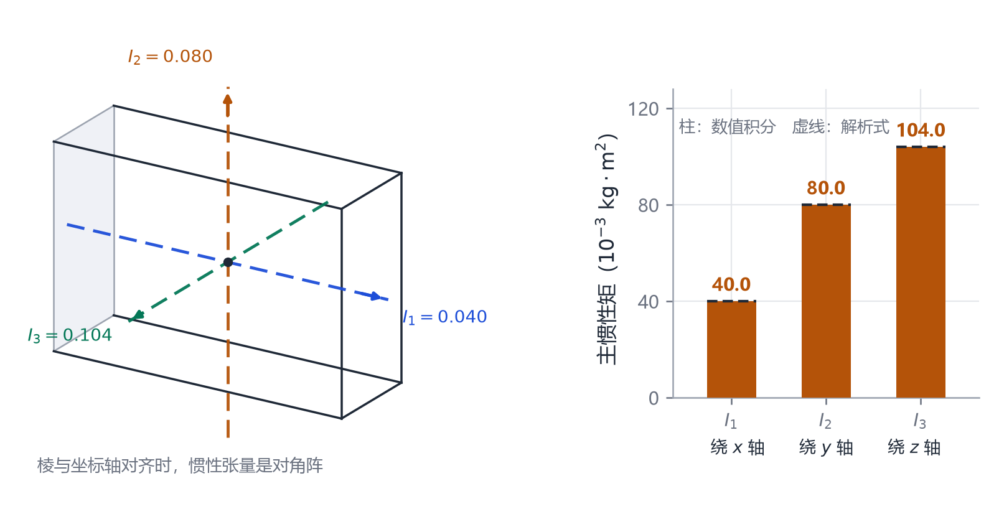
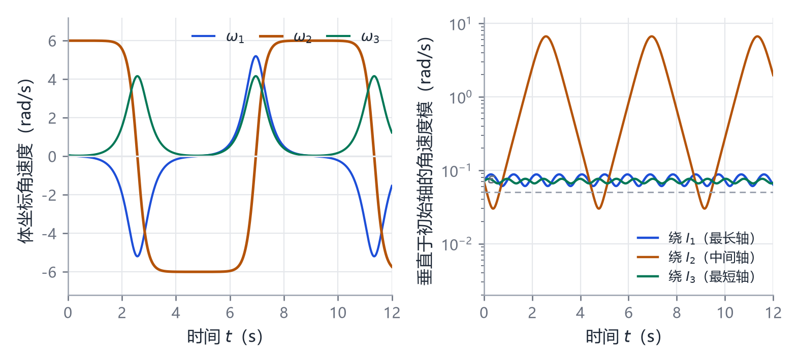

# 第 2 章 惯性张量与旋转动力学

> 本章导读：同样大的力矩作用在同一质量的两个物体上，转起来的快慢可能差很多；这个差别由一个三乘三矩阵决定。这一章讲这个矩阵怎么从质量分布积出来、为什么能对角化、换到世界坐标要付多少代价，然后把它代进欧拉方程，用数值积分把网球拍定理复现一遍，最后讨论一个选择：把角速度当状态，还是把角动量当状态。

## 2.1 推门：力矩有了，响应还差一张表

推门这个动作人人都懂。手放在门轴附近，怎么使劲都推不动；手挪到把手，一根手指就够。力矩是力乘力臂，$\boldsymbol{\tau}=\mathbf{r}\times\mathbf{F}$，$\mathbf{r}$ 是力作用点相对质心的位置。

力矩只是输入。同样的力矩作用在两个质量相同的东西上，转起来的快慢可能差好几倍：一根细长杆绕自己轴线和绕垂直轴，前者几乎不用力，后者费劲。这说明转动这件事上，“质量”这个概念不够用，得知道质量摊在什么位置。

两者之间还需要一个约定：力矩相对哪个点算。取质心，平移和转动才能拆开——质心的加速度只由合力决定，绕质心的转动只由相对质心的力矩决定，两组方程互不出现对方。换任何一个别的点做参考，公式里会多出参考点自己的加速度项，转动方程和平移方程就缠在一起了。这就是所有刚体引擎把质心当局部坐标原点、并且要求惯性张量相对质心给出的原因。

把物体切成小块，每块质量 $\mathrm{d}m$，位置 $\mathbf{x}$ 相对质心，定义

$$\mathbf{I}=\int\rho(\mathbf{x})\left(|\mathbf{x}|^2\mathbf{E}-\mathbf{x}\mathbf{x}^{\mathsf{T}}\right)\mathrm{d}V$$

$\rho$ 是密度，$\mathbf{E}$ 是三阶单位阵，$\mathbf{x}\mathbf{x}^{\mathsf{T}}$ 是一个外积矩阵。这个式子不像“质量乘距离平方”那么好懂，用一次就清楚了：任给一根单位轴 $\mathbf{n}$，双线性型

$$\mathbf{n}^{\mathsf{T}}\mathbf{I}\mathbf{n}=\int\rho\left(|\mathbf{x}|^2-(\mathbf{x}\cdot\mathbf{n})^2\right)\mathrm{d}V$$

括号里是点到轴的垂距平方，因为 $|\mathbf{x}|^2-(\mathbf{x}\cdot\mathbf{n})^2$ 正好是勾股定理减掉沿轴分量。所以 $\mathbf{n}^{\mathsf{T}}\mathbf{I}\mathbf{n}$ 就是“绕 $\mathbf{n}$ 转的转动惯量”，跟中学里的 $\sum m_i r_i^2$ 完全一样，只是换成了连续积分。矩阵 $\mathbf{I}$ 的用处是：对任意方向的轴一次算完，不必每次重新积。

写成矩阵形式还有一个来源上的理由。$\mathbf{I}$ 一定是对称的，因为 $|\mathbf{x}|^2\mathbf{E}$ 对称，$\mathbf{x}\mathbf{x}^{\mathsf{T}}$ 也对称，两项相减仍然对称。九个元素里只有六个独立，这是后面能对角化的前提。单位是千克平方米，跟质量乘长度平方同阶，记住这一点在排查问题时有用：惯性张量的数量级错了，八成是长度单位或者缩放搞混了。

一根长 $L$、质量 $m$ 的均匀细杆，绕质心垂直于杆的轴，$I=mL^2/12$；绕端点则变成 $mL^2/3$。两个数差四倍，位置只挪了半个杆长。这就是为什么“绕哪根轴”必须说清楚，也是为什么引擎里查惯性张量要按局部坐标轴给三个数，而不是给一个数。

## 2.2 主轴与主惯性矩

对称矩阵可以做特征分解。对 $\mathbf{I}$ 来说，结果是存在一组标准正交的特征向量 $\mathbf{u}_1,\mathbf{u}_2,\mathbf{u}_3$ 和实数特征值 $I_1,I_2,I_3$，使得

$$\mathbf{I}=\mathbf{Q}\begin{pmatrix}I_1&&\\&I_2&\\&&I_3\end{pmatrix}\mathbf{Q}^{\mathsf{T}}$$

$\mathbf{Q}$ 的三列就是 $\mathbf{u}_1,\mathbf{u}_2,\mathbf{u}_3$，它是一个旋转矩阵。三个特征值叫主惯性矩，三根轴叫惯性主轴。换成主轴坐标系，$\mathbf{I}$ 变成对角阵，三个数各管一根轴。

主轴的物理意义很直接：绕主轴转，角动量 $\mathbf{L}=\mathbf{I}\boldsymbol{\omega}$ 和角速度 $\boldsymbol{\omega}$ 平行。轴承上不受横向的周期性力，转子做动平衡，要做到的就是让转轴和主轴重合。反过来，绕非主轴转，$\mathbf{L}$ 和 $\boldsymbol{\omega}$ 不平行，物体每转一圈，轴承被推一下，这就是甩动感的来源。

还有一个几何图像：让 $\mathbf{n}$ 遍历单位球面，$\mathbf{n}^{\mathsf{T}}\mathbf{I}\mathbf{n}$ 的等值面是一个椭球，三个半轴方向就是主轴，长度对应主惯性矩。瘦长的物体，椭球也瘦长，绕长轴转最省力，跟挥一根长木棍的直觉对得上。

盒子的惯性张量是对角的，前提是坐标轴跟盒子的棱对齐且原点在质心。原因不是“盒子特殊”，是对称性杀项：惯性积里含有 $\int\rho\,xy\,\mathrm{d}V$ 这样的项，把 $x$ 换成 $-x$，积分区域不变、密度不变、被积函数变号，积分只能是零。长方体有三组对称面，三个惯性积全被杀掉，只剩下对角线上的三项：

$$I_x=\frac{m(b^2+c^2)}{12},\quad I_y=\frac{m(a^2+c^2)}{12},\quad I_z=\frac{m(a^2+b^2)}{12}$$

$a,b,c$ 是三条棱的全长。$I_x$ 里没有 $a$，因为绕 $x$ 轴转的时候，沿 $x$ 方向的长度不影响每个质量元到轴的距离，只由 $b$、$c$ 决定。圆柱同理，绕轴的那一项是 $mr^2/2$，另外两项相等。

对角化在资产管线里做一次就行，不进运行时。做法是解三次特征多项式 $\det(\mathbf{I}-\lambda\mathbf{E})=0$，三个实根就是主惯性矩，再回代求特征向量；或者用雅可比旋转，几轮扫描就把非对角元素压到机器精度。后者代码短、不用写求根公式，适合用在高精度预处理里。引擎存下对角的那三个数和一组从主轴到局部坐标的固定旋转，运行时只需把这三个数从体坐标换到世界坐标，不用再做特征分解。

三个主惯性矩不能随便取。物理上可实现的一组数必须满足三角不等式

$$I_1+I_2\ge I_3$$

拿积分的定义验证：设 $I_x,I_y,I_z$ 分别是绕三根坐标轴的矩，那么 $I_x+I_y-I_z=\int 2\rho z^2\,\mathrm{d}V\ge 0$。等号成立意味着所有质量都在 $z=0$ 平面上，也就是一块没有厚度的薄板。手工填了一个 $(1,1,10)$ 这样的张量，程序不会报错，物体会在自由旋转时越转越快，能量凭空长出来，因为这样的质量分布在三维里不存在。

<figure class="fig">

<figcaption><b>图 2-1</b>　长方体的三个惯性主轴（真实计算）。尺寸 $0.6\times0.4\times0.2\ \mathrm{m}$、质量 $2.4\ \mathrm{kg}$，把盒子剖成六个四面体逐个积分得到惯性张量，再对角化。左图：三根主轴与棱平行，长度按主惯性矩的比例画；右图：数值特征值与解析式 $m(b^2+c^2)/12$ 的对比，相对误差在 $10^{-15}$ 量级。</figcaption>
</figure>

## 2.3 世界坐标下的惯性张量

物体在体坐标里的惯性张量是常数，这是刚体假设给的最大好处之一。但在世界坐标里它每帧都变，因为物体每帧都在转：

$$\mathbf{I}_{\mathrm{w}}=\mathbf{R}\,\mathbf{I}_{\ell}\,\mathbf{R}^{\mathsf{T}}$$

$\mathbf{I}_{\ell}$ 是体坐标下的张量。要用它算角加速度，还需要逆：

$$\mathbf{I}_{\mathrm{w}}^{-1}=\mathbf{R}\,\mathbf{I}_{\ell}^{-1}\,\mathbf{R}^{\mathsf{T}}$$

注意逆号的位置：两边各夹一个 $\mathbf{R}$，中间是体坐标下的逆。容易写错的地方是把 $\mathbf{R}^{\mathsf{T}}$ 和 $\mathbf{R}$ 调换，转置一下看不出来，但结果是把张量转到了反方向，物体会绕着一根镜像的轴晃。

每帧求一次逆是浪费。三乘三求逆要算行列式、伴随矩阵，几十次除法；更糟的是数值上它会把 $\mathbf{R}$ 的漂移放大，算出来的“逆”可能不对称、甚至不正定。常见的做法是压根不存 $\mathbf{I}_{\mathrm{w}}$，用的时候把向量转进去、乘完再转出来：

$$\mathbf{I}_{\mathrm{w}}\boldsymbol{\omega}=\mathbf{R}\left(\mathbf{I}_{\ell}\left(\mathbf{R}^{\mathsf{T}}\boldsymbol{\omega}\right)\right)$$

代价是两次向量旋转加三次乘法，比一次矩阵乘向量还便宜，而且不会因为 $\mathbf{R}$ 的微小误差破坏正定性。体坐标下的逆 $\mathbf{I}_{\ell}^{-1}$ 在建模时算一次，永远有效。

接触求解是另一回事。每个接触点、每一轮迭代都要算有效质量，其中含一项 $\left(\left(\mathbf{I}_{\mathrm{w}}^{-1}(\mathbf{r}\times\mathbf{n})\right)\times\mathbf{r}\right)\cdot\mathbf{n}$，$\mathbf{r}$ 是接触点相对质心的位置，$\mathbf{n}$ 是法向；这里每轮都要用 $\mathbf{I}_{\mathrm{w}}^{-1}$ [@baraff1994]。这时把它显式缓存下来更划算，一笔内存换掉反复的三步转换。两种写法都在用，选择看调用频次：每帧一次的地方用三步转换，每个接触每轮都要用的地方用缓存。

如果状态里存的是四元数，连矩阵都不用先生成。四元数旋转一个向量的公式是 $\mathbf{v}'=\mathbf{v}+2w(\mathbf{q}_v\times\mathbf{v})+2\mathbf{q}_v\times(\mathbf{q}_v\times\mathbf{v})$，$\mathbf{q}_v$ 是四元数的向量部分，$w$ 是实部。把三个基向量各转一次，就得到 $\mathbf{R}$ 的三列，一共三十几次乘加，比先拼出矩阵再乘矩阵便宜。需要 $\mathbf{I}_{\mathrm{w}}^{-1}$ 时同理，转的是 $\mathbf{I}_{\ell}^{-1}$ 的三个列向量。

还有一个常被忽略的约定：形状在体坐标里不一定跟坐标轴对齐。一个盒子既是碰撞体又是渲染体时，美术可能把它转了几十度再挂到骨架上。这时张量要么在资产里已经转过，要么在运行时用形状自己的朝向再转一次。漏了这一层，物体会按一套轴算惯性、按另一套轴画出来，揽起来像被人从中间拧着。

缓存下来的 $\mathbf{I}_{\mathrm{w}}^{-1}$ 还该每帧花一次代价查它是否对称。它理论上对称正定，一旦出现不对称，说明 $\mathbf{R}$ 已经不是旋转矩阵了，问题在姿态不在张量。把这一步当断言写进去，比事后猜“为什么物体自己拐弯”便宜得多。

## 2.4 角动量与欧拉方程

线动量的对应物是角动量

$$\mathbf{L}=\mathbf{I}\boldsymbol{\omega}$$

在体坐标下写成 $\mathbf{L}_{\ell}=\mathbf{I}_{\ell}\boldsymbol{\omega}_{\ell}$，在世界坐标下写成 $\mathbf{L}_{\mathrm{w}}=\mathbf{I}_{\mathrm{w}}\boldsymbol{\omega}$。两者是同一个物理量，差的只是一个旋转：$\mathbf{L}_{\mathrm{w}}=\mathbf{R}\mathbf{L}_{\ell}$。

无力矩时，角动量在世界坐标里守恒，这是一条严格的守恒律。可物体的姿态在变，$\mathbf{I}_{\mathrm{w}}$ 跟着变，$\boldsymbol{\omega}=\mathbf{I}_{\mathrm{w}}^{-1}\mathbf{L}$ 就必须变。所以角速度不是守恒量，一根扔出去的杆会一边转一边晃，晃的幅度由张量的不对称程度决定。

把 $\dot{\mathbf{L}}_{\mathrm{w}}=\boldsymbol{\tau}_{\mathrm{w}}$ 换到体坐标，会多出一项。参考系自己在转，向量的时间导数要加一个补偿项：

$$\dot{\mathbf{L}}_{\mathrm{w}}=\mathbf{R}\left(\dot{\mathbf{L}}_{\ell}+\boldsymbol{\omega}_{\ell}\times\mathbf{L}_{\ell}\right)$$

令它等于 $\boldsymbol{\tau}_{\mathrm{w}}=\mathbf{R}\boldsymbol{\tau}_{\ell}$，两边同乘 $\mathbf{R}^{\mathsf{T}}$，再用 $\mathbf{L}_{\ell}=\mathbf{I}_{\ell}\boldsymbol{\omega}_{\ell}$，得到欧拉方程

$$\mathbf{I}_{\ell}\dot{\boldsymbol{\omega}}_{\ell}+\boldsymbol{\omega}_{\ell}\times\left(\mathbf{I}_{\ell}\boldsymbol{\omega}_{\ell}\right)=\boldsymbol{\tau}_{\ell}$$

那个叉积项就是所谓的陀螺项，它不是笔误，来源是参考系旋转。它的行为值得看一眼：只有当 $\boldsymbol{\omega}_{\ell}$ 平行于某根主轴、或者两个主惯性矩相等时，$\boldsymbol{\omega}_{\ell}\times\left(\mathbf{I}_{\ell}\boldsymbol{\omega}_{\ell}\right)$ 才等于零。其余情况下它非零，方向垂直于 $\boldsymbol{\omega}$，这一点可以验证：$\boldsymbol{\omega}\cdot(\boldsymbol{\omega}\times\mathbf{I}\boldsymbol{\omega})=0$，叉积与自己正交。

垂直于角速度的分量不做功，所以陀螺项不改变动能，也不改变转速，它只把转轴的方向掰弯。平时看不出来，一旦角速度和主轴不平行，它就默默地把物体掰到另一个姿态上。

写成能直接积分的形式：

$$\dot{\boldsymbol{\omega}}_{\ell}=\mathbf{I}_{\ell}^{-1}\left(\boldsymbol{\tau}_{\ell}-\boldsymbol{\omega}_{\ell}\times\mathbf{I}_{\ell}\boldsymbol{\omega}_{\ell}\right)$$

顺序上是先算叉积、再乘逆。$-\mathbf{I}_{\ell}^{-1}\left(\boldsymbol{\omega}_{\ell}\times\mathbf{I}_{\ell}\boldsymbol{\omega}_{\ell}\right)$ 如果错写成 $-\mathbf{I}_{\ell}^{-1}\boldsymbol{\omega}_{\ell}\times\boldsymbol{\omega}_{\ell}$，叉积自己为零，陀螺项整个消失，物体在任何姿态下都像绕主轴一样稳，这种错误在截图上看不出来，要跑长序列或者做能量检查才会暴露。

## 2.5 网球拍定理

拿一本硬皮书，绕三个方向各抛一次。绕书脊方向抛，它稳稳地转；绕封面法向抛，也稳；绕剩下那根、也就是封面内垂直于书脊的方向抛上去，它在空中翻个面，落下来接住时封面朝下。换成手机、网球拍、硬纸板，现象一样。每次抛都一样，不是手抖。

设三根主轴对应 $I_1\lt I_2\lt I_3$，现在绕中间那根轴转，角速度是 $\boldsymbol{\omega}=\Omega\,\mathbf{e}_2$ 加一点小扰动。欧拉方程的三个分量写成

$$I_1\dot{\omega}_1=(I_2-I_3)\,\omega_2\omega_3,\quad I_2\dot{\omega}_2=(I_3-I_1)\,\omega_3\omega_1,\quad I_3\dot{\omega}_3=(I_1-I_2)\,\omega_1\omega_2$$

第二式的右边是两个小量相乘，二阶小，先丢掉；$\omega_2$ 就近似等于常量 $\Omega$。把第一、第三式联立，对 $\omega_1$ 求导，得到

$$\ddot{\omega}_1=\lambda\,\omega_1,\qquad \lambda=\frac{(I_3-I_2)(I_2-I_1)}{I_1I_3}\,\Omega^2$$

$I_1\lt I_2\lt I_3$ 时分子是两个正数相乘，$\lambda$ 大于零，解是双曲函数：扰动不振荡，而是一直放大。扰动长到与 $\Omega$ 同阶，物体已经翻过去了，$\omega_2$ 从 $+\Omega$ 变成 $-\Omega$，接着往回翻。

换成绕最长那根轴转，同样的推导给出 $\ddot{\omega}_2=\lambda'\,\omega_2$，$\lambda'=\frac{(I_3-I_1)(I_1-I_2)}{I_2I_3}\Omega^2$，$I_1-I_2$ 是负的，整个系数小于零，解是正弦，扰动只在原地打转，所以稳定。绕最短那根轴同理。稳定性不取决于转得多快，只取决于转的是哪一根：两个极端稳，中间那个不稳。

三条限制值得记住。$\lambda$ 正比于 $\Omega^2$，转得越快翻得越快；时间尺度是 $1/\sqrt{\lambda}$，前面那只盒子在六弧度每秒时约莫三分之一秒，一次抛掷里够翻好几下。三个主惯性矩全部相等时 $\lambda=0$（对称陀螺），只剩进动，不翻，所以完全对称的球永远测不出这个现象。张量接近退化时 $\lambda$ 很小，比如一张薄卡片，$I_1+I_2\approx I_3$，翻转的时间尺度可能长过整个抛掷过程，看不见。

<figure class="fig">

<figcaption><b>图 2-2</b>　三种初始角速度下的自由旋转（真实积分）。惯性张量 $\mathbf{I}=\mathrm{diag}(0.04,0.08,0.104)\ \mathrm{kg\cdot m^2}$，对应上面那只长方体；无力矩，RK4 积分，步长 $10^{-4}\ \mathrm{s}$，总时长 12 s。左图：绕中间轴（$I_2$）以 $\Omega=6\ \mathrm{rad/s}$ 转起，扰动 $\varepsilon=0.05\ \mathrm{rad/s}$，$\omega_2$ 在 2.6 s、7.0 s、11.3 s 三次过零，在 $+6$ 与 $-6$ 之间来回切，翻转周期约 4.4 s；右图：垂直于初始轴的角速度模，中间轴那条从 0.05 涨到 6.7 rad/s 再落回，最长与最短轴两条始终在 0.08 附近振荡，纵轴取对数。</figcaption>
</figure>

复现它只需要直接积分欧拉方程，不需要任何碰撞。初值取 $\boldsymbol{\omega}=(\varepsilon,\Omega,\varepsilon)$，$\varepsilon$ 取 $\Omega$ 的百分之一，积分十几秒就能看到两次翻转。这件事让网球拍定理成为一个很好用的回归测试：它同时受制于三处实现，陀螺项漏了永远不翻，积分格式耗散太大翻两下就停，惯性张量转到世界坐标时转反了则翻转轴会变成另一个。拿球体做测试则什么也测不出来。

从外面看，翻转不像“忽然转了个身”，而像转轴自己在跑：$\mathbf{L}$ 在世界坐标里不动，$\boldsymbol{\omega}$ 在体坐标里沿一条闭合曲线跑，中间轴附近那条曲线卡在分界线上，稍一扰动就被推到另一边去。慢镜头里看得见的是，物体翻面之后会抢着把长轴摆到角动量那一侧，然后再稳下来。这一点隔着屏幕看不出来，只有把 $\boldsymbol{\omega}$ 的三个分量打出来才清楚。

## 2.6 积分角速度还是积分角动量

有了欧拉方程，下一步是把什么当状态。两种写法都成立，它们的守恒性质不同。

第一种把 $\boldsymbol{\omega}$ 当状态，每步积分

$$\dot{\boldsymbol{\omega}}_{\ell}=\mathbf{I}_{\ell}^{-1}\left(\boldsymbol{\tau}_{\ell}-\boldsymbol{\omega}_{\ell}\times\mathbf{I}_{\ell}\boldsymbol{\omega}_{\ell}\right)$$

姿态另外用 $\boldsymbol{\omega}$ 推进。第二种把角动量当状态，在世界坐标里积分 $\dot{\mathbf{L}}_{\mathrm{w}}=\boldsymbol{\tau}_{\mathrm{w}}$，然后反解

$$\boldsymbol{\omega}=\mathbf{I}_{\mathrm{w}}^{-1}\mathbf{L}_{\mathrm{w}}=\mathbf{R}\,\mathbf{I}_{\ell}^{-1}\mathbf{R}^{\mathsf{T}}\mathbf{L}_{\mathrm{w}}$$

第二种的好处写在面上：无力矩时 $\mathbf{L}_{\mathrm{w}}$ 是常量，一步都不用积分，角动量一分不差。第一种的角动量是算出来的，$\mathbf{I}_{\mathrm{w}}\boldsymbol{\omega}$ 每步重算一次，偏差一直累。

能量恰好反过来。第二种里 $E=\frac{1}{2}\mathbf{L}^{\mathsf{T}}\mathbf{I}_{\mathrm{w}}^{-1}\mathbf{L}$，而 $\mathbf{I}_{\mathrm{w}}$ 由姿态算出，姿态是积分的，所以能量会漂。第一种用显式 Euler 时能量单调上涨，每步增量可以直接算出来：令 $\mathbf{f}=-\mathbf{I}^{-1}(\boldsymbol{\omega}\times\mathbf{I}\boldsymbol{\omega})$，一步之后能量变化是 $\Delta t\,\boldsymbol{\omega}^{\mathsf{T}}\mathbf{I}\mathbf{f}+\frac{\Delta t^2}{2}\mathbf{f}^{\mathsf{T}}\mathbf{I}\mathbf{f}$，第一项为零（叉积垂直于 $\boldsymbol{\omega}$，点乘消掉），第二项是二次型，恒不小于零。这种漂移方向单一，所以累计得很快；跑久一点，物体会越转越快。

两条守恒律都在，才是真实的无力矩运动。能量守恒把 $\boldsymbol{\omega}$ 限制在一个椭球面上，角动量守恒又把它限制在另一个椭球面上，两个面相交是一条闭合曲线，真实的 $\boldsymbol{\omega}$ 沿这条曲线跑。数值格式只严格保住其中一条，另一条慢慢漂，姿态就会缓缓离开那条曲线。这是自由旋转长期模拟难做的根源，不是精度不够，是约束少了一条。

工程上选哪个，看调用方式。接触冲量天然改的是速度，把力臂叉乘冲量 $\mathbf{r}\times\mathbf{J}$ 再乘惯性逆就是角速度增量，用第一种写法一步到位。用第二种时得先把它变成角动量增量 $\Delta\mathbf{L}=\mathbf{r}\times\mathbf{J}$，再反解一次 $\boldsymbol{\omega}$，多一次乘法，不贵，但每帧每个接触都要多这一下。

引擎级的选择还有另一层。把广义速度或者广义动量当状态、用质量矩阵组织约束求解的那类引擎，动量与速度之间隔着一个矩阵，所以它们本来就要反复在两套坐标里换 [@todorov2012]。这影响的是约束层的写法，跟积分器是不是辛的不是同一件事，两层不要混在一起谈。

实际建议很简单：用第一种，体坐标，陀螺项写对，阶数至少二阶。角速度很大时改用指数映射，一步到位不靠子步硬碰。最后把能量和 $|\mathbf{L}|$ 两条曲线都打出来跑一段，它们都不应该单调爬升。

阶数不够时有一个便宜的补丁：半步中点法。用步初的 $\boldsymbol{\omega}$ 算一次导数，走到半步，用半步处的状态再算一次导数，用这个值走完整步。代价是每步两次叉积，换来的是对陀螺项的二阶精度，而且不增加状态。它不能把能量漂移降为零，但能把漂移速度降下一大截，在六十分之一秒的步长下足够用。

## 2.7 惯性张量的工程细节

张量从碰撞形状算，不要从视觉网格算。两者常常不一致：视觉模型上有铆钉、倒角、凹槽，碰撞体往往是一个简化过的盒子或者凸包。用视觉网格算出的张量套在简化碰撞体上，物体会以另一个东西的惯性转，撞起来的手感跟看到的体积对不上。

多个凸块拼成的形状，用平行轴定理叠：

$$\mathbf{I}=\sum_i\left(\mathbf{I}_i+m_i\left(|\mathbf{d}_i|^2\mathbf{E}-\mathbf{d}_i\mathbf{d}_i^{\mathsf{T}}\right)\right)$$

$\mathbf{d}_i$ 是第 $i$ 块质心相对整体质心的位移。减号不能写成加号：把质量从质心挪开，绕质心的转动惯量只会变大，而 $|\mathbf{d}|^2\mathbf{E}-\mathbf{d}\mathbf{d}^{\mathsf{T}}$ 这个算子沿位移方向给零、垂直方向给 $|\mathbf{d}|^2$，正好对。

退化要处理。细杆、薄板、被当成质点的粒子，它们的张量有两个甚至三个特征值接近零，逆不存在。引擎不能报错退出，只能把最小特征值钳到一个下限，比如质量乘 $10^{-6}$ 平方米。钳得太宽松，薄板会表现出本不该有的扭转惯性，翻面时像一块厚木头；钳得太紧，逆的元素被放大到千万量级，一帧就飞出去，下一帧收到 NaN。

填完张量要验三条：三个特征值为正，三角不等式成立，量级与质量乘尺寸平方一致。这三条能捕获绝大多数手写参数的错误，比如把直径当半径填、把厘米当米填、把转动惯量当成惯性积填到非对角线上。拿有解析解的形状当回归用例最省事：半径半米、十千克的实心球绕直径是 $\frac{2}{5}mr^2=1\ \mathrm{kg\cdot m^2}$，同尺寸的空心球是 $\frac{2}{3}mr^2\approx1.67\ \mathrm{kg\cdot m^2}$，两项都对，而且都是三个方向相等，所以它们怎么抛都不翻。

缩放是另一个坑。均匀放大 $s$ 倍，质量乘 $s^3$，惯性张量乘 $s^5$，因为张量的量纲是质量乘长度平方。非均匀缩放不能按元素乘，必须拿缩放后的几何重新积分，否则算出来的张量可以违反三角不等式，物体自由旋转时会自己加速。缩放也是关卡调优里最常见的一类改动，把障碍物改小以腾出摆放空间、把石头改大以堵住路口，这些操作都会连带质量属性，忘了同步就会出现“看着轻的东西推开人一大截”。
