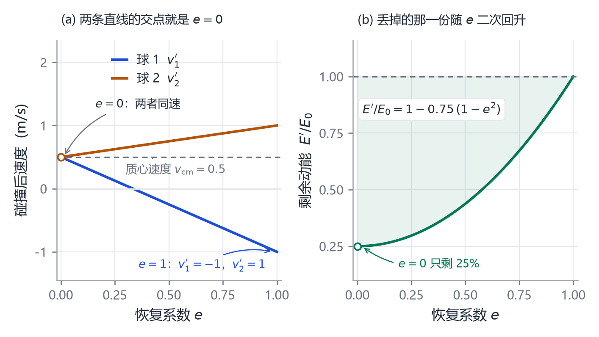
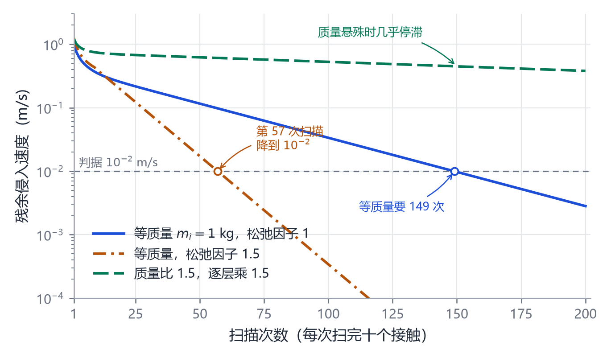

# 第 3 章 从牛顿到冲量

一颗台球以 2 m/s 斜着撞上库边，弹回来时速度只剩七成，方向偏了十几度，球还多了一点侧旋。高速摄影里这一下接触持续不到一毫秒，接触斑只有几平方毫米。要在程序里复现它，第一个问题是：这不到一毫秒里，力是怎么变的？

你测不出来。力在接触开始时从零涨到峰值，再落回零，形状大概是半个正弦或一段抛物线，峰值出现在中间某个说不清的时刻。但这条看不见的曲线有一个可测的性质：它下面的面积。面积等于球的动量变化，这件事与曲线形状无关。工程上把这个面积叫作冲量，记作 $\mathbf{J}=\int \mathbf{F}\,dt$。既然形状测不到、面积又必须对，那么引擎里干脆不写力，只写面积。

冲量（impulse）的单位是 N·s，也可以写成 kg·m/s，和动量完全同一个单位。这不是巧合：冲量就是动量的转账凭证，谁收下多少，谁的动量就变多少。引擎里存的是速度，所以碰撞真正做的事，是往两个物体的速度上各加减一笔。

这个思路把碰撞从一个连续过程变成一次跳变，代价是放弃了接触期间的所有细节。本章要说明这个交换划算在哪里、代价具体落在哪几处，以及当一个场景里有几十个接触同时发生时，这些跳变该怎么排队。

## 3.1 一次碰撞里真正的可观测量

把台球换成两枚硬币，玩法更清楚：一枚滑过去撞上静止的一枚，两枚都动，静止的那枚动得更快。用牛顿定律去解释，你需要知道接触力随时间的变化，然后对每枚硬币积分 $m\dot{\mathbf{v}}=\mathbf{F}$。问题在于 $F$ 的量级。台球质量 0.17 kg，接触 0.5 ms 内速度改变约 1 m/s，平均力就是 $0.17\times1.0/0.0005\approx340$ N；峰值大概是平均值的两三倍，接近一千牛。一千牛压在几平方毫米上，接触区的材料已经进入非线性，应力-应变关系不再是常数。想从材料参数算出这条曲线，等于做一个接触力学问题，代价远高于模拟本身。

绕过它的办法是承认自己只关心两端。碰撞前速度 $\mathbf{u}$，碰撞后速度 $\mathbf{v}$，中间发生了什么不重要，只要动量守恒、能量不增加。动量守恒给出一个方程：两物体受到的冲量大小相等、方向相反。剩一个自由度没定，这就是恢复系数要填的坑。

一维情形数一下未知量：碰后两个速度，两个未知数，一个方程。如果把能量守恒也写进来凑成第二个方程，会得到两个根：一个是两个速度各自不变（等于什么都没发生），另一个才是真正的反弹。要挑出后者，还得额外知道两球的相对速度变了多少，或者说这次碰撞损失了多少能量。恢复系数补的正是这个位置，它把“损失多少”当成参数交给使用者，而 $e=1$ 恰好是能量守恒那一支。所以碰撞模型不是从两条守恒律推出来的，它是守恒律加一个人为参数。

把冲量的量级记一下很有用。一颗台球撞库边约 0.3 N·s；一个 0.5 kg 的箱子从一米高落下，落到木地板上的冲量约 2.6 N·s；一辆 1.5 吨的车以 50 km/h 撞墙，冲量在两万 N·s 量级。引擎里的接触冲量大多落在 0.01 到 100 N·s 之间，跨越四个数量级。这个范围直接决定了容差该怎么取，也解释了为什么不能用一个固定的绝对阈值去判断“冲量是不是零”。

冲量法还有一个隐含前提：接触期间物体位置不变。所以接触点、法向、从质心到接触点的向量，全都取碰撞前的值。这个前提在慢速下无害，在快速下会出错。一个以 2 m/s 运动的球，一帧 16.7 ms 走 3.3 cm，而它的半径只有 2.8 cm。碰撞实际发生在这一帧中间的某个时刻，你用的却是帧首或帧尾的几何。误差是厘米级的，视觉上常常看不出来，但在堆叠里会一层层放大，第 7 章要专门处理。

**容易误解的地方。** 冲量不是碰撞专用。推购物车走三秒，平均用力 50 N，总冲量 150 N·s，同样可以直接加到速度上，误差只来自摩擦和转向。碰撞之所以要单独处理，不是因为它的物理不一样，而是因为这 150 N·s 摊在三秒里，积分器每帧都能看见一点；碰撞的那 3 N·s 落在 0.5 毫秒内，一帧只施力一次，积分器整个看不见。也就是说，冲量法管的是“作用时间远短于一帧”的所有事：撞击、爆炸的推力脉冲、瞬间点火的火箭、被子弹打中的西瓜。时间尺度不同，公式是同一个。

与此相对的另一条路线是罚函数：把接触写成一个很硬的弹簧加阻尼，力正比于穿透深度 $\delta$，$\mathbf{F}=-k\delta\mathbf{n}-c\mathbf{v}_n$。它不需要时间上的跳变，天生能处理持续挤压，代码只有三行。问题在刚度：要让 5 cm 的穿透产生足够大的力，$k$ 得取到 $10^6$ 以上，而显式积分要求 $\Delta t \lt 2/\omega=2\sqrt{m/k}$，$m=0.2$ kg、$k=10^6$ 时上界约 0.9 ms，比一帧小十几倍。这就是罚函数那条路的全部困难：不是公式不对，是步长付不起。

## 3.2 半隐式积分能走多远

先看半隐式积分在碰撞面前能做到什么。它的更新是两步：先用当前加速度改速度，再用新速度改位置，

$$\mathbf{v}_{n+1}=\mathbf{v}_n+\mathbf{a}\Delta t,\qquad \mathbf{x}_{n+1}=\mathbf{x}_n+\mathbf{v}_{n+1}\Delta t .$$

这个顺序让它在弹簧上无条件比显式 Euler 稳，因为位置更新用的是已经"踩过刹车"的速度。但它一帧只施力一次，而碰撞的全部内容都发生在一帧之内。

拿一个 0.2 kg 的方块以 8 m/s 撞 5 cm 厚的墙做例子。一帧的位移是 13.3 cm，方块会整个穿过墙，下一帧出现在墙的另一侧。半隐式积分对此毫无办法：它不知道墙存在，它只知道自己被重力拉了一下。要在这一帧里把方块停下来，积分器必须在这 13.3 cm 内被调用几十次，而它一帧只有一次机会。

于是有两条出路。一条是把一帧切碎，用子步或连续碰撞检测把碰撞时刻找出来，这是第 9 章的内容。另一条是接受"一帧之内速度跳变"这件事，直接算出跳变的大小。冲量法走的是后一条：解出 $\mathbf{J}$，然后

$$\mathbf{v}\leftarrow\mathbf{v}+\frac{\mathbf{J}}{m},\qquad \boldsymbol{\omega}\leftarrow\boldsymbol{\omega}+\mathbf{I}^{-1}(\mathbf{r}\times\mathbf{J}).$$

**这一步在代码里长什么样。** 施加一次接触冲量，实际只有四行：给物体 A 的速度减去 $\mathbf{J}/m_A$，角速度减去 $\mathbf{I}_A^{-1}(\mathbf{r}_A\times\mathbf{J})$；给物体 B 加同样的两份，符号相反。没有循环，没有 $\Delta t$，也不碰位置。整个顺序冲量求解器就是把这四行放进一个循环，跑八到十二遍。

注意这里没有 $\Delta t$。冲量法的更新与步长无关，它改的是速度，不改位置，所以不会让物体穿得更深。代价是位置层面的错误被完全留给了后续处理：如果几何已经重叠了 3 cm，冲量只负责让它们不再继续靠近，重叠本身要靠位置修正或下一帧的几何慢慢消掉。

这也解释了为什么冲量法在游戏引擎里赢了：它把"碰撞"从一个必须在正确时刻求解的微分方程，变成一个可以在帧末一次性求解的代数问题。代数问题可以迭代、可以截断、可以在预算用完时停手，而微分方程不行。

还有一个次要但很实际的好处：冲量与步长无关。同一个碰撞在 30 帧和 144 帧的环境里解出同一个 $\mathbf{J}$，只有位置更新不同。用弹簧模拟接触则相反，刚度、步长、阻尼三者的组合会随帧率变化，同一个场景换个帧率行为就变了。对需要联网同步或录制回放的项目，这种漂移比精度损失更难受。

**一个反例。** 有人试过这样绕过问题：照常用半隐式积分，帧末发现穿透了，就把物体直接推到表面上，速度清零。看起来干净，但物体被推上去的那段距离是凭空多出来的位移。一个箱子从 1 m 落下，落在一个正在下沉的平台上，每帧被推回 3 cm，十帧就是 30 cm——箱子凭空爬了三十厘米，能量不是从物理来的，是从修正里来的。所以位置修正必须和速度修正分开做，不能让修正反过来改速度，这件事第 7 章还要回来处理。

## 3.3 恢复系数与有效质量

一维情形可以把整件事算干净。两个球沿同一条线运动，质量 $m_1$、$m_2$，碰前速度 $u_1$、$u_2$，且 $u_1\gt u_2$。取法向 $\mathbf{n}$ 由球 1 指向球 2，相对接近速度是 $u=(u_2-u_1)$，碰前为负。

恢复系数定义为反弹速度与接近速度之比取负：

$$e=-\frac{u'}{u},\qquad u'=(v_2-v_1).$$

$e=0$ 表示碰后两球同速，完全非弹性；$e=1$ 表示相对速度大小不变、方向反转，完全弹性。真实材料的 $e$ 在两者之间：钢球对钢球约 0.95，木球对木球约 0.5，湿黏土接近 0。测量它的标准做法是把球从高度 $h$ 自由落下，量反弹高度 $h'$，取 $e=\sqrt{h'/h}$：落到底部时 $v=\sqrt{2gh}$，反弹时 $v'=\sqrt{2gh'}$，两者相除就是定义。这个测法把空气阻力和材料内耗一起包了进去，所以它给出的不是纯材料常数；换个地面、换个球径，数字都会变。

动量守恒说两球受到的冲量等大反向。$\mathbf{n}$ 由球 1 指向球 2，取 $J$ 为球 2 收到的那一份冲量大小，则球 1 收到 $-J\mathbf{n}$，两个速度更新成

$$v_1=u_1-\frac{J}{m_1},\qquad v_2=u_2+\frac{J}{m_2}.$$

$J$ 的单位是 N·s，取正值表示两球在互相推开。这两个式子只用了一件事：动量守恒——一笔冲量从球 1 转到球 2，总量不变。

两式相减，得到相对速度的变化：

$$u'=u+J\left(\frac{1}{m_1}+\frac{1}{m_2}\right)=u+Jk .$$

这里的 $k=1/m_1+1/m_2$ 值得单独命名。它不是质量，量纲是质量的倒数，含义是“单位冲量能让相对速度改变多少”。两根弹簧串联时柔度相加，这里也是：物体越轻，$k$ 越大，同样的冲量把两者推开得越快。也就是说，$k$ 描述的是这对物体在“靠近与分开”这个方向上的软硬。往 1 kg 与 3 kg 这对球之间塞进 1 N·s，它们的相对速度只挪 1.33 m/s；换成 1 kg 的球撞墙，同样的 1 N·s 能挪 3 m/s，硬得多。

它的倒数 $m_{\mathrm{eff}}=m_1m_2/(m_1+m_2)$ 是约化质量（reduced mass），也叫有效质量。一堵无限重的墙对应 $k=1/m_1$，$m_{\mathrm{eff}}=m_1$。

**有效质量到底有多重。** 碰撞里其实有两个自由度。质心一直在匀速走，谁也拦不住；真正在变的是两者的相对速度。$m_1+m_2$ 是质心那个自由度的惯性，$m_{\mathrm{eff}}$ 是相对运动那个自由度的惯性。两个自由度，两套惯性。也就是说，$m_{\mathrm{eff}}$ 回答的是“在互相接近这件事上，这对物体有多重”。

它被两个极端夹住。$m_2\to\infty$ 时 $m_{\mathrm{eff}}\to m_1$：球撞墙、箱子落地、钉子被锤子砸，都属于这一支，另一个物体太沉，整场碰撞在相对运动上等同于撞一堵钉死的墙，墙的质量根本不进公式。$m_1=m_2=m$ 时 $m_{\mathrm{eff}}=m/2$，两个一样的球对撞，冲量只有撞墙时的一半，因为两边都在让。

这个量解释了一个反直觉的现象。锤头 0.5 kg，钉子 5 g，$m_{\mathrm{eff}}\approx0.005$ kg。把锤头换成 1 kg，$m_{\mathrm{eff}}$ 只从 0.00495 涨到 0.004975，冲量涨了不到百分之一。敲钉子靠的是速度而不是锤头的重量；大锤的用处是往桩子那种质量相当的物体里灌动量，那里 $m_{\mathrm{eff}}$ 才接近锤头自己的质量。

把 $e$ 的定义代进去，$-eu=u+Jk$，解出

$$J=-(1+e)\frac{u}{k}=-(1+e)\,u\,m_{\mathrm{eff}} .$$

逐个符号看：$u$ 是碰前的相对速度，接近时为负；$e$ 是恢复系数；$k$ 是刚才那个柔度，$m_{\mathrm{eff}}$ 是它的倒数。最前面的负号只是把方向摆正——接近速度是负的，冲量应该是正的。$(1+e)$ 可以读作“反弹放大率”：$e=0$ 时它是 1，冲量刚好把接近速度抹平；$e=1$ 时它是 2，冲量翻倍，接近速度被抹平再反向还回去。

代入 $m_1=1$ kg、$m_2=3$ kg、$u_1=2$ m/s、$u_2=0$：$k=4/3$，$u=-2$ m/s。$e=0$ 时 $J=1.5$ N·s，$v_1=v_2=0.5$ m/s，正好是质心速度；$e=1$ 时 $J=3.0$ N·s，$v_1=-1$、$v_2=1$ m/s，相对速度大小不变。

**把 $e=0.6$ 完整走一遍。** 两个端点好算，中间的值才是引擎每天在算的。取 $e=0.6$，这是硬塑料球落在木地板上的量级。

第 1 步，接近速度。$u=u_2-u_1=0-2=-2$ m/s。负号只说明两球在靠近，接近速度的大小是 2 m/s。

第 2 步，柔度。$k=1/1+1/3=1.333$ kg$^{-1}$。

第 3 步，冲量。$J=-(1+0.6)\times(-2)/1.333=3.2/1.333=2.4$ N·s。这个数落在 $e=0$ 的 1.5 和 $e=1$ 的 3.0 之间，位置由 $(1+e)$ 线性决定。

第 4 步，碰后速度。$v_1=2-2.4/1=-0.4$ m/s，$v_2=0+2.4/3=0.8$ m/s。小球被弹回去了，但只剩 0.4；大球带着 0.8 往前走。

第 5 步，验算动量。碰前 $1\times2+3\times0=2.0$ kg·m/s，碰后 $1\times(-0.4)+3\times0.8=2.0$ kg·m/s。一分不差。

第 6 步，验算恢复系数。碰后相对速度 $u'=0.8-(-0.4)=1.2$ m/s，取负除以碰前的 $-2$，得 $0.6$，与给定值一致。

第 7 步，算能量。碰前 $\frac12\times1\times2^2=2.0$ J；碰后 $\frac12\times1\times0.4^2+\frac12\times3\times0.8^2=0.08+0.96=1.04$ J。损失 0.96 J。用公式验：$\frac12m_{\mathrm{eff}}(1-e^2)u^2=\frac12\times0.75\times(1-0.36)\times4=0.96$ J，对得上。

顺手看一眼质心。碰前 $(1\times2+3\times0)/4=0.5$ m/s，碰后 $(1\times(-0.4)+3\times0.8)/4=0.5$ m/s。整个过程质心一动不动。碰撞改不了质心，它只改相对运动——这一条值得记住，因为无论碰撞模型怎么设计，整体平移那部分都不受影响。

七步算完，代码里就是七八次乘除。没有循环，没有时间步，也没有“接触持续了多久”这个量。

<figure class="fig">

<figcaption><b>图 3-1</b>　两球一维碰撞，$m_1=1$ kg、$m_2=3$ kg、$u_1=2$ m/s、$u_2=0$，按 $J=-(1+e)u/k$ 逐点计算。左图是碰后速度，两条直线在 $e=0$ 处交于质心速度 0.5 m/s；右图是剩余动能占碰前动能的比例，$e=0$ 时只剩四分之一，剩余部分 $1-0.75(1-e^2)$ 随 $e$ 二次上升。</figcaption>
</figure>

右图那条曲线值得停一下。损失的动能是 $\frac{1}{2}m_{\mathrm{eff}}(1-e^2)u^2$，与总动能之比只取决于质量比和 $e$。这里质量比 1:3 给出 $0.75$ 这个系数，意味着即使完全弹性也只有 75% 的动能在"两球相对运动"这个自由度里，剩下 25% 从一开始就锁在质心运动里，$e=0$ 时连这 75% 也全部损失掉。所以软材料不是"弹得低一点"，而是每撞一次就把相对运动的那份能量清空一次。

**容易误解的地方。** 有人以为 $e$ 能从杨氏模量或硬度推出来。不能。$e$ 里包着撞击速度、接触面积、材料内耗，甚至气垫层的形状：同一个钢球砸钢板，速度从 0.1 m/s 到 10 m/s，$e$ 能从 0.98 掉到 0.7。所以引擎里的 $e$ 永远是拟合参数，从实验表里查，或者从美术要的“手感”倒推。想清楚这一点，就不会花时间去“物理正确地”算它。

实践里 $e$ 还有两个额外的限制。第一，它是材质对的属性，不是单个物体的属性，两种材料各存一个数然后相乘或取平均，都是粗糙但常用的近似。第二，$e$ 与撞击速度有关：同一个橡皮球从 10 cm 落下弹得比从 2 m 落下更高（按比例算），因为低速时材料来得及完全回弹。引擎不会模拟这种依赖，通常给一个 $e$ 上限（0.2 到 0.4 很常见），再设一个速度阈值，当 $|u|$ 小于阈值（1 m/s 左右）时强制 $e=0$。后一条尤其重要：没有它，一个球会在地面上永远做幅度越来越小、次数越来越多的弹跳，而每一帧的穿透和位置修正还会给它注入新的能量。

## 3.4 冲量偏离质心之后

球撞在正中间时，上面那套就够了。真实物体很少这么客气：箱子落地的角先着地，球棒打偏了半寸，手指推门推在门轴附近。冲量作用在质心之外，它同时改变两件事。

相对于质心，冲量产生的角冲量是 $\mathbf{r}\times\mathbf{J}$，其中 $\mathbf{r}$ 从质心指向接触点。角动量的变化等于角冲量，于是

$$\Delta\boldsymbol{\omega}=\mathbf{I}^{-1}(\mathbf{r}\times\mathbf{J}),\qquad \Delta\mathbf{v}=\frac{\mathbf{J}}{m}.$$

接触点的速度是质心速度加上转动带来的那一份：$\mathbf{v}_p=\mathbf{v}+\boldsymbol{\omega}\times\mathbf{r}$。碰撞要满足的条件写在接触点上，不在质心上，所以要把这两个式子合起来，算出"施加单位冲量会让接触点沿法向的速度改变多少"。这个量就是偏心情形下的 $k$：

$$k=\frac{1}{m_1}+\frac{1}{m_2}+\mathbf{n}\cdot\left[\left(\mathbf{I}_1^{-1}(\mathbf{r}_1\times\mathbf{n})\right)\times\mathbf{r}_1\right]+\mathbf{n}\cdot\left[\left(\mathbf{I}_2^{-1}(\mathbf{r}_2\times\mathbf{n})\right)\times\mathbf{r}_2\right].$$

二维时括号里的量可以写成 $(r_t)^2/I$，$r_t$ 是 $\mathbf{r}$ 在切向（垂直于 $\mathbf{n}$）的投影长度。$\mathbf{r}$ 沿法向的那部分投影不产生任何转动效果——沿 $\mathbf{n}$ 推一个点，力臂与 $\mathbf{n}$ 平行，叉乘为零——只有切向投影才有力臂。

**力矩图景。** 叉乘只认互相垂直的那部分。把 $\mathbf{r}$ 拆成沿法向的 $r_n$ 和切向的 $r_t$，$\mathbf{r}\times(J\mathbf{n})$ 里 $r_n\mathbf{n}\times\mathbf{n}$ 直接消失，只剩 $r_tJ$。也就是说，把冲量的作用点沿着它自己的方向平移，力矩一点不变；真正算作力臂的，只有横向那个偏移量。

一扇门是最好的例子。门轴在左边，把手在右边 0.8 m 处，垂直门面推 50 N，力矩 40 N·m，门轻松转开。同样的 50 N 推在离轴 0.05 m 的地方，力矩只剩 2.5 N·m，门几乎不动——外形、重量、转动惯量都没变，变的只有 $r_t$。把手装在门边不是审美选择，是把力臂买大。反过来，贴着门板朝门轴方向使劲，$\mathbf{J}$ 与 $\mathbf{r}$ 平行，叉乘为零，推多重门都不转。

三维里必须按矩阵乘法老实算：$(\mathbf{I}^{-1}(\mathbf{r}\times\mathbf{n}))\times\mathbf{r}$ 一般不与 $\mathbf{n}$ 同向，内积出来的标量依赖于惯性张量的完整形式，不能简化成 $(r_t)^2/I$。那个简化式只在“所有转动都绕同一根轴"的二维情形下成立。代码里把二维公式直接搬到三维，物体看起来能动，但转角总是偏小或偏大，原因就在这里。还有一件事只在三维出现：$\Delta\boldsymbol{\omega}=\mathbf{I}^{-1}(\mathbf{r}\times\mathbf{J})$ 里的 $\mathbf{I}^{-1}$ 会把角冲量弯折，转轴一般不与力矩同向。斜着敲一根长杆，它不会绕“看起来该转的那根轴”转，而是绕一根既不在杆方向、也不在敲击方向的轴转，一边转一边向外甩。

取一个 0.5 kg、边长 0.2 m 的方块，绕质心的转动惯量 $I=m(a^2+a^2)/12=0.0033$ kg·m²。撞在顶角，$\mathbf{r}=(0.1,0.1)$，法向竖直，$r_t=0.1$ m，于是转动项是 $0.01/0.0033\approx3.0$，而平动项只有 $1/0.5=2.0$。$k$ 从 2.0 变成 5.0，同样 1 m/s 的接近速度，法向冲量只有"撞在质心高度"时的 40%。这个结果和直觉一致：撞在角上，物体转起来了，动量传进去的效率就低。反过来，同样的推挤如果作用在质心高度，几乎所有冲量都变成平动。

把 1 N·s 真加进去看一步，就知道这 5.0 是怎么来的。平动部分 $\Delta\mathbf{v}=\mathbf{J}/m=2.0$ m/s，全在竖直方向。转动部分 $\mathbf{r}\times\mathbf{J}=0.1\times1-0.1\times0=0.1$，$\Delta\omega=0.1/0.0033\approx30$ rad/s。接触点的速度变化是两者叠加，$\Delta\mathbf{v}_p=\Delta\mathbf{v}+\Delta\omega\,\hat{\mathbf{z}}\times\mathbf{r}$，而 $\hat{\mathbf{z}}\times(0.1,0.1)=(-0.1,0.1)$，乘 30 得 $(-3.0,3.0)$ m/s。竖直分量 $2.0+3.0=5.0$ m/s，正好是 $k$。

分一下这笔账：接触点竖直方向上每 1 N·s 换来 5 m/s 的响应，其中 2 来自平动，3 来自转动，六成的响应是转出来的。转出来的那份是“虚”的——箱子一转，接触点就从地面上跑开，所以要让这个点停下来，需要的冲量反而小。撞得轻和转得狠，是同一件事的两面。

30 rad/s 是每秒将近五圈。这是 1 N·s 的结果，而一个 0.5 kg 的盒子从一米高落下，落地速度 4.4 m/s，取 $e=0.2$、地面看作无限重，冲量 $J=(1+0.2)\times4.4\times0.5=2.6$ N·s，是这里的两倍半。

这就是手机摔在硬地上会翻着弹起来的全部原因。角先着地，一次冲量带出几十弧度每秒的转动，转动把另一个角甩到地上，再撞一次，能量在几个角之间来回倒，最后才躺平。整面拍下来时四个角同时受力，各自的转动互相抵消，合起来没有净转动，只有一声闷响。同一部手机，两种声音，差别全在 $r_t$。

这里只写了法向。真实碰撞还会产生切向冲量（摩擦），它同样经过 $\mathbf{r}$ 产生转动，而且转动会改变接触点的切向速度，于是切向的有效质量也要把转动项加进去，形式与上式完全平行，只是把 $\mathbf{n}$ 换成切向 $\mathbf{t}$。两个方向并不独立：法向冲量改变转动，转动改变切向速度，切向冲量又反过来影响转动。摩擦把一维的标量方程变成一个二维的耦合问题，第 6 章再处理它。

力臂效应还有一个更精细的用法。棒球棒的"甜点"不是重心，而是握把处速度变化为零的位置：冲量在那里产生的平动 $\mathbf{J}/m$ 与转动 $\boldsymbol{\omega}\times\mathbf{r}_{\text{grip}}$ 恰好抵消。手不震，不是因为力小，而是因为两个分量在这个特定位置上互相抵消。也就是说，甜点由两个距离共同决定：击球点到质心的距离，与握点到质心的距离。换个握把位置，甜点跟着跑——这就是球棒要按人身高定做、而不能统一规格的原因。这条推理在引擎里也有对应：判断一次碰撞"打得实不实"，看的不是冲量大小，而是接触点速度被消除得干不干净。

## 3.5 一个接触一个接触地解

上面所有推导都假设只有一个接触。场景里从来不是这样：一摞箱子落地，每两层之间都有一个接触，最底层还有一个对地面的接触。十个接触就有十个未知冲量，而它们是耦合的——把第 3 个接触推开，第 4 个接触的接近速度就变了。

写成矩阵形式会更清楚。把所有接触的法向相对速度排成向量 $\mathbf{u}$，它等于 $\mathbf{J}\mathbf{v}$，$\mathbf{J}$ 是接触雅可比：每一行对应一个接触，把物体速度映射成该接触点的法向相对速度。施加冲量后速度变了，新的相对速度是

$$\mathbf{u}'=\mathbf{u}+\mathbf{A}\boldsymbol{\lambda},\qquad \mathbf{A}=\mathbf{J}\mathbf{M}^{-1}\mathbf{J}^{\top},$$

其中 $\mathbf{M}$ 是所有物体的质量与惯性张量拼成的对角块，$\boldsymbol{\lambda}$ 是各接触的冲量。$\mathbf{A}$ 的对角元就是第 3.3、3.4 节里的 $k$，非对角元描述"接触 $i$ 的冲量如何改变接触 $j$ 的相对速度"。要求解的是 $\mathbf{u}'=0$（完全非弹性）加上 $\lambda_i\ge0$（接触只能推不能拉）。

顺序冲量的做法是拒绝一次解完。它一个接触一个接触地处理：对第 $i$ 个接触，算出当前的相对法向速度，更新累积冲量

$$\lambda_i\leftarrow\max\left(0,\ \lambda_i-\frac{u_i}{A_{ii}}\right),$$

然后把增量 $\lambda_i^{\text{new}}-\lambda_i^{\text{old}}$ 真正施加到两个物体的速度上，继续下一个。$\max(0,\cdot)$ 那一步是物理约束：接触不能吸住物体，累积冲量不能为负。

**两个接触手算一遍。** 两个 1 kg 的箱子摞着，一起以 1 m/s 下落，地面不动，$e=0$。接触有两个：底层对地面记作 $c_1$，两层之间记作 $c_2$。

先写出 $\mathbf{A}$。$c_1$ 的冲量只推底层，$A_{11}=1/m_1=1$；$c_2$ 的冲量同时推两层，$A_{22}=1/m_1+1/m_2=2$；两者的耦合是负的，$A_{12}=A_{21}=-1$——把 $c_1$ 的冲量加上去，底层被顶住、往上的速度变大，上层没变，于是 $u_2=v_2-v_1$ 反而更负。也就是说，两个接触在“帮倒忙”：把一个堵住，另一个就漏。

初值 $\mathbf{u}=(-1,\,0)$：底层相对地面在靠近，上下两层之间还没有相对速度，因为两个箱子同速下落。

扫描一轮。$c_1$ 先解，$\lambda_1$ 从 0 加到 1，底层停住，$u_1=0$，同时把 $u_2$ 拖到 $-1$。接着解 $c_2$，$\lambda_2$ 加到 0.5，两层之间对齐，$u_2=0$，但这一下把底层又推下去了，$v_1$ 变成 $-0.5$。

残余从 1 掉到 0.5。再扫一轮，又减半，0.25、0.125，一直往下。冲量最后收敛到 $\lambda_1=2$、$\lambda_2=1$，正好是“底下的接触要拦住 2 kg，上面的只要拦住 1 kg”。

这个循环在数学上是对线性互补问题做投影高斯-赛德尔迭代，$\mathbf{A}$ 对称半正定，若它还是 P-矩阵（所有主子式为正），迭代会收敛到唯一解 [@baraff1994]。加上摩擦之后 $\mathbf{A}$ 不再对称，理论保证变弱，需要把摩擦写成互补条件的形式才能继续谈收敛 [@anitescu1997]。物理上的直觉更简单：每次只把一个接触的侵入速度归零，其他接触被扰动一点，再回头修正，扰动越来越小。

实现上有两个不起眼但影响很大的选择。一是用累积冲量 $\lambda_i$ 而不是直接覆写：每帧开始时把上一帧的 $\lambda$ 拿来做初值，这次求出的值与初值之差才施加到速度上。这就是热启动，它把“十次扫描不够”变成“十次扫描绰绰有余”，因为大多数接触的冲量逐帧几乎不变。二是顺序：接触是按 broad phase 的输出顺序生成的，这个顺序无意义且可能每帧变化，所以成熟实现会先按接触点沿重力方向的深度排序，再开始扫描。

收敛有多慢，取决于接触之间耦合的强弱。取一摞十个等质量的箱子，整体以 2 m/s 落地，解出来的冲量从下往上是一个等差序列 $20,18,16,\dots,2$ N·s（越往上，需要被拦下的箱子越少，冲量就少一份），而迭代的过程是从底往上一层层传导。

<figure class="fig">

<figcaption><b>图 3-2</b>　十个接触的箱堆，等质量 1 kg，整体以 2 m/s 落地，只施加法向冲量，$e=0$。纵轴是残余侵入速度 $\max_i\min(u_i,0)$，横轴是顺序冲量的扫描次数。实线为逐次更新的结果：两百次扫描仍有 $3\times10^{-3}$ m/s 的残余；点划线把同样的迭代加了 1.5 的松弛因子，达到 $10^{-2}$ 用了 57 次、$10^{-3}$ 用了 87 次；虚线把质量换成从 1 kg 起逐层乘 1.5，两百次扫描后残余仍有 0.38 m/s，几乎停在原地。</figcaption>
</figure>

这张图里三件事各自说明一个问题。等质量那条曲线下降得像扩散方程，因为每一层箱子只能从相邻层拿到信息，一次扫描只把冲量往前推一格，收敛率大约是 $1-O(1/N^2)$，接触数翻倍，迭代次数要翻四倍。松弛因子 1.5 把步长放大，扫描次数降到三分之一不到，但这是有代价的：松弛过大会让某些 $\lambda_i$ 在正值和截断值之间来回跳，残差不再单调下降。质量比那条几乎水平，因为轻的箱子对下面重箱子的扰动几乎没有响应，信息传不上去。

十次扫描后残余还有 0.35 m/s，这个数放在真实的十层箱堆上意味着落地那一帧结束时，箱子之间仍在以每秒三十多厘米互相挤压。下一帧继续迭代会把它压到几分之一，所以视觉上只表现为接触处轻微的下陷，而不是穿透。但如果这一帧里还有别的物体要跟这摞箱子碰撞，它们看到的是一摞还在互相挤压的箱子。

顺序依赖也在这里显形。同样十个接触，按从下往上的顺序扫，第一次扫描就能把冲量一路顶到顶层；按从上往下扫，第一次扫描后残余是前者的两倍，要多花一次扫描才追上。把这个观察做成算法的思路叫冲击传播：先按接触图分层，从最靠近地面的接触开始，一层层向上传导冲量，而不是让求解器自己去发现层次 [@erleben2007]。代价是要维护接触图，收益是在高塔上少迭代一个数量级。

## 3.6 迭代预算与换算法的时机

生产引擎几乎都用固定迭代次数而不是收敛判据。理由有三条。一是预算：一帧 16.7 ms，物理可能只分到 2 ms，迭代到残差 $10^{-6}$ 会把这一帧吃完。二是突变：残差判据会让不同帧的迭代次数不同，速度层的解在一个帧里"更准"，下一个帧里"更松"，肉眼看到的是物体偶尔一沉。三是确定性：固定次数、固定顺序，同一串输入给出同一个结果，这在联网同步和回放里是硬要求。

通常的做法是 8 到 12 次扫描，配合热启动（用上一帧的冲量作初值）。热启动之所以有效，是因为相邻两帧的接触冲量本来就很接近：静止堆叠时它几乎不变，迭代一两次就够了。第 7 章会讲这套东西的整体配合。松弛因子在实践中取 1.2 到 1.5，超过 1.6 就要开始担心截断引起的振荡：松弛把一个负的 $\lambda_i$ 推得更深，下一轮它被截到零，再下一轮又被推回负值，如此往复。有些实现用自适应松弛，残差下降就加大因子，开始振荡就退回去。

什么时候该放弃顺序冲量，换一个更重的算法？几个信号：质量比超过 10（一个 1000 kg 的箱子压在一堆 1 kg 的木条上）；接触图里有环（两个箱子从两侧夹住第三个，冲量在两个方向互相支撑）；链条很长（十几节链条悬着）；摩擦主导且接近摩擦锥边界（楔形夹具、堆叠的纸牌）。这四种情况下 $\mathbf{A}$ 的条件数很差或者结构不适合逐行更新，迭代次数会涨到几百次。

相应的替代方案有两类。一类是块求解：把互相强耦合的少数几个接触合成一个块，块内直接解一个小型 LCP（块大小通常不超过 4），块之间仍然用顺序冲量。这个 4 不是随意定的：块内四个接触，所有互补情形枚举一遍不过八十一种，逐一看比迭代还便宜；再大就翻倍地不划算，而且块内出现环的概率迅速上升。它把最坏的耦合关在块里，代价是要先做一次接触图的连通分量分析。另一类是整体直接求解：把所有接触和关节合成一个大 LCP，用 Lemke 算法或内点法，$O(n^3)$ 但 $n$ 小于五十时可以接受，物理离线仿真里常见。

一条经验：残余侵入速度 $10^{-2}$ m/s 在视觉上完全看不出来，追到 $10^{-6}$ 没有意义，因为接触几何本身带着厘米级的误差（第 3.1 节）。冲量法的精度瓶颈不在迭代，在“用哪一帧的几何算这个冲量”。把迭代次数从 10 加到 100，不如把步长减半。

固定次数还有一个不显眼但致命的用处：可复现。两个人联机，一台 144 帧，一台 30 帧，如果都用残差判据，每一步的接触解精度不同，同样一脚踢出去，球的位置几十帧后差出半个身位，服务器判定为不同步。固定十次扫描、固定顺序、固定并行分区，两侧的浮点运算序列逐位一致，回放也对得上。这不是追求物理正确，是追求可重复。

这也解释了为什么第 5 章还要回到这个问题：那里会把接触的不穿透、力的非负、两者的互补写成一个统一的条件，然后说明顺序冲量只是众多解法中最便宜的一个。本章停在"怎么在速度上做一次跳变"，跳变之后几何错位怎么办，是位置层的事。
