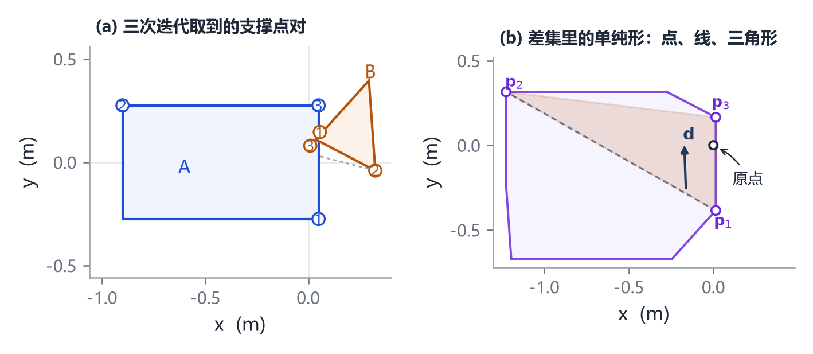

# 第 4 章 碰撞检测：从包围盒到 GJK

一个仓库场景，地上散着一千二百个木箱，玩家从货架顶上推下一个木桶。这一帧结束前，程序必须回答一个问题：木桶碰了谁，碰在哪个点，压进去多深。

朴素做法是把所有物体两两测一遍。1201 个物体有 720600 对，每对都做精确相交测试，哪怕单次只要 100 纳秒，也要 72 毫秒——四帧的时间，只够算这一帧的碰撞。而且这 72 毫秒里，有 719000 多对是白算的：木桶在货架顶上，跟地面上的箱子隔着三米。

碰撞检测因此被拆成两个职责完全不同的阶段。第一阶段用一个便宜到近乎免费的测试，把所有"肯定不碰"的对排除掉，只留下几百对候选；第二阶段对候选做精确计算，给出接触点、法向和穿透深度。前者叫 broad phase，后者叫 narrow phase。这个划分不是因为工程上好看，而是因为两个阶段要优化的东西正好相反：broad phase 要的是筛得快、允许误报；narrow phase 要的是算得准、一次算清。

## 4.1 两阶段各自的责任

Broad phase 的契约只有一句话：不允许漏。它可以报告"这两个可能碰了"而实际没碰，代价是 narrow phase 白跑一次；它不可以漏掉一对真的接触，因为后面没有任何环节能补回来。这个单边保证让 broad phase 可以尽情使用粗糙的包围体。

粗糙到什么程度？一个物体会被包进一个轴对齐包围盒（AABB），两个 AABB 的相交测试是六个比较：三个轴上的区间是否重叠。六个比较比一次精确的 GJK 便宜两个数量级，而它能排除掉九成以上的对。这一成候选交给 narrow phase，narrow phase 再花几十微秒算清楚。

Narrow phase 的输出不止"碰了没有"。求解器需要三样东西：接触点在世界坐标里的位置（用来算力臂 $\mathbf{r}$）、法向（用来定义冲量的方向）、穿透深度（用来做位置修正和判断要不要报警）。一个面贴面接触还需要多个接触点——一个四边形面压在另一个面上，只给一个点，物体会绕着这个点转，看起来像被针顶住。把同一对物体的多个接触点组织在一起，叫作接触流形。

两个阶段的成本随规模增长的方式不一样，这决定了它们的实现风格。Broad phase 在物体密度有界时接近线性：每个物体只跟邻近的几个比，总量正比于 $n$。Narrow phase 的成本正比于实际接触对数，通常也是线性的，但常数大得多。所以优化 broad phase 是优化常数，优化 narrow phase 是优化每个接触的算法。两者都要做，但先做前者：把候选对数从七万降到七千，比把 GJK 提速一倍有效得多。

## 4.2 谁跟谁有可能碰

Broad phase 的实现选择取决于场景的物体尺寸分布，这一点比算法本身更重要。

均匀网格是最简单的一种：把空间切成边长约为"平均物体尺寸两倍"的格子，每个物体登记到自己覆盖的所有格子里，然后每个格子内部两两配对。它对尺寸均匀、分布均匀的场景非常好，查询是常数时间。它的失败方式也很明确：一个尺寸是格子十倍的物体（一堵墙、一块地面）会占据上千个格子，每次移动都要更新上千条记录。地面这种物体干脆不进网格，单独处理。

排序扫描（sweep and prune）利用时间相干性：把物体按某个轴的区间起点排序，扫描一遍，只有区间重叠的才进入下一轮。它的关键在于帧间几乎有序，用插入排序维护，每帧的实际代价接近线性而不是 $O(n\log n)$。三个轴都做一遍再取交集，可以消掉长条形物体在一个轴上重叠的误报。它的弱点是物体沿某个轴分布极不均匀时，单轴重叠的对数会爆炸。

BVH 是树。每个节点存一个包住整棵子树的 AABB，叶子是单个物体（或几个物体）。查询时从根开始，节点不相交就整枝剪掉。构造有两条路：自顶向下按最长轴中位数切分，或按表面积启发式（SAH）选择切分位置，代价高一点但树更紧凑；自底向上把最近的叶子对聚合成父节点，适合一次性构造。

BVH 真正的竞争力在动态场景里的更新方式。物体动了一点，包围盒跟着变，可以先只往上更新祖先的 AABB——这叫 refit，代价 $O(\log n)$ 每物体，一次遍历就能改完整棵树。问题是 refit 不改变树的拓扑，物体在场景里移动久了，原本"邻居"的物体跑到远处，树会变松，剪枝效率下降。所以还需要周期性的局部旋转：当父子节点的包围盒重叠严重时，交换两个子树，让盒子更紧。再不够就整体重建。工程上的折中是每帧 refit，每几十帧检查一次树的"松紧度"，超阈值就重建。

三个结构可以组合：地面、墙这类大物体手工从 broad phase 里摘出去单独匹配；中等尺寸的用 BVH；大量同尺寸的小碎石用网格。没有哪个结构在所有场景里都赢，而有经验的实现会按物体的尺寸分层，每层用最合适的结构。

## 4.3 支撑函数与闵可夫斯基差

Narrow phase 的现代做法建立在一个叫支撑函数的概念上。对凸集 $K$ 和方向 $\mathbf{d}$，支撑函数定义为 $K$ 中沿 $\mathbf{d}$ 方向最远的点的投影长度：

$$h_K(\mathbf{d})=\max_{\mathbf{x}\in K}\ \mathbf{x}\cdot\mathbf{d}.$$

取值最大的那个点叫支撑点，记作 $s_K(\mathbf{d})$。对凸集来说，这个函数（连同每个方向上的支撑点）唯一确定了集合——给定一个方向就能问"你最远能伸到哪里"，问遍所有方向，形状就还原出来了。

具体形状的支撑点很容易算。多面体遍历顶点取最大点积，若有凸包结构可以用爬山从上一帧的支撑点出发，几个顶点就到了。球是 $\mathbf{c}+r\mathbf{d}/|\mathbf{d}|$，与顶点数无关。盒子是逐轴取 $\pm$ 分量，三轴各看一次符号。胶囊是两端球心连成的线段，把 $\mathbf{d}$ 投到线段上取端点，再加半径方向的偏移。这些计算都不需要遍历几何，正是 GJK 快的原因。

有了支撑函数，两个凸集 $A$、$B$ 的相交问题可以换一个说法。定义闵可夫斯基差

$$A\ominus B=\{\mathbf{a}-\mathbf{b}\ \vert\ \mathbf{a}\in A,\ \mathbf{b}\in B\},$$

它把两个形状的所有点对相减，得到的还是一个凸集。$A$ 与 $B$ 有公共点，等价于存在 $\mathbf{a}=\mathbf{b}$，也就等价于差集里存在零向量：$A$ 与 $B$ 相交当且仅当 $\mathbf{0}\in A\ominus B$。两个物体的接触问题，变成了一个点是否落在一个集合里的问题。

<figure class="fig">

<figcaption><b>图 4-1</b>　支撑函数与闵可夫斯基差的关系（示意图，未按比例计算）。左图中方向 $\mathbf{d}$ 分别作用于两个凸形，得到各自的支撑点；右图中差集在 $\mathbf{d}$ 方向的支撑点正是这两点的差，其投影长度等于 $h_A(\mathbf{d})+h_B(-\mathbf{d})$。差集的轮廓通常比任一原形状"胖"，两个十面体的差集最多有上百个顶点。</figcaption>
</figure>

这张图里最重要的一件事是：差集不需要真的构造出来。支撑函数满足

$$h_{A\ominus B}(\mathbf{d})=h_A(\mathbf{d})+h_B(-\mathbf{d}),$$

因为 $\max(\mathbf{a}-\mathbf{b})\cdot\mathbf{d}$ 可以对 $\mathbf{a}$ 和 $\mathbf{b}$ 分别取极值。也就是说，只要各自求一次支撑点再相减，就得到了差集在 $\mathbf{d}$ 方向的支撑点。$A$ 有一万个三角形、$B$ 有一万个，差集的顶点数可以是亿级，但每次查询仍然只是两次对数级的检索。这就是把几何问题变成"问方向"的好处：代价与形状复杂度解耦。

闵可夫斯基差还有一个副产品是距离。当两个凸集分离时，差集到原点的距离，恰好等于两个集合之间的最近距离。这一点在后面判定"靠近但还没接触"时有用：GJK 在报告分离的同时，顺带给出了距离和最近点对，不需要另写一套算法。

## 4.4 GJK：一个点是否落在差集里

GJK 要回答的是 $\mathbf{0}\in A\ominus B$，而它只允许通过支撑函数提问。核心观察只有一句：取任意方向 $\mathbf{d}$，如果差集在 $\mathbf{d}$ 方向的支撑点 $\mathbf{p}$ 满足 $\mathbf{p}\cdot\mathbf{d}\lt 0$，那么差集里所有点 $\mathbf{x}$ 都满足 $\mathbf{x}\cdot\mathbf{d}\le\mathbf{p}\cdot\mathbf{d}\lt 0$，原点不在其中，两个形状分离。

反过来，如果每次都不满足这个条件，就说明差集在原点的每一侧都有点，原点很可能在里面。GJK 把这个"很可能"变成确定，靠的是维护一个越来越靠近原点的单纯形：二维是线段或三角形，三维是四面体。每轮迭代沿"从单纯形指向原点"的方向求支撑点，把新点加入单纯形，再删掉那些不可能包含原点的部分，得到一个更小的单纯形和一个更近的搜索方向。

用一对具体的形状走一遍。$A$ 是一个 $0.95\times0.55$ 的矩形，范围 $x\in[-0.90,0.05]$、$y\in[-0.275,0.275]$；$B$ 是一个三角形，顶点 $(0.3247,-0.0404)$、$(0.2939,0.3953)$、$(0.0359,0.1098)$。两者在水平方向重叠约一厘米半。

第一次取 $\mathbf{d}=(1,0)$。$A$ 的支撑点是 $(0.05,-0.275)$，$B$ 在 $-\mathbf{d}$ 方向的支撑点是 $(0.0359,0.1098)$，相减得到 $\mathbf{p}_1=(0.0141,-0.3848)$。它的投影是正的，说明差集在这个方向上越过了原点，还没有结论。此时单纯形只有一个点，新的方向取它指向原点的方向，即 $(-0.0366,0.9993)$。

第二次沿这个方向求支撑，得到 $\mathbf{p}_2=(-1.2247,0.3154)$，投影 0.360。两个点连成线段，线段上离原点最近的点给出新方向 $(0.4921,0.8706)$（垂直于该线段、指向原点）。第三次得到 $\mathbf{p}_3=(0.0141,0.1652)$，投影 0.151。三个点连成的三角形把原点包在里面，迭代结束，判定相交。

<figure class="fig">

<figcaption><b>图 4-2</b>　二维 GJK 的三次迭代，真实计算。左图是矩形 $A$ 与三角形 $B$，它们水平方向重叠约 1.4 cm，①②③ 是三次迭代各自取到的支撑点对，虚线把它们连起来；右图是两者的闵可夫斯基差（$4\times3=12$ 个点对相减后取凸包，共 7 个顶点），三次支撑得到 $\mathbf{p}_1,\mathbf{p}_2,\mathbf{p}_3$，前两点先组成线段、第三点把原点包进三角形，判定相交，箭头是第二次迭代从线段最近点出发的搜索方向 $\mathbf{d}$。全程只用 3 次支撑调用。</figcaption>
</figure>

三次迭代就结束，这是典型数量。GJK 的收敛速度取决于两个形状的"圆润程度"：球与球几乎一次就到位，细长的棱柱与薄片可能要十几次，但很少超过二十次。每次迭代只做两次支撑查询：球体是常数时间，多面体在凸包上爬山是顶点数的对数，所以整体开销与“这个形状有多少个三角形”几乎无关。

单纯形的约简规则值得单独说，因为所有实现错误都出在这里。二维里三角形 $ABC$ 的顶点按加入顺序排好，$C$ 是最新的一个：原点若落在边 $AB$ 的外侧，说明 $C$ 把三角形撑向了一个没有用的方向，删掉它，只留 $A$、$B$ 继续；原点若落在边 $AC$ 的外侧，删掉 $B$；两边都不在外侧，原点就在三角形内。三维四面体要对四个面各做一次同样的判断，每次删掉一个顶点。这些判断全靠叉乘和点积，代码短，但符号错一个就永不收敛。

还有两个必须处理的退化。一是新支撑点已经存在于单纯形中（方向没带来新信息），这在两个形状刚刚接触、差集退化成一条线或一个面时出现，此时应判为相交并进入 EPA。二是搜索方向长度接近零，说明单纯形已经贴到原点，同样判为相交。工程实现里这两个条件用同一个容差判断，容差的取值是第 4.7 节的内容。

## 4.5 EPA：从"碰了"到"碰多深"

GJK 的答案是一个布尔值。求解器需要的是穿透深度和法向，而这两样东西在 GJK 结束时只以"原点在单纯形内部"的形式存在，没有任何数值。

EPA 接在 GJK 后面，思路是把这个单纯形当作一个初始的凸多面体，然后让它长大。既然原点在这个多面体内部，那么"差集的边界到原点的最短距离"就是穿透深度，最短方向就是法向。做法是：找出多面体上离原点最近的面，在它的法向上求差集的支撑点，看这个新点能把距离改进多少。若改进小于容差，说明这个面就是差集的边界，结束；否则把该面删掉，用新点与它的边重新三角化，继续。

三维里这个"删面补面"的簿记是 EPA 的主要代码量：需要维护顶点表、面表、每条边的相邻面，才能保证新生成的面方向正确。二维简单得多，删掉一条边，连两条新边，像个多边形膨胀的过程。收敛通常要 20 到 40 次支撑查询，每次都在爬山，最后得到的面上三个点带有重心坐标，把它们对应的支撑点对权重相加，就回插出 $A$ 和 $B$ 上的接触点。

EPA 的数值行为比 GJK 挑剔。浅穿透时，多面体上最近的那个面往往又扁又长，法向对顶点的微小扰动摇摆得很厉害；几个面几乎共面时，最近面会在它们之间来回跳。表现到游戏里就是：物体静止贴在一起，法向每帧抖几度，冲量方向跟着抖，物体会微微颤动。

成熟的实现不会把 EPA 的原始输出直接交给求解器。常用的补救有三条。其一，把这一帧的法向与上一帧做混合，或干脆沿用上一帧的法向，只要新法向与它夹角不超过阈值。其二，同一对物体的多个接触点合成一个流形，用流形的整体朝向决定法向，而不是每个点各算一个。其三，给倾斜的面加惩罚，让法向偏向坐标轴或偏向上一次的方向。这三条都是"用时间相干性换稳定性"，代价是响应变慢半帧。

穿透深度在后续环节里还有第二个用途：它是判断接触深浅、决定是否要用位置修正的依据，也是按深度给接触分层排序的输入 [@erleben2007]。深度算错的后果不止是推出距离不对，还包括分层顺序错乱，冲量传导的方向跟着错。

## 4.6 非凸形状与实际几何

GJK 和 EPA 都要求凸集。支撑函数的定义里那个 $\max$ 只在凸集上才能唯一确定形状——凹处永远是某个方向的"内部"，支撑点永远取不到它。真实物体大多不凸：人形角色、椅子、拆开的机械零件、地形。

最直接的解法是凸分解：把一个非凸网格切成若干凸块，检测时对块对做 GJK。切分算法离线跑，目标是最少块数、每块尽量"胖"（避免刀片状的块）。块数多了，检测的对数按平方增长，所以分解质量直接影响运行成本。

工程上更常见的是手工复合形状。一把椅子用五个盒子拼，一个人形用十几个胶囊和盒子拼，一块地面用一个巨大的盒子和若干斜坡拼。复合形状的好处不只是凸，还在于快：块与块之间的相对位置固定，可以预先算出它们互不重叠，检测时省掉块内的配对。代价是建模工作量和"看起来方"——视觉网格与碰撞形状是两套东西，这在游戏里是常识，在仿真里则是一个需要交代的近似。

三角形网格是另一类。三角形本身是凸的，但它是零厚度的，支撑函数在法向方向上没有意义：往薄片的正反两面问支撑，得到同一个点，差集退化成一个平面片，EPA 找不到"最近的面"。所以三角形网格通常不走 GJK，而是走解析的"点对面"或"线段对面"最近点计算：球对三角形是点到三角形的最近点，胶囊对三角形是线段到三角形的最近线段。一个三角形网格配上 BVH，查询时先用包围盒剪枝，再对剩下的三角形逐个算最近点。

中空与单面是这类几何的两个坑。一个玻璃杯的网格是单面的，杯子内外都在同一层三角形上；球从内侧撞上来时，法向应该指向内，从外侧撞时指向外，而三角形本身的法向只有一个。常见处理是把三角形当作双面，或者给网格一个厚度，用"胶囊化的三角形"做检测。地形和布料也属于这一类，前者用高度场可以绕开，后者必须正面处理。

三角形网格的代价主要不在单个三角形（解析最近点只是几十次乘加），而在查询次数。一个两万面的地形与一个足球作检测，BVH 剪枝后真正进入计算的一般只有五六个三角形，但这个结论依赖于 BVH 的叶子尺寸：叶子装一个三角形时树深、遍历开销大，装八个时叶子内部仍要逐个算。四到八个是常见的取值。

接触流形的规模也需要控制。一个大箱子平放在地面上，箱子底面与地面可能产生几十个三角形接触点，全部送进求解器会让 $\mathbf{A}$ 变得巨大而病态。所以要裁剪：保留最深的一个点，加上在接触平面上分布最开的三个点，通常就足以稳定支撑。裁剪规则本身会影响堆叠的稳定性，也会影响求解器能否把同一批接触认成同一批约束 [@baraff1994]，这是第 7 章的话题。

## 4.7 鲁棒性：假设被打破的地方

碰撞检测的 bug 很少是算法写错，多数是"这个输入不该出现"的假设被打破。下面几类几乎每个引擎都会踩一遍。

尺度差异。场景里同时有 1 毫米的螺丝和 100 米的地形，单精度浮点在这个范围里只剩六七位有效数字。GJK 中途算出的搜索方向是两个大数相减，误差可能比方向本身的长度还大，于是迭代在几个点之间来回跳。可行的做法是统一单位（全部用米）、限制最小特征尺寸（薄于 1 毫米的碰撞体加厚到 1 毫米），以及在 narrow phase 里把坐标原点平移到两个物体的中心附近再算。

容差。所有"是否重叠""是否为零"的判断都要给一个绝对容差，而这个绝对值必须与物体尺度挂钩。$10^{-4}$ 米对 10 米的物体恰到好处，对 0.01 米的物体就是把整个物体当成一个点。实践里用相对容差（物体包围盒尺寸的 $10^{-5}$）加上一个绝对下限，两害相权。

退化几何。共线的三个点、面积为负的三角形、两个顶点重合的多面体，都会让叉乘结果为零或方向翻转。这类几何不该进入碰撞管线，应该在资产导入时检查并修好；但程序不能假设它们不存在，因为程序化生成的网格经常带这些毛病。

帧间一致性。这是最容易被忽略的一条。同一对物体，这一帧的法向是 $(0,1,0)$，下一帧变成 $(0.02,0.9998,0)$，从物理上说毫无区别，从求解器看却是两个不同的约束：上一帧的冲量方向作废，热启动失效，物体抖动。所以碰撞检测的输出不只是几何量，它还是求解器的输入历史，需要被缓存和关联。给每个接触点一个稳定的标识（哪两个物体、哪个特征对上），把上一帧的法向和冲量带过来，比任何算法优化都更能改善视觉稳定性。

最后一条经验：碰撞检测里"接触"和"分离"之间有一段模糊地带。距离小于两倍容差时，物体既可以说碰了，也可以说没碰，两种判定会来回切换，每次切换都是一个不连续的力。解决办法不是把容差调小，而是加一层滞回：进入接触用一个阈值，退出用另一个更大的阈值，中间地带保持上一帧的状态。这种做法在物理上没有依据，在视觉上是必需的，而且它恰好和第 3 章里"恢复系数在低速时强制为零"是同一类手段——用一点点非物理，换掉一大堆抖动。
