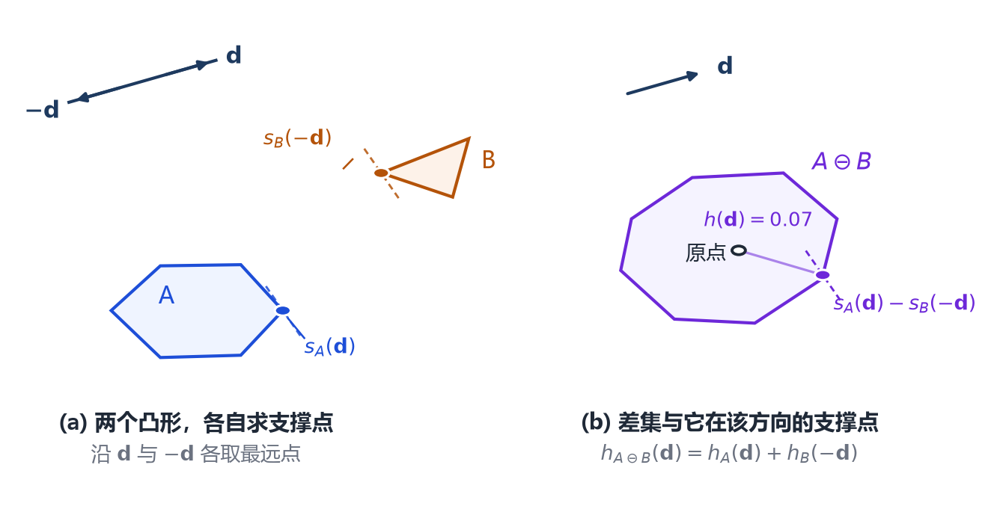

# 第 4 章 碰撞检测：从包围盒到 GJK

一个仓库场景，地上散着一千二百个木箱，玩家从货架顶上推下一个木桶。这一帧结束前，程序必须回答一个问题：木桶碰了谁，碰在哪个点，压进去多深。

朴素做法是把所有物体两两测一遍。1201 个物体有 720600 对，每对都做精确相交测试，哪怕单次只要 100 纳秒，也要 72 毫秒——四帧的时间，只够算这一帧的碰撞。而且这 72 毫秒里，有 719000 多对是白算的：木桶在货架顶上，跟地面上的箱子隔着三米。

碰撞检测因此被拆成两个职责完全不同的阶段。第一阶段用一个便宜到近乎免费的测试，把所有"肯定不碰"的对排除掉，只留下几百对候选；第二阶段对候选做精确计算，给出接触点、法向和穿透深度。前者叫 broad phase（宽相位，粗筛），后者叫 narrow phase（窄相位，精算）。这个划分不是因为工程上好看，而是因为两个阶段要优化的东西正好相反：broad phase 要的是筛得快、允许误报；narrow phase 要的是算得准、一次算清。

也就是说，粗筛负责把候选名单压到能装进预算的规模，精算负责把名单上每一条算到底。前者可以错在“多报”，后者不许错在“漏算”。

## 4.1 两阶段各自的责任

Broad phase 的契约只有一句话：不允许漏。它可以报告"这两个可能碰了"而实际没碰，代价是 narrow phase 白跑一次；它不可以漏掉一对真的接触，因为后面没有任何环节能补回来。这个单边保证让 broad phase 可以尽情使用粗糙的包围体。

粗糙到什么程度？一个物体会被包进一个轴对齐包围盒（axis-aligned bounding box，AABB），两个 AABB 的相交测试是六个比较：三个轴上的区间是否重叠。六个比较比一次精确的 GJK 便宜三个数量级，而它能排除掉九成以上的对。这一成候选交给 narrow phase，narrow phase 再花一到几十微秒算清楚。

先把“省”这件事算成数字。六次比较加三次减法，一次 AABB 测试在现代 CPU 上约 2 纳秒；一次 GJK 对两个盒子大约 1 到 3 微秒。两个数差三个数量级，所以哪怕把 720600 对全用 AABB 过一遍，也只要 1.4 毫秒——听起来能接受，可这只是排除，一对候选都还没精算。

问题在于它按平方增长。物体翻倍到 2402 个，配对变成 288 万对，AABB 过一遍就是 5.8 毫秒；再翻倍到 4804 个，23 毫秒，一帧 16.7 毫秒装不下。真正能用的 broad phase 必须让比较次数随物体数线性增长：设每个物体平均只和 $k$ 个邻居比较，总量是 $nk/2$。仓库里 0.4 m 的木箱铺满 30×30 米的地面，$k$ 大约是 8，1201 个物体只剩 4800 对，按 2 纳秒算 10 微秒。

也就是说，broad phase 省的不是“每次比较的时间”，而是“比较的次数”——它把 $n^2$ 换成 $n$，代价是允许误报。这个替换只在一种情况下成立：物体在空间上分布得开，每个物体的邻居数有个上界。一千个物体全挤在 1 米见方的角落里，$k$ 就接近 $n$，线性又退回平方。

反例说清精算为什么不能省。一把斜靠在墙边的梯子，它的 AABB 是包住整把梯子的大盒子；一个人从梯子下走过，AABB 与人相交，实际两者隔着半米空气。若只做 broad phase 就下结论，人会撞上一堵看不见的墙。两个斜放的木箱角对角也一样，AABB 重叠得像嵌在一起，实际只差几毫米就分开。粗糙的包围体天生分不清“角落里空着”和“角落里塞满”，这份精度只能由 narrow phase 补。

Narrow phase 的输出不止"碰了没有"。求解器需要三样东西：接触点在世界坐标里的位置（用来算力臂 $\mathbf{r}$）、法向（用来定义冲量的方向）、穿透深度（用来做位置修正和判断要不要报警）。一个面贴面接触还需要多个接触点——一个四边形面压在另一个面上，只给一个点，物体会绕着这个点转，看起来像被针顶住。把同一对物体的多个接触点组织在一起，叫作接触流形（contact manifold）。也就是说，流形不是“更多接触点”，而是“一组必须同时成立的接触约束”，它决定了物体会不会绕着某个点翻。

三个输出里，法向最容易被低估。接触点算错一毫米，冲击力臂就偏一毫米；法向算错五度，冲量方向就偏五度，而物体会被连续推偏。穿透深度则只在浅接触下才有意义：两厘米的穿透已经说明前一帧出了问题，此时的深度值不如直接把它压到上限。

两个阶段的成本随规模增长的方式不一样，这决定了它们的实现风格。Broad phase 的总量随 $n$ 线性，常数很小；narrow phase 的总量随接触对数增长，单个接触要跑几十次向量运算，常数大三个数量级。所以优化前者是优化常数与结构，优化后者是优化每个接触的算法。

两者都要做，但先做前者。把候选对数从七十二万降到四千八，比把 GJK 提速一倍有效得多。可是候选本身也要花钱：4800 对乘 2 微秒是 9.6 毫秒，单独就吃掉大半预算。所以真实的管线常常是三层：先用 AABB 粗筛出几千对，再用更紧的包围体（有向包围盒 OBB）或一次便宜的分离轴测试压到两三百对，最后才上 GJK。每压一层都允许误报，只要不漏，后面就还有机会纠正。

## 4.2 谁跟谁有可能碰

Broad phase 的实现选择取决于场景的物体尺寸分布，这一点比算法本身更重要。

均匀网格是最简单的一种：把空间切成边长约为"平均物体尺寸两倍"的格子，每个物体登记到自己覆盖的所有格子里，然后每个格子内部两两配对。它对尺寸均匀、分布均匀的场景非常好，查询是常数时间。它的失败方式也很明确：一个尺寸是格子十倍的物体（一堵墙、一块地面）会占据上千个格子，每次移动都要更新上千条记录。地面这种物体干脆不进网格，单独处理。

把数字带进去。30×30 米的地面、格子取 0.8 米，得到 38×38 约 1444 个格；1201 个 0.4 m 的木箱平均每格不到一个，每箱只登记进一两格。每格内部两两配对，总数就和物体数同阶。也就是说，网格的代价全在“登记”这一步：每个物体要写进几个格子，移动时要先把旧记录删掉再写新的。格子越小，筛得越细，但登记次数越多；格子越大，登记便宜，但每格的配对又变多。

排序扫描（sweep and prune，简称 SAP）利用时间相干性（temporal coherence，上一帧和这一帧差不多）：把物体按某个轴的区间起点排序，扫描一遍，只有区间重叠的才进入下一轮。

也就是说，它不切空间，而是把“三维重叠”拆成“三个一维区间重叠”再取交集。关键在于帧间几乎有序：上一帧排好的表，这一帧只需要插入排序的少量交换，代价接近线性。

它的反例很具体。两百个箱子沿垂直方向搭成一根高塔，每个箱子的 $x$ 区间都和其他所有箱子重叠。只看 $x$ 轴，200×199/2=19900 对全部进入候选，一条也没筛掉；再看 $y$ 轴才有区分度，但那时已经白做了一万九千次测试。单轴分布极不均匀时，SAP 会退化成全配对。所以多数实现会先把主轴选成“跨度最大”的那个轴，或者三个轴轮流做先行轴。

BVH（bounding volume hierarchy，包围体层次）是树。每个节点存一个包住整棵子树的 AABB，叶子是单个物体（或几个物体）。查询时从根开始，节点不相交就整枝剪掉。也就是说，BVH 把“逐对测试”改成了“批量排除”：一次节点比较就能否定它下面成百上千个物体。构造有两条路：自顶向下按最长轴中位数切分，或按表面积启发式（surface area heuristic，SAH）选择切分位置，代价高一点但树更紧凑；自底向上把最近的叶子对聚合成父节点，适合一次性构造。

BVH 真正的竞争力在动态场景里的更新方式。物体动了一点，包围盒跟着变，可以先只往上更新祖先的 AABB——这叫 refit，代价 $O(\log n)$ 每物体，一次遍历就能改完整棵树。

算一下这句话的含金量。1201 个物体的平衡二叉树深 11 层，也就是每个叶子到根有 11 个盒子要重算；全场景 refit 一遍是 1201×11≈13000 次盒子合并，每次几个比较，合计不到 0.1 毫秒。同样规模下重建一次树要几十毫秒。两百倍的差距，就是 refit 值得写的原因。问题是 refit 不改变树的拓扑，物体在场景里移动久了，原本"邻居"的物体跑到远处，树会变松，剪枝效率下降。所以还需要周期性的局部旋转：当父子节点的包围盒重叠严重时，交换两个子树，让盒子更紧。再不够就整体重建。工程上的折中是每帧 refit，每几十帧检查一次树的"松紧度"，超阈值就重建。

三个结构可以组合：地面、墙这类大物体手工从 broad phase 里摘出去单独匹配；中等尺寸的用 BVH；大量同尺寸的小碎石用网格。没有哪个结构在所有场景里都赢，而有经验的实现会按物体的尺寸分层，每层用最合适的结构。

## 4.3 支撑函数与闵可夫斯基差

Narrow phase 的现代做法建立在一个叫支撑函数（support function）的概念上。对凸集 $K$ 和方向 $\mathbf{d}$，支撑函数定义为 $K$ 中沿 $\mathbf{d}$ 方向最远的点的投影长度：

$$h_K(\mathbf{d})=\max_{\mathbf{x}\in K}\ \mathbf{x}\cdot\mathbf{d}.$$

把这个式子逐符号读一遍。$h$ 是函数名，下标 $K$ 表示“属于哪个集合”；$\mathbf{d}$ 是问的方向，二维是两个数、三维是三个数；$\mathbf{x}$ 是集合里的任意一点；$\mathbf{x}\cdot\mathbf{d}$ 是点积，几何上等于 $\mathbf{x}$ 在 $\mathbf{d}$ 上的投影长度（这要求 $\mathbf{d}$ 是单位向量）；$\max$ 表示在集合所有点里取最大值。$h$ 的单位是米，可以读成“从原点沿 $\mathbf{d}$ 走 $h$ 米，就到了形状的最外沿”。

取值最大的那个点叫支撑点，记作 $s_K(\mathbf{d})$。对凸集来说，这个函数（连同每个方向上的支撑点）唯一确定了集合——给定一个方向就能问“你最远能伸到哪里”，问遍所有方向，形状就还原出来了。也就是说，支撑函数是形状的一个“接口”：它不暴露形状有多少个顶点，只回答“这个方向上最外面在哪里”。

这个定义有一个可以拿在手上的图像。把 $\mathbf{d}$ 想成一块平板被推向形状，平板始终垂直于 $\mathbf{d}$，从无穷远处一点点压过来；第一个碰到形状的位置就是 $h_K(\mathbf{d})$，碰到的那一点就是支撑点。所以支撑函数是带符号的：若形状整个落在原点的背面，$h$ 会是负数。

拿一个矩形试。矩形 $A$ 的范围是 $x\in[-0.90,0.05]$、$y\in[-0.275,0.275]$。方向 $(1,0)$ 时最右边满足 $x=0.05$，于是 $h_A=0.05$；方向 $(0,1)$ 时 $h_A=0.275$；方向 $(0.7071,0.7071)$ 时支撑点是右上角 $(0.05,0.275)$，$h_A=0.05\times0.7071+0.275\times0.7071=0.230$。第三个值比前两个都小，因为斜着靠过来的平板先碰到的是角，不是整条边。

具体形状的支撑点很容易算。多面体遍历顶点取最大点积，若有凸包结构可以用爬山从上一帧的支撑点出发，几个顶点就到了。球是 $\mathbf{c}+r\mathbf{d}/|\mathbf{d}|$,与顶点数无关。盒子是逐轴取 $\pm$ 分量，三轴各看一次符号。胶囊是两端球心连成的线段，把 $\mathbf{d}$ 投到线段上取端点，再加半径方向的偏移。这些计算都不需要遍历几何，正是 GJK 快的原因。也就是说，一万个三角形的网格和四个顶点的盒子，在支撑函数面前一样便宜：查询一次的代价取决于能不能在凸包上快速找到最外沿，不取决于三角形总数。

一个容易掉进去的坑：支撑函数只能给出“某一侧的最外沿”，它不能直接回答“两个形状是否相交”。要回答后者，需要把所有方向上的最外沿放在一起看，这正是差集要做的事。

有了支撑函数，两个凸集 $A$、$B$ 的相交问题可以换一个说法。定义闵可夫斯基差（Minkowski difference）

$$A\ominus B=\{\mathbf{a}-\mathbf{b}\ \vert\ \mathbf{a}\in A,\ \mathbf{b}\in B\},$$

它把两个形状的所有点对相减，得到的还是一个凸集。$A$ 与 $B$ 有公共点，等价于存在 $\mathbf{a}=\mathbf{b}$，也就等价于差集里存在零向量：$A$ 与 $B$ 相交当且仅当 $\mathbf{0}\in A\ominus B$。两个物体的接触问题，变成了一个点是否落在一个集合里的问题。也就是说，原本要比较两个形状的每一处，现在只需要盯住一个点——原点——和一块新的形状。

要看懂这块新形状，最好先看它怎么被“扫”出来。把 $B$ 关于原点翻转，得到 $-B=\{-\mathbf{b}\}$；再把翻转后的 $B$ 的某个固定点放在 $A$ 的每一个位置上，让它沿 $A$ 滑一圈，划过的区域就是差集。二维里更好操作：取 $A$ 的一条边，把翻转后的 $B$ 贴着它平移，外包络就是差集的一部分边界。所以差集总是比任一原形状更大、更胖——它把两个形状的尺寸叠加在了一起。

球是最容易看的例子。$A$ 半径 0.5、圆心 $(1,0)$，$B$ 半径 0.3、圆心在原点，差集是一个圆心 $(1,0)$、半径 $0.5+0.3=0.8$ 的圆。原点离这个圆心 1.0，比 0.8 大，所以原点在差集外，两圆分离；差集边界到原点的距离 $1.0-0.8=0.2$，恰好是两个圆表面的间隙。台球桌上就是这个数字：半径 2.8 cm 的两颗球，差集是半径 5.6 cm 的圆，原点进没进去，一眼就能判断。两个同尺寸的盒子也一样：0.4 m 见方的两个盒子，差集是 0.8 m 见方的盒子，边长等于两者半宽之和。

这个“尺寸相加”的性质是 GJK 能在几步内收敛的根源。差集的尺度只由两个形状的最大尺寸决定，与它们有多少个顶点无关；一个一万面的茶壶和一个四面的盒子，它们的差集还是个“胖茶壶”大小的东西，支撑查询依然只要几微秒。

<figure class="fig">

<figcaption><b>图 4-1</b>　支撑函数与闵可夫斯基差的关系（示意图，未按比例计算）。左图中方向 $\mathbf{d}$ 分别作用于两个凸形，得到各自的支撑点；右图中差集在 $\mathbf{d}$ 方向的支撑点正是这两点的差，其投影长度等于 $h_A(\mathbf{d})+h_B(-\mathbf{d})$。差集的轮廓通常比任一原形状"胖"，两个十面体的差集最多有上百个顶点。</figcaption>
</figure>

这张图里最重要的一件事是：差集不需要真的构造出来。支撑函数满足

$$h_{A\ominus B}(\mathbf{d})=h_A(\mathbf{d})+h_B(-\mathbf{d}),$$

因为 $\max(\mathbf{a}-\mathbf{b})\cdot\mathbf{d}$ 可以对 $\mathbf{a}$ 和 $\mathbf{b}$ 分别取极值。也就是说，只要各自求一次支撑点再相减，就得到了差集在 $\mathbf{d}$ 方向的支撑点。回到下一节那对形状先验一眼：$\mathbf{d}=(1,0)$ 时 $h_A=0.05$、$h_B((-1,0))=-0.0359$，两者相加得 $0.0141$，正是那里第 0 步算出的 $\mathbf{p}_1$ 在 $\mathbf{d}$ 上的投影。$A$ 有一万个三角形、$B$ 有一万个，差集的顶点数可以是亿级，但每次查询仍然只是两次对数级的检索。这就是把几何问题变成"问方向"的好处：代价与形状复杂度解耦。

闵可夫斯基差还有一个副产品是距离。当两个凸集分离时，差集到原点的距离，恰好等于两个集合之间的最近距离。这一点在后面判定"靠近但还没接触"时有用：GJK 在报告分离的同时，顺带给出了距离和最近点对，不需要另写一套算法。

## 4.4 GJK：一个点是否落在差集里

GJK（Gilbert–Johnson–Keerthi，三个人姓氏的缩写）要回答的是 $\mathbf{0}\in A\ominus B$，而它只允许通过支撑函数提问。核心观察只有一句：取任意方向 $\mathbf{d}$，如果差集在 $\mathbf{d}$ 方向的支撑点 $\mathbf{p}$ 满足 $\mathbf{p}\cdot\mathbf{d}\lt 0$，那么差集里所有点 $\mathbf{x}$ 都满足 $\mathbf{x}\cdot\mathbf{d}\le\mathbf{p}\cdot\mathbf{d}\lt 0$，原点不在其中，两个形状分离。

反过来，如果每次都不满足这个条件，就说明差集在原点的每一侧都有点，原点很可能在里面。GJK 把这个“很可能”变成确定，靠的是维护一个越来越靠近原点的单纯形（simplex）：二维是线段或三角形，三维是四面体。也就是说，它不去描述差集的整个轮廓，只用两到四个点搭一个越来越小、越来越贴原点的“笼子”。每轮迭代沿"从单纯形指向原点"的方向求支撑点，把新点加入单纯形，再删掉那些不可能包含原点的部分，得到一个更小的单纯形和一个更近的搜索方向。

用一对具体的形状走一遍。$A$ 是一个 $0.95\times0.55$ 的矩形，范围 $x\in[-0.90,0.05]$、$y\in[-0.275,0.275]$；$B$ 是一个三角形，顶点 $(0.3247,-0.0404)$、$(0.2939,0.3953)$、$(0.0359,0.1098)$。两者在水平方向重叠约 1.4 厘米。

第 0 步取 $\mathbf{d}_0=(1,0)$，先问“最右边”。矩形 $A$ 的最右处是整条竖边 $x=0.05$，边上每一点都并列最远，实现取了下端点 $(0.05,-0.275)$；三角形 $B$ 在 $-\mathbf{d}_0=(-1,0)$ 上的支撑点是最左顶点 $(0.0359,0.1098)$。两者相减，$\mathbf{p}_1=(0.0141,-0.3848)$。投影 $\mathbf{p}_1\cdot\mathbf{d}_0=0.0141$ 是正的，说明差集在这个方向上越过了原点，还不能下结论。单纯形里只有这一个点，下一步方向取它指向原点的那一侧，归一化后是 $\mathbf{d}_1=(-0.0366,0.9993)$，几乎正上方。

第 1 步沿 $\mathbf{d}_1$ 求支撑。$A$ 给的是左上角 $(-0.90,0.275)$，$B$ 沿相反方向给的是右下顶点 $(0.3247,-0.0404)$，相减得 $\mathbf{p}_2=(-1.2247,0.3154)$，投影 0.360，还是正的。现在单纯形是两个点，连成一条线段；求原点到这条线段的最近点，得到 $(-0.1614,-0.2856)$，距原点 0.328。原点不在线段上，方向改成从最近点指向原点，即 $\mathbf{d}_2=(0.4921,0.8706)$。

第 2 步沿 $\mathbf{d}_2$ 求支撑。$A$ 给的是右上角 $(0.05,0.275)$——上一次是左上角，这一次因为 $\mathbf{d}_2$ 的 $x$ 分量变正，支撑点从左边跳到了右边。$B$ 在相反方向上给出的仍是 $(0.0359,0.1098)$，和第一步是同一个顶点。相减得 $\mathbf{p}_3=(0.0141,0.1652)$，投影 0.151。三个点构成三角形，判断原点是否在里面：解权重 $\alpha,\beta,\gamma$ 使 $\alpha\mathbf{p}_1+\beta\mathbf{p}_2+\gamma\mathbf{p}_3=\mathbf{0}$、$\alpha+\beta+\gamma=1$，得到 $(0.303,\ 0.011,\ 0.685)$，三个都为正，原点在三角形内部，判定相交。全程三次迭代、六次支撑查询。

<figure class="fig">

<figcaption><b>图 4-2</b>　二维 GJK 的三次迭代，真实计算。左图是矩形 $A$ 与三角形 $B$，它们水平方向重叠约 1.4 cm，①②③ 是三次迭代各自取到的支撑点对，虚线把它们连起来；右图是两者的闵可夫斯基差（$4\times3=12$ 个点对相减后取凸包，共 7 个顶点），三次支撑得到 $\mathbf{p}_1,\mathbf{p}_2,\mathbf{p}_3$，前两点先组成线段、第三点把原点包进三角形，判定相交，箭头是第二次迭代从线段最近点出发的搜索方向 $\mathbf{d}$。全程只用 3 次支撑调用。</figcaption>
</figure>

三次迭代就结束，这是典型数量。GJK 的收敛速度取决于两个形状的"圆润程度"：球与球几乎一次就到位，细长的棱柱与薄片可能要十几次，但很少超过二十次。每次迭代只做两次支撑查询：球体是常数时间，多面体在凸包上爬山是顶点数的对数，所以整体开销与“这个形状有多少个三角形”几乎无关。

单纯形的约简规则值得单独说，因为所有实现错误都出在这里。二维里三角形 $ABC$ 的顶点按加入顺序排好，$C$ 是最新的一个：原点若落在边 $AB$ 的外侧，说明 $C$ 把三角形撑向了一个没有用的方向，删掉它，只留 $A$、$B$ 继续；原点若落在边 $AC$ 的外侧，删掉 $B$；两边都不在外侧，原点就在三角形内。三维四面体要对四个面各做一次同样的判断，每次删掉一个顶点。这些判断全靠叉乘和点积，代码短，但符号错一个就永不收敛。

为什么删得掉？因为“最近点”只可能落在离原点最近的那一块区域里。三角形把平面分成七个区：三个顶点附近、三条边附近、一个内部，原点落在哪个区，最近点就落在对应的顶点、边或内部，其余部分对下一步没有贡献。也就是说，约简不是启发式，它是在删掉“不可能包含最近点”的部分，删错了就一定跑偏。

还有两个必须处理的退化。一是新支撑点已经存在于单纯形中（方向没带来新信息），这在两个形状刚刚接触、差集退化成一条线或一个面时出现，此时应判为相交并进入 EPA。二是搜索方向长度接近零，说明单纯形已经贴到原点，同样判为相交。工程实现里这两个条件用同一个容差判断，容差的取值是第 4.7 节的内容。

还有第三种退化容易被忽略：支撑方向平行于一条边，整条边上的点并列最远。本次走的第一步就是这种情况——矩形最右侧整条竖边都是支撑点，实现按固定规则取了偏下的那个。取哪个都能收敛，但两个实现取法不同，同一场景在两台机器上可能给出差一帧的接触序列。所以并列时必须有一个确定性的破平规则（先比 $y$，再比 $z$），不能依赖数组顺序。

容差取错的代价很直接：两根平行钢管间隙 0.1 毫米，容差却给了 1 毫米，GJK 会判它们接触；求解器于是每帧给一个冲量，两根钢管在半空中越推越远。

## 4.5 EPA：从"碰了"到"碰多深"

GJK 的答案是一个布尔值。求解器需要的是穿透深度和法向，而这两样东西在 GJK 结束时只以“原点在单纯形内部”的形式存在，没有任何数值。

两者的分工可以用一句话划清：GJK 回答“有没有”，EPA（expanding polytope algorithm，扩张多面体算法）回答“多深、朝哪、在哪”。GJK 的输入是两个形状的支撑函数，输出是一个布尔值和一个包住原点的单纯形；EPA 的输入正是那个单纯形，输出是深度、法向和一对接触点。也就是说，EPA 不重新搜索，它把 GJK 的半成品当作初始猜测，从里面往外长。

EPA 的做法是把这个单纯形当作一个初始的凸多面体，然后让它长大。既然原点在这个多面体内部，那么"差集的边界到原点的最短距离"就是穿透深度，最短方向就是法向。做法是：找出多面体上离原点最近的面，在它的法向上求差集的支撑点，看这个新点能把距离改进多少。若改进小于容差，说明这个面就是差集的边界，结束；否则把该面删掉，用新点与它的边重新三角化，继续。

拿两个盒子走一遍。两个 0.4 m 见方的盒子，中心在 $x$ 上相距 0.34 m，其余方向对齐，于是沿 $x$ 重叠 $0.4-0.34=0.06$ m。差集是边长 0.8 m 的盒子，中心在 $x=0.34$；原点离差集最近的面（$x=-0.06$）恰好 0.06 m，于是深度 0.06，法向取“把原点推到最近面”的方向即 $+x$，A 沿 $+x$ 移 0.06 m 就分开——和直觉一致：A 在右边，要往右推。也就是说，EPA 要的答案就写在差集的脸上，难点只在于怎么把那些面一点一点凑出来。

三维里这个"删面补面"的簿记是 EPA 的主要代码量：需要维护顶点表、面表、每条边的相邻面，才能保证新生成的面方向正确。二维简单得多，删掉一条边，连两条新边，像个多边形膨胀的过程。收敛通常要 20 到 40 次支撑查询，每次都在爬山，最后得到的面上三个点带有重心坐标（barycentric coordinates，把面内一点写成三个顶点的加权平均，权重和为 1），把它们对应的支撑点对按权重相加，就回插出 $A$ 和 $B$ 上的接触点。这里正好用得上第 2 步算出的 $(0.303,0.011,0.685)$：三个权重的和是 1，最大的一项说明接触点主要靠近第三个支撑点对。

40 次支撑乘上每次约一微秒，就是 40 微秒，比 GJK 贵一个数量级。也就是说，EPA 的成本不取决于“碰得多深”，而取决于“GJK 留下的那四面体有多粗糙”——初始多面体越接近真实边界，要补的面越少。所以有些实现会在 GJK 结束时多迭代一两轮，把单纯形多撑出几个面再交给 EPA，总耗时反而更短。

EPA 的数值行为比 GJK 挑剔。浅穿透时，多面体上最近的那个面往往又扁又长，法向对顶点的微小扰动摇摆得很厉害；几个面几乎共面时，最近面会在它们之间来回跳。表现到游戏里就是：物体静止贴在一起，法向每帧抖几度，冲量方向跟着抖，物体会微微颤动。

把颤动算成位移。深度 0.5 毫米、法向抖 3°，每帧的切向错位是 $0.5\times\tan 3^\circ\approx 0.026$ 毫米，看上去微不足道；乘上 60 帧就是每秒 1.6 毫米，一分钟下来箱子自己爬了将近十厘米。玩家看到的是：一摞书放在桌上，没人碰，自己慢慢滑到桌边。

成熟的实现不会把 EPA 的原始输出直接交给求解器。常用的补救有三条。其一，把这一帧的法向与上一帧做混合，或干脆沿用上一帧的法向，只要新法向与它夹角不超过阈值。其二，同一对物体的多个接触点合成一个流形，用流形的整体朝向决定法向，而不是每个点各算一个。其三，给倾斜的面加惩罚，让法向偏向坐标轴或偏向上一次的方向。这三条都是"用时间相干性换稳定性"，代价是响应变慢半帧。

穿透深度在后续环节里还有第二个用途：它是判断接触深浅、决定是否要用位置修正的依据，也是按深度给接触分层排序的输入 [@erleben2007]。深度算错的后果不止是推出距离不对，还包括分层顺序错乱，冲量传导的方向跟着错。

## 4.6 非凸形状与实际几何

GJK 和 EPA 都要求凸集。支撑函数的定义里那个 $\max$ 只在凸集上才能唯一确定形状——凹处永远是某个方向的"内部"，支撑点永远取不到它。真实物体大多不凸：人形角色、椅子、拆开的机械零件、地形。

最直接的解法是凸分解（convex decomposition）：把一个非凸网格切成若干凸块，检测时对块对做 GJK。切分算法离线跑，目标是最少块数、每块尽量"胖"（避免刀片状的块）。块数多了，检测的对数按平方增长，所以分解质量直接影响运行成本。

工程上更常见的是手工复合形状。一把椅子用五个盒子拼，一个人形用十几个胶囊和盒子拼，一块地面用一个巨大的盒子和若干斜坡拼。

算一下这件事的另一面。人形用 15 块拼，两个角色对撞就是 $15\times15=225$ 个块对，每对 2 微秒就是 450 微秒，一个角色对几个物体就爆预算。所以复合形状内部还要再套一层块级 AABB——15 块各有一个盒子，粗筛后通常只剩 10 到 20 对，40 微秒以内跑完。也就是说，复合形状不是“把问题变大”，而是“把一个难问题换成一堆小问题，再加一次额外的粗筛”。

复合形状的好处不只是凸，还在于快：块与块之间的相对位置固定，可以预先算出它们互不重叠，检测时省掉块内的配对。代价是建模工作量和"看起来方"——视觉网格与碰撞形状是两套东西，这在游戏里是常识，在仿真里则是一个需要交代的近似。

三角形网格是另一类。三角形本身是凸的，但它是零厚度的，支撑函数在法向方向上没有意义：往薄片的正反两面问支撑，得到同一个点，差集退化成一个平面片，EPA 找不到"最近的面"。所以三角形网格通常不走 GJK，而是走解析的"点对面"或"线段对面"最近点计算：球对三角形是点到三角形的最近点，胶囊对三角形是线段到三角形的最近线段。一个三角形网格配上 BVH，查询时先用包围盒剪枝，再对剩下的三角形逐个算最近点。

中空与单面是这类几何的两个坑。一个玻璃杯的网格是单面的，杯子内外都在同一层三角形上；球从内侧撞上来时，法向应该指向内，从外侧撞时指向外，而三角形本身的法向只有一个。常见处理是把三角形当作双面，或者给网格一个厚度，用"胶囊化的三角形"做检测。地形和布料也属于这一类，前者用高度场可以绕开，后者必须正面处理。

三角形网格的代价主要不在单个三角形（解析最近点只是几十次乘加），而在查询次数。一个两万面的地形与一个足球作检测，BVH 剪枝后真正进入计算的一般只有五六个三角形，但这个结论依赖于 BVH 的叶子尺寸：叶子装一个三角形时树深、遍历开销大，装八个时叶子内部仍要逐个算。四到八个是常见的取值。

接触流形的规模也需要控制。一个大箱子平放在地面上，箱子底面与地面可能产生几十个三角形接触点，全部送进求解器会让 $\mathbf{A}$ 变得巨大而病态。所以要裁剪：保留最深的一个点，加上在接触平面上分布最开的三个点，通常就足以稳定支撑。裁剪规则本身会影响堆叠的稳定性，也会影响求解器能否把同一批接触认成同一批约束 [@baraff1994]，这是第 7 章的话题。

## 4.7 鲁棒性：假设被打破的地方

碰撞检测的 bug 很少是算法写错，多数是"这个输入不该出现"的假设被打破。下面几类几乎每个引擎都会踩一遍。

尺度差异。场景里同时有 1 毫米的螺丝和 100 米的地形，单精度浮点（24 位尾数）在这个范围里只剩六七位有效数字：100 m 处的分辨率是 $100\times2^{-23}\approx12$ 微米，已经占掉 1 mm 特征尺寸的百分之一。GJK 中途算出的搜索方向是两个大数相减，误差可能比方向本身的长度还大，于是迭代在几个点之间来回跳。可行的做法是统一单位（全部用米）、限制最小特征尺寸（薄于 1 毫米的碰撞体加厚到 1 毫米），以及在 narrow phase 里把坐标原点平移到两个物体的中心附近再算。

容差。所有"是否重叠""是否为零"的判断都要给一个容差（tolerance），而这个值必须与物体尺度挂钩。$10^{-4}$ 米对 10 米的物体恰到好处，对 0.01 米的物体就是把整个物体当成一个点。实践里用相对容差（物体包围盒尺寸的 $10^{-5}$）加上一个绝对下限，两害相权。写成式子就是 $\varepsilon=10^{-5}L+10^{-6}$，$L$ 是包围盒最长边（米），第二项是绝对下限（米）。对 0.4 m 的木箱，$\varepsilon=4\times10^{-6}+10^{-6}=5$ 微米；对 100 m 的地形，$\varepsilon=1$ 毫米；对 1 mm 的螺丝，第二项主导，$\varepsilon\approx1$ 微米，是它直径的千分之一。也就是说，容差不是一个常数，而是一条随尺度走的曲线，代码里必须现算，不能写成宏。

退化几何。共线的三个点、面积为负的三角形、两个顶点重合的多面体，都会让叉乘结果为零或方向翻转。这类几何不该进入碰撞管线，应该在资产导入时检查并修好；但程序不能假设它们不存在，因为程序化生成的网格经常带这些毛病。

帧间一致性。这是最容易被忽略的一条。同一对物体，这一帧的法向是 $(0,1,0)$，下一帧变成 $(0.02,0.9998,0)$，从物理上说毫无区别，从求解器看却是两个不同的约束：上一帧的冲量方向作废，热启动失效，物体抖动。所以碰撞检测的输出不只是几何量，它还是求解器的输入历史，需要被缓存和关联。给每个接触点一个稳定的标识（哪两个物体、哪个特征对上），把上一帧的法向和冲量带过来，比任何算法优化都更能改善视觉稳定性。

最后一条经验：碰撞检测里"接触"和"分离"之间有一段模糊地带。距离小于两倍容差时，物体既可以说碰了，也可以说没碰，两种判定会来回切换，每次切换都是一个不连续的力。解决办法不是把容差调小，而是加一层滞回：进入接触用一个阈值，退出用另一个更大的阈值，中间地带保持上一帧的状态。数字上就是：进入用 0.5 毫米，退出用 1.5 毫米。一个箱子贴地时真实间隙在 0 到 1.1 毫米之间抖，单阈值下每帧都在“碰”和“不碰”之间切换，冲量在 0 和约 10 N·s 之间跳；加了滞回就一路停在“碰”，冲量变得平稳。这种做法在物理上没有依据，在视觉上是必需的，而且它恰好和第 3 章里"恢复系数在低速时强制为零"是同一类手段——用一点点非物理，换掉一大堆抖动。
