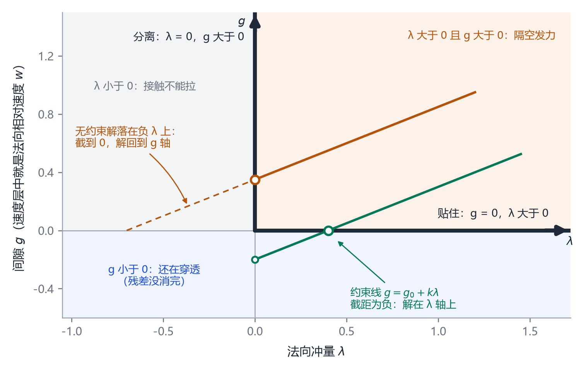
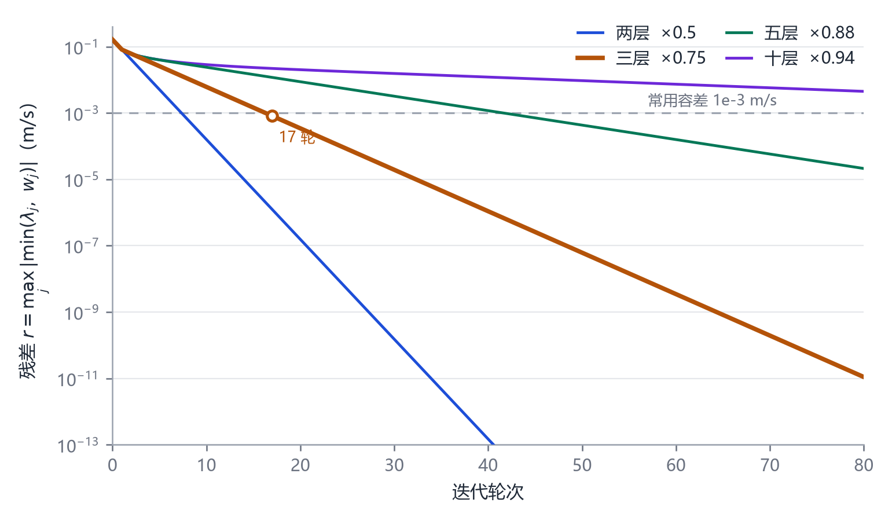

# 第 5 章 接触求解：互补与投影

> 本章导读：三个箱子摞在桌上，第一帧之后塔开始抖，底箱陷进桌面。问题不在重力算错了，而在三个接触必须同时成立。这一章把"不许穿透"写成一组不等式，再把不等式变成几十微秒能解完的迭代，最后说明为什么迭代次数会随着堆叠变高一起长。

## 5.1 第一帧就算错了

建模的人把三个箱子摞成一座塔。箱子每只 1 kg，边长 0.4 m，桌面不动，重力取 9.81。按下运行，头几帧看不出问题，因为箱子还在半空。等到接触生成的那一帧，塔开始抖：底箱陷进桌面两三毫米，中间的箱子跟着下坠，再过十几帧整摞歪掉。

把这一帧拆开算。时间步取 1/60 秒，一个箱子自由落体一步，速度变成向下 9.81/60 = 0.1635 m/s。三个箱子速度一样，接触点上的法向相对速度也是 -0.1635 m/s，负号表示两个面还在靠近。

最自然的做法是一个接触一个接触地处理。先看桌面与底箱：把底箱速度顶回零，需要 0.1635 N·s 的冲量。再看底箱与中箱：两者速度是 0 和 -0.1635，相对速度 -0.1635，接触的有效质量是 $1/(1/m+1/m)=0.5$ kg，于是冲量 0.0818 N·s，一半推中箱向上，一半把底箱往下压。最后看中箱与顶箱，相对速度只剩 -0.0818，冲量 0.0409 N·s。

三个冲量除以步长，得到这一帧的接触力：9.81、4.91、2.45 N。正确答案是 29.43、19.62、9.81 N，也就是三倍、两倍、一倍自重。第一次扫描给出的底部支撑只有它该承受的三分之一，塔当然往下沉。

更要紧的是第二件事。处理底箱与中箱时，中箱被顶起来了，底箱被压下去了 0.0818 m/s——刚归零的速度又变成了负的。等三个接触都处理完，三个接触点上的相对法向速度是 -0.0818、-0.0409、0。底部那个接触重新开始靠近，尽管它是第一个被"解决"的。

这个现象说明，逐个处理接触从来没有真正解决问题，它只是把误差从一个接触挪到另一个接触。要让一帧站得住，三个接触的不等式必须同时成立。这句话听着像废话，但它是整个接触求解的起点：不能顺序地"解决"接触，只能迭代地把它们一起逼近。

有人会想换个思路：既然接触就是不许穿透，那把接触做成一根很硬的弹簧，穿透多少就顶回多少，不就不需要解方程组了？这就是惩罚法。它确实简单，一行力公式就能跑，但弹簧刚度一高，显式积分就要求步长小到没法用；刚度一低，箱子就软软地陷进桌面。更麻烦的是，弹簧永远在"推"，物体即使只是轻轻贴着，也会被弹一下，一摞箱子就会跳。不等式描述的是"可以贴着、不可以穿过"，这个单向性正是弹簧做不到的。

## 5.2 三条要求

一次接触有两个未知量：法向冲量 $\lambda$，以及这一步结束时接触点上的法向相对速度 $w$。不是任意一对数值都合法，得同时满足三条。

第一条，不许穿透。速度层上写成 $w\ge 0$：这一步结束时，两个面要么正在分开，要么贴着一块走，不能还在互相靠近。

第二条，力只能推不能拉。$\lambda \ge 0$。

第三条最不直观：两者不能同时为正。$w$ 大于零表示已经分开，这时若还有 $\lambda$，等于隔空发力，物体被无故推飞；$\lambda$ 大于零表示在顶，这时若 $w$ 也大于零，说明顶过头了。两头都堵上，只剩

$$
w\ge 0,\qquad \lambda\ge 0,\qquad w\,\lambda = 0
$$

这三条合起来叫互补条件。把 $(w,\lambda)$ 当成平面上的坐标，可行解只落在两根半轴上：正 $w$ 轴对应"分开了、没力"，正 $\lambda$ 轴对应"贴着、有力"。两个象限被划成禁区，图 5-1 画的就是这张分区图。

<figure class="fig">

<figcaption><b>图 5-1</b>　force-gap 平面上的互补分区。横轴 $g$ 是接触点间隙（速度层里就是法向相对速度 $w$，负值表示还在靠近），纵轴是法向冲量 $\lambda$。可行的取值只有两条半轴：$g$ 为正、$\lambda=0$ 表示分离，$g=0$、$\lambda$ 为正表示贴住。落在第一象限是"隔空发力"，落在负 $g$ 轴上是"无力却穿透"，都是解错的表现。斜线 $g = g_0 + k\lambda$ 是一个接触的约束方程，解是它与可行集的交点；截距 $g_0$ 为正却算出负 $\lambda$ 时，投影把解拉回原点。</figcaption>
</figure>

图 5-1 里那条斜线值得多看两眼。它表示"如果给这个接触施加 $\lambda$ 的冲量，间隙会变成多少"：$\lambda$ 越大，物体被顶得越开，所以斜率为正。斜率就是有效质量的倒数，截距 $g_0$ 是在完全不加力时这一步结束的间隙。斜线与纵轴的交点对应负间隙——它给出一个"如果允许拉，该拉多少"的答案。真实解把这段负值截掉：接触不能拉，于是只能取 $\lambda=0$，物体继续穿进去。这就是为什么单靠一个接触的方程不够：截掉的部分必须由别的接触补上。

顺便说清一个词。很多代码里 $g$ 叫 gap，指的是几何间隙；但求解实际发生在速度层，用的是"这一步结束时的相对法向速度"，量纲是米每秒。两者差一个积分，代码里常常混着叫，读到 $\lambda w=0$ 时心里要清楚 $w$ 是速度而不是距离。

只有一个接触的时候，这一整套东西退化成一行算术。台球桌上两颗球相撞，解就是 $\lambda=\max(0,-b/k)$：算相对速度、乘有效质量、截断到非负，一次乘除完事。之所以能用顺序冲量在台球游戏里跑得飞快，就是因为台球几乎不会出现三个接触同时成立的局面——撞完就分开，接触彼此不共用物体。麻烦全部来自"共享"：一个箱子压在两个箱子上，一个接触的冲量改了那个箱子的速度，另一个接触的条件立刻就不成立了。于是问题从算术变成方程组，从方程组变成迭代。

## 5.3 一条约束写成一行

把每个接触的方程排成一行，就得到线性互补问题，缩写 LCP：

$$
\mathbf{w} = \mathbf{A}\boldsymbol{\lambda} + \mathbf{b},\qquad
\mathbf{w}\ge 0,\quad \boldsymbol{\lambda}\ge 0,\quad \mathbf{w}^{\top}\boldsymbol{\lambda}=0
$$

$\boldsymbol{\lambda}$ 是所有接触的冲量堆成的向量，$\mathbf{w}$ 是对应的相对速度，$\mathbf{b}$ 是"一个冲量都不给时，这一步结束的相对速度"，$\mathbf{A}$ 把冲量映射成速度改变。

$\mathbf{A}$ 的元素是有效质量。两个物体 $i$、$j$ 之间一个接触，法向 $\mathbf{n}$，接触点到质心的向量 $\mathbf{r}_i$、$\mathbf{r}_j$，则

$$
k = \frac{1}{m_i}+\frac{1}{m_j}
+ \left(\mathbf{r}_i\times\mathbf{n}\right)^{\top}\mathbf{I}_i^{-1}\left(\mathbf{r}_i\times\mathbf{n}\right)
+ \left(\mathbf{r}_j\times\mathbf{n}\right)^{\top}\mathbf{I}_j^{-1}\left(\mathbf{r}_j\times\mathbf{n}\right)
$$

$m_i$、$m_j$ 是两个物体的质量，$\mathbf{I}$ 是世界坐标下的惯性张量，$\times$ 是叉积。这四项说的是：质量越大越难推，接触点离质心越远、绕那根轴的惯性越小，也越难推——门把手比门轴好推，反过来从把手推门框就推不动。

$\mathbf{A}$ 的对角线是各个接触自己的 $k$，非对角线是两个接触共享物体时产生的耦合。一维三箱的例子排出来是

$$
\mathbf{A}=\begin{bmatrix}1 & -1 & 0\\ -1 & 2 & -1\\ 0 & -1 & 2\end{bmatrix},
\qquad \mathbf{b}=\begin{bmatrix}-0.1635\\ 0\\ 0\end{bmatrix}
$$

对角线上的 1 和 2 是 $1/m$ 累加：底箱只和地面接触，$1/m$；中间的箱子上下都接触，$1/m+1/m=2$。非对角线上的 -1 表示"你给的冲量会改我的相对速度"。$\mathbf{b}$ 里只有第一项非零，因为重力让所有箱子都往下走同样的量，相对速度只在最底下的接触上体现出来。

这个方程组的解是 $\boldsymbol{\lambda}=[0.4905,\ 0.327,\ 0.1635]$，除以步长就是 29.43、19.62、9.81 N。一维情形其实不用迭代：从最上面一行往回代就行。真实场景没有这个便宜——斜面接触、两个接触共享一个箱子、带转动的接触，$\mathbf{A}$ 虽然还是对称半正定，却没有三角结构，只能迭代。

转动的耦合最容易被低估。取一个边长 0.4 m、质量 1 kg 的立方体，它的转动惯量是 $m(a^2+b^2)/3$，$a=b=0.2$ 是半边长，算出来 0.0267 kg·m$^2$。让它同时被地面和侧墙顶住：地面接触在右下角，法向竖直；墙面接触在右上角，法向水平。两个法向正交，直觉上应该互不干扰，可实际排出来的 $\mathbf{A}$ 是

$$
\mathbf{A}=\begin{bmatrix}2.5 & 1.5\\ 1.5 & 2.5\end{bmatrix}
$$

非对角元 1.5 全部来自转动：地面那个接触的力矩臂是 $a$，墙面那个是 $b$，两者的乘积除以惯性张量就是 $ab/I=1.5$。这个矩阵的特征值是 1 和 4，条件数 4，PGS 在它上面可能来回振荡好几轮才收敛。如果物体是个细长杆，$I$ 很小，非对角元会大到让矩阵接近奇异，这时候真正的解法不是多迭代，而是把两个接触放进同一个块里一次解掉。

半正定这个性质是后面所有算法的地基。$\mathbf{A}=\mathbf{J}\mathbf{M}^{-1}\mathbf{J}^{\top}$，$\mathbf{J}$ 是接触雅可比，$\mathbf{M}$ 是质量矩阵。$\mathbf{M}^{-1}$ 正定，所以 $\mathbf{A}$ 至少半正定；接触法向线性无关时它正定。正定加上互补条件，解存在且唯一，这一点在文献里早就被反复证明 [@stewart1996]。工程上更关心的是另一件事：正定意味着把求解写成"最小化一个凸二次函数"，而凸问题可以用最简单的迭代法慢慢磨。

## 5.4 投影高斯-赛德尔

实际引擎里最常用的迭代叫投影高斯-赛德尔（PGS）。做法朴素到不像个算法：一行一行地看，每次只让一行满足条件，其余行的冲量先不管。

$$
\lambda_j \leftarrow \max\left(0,\ -\frac{1}{A_{jj}}\Big(b_j+\sum_{k\ne j}A_{jk}\lambda_k\Big)\right)
$$

$A_{jj}$ 是这一行的对角元，求和里不含 $j$ 自己。括号里算的是"其他接触都按当前值给，这个接触还需要多少冲量才能让相对速度归零"，再截断到非负。一轮扫过所有接触叫一次迭代，扫的顺序通常是从下往上，或者交替上下。

为什么这样能收敛？把求解写成最小化

$$
f(\boldsymbol{\lambda}) = \tfrac12\boldsymbol{\lambda}^{\top}\mathbf{A}\boldsymbol{\lambda}+\mathbf{b}^{\top}\boldsymbol{\lambda},
\qquad \boldsymbol{\lambda}\ge 0
$$

因为 $\mathbf{A}$ 正定，$f$ 是个开口向上的碗，解就是碗底落在第一象限卦限里的那个点。逐行更新等价于沿着一个坐标方向精确地走到最低点，再把越界的部分压回 0——这正是投影坐标下降。凸函数在坐标下降下必然收敛，速度由 $\mathbf{A}$ 的条件数和耦合强度决定。

$\mathbf{A}$ 的稀疏性决定了这个算法为什么便宜。行 $j$ 只在牵挂同一物体的其他接触上有非零元，所以一行的非零元个数等于两个物体各自接触数之和加一，与场景总体规模无关。一次迭代的成本正比于接触数乘一个常数，跟场景里有多少物体没关系。

坐标下降的代价是按坐标走，走的是折线。接触之间耦合强的时候，折线会在碗底附近来回横跳，收敛慢。块求解的思路是别再一个坐标一个坐标地走：把互相牵扯最紧的若干个接触凑成一小块（比如一个箱子上的四个角点），对这一小块直接求精确解，块与块之间仍然用 PGS。块的大小通常取 2 到 4，因为 4×4 的 Cholesky 分解还是几个乘加，再大就划不来了。多数引擎给这个功能留了个开关，默认关闭，遇到堆叠抖得厉害才打开。

扫描顺序不影响最终解，但影响收敛速度，有时差得很多。三箱的例子里从上往下扫，第一轮顶箱先拿到它该有的冲量，信息往下传一层；从下往上扫，底箱先拿到一个偏小的值，得靠后面几轮补。实践中常见两种做法：一是交替方向扫，二是按接触图做分层——先解"局部孤立的接触组"，再解连成一片的。这个思路被整理成冲击传播（shock propagation），把冲量沿着接触连成的树往上推，堆叠的收敛能快一个数量级 [@erleben2007]。

还有一个选择是干脆不迭代：接触数很少时（比如一辆车的四个轮子），直接把 $\mathbf{A}$ 分解了求精确解。$\mathbf{A}$ 是 $n\times n$，$n$ 是接触数，$O(n^3)$ 的分解在 $n$ 小于几十时完全可接受。实时引擎里两种解法常常并存，按接触数切换。

## 5.5 越高越难

把同样的 PGS 用到 $n$ 层堆叠上，残差随迭代的变化会变得很难看。残差取

$$
r = \max_j \left|\min\left(\lambda_j,\ w_j\right)\right|
$$

它为零当且仅当互补条件成立。图 5-2 是 $1$ kg 的箱子、步长 1/60 秒、无摩擦无恢复系数时，一帧内从零初值开始的残差下降。

<figure class="fig">

<figcaption><b>图 5-2</b>　三层堆叠的 PGS 残差随迭代下降，纵轴取对数。参数：每只箱子 1 kg，$\Delta t=1/60$ s，$g=9.81$，无摩擦、无恢复系数，冲量初值全零，迭代顺序自下而上。两层的残差每轮减半，三层每轮乘 0.75，五层约乘 0.88，十层只乘 0.94：堆得越高，收敛越慢。要达到 $10^{-3}$ m/s 的残差，两层需要 8 轮，三层 17 轮，五层 42 轮，十层 141 轮。</figcaption>
</figure>

曲线可以读出一条规律：层数为 $n$ 时，残差的衰减比大致是 $\cos^2\!\big(\pi/(2n+2)\big)$ 这一类随 $n$ 逼近 1 的量，直观地说，$n$ 越大，每轮能消掉的比例越小。三层到十层，从 0.75 掉到 0.94，看着差距不大，但迭代次数是从 17 涨到 141——指数上的差别，不是线性的。

原因不难想。$\mathbf{b}$ 里只有最底下那一项非零，因为只有那里"底部被地面挡住、上部还悬着"这个不对称才产生相对靠近。冲量要从地面往上爬，一层一层地传：第一轮扫描把底部的缺口补上一点，补上的量又改变了上面一层所需的冲量，但那一层在本次扫描里已经过去了，只能等下一轮。一次扫描最多把信息往上传一层，$n$ 层就要 $n$ 次。这跟热传导里显式格式的传播极限是一回事。

工程上能做的事有三件。第一，增加迭代次数，代价是时间，实时引擎的预算通常是 8 到 20 轮，够两层不够十层。第二，减小步长或者加子步：残差是速度量，步长减半，每帧需要消掉的速度也减半，而迭代次数不变，等于白赚一倍精度。第三，换求解顺序或者换算法：冲击传播、块求解、把整摞用一个"复合刚体"处理。真实引擎里三者常常一起用。

## 5.6 速度层之后还有位置层

PGS 解完之后，所有接触的法向相对速度非负，含义是"从这一刻起，物体不会再互相靠近"。但它没说已经进去的部分怎么办。一个箱子在上一帧陷进桌面 5 mm，这一帧解出的相对速度是 0，那它就永远嵌在那里。

所以接触求解通常有两层。速度层解决"接下来会不会穿"，位置层解决"已经穿了多少"。

位置层有三种常见写法。第一种是 Baumgarte 稳定化：把穿透深度换成速度偏置，塞进 $\mathbf{b}$ 里。

$$
b_j \leftarrow b_j - \frac{\beta\, d_j}{\Delta t}
$$

$d_j$ 是穿透深度（正值表示已穿），$\beta$ 是 $0$ 到 $1$ 之间的系数，通常取 0.1 到 0.2。这个偏置要求接触点这一步至少分开 $\beta d_j$，于是穿透按几何级数慢慢退掉。问题在于这个速度是真的：物体确实带着一个向外的小速度，下一步如果接触消失，它就带着这个速度飞出去，看起来像凭空弹了一下。

第二种是 split impulse：位置修正用一套独立的速度，解完之后只拿来改位置，不写回真实速度。虚假弹跳就没了，代价是要维护两份速度、多解一次。

第三种是直接改位置：把两个物体沿法向推开，按质量比例分配，反复几轮。这种做法在基于位置的动力学里很常见，稳定、不容易爆，但它不遵守冲量守恒，动量和能量都对不上，对重物压轻物的场景会推出不自然的结果。

位置层和摩擦层还要配合。摩擦的切向约束作用在速度层，位置修正如果只沿法向做，斜面上的物体就会"每帧往上推一点、再被摩擦拉回一点"，形成缓慢的爬行。交错投影的办法是法向与切向交替做位置修正，各投影一半，收敛之后再进下一步 [@kaufman2008]。

位置修正还得限幅。三步里任何一步都不该一次改完穿透的全部深度：物体可能本来就嵌在两层地板之间，唯一能去的地方是原地；也可能一改就把另一个接触顶穿，来回拉锯。常见做法是每步最多修掉剩余穿透的一部分，最多修几毫米，改完重新算接触点。这样做不会让穿透消失得更快，但会让它消失得更稳。

还有一个顺序问题：先速度还是先位置。主流做法是速度层解完、积分位置、然后再做一次位置修正，修正的结果不影响速度。反过来的做法（先修位置再解速度）在接触点移动很快时会打架：位置一改，接触点就换了，刚算好的冲量对不上新的接触点。

## 5.7 什么时候停

迭代不能无限做下去，得有个停的条件。工程上真正用的是三个量。

第一个是残差 $r$，就是 5.5 节那个 $\max|\min(\lambda,w)|$，单位是米每秒。它的含义是"还有多大的靠近速度没被消掉"。容差取 $10^{-2}$ 到 $10^{-3}$ m/s 这一档，对应一步之内零点几毫米的额外穿透，肉眼看不出来。

第二个是穿透深度，单位是米，属于位置层。容差通常取 1 mm 左右。这个数不是拍脑袋：假设镜头里竖直方向覆盖 10 m 场景、屏幕 1080 像素，一个像素约 9 mm，1 mm 的穿透不到八分之一个像素。要求更严没有意义，只是浪费迭代。

第三个是迭代次数上限，它是保险丝，不是精度控制。实时引擎给 8 到 20 轮，物理引擎给 50 到 100 轮，离线仿真可以给几百轮。上限触发了就说明这一帧没有解干净，要么接受误差，要么在别处补偿。

两个容差是不同的物理量，代码里必须分开判断。只判残差会漏掉"速度干净但位置已经陷进去"的情况——上一帧陷进去 4 mm，这一帧速度为零，残差为零，但画面里那个箱子是嵌在桌里的。只判穿透又会漏掉"位置还没穿但速度正在往里冲"。

解开之后残差还是降不下来，说明问题不在迭代次数。常见的三种原因：接触太多、堆得太高，那要减步长或上块求解；约束互相矛盾，比如一个物体同时被三个面挤住，那要检查几何是不是重叠了；质量比太悬殊，比如一辆 1 吨的车压在一个 10 g 的硬币上，那 $\mathbf{A}$ 的条件数会很差，PGS 磨不动。最后这种情况，改迭代次数是没用的，得改建模——或者用能处理大质量比的求解器。

实践上还有个习惯值得养成：让求解器把每次迭代的残差、触发的上限、这一帧的最大穿透都记下来，做成一条曲线。堆叠抖动的问题几乎都能从这条曲线上看出来——残差在某个固定值附近卡住，说明有约束互相矛盾；残差降到 1e-5 却还在抖，说明问题在位置层或积分器；残差每帧从很大的值重新开始，说明上一帧的冲量没有被继承下来。这三种情况的处理方向完全不同，光看画面是分不出来的。
