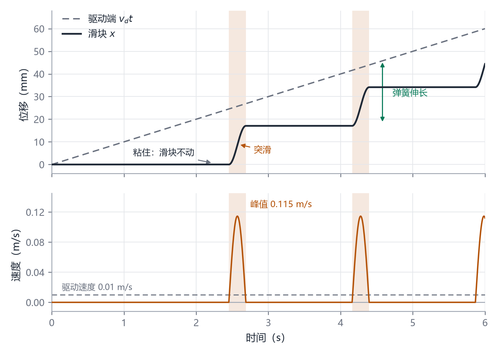
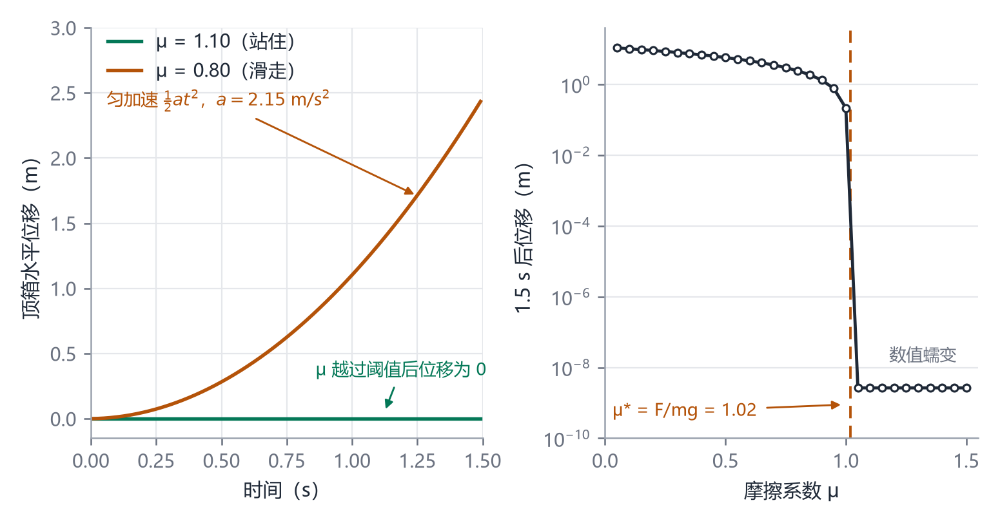

# 第 6 章 摩擦：库仑、锥与各向异性

> 本章导读：推一个箱子，力气小推不动，力气过了某个坎它突然窜出去；抽屉卡一下才滑开。摩擦是接触里唯一"必须用不等式描述"的方向，也是堆叠能不能站着的关键。这一章讲摩擦锥怎么写进求解器、为什么引擎要记住接触点、粘滑是怎么来的，以及摩擦系数大一点到底稳不稳。

## 6.1 推不动的那个坎

一只 10 kg 的木箱放在水泥地上，箱子与地面的摩擦系数取 0.4。用手平推，力从 10 N 加到 30 N，箱子纹丝不动；加到 39 N，还是不动；加到 40 N 那一刻，箱子突然滑出去，之后只要略小一点的力就能让它匀速前进。

这个现象古人早就知道，但把它变成两条可以写进代码的规则是库仑的功劳。第一条：静摩擦有一个上限，等于摩擦系数乘正压力，

$$
|\mathbf{f}_t| \le \mu f_n
$$

$\mathbf{f}_t$ 是切向（接触面内）的摩擦力，$f_n$ 是法向压力，$\mu$ 是无量纲的摩擦系数。摩擦力不超过这个上限时可以取任何值，具体取多少由"刚好不让物体动"决定——这是一个待定的量，不是一个能直接算出来的量。

第二条：一旦滑起来，动摩擦力的大小约等于 $\mu_k f_n$，方向与相对滑动方向相反。$\mu_k$ 叫动摩擦系数，通常比静摩擦系数 $\mu_s$ 略小。

斜面是同一个坎的另一种测法。把箱子放在倾角 $\theta$ 的斜面上，重力沿斜面的分量是 $mg\sin\theta$，正压力是 $mg\cos\theta$，两者之比就是 $\tan\theta$。箱子不动要求 $\tan\theta\le\mu$，所以 $\theta_c=\arctan\mu$ 这个角叫摩擦角，$\mu=0.4$ 对应 21.8 度。搬沙子的工地堆出的圆锥，锥面倾角就是这个摩擦角；沙子的摩擦系数大约 0.6，堆出来是 31 度。同一个道理，干燥的沙堆比湿的陡，湿沙颗粒之间有毛细水的黏聚力。

法向那边只有两条要求（不穿透、力非负），摩擦这边难在三处。

第一处，静摩擦是一整段区间而不是一个数。法向冲量是解出来的一个值，切向冲量只要落在 $[-\mu f_n,\ \mu f_n]$ 里都合法，靠"相对切向速度为零"来挑那一个。

第二处，$\mu_s$ 与 $\mu_k$ 是两个系数。用法向那一套写法的话，得记住"这个接触现在是在粘还是在滑"，粘的时候用上限 $\mu_s$，滑的时候用 $\mu_k$。状态量藏在接触里，一帧之内可能翻好几次，需要事件检测。

第三处，切向在三维里是一个平面，不是一根轴。摩擦力的方向本身也要解，约束变成"这个向量不能出圆"，圆一沿法向拉起来就是个锥。

库仑当年还给了两条“反直觉”的结论，它们让摩擦系数这个简单的数字变得可信。一是摩擦力与接触面积无关：同样重的箱子平放和侧放，推起来的阻力差不多；二是摩擦力与速度无关，推得快推得慢，阻力差不多。这两条在宏观尺度上站得住，微观上都不对——真实接触只发生在表面凸起的尖端，总面积远小于看上去的面积，而局部压强早就把材料压出了塑性变形。引擎里之所以敢用一个常数，是因为它在人的尺度上够用，且稳定；至于为什么够用，那是摩擦学的问题，不是模拟器的责任。

## 6.2 摩擦锥与两条出路

把切向冲量的两个分量 $p_1$、$p_2$ 与法向冲量 $\lambda$ 放在一起，合法区域是

$$
\sqrt{p_1^2+p_2^2}\ \le\ \mu\lambda,\qquad \lambda\ge 0
$$

这是一个以接触点为顶点、沿法向张开的圆锥，叫摩擦锥。锥这个形状不是数学上的花活，它来自物理：法向压力越大，能提供的摩擦越大，所以锥的截面半径正比于离顶点的距离，剖面像一把张开的剪刀，斜边的斜率就是 $\mu$。锥内的点对应粘住，锥面上的点对应正在滑。一摞箱子里最底下的接触法向力最大，摩擦容量也最大；最上面的接触只有一层箱子的重量，最先滑。

锥约束本身是凸的，但互补条件和它凑在一起就不是 LCP 了，而是二阶锥互补问题。实时引擎不愿意解这个，于是有两条路。

第一条路是把圆换成多边形。取 $m$ 个均匀方向 $\mathbf{d}_k$，把切向冲量写成非负系数的组合 $p=\sum_k \alpha_k \mathbf{d}_k$，$\alpha_k\ge 0$，约束 $\sum_k \alpha_k \le \mu\lambda$，每个方向再配一条互补条件。这是标准的 LCP，能塞进 PGS。代价是各向异性的误差：八个方向内接，最坏的方向（45 度）上允许的冲量只有真值的 $\cos 22.5^\circ = 0.924$ 倍，也就是少了 7.6%。想更准就加到 16 个方向，误差降到 2%。

第二条路是干脆不要互补。把"切向速度与切向冲量互补"这一条丢掉，只留锥约束，问题变成一个凸二次规划，一定有解、且解唯一，可以用投影梯度或内点法 [@anitescu1997]。丢掉互补的物理含义是允许一点点残余滑动——物体在斜面上会极慢地蠕变，但不会解不出来、也不会因为初值不同而结果不同。机器人仿真里这条路特别受欢迎，因为"一定有解"比"完全静止"重要得多。

两条路的选择基本取决于用途。要画面上看起来完全静止的堆叠，用多边形近似加互补；要保证每帧都能返回一个可信结果、还要对参数求导，用松弛的凸形式。

多边形写法里有个细节值得知道：多出来的每个方向都是一个新未知量，八方向就是每个接触多八个标量，而且它们共用一个锥约束。这和法向的一行一变量不一样，锥约束把八个方向绑在了一起，PGS 逐行扫的时候很难同时满足。常见的处理是先扫法向、再扫切向、最后把总和裁到上限，几轮之后大致收敛。做法不难，但它解释了为什么带摩擦的场景比无摩擦慢好几倍：接触数没变，未知量翻了九倍。

还有一点：锥边界上的点对应“正在滑”，锥内部的点对应“粘着”，两者在数学上差一个满足与不满足的等号，在数值上却是连续的——冲量刚好等于上限时，物体可能下一帧就滑了也可能还粘着。这种模糊地带是摩擦抖动的主因之一，后面讲稳定化时会再碰到。

## 6.3 摩擦锚点

速度层的摩擦有一个隐蔽的缺陷：它只约束"这一步的相对切向速度为零"，不管"这一步之前已经滑到哪里了"。

一段斜面上的箱子能说明问题。斜面倾角不大，摩擦足够，箱子本该一动不动。每一帧算出来：切向相对速度为零，摩擦冲量刚好抵消重力分量，箱子不动。数值上却不完全是这样：求解有容差，位置积分有舍入，几帧之后箱子往下挪了零点几毫米；下一帧的摩擦只是让它"这一刻不动"，那零点几毫米就留在那里了。一秒钟六十帧，一分钟下来，箱子在斜坡上爬了半厘米。

更明显的症状在堆叠上。一摞箱子本该纹丝不动，几秒钟之后整摞缓慢地往一边偏，越上面的偏得越多，最后像被谁推倒一样塌下去。

解决办法是给每对接触一个锚点。接触第一次建立时，把接触点所在的两个物质点在世界坐标里的位置记下来；之后切向约束不再要求"速度为零"，而是要求"回到锚点"。锚点跟着物体运动，两个物体各自按自己的位姿把锚点变换到世界坐标，差出来的位移就是要修的切向量。

$$
\mathbf{C}_t = \left(\mathbf{x}_i+\mathbf{R}_i\mathbf{a}_i\right)-\left(\mathbf{x}_j+\mathbf{R}_j\mathbf{a}_j\right)
$$

$\mathbf{x}$ 是质心位置，$\mathbf{R}$ 是姿态，$\mathbf{a}_i$、$\mathbf{a}_j$ 是锚点在两个物体局部坐标里的位置。这个差值进入位置层，跟法向的穿透一起被投影掉。切向冲量因此有了记忆：它累积起来，攒到超过 $\mu\lambda$ 才让锚点断开、重新建立。

有了锚点，静摩擦从"每帧速度为零"变成"位置不许漂"，蠕变基本消失。副作用是接触的寿命变长：物体如果整体滑了一段，锚点还在原地，切向修正会很大，超过上限就该断开重建，判断阈值通常是切向位移超过几毫米或者冲量饱和。

锚点和法向的割线投影经常被放在一起做，法向与切向交替投影，各自只修一部分，几轮之后收敛 [@kaufman2008]。交替而不是同时，是因为两个方向修正会互相干扰：沿法向推开一点，切向锚点就错位了。

锚点还顺带解决了另一个问题：初值。没有锚点，每帧的切向冲量从零开始迭代，第一帧的结果和上一帧无关；有了锚点，上一帧累积的切向冲量可以直接用作本帧的初值，粘着的接触几乎不用迭代就能保持不动。摩擦的“记忆”在数值上和物理上是同一件事——真实接触面的微观咬合也确实有记忆，两个面在同一个位置贴了很久，再推动它就需要更大的力。

## 6.4 粘滑

摩擦最容易被忽略的一个细节是它不稳定。

桌面上放一个 1 kg 的滑块，左边系一根刚度 200 N/m 的弹簧，弹簧的另一端被一台机器以 0.01 m/s 的速度匀速拉开。摩擦系数取静 0.5、动 0.35，重力 9.81。图 6-1 是这么跑出来的位移曲线，用 $2\times10^{-5}$ 秒的步长积了 6 秒。

<figure class="fig">

<figcaption><b>图 6-1</b>　弹簧拉滑块的粘滑。参数：$m=1$ kg，$k=200$ N/m，驱动速度 $v_d=0.01$ m/s，$\mu_s=0.5$，$\mu_k=0.35$，$g=9.81$，$\Delta t=2\times10^{-5}$ s。上图是滑块位移与驱动端位移，下图是滑块速度。粘住阶段滑块不动，两条曲线之间的竖直距离就是弹簧伸长量，弹力涨到 $\mu_s mg=4.905$ N 时崩开。一次突滑历时约 0.24 s，峰值速度 0.115 m/s，是驱动速度的十一倍，滑块前进约 17 mm 后重新停住。周期 1.71 s；六秒里出现三次突滑，第三次在 6 s 时还没结束。</figcaption>
</figure>

曲线像台阶：水平段滑块不动，陡升段是突滑。粘住的时候滑块静止，驱动端以 0.01 m/s 匀速前进，两条曲线之间的竖直距离就是弹簧的伸长量，弹力 $k(x_d-x)$ 随之线性上涨；涨到 4.905 N（正好是 $\mu_s mg$）那一刻，静摩擦顶不住了，滑块开始滑。摩擦降为 $\mu_k mg = 3.43$ N，弹簧力还大于它，滑块加速，0.24 s 内冲出 17 mm，峰值速度 0.115 m/s，是驱动速度的十一倍。弹簧一被追上，弹力回落到 3.43 N 附近，加速度过零变负，滑块停下来重新粘住。这时它仍落后驱动端约 10 mm，弹簧保持着近 2 N 的拉力，所以下一轮只要再撑 1.47 s 就又崩开。

用估算对一下：如果把突滑当成瞬时，一个周期里驱动端要多走 $2(\mu_s-\mu_k)mg/k = 14.7$ mm 才能再次触发，除以 0.01 m/s 得 1.47 s。实测 1.71 s，差的那部分是突滑本身也花了 0.24 s，这段时间驱动端照样在走。

粘滑在引擎里是个麻烦。它需要区分静摩擦与动摩擦、需要检测速度过零、需要处理"一帧之内粘了又滑"。多数实时引擎干脆只用一个 $\mu$，让摩擦冲量在速度接近零时按 $\mu\lambda$ 截断，等于把 $\mu_s$ 与 $\mu_k$ 合并成一个值。这样粘滑的物理没了，但也不会出现"吱吱叫"的抖动——真实世界里那种尖叫的门轴、刹车时的震颤，本质上都是粘滑，模拟它需要很小的步长和显式的状态切换。

即使不区分两个系数，粘滑也会以另一种形式回来。用一个大步长（比如 1/60 s）跑图 6-1 那个场景，弹簧在一个步长里就能多拉 0.17 mm 的量，摩擦冲量的分辨率相应为 $\mu mg\Delta t = 0.08$ N·s，实际可能一次性超过或不到静摩擦阀值。结果就是滑块在每个步长里"微粘一下、微滑一下"，位移曲线变成一堆小台阶，看上去像在抖。这不是物理，是时间离散的产物。想看到真的锯齿，步长要小到远小于突滑持续时间（本例里是 0.24 s），两三个数量级的差距才够。

## 6.5 各向异性摩擦

前面所有讨论都假定摩擦系数是一个标量，各个方向一样。真实的表面很少这么客气。

布料的经纬两个方向织法不同，沿经线拉和沿纬线拉的阻力能差两成；动物毛发顺摸和逆摸的手感完全不同；轮胎的纵向（滚动方向）和横向（侧向）抓地力差得更多，赛车上这两个系数要分开调；滑雪板沿板长方向和侧向更是两套数；木头的纹理方向也常被单独处理。

数学上这是把 $\mu$ 换成一个各向异性的关系。锥还在，截面从圆变成椭圆：

$$
\left(\frac{p_1}{\mu_1}\right)^2+\left(\frac{p_2}{\mu_2}\right)^2 \le \lambda^2
$$

$p_1$、$p_2$ 是两个切向主方向上的冲量，$\mu_1$、$\mu_2$ 是对应的摩擦系数，主轴固定在物体的局部坐标里。

实现上有三种做法，代价依次上升。最省事的是各自截断：两个切向各用各的上限，互不干涉。这样每个方向的上限是对的，但合起来允许的区域是个矩形，对角方向的上限变成 $\sqrt{\mu_1^2+\mu_2^2}$ 倍，比椭圆大了四成多——相当于在斜方向上偷偷加了摩擦，物体要滑不滑的时候会"卡"在一个不该卡的角度上。

第二种是各方向不等长的多边形：还是在切向平面上取若干方向，但每个方向的长度按椭圆来算。这种近似可以做到与椭圆一致到几个百分点，代价是方向数要多一些，且主轴必须跟物体一起转。

第三种是直接解椭圆约束，用二阶锥规划。精度最高，代价是每一步都要解一个锥约束问题，实时引擎里基本只在离线仿真或者机器人训练里用。

各向异性还有个容易忘的地方：主轴随物体转动。物体转 90 度，经向和纬向就换了位置，锚点必须跟着转，否则就会凭空出现一个垂直于滑动方向的力。这个力通常不大，但在布料和毛发上会表现得像"物体自己在扭"。

布料是各向异性最典型的使用者。编织物的经向和纬向刚度差异很大，斜向（约 45 度）又最软，这就是为什么一条手帕对角拉比正着拉容易得多。把这些搬到接触上，意味着布与布、布与身体之间的摩擦也要分方向：沿纱线方向滑得动，垂直方向却容易卡住，所以裙子在腿上会"转"而不是直接滑下去。毛发更夸张，逆毛方向的摩擦系数可以是顺毛的好几倍，这就是为什么撸猫只能顺着来，也是为什么毛发渲染里要单独算一层切线方向。

## 6.6 摩擦与堆叠

把摩擦拿掉，塔立刻塌——这句话不是修辞。三个箱子摞起来，只要有一点点侧向扰动，没有摩擦的接触只能提供法向力，任何水平分量都无法平衡，箱子会像台球一样滑开。真实的一摞箱子能站着，靠的就是每个接触面上那点切向力把水平方向的误差吃掉。

摩擦要多大才够，可以算。三个 1 kg 的箱子摞着，最上面那只受 10 N 的水平推力。要让整摞不动，最上面那个接触必须传出 10 N 的切向力，而它的法向力只有一个箱子的重量 9.81 N，所以

$$
\mu \ge \frac{10}{9.81} = 1.02
$$

下面两个接触的法向力分别是 19.62 N 与 29.43 N，需要 0.51 与 0.34，都比 1.02 松。所以决定成败的是最上面那个接触——法向力最小的地方最先滑，这个规律在更复杂的堆叠里也成立。

<figure class="fig">

<figcaption><b>图 6-2</b>　摩擦系数对堆叠稳定性的影响。每只箱子 1 kg，三层叠放，顶箱受 10 N 水平力，$\Delta t=1/120$ s，法向与切向都用 PGS，迭代 60 轮，摩擦上限取 $\mu\lambda$。左图是 $\mu=0.8$ 与 $\mu=1.1$ 两种情况下顶箱的位移—时间曲线。右图是 1.5 s 后顶箱的位移随 $\mu$ 的变化：$\mu$ 小于 1.02 时整层滑走，位移随 $\mu$ 减小而线性增大（$\mu=0.4$ 时 6.87 m，与 $(10-\mu mg)/m$ 的匀加速对得上），$\mu$ 越过 1.02 之后位移掉到 $10^{-9}$ m 量级，只剩数值蠕变。</figcaption>
</figure>

图 6-2 是这套公式的真实回算。摩擦系数从 0.05 扫到 1.5，顶箱 1.5 秒后的水平位移在 $\mu = 1.02$ 处发生突变：左边随 $\mu$ 减小几乎线性上升，右边停在 $3\times10^{-9}$ m，也就是数值噪声的量级。$\mu=0.4$ 时位移 6.87 m，用 $a=(10-\mu mg)/m = 6.08$ 匀加速算 1.5 秒是 6.84 m，对得上。

摩擦不足的失败有三种样子，看位移曲线就能分清。整摞一起滑走，说明地面那个接触先破了，$\mu$ 低于 $F/(3mg)$；只有上面几层错位，说明中间的接触破了，塔会歪；只有顶箱飞出去，说明最上面那个接触破了，下面还是稳的。三种情况的修法不同：第一种要加地面摩擦或者减小推力，后两种要改材质分布或者把重物放下面。

摩擦太大也不是好事，这一点容易忽略。摩擦会把位置修正吃掉：法向把物体推开一点，切向的锚点却把它拽住，两个约束打架，结果是谁也没修干净，堆叠看起来站着，但每一帧都在缓慢漂移。摩擦锥过大还会让 $\mathbf{A}$ 的条件数变差，PGS 需要更多迭代。把库仑摩擦写进时间步进的统一形式，是这类问题的标准出发点，它保证了在摩擦锥凸的条件下解的存在性 [@stewart1996]。

最后是一个工程上的经验数字：堆叠场景里摩擦系数取 0.5 到 0.8，比取 1.5 稳得多。真实木材对木材大约 0.4，橡胶对混凝土能到 1.0，但引擎里没人会把 $\mu$ 调到 1 以上然后期待塔更稳——那样只会让接触更难解，然后把抖动换成漂移。

还有一个求解顺序上的事实：摩擦不能补几何。如果碰撞检测给出的接触法向算错了，比如把箱子的棱当成面，摩擦会顺着那个错误的方向使出力气，箱子就会沿着一条不该存在的滑道慢悠悠地吐出去，看着像"被风推"。先把法向算对，再谈摩擦，顺序不能反。

从求解器角度看，法向与切向也不是平等的。法向冲量决定了摩擦上限，切向冲量却不影响法向，所以先把法向解完再解切向，比反过来稳定。代价是这个顺序把两个本来耦合的量拆开了，严格地说得到的不是原方程的解，只是它的一个不动点；实践中这个不动点离真解很近，迭代几轮就够了。
