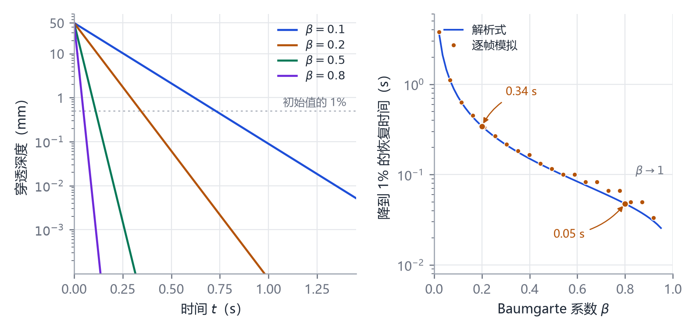
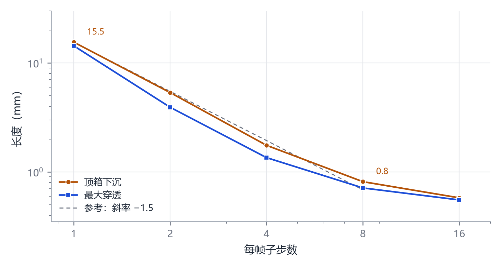

# 第 7 章 堆叠、抖动与稳定化

> 本章导读：单个接触的解，第五章已经写完了。难的是把几十个接触摞在一起：重量要一层层传下去，迭代预算却只有几遍。这一章讲工程上怎么把这件事按住——把穿透换成速度的 Baumgarte、把位置修正单独拿出去的 split impulse、把一帧切开的子步，以及休眠、热启动这些看起来像补丁、实际上决定手感的做法。

仓库角落里摞着十只木箱。刚松手时它站得很稳，过两三秒，最下面那只开始慢慢往下陷，箱与箱之间露出一条细缝；再凑近看，整摞箱子在以每秒二三十次的频率发抖，像被一台看不见的压缩机顶着。把箱子减到两只，参数一个字不改，什么毛病都没有。

问题不在某一个接触，而在接触之间。两个箱子只有一个接触，一次求解就能算干净；十只箱子有九个接触加一个地面接触，底下的接触要托住上面全部重量，而求解器一次只读一行的速度。堆叠把孤立的约束连成了一张网，迭代次数、求解顺序、误差累积全都被这张网放大了。

## 7.1 一张被迭代预算卡住的约束网

先看两只箱子。上面的箱子压着下面的，接触法向竖直，有效质量是

$$
k=\frac{1}{\mathbf{n}^{\mathsf{T}}\left(m_1^{-1}+m_2^{-1}\right)\mathbf{n}},
\tag{7.1}
$$

$\mathbf{n}$ 是单位法向，$m_1$、$m_2$ 是两个物体的质量。一维情形下它就是 $m_1m_2/(m_1+m_2)$。顺序冲量处理这个接触时，把它当成一个独立的一维问题，求出冲量，改掉两个物体的速度，再去看下一个接触。两只箱子只有一个接触，这一步就是全部。

十只箱子不一样。求解器从最上面的接触开始扫，把上箱的速度改一点，再扫下一层。重量要沿着接触链往下传：第一遍扫描只把最上面一层的重量传到第二层，第二遍再传到第三层。要让顶部的重量抵达地面，至少需要与层数相当的扫描次数。有效质量只看当前这一行的两个物体，它不知道上面还压着八只箱子。迭代次数与堆叠高度有关，根子就在这里。

扫描顺序也会改变需要的遍数。从下往上扫，底层的冲量先更新，它托住第二层，第二层的有效质量里就带上了底层的响应，重量一趟能传到顶；从上往下扫，每一层都要等下一遍才看得到下面的支撑，十层就要十遍。多数引擎按接触的生成顺序扫，既不是严格从下往上，也不是严格从上往下，所以实际的收敛遍数介于两者之间，堆得越高越难预测。

Erleben 那篇讲冲击传播的文章把这件事说得很直白：接触图有方向，按深度排序、让一次扫描把冲击送到链的末端，比盲目多迭代有效得多 [@erleben2007]。后来许多引擎的“接触排序”“按岛求解”都是这个思路的变体。

误差还会累积。每个接触允许一毫米穿透，十层叠起来就是从上到下一厘米的压缩；速度上的残差每帧积分一次，位置误差不会自己消失，只会换一种形式藏起来。更麻烦的是几何在变：箱子稍微一歪，接触点就沿着接触面滑动，上一帧缓存的位置对不上，接触法向也可能从面法向跳成边法向。求解器每帧都在重新认识这摞箱子。

所以堆叠的难点可以拆成三件事：约束耦合让信息传得慢，迭代预算让信息传不完，离散误差让每一帧都留下一点残余。后面的几种手段，分别对着这三件事。

## 7.2 Baumgarte：把穿透折成速度

速度层的求解只保证“这一刻不继续靠近”。位置积分之后，物体还是可能陷进去一点；下一帧再解，再陷一点。Baumgarte 稳定化做的事，是把已经发生的穿透折算成一个目标分离速度，让求解器顺手把它推出来。

记接触间隙为 $C$，分离为正，穿透为负；穿透深度 $p=-C$。速度约束写成

$$
\mathbf{J}\mathbf{v}+b\ge 0,\qquad b=\frac{\beta}{\Delta t}C,
\tag{7.2}
$$

$\mathbf{J}$ 是接触行的雅可比，$\mathbf{v}$ 是广义速度，$\beta$ 通常取 0 到 1，$\Delta t$ 是步长。穿透时 $C\lt 0$，$b$ 为负，约束要求 $\mathbf{J}\mathbf{v}\ge -b=\beta p/\Delta t$，也就是至少以这个速度分开。$\beta=0$ 时退化成“不许继续靠近”，正是没有稳定化时的写法。

一维、不计重力时，这个修正很干净。每一步求解后法向速度是 $\beta p/\Delta t$，位置积分一步，新的穿透是

$$
p_{n+1}=(1-\beta)p_n .
\tag{7.3}
$$

穿透按几何级数缩水，缩到初始值的百分之一需要

$$
n=\frac{\ln 0.01}{\ln(1-\beta)}
\tag{7.4}
$$

步。$\beta=0.2$、$\Delta t=1/60$ s 时约 21 步、0.34 秒；$\beta=0.8$ 时只要 3 步、0.05 秒。$\beta=1$ 时式 (7.3) 一步就把穿透抹平，听起来完美，但只在不计重力、只有一个接触时成立；$\beta$ 再大一点，$p_{n+1}$ 变成负数，穿透翻成离开地面的缝隙，下一步又反向修正，于是来回振荡。图 7-1 左边是几条实际的衰减曲线，右边是恢复时间随 $\beta$ 的变化。看起来系数越大越好，但工程上恰好相反：常用值在 0.1 到 0.3 之间。

原因是重力。物体压在面上，每一步重力给它 $g\Delta t$ 的向下速度，Baumgarte 给它 $\beta p/\Delta t$ 的向上速度，两者平衡时

$$
p_{\mathrm{eq}}=\frac{g\,\Delta t^{2}}{\beta}.
\tag{7.5}
$$

$\Delta t=1/60$ s 时，$\beta=0.2$ 对应 1.4 厘米，$\beta=0.5$ 对应 5.4 毫米，$\beta=0.8$ 对应 3.4 毫米。Baumgarte 并不能把穿透消成零，它只是把穿透压到与重力相称的深度。系数越大，稳态越浅，但每一步塞进去的修正速度也越大。多接触一起工作时，这些修正会互相推挤：底层推上层，上层又压回来，速度里出现一个与真实运动无关的高频分量，看上去就是抖。

工程上还会配一个允许穿透量 $s$，只对超过 $s$ 的部分做修正，稳态变成 $s+g\Delta t^{2}/\beta$。$s$ 取 0.5 到 2 毫米，既能盖住浮点噪声，又不会让缝隙肉眼可见。式 (7.2) 里的 $b$ 相应改成 $\beta\max(0,-C-s)/\Delta t$ 的负值。

$\beta$ 是每一步的修正比例，不是每秒的比例，所以它和帧率绑在一起。同一个 $\beta$，帧率从 60 降到 30，恢复时间翻倍，稳态穿透变成四倍；想在低帧率下保持同样的手感，要么把 $\beta$ 提上去，要么用子步把有效步长拉回来。跨平台调参数时，先固定物理帧长，再谈 $\beta$ 取多少，否则在开发机上调好的值换一台机器就变样。

Baraff 的接触力算法走的是另一条路：把位置、速度、力放进一个线性互补问题里整体求解，不需要事后补速度 [@baraff1994]。代价是全局矩阵，规模一大就贵。实时引擎选择顺序冲量加 Baumgarte，是用一点可见的穿透换线性的成本。

<figure class="fig">

<figcaption><b>图 7-1</b>　一维穿透在 Baumgarte 修正下的衰减。左：初始穿透 5 cm，不计重力，β 取 0.1、0.2、0.5、0.8，纵轴为对数坐标；右：降到初始值 1% 所需的恢复时间，实线为 −Δt·ln(0.01)/ln(1−β)，圆点为逐帧模拟，Δt=1/60 s。β 接近 1 时恢复时间趋于无穷，超过 1 会过冲。</figcaption>
</figure>

## 7.3 split impulse：让位置修正不碰速度

Baumgarte 的偏差进入的是真实速度。一个箱子从高处落下，穿透 2 厘米，求解器给它一个向上的修正速度；这个速度在箱子离开地面时仍然存在，于是它多带了一点动能，看起来轻轻弹了一下。恢复系数设成零也压不住，因为弹的来源不是碰撞恢复，而是位置修正。

split impulse 把这件事拆成两套速度。真实速度 $\mathbf{v}$ 只负责运动和碰撞响应，另设一套伪速度 $\tilde{\mathbf{v}}$，只用来消位置误差。求解时先按普通接触解 $\mathbf{v}$，恢复系数、摩擦都在这一层；再用同一个雅可比解 $\tilde{\mathbf{v}}$，偏差项只进伪速度：

$$
\mathbf{J}\tilde{\mathbf{v}}=-\frac{\beta}{\Delta t}C .
\tag{7.6}
$$

积分位置时用 $\mathbf{v}+\tilde{\mathbf{v}}$，积分姿态、计算动能、传给下一帧的速度仍然只用 $\mathbf{v}$。箱子被推回地面以上，但不会带着修正速度飞起来。代价是多一组速度、多一遍迭代；伪速度不参与摩擦和恢复，所以摩擦锚点、恢复系数的计算都要留在真实速度那一层。

实现上可以在一轮迭代里同时维护两组速度：先解真实速度，把接触冲量记下来；再用同一批接触行解伪速度，偏差项只加在伪速度上，迭代次数可以少一些，因为伪速度不需要满足摩擦锥。位置积分时把两组速度相加，速度积分、能量统计、下一帧的初值都只用真实速度。这样做的好处是恢复系数和摩擦的计算完全不受位置修正污染，落地就是落地，不会因为穿透深而多弹一下。

另一种做法更直接：先按真实速度把位置积分完，再把位置投影回约束面，

$$
\Delta\mathbf{x}=\mathbf{M}^{-1}\mathbf{J}^{\mathsf{T}}\left(\mathbf{J}\mathbf{M}^{-1}\mathbf{J}^{\mathsf{T}}\right)^{-1}\left(-C\right),
\tag{7.7}
$$

$\mathbf{M}$ 是质量矩阵，$\Delta\mathbf{x}$ 是按质量加权的修正量。重的物体少动，轻的物体多动，接触点被拉回面上。这就是位置投影，也叫非线性高斯-赛德尔（NGS）的一步。它和 split impulse 的区别只在顺序：一个先修正速度再积分，一个先积分再修正位置。两者都不会把修正写进真实速度，所以都不会产生虚假弹跳。

代价藏在细节里。位置投影会改变物体的位置，却不改变速度，于是下一帧的接触法向、接触点都跟着变；投影量太大时，物体会以“瞬移”的方式互相让路，看起来不自然。工程上通常限制每次投影的最大修正量，或者把投影分配到几个子步里。

## 7.4 子步：把一帧切成几份

一帧六十分之一秒，一个 5 m/s 的箱子在一帧里走 8.3 厘米。碰撞检测在帧末才做，接触发现时箱子已经陷进去 8 厘米；求解器再用力推，也只能在下一帧把它推出来。子步的做法是把一帧切成 $n$ 份，每份重新做碰撞检测、重新求解、重新积分。

好处有三个。单步位移降到 $1/n$，因运动造成的穿透按 $1/n$ 下降；约束信息在一帧内有 $n$ 次传播机会，堆叠的重量不必等到下一帧才往下走；Baumgarte 的稳态穿透 $g(\Delta t/n)^{2}/\beta$ 按平方缩小。图 7-2 是八层箱子的实测：单步时顶箱十秒下沉 15.5 毫米，最大穿透 14 毫米；四子步降到 1.8 毫米和 1.4 毫米；八子步是 0.8 毫米和 0.7 毫米。曲线在双对数坐标下头一段接近斜率 $-1.5$，比理想的平方衰减慢；到 8 子步以上，迭代和接触耦合成了新的瓶颈，曲线开始变平。

代价同样明确。碰撞检测做 $n$ 遍，窄相位的成本线性上涨；接触缓存每个子步都可能失效，热启动的命中率下降；休眠判定要在子步之间做，否则一个子步的速度低于阈值、下一个子步又被推起来，物体永远睡不着。实时引擎常见的档位是 4 子步；VR 或高堆叠场景用 8；再往上加，收益开始被检测成本吃掉，就该考虑换求解器，而不是继续切时间。

子步和迭代解决的不是同一件事。迭代处理“同一时刻多个约束互相打架”，子步处理“这一时刻的线性化在下一步就不准了”。十个接触给一百次迭代，仍然可能因为一帧走得太远而漏掉接触；反过来，只加子步不迭代，同一子步里并列的接触还是解不干净。工程上的预算通常是这样分的：子步 4，每子步 8 到 12 次迭代，热启动常开；先把子步加到 4，再考虑加迭代，因为前者的误差阶更高。

子步不是“把同样的算法跑得更细”这么简单。Macklin 等人的统一粒子求解器把子步和 XPBD 的迭代揉在一起，子步同时承担了碰撞检测、约束投影和刚度更新的职责 [@macklin2014]。在他们的框架里，子步数是一个求解器参数，不是外挂在主循环上的补丁。

<figure class="fig">

<figcaption><b>图 7-2</b>　子步数对八层箱堆的影响。每只箱子质量 1 kg、高 1 m，重力 9.81 m/s²，帧长 1/60 s，每个子步 8 次 PGS 迭代，β=0.2，允许穿透 0.5 mm，模拟 10 s。纵轴为顶箱相对初始位置的下沉量与全过程最大穿透，双对数坐标；虚线是斜率 −1.5 的参考线。</figcaption>
</figure>

## 7.5 休眠：让稳定的东西真的停下来

一摞箱子看起来不动了，数值上并没有。浮点舍入、Baumgarte 的修正、接触顺序每帧的细微差别，都会让速度在零附近抖动；速度一抖，位置就跟着抖，误差继续积累。休眠就是承认这件事，然后停止积分。

判据一般是两个阈值加一个计时器：线速度低于 0.01 m/s、角速度低于 0.05 rad/s，连续 0.5 秒，就把物体标记为睡眠。实际实现按岛（island）成组休眠：通过接触和关节连在一起的物体一起睡，否则一个睡着、一个醒着，接触约束会立刻把睡着的那个叫醒。唤醒的条件包括受到外力、出现新的接触、同一岛里的邻居醒来、关节另一端被移动。

有两个坑。第一，睡着的物体不能从宽相位里删掉。上面的箱子掉下来时，仍要能和它检测到碰撞，否则直接穿过去。第二，休眠判据必须看速度，不能看位置。Baumgarte 会让物体保持一个稳态穿透，位置永远差那么一点；如果拿“位置是否回到原位”当判据，物体永远睡不着。

休眠既是稳定化手段，也是性能手段。停止积分就停止误差累积，这比任何稳定化系数都彻底；同时省下积分、求解和大部分窄相位检测。代价是唤醒时的突变：一个睡了很久的物体被撞醒，它的接触缓存、热启动冲量都过期了，第一帧要用冷启动，容易出现可见的跳动。工程上会在唤醒后的前几帧限制修正速度，或者强制多迭代几次。

阈值要留迟滞。进入睡眠用 0.01 m/s，唤醒用 0.02 m/s，中间这段速度不至于让物体在睡与醒之间反复横跳。整组休眠还要防止“一个先睡、一个后睡”：先睡的物体不再更新位置，后睡的物体还在微动，接触约束会把两者拉开，于是先睡的又被叫醒。按岛统一判定、统一入睡，是省掉这类麻烦的常用做法。

## 7.6 接触缓存与热启动

每一帧的接触流形都是重新生成的。接触点位置、法向、穿透深度和上一帧不会完全相同，求解器如果每次都从零冲量开始，前几次迭代都在爬升；等冲量爬到差不多的量级，迭代预算已经用完了。堆叠越高，这个爬升越吃力。

热启动的做法是记住上一帧的冲量，这一帧按接触特征匹配上以后，直接拿来当初值。匹配靠特征编号：顶点-面接触记下顶点索引和面索引，边-边接触记下一对边索引；两个物体的形状编号加上这些局部索引，构成一个稳定的键。匹配成功就把上一帧的 $\lambda$ 施加到速度上，再进入正常迭代；匹配失败就冷启动。

初值通常要乘一个 0.8 到 0.95 的衰减。原因是上一帧的冲量对应的是上一帧的接触几何，这一帧法向转了一点、穿透浅了一点，原封不动地拿过来会过冲；衰减一点，让迭代去补差值，比一次性给足更稳。法向本身也要跟着物体姿态旋转，否则热启动会把冲量施加到错误的方向上。

热启动不改变问题的解，只改变爬到解的速度。同样的迭代次数，带热启动的残差通常低一截，堆叠的可见抖动也小一截；但如果约束本身写错了，热启动只会让错误更顽固，因为每次迭代都从一个“看起来合理”的错值出发。调试时先关掉热启动，确认冷启动能收敛，再打开它看稳定性，这个顺序比较可靠。

缓存的生命周期也要管。接触消失时对应的冲量要丢掉，否则物体分开又碰回来，会带着上一次的旧冲量突然弹开；物体被传送、关节被重新绑定、时间步被重置时，整张缓存表都应当清空。很多“传送后物体爆炸”的 bug，追下去就是热启动拿了上一次位置的冲量。

接触数量多的时候，热启动的收益更明显：每个接触省下的不是一次乘法，而是好几轮迭代才爬得上去的冲量高度。它也有上限，缓存命中率低、接触每帧大换血的场景（快速滚动、破碎）里，热启动带来的收益会被匹配成本抵消，这时关掉它反而更简单。

## 7.7 抖动还是穿透

堆叠出问题，现象只有两类：抖，或者陷。两者的参数方向几乎相反，先分清是哪一类，比盲目调参有用。

抖是能量注入。$\beta$ 太大，位置修正速度变成可见的弹跳；迭代太少，接触冲量在帧与帧之间来回过冲；摩擦不足，箱子在切向上微微滑动，法向跟着跳；接触法向在面法向和边法向之间切换，冲量方向每帧变一次。表现是高频、周期性、幅度不大但一直不停。处理方向是降 $\beta$、加允许穿透、加迭代、开热启动、补摩擦；如果法向在跳，还要检查接触流形的裁剪和特征匹配。

陷是约束没满足。$\beta$ 太小，稳态穿透 $g\Delta t^{2}/\beta$ 本身就大；步长太大，一帧走的距离超过箱子厚度；迭代太少，重量传不到地面；允许穿透设得太大，看起来就是一条缝。表现是单调下沉、缝隙越来越大、越往底层越明显。处理方向是加 $\beta$、减允许穿透、加子步、必要时上连续碰撞检测。

两类问题会互相伪装。$\beta$ 调得很大，穿透确实浅了，但箱子开始抖；为了压抖又把 $\beta$ 调回去，穿透又回来。真正要动的是迭代预算和子步，而不是在这两个系数之间来回折中。

分辨的方法不难：把每个接触的穿透深度和法向冲量按帧记下来画成曲线。周期性的锯齿、幅度稳定，是抖；单调往下走、越底层越深，是陷；两者都有，多半是底层陷下去之后 Baumgarte 猛推，推过头又抖，属于参数和预算同时不够。先看曲线再改参数，比凭手感拧系数快得多。

一个具体的例子：十层箱子，$\beta=0.4$ 时整摞在以几十赫兹发抖。把 $\beta$ 降到 0.15，允许穿透放到 1 毫米，开 4 子步，抖动被压住；代价是位置修正变慢、静态穿透变深，但换掉了可见的高频抖动。堆叠的稳定从来不是“算得更准”，而是把误差挪到看不见的地方，并且让它别再动。
