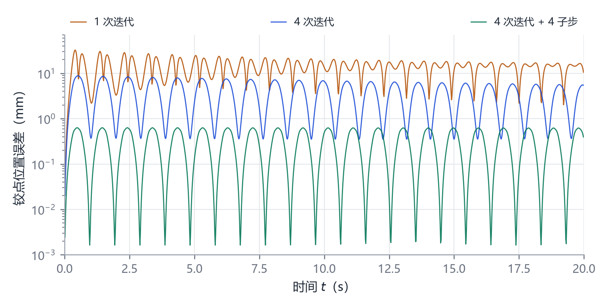
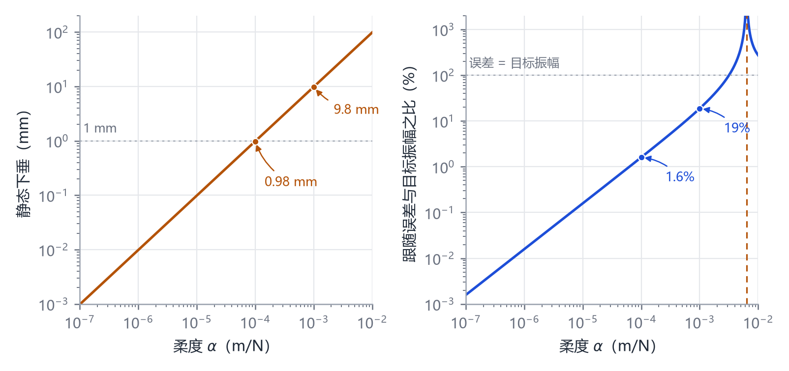

# 第 8 章 关节、马达与约束

> 本章导读：碰撞是“别穿过去”，关节是“别分开”。两者在求解器里长得几乎一样：一行雅可比、一个偏置、一个冲量上下限。这一章从约束的写法开始，把球铰、铰链、滑块、固定关节拆成行，接着讲软约束、马达、限位，再落到 6DOF 和布娃娃——为什么同样的求解器，有的角色站得稳，有的一松手就散架。

一扇门绕门轴转，门轴装歪了半度，门就会在开到某个角度时自己往回弹；游戏角色的肩膀被手臂拉脱，肘关节反折，布娃娃的膝盖像折尺一样朝前弯。这些都不是渲染问题，也不是碰撞检测漏了，而是约束写错、限位没加、或者求解器根本没收敛。

碰撞和关节在代码里是邻居。接触说“两个物体不许互相穿透”，关节说“两个物体必须保持某种相对关系”；前者是单边约束，允许分开，后者通常是双边约束，分开和挤压都不行。把关节写成速度层的一行，它就能和接触共用同一个顺序冲量求解器，这是绝大多数刚体引擎的做法。

## 8.1 约束、雅可比与有效质量

把刚体的状态记成广义坐标 $\mathbf{q}$：二维里是 $(x,y,\theta)$，三维里是位置加姿态。一个约束就是一组合起来必须为零的方程

$$
C(\mathbf{q})=0 .
\tag{8.1}
$$

$C$ 可以是标量，也可以是向量；有几个分量，就占几行。最简单的例子是二维的点-点约束：物体上的局部点 $\mathbf{r}$ 经过旋转、平移后，必须落在世界锚点 $\mathbf{a}$ 上，

$$
C=\mathbf{x}+\mathbf{R}(\theta)\mathbf{r}-\mathbf{a}=\mathbf{0},
\tag{8.2}
$$

$\mathbf{x}$ 是质心位置，$\mathbf{R}$ 是旋转矩阵，$\mathbf{a}$ 是固定的世界坐标。两行，分别管 $x$ 和 $y$。

对时间求导，得到速度层的关系

$$
\dot{C}=\mathbf{J}\dot{\mathbf{q}}=0,\qquad
\mathbf{J}=\frac{\partial C}{\partial \mathbf{q}} .
\tag{8.3}
$$

$\mathbf{J}$ 就是雅可比，它把广义速度映射成约束方向上的速度。二维点约束的雅可比是

$$
\mathbf{J}=
\begin{bmatrix}
1 & 0 & -r_y\\
0 & 1 & r_x
\end{bmatrix},
\tag{8.4}
$$

$r_x$、$r_y$ 是局部点在当前姿态下相对质心的世界分量。前两列说明平移直接改变约束点，第三列说明转一点角度会让约束点沿切向移动 $(-r_y,r_x)$，这个向量就是 $\mathbf{r}$ 逆时针转九十度。三维里第三列换成 $\mathbf{r}\times$ 的矩阵形式，含义一样。

有了雅可比，求解一行约束就是解一个一维问题。记这一行在约束方向上的逆质量为

$$
w=\mathbf{J}\mathbf{M}^{-1}\mathbf{J}^{\mathsf{T}},
\tag{8.5}
$$

$\mathbf{M}$ 是广义质量矩阵，包含质量和惯性张量；有效质量是 $1/w$。约束方向上的速度是 $\mathbf{J}\mathbf{v}$，要把它拉到目标值，需要的冲量是

$$
\lambda=-w^{-1}\left(\mathbf{J}\mathbf{v}+b\right),
\tag{8.6}
$$

$b$ 是偏置项，位置误差、恢复系数、马达目标速度都塞在这里。冲量施加回去：

$$
\mathbf{v}\leftarrow\mathbf{v}+\mathbf{M}^{-1}\mathbf{J}^{\mathsf{T}}\lambda .
\tag{8.7}
$$

对二维点约束，式 (8.7) 展开就是线速度加 $\lambda/m$、角速度加 $(\mathbf{r}\times\boldsymbol{\lambda})/I$。冲量作用在质心之外会产生转动，这一点和第三章的偏心碰撞是同一件事。式 (8.5) 里的 $w$ 越小，有效质量越大，同样的速度误差需要的冲量越大；两个物体质量悬殊时，$w$ 由轻的那个主导，重的那个几乎不动，这是后面质量比问题的根源。

约束是非线性的，雅可比随姿态变。每步都在当前姿态重新算 $\mathbf{J}$，解完速度、积分位置，下一帧再重新线性化。所谓“约束求解”，解的是一串局部线性化问题，不是一次性把曲线拉直。

再往下求导会得到加速度层的关系 $\mathbf{J}\ddot{\mathbf{q}}+\dot{\mathbf{J}}\dot{\mathbf{q}}=0$，其中 $\dot{\mathbf{J}}\dot{\mathbf{q}}$ 是雅可比自身的变化率，包含离心项和科氏项。解析地把它算准并不容易，实时引擎通常不走这条路：用速度层的迭代加位置修正，把加速度层该做的事近似掉。这也是为什么同样的约束，用解析加速度求解和用 PGS 求解，在大转速下表现不一样。

## 8.2 四类关节，四组行

关节的差别，说到底是留下几个自由度。一个自由刚体在三维里有六个自由度，关节去掉几个，就写几行约束。常见的四类可以排成一张表。

球铰（ball-socket）让两个物体的一个局部点重合，去掉三个平移，留下三个转动。约束就是式 (8.2) 的三维版本，三行。它像人的肩关节，手臂可以朝任意方向摆，但不能从肩窝里脱出去。

铰链（hinge/revolute）只留一个转动，去掉另外五个自由度：三个平移加两个转动。五行。三行管点重合，另外两行管轴对齐——把两个物体各自的轴 $\mathbf{a}_1$、$\mathbf{a}_2$ 约束成同一条直线。轴对齐看起来是一个叉乘为零的约束，但叉乘的三个分量只有两个独立，工程上取两个与 $\mathbf{a}_2$ 垂直的方向 $\mathbf{u}$、$\mathbf{v}$，写

$$
\mathbf{a}_1\cdot\mathbf{u}=0,\qquad
\mathbf{a}_1\cdot\mathbf{v}=0 .
\tag{8.8}
$$

两行刚好。二维里的铰链简单得多，只有一个转动，点重合两行就够。

滑块（prismatic）只留一个平移，去掉三个转动和两个垂直于滑轨的平移，五行。三行管相对姿态不变，两行管垂直方向不偏。它适合活塞、抽屉、电梯导轨。

固定关节（fixed/weld）把两个物体焊死，六个自由度全去掉，六行：三行点重合，三行相对姿态不变。布料与刚体的绑定、角色手里握着的武器，常用这种写法。

自由度计数可以反过来用：关节行数等于 $6-f$，$f$ 是留下的自由度数。二维里刚体只有三个自由度，铰链两行、滑块两行、焊接三行。行数不是越多越好。固定关节的六行在数值上可能相关，比如两个物体的质量比极大时，某些行几乎解不动；冗余的行会让顺序冲量收敛变慢，甚至在一个方向上反复过冲。遇到关节“发软”，先数一数是不是写了多余的约束。

关节还要存两个局部锚点和一组参考姿态。铰链的轴、滑块的导轨方向、固定关节的初始相对旋转，都得在物体局部坐标里定下来；世界坐标里的轴会随物体转动，不能直接存。参考姿态选错，最常见的结果是关节一创建就把两个物体猛拽到一起，第一帧就炸。

## 8.3 和接触共用一套求解器

把关节写成行之后，它和接触的差别只剩三个字段：偏置 $b$、冲量下限、冲量上限。

接触是单边约束，冲量只能推不能拉，所以 $\lambda\ge 0$；关节是双边约束，$\lambda$ 可以正也可以负；马达把上限压到最大力矩乘步长；限位只在一个方向生效。求解器不关心这一行来自接触还是关节，它只做一件事：

$$
\lambda\leftarrow \operatorname{clamp}\left(\lambda-w^{-1}\left(\mathbf{J}\mathbf{v}+b\right),\ \lambda_{\min},\ \lambda_{\max}\right).
\tag{8.9}
$$

这就是投影高斯-赛德尔的一步。逐行扫，每行解完立刻把冲量施加回速度，下一行看到的是更新后的速度。扫完一遍叫一次迭代；迭代到残差够小，或者预算用完。

行与行之间有耦合，所以一遍不一定够。关节和接触混在一起时，先解谁、后解谁，会影响多少遍收敛；顺序不改变最终解，但改变误差在过程中的分布。热启动对关节同样有用：上一帧的冲量按关节行缓存，下一帧直接拿来当初值，省掉从零爬升的几遍迭代。

偏置项是关节精度的主要来源。位置误差 $C$ 通过 $b=\beta C/\Delta t$ 折成速度，和第七章的 Baumgarte 是同一个手法。$\beta$ 大，误差收得快，但容易过冲；$\beta$ 小，稳，但关节在重力下会慢慢被拉长。多数引擎把关节的 $\beta$ 设在 0.1 到 0.3，和接触共用，也可以单独给关节一套。

图 8-1 是一根一米长、一千克的均质杆，一端铰接，从水平位置放下来，跑二十秒。三条线分别是 1 次迭代、4 次迭代、4 次迭代加 4 子步。一次迭代时铰点误差长期在 1.4 厘米量级，峰值 3.3 厘米；四次迭代降到平均 3.3 毫米、峰值 8.8 毫米；再切四个子步，平均 0.3 毫米、峰值 0.6 毫米。

这组数说明两件事。第一，迭代次数能把误差从“看得见”压到“勉强看不见”，但压不到零；四次和三十次的差别已经很小，剩下的误差不是求解器没收敛，而是时间离散——每一步杆转过一个角度，用这一步开头的雅可比去约束，转角越大，线性化越不准。第二，子步对这种误差特别有效，因为它直接把每步转过的角度切小了。想让铰链更准，先加子步，再考虑加迭代，顺序和第七章一样。

Baraff 的全局接触力算法把整个系统的约束放进一个 LCP 一次解掉，没有迭代顺序带来的偏差 [@baraff1994]；Erleben 的冲击传播则利用约束图的层次，让冲量沿链快速传到底 [@erleben2007]。两者都在减少“迭代没扫完”的误差，但都改变不了“一步走得太远”的离散误差。

<figure class="fig">

<figcaption><b>图 8-1</b>　铰链约束误差随时间。1 m 长、1 kg 的均质杆一端铰接，初始水平，重力 9.81 m/s²，Δt=1/60 s，β=0.2；三条线分别为 1 次迭代、4 次迭代、4 次迭代加 4 子步。纵轴是铰点世界位置与锚点的距离，对数坐标，取 20 s。</figcaption>
</figure>

## 8.4 软约束：用柔度换稳定

硬约束要求 $C=0$ 严格成立，数值上等于要求无穷大的刚度。迭代有限、时间离散、质量比又不可能永远温和，硬约束迟早会在某个场景里抖起来。软约束换了一个问法：允许 $C$ 不为零，但让约束力与 $C$ 成正比，

$$
C=\alpha f ,
\tag{8.10}
$$

$\alpha$ 叫柔度，单位是米每牛顿，意思是“施加一牛顿的约束力，允许产生多少米的误差”；$f$ 是约束力。$\alpha=0$ 退化成硬约束；$\alpha$ 越大，关节越软。求解器里存的是冲量，式 (8.10) 的力乘上 $\Delta t$ 才是冲量。

XPBD 把柔度直接写进位置修正 [@macklin2016]。一次投影的乘子写成

$$
\mu=-\frac{C}{\alpha/\Delta t^{2}+w},
\tag{8.11}
$$

$w=\mathbf{J}\mathbf{M}^{-1}\mathbf{J}^{\mathsf{T}}$ 还是约束方向上的逆质量。$\mu$ 是位置层的乘子，量纲是质量乘长度，位置修正量是 $\mathbf{M}^{-1}\mathbf{J}^{\mathsf{T}}\mu$。分母里的 $\alpha/\Delta t^{2}$ 和 $w$ 同量纲，是一个由柔度折出来的逆质量项：$\alpha$ 越大，分母越大，同样的误差产生的修正越小，关节越软；$\alpha=0$ 时退化成硬约束。把它整理成频率，单质量情形下

$$
\omega=\sqrt{\frac{1}{\alpha m}},
\tag{8.12}
$$

$\omega$ 是关节的固有角频率，$m$ 是负载质量。想要一个 10 Hz 的关节，就取 $\alpha=1/(m\omega^{2})$；$m=1$ kg、10 Hz 对应 2.5×10⁻⁴ m/N。这个换算在调布娃娃和车辆悬挂时很实用：频率比柔度更直观。

柔度不是免费的。重力下，软约束会下垂

$$
\Delta x=\alpha m g ,
\tag{8.13}
$$

$\Delta x$ 是静态跟随误差。$\alpha=10^{-4}$ m/N、$m=1$ kg 时约 0.98 毫米；$\alpha=10^{-3}$ 时约 9.8 毫米。目标做快速运动时还有动态滞后。图 8-2 右边是目标以 2 Hz、1 厘米振幅摆动时的跟随误差幅值比：$\alpha=10^{-4}$ 时约 1.6%，$10^{-3}$ 时约 19%，再往上接近共振，误差会超过目标本身的振幅。

游戏里到处都是软约束，原因不是“物理上更真实”，而是“数值上更可控”。布娃娃的关节软一点，摔倒时不会像钢筋一样僵直；车辆的悬挂软一点，过坎时有可见的压缩；角色的手被抓取物拉住时，软约束允许手臂被拉长一点点，避免整个角色被拽飞。软约束把不可避免的误差变成可设计的参数，而不是让它以抖动的形式随机出现。

老一点的引擎不直接写柔度，而是用两个参数描述同一件事：误差减少参数（ERP）决定每步把多少位置误差转成速度，约束力混合（CFM）决定约束行有多“软”。ERP 对应 Baumgarte 的 $\beta$，CFM 对应柔度；名字不同，做的都是把硬约束放松一点。看到引擎文档里这两个词，可以直接按本章的 $\beta$ 和 $\alpha$ 理解。

<figure class="fig">

<figcaption><b>图 8-2</b>　柔度与跟随误差。质量 1 kg，重力 9.81 m/s²。左：静态下垂 αmg 随柔度 α 变化，双对数坐标；右：目标做 2 Hz、1 cm 振幅正弦运动时的跟随误差幅值比，ω₀²=1/(αm)，竖虚线为共振 α=1/ω²。α=0 为硬约束。</figcaption>
</figure>

## 8.5 马达与限位

马达是一条带目标速度的约束。普通关节要求 $\mathbf{J}\mathbf{v}=0$，马达要求 $\mathbf{J}\mathbf{v}=v_{\mathrm{target}}$，偏置项直接写 $-v_{\mathrm{target}}$。冲量仍然有上下限，

$$
-\tau_{\max}\Delta t\le\lambda\le\tau_{\max}\Delta t ,
\tag{8.14}
$$

$\tau_{\max}$ 是马达能输出的最大力矩，乘步长就是这一步能施加的最大冲量。目标速度设得再高，力矩不够也追不上；负载太重，马达会一直顶在上限，关节以最大力矩转动。这两条合起来，就是一个简单的伺服：速度目标加力矩上限。

限位是单边约束。角度 $\theta$ 只能在 $[\theta_{\min},\theta_{\max}]$ 里，越过下限时约束要求 $\dot{\theta}\ge 0$，越过上限时要求 $\dot{\theta}\le 0$，中间不生效。实现上给每个限位一行，根据当前角度决定它是“松”还是“紧”；紧的时候加一个把角度推回区间内的偏置，松的时候把冲量清零。冲量不清零会留下残余，关节会在边界附近被顶住，看起来像卡了一下。

状态切换是限位最容易出 bug 的地方。一个关节可能处于自由、下限、上限、马达四种状态，每帧只能选一种；从自由切到限位时要清掉马达的冲量，从限位切回自由时要清掉限位的冲量，否则上一状态积累的冲量会继续作用。很多“门开到一半自己弹回来”“膝盖在某个角度突然锁死”的问题，都是切换时没清冲量。

硬限位在高速撞击时会抖，因为它在边界上做硬碰硬的速度截断。工程上常用软限位：把限位写成一个只在越界时生效的弹簧加阻尼，或者给限位也配一个柔度。代价是角度会略微超出范围，但换来了边界附近的平滑。角色关节、车门、抽屉，通常都这么处理。角度还要处理绕圈：$-\pi$ 和 $\pi$ 是同一个方向，限位判断前先把角度折到以参考角为中心的区间里，否则关节会在绕圈时突然撞到限位。

马达和限位经常同时存在，比如一条腿：髋关节有马达负责摆腿，又有角度范围防止反折。这时要先判断限位是否生效，生效时限位优先，马达的冲量让位；两边都生效会互相顶，表现为关节在边界上高频抖动。简单可靠的做法是给状态机明确的优先级，并在每帧开始时根据角度和速度只选一个活动约束。

## 8.6 6DOF 与布娃娃

6DOF 关节是把三个平移、三个转动拆成六条独立的轴，每根轴可以自由、锁定、限位或加马达。它不是一个特殊的求解器，只是六行约束，每行的雅可比取对应轴的方向。六根轴通常取关节坐标系的三根平移轴和三根转动轴，具体方向由创建关节时指定的参考姿态决定。每一行有自己的上下限、柔度和马达参数。

这种关节的好处是可配置。同一套代码，把三根平移轴锁死、两根转动轴限位，就是一个带角度限位的铰链；把三根平移轴锁死、三根转动轴设成软约束，就是布娃娃的肩膀；把一根平移轴放开，就是滑块。工业仿真里的机器人关节、车辆悬架、生物力学模型，大多最终落成 6DOF 的参数表。

布娃娃是 6DOF 最可见的用法。每个骨骼是一块刚体，骨骼之间用铰链或 6DOF 关节连接，关节带角度限位和软约束；碰撞体用胶囊或盒子包住骨骼，相邻骨骼之间关掉自碰撞，否则大腿会一直和骨盆打架。摔倒时，关节的限位决定膝盖能不能反折，软约束决定落地时是“有肉”还是“像木棍”。

布娃娃的难点不在单个人形，而在参数。质量比太大，轻的脚被重的躯干一拉就飞；关节太硬，落地时约束互相冲突，整个人形抖成一团；关节太软，四肢像面条一样甩。常见做法是把关节的柔度按骨骼质量缩放，让每个关节的固有频率落在差不多的范围；把躯干设成 kinematic 或加大质量，避免被四肢反推；自碰撞只开相邻两层，减少约束数量。XPBD 那套按柔度写约束的做法在这里很顺手，因为柔度直接对应频率，调参比调刚度矩阵直观 [@macklin2016]。

一个十几根骨骼的人形，关节行数很容易上百，加上地面接触和自碰撞，一帧要解几百行。这时迭代预算怎么分比单行怎么写更重要：关节行先扫一遍保证骨架不散，接触行再扫，再回到关节补一遍；或者按岛把互不相连的肢体分开解。布娃娃的视觉容错比机械仿真高，允许的误差可以用厘米计，这也是它能在实时引擎里跑起来的原因。

## 8.7 顺序、质量比与散架

关节散架，先看质量比。一个 100 kg 的躯干通过关节拉住一个 1 kg 的手，有效质量由手主导，速度修正几乎全落在手上；手被拉回约束位置，躯干只动一点点。下一轮迭代，手的位置又因为躯干的反作用偏掉，再拉，再偏。单行约束一次就能解干净，但多行连成链、连成环时，轻重悬殊会让收敛变得很慢，残差在轻的那一端来回跳。

处理办法有几种。把质量比压到 10:1 以内，最省事；把重物设成 kinematic，让它不参与冲量分配，代价是重物不再被关节推动；对小的岛用直接求解，把整个矩阵解掉，不再迭代；或者加子步，让每一小步的误差小到迭代能追上。没有一种办法免费，选哪种取决于场景是“角色”还是“机械”。

质量比的影响可以用式 (8.5) 估。轻物体质量 $m_1$、重物体 $m_2$，一行约束的 $w$ 大约是 $1/m_1+1/m_2$，有效质量是它的倒数，约等于 $m_1$；$m_2=100m_1$ 时几乎就是 $m_1$。冲量按质量反比分配，重物只得到百分之一的速度修正，轻物得到几乎全部。单行这样没问题，但轻物被拉回后，它又通过下一行去拉别的东西，误差就在轻的一端来回反射。链越长、环越多，反射次数越多，收敛越慢。

求解顺序也影响收敛。先解关节再解接触，和先解接触再解关节，收敛速度不一样；按岛分组、组内固定顺序，能让结果可复现。顺序不改变最终解，只改变爬到解的路。对确定性要求高的场景（回放、网络同步），顺序必须固定，不能用哈希表遍历的顺序碰运气。

散架的诊断可以按误差的形态分。误差随时间线性增长，多半是偏置太小或者根本没加位置修正；误差周期性跳变，多半是限位或马达状态切换时冲量没清；误差集中在轻的那一端，先查质量比；误差在高速时才出现，先查步长和子步。关节本身写错了反而少见，多数问题出在数值预算和状态管理上。

一扇门装歪半度，铰链的轴对齐约束每帧都在把它拉回，门却因为限位和马达抢冲量而弹；一个人形落地散架，躯干和脚的质量比是 80:1，迭代十次也传不到脚。约束的方程只有一行，难的是让它在一堆互相拉扯的行里，安静地收敛。
