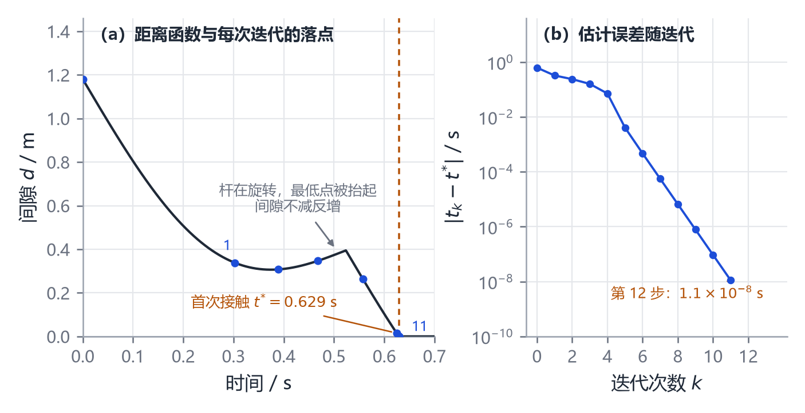
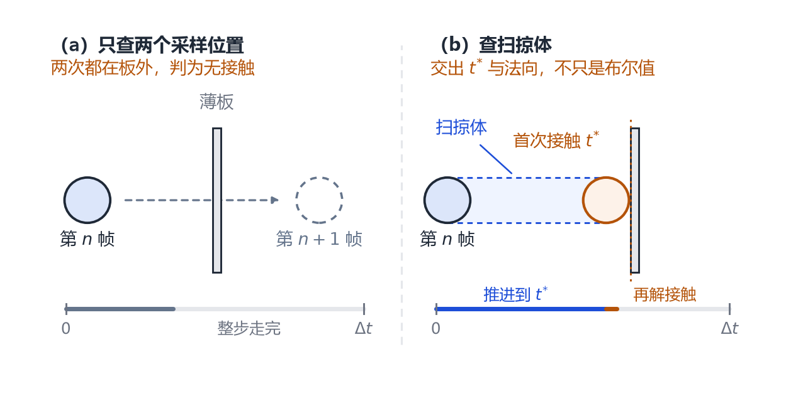

# 第 9 章 连续碰撞与高速旋转

> 本章导读：这一章讲物体在一帧里走得太远之后会发生什么，以及三种补救办法各自的账：保守前进、扫掠体、按需开连续检测。读完你应该能对一个场景判断该不该上连续检测，以及接触时刻找到之后，还有哪些东西必须在同一个时刻上算。

## 9.1 一颗子弹穿过薄墙

射击游戏里最容易被玩家发现的一个 bug，是子弹穿墙。帧率 60，子弹初速 300 m/s，一帧就是 5 m；而墙只有 2 cm 厚。碰撞检测在每帧末尾问一次：子弹和墙重叠吗。第 $n$ 帧子弹在墙前一米，第 $n+1$ 帧在墙后四米，两次查询都答“不重叠”。子弹就这么过去了。

比穿过去更麻烦的是穿过去之后。子弹到了墙的另一侧，宽相再也不会把它和这面墙配对，于是它永远留在墙外，墙对它来说不存在。如果落点恰好在一个两米厚的块体内部，情况反过来：窄相报重叠，求解器沿最短分离方向把它推出去，这个方向可能是它来的那一侧，也可能是另一侧，玩家看到的是物体瞬移了几米。同一个漏检，两种表现，取决于它停在了哪里。

旋转的版本更隐蔽。一片 0.6 m 长的薄刀片以 30 rad/s 转动，端点速度 9 m/s，一帧扫过 0.15 m；中间立着一块 3 mm 厚的挡板。两个采样时刻，刀片的两端都在板外，刀身也在板外，因为它是“扫”过去的。这时连穿模的痕迹都没有，板没有被推开，也没有重叠报错，只是这一次打击消失了。如果这是格斗游戏里的判定，玩家会觉得明明砍中了却没有伤害。

把这件事折算成一张表，谁有危险一眼就看得出来。以 60 fps 计，一帧的位移是速度除以 60，最后一列是“要让每帧位移小于物体自己的厚度，需要多少帧率”，也就是速度除以厚度：

| 物体 | 速度 (m/s) | 一帧走多远 | 特征厚度 | 位移 / 厚度 | 需要的帧率 |
| --- | ---: | ---: | ---: | ---: | ---: |
| 走路的人 | 1.4 | 2.3 cm | 30 cm | 0.08 | 5 |
| 抛出的石块 | 20 | 33 cm | 10 cm | 3.3 | 200 |
| 网球发球 | 50 | 83 cm | 6.7 cm | 12 | 750 |
| 高尔夫开球 | 70 | 1.17 m | 4.3 cm | 27 | 1600 |
| 刀片端点 | 9 | 15 cm | 3 mm（挡板） | 50 | 3000 |
| 手枪弹 | 350 | 5.8 m | 2 cm（墙） | 290 | 17500 |

前三行的比值从零点零几到十几，出问题的概率不高，出了也只是偶尔穿一次。最后两行是两百多和五十，每一次都可能漏。最后一列的差距更刺眼：从 60 提到 3000 是五十倍，提到 17500 是三百倍。也就是说，靠提帧率救子弹，等于把整场模拟的每一部分都按三百倍的成本重做，而其中九成九的物体根本不需要这么细。

表里最容易被忽略的是刀片那一行。它的质心几乎不动，一帧只走一两厘米，按质心速度筛“要不要特殊处理”，它排在石块后面，会被判成慢速物体。可它的端点在飞。要让端点每帧只走 3 mm，每帧转角必须小于 $0.003 / 0.3 = 0.01$ rad，而它实际一帧转 0.5 rad，得把一帧切成 50 段，每段查一次距离。也就是说，采样密度要按物体上“最快的那个点”定，不是按质心定。

这两件事是同一个原因：我们把位置当成每秒 60 次的采样，而碰撞是连续时间里的一个事件。采样间隔里发生的事全被丢掉。补救也不是提高帧率：要让 300 m/s 的子弹每帧只走 2 cm，需要 15000 fps，为了一个子弹把整场模拟提到这个频率不现实。

有一个粗糙但好用的数可以先看：一帧内的最大位移 $s = v\Delta t$ 与物体的最小特征尺寸（薄板的厚度、球的半径、杆的半径）之比。比值小于一，端点采样基本够用；大于一，就可能跳过接触。这个比值的严格版本是下一节的不等式，它也是这一章所有方法的共同起点。这类做法有一个统称，连续碰撞检测（continuous collision detection，CCD）：它不问“现在重叠吗”，而问“这一帧里什么时候第一次接触”。

## 9.2 一帧走得太远

把碰撞写成距离。两个形状之间的距离 $d(t)$ 是表面之间的最近距离，重叠时取零或者取负的穿透深度。一帧内有没有碰撞，等价于 $d(t)$ 在区间 $(t_n, t_{n+1})$ 里有没有到过零。离散检测只查两端，而两端都为正推不出中间为正：$d$ 只要先降后升就够了，这在相对速度指向对方时是常态。

能推出什么，取决于 $d$ 有多“陡”。两个形状上任意一点的速度不超过质心速度加上转动带来的部分，

$$
v_{\max} = |\mathbf{v}_{rel}| + \omega_{rel} R ,
\tag{9.1}
$$

$\mathbf{v}_{rel}$ 是相对质心速度，$\omega_{rel}$ 是相对角速度的大小，$R$ 是形状上离相对转轴最远的距离上界。既然每一对表面点的接近速度都不超过 $v_{\max}$，距离函数就是利普希茨的（Lipschitz，意思是两点的函数值之差不超过它们距离的常数倍），常数为 $v_{\max}$，于是

$$
d(t+\Delta) \ge d(t) - v_{\max}\Delta .
\tag{9.2}
$$

这个不等式反过来用就是跳过条件：若 $d(t_n) \gt v_{\max}\Delta t$，整个区间内不可能接触，可以直接按离散步过关。它只看距离和速度的大小，不看方向；正对着墙飞来和贴着墙掠过满足同样的条件，所以它是保守的，保守的代价是效率。

代一组具体的数就有感觉。一个 0.5 m 的木箱以 8 m/s 斜着飞出，$v_{\max}$ 就是 8，一帧最多走 13.3 cm，而箱子最薄的方向也有 50 cm，不等式说“放心走”，这一步确实不会碰。同样 8 m/s 换成一堆飞散的玻璃碎片，单片厚 3 mm，13.3 cm 是它的 44 倍，不等式什么也没说：撞与不撞都可能，必须去求接触时刻。同一个公式，同一个速度，只因为对象的厚度差了两个数量级，结论就完全相反。

容易误解的地方在于 $R$ 要取多大。$R$ 是“离相对转轴最远”的距离上界，不是包围球半径，也不是质心到最远点的距离。取大了界就松，松的界不产生错误，只产生白跑：步长被压小，迭代次数变多。取小了就会漏检，这是真正的错误。稳妥的做法是先取一个明显偏大的 $R$，等确认某段代码从来不缺碰撞，再想办法收紧。

多数场景看不出问题，是因为 $v_{\max}\Delta t$ 通常只有几厘米，而物体尺寸是几十厘米，采样足够密。出事的都是两类：快，比如子弹、投掷物、高速旋转件；薄，比如布、纸、刀片、栏杆。还有一类容易被忽略：质心几乎不动，但角速度很大。一根 2 m 长的杆以 2 rad/s 旋转，端点速度 4 m/s，一帧走 6.7 cm，而杆的直径只有 2 cm。按质心速度去筛“需不需要连续检测”，这根杆会被判为慢速物体，然后每一帧都从板中间穿过去。判据里必须有 $\omega R$ 这一项，这是后面几节反复要用的事实。

## 9.3 保守前进：每一步都安全

有一个不需要预先知道区间的方法：从 $t_n$ 出发，每次算当前距离 $d$，用 $d / v_{\max}$ 作为步长往前推一段，直到距离小于容差。每一步都满足式 9.2，因此这一步之内保证不会接触，也就永远不会跨过接触时刻。这个方法叫保守前进（conservative advancement），白话就是“每次只走到保证安全的地方”。

流程可以用几句话写完。令 $t = 0$；循环执行三件事：求当前位姿下的距离 $d(t)$ 与最近点对；若 $d \lt \varepsilon$ 则退出；令 $\tau = d / v_{\max}$，把 $t$ 增加 $\tau$，位姿按 $t$ 重新计算。退出时的 $t$ 就是首次接触时刻的估计。

不用二分，是因为二分要求手上有一个端点异号的有根区间。第一次接触之前，区间两端的距离都是正的，我们没有那个右端点；先按整步推过去看看有没有重叠也不可行，因为推过去本身就已经穿透，而且穿透之后距离函数的形状变了，法向和接触点都不可信。保守前进只依赖当前距离和速度上界，不需要预知终点，这就是它比二分更适合碰撞的原因。

二分在有根区间上的表现，用手算一遍最清楚。球半径 0.1 m，球心在 $x = 0.6$ m 处以 9 m/s 沿 $-x$ 飞来，墙是 $x = 0$ 的平面。球心到墙面的距离是 $0.6 - 9t$，表面间隙是 $d(t) = 0.6 - 9t - 0.1 = 0.5 - 9t$，真值 $t^{*} = 0.5/9 = 0.05556$ s。用 $1/60$ s 的整步推，$t = 0.05$ s 时 $d = 0.05$ m，$t = 0.0667$ s 时 $d = -0.1$ m，于是拿到一个有根区间 $[0.0500, 0.0667]$，宽 0.0167 s。之后每次取中点、算一次间隙、把同号的一半丢掉：

| 次数 | 区间左端 | 区间右端 | 中点 $t$ | 中点间隙 $d$ | 保留 |
| ---: | ---: | ---: | ---: | ---: | --- |
| 1 | 0.05000 | 0.06667 | 0.05833 | $-0.0250$ | 左半 |
| 2 | 0.05000 | 0.05833 | 0.05417 | $+0.0125$ | 右半 |
| 3 | 0.05417 | 0.05833 | 0.05625 | $-0.00625$ | 左半 |
| 4 | 0.05417 | 0.05625 | 0.05521 | $+0.00313$ | 右半 |
| 5 | 0.05521 | 0.05625 | 0.05573 | $-0.00156$ | 左半 |
| 6 | 0.05521 | 0.05573 | 0.05547 | $+0.00078$ | 右半 |
| 7 | 0.05547 | 0.05573 | 0.05560 | $-0.00039$ | 左半 |
| 8 | 0.05547 | 0.05560 | 0.05553 | $+0.00020$ | 右半 |

八次之后区间只剩 $6.5\times10^{-5}$ s，真值 0.05556 夹在 $[0.05553, 0.05560]$ 之间，误差不超过 3.3e-5 s。这个收敛是纯算术的：每步把区间砍一半，与几何形状无关。要把误差压到 $10^{-6}$ s，需要 $0.0167 / 2^{n+1} \le 10^{-6}$，也就是 $n \ge 13$，十四次。

留意二分要付的第一笔代价，不是这十四次查询，而是那个右端点。要造出 $d \lt 0$ 的端点，必须先把球推到墙里面去。对一面无限平面这无所谓，$d$ 可以算负；对真实网格，一旦顶点进了实体内部，最近点查询给出的距离就不可信了，通常会返回零、返回负的穿透深度、或者在一次查询里跳到一个完全不相干的面。也就是说，二分的右端点只能靠“穿透状态下的距离”，而那正是最不可靠的一次查询。它还要假设落点只有一个接触，一旦球在这一步里穿过两块板，区间里就有两个零点，中点的符号会把你引到错误的那一个。

保守前进没有这个问题。它从头到尾只走 $d \gt 0$ 的一侧，每次查询都在实心外面。代价是收敛速度依赖几何：法向速度占上界的比例高就快，擦着飞就慢。二分是“与几何无关的 14 次”，保守前进是“与几何强相关的 3 到 30 次”，工程上一般选后者，因为它的最坏情况仍然可控，而二分的错误是悄悄发生的。

收敛速度可以估。设接近速度 $v_n$ 在这一小段里近似不变，走一步之后距离变成 $d\,(1 - v_n/v_{\max})$，是几何收敛，比率 $q = 1 - v_n/v_{\max}$。法向速度占上界的比例越高，收敛越快：正对着撞时 $v_n$ 接近 $v_{\max}$，一两步就到位；擦着飞时 $v_n$ 接近零，几乎不动。把距离从 $d_0$ 压到容差 $\varepsilon$ 需要大约 $\ln(\varepsilon/d_0)/\ln q$ 步。

一个真实的例子能看清代价。胶囊长 0.8 m、半径 0.02 m，绕质心以 6 rad/s 旋转，整体以 1.5 m/s 下落，最低点初始离地 1.18 m。上界 $v_{\max} = 1.5 + 6 \times 0.4 = 3.9$ m/s。真实接触时刻是 0.629 s，保守前进用了 11 步推进、12 个落点，把误差压到 $10^{-8}$ s。

这十几步的细节比结果更有意思（图 9-1）。第一步从 0 直接推到 0.3026 s，因为间隙 1.18 m 除以 3.9 就是这么多。接下来几步，间隙在 0.26 到 0.35 m 之间来回：杆在转，最低点有时反而升起来，距离不减反增，但每一步仍然只按最坏情况推进。到第六步，杆的最低点转到下方，间隙从 0.26 m 掉到 0.014 m，之后每步再缩一个数量级，五步就压到 $10^{-6}$ m 以下。

<figure class="fig">

<figcaption><b>图 9-1</b>　保守前进的 12 个落点。胶囊长 0.8 m、半径 0.02 m，绕质心以 $\omega = 6$ rad/s 旋转，整体以 1.5 m/s 下落，初始最低点离地 1.18 m，上界 $v_{\max} = 3.9$ m/s。左图是真实距离函数与每次迭代的落点，横轴上的竖线是真实的首次接触时刻 0.629 s；右图是估计时刻与真值之差（对数轴），前五步几乎不动，因为旋转把最低点抬了起来。同样的胶囊若不旋转，一步就从 1.18 m 推到接触。</figcaption>
</figure>

如果同样的胶囊不旋转，$v_{\max} = 1.5$，第一步 $\tau = 1.18/1.5 = 0.787$ s 就正好是接触时刻，一次迭代结束。旋转把一步变成十几步，差别全在 $\omega R$ 那一项。这不是算法的缺陷，而是信息量的差别：保守前进不知道物体接下来是要靠近还是离开，只能假设最坏情况。

代价还算得出来：每次迭代至少一次距离查询，查询本身是一个 GJK，十几次支撑函数；十二步就是上百次支撑函数，比一次离散检测贵两个数量级。所以它不能无差别地用在每一对上。什么时候值得，留到 9.7 再说。

## 9.4 扫掠体：把时间摊成几何

保守前进用迭代逼近接触时刻，另一条路想把答案直接构造出来。把一段时间里的运动“摊开”成空间里的一个区域：物体在 $t \in [0, \Delta t]$ 里扫过的那团空间叫扫掠体（swept volume），第一次接触就是扫掠体与对方形状相交的最早时刻。这是同一件事的两种说法，一种在时间上迭代，一种在空间上求交。

纯平动时扫掠体很干净。凸形状沿一条线段扫过，扫出的区域是形状与线段的 Minkowski 和，也等于形状在起点和终点的两份拷贝的凸包。所以两个物体都在平动时，可以把其中一个当作静止，用相对位移去扫另一个，求一次交就回答了“碰没碰”；要接触时刻，则把相对位移写成 $\mathbf{x}(s) = \mathbf{x}_0 + s\,\Delta\mathbf{x}$，$s \in [0,1]$，找最小的 $s$ 使两个形状重叠。$s$ 与 $t$ 只差一个线性缩放，这一步不需要迭代。

这份干净全部来自凸性。Minkowski 和里没有乘法，只有加法，凸集加凸集还是凸集；凸集之间的最近距离可以用 GJK 一次问出来，问出来就是答案。“扫掠体 vs 对方形状”于是退化成“一个凸形 vs 另一个凸形”，工具是现成的。旋转一旦加进来，这个退路就断了：顶点走曲线，扫掠体不再是凸集，最近点也不再是从两份拷贝里挑一个那么简单，得在整段圆弧上找。

具体差多少，可以数一遍。一根 1 m 长的杆绕一端转 90°，端点走过 $1 \times \pi/2 = 1.57$ m 的圆弧，扫出的真实区域是四分之一圆盘，面积 $\pi/4 = 0.785$ m²。如果把起点和终点两份拷贝直接做凸包，得到的是顶点在 $(0,0)$、$(1,0)$、$(0,1)$ 的三角形，面积 0.5 m²。差 0.285 m²，占真实扫掠区的 36%，而且缺的正是圆弧外侧那圈月牙。一个从侧面贴着圆弧飞向杆端的小球，会落在这圈月牙里：按凸包算，它没有任何时刻与杆重叠，于是这一击被吃掉。也就是说，用“起点终点的凸包”近似旋转扫掠，漏检区域随转角增大，90° 时已经超过三分之一。

旋转把这份干净毁掉了。顶点走的是圆弧，扫过的面是螺旋面；一根杆转过 90°，扫出的区域像一个扇面，它与一块薄板可以有多个分离的相交区间。对一般凸形，旋转扫掠体的精确求交没有闭式解，工程上有三条退路：分段线性化、包围体、回到迭代。

为什么没有闭式解，值得说清楚。扫掠体的边界不是“顶点扫出的那些曲线”本身，而是它们的包络面，加上每条边扫出的直纹面、每个面扫出的旋转面，三块拼起来。一块边界由哪个特征主导会随转角切换：转角小时外轮廓由顶点圆弧管，转角大到一定程度换成边扫出的直纹面。也就是说，扫掠体是分段的，每一段的解析式不同，求交要先把区间切成段、再逐段判断谁在外侧。这条缝在做数值的时候表现为：转角跨过切换点的那一帧，接触法向会突然转过一个角度。

再把根的数量算一遍。杆从板外转进板内再转出去，距离函数在一帧内有两个零点，最小的那个是首次接触，第二个是这一帧里的第二次碰撞。做成扫掠体求交，等价于求两个集合的多个分离相交区间，然后按 $s$ 排序取最小。两个物体同时旋转时更糟：相对运动是螺旋运动，绕某条轴转动的同时沿轴平移，扫掠体是螺旋扫掠。螺旋扫掠与多面体的求交没有闭式解，连“扫掠体是凸的”这条都没了，所以工程上不这么写。

分段线性化最常见：把一帧的转角切成若干段，每段内转角足够小，用小段端点的两份拷贝做凸包（也就是一小段平动扫掠）近似这一段真实的螺旋扫掠。误差是弦高，$\Delta\theta$ 一段时约 $R\,(1 - \cos(\Delta\theta/2))$。半径 0.4 m 的杆，每段 5 度，弦高约 $3.8\times10^{-4}$ m，比 3 mm 的挡板薄，够用；同样角度换成 4 m 长的杆，弦高变成 3.8 mm，已经超过板厚，必须把段切得更细。这个误差不是无害的：它会让物体比真实情况早一点或者晚一点接触，早期就是多穿一点，晚期就是漏一次。

弦高这条误差有个特点：它只跟 $R$ 和段转角有关，跟物体运动多快无关。把速度加倍、帧率加倍，误差不变；把杆加长一倍，误差也翻倍。也就是说，判断“这根的弦高够不够”，看的是几何尺寸和每段转角，不是速度。这也解释了为什么风扇叶片、长枪管、导弹这类细长高速旋转件特别难处理：它们的 $R$ 大，同样的角度分辨率换来的误差是别人的十倍。

包围体是另一种保守做法：用球、圆柱、圆锥把扫掠区域整个包住。包住之后求交容易，代价是“可能碰”判得太多，需要在包住的范围里再做一次精确查询。齿轮、风扇、转门这类绕固定轴转的物体特别适合：它们的扫掠区域固定，可以预计算成一个环带。

<figure class="fig">

<figcaption><b>图 9-2</b>　两种查法的对比。左：只查一帧的起点和终点位置，小球两次都在薄板外，结论是“没有接触”，而小球其实穿了过去。右：把这一段运动扫成一个胶囊形的区域，它与薄板相交，最早的交点给出接触时刻 $t^{*}$，交线的方向给出法向。示意图，位置与比例经过放大。</figcaption>
</figure>

图 9-2 把两种查法摆在一起。左边是离散检测的两次查询，右边是扫掠体求交。注意右边多拿到了两样东西：接触时刻和接触法向。这两样是后续冲量求解必需的输入，而“碰没碰”这个布尔值本身几乎没用。

## 9.5 旋转物体的接触时刻

旋转让距离函数的零点变多。杆扫过板是一次接触，继续转是分离，再转回来可能又碰一次。一帧内出现两个零点完全正常，第一次接触对应最小的根，后面的根属于这一帧里的第二次碰撞，要不要处理取决于预算：多数引擎只处理第一个，把剩下的交给下一帧，代价是快速旋转的物体在连续打击下会“吃掉”几次。

二分在这里不好用，因为区间两端同号：$d(0)$ 和 $d(\Delta t)$ 都为正，中间可能有两个零点，也可能一个都没有。补救是先按角度分段，每段转角不超过几度，段内距离变化小到可以认为最多一个零点，再在段内二分或者用牛顿。代价与角度成正比：30 rad/s 的杆在 $1/60$ s 内转 0.5 rad，按 5 度一段要切六段，也就是六次距离查询起步。

牛顿法收敛快，但需要导数。刚体的距离对时间的导数，是最接近点对的相对法向速度取负：

$$
\dot d = -\,\big(\mathbf{v}_{rel} + \boldsymbol{\omega}_{rel}\times\mathbf{r}\big)\cdot\mathbf{n} ,
\tag{9.3}
$$

$\mathbf{r}$ 是从质心到最接近点的向量，$\mathbf{n}$ 是单位法向。问题在 $d$ 趋零时最近点对会跳变，导数不连续；牛顿步可能一步跨过零点，也可能朝远离的方向走。稳妥的写法是把两者混起来：先试牛顿，算出的步长若使 $d$ 变大就退回去，改用 $d/v_{\max}$。这样既保留牛顿在接近段的速度，又不会失去保守性。

两者的差别在数上很具体。还是那根 0.8 m 的胶囊，上界 3.9 m/s，当前间隙 2 cm。保守前进给 $0.02/3.9 = 5.1$ ms。若最接近点处的法向速度是 1.5 m/s，牛顿给 $0.02/1.5 = 13.3$ ms，比保守步长还大；这一步跨出去，剩下的 1.3 cm 按 1.5 m/s 只要 8.7 ms 就走完，中途杆还在转，法向可能已经换了方向。也就是说，牛顿的“一步到位”建立在一个假设上：这段路里法向速度不变。转角大的时候这个假设最先破，检查 $d$ 有没有变大就是检查这个假设。

上界的松紧直接决定迭代次数。整根 0.8 m 的杆，$R = 0.4$ m，$\omega R = 2.4$ m/s，是质心速度 1.5 m/s 的 1.6 倍；只要最接近地面的位置落在杆端，步长就必须按 3.9 m/s 来除。如果最接近的地方是杆的中段，用整根杆的 $R$ 就浪费了：把杆沿长度切成 8 段，中段的 $R$ 只有 0.05 m，$\omega R$ 降到 0.3 m/s，同样一段间隙换来的步长是原来的两倍多。实现上就是一棵包围盒树，查询取当前最接近的叶子，用叶子的 $R$ 算步长，叶子离转轴越近界越紧。反过来，如果最接近的总是杆端，切段不会有任何收益——这时上界已经被端点的速度定死了。

还有一类物体需要单独处理：绕固定轴匀速转的东西。它的 $d(t)$ 是周期函数，保守前进每个周期都推进同样的步长，于是每一帧都开连续检测，成本变成常数开销。这类物体的运动区域固定，最划算的是把扫掠区域（一个圆盘或者圆环）一次算好，之后每帧只做“静态区域 vs 静态几何”的查询，甚至可以预计算成一张表。

## 9.6 接触时刻之后

求出 $t^{*}$ 只是把事情做到一半。接下来要把这一帧切成两段：先按旧速度走到 $t^{*}$，在那里解一次接触，再用新速度走完剩下的 $\Delta t - t^{*}$。剩余时间里可能再碰，所以整个流程是一个循环，一帧内最多处理若干次（常见 4 到 8 次），超了就放弃，接受一点误差。这个上限存在的原因是病态场景：两块板夹着一个物体、物体卡在缝隙里，每次推进一步都会立刻再碰，没有上限的话这一帧永远算不完。

走到 $t^{*}$ 时不要做位置修正。位置修正是把已经重叠的物体沿法向推开，它和“把时间拨回到刚接触”是两件事：前者改变了物体的位置，后者只改变我们采样的时刻。连续检测的整个意义在于物体从来没有真的进到对方里面，所以这里只需要把 $t$ 停在 $t^{*}$，位姿用手上的速度外推，而不是调用那个“推出去”的函数。混用这两者会让物体在接触瞬间多出一段横向位移，视觉上是顿一下。

位姿和速度必须来自同一个时刻，这是最容易出错的地方。常见的写法是：法向和力臂用上一帧缓存里的接触点，因为那里现成；但位置已经推到 $t^{*}$，物体的姿态转了一个角度。力臂差一个角度，切向冲量的方向就错，表现是接触之后物体忽然侧滑，或者旋转方向反了。正确做法是在 $t^{*}$ 的位姿上重新求最近点对，用那次查询给出的法向与接触点。

摩擦锚点也要在 $t^{*}$ 处重建。上一帧的锚点属于上一帧的接触，在 $t^{*}$ 处这是一次新接触：切向基由 $t^{*}$ 处的法向决定，锚点位置由 $t^{*}$ 处的位姿决定。沿用旧锚点会把一段不属于这次接触的切向位移算进摩擦里，直观表现是高速旋转的物体落地后带着一股横向的“搓”劲。

容差与死循环是另一半麻烦。$t^{*}$ 总有数值误差，物体在 $t^{*}$ 之后立刻又被判为重叠，下一次求出的接触时刻是零，循环空转。做法是给接触一个允许的穿透（比如 $10^{-4}$ m）或者一个最小时间推进量（比如 $10^{-6}$ s），小于这个量就认为已经接触，交给离散求解器去修位置。

已经处于接触状态的物体不该走连续检测。它们每帧都在接触，距离一直在容差以内，保守前进的第一步就返回零，白白花掉一次查询。合理的分工是维护一张当前接触表：表内的对走离散检测加位置修正，表外的对才做连续检测。这也是为什么“全场景开连续检测”的引擎跑不快——它把绝大多数本来就在接触的配对又算了一遍。

容易误解的地方还有一处：把 $t^{*}$ 循环当成“一帧里最多一次碰撞”。只要剩余时间里还有速度，就还有可能再碰，上限 4 到 8 次不是精度参数，而是防死循环的闸门。一帧里出现第九次碰撞时，通常说明场景里有一个不该存在的夹缝，或者某个物体被两个静态面顶住了。

多体同时接触还有一层顺序问题。两个物体同时撞上第三个，处理完第一个的接触时刻之后，第二个的接触时刻已经变了，因为第三个被推开了一点。严格做法是每处理一次就重算所有候选的接触时刻并取最小，代价是每步一次全局扫描；近似做法是按初始时刻排序依次处理。两者的差别在“同时碰撞”的冲量分配上，堆叠里会表现为一点侧向漂移，时间长了整堆会慢慢散开。

## 9.7 谁值得开连续检测

把成本摆出来：一次保守前进平均 5 到 20 次距离查询，一次离散检测是一次查询，所以贵一到两个数量级。场景里若有 200 个快速物体，每个和 5 个候选配对，每帧就是上千次接触时刻求解，这个量级已经和接触求解本身相当。钱要花在能看见的地方，所以第一件事是筛。

第一道筛用运动上限：若 $|\mathbf{v}|\Delta t + \omega R\,\Delta t$ 小于物体的最小特征厚度（包围盒最短边的一半，或者已知的碰撞厚度），直接走离散步。这一条能筛掉九成以上的配对，而且几乎不花钱。

第二道筛区分“薄”与“快”。薄的东西（挡板、布、栏杆、地形三角形）容易被打穿，需要保护；厚实的箱子之间很少需要。于是常见配置是：快速物体对静态薄几何开连续检测，快速对快速用推测接触。

筛不掉的还要排。把数摆出来：一次 GJK 距离查询在 CPU 上大约一到三微秒，保守前进平均八次查询，一对就是十到二十五微秒。60 fps 的整帧预算 16.7 ms，如果允许连续检测吃掉两成，就是 3.3 ms，只够一百三十对到三百对。而一个五百个快速物体、每个六个候选的场景是三千对，差了一个数量级。也就是说，“全开”不是慢一点，是慢十倍；必须决定哪一百多对先算。

排的顺序按风险来，不按物体编号。风险的一个简单度量是一帧位移除以特征厚度，比值越大越危险；也可以用“预计接触时刻”，越早的越先算——因为早的接触会影响后面的接触时刻，晚的可能在轮到它之前就不成立了。两种排序都能用，前者便宜，后者更准。

推测接触值得单独讲。当 $d \lt v_{\max}\Delta t$ 时，不推进时间，直接生成一个带正间距的接触约束，这种做法叫推测接触（speculative contact），让求解器在整步上处理。约束允许分离：间距为正时不产生冲量，但整步推过去会穿透，冲量就会在正确的位置把它挡住。这把“求接触时刻”换成了“多一行约束”，成本几乎为零，效果是把碰撞提前了一点点——提前量最多是 $v_{\max}\Delta t$，在 1/60 s 的步长下通常看不出来。代价是求解器必须支持正间距，而且间距很大时约束的数值条件会变差，迭代收敛变慢。

真正需要精确接触时刻的场合并不多：子弹打薄板（要准确的入射点和法向）、高速旋转的刀片（接触点随角度变）、布与快速物体互作（布被穿过很难修）、以及碰撞后的状态要被记录或回放的场景（体育判定、机器人）。这些场合下，推测接触的那点提前量会变成看得见的错误。

大规模颗粒是另一个极端。几千个颗粒两两碰撞，逐个求接触时刻不可能。做法是减小步长、允许一点穿透、把所有接触丢进一个互补问题一次解完 [@tasora2010]；颗粒速度被限制在“一帧走不过一个粒径”的量级，靠的是场景尺度小和步长小，不是逐对的连续检测。这条路线在颗粒数量上是划算的，它的前提是颗粒足够小、步长足够细。

还有一条思路来自保证无穿透的隐式方法。用一道在距离趋零时趋于无穷的势垒，让物体在接近时自动减速；连续检测只做一件事，检查牛顿迭代的每一步有没有跨过接触，跨过就把步长砍半 [@li2020]。这种用法里连续检测不是每帧对每个物体跑，而是求解器线搜索的一部分，只在真正要撞上的那几步被调用，成本随碰撞次数增长，而不是随物体数量增长。

把这套东西装进一帧的预算里，是另一件事。可用的手段有五样：

预算制。给每帧的接触时刻求解一个硬上限（比如 200 次查询），用完就停，剩下的一律降级为推测接触，并记下“这一帧有谁被降级”，下一帧优先处理它们。硬上限的意义是让最坏帧仍然落在 16.7 ms 之内，而不是让某一帧卡住半秒。

延迟重算。真正需要每帧重算接触时刻的配对是少数。对只在某片区域里来回晃的物体，每三到五帧重算一次候选，中间用推测接触兜底；如果这期间它真撞上了，离散检测会先报出重叠，再补一次精确查询。

按物体而不是按配对分配。同一个高速物体的所有候选应该一起算，因为它的位姿只算了一次；反过来，把同一个静态薄板的几十个候选打散到不同批次里，会重复做很多相同的变换。

降级与回收。维护一个计数器：某一对连续 60 帧都想开连续检测，却从没真正在 $t^{*}$ 上接触过，就把它的优先级降下来；反过来，真正发生过 $t^{*}$ 接触的配对，下一帧提高优先级。这个反馈回路能自动把预算集中到真会出事的地方。静止的、睡着的物体直接排除，静止对静止永远不需要。

观测三个数。每帧的接触时刻查询次数、平均迭代步数、命中率（求出的 $t^{*}$ 后面真的发生了接触的比例）。命中率低于 5% 说明第一道筛太松，步数突然从 8 跳到 40 说明某个物体的 $R$ 估得过大，查询次数随时间单调上涨说明有配对在反复互相触发。这三个数不占什么预算，但能省掉大部分“为什么这一帧突然掉帧”的排查。

三种选择的界线可以说得更硬：只要“一帧位移小于特征厚度”成立，离散就够；不成立而形状厚实，用推测接触；不成立且形状薄、或者需要精确接触点，才做保守前进与扫掠体。判断顺序就是这个顺序，反过来先上连续检测，只会在不该花钱的地方把钱花光。
