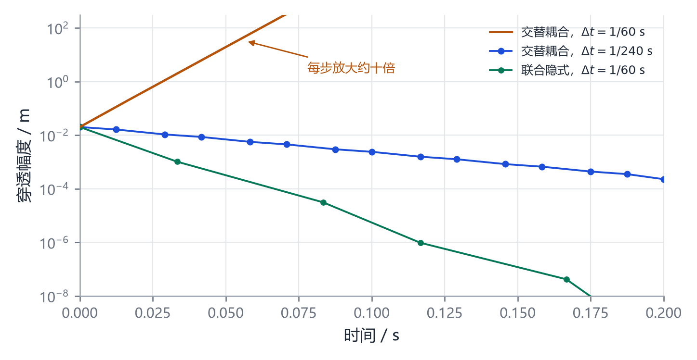

# 第 10 章 刚体与流体、布料的耦合

> 本章导读：这一章讲一个刚体进入流体或者被布包住时，两种求解器怎么交换信息。三种耦合层次的差别、浮力与附加质量怎么变成代码里的数、表面压力为什么会抖、时间步怎么对齐，这几件事决定了同一个场景是“像”还是“炸”。

## 10.1 一只漂在水上的箱子

一个 0.5 m 见方的木箱，密度 600 kg/m³，从半米高处落进水池。它撞进水面，激起一圈水花，沉到大约一半的体积没入水中，然后被浮力推回来，在水面上下晃几下，慢慢停住，露出水面的部分正好是四成。这是物理上该有的样子：平衡时没入的体积比例等于密度比。

把密度改成 950，事情就不对了。箱子下水后开始剧烈上下跳，幅度一次比一次大，几秒之后被弹到水面以上半米，再砸回去，速度越来越离谱。换成一块泡沫（密度 50），跳得更凶，因为它轻，同样的力给它的加速度是木箱的十二倍。同一个求解器，同一个水池，只是密度比变了，行为从稳定变成发散。

第三种毛病出现在一块空心铁盒上，密度接近 1000，漂在水面上不动。它的位置在抖：竖直方向每秒几十次、幅度几毫米的高频颤动，像被什么东西不停地敲。这个抖动和密度比无关，改参数也压不下去，只有把流体的网格加密才减轻一点。

三种现象，三条不同的原因。第一种是浮力与稳心的事，算对了就会停住；第二种是耦合方式的事，密度比把时间积分的稳定域挤小了；第三种是界面采样的事，力在时间上不连续。这一章按这个顺序讲，因为它们的修法完全不同：第一种改公式，第二种改时间步或者改求解结构，第三种只能改采样和守恒。

还有一件贯穿全章的事：两边对“边界在哪里”的定义不一致。流体在网格或粒子上解，刚体在解析形状上解，界面的压力是流体的量，界面的位置是刚体的量，只能靠插值对接。所有耦合问题，本质都是这个插值的问题。

## 10.2 三种耦合：单向、交替、联合

最省事的是单向。刚体当成流体求解器里的一个运动边界：它的位姿喂给流体，流体该绕流就绕流，该被推开就被推开；流体的结果用来渲染，不回算到刚体上。多数“船划过水面”的镜头就是这么做的：轨迹是动画师给的，水花是解出来的。反过来也成立：先算出尾迹，再让刚体跟着尾迹漂。

单向的成本是一次流体求解加一次表面采样，误差是动量不守恒：刚体把水推开，水对刚体没有任何反作用。看得出问题的场合是入水不减速、被推开的水不回落。用在远景和不能交互的镜头上完全够，用在需要“手感”的地方一眼就假。

交替双向是游戏和影视里的主力。一帧里做两件事：先按刚体上一帧的位姿和速度解流体，从流体场里取力；再用这个力积分刚体。下一帧重复。写成式子就是

$$
\mathbf{u}^{n+1} = \mathcal{F}\big(\mathbf{u}^n, \mathbf{x}^n, \mathbf{v}^n\big), \qquad
\mathbf{F}_b = \mathcal{P}\big(\mathbf{u}^{n+1}\big), \qquad
\mathbf{v}^{n+1} = \mathbf{v}^n + \Delta t\,\mathbf{F}_b / m ,
\tag{10.1}
$$

$\mathcal{F}$ 是一步流体求解，$\mathcal{P}$ 是从流体场到刚体合力的采样算子，$m$ 是刚体质量。注意两边的信息不在同一个时刻：流体用的是 $n$ 时刻的位姿，刚体用的是 $n+1$ 时刻的力。这个错位是一阶误差，也是交替耦合所有稳定性问题的根源。

交替耦合还有个顺序问题。先解流体再解刚体，和先解刚体再解流体，结果差半步；两者的误差方向相反。取平均（半步流体、整步刚体、再半步流体）能把一阶误差消掉，这就是算子分裂里的 Strang 对称化，代价是每帧多解一次半步流体。

联合隐式是第三种。把刚体的位置和速度当成整个系统的未知量，与流体的压力（或速度）一起解，一个牛顿迭代里同时满足流体的方程和刚体的运动方程。它没有那个半步错位，稳定性不依赖密度比，代价是每一步都要解一个带耦合块的系统，通常意味着每帧三到十次流体求解。

选哪一种，取决于两件事：密度比，以及观众会不会盯着看。密度比远离 1（木箱、石子）交替耦合通常够用；密度比接近 1（空心铁盒、潜水器、冰块）交替耦合会抖或者炸，这时要么上隐式，要么认下“物体质量被加了一点”的近似。剩下几节讲这些判断的依据。

## 10.3 浮力、阻力与附加质量

浮力是最容易写对也最容易写错的一项。公式本身简单：$\mathbf{F}_b = \rho_f V_{sub}\, g$，方向向上，作用点在浮心，也就是排开那部分体积的形心。写错的地方在 $V_{sub}$ 和浮心。

浸没体积有三种算法。解析法只对少数形状可行：球、轴对齐的盒子、竖直的圆柱，水面是平面时能写出闭式解。采样法在表面撒点，统计水下的点，用体积权重求和，精度取决于点数。裁剪法把网格与水面切一刀，算切下来那部分的体积与形心，最准也最贵。

平衡时 $V_{sub}/V = \rho_b/\rho_f$，浸没比例就是密度比，这条式子对任何形状都成立，因为浮力等于排开流体的重量、平衡时等于物体重量。冰的密度 917 kg/m³，漂在水上时约 92% 的体积在水下，露出 8%，这就是冰山只露一角的算术来源。图 10-1 左半边把这条线画出来，顺带标了几种常见材料的密度比。

<figure class="fig">

<figcaption><b>图 10-1</b>　左：静水平衡时浸没体积比例等于密度比 $s = \rho_b/\rho_f$，标出泡沫、松木、橡木、冰四个点。右：球体在理想流体中的附加质量与刚体质量之比 $m_a/m_b = \rho_f/(2\rho_b)$，横轴是密度比，纵轴取对数。密度比 0.5 时两者相等；密度比 0.1 的轻物体，附加质量是自重的五倍。两图都是公式直接算出来的，没有拟合。</figcaption>
</figure>

浮心与质心的相对位置决定稳定性。浮心在质心之上时，倾斜会把浮力作用点推向倾斜的一侧，产生恢复力矩，箱子自己正回来；浮心在质心之下，力矩方向反过来，箱子会翻。真实船体的稳心高度是设计参数，模拟里则直接来自“质心位置减浮心位置”这一项，所以质心必须按真实质量分布算。

阻力有两套写法，取决于尺度。小物体、慢速度、粘性主导时用线性阻力 $\mathbf{F}_d = -c\,\mathbf{v}$，$c$ 靠实验或者量纲估。大物体、快速度、惯性主导时用二次阻力 $\mathbf{F}_d = -\tfrac{1}{2}\rho_f C_d A\,|\mathbf{v}|\mathbf{v}$，$A$ 是迎流面积，$C_d$ 是阻力系数，球约 0.47，立方体约 1.05，平板垂直迎流约 1.28。阻力矩同理，把速度换成角速度即可。

从数值角度看，阻力是好事：它给系统加阻尼，压住抖动，也让交替耦合的稳定域宽一点。二次阻力在大速度下会带来麻烦：$|\mathbf{v}|\mathbf{v}$ 的量级随速度平方增长，显式积分在入水瞬间容易一步跨得太大，出现“入水即反弹”的假象。常见处理是对阻力项做半隐式（把 $|\mathbf{v}|$ 取上一时刻的值，把 $\mathbf{v}$ 当未知量解一个标量方程），或者给速度设一个上限。

附加质量是最容易被忽略、又最能解释“为什么会炸”的一项。物体在水中加速，必须同时把周围的水也加速，这部分水的惯性表现为刚体质量的增加。理想流体里球体的附加质量是排开流体质量的一半，$m_a = \tfrac{1}{2}\rho_f V$；长方体按方向不同在 0.2 到 0.7 倍之间；贴近水面的物体还要更大，因为自由面让流动更受限。

把它写成比值就看出问题的量级：

$$
\frac{m_a}{m_b} = \frac{\rho_f}{2\rho_b} .
\tag{10.2}
$$

密度比 0.5 的木箱，附加质量约等于自重；密度比 0.1 的泡沫，附加质量是自重的五倍；密度比 0.95 的铁盒，附加质量约是自重的一半，仍然与自重同量级。也就是说，只要物体密度不超过流体密度的两倍，附加质量就不是一个小修正，它会改变系统的有效惯量，而多数刚体求解器的质量矩阵里根本没有它。

这一点在下文会反复出现：交替耦合用的是刚体质量 $m_b$，而真实系统的有效质量是 $m_b + m_a$。程序把物体算得比实际轻，同一个压力差给出的加速度就偏大，偏大的加速度又把界面推得更远，下一帧的压力差更大。这是一个正反馈，反馈的增益与 $m_a/m_b$ 同量级，密度比越接近 1 增益越大。10.6 会把这个反馈写成一维模型，给出稳定条件。

## 10.4 压力从网格搬到表面

流体求解器给出的是网格中心或者粒子上的压力，刚体需要的是表面上的积分。两件事：

$$
\mathbf{F}_b = \sum_i p_i\,\mathbf{n}_i\,A_i , \qquad
\boldsymbol{\tau}_b = \sum_i \mathbf{r}_i \times \big(p_i\,\mathbf{n}_i\,A_i\big) ,
\tag{10.3}
$$

$i$ 遍历刚体表面的一组采样点，$p_i$ 是该点的压力（从流体场插值得到），$\mathbf{n}_i$ 是表面外法向，$A_i$ 是这个采样点代表的面积，$\mathbf{r}_i$ 是从质心到采样点的向量。采样点通常固定在物体局部坐标里，跟着物体一起运动；面积权重按形状预先分配，球面上按立体角、盒子上按面均分。

抖动的第一个来源就在这组采样点的运动里。物体每移动一点，采样点就落到网格的不同单元或者粒子的不同邻域里，插值函数（三线性、SPH 核）在两套离散之间是分段光滑但整体不连续的。力的时间序列因此是台阶状的，物体的加速度也是台阶状的，积分两次就是可见的颤动。

量级可以估。一个 0.5 m 见方的木箱，密度 600，质量 75 kg，重量约 735 N。每面撒 $8\times8$ 个采样点，每个点代表 $3.9\times10^{-3}$ m²。网格 2 cm 时，跨一个网格的压力差约 $\rho_f g \Delta x \approx 196$ Pa，单点的力就是 0.77 N，约等于重量的千分之一。一个点偏不要紧，怕的是同一侧几十个点同向偏：20 个点同向，合力 15 N，约是重量的 2%，加速度就有 0.2 m/s² 的抖动。这正好是肉眼能看出来的幅度。

第二个来源是自由面。压力在水面附近最陡，从大气压到 $\rho g h$ 只跨几个网格；采样点落在这个带里时压力对位置极敏感，于是抖动集中在物体跨过水面的那些帧。这解释了为什么漂着的抖、全沉的稳。

第三个来源是力矩。力臂把误差放大：0.77 N 的误差作用在 0.25 m 的力臂上是 0.19 N·m。方向随采样点跳变，会让物体缓慢摇晃，阻尼吃不掉它，因为它是外加的、非物理的力矩。

缓解有四条，按代价从低到高。

把采样点固定住并增加点数。采样点跟着局部坐标走，面积权重预先算好，这条是基础。点数要够：每个网格单元对应的面积上至少有几个点，否则插值的台阶会直接变成力的台阶。

对压力做时间平滑。一阶低通 $p \leftarrow \alpha p + (1-\alpha) p_{new}$，$\alpha$ 取 0.1 到 0.3，能压掉大部分高频。代价是滞后，物体对压力的响应慢了几帧，快速入水时会显得“软”。平滑也会引入额外的能量耗散，对需要能量守恒的镜头不合适。

用动量交换代替单向采样。取力的时候同时把等大反向的冲量加回流体的对应单元，两边用同一组插值权重。这样误差变成了系统内部的传递，总动量守恒，抖动从“凭空出现的力”变成“力的重新分配”，量级降一个数量级。这条在粒子法里特别好实现，因为粒子本身就是动量载体。

把刚体也变成粒子。统一粒子求解器里，刚体由一层粒子表示，用形状匹配维持刚性，与流体用同一套密度约束和邻域核 [@macklin2014]。界面上的压力不再需要插值，因为两边是同一套离散；浮力、阻力、附加质量都是密度约束的自然结果，不需要单独写。代价是形状精度受粒子分辨率限制，大平面上会有颗粒感。

四条里最常用的是第一条加第三条。第四条在需要大量小物体与流体互动（泡沫、碎石、漂浮的碎片）时特别划算，因为那类场景本来就不需要精确形状。

## 10.5 布料与刚体

布料与刚体的耦合，和流体与刚体的耦合在结构上很像：一边是顶点，一边是解析形状，中间靠距离查询对接。区别在布料没有体积，也没有压力，它只传法向力和摩擦力。

布料撞刚体是最常见的一半。刚体在布料求解器里当一个碰撞体：每个顶点查询到刚体表面的有符号距离，距离小于布料厚度时施加约束。凸形用 GJK 求最近点，复杂形状用 SDF 或者 BVH 加三角形最近点。约束的写法有两种，位置层直接把顶点推到表面外，速度层施加一个法向冲量让相对法向速度非负；前者稳但会引入位置修正的人为位移，后者物理但会留一点穿透。多数引擎两者都用：速度层解，位置层收尾。

布料是双面的，这一条会带来专门的 bug。顶点没有朝向，一个顶点从正面穿到背面时，距离查询给出的法向会翻转，约束会把顶点往错误的一侧推，结果是布料“粘”在刚体上或者被弹开。处理办法是记住每个顶点上次在哪一侧，按记忆选法向；或者给布料一个很小的厚度。

摩擦决定了布料是“搭在”还是“包住”。包裹感几乎全靠摩擦：布与刚体的摩擦系数大，布就不会顺着斜面滑下去，而是折出褶子卡住。摩擦冲量的锚点建在顶点与刚体接触的那一刻，锚点跟着刚体走（刚体可能也在动），切向位移按锚点算。锚点跳变是布料抖动的主要来源之一，和上一节的采样抖动同源：都是“离散点在连续表面上滑动”的必然结果。

另一半是刚体被布料影响。布料顶点对刚体施加的力是顶点冲量之和，反作用到刚体的质心与转动上。布料质量通常远小于刚体，单向就够：布盖在桌子上，桌子不需要被布推动。但“包袱”这类场景是双向的：布被拉紧、包住物体、改变物体的运动。这时质量比可能到 1:10 甚至更大，约束求解器要多迭代，否则布会把刚体“挤”出去或者刚体把布“扯”穿。

成本主要在顶点侧：几万个顶点，每个每帧一到几次距离查询，刚体侧的 BVH 或 SDF 网格把单次查询压到对数时间。

## 10.6 时间步怎么对

流体和刚体对步长的要求不一样。流体受 CFL 限制，步长与网格尺寸和流速挂钩，通常要小；刚体的步长由接触刚度和迭代预算决定，可以大一些。于是最常见的是子循环：一个刚体步里跑若干个流体子步，比例一到八不等。

子循环里有一个必须做对的细节：刚体的位姿要在每个子步之间更新，位置线性插值、姿态球面插值，不能整步共用一个位姿，否则流体看到的是一个瞬移的障碍物，压力会出现尖峰。流体力则要在子步上按时间加权平均。

交替顺序误差是一阶的，这个结论可以用一维模型看清楚。让刚体质量 $m_b$，流体侧等效质量 $m_f$（含附加质量），界面的耦合刚度为 $k$，阻尼为 $c$，穿透量 $p = x_b - x_f$。两个质量通过一个弹簧-阻尼器相连，方程是

$$
m_b \ddot x_b = -k p - c\dot p , \qquad
m_f \ddot x_f = +k p + c\dot p .
\tag{10.4}
$$

交替耦合的积分是：先用旧的 $p$、$\dot p$ 算力，更新流体一侧；再用同一个力更新刚体。这等价于把耦合项显式处理，而显式处理弹簧系统的稳定条件是

$$
\Delta t \lt \frac{2}{\omega}, \qquad \omega = \sqrt{k\left(\frac{1}{m_b} + \frac{1}{m_f}\right)} .
\tag{10.5}
$$

$\omega$ 是耦合振型（两个质量反相振动）的频率。越过这个界，误差每步放大，穿透量指数增长。

图 10-2 是一个具体算例。取 $m_b = m_f = 1$ kg，$k = 2\times10^4$ N/m，$c = 20$ N·s/m，初始穿透 2 cm，$\omega = 200$ rad/s，稳定界是 $\Delta t \lt 0.01$ s。用 $1/60$ s 的步长（$\Delta t\,\omega \approx 3.3$），穿透每步放大约十倍，两帧就到米级，物体被弹飞；把步长切到 $1/240$ s（$\Delta t\,\omega \approx 0.83$），振荡的幅度按阻尼衰减，0.2 s 后从 2 cm 降到 $10^{-4}$ m 量级；换成联合隐式、仍然用 $1/60$ s，幅度衰减得更快，0.17 s 已经到 $10^{-8}$ m，而且整个过程没有振荡。

<figure class="fig">

<figcaption><b>图 10-2</b>　一维耦合模型的穿透随时间，纵轴取对数，画的是穿透量的幅度（每个振荡周期内的极大绝对值，取对数）。两个质量各 1 kg，耦合刚度 $k = 2\times10^4$ N/m，阻尼 $c = 20$ N·s/m，初始穿透 2 cm，$\omega = 200$ rad/s。交替耦合用 $1/60$ s 时 $\Delta t\,\omega \approx 3.3$，越过稳定界 $2$，幅度每步放大约十倍，0.07 s 之后已在坐标范围之外；同一模型把步长切到 $1/240$ s 就稳住了，0.2 s 时幅度约 $10^{-4}$ m；联合隐式用 $1/60$ s 也稳，衰减还更快。</figcaption>
</figure>

这个模型解释三件实际场景里反复出现的事。

密度比通过 $m_f$ 进入稳定条件。$m_f$ 是流体侧被带动的等效质量，量级就是附加质量 $\tfrac12\rho_f V$。物体越轻，$1/m_b$ 越大，$\omega$ 越大，允许的步长越小。一块泡沫要稳定，步长得比木箱还小，这和“轻的东西应该更容易被水带着走”的直觉相反，原因是它的惯性小、同样的力给出的加速度大，耦合回路增益高。

耦合刚度 $k$ 也不是常数。它正比于流体密度、界面面积，反比于网格尺寸：网格加密一倍，界面附近的压力梯度变陡一倍，$k$ 大约翻倍，稳定步长减半。这解释了一个常见的困惑：同一个场景，把流体分辨率调高之后，原本稳定的耦合开始炸，因为流体的时间步跟着变小了，但刚体的步长没变。

子步与隐式解决的是同一个问题，代价不同。子步把 $\Delta t$ 变小，成本线性增长；隐式把稳定性条件去掉，成本是每步多次求解。两者都能救图 10-2 里的发散，选哪个看流体求解器能不能承受多次调用。

## 10.7 什么时候必须隐式

当密度比接近 1、耦合刚度又大时，显式路线的步长会小到不可接受。这时把两边放进一个系统解。做法是把流体与刚体的方程写成一个残差

$$
\mathbf{r}(\mathbf{u}, \mathbf{x}, \mathbf{v}) = \mathbf{0} ,
\tag{10.6}
$$

$\mathbf{u}$ 是流体的速度与压力，$\mathbf{x}$、$\mathbf{v}$ 是刚体的位姿与速度。牛顿法每步解一个线性系统，雅可比矩阵里有四块：流体对流体、刚体对刚体，以及两块耦合 $\partial \mathbf{F}_f/\partial \mathbf{x}$ 和 $\partial \mathbf{F}_b/\partial \mathbf{u}$。这两块正是显式耦合假装不存在的东西：流体对刚体位移的敏感度（压力随物体位置变化），和刚体对流体的敏感度。

直接解这个系统代价太高，因为流体那块有几百万个未知数。实际的写法是 Schur 补：把流体块消掉，得到刚体自由度上的约化系统。刚体每个只有六个未知数，几十个物体也就几百个，约化系统的规模可以接受；代价是每构造一次约化矩阵要解若干次流体线性系统，也就是每步三到十次流体求解。

还有一条更便宜的路：加质量稳定化。不改求解器结构，只把附加质量加到刚体的质量矩阵里，$m_b \to m_b + m_a$。这样 $\omega$ 变小，稳定界放宽，同一个步长就不炸了。它稳、简单、几乎不增加成本，代价是精度：物体对力的响应变迟钝，加速比真实情况慢，附加质量估小了还会残余振荡。工程上这常常是性价比最高的选择。

要保证不穿透，就得让接触也进入这个隐式系统。用一道在距离趋零时趋于无穷的势垒把接触写成能量项，接触力随距离连续变化，牛顿迭代不会跳过接触，再配合连续检测做线搜索，得到的是“无穿透、无翻转”的结果 [@li2020]。代价是每步的牛顿迭代与线搜索都不便宜，势垒刚度大时条件数还差，需要好的预条件。

判断该走到哪一层，可以用三个问题。物体与流体的密度比是否在 0.5 到 2 之间，如果在，交替耦合大概率要抖。界面的耦合刚度是否随分辨率变化剧烈，如果是，隐式或者加质量更省心。以及最关键的：观众会不会盯着这个物体的运动看。远景里漂着的浮标，交替耦合足够；近景里潜艇上浮、冰块翻转，交替耦合的滞后和附加质量误差都能被看出来。

同一份代码可以有两档：默认走交替耦合加子步，对少数“重点物体”切到隐式，把成本压在真正需要精度的地方。
