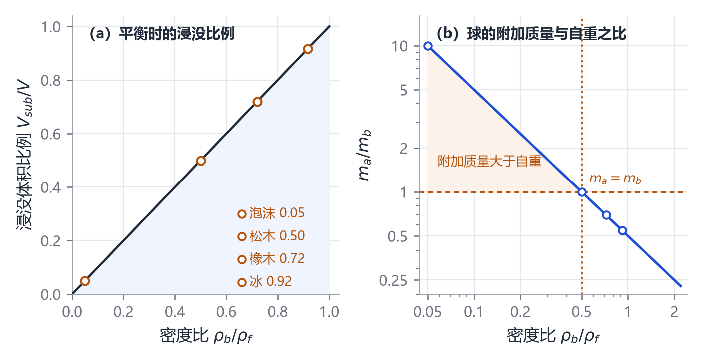

# 第 10 章 刚体与流体、布料的耦合

> 本章导读：这一章讲一个刚体进入流体或者被布包住时，两种求解器怎么交换信息。三种耦合层次的差别、浮力与附加质量怎么变成代码里的数、表面压力为什么会抖、时间步怎么对齐，这几件事决定了同一个场景是“像”还是“炸”。

## 10.1 一只漂在水上的箱子

一个 0.5 m 见方的木箱，密度 600 kg/m³，从半米高处落进水池。它撞进水面，激起一圈水花，沉到大约一半的体积没入水中，然后被浮力推回来，在水面上下晃几下，慢慢停住，露出水面的部分正好是四成。这是物理上该有的样子：平衡时没入的体积比例等于密度比。

把密度改成 950，事情就不对了。箱子下水后开始剧烈上下跳，幅度一次比一次大，几秒之后被弹到水面以上半米，再砸回去，速度越来越离谱。换成一块泡沫（密度 50），跳得更凶，因为它轻，同样的力给它的加速度是木箱的十二倍。同一个求解器，同一个水池，只是密度比变了，行为从稳定变成发散。

第三种毛病出现在一块空心铁盒上，密度接近 1000，漂在水面上不动。它的位置在抖：竖直方向每秒几十次、幅度几毫米的高频颤动，像被什么东西不停地敲。这个抖动和密度比无关，改参数也压不下去，只有把流体的网格加密才减轻一点。

三种现象，三条不同的原因。第一种是浮力与稳心的事，算对了就会停住；第二种是耦合方式的事，密度比把时间积分的稳定域挤小了；第三种是界面采样的事，力在时间上不连续。这一章按这个顺序讲，因为它们的修法完全不同：第一种改公式，第二种改时间步或者改求解结构，第三种只能改采样和守恒。

这三种毛病在真实工程里各有各的对应物。游戏里漂在水面上的木桶属于第一种，桶摆得对不对，一眼就能看出来，因为玩家见过真的木桶。潜艇、浮标、水下机器人属于第二种，它们的密度比接近 1，做仿真的人最常抱怨的“莫名其妙飞出去”多半在这里。第三种在影视里最要命：一个不动的浮标在镜头里微颤，比一个明显错的浮力更容易被观众注意到，因为前者是运动，人眼对高频抖动极敏感。

还有一件贯穿全章的事：两边对“边界在哪里”的定义不一致。流体在网格或粒子上解，刚体在解析形状上解，界面的压力是流体的量，界面的位置是刚体的量，只能靠插值对接。所有耦合问题，本质都是这个插值的问题。

## 10.2 三种耦合：单向、交替、联合

最省事的是单向。刚体当成流体求解器里的一个运动边界：它的位姿喂给流体，流体该绕流就绕流，该被推开就被推开；流体的结果用来渲染，不回算到刚体上。多数“船划过水面”的镜头就是这么做的：轨迹是动画师给的，水花是解出来的。反过来也成立：先算出尾迹，再让刚体跟着尾迹漂。

单向的成本是一次流体求解加一次表面采样，误差是动量不守恒：刚体把水推开，水对刚体没有任何反作用。看得出问题的场合是入水不减速、被推开的水不回落。用在远景和不能交互的镜头上完全够，用在需要“手感”的地方一眼就假。

交替双向（staggered coupling，也叫分块耦合）是游戏和影视里的主力。一帧里做两件事：先按刚体上一帧的位姿和速度解流体，从流体场里取力；再用这个力积分刚体。下一帧重复。写成式子就是

$$
\mathbf{u}^{n+1} = \mathcal{F}\big(\mathbf{u}^n, \mathbf{x}^n, \mathbf{v}^n\big), \qquad
\mathbf{F}_b = \mathcal{P}\big(\mathbf{u}^{n+1}\big), \qquad
\mathbf{v}^{n+1} = \mathbf{v}^n + \Delta t\,\mathbf{F}_b / m ,
\tag{10.1}
$$

$\mathcal{F}$ 是一步流体求解，$\mathcal{P}$ 是从流体场到刚体合力的采样算子，$m$ 是刚体质量。注意两边的信息不在同一个时刻：流体用的是 $n$ 时刻的位姿，刚体用的是 $n+1$ 时刻的力。这个错位是一阶误差，也是交替耦合所有稳定性问题的根源。

把它代入具体的数：$\Delta t = 1/60$ s，木箱 $m = 75$ kg，某一帧采样算出的合力比重力多 150 N（大约两成），那么这一步的加速度是 $150/75 = 2$ m/s²，速度增加 3.3 cm/s，位置多走零点三毫米。这个量本身无害。危险的是下一步：箱子往下多走了半毫米，浸没体积变大，排开的水变多，浮力又比上一步多出一点，而求解器把这个增量当成了新的输入。也就是说，每一步的“多余”都被下一步接着放大，而不是被吸收掉。

交替耦合还有个顺序问题。先解流体再解刚体，和先解刚体再解流体，结果差半步；两者的误差方向相反。取平均（半步流体、整步刚体、再半步流体）能把一阶误差消掉，这就是算子分裂里的 Strang 对称化，代价是每帧多解一次半步流体。

联合隐式（monolithic coupling，整体耦合）是第三种。把刚体的位置和速度当成整个系统的未知量，与流体的压力（或速度）一起解，一个牛顿迭代里同时满足流体的方程和刚体的运动方程。它没有那个半步错位，稳定性不依赖密度比，代价是每一步都要解一个带耦合块的系统，通常意味着每帧三到十次流体求解。

三者的成本差得很干脆。同样一个场景，单向是一份流体求解，交替是两份到四份（含子步），联合隐式是十份到三十份。也就是说，稳定性的价钱是十倍的机时。这个价钱在离线渲染里可以接受，在 60 fps 的游戏里基本不可能，所以游戏里的水下物体多半是交替耦合加一堆补丁。

选哪一种，取决于两件事：密度比，以及观众会不会盯着看。密度比远离 1（木箱、石子）交替耦合通常够用；密度比接近 1（空心铁盒、潜水器、冰块）交替耦合会抖或者炸，这时要么上隐式，要么认下“物体质量被加了一点”的近似。剩下几节讲这些判断的依据。

## 10.3 浮力、阻力与附加质量

浮力是最容易写对也最容易写错的一项。公式本身简单：$\mathbf{F}_b = \rho_f V_{sub}\, g$，方向向上，作用点在浮心，也就是排开那部分体积的形心。写错的地方在 $V_{sub}$ 和浮心。

逐个符号看：$\rho_f$ 是流体的密度，水取 1000 kg/m³；$V_{sub}$ 是物体浸没部分的体积，单位 m³；$g$ 取 9.81 m/s²。三个量相乘，量纲是 kg/m³ × m³ × m/s² = N，正好是力。方向沿竖直向上，作用点在浮心。

拿 10.1 里那只木箱算一遍。边长 0.5 m，体积 $0.125$ m³，密度 600，质量 75 kg，重量 $75 \times 9.81 = 735.75$ N。平衡时浮力等于重量，于是 $V_{sub} = 735.75/(1000 \times 9.81) = 0.075$ m³，占总体积的 60%。箱底面积 0.25 m²，浸没 0.075 m³ 对应吃水 $0.075/0.25 = 0.30$ m。箱高 0.5 m，所以露出水面 0.20 m，正好是四成。也就是说，一整条浮力计算，最后落到一个长度上：吃水 30 cm。做水面特效的人记住的是这个数，不是那个体积。

浸没体积有三种算法。解析法只对少数形状可行：球、轴对齐的盒子、竖直的圆柱，水面是平面时能写出闭式解。采样法在表面撒点，统计水下的点，用体积权重求和，精度取决于点数。裁剪法把网格与水面切一刀，算切下来那部分的体积与形心，最准也最贵。

平衡时 $V_{sub}/V = \rho_b/\rho_f$，浸没比例就是密度比，这条式子对任何形状都成立，因为浮力等于排开流体的重量、平衡时等于物体重量。冰的密度 917 kg/m³，漂在水上时约 92% 的体积在水下，露出 8%，这就是冰山只露一角的算术来源。图 10-1 左半边把这条线画出来，顺带标了几种常见材料的密度比。

<figure class="fig">

<figcaption><b>图 10-1</b>　左：静水平衡时浸没体积比例等于密度比 $s = \rho_b/\rho_f$，标出泡沫、松木、橡木、冰四个点。右：球体在理想流体中的附加质量与刚体质量之比 $m_a/m_b = \rho_f/(2\rho_b)$，横轴是密度比，纵轴取对数。密度比 0.5 时两者相等；密度比 0.1 的轻物体，附加质量是自重的五倍。两图都是公式直接算出来的，没有拟合。</figcaption>
</figure>

浮心与质心的相对位置决定稳定性。浮心在质心之上时，倾斜会把浮力作用点推向倾斜的一侧，产生恢复力矩，箱子自己正回来；浮心在质心之下，力矩方向反过来，箱子会翻。真实船体的稳心高度是设计参数，模拟里则直接来自“质心位置减浮心位置”这一项，所以质心必须按真实质量分布算。

这句话只说了一半，倾斜之后的恢复力矩还要算上水线面的形状。船的判据是稳心高度（metacentric height）$GM = BM - BG$：$BG$ 是浮心到质心的距离（质心在上为正），$BM = I/V_{sub}$，$I$ 是水线面的面积惯性矩，$V_{sub}$ 还是浸没体积。$GM$ 为正，船自己正回来；$GM$ 为负，船翻。也就是说，宽而浅的物体稳，窄而高的物体翻。

代三个数看看。同样密度 600 的一块木板，1 m × 1 m × 0.1 m，质量 60 kg，排水 0.06 m³，吃水 6 cm。水线面是 1 m 见方，$I = 1^4/12 = 0.0833$ m⁴，$BM = 0.0833/0.06 = 1.39$ m，$BG = 0.05 - 0.03 = 0.02$ m，$GM = 1.37$ m。这个数大得离谱，所以木板漂得极稳，站个人上去也不翻。

换成一根 0.3 m × 0.3 m × 2 m 的方木柱，质量 108 kg，排水 0.108 m³，底面积 0.09 m²，吃水 $0.108/0.09 = 1.2$ m。$I = 0.3^4/12 = 6.75\times10^{-4}$ m⁴，$BM = 6.25\times10^{-3}$ m，$BG = 1.0 - 0.6 = 0.4$ m，$GM = -0.39$ m。负得很多，木柱立着根本漂不住，一定会躺下来。生活里漂在水上的木头都是躺着的，原因就是这个负号，不是因为它“懒得站”。

容易误解的地方在这里：一个均匀的立方体，密度 0.6，看起来四平八稳，算下来 $GM = 0.069 - 0.10 = -0.03$ m，是负的。它不会平着漂，会歪到某个角度才停。要它平着漂，密度得高于 0.79 左右，或者把水线面加宽——这也是船为什么要做得宽而浅、为什么货船空载时要压载水。

阻力有两套写法，取决于尺度。小物体、慢速度、粘性主导时用线性阻力 $\mathbf{F}_d = -c\,\mathbf{v}$，$c$ 靠实验或者量纲估。大物体、快速度、惯性主导时用二次阻力 $\mathbf{F}_d = -\tfrac{1}{2}\rho_f C_d A\,|\mathbf{v}|\mathbf{v}$，$A$ 是迎流面积，$C_d$ 是阻力系数，球约 0.47，立方体约 1.05，平板垂直迎流约 1.28。阻力矩同理，把速度换成角速度即可。

二次阻力也代一组数。木箱底面 0.5 m × 0.5 m 竖直下落，$A = 0.25$ m²，$C_d$ 取 1.05，速度 1 m/s 时 $F_d = 0.5 \times 1000 \times 1.05 \times 0.25 \times 1 = 131$ N，是自重 735.75 N 的 18%。速度到 3 m/s 时是 1181 N，已经超过自重，箱子开始减速。终速由 $131 v^2 = 735.75$ 定出，$v = 2.37$ m/s。也就是说，这只箱子在水里最多下落 2.4 m/s 左右，跟它从多高掉下来无关。

从数值角度看，阻力是好事：它给系统加阻尼，压住抖动，也让交替耦合的稳定域宽一点。二次阻力在大速度下会带来麻烦：$|\mathbf{v}|\mathbf{v}$ 的量级随速度平方增长，显式积分在入水瞬间容易一步跨得太大，出现“入水即反弹”的假象。常见处理是对阻力项做半隐式（把 $|\mathbf{v}|$ 取上一时刻的值，把 $\mathbf{v}$ 当未知量解一个标量方程），或者给速度设一个上限。

附加质量是最容易被忽略、又最能解释“为什么会炸”的一项。物体在水中加速，必须同时把周围的水也加速，这部分水的惯性表现为刚体质量的增加，这一项叫附加质量（added mass）。理想流体里球体的附加质量是排开流体质量的一半，$m_a = \tfrac{1}{2}\rho_f V$；长方体按方向不同在 0.2 到 0.7 倍之间；贴近水面的物体还要更大，因为自由面让流动更受限。

把它写成比值就看出问题的量级：

$$
\frac{m_a}{m_b} = \frac{\rho_f}{2\rho_b} .
\tag{10.2}
$$

$\rho_f$ 是流体密度，$\rho_b$ 是物体密度，比值 1 意味着附加质量和物体自重相等。密度比 0.5 的木箱，附加质量约等于自重；密度比 0.1 的泡沫，附加质量是自重的五倍；密度比 0.95 的铁盒，附加质量约是自重的一半，仍然与自重同量级。也就是说，只要物体密度不超过流体密度的两倍，附加质量就不是一个小修正，它会改变系统的有效惯量，而多数刚体求解器的质量矩阵里根本没有它。

要摸到附加质量的手感，最好的实验是推一只水里的球。直径 10 cm、密度 500 的木球，质量 0.26 kg，排水 0.52 kg，按式 10.2 附加质量等于自重，都是 0.26 kg。用 2.6 N 的力推它（大约等于它自己的重量），在空气里加速度是 10 m/s²；在水里，扣掉与重量抵消的浮力之后，同样的力只给出 5 m/s²。手感到的“变重”不是浮力（浮力抵消的是重量，不是惯性），也不是粘性（粘性与速度有关，起步时速度是零，粘性阻力也是零）。它来自一件很朴素的事：你推球的时候，同时在把球前方的那团水挤到后方去，这团水没有把手，只能通过球来推。

这团水还有个后果：松手之后它还在动。球的动能加周围水的动能一起存在这个流场里，球停下之前水还在往前流，会继续带着球滑行一小段。真空里推一下球，松手就匀速；水里推一下，松手后还会漂出半个球身。也就是说，附加质量是“与加速度成正比的额外惯性”，跟阻力（与速度成正比）是两回事，两者在代码里应该分开写。

这一点在下文会反复出现：交替耦合用的是刚体质量 $m_b$，而真实系统的有效质量是 $m_b + m_a$。程序把物体算得比实际轻，同一个压力差给出的加速度就偏大，偏大的加速度又把界面推得更远，下一帧的压力差更大。这是一个正反馈，反馈的增益与 $m_a/m_b$ 同量级，密度比越接近 1 增益越大。10.6 会把这个反馈写成一维模型，给出稳定条件。

## 10.4 压力从网格搬到表面

流体求解器给出的是网格中心或者粒子上的压力，刚体需要的是表面上的积分。两件事：

$$
\mathbf{F}_b = \sum_i p_i\,\mathbf{n}_i\,A_i , \qquad
\boldsymbol{\tau}_b = \sum_i \mathbf{r}_i \times \big(p_i\,\mathbf{n}_i\,A_i\big) ,
\tag{10.3}
$$

$i$ 遍历刚体表面的一组采样点，$p_i$ 是该点的压力（从流体场插值得到），$\mathbf{n}_i$ 是表面外法向，$A_i$ 是这个采样点代表的面积，$\mathbf{r}_i$ 是从质心到采样点的向量。采样点通常固定在物体局部坐标里，跟着物体一起运动；面积权重按形状预先分配，球面上按立体角、盒子上按面均分。

代入数字：木箱每面撒 $8\times8$ 个采样点，每面 0.25 m²，一个点代表 $0.25/64 = 3.9\times10^{-3}$ m²。若某点的压力比重力静压多 196 Pa（相当于 2 cm 的水柱），这个点的力就是 $196 \times 3.9\times10^{-3} = 0.77$ N，方向沿外法向。$\mathbf{n}_i$ 是单位向量，$A_i$ 的单位是 m²，两者乘上压力量纲 Pa = N/m²，得到的还是 N。

抖动的第一个来源就在这组采样点的运动里。物体每移动一点，采样点就落到网格的不同单元或者粒子的不同邻域里，插值函数（三线性、SPH 核）在两套离散之间是分段光滑但整体不连续的。力的时间序列因此是台阶状的，物体的加速度也是台阶状的，积分两次就是可见的颤动。

量级可以估。一个 0.5 m 见方的木箱，密度 600，质量 75 kg，重量约 735 N。每面撒 $8\times8$ 个采样点，每个点代表 $3.9\times10^{-3}$ m²。网格 2 cm 时，跨一个网格的压力差约 $\rho_f g \Delta x \approx 196$ Pa，单点的力就是 0.77 N，约等于重量的千分之一。一个点偏不要紧，怕的是同一侧几十个点同向偏：20 个点同向，合力 15 N，约是重量的 2%，加速度就有 0.2 m/s² 的抖动。这正好是肉眼能看出来的幅度。

第二个来源是自由面。压力在水面附近最陡，从大气压到 $\rho g h$ 只跨几个网格；采样点落在这个带里时压力对位置极敏感，于是抖动集中在物体跨过水面的那些帧。这解释了为什么漂着的抖、全沉的稳。

第三个来源是力矩。力臂把误差放大：0.77 N 的误差作用在 0.25 m 的力臂上是 0.19 N·m。方向随采样点跳变，会让物体缓慢摇晃，阻尼吃不掉它，因为它是外加的、非物理的力矩。

这一步在代码里长什么样，值得写清楚，因为出错的地方几乎都在这里。每个刚体预先存三张表：局部坐标下的采样点位置、每个点的外法向、每个点代表的面积。每帧三趟循环：把采样点变换到世界坐标；用世界坐标去流体场插值出压力；把压力乘面积乘法向累加成合力与合力矩。变换只做一次，法向只转一次，插值时的网格索引还能跨帧缓存——只要物体没跨过单元边界。

三趟循环里最贵的是插值，最容易错的是“变换”这一趟。法向必须跟着物体转，忘了转的话，物体翻过来之后法向还朝上，浮力的方向就是错的。这个错误的表现很典型：物体在水下也能“浮”，而且越深越浮。

缓解有四条，按代价从低到高。

把采样点固定住并增加点数。采样点跟着局部坐标走，面积权重预先算好，这条是基础。点数要够：每个网格单元对应的面积上至少有几个点，否则插值的台阶会直接变成力的台阶。

对压力做时间平滑。一阶低通 $p \leftarrow \alpha p + (1-\alpha) p_{new}$，$\alpha$ 取 0.1 到 0.3，能压掉大部分高频。代价是滞后，物体对压力的响应慢了几帧，快速入水时会显得“软”。平滑也会引入额外的能量耗散，对需要能量守恒的镜头不合适。

用动量交换代替单向采样。取力的时候同时把等大反向的冲量加回流体的对应单元，两边用同一组插值权重。这样误差变成了系统内部的传递，总动量守恒，抖动从“凭空出现的力”变成“力的重新分配”，量级降一个数量级。这条在粒子法里特别好实现，因为粒子本身就是动量载体。

把刚体也变成粒子。统一粒子求解器里，刚体由一层粒子表示，用形状匹配（shape matching）维持刚性，与流体用同一套密度约束和邻域核 [@macklin2014]。界面上的压力不再需要插值，因为两边是同一套离散；浮力、阻力、附加质量都是密度约束的自然结果，不需要单独写。代价是形状精度受粒子分辨率限制，大平面上会有颗粒感。

四条里最常用的是第一条加第三条。第四条在需要大量小物体与流体互动（泡沫、碎石、漂浮的碎片）时特别划算，因为那类场景本来就不需要精确形状。

容易误解的地方是“网格加密就能修好抖动”。加密确实能让台阶变小，但台阶的位置也跟着变，只要采样点和流体离散还是两套独立的东西，力的时间序列就还是有跳变。真正消掉跳变的只有两件事：两边用同一套离散（第四条），或者把误差变成守恒的交换（第三条）。

## 10.5 布料与刚体

布料与刚体的耦合，和流体与刚体的耦合在结构上很像：一边是顶点，一边是解析形状，中间靠距离查询对接。区别在布料没有体积，也没有压力，它只传法向力和摩擦力。

布料撞刚体是最常见的一半。刚体在布料求解器里当一个碰撞体：每个顶点查询到刚体表面的有符号距离，距离小于布料厚度时施加约束。凸形用 GJK 求最近点，复杂形状用 SDF 或者 BVH 加三角形最近点。约束的写法有两种，位置层直接把顶点推到表面外，速度层施加一个法向冲量让相对法向速度非负；前者稳但会引入位置修正的人为位移，后者物理但会留一点穿透。多数引擎两者都用：速度层解，位置层收尾。

代价可以先数一遍。一条 2 m × 2 m 的桌布，顶点间距 2 cm，就是 $101 \times 101 \approx 10^4$ 个顶点。每个顶点每帧至少一次距离查询，多数实现要两次（一次预测、一次修正），60 fps 下就是每秒 120 万次。单次 BVH 查询在 0.3 μs 上下，一帧就是 2 万次查询、约 6 ms——帧预算的三分之一已经没了。把间距改成 1 cm，顶点数变四倍，这笔钱也变四倍。也就是说，布料的分辨率得按“观众看得多近”定，不能按“越细越好”定。

布料是双面的，这一条会带来专门的 bug。顶点没有朝向，一个顶点从正面穿到背面时，距离查询给出的法向会翻转，约束会把顶点往错误的一侧推，结果是布料“粘”在刚体上或者被弹开。处理办法是记住每个顶点上次在哪一侧，按记忆选法向；或者给布料一个很小的厚度。

摩擦决定了布料是“搭在”还是“包住”。包裹感几乎全靠摩擦：布与刚体的摩擦系数大，布就不会顺着斜面滑下去，而是折出褶子卡住。摩擦冲量的锚点建在顶点与刚体接触的那一刻，锚点跟着刚体走（刚体可能也在动），切向位移按锚点算。锚点跳变是布料抖动的主要来源之一，和上一节的采样抖动同源：都是“离散点在连续表面上滑动”的必然结果。

另一半是刚体被布料影响。布料顶点对刚体施加的力是顶点冲量之和，反作用到刚体的质心与转动上。布料质量通常远小于刚体，单向就够：布盖在桌子上，桌子不需要被布推动。但“包袱”这类场景是双向的：布被拉紧、包住物体、改变物体的运动。这时质量比可能到 1:10 甚至更大，约束求解器要多迭代，否则布会把刚体“挤”出去或者刚体把布“扯”穿。

双向时的迭代次数可以估。布包住一个 2 kg 的球，布自身的总质量 0.1 kg，质量比 1:20。约束求解器每多一次迭代，把残余速度误差乘上一个比值：比值约为质量比的倒数，也就是 0.05，所以三四次迭代之后误差就降到百分之一以下。但如果是刚体主动去撞布，情况反过来：布的质量小，它被推动得快，需要更多迭代才能把布的形状稳下来，常见配置是 8 到 16 次。

成本主要在顶点侧：几万个顶点，每个每帧一到几次距离查询，刚体侧的 BVH 或 SDF 网格把单次查询压到对数时间。

## 10.6 时间步怎么对

流体和刚体对步长的要求不一样。流体受 CFL 限制，步长与网格尺寸和流速挂钩，通常要小；刚体的步长由接触刚度和迭代预算决定，可以大一些。于是最常见的是子循环：一个刚体步里跑若干个流体子步，比例一到八不等。

子循环里有一个必须做对的细节：刚体的位姿要在每个子步之间更新，位置线性插值、姿态球面插值，不能整步共用一个位姿，否则流体看到的是一个瞬移的障碍物，压力会出现尖峰。流体力则要在子步上按时间加权平均。

交替顺序误差是一阶的，这个结论可以用一维模型看清楚。让刚体质量 $m_b$，流体侧等效质量 $m_f$（含附加质量），界面的耦合刚度为 $k$，阻尼为 $c$，穿透量 $p = x_b - x_f$。两个质量通过一个弹簧-阻尼器相连，方程是

$$
m_b \ddot x_b = -k p - c\dot p , \qquad
m_f \ddot x_f = +k p + c\dot p .
\tag{10.4}
$$

两个式子的右边等大反向，所以总动量守恒，两者的共同重心以恒定速度移动；变化全在穿透量上。相减得到 $\ddot p = -k p (1/m_b + 1/m_f) - c\dot p(1/m_b+1/m_f)$，也就是说，穿透量自己单独遵守一个弹簧振子的方程，频率的平方是 $k(1/m_b+1/m_f)$。代入 $m_b = m_f = 1$ kg、$k = 2\times10^4$ N/m，得到 $\ddot p = -4\times10^4 p$，频率平方是 $4\times10^4$，$\omega = 200$ rad/s，振动周期 $2\pi/200 = 0.0314$ s。两边各推进一个步长，就相当于这个振子每周期只被采到不到两次。

交替耦合的积分是：先用旧的 $p$、$\dot p$ 算力，更新流体一侧；再用同一个力更新刚体。这等价于把耦合项显式处理，而显式处理弹簧系统的稳定条件是

$$
\Delta t \lt \frac{2}{\omega}, \qquad \omega = \sqrt{k\left(\frac{1}{m_b} + \frac{1}{m_f}\right)} .
\tag{10.5}
$$

$\omega$ 是耦合振型（两个质量反相振动）的频率。越过这个界，误差每步放大，穿透量指数增长。代上刚才的数：$2/\omega = 0.01$ s，比 $1/60$ s 小，所以 $1/60$ 的步长已经越界了。

把“为什么会炸”拆成三个环节，就能看出漏了哪一环。第一个环节是压力随穿透量增长，$F \propto k p$，这一步是单向的、瞬时的。第二个环节是力给出加速度，$a = F/m_b$，这里用的质量是刚体自己的，不含附加质量。第三个环节是加速度积成位移，位移又变成更大的 $p$。三个环节首尾相接，就是一个正反馈；从增益上看，每一步穿透大致被乘上 $1 + \Delta t^2\omega^2$ 这个量级的因子。$\Delta t\omega = 3.3$ 时它是 11.9，与图 10-2 里“每步约十倍”的幅度增长同量级，所以两次振荡就出了坐标范围。

漏的那一环是相位。真实的流体会在“被压缩的过程中”就把反力给回来，而交替耦合要等一个步长才能从解好的流体里取到力。在振荡系统里，一个几乎恰好落后半周期的力，等于一个沿着速度方向的推力；也就是说，它把误差当成了能量注入。越过稳定界之后，每一步都在往里泵能量，阻尼只吃掉了其中一部分。

还有一层采样问题。$\omega = 200$ rad/s 时，周期是 0.0314 s，$1/60$ s 的步长每周期只采到 1.9 个点。积分器看到的不是一个振荡，而是一串相位差不多的点，它分不清“正在往下压”和“已经压到底了”。如果仿真里出现“运动速度看着很慢、但算着算着就飞了”的现象，先去数一下界面振荡周期里有多少个步长。

加阻尼不是万能药。阻尼能把振荡压下去，但当 $\Delta t\omega$ 越过稳定界之后，放大来自积分格式本身，改 $c$ 只能改变放大速度，不能把符号改回来。反过来，阻尼加上去还会带来物理上不存在的能量耗散，比如浮体上浮变得黏滞。

图 10-2 是一个具体算例。取 $m_b = m_f = 1$ kg，$k = 2\times10^4$ N/m，$c = 20$ N·s/m，初始穿透 2 cm，$\omega = 200$ rad/s，稳定界是 $\Delta t \lt 0.01$ s。用 $1/60$ s 的步长（$\Delta t\,\omega \approx 3.3$），穿透每步放大约十倍，两帧就到米级，物体被弹飞；把步长切到 $1/240$ s（$\Delta t\,\omega \approx 0.83$），振荡的幅度按阻尼衰减，0.2 s 后从 2 cm 降到 $10^{-4}$ m 量级；换成联合隐式、仍然用 $1/60$ s，幅度衰减得更快，0.17 s 已经到 $10^{-8}$ m，而且一路下降，没有来回振荡。

<figure class="fig">

<figcaption><b>图 10-2</b>　一维耦合模型的穿透随时间，纵轴取对数，画的是穿透量的幅度（每个振荡周期内的极大绝对值，取对数）。两个质量各 1 kg，耦合刚度 $k = 2\times10^4$ N/m，阻尼 $c = 20$ N·s/m，初始穿透 2 cm，$\omega = 200$ rad/s。交替耦合用 $1/60$ s 时 $\Delta t\,\omega \approx 3.3$，越过稳定界 $2$，幅度每步放大约十倍，0.07 s 之后已在坐标范围之外；同一模型把步长切到 $1/240$ s 就稳住了，0.2 s 时幅度约 $10^{-4}$ m；联合隐式用 $1/60$ s 也稳，衰减还更快。</figcaption>
</figure>

这个模型解释两件实际场景里反复出现的事。

密度比通过 $m_f$ 进入稳定条件。$m_f$ 是流体侧被带动的等效质量，量级就是附加质量 $\tfrac12\rho_f V$。物体越轻，$1/m_b$ 越大，$\omega$ 越大，允许的步长越小。一块泡沫要稳定，步长得比木箱还小，这和“轻的东西应该更容易被水带着走”的直觉相反，原因是它的惯性小、同样的力给出的加速度大，耦合回路增益高。

这个结论可以直接化成一张预算表。木箱密度 0.5、泡沫密度 0.1，同样形状下 $m_f$ 相同，$1/m_b$ 差五倍，$\omega$ 大约差两倍多，允许步长差两倍多。也就是说，一片泡沫碎屑的稳定步长可能只有 2 ms，而它在屏幕上的体积可能不到一个像素。这也是为什么泡沫、浪花、碎冰这类“小、轻、多”的东西很难做实心耦合，多半直接用粒子或者视觉特效。

耦合刚度 $k$ 也不是常数。它正比于流体密度、界面面积，反比于网格尺寸：网格加密一倍，界面附近的压力梯度变陡一倍，$k$ 大约翻倍，稳定步长减半。这解释了一个常见的困惑：同一个场景，把流体分辨率调高之后，原本稳定的耦合开始炸，因为流体的时间步跟着变小了，但刚体的步长没变。

子步与隐式解决的是同一个问题，代价不同。子步把 $\Delta t$ 变小，成本线性增长；隐式把稳定性条件去掉，成本是每步多次求解。两者都能救图 10-2 里的发散，选哪个看流体求解器能不能承受多次调用。

## 10.7 什么时候必须隐式

当密度比接近 1、耦合刚度又大时，显式路线的步长会小到不可接受。这时把两边放进一个系统解。做法是把流体与刚体的方程写成一个残差

$$
\mathbf{r}(\mathbf{u}, \mathbf{x}, \mathbf{v}) = \mathbf{0} ,
\tag{10.6}
$$

$\mathbf{u}$ 是流体的速度与压力，$\mathbf{x}$、$\mathbf{v}$ 是刚体的位姿与速度。牛顿法每步解一个线性系统，雅可比矩阵里有四块：流体对流体、刚体对刚体，以及两块耦合 $\partial \mathbf{F}_f/\partial \mathbf{x}$ 和 $\partial \mathbf{F}_b/\partial \mathbf{u}$。这两块正是显式耦合假装不存在的东西：流体对刚体位移的敏感度（压力随物体位置变化），和刚体对流体的敏感度。

强耦合的账单可以估得相当准。一个 $128^3$ 的流体网格是两百多万个格，一次压力泊松求解（多重网格、单线程）在 0.1 到 0.3 s 量级。每帧三到十次，就是每帧 0.3 到 3 s，也就是说 0.3 到 3 fps。这还没算构造耦合块的钱。

直接解这个系统代价太高，因为流体那块有几百万个未知数。实际的写法是 Schur 补：把流体块消掉，得到刚体自由度上的约化系统。刚体每个只有六个未知数，几十个物体也就几百个，约化系统的规模可以接受；代价是每构造一次约化矩阵要解若干次流体线性系统，也就是每步三到十次流体求解。

Schur 补的规模具体长这样。100 个刚体、每个 6 个自由度，约化矩阵是 $600 \times 600$ 的稠密阵，它本身不大（不到 3 MB），但每个元素都得从一次流体线性求解里抽出来，也就是千次量级的线性求解。所以真正贵的不是解那个 600 阶的小系统，是把它填满。这也解释了为什么强耦合很难扩展到上千个物体：矩阵是 $6000 \times 6000$ 的时候，填充它的钱已经涨了两个数量级。

还有一条更便宜的路：加质量稳定化。不改求解器结构，只把附加质量加到刚体的质量矩阵里，$m_b \to m_b + m_a$。这样 $\omega$ 变小，稳定界放宽，同一个步长就不炸了。它稳、简单、几乎不增加成本，代价是精度：物体对力的响应变迟钝，加速比真实情况慢，附加质量估小了还会残余振荡。工程上这常常是性价比最高的选择。

迟钝到什么程度，可以算。密度 50 的泡沫球，按式 10.2 附加质量是自重的十倍，有效惯量变十一倍，上浮的加速度就只有真实值的十一分之一。一个该在 0.5 s 内冲到水面的碎块，会拖到两秒以上；入水时的减速也只到真实的十分之一，看起来像在蜜里掉。物理上这比“炸掉”好，视觉上并不总是可接受。

要保证不穿透，就得让接触也进入这个隐式系统。用一道在距离趋零时趋于无穷的势垒把接触写成能量项，接触力随距离连续变化，牛顿迭代不会跳过接触，再配合连续检测做线搜索，得到的是“无穿透、无翻转”的结果 [@li2020]。代价是每步的牛顿迭代与线搜索都不便宜，势垒刚度大时条件数还差，需要好的预条件。

容易误解的地方是把“隐式”当成“更真实”。隐式只保证数值稳定：它让步长不再受振荡周期限制，但附加质量还是没有被建模，耦合块用的是线性的压力响应，湍流与分离还是没被解。一个用隐式算出来的泡沫碎块，同样会比真实情况“重”；只是它不炸而已。

判断该走到哪一层，可以用三个问题。物体与流体的密度比是否在 0.5 到 2 之间，如果在，交替耦合大概率要抖。界面的耦合刚度是否随分辨率变化剧烈，如果是，隐式或者加质量更省心。以及最关键的：观众会不会盯着这个物体的运动看。远景里漂着的浮标，交替耦合足够；近景里潜艇上浮、冰块翻转，交替耦合的滞后和附加质量误差都能被看出来。

同一份代码可以有两档：默认走交替耦合加子步，对少数“重点物体”切到隐式，把成本压在需要精度的地方。
