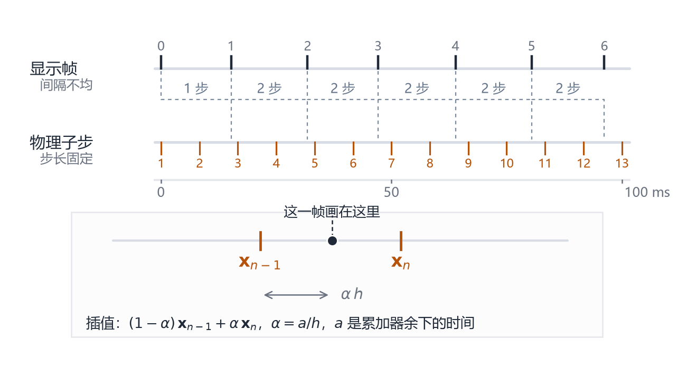
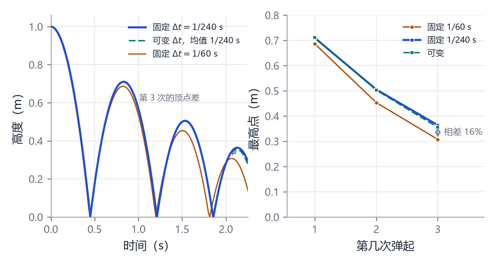

# 第 11 章 实时引擎的工程做法

一个过场动画播到一半，帧率从一百二掉到四十五。镜头里那摞木箱本来堆得好好的，几秒钟之后最下面那只陷进地板半厘米，上面的几只跟着歪了一点。测试同事把录屏发过来，问约束求解器是不是写错了。

把同一份场景拷到另一台机器上，帧率稳在六十，箱子纹丝不动。求解器一行没改，接触点、迭代次数、摩擦系数全是同一批数字，唯一变的是每帧的时间间隔。物理引擎里没有任何一处写着“一秒”。所有公式用的都是“一步”，一步有多长由外面喂进来，喂得不均匀，结果就不均匀。

这一章讲引擎为了让“每帧算一次”这件事站得住，都在哪些地方做了妥协：时间怎么切、切完怎么给渲染用、同样的输入能不能算出同样的结果、什么时候可以让物体装作不存在、宽相多久更新一次，以及几款常见引擎为什么会做出完全不同的选择。这些决定看上去都属于工程层面，但它们决定了同一套方程在玩家机器上的表现。

## 11.1 为什么物理必须固定步长

先说清楚固定步长到底固定了什么。它固定的不是“每帧一次物理”，而是“每次积分前进的时间长度相同”。帧率可以是三十、六十、一百四十四，物理步长始终是 $1/120$ 秒，一帧里跑一步、两步或者零步，取决于这一帧有多长。

把这件事说得更硬一点：引擎里能算出来的量，全都是无量纲的组合。角频率乘步长 $\omega\Delta t$ 是角度，速度乘步长除以长度 $v\Delta t/L$ 是一个比例，重力乘步长的平方除以长度 $g\Delta t^2/L$ 也是一样。只有这些组合会进入结果，单独的 $\Delta t$ 或者单独的重力都进不去。也就是说，改步长等价于把整个场景的长度、质量、重力一起换了一套刻度，而不是“算得粗一点”。

不这样做的话，第一个出问题的是稳定域。把一维弹簧写成 $\ddot{x}=-\omega^2 x$，$\omega$ 是角频率（单位 rad/s），半隐式积分每一步把振幅乘以一个与 $\omega\Delta t$ 有关的因子，只要 $\omega\Delta t \gt 2$，这个因子就大于 1，振幅按几何级数增长，画面上的表现是小球越弹越高，几百步之后溢出。$\Delta t$ 抖一下，抖动恰好落在临界值附近时，同一根弹簧在有的帧里衰减、有的帧里增长，看起来像随机的抽搐。

接触求解对步长的依赖更直接。Baumgarte 项把穿透深度 $d$ 换算成一个修正速度 $\beta d/\Delta t$，$\beta$ 是用户给的系数。同样压进去半厘米，步长从 $1/120$ 变成 $1/45$，修正速度变成原来的 2.7 倍，箱子被顶起来的高度也跟着变。这不是精度问题，而是这个格式本身把 $\Delta t$ 写进了物理量的定义里。

还有离散的恢复系数。球以速度 $v$ 撞地，代码把法向速度改成 $-ev$，$e$ 是恢复系数。但检测到接触时球已经陷进地面 $v\Delta t$ 的深度，位置修正又把它抬出来，抬出来之后它离地面的距离和速度都不完全对应“刚接触”的那一刻。$\Delta t$ 一变，落地的相位、抬出的高度、每个周期损失的能量全都变。拿一个球从 1 米高处以 $e=0.85$ 自由下落，$\Delta t=1/60$ 时第一次弹起的高度是 0.686 米，$\Delta t=1/240$ 时是 0.710 米，到第三次弹起差到 16%。两者都不是“真实答案”，但它们确实是两个不同的系统。

想看这个差距有多实在，可以做一次只改一个数的对比。二十只木箱按四只一层码五层，地面是静态盒，摩擦系数 0.6，先在 120 Hz 下跑三秒，再用同一份初始状态在 60 Hz 下跑三秒。第一秒末，两组的最底层穿透是 0.2 毫米和 0.4 毫米，肉眼分不出。第三秒末，顶层的水平位置差了 6 毫米，还是看不出来。把 60 Hz 那组接着跑到二十秒，塔歪了 3 厘米，从侧面能看见接缝错开；120 Hz 那组还是直的。在这段时间里没有任何参数改动，两个世界只是走得快慢不同。

这个差距不会随着仿真变长而收敛。每一次碰撞都把一个与步长有关的偏差乘进去，偏差又改变下一次碰撞的相位，相位再改变冲量分配。误差不是慢慢积累起来的，是在每次碰撞时跳一下，然后靠堆叠把它放大。

工程上的写法是一个累加器。把这一帧的实际耗时 $\Delta t_{\text{frame}}$ 先截断到一个区间，比如 $[1/240,\,1/30]$，再加到累加量 $a$ 上；只要 $a$ 还够一个固定步长 $h$，就执行一次物理步并把 $a$ 减去 $h$；剩下的零头留给渲染插值。截断是必须的：玩家拖动窗口、系统换页、断点调试回来，帧时间可能是三秒，不截断就会一口气跑三百步，跑完还是卡，下一帧更慢，这叫死亡螺旋。再配一个“每帧最多跑 $N$ 步”的上限，$N$ 取四到八，超出部分直接丢弃时间，宁可让物理变慢也不要让画面停住。

这一步在代码里长这样：

```cpp
const double h = 1.0 / 120.0;
double acc = 0.0;

void tick(double frameTime) {
    double dt = clamp(frameTime, 1.0 / 240.0, 1.0 / 30.0);  // 先截断
    acc += dt;

    int steps = 0;
    while (acc >= h && steps < 8) {   // 上限挡住死亡螺旋
        savePrevState();              // 留给插值
        stepPhysics(h);               // 永远传 h，绝不传 dt
        acc -= h;
        ++steps;
    }
    if (steps == 8) acc = 0.0;        // 追不上就丢，别攒着
    render(acc / h);                  // α 落在 [0,1)
}
```

`acc = 0.0` 那一行最容易被删掉，因为它看起来像在丢数据。不丢的后果是：游戏从卡顿里恢复之后，累加器里存着两秒钟的欠账，接下来每一帧都会跑满八步，物理时间追了两秒才追平，期间画面一直卡，玩家以为游戏坏了。真实时间是单调的，物理时间不必跟上它，只要不快过它就行。

固定步长还有一个副作用，写引擎的人往往过了很久才意识到它的价值：同一串输入，跑出来的轨迹是可复现的。回放、录像、自动化测试、联网同步，全都建立在“同样的一千步之后状态相同”这个前提上。可变步长把这个前提打掉了，因为步长序列本身就是外部环境的函数。

容易误解的地方在于，“固定步长”常被当成“帧率锁死”。锁帧率只保证帧长的分布好看一点，不保证每帧一步：显示器刷新和物理步是两条独立的时钟，中间隔着累加器。另一头也容易搞混：步长固定不代表仿真时间和真实时间一致，卡顿的时候物理会变慢，这是有意的取舍——宁可慢动作，也不要一帧跳过去半米。

固定步长不等于步长越小越好。步长减半，每帧的物理开销翻倍，而精度提升未必线性。真正划算的做法是把步长取到能覆盖最快运动的位置：一个以 10 m/s 飞行的球，在 $1/60$ 秒里走 16.7 厘米，比很多薄板都厚，接触会在两次采样之间被跳过；取 $1/240$ 秒，位移降到 4.2 厘米，多数场景就够用了。

从厚度倒推步长比凭感觉调靠得住。场景里最薄的碰撞体是 2 厘米厚的桌面，最快的东西是 5 m/s 的手办。要保证一步之内位移小于厚度的一半，得 $5h<0.01$，即 $h<1/500$ 秒。结论不是“步长选错了”，而是这个场景本来就得靠连续碰撞检测；为一个物体把步长压到 1/500，全场开销翻四倍。

## 11.2 子步与插值

物理以 120 Hz 走，显示器可能是 60 Hz，也可能是 144 Hz。刷新率是物理频率的整数分之一时，情况还算好：一帧跑固定的几步，步子整齐。144 Hz 就不是了，刷新间隔比物理步长还短，一帧有时跑一步、有时一步都不跑，渲染时刻落在两次物理状态之间。硬把最近的那次物理状态画出来，画面会以物理步频的节奏跳变，慢动作下能看到物体一格一格地挪。做法是插值：保存上一次和这一次的物理状态，用累加器的余数算出一个混合系数，把两个状态混起来画。

$$
\mathbf{x}_{\text{draw}} = (1-\alpha)\,\mathbf{x}_{n-1} + \alpha\,\mathbf{x}_n,
\qquad \alpha = a/h
\tag{11.1}
$$

$\mathbf{x}_{n-1}$ 与 $\mathbf{x}_n$ 是相邻两次物理步结束时的位置，$a$ 是累加器剩下的时间，$h$ 是固定步长，所以 $\alpha$ 在 0 与 1 之间，表示“渲染时刻落在两次物理步之间的比例”。姿态不能用线性插值，得用四元数的球面插值或者归一化线性插值，否则两个相差较大的旋转之间会出现体积塌缩。

拿一个具体数字看：物体以 10 m/s 沿 x 走，$h=1/120$ 秒，相邻两步之间相距 8.3 厘米。如果这一帧渲染时 $a=0.0021$ 秒，$\alpha=0.25$，画出来的位置在上一位置往前 2.1 厘米处，比最新状态落后 6.2 厘米。这 6.2 厘米正是插值买来的平滑，代价是画面延迟。

144 除以 120 是 1.2，意思是每五帧多出一步：五帧里一帧跑两步、四帧跑一步，这个不均匀的周期是 5/144 秒，约 35 毫秒，玩家会觉得画面在“呼吸”。插值把这个顿抹平，代价是延迟稳定在一个步长。

图 11-1 把两条时间线摊在一起看：上面是不均匀的显示帧，下面是等距的物理步，底部放大了一次物理步之内渲染落在哪个位置。

<figure class="fig">

<figcaption><b>图 11-1</b>　渲染帧与物理子步的时间线（示意图）。上排是显示器的刷新时刻，间隔并不均匀；下排是固定步长 $h$ 的物理步，一帧里跑一步或两步；箭头标出渲染时用的插值位置 $\alpha=a/h$。渲染永远比最新一次物理状态晚一点点，最多晚一个 $h$。</figcaption>
</figure>

插值的代价是延迟。屏幕上画的是 $n-1$ 与 $n$ 之间的状态，而模拟已经推进到 $n$，等于把画面往回拉了最多一个步长的时间。$1/120$ 秒是 8 毫秒，玩家感觉不到；如果为了省 CPU 把物理降到 30 Hz，延迟变成 33 毫秒，快速转视角时物体边缘会“粘”在屏幕上，手感立刻变糊。用外推代替插值可以消掉这个延迟，$\mathbf{x}_{\text{draw}}=\mathbf{x}_n+\alpha h\,\mathbf{v}_n$，但外推在碰撞时刻必然过冲：物体已经停下，外推还在往前推，画面上就是穿进墙里再弹出来。多数引擎选插值，接受那最多一个步长的延迟。

插值有两个坑，都出在“状态不是连续变化”的时候。一是休眠：箱子睡着后 $n-1$ 与 $n$ 是同一个状态，插值本该什么都不做，可某些引擎在睡眠时仍更新累加器，静止物体反而在原地轻晃。修法是入睡那一刻把两个状态设成相同，$\alpha$ 一律当 1。二是传送：角色被挪到二十米外，插值会把这一帧画在两地之间，拉出一道滑影。引擎为此留了“瞬移”通道，设置位置时打标记，这一帧跳过插值。

子步是另一件事，虽然实现上是同一个循环。子步指把一帧切成 $k$ 段，每段都做一次完整的“力—积分—碰撞—求解”，而不是在一份接触表上多迭代几次。两者花的 CPU 差不多，效果差得很远。原因在接触的线性化：一次求解假设接触法向在整步内不变、穿透深度线性增长，步长越大这个假设越离谱；把步长切成四份，每份里位移只有四分之一，法向变化小，穿透深度小，同一个顺序冲量求解器给出的结果就更接近它想解的那个问题。

把账算清楚：八子步各迭代两次是十六次求解，一步迭代十六次也是十六次。后者在同一张接触表上磨同一个线性系统，前者每两次就换一张新表。如果这十六次里有一半花在“把错的线性化磨到收敛”，那部分就白做了。

这个结论在 2019 年被明确地量过一遍[@macklin2019]：把同样的计算预算从“多迭代”挪到“多子步”，堆叠的稳定性提升明显，原因是迭代法在强耦合的接触网络上收敛很慢，而小步长把耦合本身变弱了。这条经验后来变成了很多引擎的默认配置：每帧四到八个子步，每个子步只迭代一到四次。

<figure class="fig">

<figcaption><b>图 11-2</b>　同一颗球在三种时间切法下的弹跳轨迹（真实一维计算）。参数为初始高度 1 m、$g=9.81$ m/s²、恢复系数 $e=0.85$、半隐式积分，检测到落地时把高度夹到 0、法向速度乘以 $-e$。左图是高度随时间：橙线为固定步长 $1/60$ 秒（每帧一步），粗蓝线为固定步长 $1/240$ 秒，绿虚线为可变步长（帧长在 $1/60$ 秒上下浮动 35%，再切成四个子步，平均步长与 $1/240$ 相同）。右图是前三次弹起的最高点：$1/60$ 秒的方案第一次只弹到 0.686 m，$1/240$ 秒弹到 0.710 m，差 3%；到第三次变成 0.307 m 与 0.364 m，差 16%。可变步长的平均步长与 $1/240$ 相同，峰值也在 0.712 m 附近，但落地时刻挪动了十几毫秒，之后每一次弹起都错开。</figcaption>
</figure>

图 11-2 里最要紧的是两条固定步长曲线的差距。它们解的是同一个方程，用的同一个积分器，只是步长差了四倍，弹起高度就差了 3%，到第三次差 16%。这个差距不会随着仿真变长而收敛，因为每一次碰撞都重新把误差乘进去。可变步长那条虚线更微妙：它的平均步长和 $1/240$ 一样，弹起高度也几乎一样，但落地时刻挪了十几毫秒——步长序列换了，碰撞落在步内的位置就换了。对单机画面这无所谓，对回放和联网同步就是灾难。

子步的代价不在积分本身，而在依附于步长的那些系统。音效和粒子如果在物理步里触发，四倍子步就是四倍事件，得去重；连续碰撞检测按子步做，次数按比例上升；脚本回调和触发器检测也一样。所以引擎通常把“物理步”和“游戏逻辑帧”分开，逻辑仍然一帧一次，物理在里面细分。

## 11.3 确定性

确定性在这里有严格的定义：相同的初始状态、相同的输入序列、相同的可执行程序，跑出来的状态逐位相同。注意是逐位，不是“误差在容差内”。差一位，几百步之后就可能差出一整个数量级。

先看浮点本身能差到什么程度。单精度在 $2^{24}$ 附近的最小间隔是 2，也就是说 $16777216$ 加 1 加不进去，会舍回自己。于是 $(2^{24}+1)-2^{24}$ 算出来是 0，而 $(2^{24}-2^{24})+1$ 算出来是 1。同一堆数，换一个相加顺序，答案从 0 变成 1。双精度上是同一个故事，只是门槛退到 $2^{53}$：把 0.1 连加十次，结果是 0.9999999999999999，而不是 1。

这不是刻意构造的怪例。顺序冲量求解器逐行更新，每解一个接触就做一次 $v \leftarrow v + \mathbf{M}^{-1}\mathbf{J}^{\top}\lambda$，一个物体背着三十个接触，它的速度就是三十项的和。哪一项先加，末位就不同。末位不同本身无害，麻烦在于它会被下一步放大：两个物体擦着走，相对法向速度刚好在 $10^{-16}$ 量级的正负之间，一个判“接触”，一个判“不接触”；一边生成了冲量，另一边没有，两条轨迹从这里分岔。

剩下几条原因，全都是“顺序在一个地方没有固定下来”。

接触表如果来自哈希表遍历，遍历顺序在不同运行之间可能变化。改成数组加稳定排序，能消掉这一层不确定——注意是稳定排序，普通的 `std::sort` 对相同 key 的接触会给出不保证的顺序，同一批数据两次运行可能不同。

并行是更大的来源。把物体分成若干岛（互不接触的一群），分给多个线程同时求解，本来很自然，但归约的顺序取决于线程完成的先后。八线程求和通常做成二叉树，树是什么形状由谁先到决定；同一帧两次运行，线程调度不同，求和顺序不同，结果就不同。要确定性就得固定归约顺序：按岛编号分段、每段内部顺序累加、最后按固定顺序合并，哪怕这样会让负载不均、慢百分之十几。

SIMD 有同样的问题。一次算四个元素，累加分通道进行，最后再加通道，顺序和标量循环不同；换一个编译选项、通道数变了，结果就变。GPU 上一个 warp 三十二线程归约，顺序写在硬件里，换一代卡就换一种。

编译器还会偷偷改变运算。开快速数学优化后，$a\times b+c$ 可以被融成一条乘加指令，中间结果不经过舍入；$\sin$、$\exp$ 会被换成自己实现的近似版，两个平台的近似不一样；优化器还认为“先算接触 A 再算 B”没有依赖，随手调换。同一份源码在两个平台上编出来的物理库，轨迹能差出可观测的距离。

联网游戏里的回滚（rollback）把这件事推到极限。客户端预测本地输入，收到服务器或对手的输入后，回到过去的某个快照重算。这套机制要求物理状态能被完整序列化，要求重算的结果与原来逐位一致，否则每次回滚都会引入新的偏差，画面开始漂移。

快照本身也不便宜。一个刚体存位置、姿态、线速度、角速度、休眠计时，十四个单精度浮点是 56 字节；一百个刚体 5.6 KB。接触缓存每对约 100 字节，五百对又是 50 KB。一帧快照六十来 KB，留两秒就是 7 MB。这直接决定了回滚能退多少帧：格斗游戏退七帧够用，赛车想退半秒就得另想办法。

做不到逐位一致时，退一步的做法是每帧算一个状态哈希，客户端之间定期比对；不一致时用平滑修正把可见误差吸收掉。玩家看到的是轻微的位置拉回，而不是物理状态发散。这个方案不优雅，但在跨平台、多硬件配置的现实里，它是唯一能落地的。

跨平台的期望要放对。逐位一致只在一个可执行文件、一颗 CPU、一个线程数下成立；换 CPU 就未必，乘加融合与三角函数实现都不同。所以承诺通常分三档：单机内可复现，用于回放与测试；同型号主机内逐位一致，用于联机；跨平台只保证看起来一样，靠状态同步兜底。

还有一个容易漏掉的输入源：采样点。按键按帧采，物理按步走。60 Hz 与 144 Hz 的机器上，同一次“按一下跳”会被不同数量的物理步看到，跳的高度就不一样。把输入也放到步边界上去采，这根时间轴才对得齐。

## 11.4 休眠、分层与宽相频率

一个场景里真正在动的物体通常不到十分之一。走进一间屋子，几百个道具摆在那儿，玩家只碰其中两三个，剩下的全都应该停止计算。休眠就是这件事：线速度小于阈值、角速度小于阈值、持续若干帧，把物体标记为睡眠，跳过积分和碰撞。

阈值给个参考量级：线速度 0.05 m/s、角速度 0.1 rad/s、持续 0.5 秒。0.05 m/s 意味着每秒挪五厘米，看起来就是不动；0.1 rad/s 是一秒钟转六度，其实已经能看出来，这一条可以更严。三个条件都满足才睡，任一条破了就重新计时，擦着走、慢慢倒的物体才不会被误判。

判据要比想象中小心。只看单个物体的速度是不够的：一摞箱子最下面那只被压着不动，上面几只轻微晃动，如果逐个判断，可能底层先睡、上层还醒，上层继续往下压，压出一个慢慢增长的穿透。正确做法是按接触图分成岛，整个岛一起判断，一起睡。唤醒也一样：岛里任何一个物体被碰、被施加力、或者它的支撑体被移走，整个岛一起醒。

支撑体被移走是最容易漏的一条。箱子睡了，玩家把下面的桌子抽走，箱子应该掉下来。如果引擎只在“有接触事件”时唤醒，而接触事件本身要醒着的物体参与才会产生，箱子就会悬在空中。解法是记录休眠物体与哪些物体接触，任何一方被销毁或移动时沿着这张表唤醒。

传送带是同一个坑的另一个版本。箱子站在运动学平台上，平台靠动画平移，速度不是通过力给的，也不产生接触事件；箱子睡得正香，平台从它脚下滑走，它留在原地悬空。修法是在平台的变换被写入时，把它这个岛上的休眠物体一起叫醒。

阈值调大省性能，也会制造新问题：线速度阈值从 0.05 提到 0.2，一个以 0.15 m/s 下滑的箱子会被判睡，卡在斜坡中间，碰一下就好。

分层（collision filtering）解决的是另一类浪费。角色身上的十几个碰撞体之间不该互相检测，布娃娃的左右手臂不该抱在一起，子弹不该打到自己的枪。引擎给每个物体一个层号和一个掩码，检测前先做位与，不匹配就直接跳过。组（group）是更强的版本：同一组内的物体整体不互碰，用于布娃娃自碰开关、载具与乘客。这些规则要在宽相之前生效，否则省不下时间。

位运算的形式值得记住，配错掩码是常见事故。层号是 2 的幂，第 3 层是 `1<<3 = 8`；掩码是“我愿意和哪些层碰”的并集。判断式是 `(a.layer & b.mask) && (b.layer & a.mask)`，两边都要满足。只写一半就是单向穿透：A 看得见 B，B 看不见 A，检测被跳过，玩家从高处掉下去。

宽相更新的频率可以低于窄相。静态几何（地形、建筑）不进动态结构，只建一棵静态树；动态物体的包围盒加一个余量（margin），按上一帧的速度预测这一帧可能到达的范围，只要预测范围还包得住实际位置，就不用更新结构。常见做法是每两帧或每四帧更新一次动态树，中间帧直接用旧的候选对，代价是偶尔多出几对假阳性，交给窄相去否掉。

余量得按最坏情况算。物体 2 m/s，四帧更新一次共 0.066 秒，位移 13 厘米，加 2 厘米余量，包围盒要外扩 15 厘米。它要是被爆炸推到 20 m/s，下一帧就走出了预测范围，那一帧的候选对里没有它要撞的东西。所以余量要么按速度上限取，要么在速度突变时强制刷新。

这些优化的共同点是：它们都在“少算”，而“少算”的前提是有一套可靠的判断说明少算的部分不影响结果。判断错了，症状不是变慢，而是穿透、悬空、穿模，而且往往只在特定场景出现，很难复现。

## 11.5 五款引擎的设计取舍

下面五款引擎经常被放在一起比较。它们的差别不在“谁更快”，而在各自服务的目标不同：有的要当通用库被嵌进任何程序，有的要在主机上塞满几百个刚体，有的要给机器人控制器提供平滑可导的接触力。目标不同，取舍就不同。

Bullet 的定位是可读、可嵌入的开源库。它的动力学世界分成离散与连续两种，默认的求解器是顺序冲量加投影高斯—赛德尔，窄相用 GJK 与 EPA，形状系统开放给用户自己扩展。这套组合的性能不是最强的，但每一层都能被替换，代码量也在一个人能读完的范围内，所以它成了论文的对照基线和大量教学项目的起点。

PhysX 的重心在规模和并行。它把求解器做成以子步为单位的小步长迭代（TGS），并且为关节链单独准备了 articulation 表示：一整条链作为一个约束系统求解，而不是十几个刚体互相拉扯。这个选择直接针对关节在质量比悬殊时发散的问题。GPU 版本的宽相与窄相把大部分工作搬到了显存里，代价是数据要在 CPU 与 GPU 之间搬运，小场景反而更慢。

Havok 是商业授权的工业产品，长期在游戏项目里打磨。它的强项是约束的稳定性和工具链：同一套 API 在主机、PC、移动端行为一致，编辑器里能直接调参数、录回放、看接触。选择它的人多半不是为了某个算法，而是为了不用自己养一个物理团队。

MuJoCo 面向的是控制与机器人，不是画面。它把接触写成软约束，把整个动力学问题写成一个凸优化问题来解[@todorov2012]。这个表述的好处是接触力连续、可微，控制器能在仿真里做梯度优化；代价是接触不再是硬约束，参数（刚度与阻尼的时间常数）要按场景调，调不好物体就会陷进地面。它在连续时间里定义模型，步长由积分器自适应，因此不走“固定步长 + 顺序冲量”这条路。

Chaos 是虚幻引擎自带的方案，它的取舍是把物理缝进内容管线：破碎、布料、载具、蓝图事件、异步求解都在同一个框架里。它不追求成为独立库，而是追求导演能在编辑器里直接搭出想要的效果，且性能预算与渲染共享。它的求解走的是位置约束投影这一支：不去解冲量，而是直接迭代修正位置误差，好处是实现简单、大变形下不易爆，代价是“力”变成了副产物，需要从位置变化反推，接触刚度不能像硬约束那样精确指定。

把五者的位置摆成一张表：

| 引擎 | 服务的场景 | 接触怎么解 | 并行方式 | 你能改到哪一层 |
| --- | --- | --- | --- | --- |
| Bullet | 通用库、教学与研究 | 顺序冲量 + 投影高斯—赛德尔 | 岛级多线程 | 几乎全部，源码可读 |
| PhysX | 大规模、主机与 PC | TGS 子步迭代 + articulation | CPU 多线程或 GPU | 大量开关，内核不可改 |
| Havok | 商业项目、多平台一致 | 冲量型，速度层加位置层 | 多平台统一 | 参数与工具链，内核黑盒 |
| MuJoCo | 控制、强化学习 | 软约束，凸优化 | 有限 | 模型与参数，结构固定 |
| Chaos | 虚幻项目 | 位置约束投影 | 异步任务图 | 蓝图与参数，绑定引擎 |

表只说明“从哪来”，不说明“用起来什么感觉”。真正的差别在付出的代价上，一条一条说。

Bullet 的代价是可预测的慢。单线程跑两千个刚体，帧时间明显超预算，瓶颈常在宽相树更新而不是求解器；GJK 对退化输入敏感，网格里一片零面积三角形就能算出零长度法向。选它就要接受“性能自己扛，碰撞数据自己洗”。

PhysX 的代价在边界上。GPU 管线要批量，几百个刚体以下把数据搬上搬下，反而比 CPU 慢；跨版本升级时求解器默认行为会变，同一个布娃娃的手感不一样，这是迁移项目里最常见的意外。articulation 很强，但要求关节链组织成树，一有闭环就得退回普通刚体。

Havok 的代价是钱和黑盒。出了问题只能等版本更新，或者绕开去改参数；换回来的是“同一份场景在四个平台上表现一致”，这条对多平台发行价值很高，自研很难做到。

MuJoCo 的代价在调参和场景类型。它的软约束参数是时间常数：刚度时间常数 0.02 秒时，稳态穿透大致与质量成正比，重十倍的物体陷得深十倍；0.002 秒硬得多，但步长得跟着变小，否则积分不稳。它也不为“几百个动态刚体堆一起”设计，那是硬约束的战场。

Chaos 的代价是绑定。离开虚幻就用不了，版本升级带来的行为变化比库更频繁；异步求解默认吃满核心，确定性要专门打开并关掉一部分并行。换回来的是内容团队能自己做效果，不用等程序排期。

这几条路线背后是同一个问题：接触到底该按硬约束解，还是按软约束解。硬约束（LCP 那一类）物理意义清楚，但需要迭代，迭代不充分就抖、就穿；软约束把接触当成很硬的弹簧，永远有解、永远稳定，但会陷、会弹。冲击传播（shock propagation）是第三条路，它沿着接触图的顺序成批地传播冲量，把一次求解当成一次波前推进[@erleben2007]，在深堆叠上收敛比逐行迭代快，代价是实现复杂、对图的依赖强。

不给性能数字，是因为这些数字离开场景就没有意义。同一个引擎在十个刚体的场景里可能比另一个慢，在两千个刚体里可能快十倍；接触数、休眠比例、并行度、缓存命中，全都比引擎名字重要。

选型该问的是三个问题，比跑分有用。要改内核吗？要改（比如布料与刚体统一求解），只能选源码开放的。要跨平台逐位一致吗？要，就得看谁敢承诺。接触是“少量、重载、要精确”，还是“大量、轻载、要稳”？前者偏硬约束加迭代，后者偏软约束或位置投影。答完通常只剩一两个候选。

## 11.6 调试工具

物理出问题时，画面只告诉你“不对”，不告诉你“哪里不对”。一个箱子在抖，可能是接触点每帧跳变，可能是冲量在两组约束之间来回分配，也可能是位置修正和速度求解打架。要分辨这些，得让引擎把内部状态画出来。

最基础的是接触可视化：在接触点画一个小十字，沿法向画一条短线表示穿透深度，线的颜色按冲量大小映射。看一摞箱子，如果接触点每帧在接触面上滑动，说明接触流形没有保持，缓存失效了；如果法向线长到肉眼可见，说明位置修正没跟上；如果颜色集中在某一条边上，说明那条约束在替其他约束背负全部载荷。

这里有个容易误解的地方：屏幕上画的接触点和求解器用的不是同一批。渲染为了好看，会把同一平面上的多个接触点合并、把法向线截断，甚至在物体睡着时干脆不画。真要看，得把求解器输入的那张表原样打印出来——点数、每个点的坐标、法向、穿透深度，一行一个。

冲量热图是同一件事的定量版本：把每个接触的累计冲量打到日志里，按帧画成曲线。正常的堆叠，底层接触的冲量应该稳定在一个值附近，波动很小；如果曲线呈锯齿状来回跳，说明求解器在两个等价解之间摆动，这时候加迭代没用，得看约束排序或者热启动。

迭代残差是判断“迭代够不够”的直接依据。每次迭代记录这一轮冲量的最大改变量 $\max|\Delta\lambda|$，画在对数坐标上。健康的曲线在两三次迭代里掉两个数量级；如果它平稳地停在某个值上不动，说明有约束在互相拆台，加迭代只会更快地到达那个平台。

穿透检测要有专门的开关：每帧扫一遍所有接触，记录最大穿透深度、对应物体、当时的相对速度，画成时间曲线。这条曲线在正常场景里应该在零点几毫米的量级上小幅波动；一旦某个时刻跳到几厘米，就能定位到具体是哪一帧、哪一对物体、速度是多少。隧穿往往就藏在这个尖峰里。

能量曲线能抓到一类隐蔽的 bug。把系统的动能、势能、接触耗散分别累加，画在一起。总能量在没有外力、没有阻尼的情况下应该单调不增；如果它缓慢上升，说明某个环节在注入能量，常见的原因是 Baumgarte 项把穿透修成了正速度、恢复系数大于 1、或者摩擦冲量没有做锥约束。这条曲线在长跑测试里比任何单帧截图都有用。

确定性出问题时，肉眼找不到。每步算一个状态哈希（位置、姿态、速度的二进制喂进固定算法），把“第几步、哈希值”写进日志；两个版本各跑一千步，比对第一处不同的步号，再前后二分，几十次就能落到具体哪个分量分家。

交互层面的工具也重要：单步执行、时间缩放、暂停后拖动时间轴、录一段输入回放。物理 bug 大多与时间相关，能停下来看某一帧的完整状态，比读十遍代码有效。再加一个固定随机种子，让粒子、破碎、初始扰动都可复现，问题才能稳定重现。
